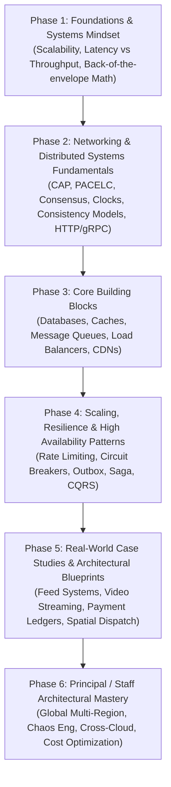
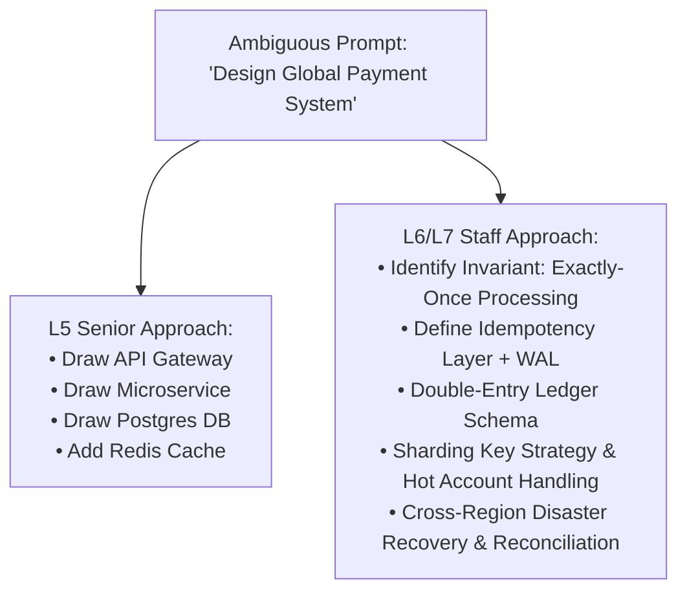
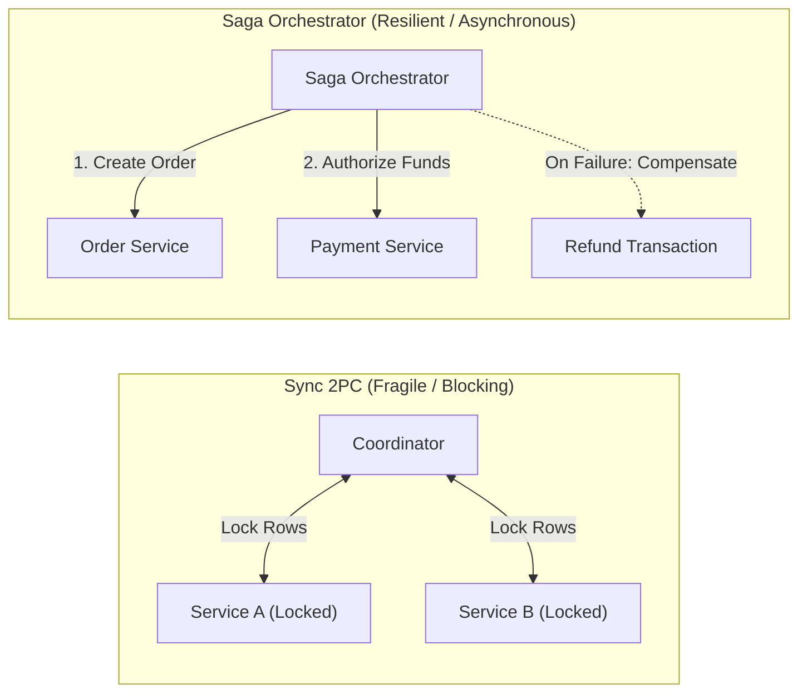

# The Complete Beginner-to-Staff System Design Roadmap

Welcome to your definitive journey into **System Design and Distributed Systems**. This roadmap is engineered to take you from a curious beginner who has never scaled a single server, to a staff/principal-level systems engineer capable of designing globally distributed, fault-tolerant platforms serving hundreds of millions of users.

### 💡 Intuitive Real-World Analogy: The Bricklayer vs. The City Planner
- **Junior Engineer (The Bricklayer):** Focuses on laying individual bricks perfectly—writing clean algorithms, bug-free loops, and optimized SQL queries.
- **Senior Engineer (The House Builder):** Knows how to assemble bricks, plumbing, and electrical wiring into a sturdy, two-story house—connecting load balancers, caching tiers, relational databases, and microservices.
- **Staff / Principal Architect (The Metropolitan City Planner):** Designs the high-voltage electrical grid, water reservoirs, subway lines, seismic earthquake shock absorbers, and zoning regulations for a metropolis of 10 million people. They anticipate floods, power grid blackouts, and population explosions decades in advance, ensuring that if a substation blows up in District 4, hospitals in District 1 never flicker.

### 👶 Plain-English / ELI5 Overview
System design is the art of building software that doesn't melt when millions of people click the same button at the exact same second. It's not about memorizing complex acronyms like Kafka, Raft, or Paxos; it's about knowing *why* things break, *where* data gets stuck, and *how* to keep computers working together across oceans when network cables get severed by sharks.

### ⚠️ The Horror Scenario: The Accidental Monolith Collapse
A fast-growing fintech startup reaches 5 million users. The founding engineering team built the system as a single monolithic Python application backed by a single PostgreSQL database on an AWS `m5.large` instance.
- On Black Friday, traffic surges $40\times$.
- Database CPU reaches 100%, and connection pool limits are instantly exhausted.
- Because there is no asynchronous queue or write buffering, user checkout HTTP requests back up into reverse proxies.
- Memory usage climbs uncontrollably until the operating system's Out-Of-Memory (OOM) killer assassinates the database process.
- The company loses $4.2M in revenue in 4 hours, and the board orders an emergency architectural re-platforming.
Understanding this roadmap prevents your engineering career from experiencing this catastrophe.

---

## The 6-Phase Mastery Pyramid

---

## Phase 1: Foundations & The Systems Mindset
> **Goal:** Transition from thinking in terms of local single-threaded code to thinking in terms of independent computers communicating over imperfect networks.

### 1. The Core Metrics of System Design
- **Latency vs. Throughput**: Why a system can have low latency but low throughput, or high throughput with high latency.
- **Availability (The "Nines")**:
  - $99.9\%$ (Three nines) $\approx 8.76$ hours downtime/year
  - $99.99\%$ (Four nines) $\approx 52.6$ minutes downtime/year
  - $99.999\%$ (Five nines) $\approx 5.26$ minutes downtime/year
- **Reliability vs. Fault Tolerance vs. Resilience**:
  - Fault: A component failure (e.g., hard drive crash, network partition).
  - Failure: The entire system stops providing service to users.
  - Fault tolerance: The ability of a system to continue operating properly despite faults.
- **Maintainability**: Operability, simplicity, and evolvability.

### 2. Back-of-the-Envelope Estimation (Capacity Planning)
- Latency Numbers Every Engineer Must Know:
  - L1 cache reference: $\sim 0.5$ ns
  - Main memory (RAM) reference: $\sim 100$ ns
  - NVMe SSD random read: $\sim 10 - 50$ µs
  - Read 1 MB sequentially from memory: $\sim 250$ µs
  - Read 1 MB sequentially from SSD: $\sim 1$ ms
  - Round trip within same datacenter: $\sim 500$ µs
  - Cross-continental round trip (e.g., NY to London): $\sim 60 - 80$ ms
- Powers of two conversions ($2^{10} \approx 10^3 = \text{KB}$, $2^{20} \approx 10^6 = \text{MB}$, $2^{30} \approx 10^9 = \text{GB}$, $2^{40} \approx 10^{12} = \text{TB}$).
- Converting Daily Active Users (DAU) $\rightarrow$ Queries Per Second (QPS) $\rightarrow$ Peak QPS $\rightarrow$ Storage per year $\rightarrow$ Bandwidth (Ingress/Egress).

---

## Phase 2: Distributed Systems Theory & Networking
> **Goal:** Understand the fundamental laws of physics and mathematics that govern distributed machines.

### 1. The Distributed Systems Impossibility Theorems
- **CAP Theorem (Brewer's Theorem)**: Under network partitioning ($P$), you must choose between Consistency ($C$) and Availability ($A$).
- **PACELC Theorem**: If Partition ($P$), choose between Availability ($A$) and Consistency ($C$); Else ($E$), choose between Latency ($L$) and Consistency ($C$).
- **FLP Impossibility Result (Fischer, Lynch, Paterson)**: In an asynchronous network, no deterministic consensus protocol can guarantee termination in the presence of even a single unannounced crash.
- **Byzantine Fault Tolerance (BFT)**: Handling arbitrary, malicious, or corrupted nodes ($3f + 1$ nodes needed to tolerate $f$ Byzantine faults).

### 2. Time, Clocks, and Ordering
- Physical clocks vs. NTP synchronization drift.
- **Lamport Timestamps**: Capturing causal "happened-before" relationships ($A \to B$).
- **Vector Clocks**: Detecting concurrent conflicting writes across multiple nodes.
- **Google TrueTime (Spanner)**: GPS receivers and atomic clocks in datacenters bounding uncertainty $[\text{earliest}, \text{latest}]$ to provide external consistency.

### 3. Consistency Models Spectrum
- Strict / Linearizable Consistency (External ordering, single copy illusion).
- Sequential Consistency.
- Causal Consistency (Causally related operations seen in same order).
- Read-Your-Writes & Monotonic Reads (Session guarantees).
- Eventual Consistency (Convergence over time).

### 4. Consensus & Coordination
- State Machine Replication.
- **Raft Consensus**: Leader Election, Log Replication, Safety invariants.
- **Paxos Protocol**: Proposers, Acceptors, Learners, 2-phase rounds.
- **ZAB Protocol (ZooKeeper)** & Leader-follower atomic broadcast.
- **Gossip Protocols**: Epidemic failure detection and cluster state dissemination.

### 5. Networking & Protocols
- OSI 7-Layer model vs. TCP/IP stack.
- TCP 3-way handshake, slow start, congestion window, Head-of-Line (HoL) blocking.
- UDP: Connectionless, zero-handshake, packet-loss tolerance.
- Evolution of HTTP:
  - HTTP/1.1: Persistent connections (`Keep-Alive`), HTTP pipelining issues.
  - HTTP/2: Binary framing, multiplexing over single TCP connection, HPACK header compression.
  - HTTP/3 & QUIC: Built on UDP, eliminates TCP HoL blocking, 0-RTT handshakes, connection migration.
- Communication patterns:
  - RESTful APIs vs. GraphQL vs. gRPC (Protocol Buffers).
  - Bidirectional real-time: WebSockets, Server-Sent Events (SSE), Long Polling, WebRTC.
- Security: TLS 1.3 handshake, Public Key Infrastructure (PKI), Mutual TLS (mTLS).

---

## Phase 3: Core Infrastructure Building Blocks
> **Goal:** Master every component in the system designer's toolbox, knowing their internal data structures and operating characteristics.

### 1. Storage & Database Systems
- **SQL vs. NoSQL vs. NewSQL**:
  - Relational: ACID, normalized schemas, multi-table joins.
  - Key-Value: O(1) reads/writes (Redis, DynamoDB).
  - Document: JSON-like documents, flexible schema (MongoDB).
  - Wide-Column: High write throughput, time-series (Cassandra, ScyllaDB).
  - Graph: Entity relationships, traversal queries (Neo4j, AWS Neptune).
  - NewSQL: Global ACID with horizontal scalability (Google Spanner, CockroachDB).
- **Storage Engines & Internal Data Structures**:
  - **B-Trees / B+ Trees**: Optimized for block storage, read-heavy workloads, range scans.
  - **LSM-Trees (Log-Structured Merge-Trees)**: Write-Ahead Log (WAL), MemTable (SkipList/RB-Tree), SSTables, Bloom Filters, Compaction (Leveled vs. Size-Tiered). Optimized for write throughput.
- **ACID Transactions & Real-World Isolation**:
  - Anomalies: Dirty Reads, Non-repeatable Reads, Phantom Reads, Write Skew, Lost Updates.
  - Isolation Levels: Read Uncommitted, Read Committed, Repeatable Read, Snapshot Isolation, Serializable.
  - Multi-Version Concurrency Control (MVCC) and Two-Phase Locking (2PL).
- **Partitioning & Sharding**:
  - Range-based sharding vs. Hash-based sharding vs. Directory-based sharding.
  - **Consistent Hashing**: Hash ring, virtual nodes, minimizing key migration during node add/remove.
- **Replication Topologies**:
  - Single-Leader (Primary-Replica): Synchronous vs. Asynchronous, replication lag.
  - Multi-Leader (Active-Active): Conflict resolution strategies (LWW, CRDTs).
  - Leaderless (Dynamo-style): Quorum consensus ($W + R > N$), Read Repair, Hinted Handoff, Anti-entropy via Merkle Trees.

### 2. Caching Strategies & Topologies
- Multi-tier caching: Browser $\to$ CDN $\to$ Reverse Proxy (Varnish/Nginx) $\to$ App Memory $\to$ Distributed Cache (Redis) $\to$ Database Buffer Pool.
- Cache Invalidation Patterns:
  - Cache-Aside (Lazy Loading)
  - Read-Through
  - Write-Through
  - Write-Behind (Write-Back)
  - Refresh-Ahead
- Cache Eviction Policies: LRU (Least Recently Used), LFU (Least Frequently Used), FIFO, 2Q, ARC (Adaptive Replacement Cache).
- Cache Anomalies & Mitigations:
  - **Cache Stampede / Thundering Herd**: Probabilistic early expiration (XFetch), Distributed locks.
  - **Cache Penetration**: Querying keys that don't exist $\rightarrow$ Bloom filters or caching null objects.
  - **Cache Avalanche**: Mass TTL expiration $\rightarrow$ Random jitter on TTLs.
  - **Cache Breakdown**: Hot key expires $\rightarrow$ Mutual exclusion locks on refill.
- Distributed Redis Architecture: Event loop, memory allocator, RDB & AOF persistence, Redis Cluster hash slots ($16,384$ slots).

### 3. Messaging & Asynchronous Event Processing
- Message Queues (RabbitMQ, AWS SQS) vs. Distributed Logs (Apache Kafka, Apache Pulsar).
- Delivery Semantics:
  - At-most-once (Message dropped on failure)
  - At-least-once (Duplicate messages possible)
  - Exactly-once (Transactional logs + idempotent processing)
- Kafka Internals: Topics, Partitions, Consumer Groups, Offset tracking, Zero-copy OS page cache (`sendfile`), In-Sync Replicas (ISR).
- Event-Driven Architecture Patterns:
  - Transactional Outbox Pattern
  - Change Data Capture (CDC with Debezium)
  - Saga Pattern: Choreography vs. Orchestration
  - Event Sourcing & CQRS (Command Query Responsibility Segregation)

### 4. Traffic Routing & Content Delivery
- DNS Resolution: Root servers, TLD servers, Authoritative nameservers, Anycast DNS, GeoDNS.
- Load Balancing:
  - Layer 4 (Transport layer: TCP/UDP, IPVS, Linux Virtual Server)
  - Layer 7 (Application layer: HTTP routing, Envoy, Nginx, HAProxy)
  - Algorithms: Round Robin, Weighted Round Robin, Least Connections, IP Hash.
- Content Delivery Networks (CDNs): Edge Points of Presence (PoPs), Origin shield, Static asset caching, Dynamic Site Acceleration (DSA).

---

## Phase 4: Resilience, Scaling & Reliability
> **Goal:** Design systems that bend without breaking under catastrophic hardware failure, sudden traffic spikes, and network partitions.

### 1. Resiliency Patterns
- **Rate Limiting & Throttling**:
  - Algorithms: Token Bucket, Leaky Bucket, Fixed Window Counter, Sliding Window Log, Sliding Window Counter.
  - Distributed Rate Limiting using Redis + Lua atomic scripts.
- **Circuit Breaker Pattern**: States (Closed, Open, Half-Open), failure thresholds, cool-down timers.
- **Bulkhead Pattern**: Isolating thread pools, memory, and database connections to prevent cascade failures.
- **Retries with Exponential Backoff and Full Jitter**: Preventing retry storms from hammering recovering downstreams.
- **Graceful Degradation**: Shedding non-critical features under extreme load (e.g., disable recommendations, serve stale cache).

### 2. High Availability & Disaster Recovery
- Active-Active vs. Active-Passive failover.
- Split-Brain mitigation via quorum witnesses.
- Disaster Recovery Metrics:
  - **RPO (Recovery Point Objective)**: Maximum acceptable data loss duration.
  - **RTO (Recovery Time Objective)**: Maximum acceptable system downtime.
- Chaos Engineering: Injecting latency, killing nodes, simulating network splits (Chaos Monkey, Litmus).

### 3. Observability & Telemetry
- Three Pillars:
  - **Metrics**: Counters, Gauges, Histograms, Summaries (Prometheus, Grafana).
  - **Logs**: Structured JSON logging, central log aggregation (ELK, OpenSearch, Loki).
  - **Distributed Tracing**: Context propagation, Trace IDs, Span IDs, OpenTelemetry, Jaeger.
- Service Level Definitions:
  - **SLI (Service Level Indicator)**: What you measure (e.g., $99^{\text{th}}$ percentile latency).
  - **SLO (Service Level Objective)**: Target reliability (e.g., $99.9\%$ of requests $< 200$ ms).
  - **SLA (Service Level Agreement)**: Contractual agreement with financial penalties.
  - **Error Budgets**: $(1 - \text{SLO})$; drives release velocity vs. stability decisions.
- SRE Monitoring Frameworks:
  - Google's 4 Golden Signals: Latency, Traffic, Errors, Saturation.
  - RED Method: Rate, Errors, Duration.
  - USE Method: Utilization, Saturation, Errors.

---

## Phase 5: Real-World Case Studies & Architectural Blueprints
> **Goal:** Synthesize theory and building blocks into end-to-end architectures for industry-defining systems.

1. **URL Shortener (TinyURL / Bitly)**:
   - High read-to-write ratio, Base62 encoding, Key Generation Service (pre-allocated tokens), 301 vs. 302 redirects, distributed caching.
2. **Distributed Rate Limiter Service**:
   - Centralized Redis cluster, Lua script atomicity, Token Bucket vs. Sliding Window, client identification (IP vs. User ID vs. API Token), multi-tier enforcement.
3. **Distributed Key-Value Store (Dynamo-style)**:
   - Consistent hashing ring, Quorum replication ($N=3, W=2, R=2$), Vector clocks for conflict detection, Read Repair, Hinted Handoff, Merkle Trees.
4. **Distributed Unique ID Generator (Snowflake)**:
   - 64-bit integer structure: 1 sign bit + 41-bit timestamp + 10-bit worker/datacenter ID + 12-bit sequence counter. Handling NTP clock drift backward.
5. **Social Media Feed System (Twitter / X)**:
   - Fan-out on Write (push) vs. Fan-out on Read (pull), Hybrid approach for celebrities (million+ followers), timeline cache structure, ranked feed retrieval.
6. **Real-Time Chat & Messaging (WhatsApp / Slack)**:
   - WebSocket connection managers, gateway session clusters, message ordering with sequence IDs, offline message storage, E2E encryption architecture, presence service.
7. **Video Streaming Platform (YouTube / Netflix)**:
   - Multi-stage transcoding pipeline (DAG worker cluster), video chunking, Adaptive Bitrate Streaming (HLS / DASH), CDN edge distribution, manifest files.
8. **Ride-Sharing Geolocation Dispatch (Uber / Lyft)**:
   - Geospatial indexing: Geohash vs. QuadTree vs. Google S2 cells, handling 1M+ driver location updates per second, geospatial radius queries, ride matchmaking.
9. **Web Crawler & Search Engine Indexer (Googlebot)**:
   - URL Frontier with host politeness queues, DNS resolver cache, deduplication using SimHash, distributed crawler workers, Inverted Index generation.
10. **Collaborative Real-time Document Editor (Google Docs)**:
    - Operational Transformation (OT) vs. Conflict-free Replicated Data Types (CRDTs: RGA, Yjs, Automerge), central authority vs. peer-to-peer sync, character positioning under concurrent typing.
11. **Distributed Job Scheduler / Task Queue (Temporal / Celery)**:
    - Delayed task execution with min-heap/Redis zset, distributed leader election, task state machines, at-least-once task execution, dead letter queues (DLQs).
12. **Financial Payment Gateway & Ledger (Stripe-like)**:
    - Double-entry bookkeeping, absolute idempotency keys, Two-Phase Commit (2PC) vs. Saga orchestrator, reconciliation batch pipelines, PCI-DSS compliance.
13. **Global Multi-Channel Notification Engine**:
    - Prioritized message queues (Transactional vs. Promotional), third-party aggregators (APNS, FCM, Twilio, SendGrid), deduplication windows, rate limiting per user.
14. **Distributed Cache Cluster (Redis / Memcached)**:
    - Partitioning hash slots, Gossip protocol for cluster heartbeats, automatic master election, replica migration, client smart routing.
15. **Search Autocomplete & Typeahead System**:
    - Prefix Trie with Top-K cached suggestions at internal nodes, asynchronous MapReduce/Spark frequency aggregation, exponential recency decay.
16. **Flash Sale Ticket Booking (Ticketmaster)**:
    - Virtual Waiting Room (Queue-it token bucketing), atomic Redis Lua seat reservation locks, optimistic concurrency control (OCC).
17. **Top-K Heavy Hitters & Trending Topics**:
    - Count-Min Sketch frequency estimation, Space-Saving algorithm, tumbling and sliding stream windowing with Apache Flink.
18. **LLM Inference Serving & RAG Pipeline**:
    - vLLM PagedAttention KV cache memory management, continuous dynamic batching, HNSW vector search, semantic response caching.
19. **Ultra-Low Latency Electronic Trading Engine (CLOB)**:
    - Central Limit Order Book, LMAX Disruptor lock-free ring buffer, deterministic single-threaded sequencing, network card kernel bypass.
20. **Distributed Object Store (Amazon S3-Compatible)**:
    - Decoupled metadata/data plane, Haystack/Bitcask append-only volume files, Reed-Solomon Erasure Coding (8+4).
21. **Real-Time Ad Click Aggregation & Billing**:
    - Kappa architecture, Apache Flink exactly-once checkpointing (Chandy-Lamport ABS), event time watermarks, click-fraud scrubbing.
22. **Modern Data Lakehouse Analytics (Apache Iceberg & Trino)**:
    - Open table format, REST Catalog, manifest tree metadata pruning, Merge-on-Read with delete vectors, sub-second interactive SQL.
23. **Hyperscale Kubernetes Platform & eBPF Service Mesh**:
    - Cilium eBPF socket layer bypass (`sockops`), Envoy xDS dynamic control plane, SPIRE short-lived zero-trust mTLS certificates.
24. **Distributed Vector Database Engine (10 Billion Vectors)**:
    - Decoupled coordinator/query/data plane, Growing vs Sealed segments, Scatter-Gather search orchestration, Out-of-core DiskANN NVMe I/O (`io_uring`).

---

## Phase 6: Principal / Staff Architectural Mastery
> **Goal:** Operate at the enterprise level, leading multi-region migrations, cost optimization, compliance, and technological strategy.

### 1. Multi-Region Active-Active Deployments
- Global traffic management (Anycast BGP + Route 53 latency routing).
- Cross-region replication: Asynchronous replication vs. multi-region consensus (CockroachDB, Spanner).
- Data sovereignty, data residency laws, and GDPR geo-fencing.

### 2. Microservices Governance & Modern Architecture
- API Gateways (Kong, Envoy, Apigee): Authentication, routing, rate limiting, telemetry.
- Service Mesh (Istio, Linkerd): Sidecar proxies, transparent mTLS, service-to-service authorization, traffic shifting (Canary, Blue-Green).
- Event-Driven Microservices vs. Modular Monolith: Knowing when *not* to use microservices.

### 3. Financial Engineering (FinOps) & Cloud Cost Optimization
- Understanding egress data transfer costs across AZs and regions.
- Spot instance fleets for distributed batch compute.
- Tiered storage lifecycle: Hot (NVMe SSD) $\to$ Warm (S3 Standard) $\to$ Cold (Glacier Flexible) $\to$ Deep Archive.

### 4. Zero Trust Security Architecture
- Perimeter-less security: Authenticate and authorize every single RPC.
- Ephemeral short-lived credentials via SPIFFE/SPIRE.
- Secret management with HashiCorp Vault / AWS Secrets Manager.

---

## How to Navigate This Repository

| Directory | What You Will Learn |
| :--- | :--- |
| `00_CURRICULUM_AND_ROADMAP/` | Study plans (30, 90, 180 days), seminal papers, interview rubric |
| `01_FOUNDATIONS_AND_PRINCIPLES/` | Distributed systems theory: CAP, PACELC, Consensus, Clocks, HLC, 2PC/3PC, Fencing, CRDTs, Actors, Snapshots, BFT |
| `02_NETWORKING_AND_PROTOCOLS/` | OSI, TCP/UDP, HTTP evolution, WebSockets, gRPC, TLS, eBPF/XDP, BBR |
| `03_STORAGE_DATABASES_AND_REPLICATION/`| Storage engines, B-Trees vs LSM, Sharding, Replication, MVCC, WAL & ARIES, Vector DBs |
| `04_CACHING_STRATEGIES_AND_PATTERNS/` | Caching patterns, evictions, stampede, Redis cluster |
| `05_MESSAGING_EVENT_DRIVEN_AND_ASYNC/`| Kafka, RabbitMQ, Saga, Outbox, CDC, CQRS |
| `06_TRAFFIC_ROUTING_LOAD_BALANCING_CDN/`| DNS, L4/L7 load balancers, Anycast, CDN caching, Maglev DSR, Envoy xDS |
| `07_RESILIENCE_FAULT_TOLERANCE_RATE_LIMITING/` | Circuit breakers, Rate limiters, Exponential backoff |
| `08_OBSERVABILITY_MONITORING_RELIABILITY/` | Metrics, logs, traces, SLI/SLO/SLA, 4 Golden Signals |
| `09_SECURITY_IDENTITY_AND_GOVERNANCE/` | OAuth2, OIDC, JWT, Zero Trust, Envelope encryption, SPIFFE/SPIRE |
| `10_SYSTEM_DESIGN_INTERVIEW_FRAMEWORK/` | 4-step framework, math cheat sheet, flashcards |
| `11_CASE_STUDIES_ARCHITECTURAL_BLUEPRINTS/` | 24 end-to-end production architectures with diagrams |
| `12_HANDS_ON_RUNNABLE_LABS/` | 22 runnable Python algorithm implementations with 68 automated unit tests |
| `13_DISTRIBUTED_COMPUTE_AND_BIG_DATA/` | Spark, Flink, Parquet columnar, Vectorized execution, Iceberg Lakehouse |
| `14_CLOUD_NATIVE_AND_CONTAINER_ORCHESTRATION/` | Kubernetes reconciliation loops, CNI BGP/eBPF, CSI storage volumes |

Start with [Phase 1: 01_FOUNDATIONS_AND_PRINCIPLES](../01_FOUNDATIONS_AND_PRINCIPLES/01_core_system_qualities.md) or follow your personalized schedule in [02_study_schedules_30_90_180_days.md](file:///home/prasanta/Documents/learning_folder/system_design/00_CURRICULUM_AND_ROADMAP/02_study_schedules_30_90_180_days.md)!

---

## 🎯 Top Real-World Interview Questions & Deep-Dive Answers (FAANG / Staff Level)

### Question 1: How do FAANG interviewers differentiate between an L5 (Senior) and an L6/L7 (Staff/Principal) candidate during a 45-minute system design session?
#### Answer:
The boundary between Senior and Staff is defined by **ownership of ambiguity, failure-domain intuition, trade-off defense, and organizational impact**:
1. **Ambiguity Scoping:**
   - *Senior (L5):* Waits for or asks standard clarification questions (QPS, DAU, read/write ratio) and builds a textbook three-tier microservice architecture.
   - *Staff (L6+):* Proactively identifies business-critical non-functional requirements that fundamentally change the architecture. (e.g., *"Are we prioritizing strict legal financial auditability across jurisdictions or sub-50ms checkout latency? Because choosing strict serializability will require distributed consensus that bounds our write throughput per shard."*).
2. **Failure Analysis & Edge Cases:**
   - *Senior (L5):* Adds a cache and a replica database, assuming that solves reliability.
   - *Staff (L6+):* Walks through what happens when the cache *dies*, how to prevent cache stampedes (probabilistic early expiration / singleflight locking), how cross-region failover handles split-brain, and how fencing tokens prevent zombie leader overwrites.
3. **Cost, FinOps & Operational Reality:**
   - *Staff (L6+):* Explicitly calculates cloud economics. (e.g., *"Replicating 100 TB across AWS regions incurs $0.02/GB cross-region data transfer fees, costing $20,000/month. We should implement delta-compression and tier cold data to S3 Glacier Flexible Archive."*).

---

### Question 2: In a high-stakes interview, you are asked: "What is your systematic framework to design any distributed system from scratch in 45 minutes?"
#### Answer:
Follow the proven **4-Step Architectural Blueprint**:
- **Step 1: Scoping & Requirement Engineering (8 mins):**
  - Functional Requirements: Limit to top 3 core user flows.
  - Non-Functional Requirements: High Availability vs Strong Consistency (CAP/PACELC), latency targets ($p99 < 100\text{ms}$), compliance (GDPR, PCI-DSS).
  - Back-of-the-envelope math: Convert DAU $\to$ Average & Peak QPS $\to$ Storage/year $\to$ Network bandwidth.
- **Step 2: High-Level Architecture & API Definition (12 mins):**
  - Draw data flow: Client $\to$ CDN/Anycast $\to$ L4/L7 Load Balancers $\to$ API Gateway $\to$ Stateless Application Services.
  - Define exact REST/gRPC contracts with idempotency tokens.
  - Lay out data models: Entities, primary keys, sharding partition keys.
- **Step 3: Deep Dives into Core Bottlenecks (15 mins):**
  - Drill into the single hardest algorithmic or scaling problem (e.g., Fan-out on write for social feeds, spatial indexing for ride dispatch, or consensus-replicated 2PC for money transfers).
- **Step 4: Resilience, Failure Modes & Edge Cases (10 mins):**
  - Eliminate SPOFs, implement circuit breakers, rate limiters, backpressure, dead-letter queues, and multi-region replication topologies.

---

### Question 3: How do you gracefully handle an interviewer who pushes back on your architecture and insists on using a distributed transaction (2PC) across microservices?
#### Answer:
Demonstrate high collaborative intelligence and technical rigor using the **Principle of Invariant Alignment**:
1. **Acknowledge and Validate:** *"I understand why you're proposing 2PC—guaranteeing atomic all-or-nothing semantics across our Order Service and Payment Service is an intuitive way to prevent state divergence."*
2. **Present the Hidden Failure Mode (The Trade-Off):** *"However, in an asynchronous cloud network, 2PC is a blocking protocol. If the coordinator or payment gateway crashes while holding locks, row-level locks on the database remain frozen indefinitely. This exhausts connection pools and can cascade into total platform paralysis."*
3. **Offer the Staff-Grade Production Alternative:** *"Instead of synchronous 2PC across network boundaries, industry production standards (like Uber and Stripe) utilize the **Saga Pattern** with an Orchestrator and Compensating Transactions backed by a transactional Outbox and Kafka. This delivers eventual consistency with high availability and non-blocking performance."*
4. **Draw the Comparison Diagram:**

