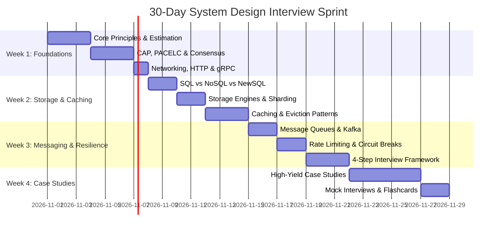
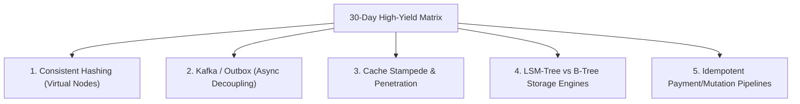

# System Design Study Schedules: 30, 90, and 180 Days

Choose the study track that matches your available time and current goals. Each plan provides daily/weekly milestones, recommended readings, and hands-on coding exercises.

### 💡 Intuitive Real-World Analogy: 5K Sprint vs. Half-Marathon vs. Ultra-Ironman
- **The 30-Day Sprint (5K Race):** You already have engineering conditioning; you need peak tactical sharpness, quick mental math reflexes, and clean execution of high-frequency interview patterns.
- **The 90-Day Plan (Half-Marathon):** You build deep muscle memory, studying underlying database storage engines, network socket protocols, and distributed consensus algorithms so you can adapt to unexpected interview curves.
- **The 180-Day Mastery (Ultra-Ironman):** You rebuild your entire mental operating system. You read seminal academic research papers, analyze source code implementations (RocksDB, Kafka, Envoy, Raft), and master multi-region active-active failure scenarios.

### 👶 Plain-English / ELI5 Overview
Don't try to memorize every architecture on the internet. Pick the schedule that fits your real calendar. If your interview is next month, focus on high-yield patterns. If you want to become the go-to Staff Architect at your company, follow the 6-month deep dive.

### ⚠️ The Horror Scenario: The "YouTube Binge" Interview Catastrophe
A senior software engineer receives an invitation to interview at Meta for an E6 (Staff) role in 3 weeks:
- Instead of structured study, they binge 40 high-level "System Design in 10 Minutes" videos on YouTube.
- In the interview, the prompt is: *"Design a Globally Distributed Rate Limiter"*.
- The candidate confidently draws a box labeled *"Redis Cluster"* and says *"Redis handles rate limiting"*.
- The interviewer asks: *"What happens when a network partition cuts off the Tokyo datacenter from the US-East Redis cluster? How does your Lua script handle clock drift across regions?"*
- The candidate freezes. They have memorized the buzzword but never studied the failure modes, sliding window race conditions, or local token bucket memory footprints.
- The outcome is a definitive "No Hire". Structured pacing across these tracks guarantees depth behind every box you draw.

---

## Track 1: The 30-Day "Interview Sprint"
> **Target Audience:** Engineers with an upcoming system design interview (FAANG/MAMAA, top unicorns) in 4–6 weeks.  
> **Commitment:** 2–3 hours/day.

### Week 1: Foundations & Distributed Theory
- **Day 1**: [01_FOUNDATIONS_AND_PRINCIPLES/01_core_system_qualities.md](file:///home/prasanta/Documents/learning_folder/system_design/01_FOUNDATIONS_AND_PRINCIPLES/01_core_system_qualities.md) + Practice Back-of-the-envelope math.
- **Day 2**: [01_FOUNDATIONS_AND_PRINCIPLES/02_distributed_systems_theorems.md](file:///home/prasanta/Documents/learning_folder/system_design/01_FOUNDATIONS_AND_PRINCIPLES/02_distributed_systems_theorems.md) (CAP, PACELC).
- **Day 3**: [01_FOUNDATIONS_AND_PRINCIPLES/03_consistency_models_hierarchy.md](file:///home/prasanta/Documents/learning_folder/system_design/01_FOUNDATIONS_AND_PRINCIPLES/03_consistency_models_hierarchy.md) (Linearizable to Eventual).
- **Day 4**: [01_FOUNDATIONS_AND_PRINCIPLES/04_clocks_time_and_ordering.md](file:///home/prasanta/Documents/learning_folder/system_design/01_FOUNDATIONS_AND_PRINCIPLES/04_clocks_time_and_ordering.md) & [05_consensus_algorithms.md](file:///home/prasanta/Documents/learning_folder/system_design/01_FOUNDATIONS_AND_PRINCIPLES/05_consensus_algorithms.md) (Raft & Paxos).
- **Day 5**: [02_NETWORKING_AND_PROTOCOLS/01_osi_model_and_transport_layers.md](file:///home/prasanta/Documents/learning_folder/system_design/02_NETWORKING_AND_PROTOCOLS/01_osi_model_and_transport_layers.md) & [02_http_evolution.md](file:///home/prasanta/Documents/learning_folder/system_design/02_NETWORKING_AND_PROTOCOLS/02_http_evolution.md).
- **Day 6**: [02_NETWORKING_AND_PROTOCOLS/03_communication_patterns.md](file:///home/prasanta/Documents/learning_folder/system_design/02_NETWORKING_AND_PROTOCOLS/03_communication_patterns.md) (REST, gRPC, WebSockets).
- **Day 7**: Hands-on Lab: [Consistent Hashing Implementation](file:///home/prasanta/Documents/learning_folder/system_design/12_HANDS_ON_RUNNABLE_LABS/01_consistent_hashing/consistent_hash.py).

### Week 2: Databases, Sharding & Caching
- **Day 8**: [03_STORAGE_DATABASES_AND_REPLICATION/01_relational_vs_nosql_vs_newsql.md](file:///home/prasanta/Documents/learning_folder/system_design/03_STORAGE_DATABASES_AND_REPLICATION/01_relational_vs_nosql_vs_newsql.md).
- **Day 9**: [03_STORAGE_DATABASES_AND_REPLICATION/02_acid_transactions_and_isolation.md](file:///home/prasanta/Documents/learning_folder/system_design/03_STORAGE_DATABASES_AND_REPLICATION/02_acid_transactions_and_isolation.md) (Isolation levels, MVCC).
- **Day 10**: [03_STORAGE_DATABASES_AND_REPLICATION/03_storage_engines_and_indexing.md](file:///home/prasanta/Documents/learning_folder/system_design/03_STORAGE_DATABASES_AND_REPLICATION/03_storage_engines_and_indexing.md) (B-Trees vs. LSM Trees).
- **Day 11**: [03_STORAGE_DATABASES_AND_REPLICATION/04_partitioning_and_sharding.md](file:///home/prasanta/Documents/learning_folder/system_design/03_STORAGE_DATABASES_AND_REPLICATION/04_partitioning_and_sharding.md) & [05_replication_strategies.md](file:///home/prasanta/Documents/learning_folder/system_design/03_STORAGE_DATABASES_AND_REPLICATION/05_replication_strategies.md).
- **Day 12**: [04_CACHING_STRATEGIES_AND_PATTERNS/01_caching_topologies_and_tiers.md](file:///home/prasanta/Documents/learning_folder/system_design/04_CACHING_STRATEGIES_AND_PATTERNS/01_caching_topologies_and_tiers.md) & [02_cache_invalidation_patterns.md](file:///home/prasanta/Documents/learning_folder/system_design/04_CACHING_STRATEGIES_AND_PATTERNS/02_cache_invalidation_patterns.md).
- **Day 13**: [04_CACHING_STRATEGIES_AND_PATTERNS/04_cache_anomalies_and_mitigation.md](file:///home/prasanta/Documents/learning_folder/system_design/04_CACHING_STRATEGIES_AND_PATTERNS/04_cache_anomalies_and_mitigation.md) (Stampede, Penetration, Avalanche).
- **Day 14**: Hands-on Labs: [LRU/LFU Cache](file:///home/prasanta/Documents/learning_folder/system_design/12_HANDS_ON_RUNNABLE_LABS/04_lru_lfu_cache/cache_implementations.py) and [Bloom Filter](file:///home/prasanta/Documents/learning_folder/system_design/12_HANDS_ON_RUNNABLE_LABS/03_bloom_filter/bloom_filter.py).

### Week 3: Asynchronous Systems, Resilience & Interview Methodology
- **Day 15**: [05_MESSAGING_EVENT_DRIVEN_AND_ASYNC/01_message_queues_vs_event_streams.md](file:///home/prasanta/Documents/learning_folder/system_design/05_MESSAGING_EVENT_DRIVEN_AND_ASYNC/01_message_queues_vs_event_streams.md) & [03_kafka_deep_dive.md](file:///home/prasanta/Documents/learning_folder/system_design/05_MESSAGING_EVENT_DRIVEN_AND_ASYNC/03_kafka_deep_dive.md).
- **Day 16**: [05_MESSAGING_EVENT_DRIVEN_AND_ASYNC/04_event_driven_design_patterns.md](file:///home/prasanta/Documents/learning_folder/system_design/05_MESSAGING_EVENT_DRIVEN_AND_ASYNC/04_event_driven_design_patterns.md) (Outbox, Saga, CQRS).
- **Day 17**: [06_TRAFFIC_ROUTING_LOAD_BALANCING_CDN/02_load_balancing_l4_vs_l7.md](file:///home/prasanta/Documents/learning_folder/system_design/06_TRAFFIC_ROUTING_LOAD_BALANCING_CDN/02_load_balancing_l4_vs_l7.md) & [04_content_delivery_networks_cdn.md](file:///home/prasanta/Documents/learning_folder/system_design/06_TRAFFIC_ROUTING_LOAD_BALANCING_CDN/04_content_delivery_networks_cdn.md).
- **Day 18**: [07_RESILIENCE_FAULT_TOLERANCE_RATE_LIMITING/01_rate_limiting_algorithms.md](file:///home/prasanta/Documents/learning_folder/system_design/07_RESILIENCE_FAULT_TOLERANCE_RATE_LIMITING/01_rate_limiting_algorithms.md) & [03_circuit_breakers_and_bulkheads.md](file:///home/prasanta/Documents/learning_folder/system_design/07_RESILIENCE_FAULT_TOLERANCE_RATE_LIMITING/03_circuit_breakers_and_bulkheads.md).
- **Day 19**: Hands-on Lab: [Rate Limiter Implementations](file:///home/prasanta/Documents/learning_folder/system_design/12_HANDS_ON_RUNNABLE_LABS/02_rate_limiters/rate_limiters.py).
- **Day 20**: [10_SYSTEM_DESIGN_INTERVIEW_FRAMEWORK/01_four_step_interview_blueprint.md](file:///home/prasanta/Documents/learning_folder/system_design/10_SYSTEM_DESIGN_INTERVIEW_FRAMEWORK/01_four_step_interview_blueprint.md).
- **Day 21**: [10_SYSTEM_DESIGN_INTERVIEW_FRAMEWORK/02_back_of_the_envelope_estimation.md](file:///home/prasanta/Documents/learning_folder/system_design/10_SYSTEM_DESIGN_INTERVIEW_FRAMEWORK/02_back_of_the_envelope_estimation.md).

### Week 4: High-Yield Case Studies & Live Mock Execution
- **Day 22**: Case Study 1: [URL Shortener](file:///home/prasanta/Documents/learning_folder/system_design/11_CASE_STUDIES_ARCHITECTURAL_BLUEPRINTS/01_url_shortener_tinyurl.md).
- **Day 23**: Case Study 2: [Twitter/X Timeline Feed](file:///home/prasanta/Documents/learning_folder/system_design/11_CASE_STUDIES_ARCHITECTURAL_BLUEPRINTS/05_social_media_feed_twitter_x.md).
- **Day 24**: Case Study 3: [Real-Time Chat App](file:///home/prasanta/Documents/learning_folder/system_design/11_CASE_STUDIES_ARCHITECTURAL_BLUEPRINTS/06_realtime_chat_messaging_whatsapp.md).
- **Day 25**: Case Study 4: [Uber Ride-Sharing & Spatial Dispatch](file:///home/prasanta/Documents/learning_folder/system_design/11_CASE_STUDIES_ARCHITECTURAL_BLUEPRINTS/08_ride_sharing_uber_lyft.md).
- **Day 26**: Case Study 5: [Video Streaming Platform (YouTube/Netflix)](file:///home/prasanta/Documents/learning_folder/system_design/11_CASE_STUDIES_ARCHITECTURAL_BLUEPRINTS/07_video_streaming_netflix_youtube.md).
- **Day 27**: Case Study 6: [Financial Payment Gateway (Stripe-like)](file:///home/prasanta/Documents/learning_folder/system_design/11_CASE_STUDIES_ARCHITECTURAL_BLUEPRINTS/12_payment_system_stripe_like.md).
- **Day 28**: Review [10_SYSTEM_DESIGN_INTERVIEW_FRAMEWORK/03_system_design_cheat_sheet.md](file:///home/prasanta/Documents/learning_folder/system_design/10_SYSTEM_DESIGN_INTERVIEW_FRAMEWORK/03_system_design_cheat_sheet.md).
- **Day 29**: Drill [10_SYSTEM_DESIGN_INTERVIEW_FRAMEWORK/04_interview_qa_flashcards.md](file:///home/prasanta/Documents/learning_folder/system_design/10_SYSTEM_DESIGN_INTERVIEW_FRAMEWORK/04_interview_qa_flashcards.md).
- **Day 30**: Timed 45-minute self-mock interview on a whiteboard/scratchpad.

---

## Track 2: The 90-Day "Comprehensive Mastery"
> **Target Audience:** Software engineers aiming to build a rigorous, production-grade mental model of distributed systems and secure Senior/Staff roles.  
> **Commitment:** 1.5–2 hours/day.

### Month 1: Distributed Foundations, Protocols & Databases
- **Weeks 1–2**:
  - Deep study of all files in [01_FOUNDATIONS_AND_PRINCIPLES](file:///home/prasanta/Documents/learning_folder/system_design/01_FOUNDATIONS_AND_PRINCIPLES/).
  - Read the Raft paper (*In Search of an Understandable Consensus Algorithm*).
  - Code and test the [Mini Raft Simulator](file:///home/prasanta/Documents/learning_folder/system_design/12_HANDS_ON_RUNNABLE_LABS/06_raft_leader_election/mini_raft.py) and [Vector Clocks](file:///home/prasanta/Documents/learning_folder/system_design/12_HANDS_ON_RUNNABLE_LABS/05_vector_clocks/vector_clock.py).
- **Weeks 3–4**:
  - Complete [02_NETWORKING_AND_PROTOCOLS](file:///home/prasanta/Documents/learning_folder/system_design/02_NETWORKING_AND_PROTOCOLS/) and [03_STORAGE_DATABASES_AND_REPLICATION](file:///home/prasanta/Documents/learning_folder/system_design/03_STORAGE_DATABASES_AND_REPLICATION/).
  - Implement [Consistent Hashing Ring](file:///home/prasanta/Documents/learning_folder/system_design/12_HANDS_ON_RUNNABLE_LABS/01_consistent_hashing/consistent_hash.py) and [Snowflake ID Generator](file:///home/prasanta/Documents/learning_folder/system_design/12_HANDS_ON_RUNNABLE_LABS/07_snowflake_id_generator/snowflake.py).
  - Read the Amazon Dynamo paper.

### Month 2: Caching, Messaging, Routing & Resiliency
- **Weeks 5–6**:
  - Study [04_CACHING_STRATEGIES_AND_PATTERNS](file:///home/prasanta/Documents/learning_folder/system_design/04_CACHING_STRATEGIES_AND_PATTERNS/) and [05_MESSAGING_EVENT_DRIVEN_AND_ASYNC](file:///home/prasanta/Documents/learning_folder/system_design/05_MESSAGING_EVENT_DRIVEN_AND_ASYNC/).
  - Code and test the [LRU/LFU Caches](file:///home/prasanta/Documents/learning_folder/system_design/12_HANDS_ON_RUNNABLE_LABS/04_lru_lfu_cache/cache_implementations.py) and [PubSub Message Broker](file:///home/prasanta/Documents/learning_folder/system_design/12_HANDS_ON_RUNNABLE_LABS/09_pubsub_message_broker/message_broker.py).
  - Read the Apache Kafka paper.
- **Weeks 7–8**:
  - Study [06_TRAFFIC_ROUTING_LOAD_BALANCING_CDN](file:///home/prasanta/Documents/learning_folder/system_design/06_TRAFFIC_ROUTING_LOAD_BALANCING_CDN/) and [07_RESILIENCE_FAULT_TOLERANCE_RATE_LIMITING](file:///home/prasanta/Documents/learning_folder/system_design/07_RESILIENCE_FAULT_TOLERANCE_RATE_LIMITING/).
  - Implement [Rate Limiters](file:///home/prasanta/Documents/learning_folder/system_design/12_HANDS_ON_RUNNABLE_LABS/02_rate_limiters/rate_limiters.py) and [Idempotency Key Engine](file:///home/prasanta/Documents/learning_folder/system_design/12_HANDS_ON_RUNNABLE_LABS/10_idempotency_key_engine/idempotency_engine.py).

### Month 3: Observability, Security & Production Case Studies
- **Weeks 9–10**:
  - Study [08_OBSERVABILITY_MONITORING_RELIABILITY](file:///home/prasanta/Documents/learning_folder/system_design/08_OBSERVABILITY_MONITORING_RELIABILITY/) and [09_SECURITY_IDENTITY_AND_GOVERNANCE](file:///home/prasanta/Documents/learning_folder/system_design/09_SECURITY_IDENTITY_AND_GOVERNANCE/).
  - Implement [Geospatial Indexing](file:///home/prasanta/Documents/learning_folder/system_design/12_HANDS_ON_RUNNABLE_LABS/08_geohash_quadtree/spatial_index.py).
- **Weeks 11–12**:
  - Study all 24 case studies in [11_CASE_STUDIES_ARCHITECTURAL_BLUEPRINTS](file:///home/prasanta/Documents/learning_folder/system_design/11_CASE_STUDIES_ARCHITECTURAL_BLUEPRINTS/).
  - Explore Big Data compute in [13_DISTRIBUTED_COMPUTE_AND_BIG_DATA](file:///home/prasanta/Documents/learning_folder/system_design/13_DISTRIBUTED_COMPUTE_AND_BIG_DATA/) and Cloud Native in [14_CLOUD_NATIVE_AND_CONTAINER_ORCHESTRATION](file:///home/prasanta/Documents/learning_folder/system_design/14_CLOUD_NATIVE_AND_CONTAINER_ORCHESTRATION/).
  - Run and verify all 22 hands-on labs in [12_HANDS_ON_RUNNABLE_LABS](file:///home/prasanta/Documents/learning_folder/system_design/12_HANDS_ON_RUNNABLE_LABS/).
  - Conduct weekly peer mock interviews or timed architectural write-ups.

---

## Track 3: The 180-Day "Staff/Principal Systems Architect"
> **Target Audience:** Senior engineers transitioning to Staff, Principal, or Distributed Systems Architects who must make multi-million-dollar technology choices and lead enterprise-wide distributed initiatives.  
> **Commitment:** 1 hour/day over 6 months.

| Month | Focus Area | Key Output / Deliverable |
| :--- | :--- | :--- |
| **Month 1** | Mathematical & Physical Foundations | Master CAP/PACELC, Consensus, Time, HLC, 2PC/3PC, CRDTs, and Formal Proofs. |
| **Month 2** | Network Protocols & Wire Optimization | Wire-level packet inspection, HTTP/3, gRPC protocol buffers, TLS 1.3, eBPF/XDP, BBR. |
| **Month 3** | Storage Engine Internals & Big Data | Deep dive into LSM-Trees, B+ Trees, SSTable compaction, WAL ARIES, Vector DBs, Spark/Flink, and Iceberg. |
| **Month 4** | Event-Driven & Cloud Native Architecture | Event Sourcing, Outbox, Saga orchestrators, Kafka KRaft, Kubernetes reconciliation loops, Cilium CNI. |
| **Month 5** | Production Blueprints & Resiliency | End-to-end design of 24 complex global systems; failure injection & chaos testing. |
| **Month 6** | Staff Competencies & Governance | FinOps, multi-region active-active architectures, compliance (GDPR/PCI), and team mentorship. |

---

## Daily Study Routine (The 3-Step Habit)
1. **Concept Reading (45 mins)**: Read one markdown chapter thoroughly. Focus on the *Trade-offs* section.
2. **Hands-on Inspection (30 mins)**: Run, break, and inspect the corresponding Python lab in `12_HANDS_ON_RUNNABLE_LABS/`.
3. **Active Recall & Synthesis (15 mins)**: Close your screen and sketch the architecture on paper. Test yourself using the [Flashcards](file:///home/prasanta/Documents/learning_folder/system_design/10_SYSTEM_DESIGN_INTERVIEW_FRAMEWORK/04_interview_qa_flashcards.md).

---

## 🎯 Top Real-World Interview Questions & Deep-Dive Answers (FAANG / Staff Level)

### Question 1: If an engineer has only 30 days before a FAANG system design loop, what are the top 5 highest-yield topics to prioritize to maximize scoring potential?
#### Answer:
Across thousands of FAANG interview rounds, 80% of evaluation signals stem from 5 foundational architectural archetypes:
1. **Consistent Hashing with Virtual Nodes:**
   - Evaluates your understanding of horizontal partitioning, rebalancing cost ($K/N$ keys moved), and mitigating hot shard skew.
2. **Asynchronous Write Buffering & Decoupling (Kafka / Outbox Pattern):**
   - Evaluates your ability to decouple synchronous client requests from slow downstream writes, handle backpressure, and prevent data loss during network hiccups.
3. **Caching Strategies & Invalidation Anomalies:**
   - Evaluates knowing Cache-Aside vs Write-Through, alongside mitigating **Cache Stampede** (using XFetch or singleflight locks), **Cache Penetration** (Bloom filters), and **Cache Avalanche** (jittered TTLs).
4. **Data Modeling: Relational B-Tree vs Wide-Column LSM-Tree:**
   - Evaluates justifying *why* Cassandra/SSTables are chosen for append-heavy write loads ($>100k\text{ ops/sec}$) vs PostgreSQL/B+ Trees for complex relational query joins.
5. **Idempotency Keys & Deduplication:**
   - Evaluates handling network retries in distributed networks where at-least-once message delivery produces duplicate charges or mutations.

---

### Question 2: In a 90-day comprehensive prep cycle, how should candidates structure mock interviews to transition from passive knowledge to Staff-level performance?
#### Answer:
Passive reading creates an illusion of competence. Transitioning to Staff requires **Deliberate Mock Simulation**:
- **Weeks 1–4 (Component Drills):** Practice 15-minute isolated deep-dives without full architectures. (e.g., *"Spend 15 minutes exclusively designing a crash-tolerant distributed locking mechanism with fencing tokens."*).
- **Weeks 5–8 (The Silent Whiteboard):** Conduct 45-minute timed mocks with an engineering peer or mentor. The interviewer remains silent for the first 20 minutes to test if you can drive the problem scope, clarify ambiguous business constraints, and lay out the core architecture autonomously without hand-holding.
- **Weeks 9–12 (Adversarial Failure Injection):** The interviewer acts as a chaos agent:
  - *"What if the datacenter in Frankfurt loses power?"*
  - *"What if your cache invalidation message is dropped?"*
  - *"What if a celebrity user with 100M followers tweets 50 times in an hour?"*
- Staff-level candidates do not get rattled; they methodically isolate the failure domain and present trade-offs.

---

### Question 3: How do you balance breadth (covering 24+ case studies) with depth (mastering storage engine page layouts and network protocols) in a 180-day master schedule?
#### Answer:
Utilize the **T-Shaped Systems Mastery Model**:
- **Horizontal Bar (Breadth):** Learn the common architectural skeletons shared across systems. For example:
  - *Social feeds, chat notification engines, and e-commerce shopping carts all share the same fan-out and write-ahead cache patterns.*
  - *Video streaming, photo sharing, and distributed file systems all share decoupled metadata/data plane architectures.*
- **Vertical Stem (Depth):** Pick 3 core deep-tech primitives and master their wire and disk-level mechanics:
  1. *LSM-Tree compaction, Write-Ahead Logs (WAL), and memtable flush dynamics.*
  2. *Consensus protocols (Raft state machines, terms, and leader completeness).*
  3. *L4 vs L7 load balancing, Maglev consistent hashing, and TCP/QUIC connection lifecycles.*
- In an interview, once you draw the high-level architecture (breadth), you intentionally steer the conversation down your vertical stem of deep technical mastery.
