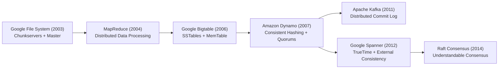
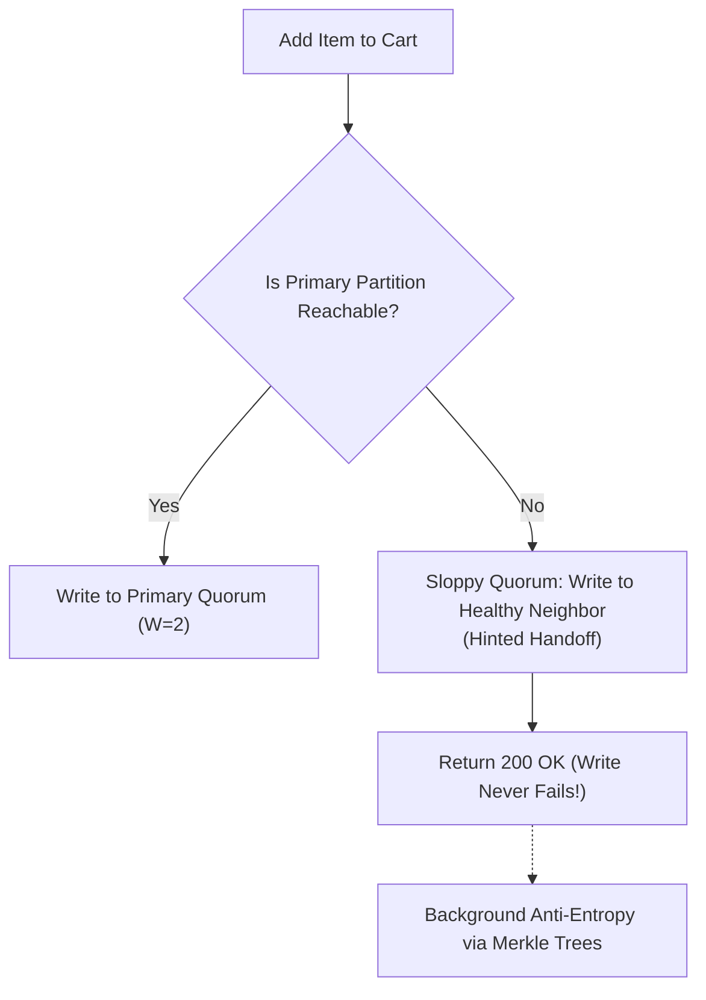

# Seminal Papers and Essential Reading List

Every world-class systems engineer stands on the shoulders of foundational academic and industrial papers. Below are the definitive distributed systems papers that shaped modern cloud infrastructure, complete with executive summaries, core breakthroughs, and key takeaways.

### 💡 Intuitive Real-World Analogy: The Aeronautical Flight Archives
Imagine an aerospace engineer tasked with designing a supersonic passenger jet. They do not start by throwing aluminum in a furnace and guessing wing shapes. They study the Wright brothers' wing camber calculations, NASA Apollo guidance computer specs, and supersonic wind tunnel research.
In distributed computing, the Google File System (2003), Amazon Dynamo (2007), and Google Spanner (2012) papers are our aerospace flight archives. Every modern cloud database—Cassandra, Kafka, CockroachDB, Kubernetes—is simply an open-source direct descendant of these seminal blueprints.

### 👶 Plain-English / ELI5 Overview
Instead of reading 50 random blog posts written by people who just learned a tool yesterday, read the original papers written by the legendary engineers at Google, Amazon, Stanford, and MIT who actually invented the technologies. Once you understand the original breakthrough, every modern tool becomes obvious.

### ⚠️ The Horror Scenario: Re-inventing the Broken Wheel
A tech startup spent 14 months and $1.5M in engineering payroll attempting to build a custom, multi-master active-active replication engine for their relational database.
- The lead engineer proudly announced: *"We built a protocol that achieves instant global writes with zero downtime and 100% strong consistency over standard internet cables without timeouts!"*
- Two weeks after launch, an AWS fiber cut isolated their Ohio datacenter from Oregon.
- The custom engine suffered catastrophic split-brain, overwrote user account balances, and lost $800,000 in unrecoverable transaction state.
- Had the team read the 1985 Fischer, Lynch, and Paterson (FLP) paper or Brewer's CAP theorem, they would have known in 5 minutes that their proposed architecture was a mathematical impossibility.

---

## 1. Foundational Distributed Systems Papers

### 1. Amazon Dynamo: Highly Available Key-Value Store (2007)
- **Authors:** Giuseppe DeCandia et al. (Amazon)
- **Core Problem:** Amazon needed a shopping cart system that was always writable, even if datacenters failed or network partitions occurred. A lost write meant lost revenue.
- **Key Breakthroughs:**
  - Synthesis of **Consistent Hashing** with virtual nodes to distribute keys.
  - **Vector Clocks** to detect concurrent updates and let the application resolve conflicts (e.g., merging cart items).
  - **Sloppy Quorum & Hinted Handoff**: Writes are accepted by the first $N$ healthy reachable nodes even if not the primary owners.
  - **Anti-Entropy using Merkle Trees**: Fast background sync of replicas with minimal network transfer.
- **Industry Impact:** Spawned Cassandra, Riak, DynamoDB, and Couchbase.

### 2. In Search of an Understandable Consensus Algorithm (Raft, 2014)
- **Authors:** Diego Ongaro and John Ousterhout (Stanford University)
- **Core Problem:** Paxos was notoriously difficult to understand, teach, and implement correctly in production software without ad-hoc extensions.
- **Key Breakthroughs:**
  - Decomposed consensus into three independent sub-problems:
    1. **Leader Election** (Randomized timers to avoid split votes).
    2. **Log Replication** (Leader appends, followers match).
    3. **Safety Invariants** (Leader completeness: only candidates with all committed entries can be elected).
  - Strong leader approach: Log entries only flow from leader to followers.
- **Industry Impact:** Powers etcd (Kubernetes), HashiCorp Consul, CockroachDB, TiKV, and modern Kafka (KRaft).

### 3. Spanner: Google's Globally-Distributed Database (2012)
- **Authors:** James C. Corbett et al. (Google)
- **Core Problem:** Sharding data across multiple continents while providing serializable transactions without locking down the entire world.
- **Key Breakthroughs:**
  - **External Consistency (Linearizability)** at global scale.
  - **TrueTime API**: Utilizes dedicated GPS receivers and atomic clocks in every Google datacenter to bound clock uncertainty to $[\text{earliest}, \text{latest}]$ with an error window $\epsilon \le 7$ ms.
  - **Commit Wait**: The coordinator waits $2\epsilon$ before releasing read locks, ensuring causal timestamp ordering without synchronization across continents.
- **Industry Impact:** Proved globally consistent ACID databases are possible at internet scale. Inspired CockroachDB and YugabyteDB.

### 4. The Google File System (GFS, 2003)
- **Authors:** Sanjay Ghemawat, Howard Gobioff, Shun-Tak Leung (Google)
- **Core Problem:** Storing petabytes of web index data on cheap, unreliable commodity hardware that fails continuously.
- **Key Breakthroughs:**
  - Component failures are treated as the *norm* rather than the exception.
  - Files broken into large $64\text{ MB}$ chunks with 3-way replication.
  - Single master for metadata (kept in memory), chunkservers handle data streaming directly with clients.
  - Append-only write pattern optimized for large sequential reads/writes.
- **Industry Impact:** Inspired Hadoop Distributed File System (HDFS) and object storage paradigms.

### 5. Bigtable: A Distributed Storage System for Structured Data (2006)
- **Authors:** Fay Chang et al. (Google)
- **Core Problem:** Managing structured data at petabyte scale across thousands of servers (Google Search, Maps, Gmail).
- **Key Breakthroughs:**
  - Sparse, distributed, persistent multi-dimensional sorted map: `(row:string, column:string, time:int64) -> byte[]`.
  - Introduced the modern **LSM-Tree** architecture: MemTable in memory, immutable SSTables on disk, Write-Ahead Log (WAL), and compaction.
- **Industry Impact:** Foundation for Apache HBase, Apache Cassandra, LevelDB, and RocksDB.

### 6. Kafka: A Distributed Messaging System for Log Processing (2011)
- **Authors:** Jay Kreps, Neha Narkhede, Jun Rao (LinkedIn)
- **Core Problem:** Existing message brokers (JMS, AMQP) struggled with high-throughput real-time metric collection and activity tracking.
- **Key Breakthroughs:**
  - Re-imagined messaging as an **append-only distributed commit log**.
  - Consumers track their own read pointer (**offset**), enabling zero message state tracking on the broker.
  - Relies on OS page cache and the `sendfile` system call (**zero-copy data transfer**) from disk directly to network socket.
  - Partitioning for linear horizontal scalability.
- **Industry Impact:** Ubiquitous backbone of real-time data streaming across the Fortune 500.

### 7. Distributed Snapshots: Determining Global States of Distributed Systems (1985)
- **Authors:** K. Mani Chandy & Leslie Lamport
- **Core Problem:** Capturing a globally consistent checkpoint across asynchronous processes and network channels without freezing ongoing execution.
- **Key Breakthroughs:**
  - Non-blocking **Marker Message Protocol** over FIFO channels.
  - Mathematical formalization of **Consistent Cuts** (causality closed).
- **Industry Impact:** Foundation for modern stream checkpointing (Apache Flink ABS), distributed debugging, and state rollback.

### 8. Practical Byzantine Fault Tolerance (PBFT, 1999)
- **Authors:** Miguel Castro & Barbara Liskov (MIT)
- **Core Problem:** Solving consensus in asynchronous networks in the presence of malicious, compromised, or arbitrarily faulty nodes in polynomial time.
- **Key Breakthroughs:**
  - 3-Phase protocol: Pre-Prepare, Prepare ($2f$ votes), Commit ($2f+1$ votes).
  - Tolerates up to $f$ Byzantine traitors with $3f + 1$ total nodes.
- **Industry Impact:** Groundwork for enterprise blockchains and mission-critical distributed consensus.

### 9. Resilient Distributed Datasets (Apache Spark, 2012)
- **Authors:** Matei Zaharia et al. (UC Berkeley AMPLab)
- **Core Problem:** MapReduce incurred catastrophic disk and network I/O overhead by writing intermediate results to HDFS across multi-step iterative computations.
- **Key Breakthroughs:**
  - **In-Memory RDD Abstraction**: Immutable, lazily evaluated collections with deterministic DAG lineage graphs.
  - Fault tolerance through deterministic recomputation of lost partitions rather than costly replication across memory.
- **Industry Impact:** Replaced MapReduce globally as the dominant big data compute engine.

### 10. Efficient and Robust Approximate Nearest Neighbor Search Using HNSW (2018)
- **Authors:** Yu. A. Malkov & D. A. Yashunin
- **Core Problem:** High-dimensional vector similarity search ($>1000$ dimensions) suffered from the curse of dimensionality, collapsing spatial trees into exhaustive $O(N)$ linear scans.
- **Key Breakthroughs:**
  - Multi-layer proximity graph inspired by the Skip List data structure.
  - Logarithmic $O(\log N)$ search latency with near-100% recall.
- **Industry Impact:** Powers modern AI vector databases (Pinecone, Milvus, Qdrant, pgvector).

---

## 2. Essential Books for System Design

### Tier 1: Non-Negotiable Core
1. **Designing Data-Intensive Applications (DDIA)** — *Martin Kleppmann*
   - *Why Read:* The absolute Bible of distributed systems and data storage. Covers storage engines, transactions, replication, partitioning, and consistency models with unmatched clarity.
2. **System Design Interview – An Insider's Guide (Vols 1 & 2)** — *Alex Xu & Sahn Lam*
   - *Why Read:* The standard reference for structuring interview discussions, estimation math, and diagramming real-world systems.
3. **Site Reliability Engineering (SRE)** — *Betsy Beyer, Chris Jones, Jennifer Petoff, Niall Murphy (Google)*
   - *Why Read:* How Google operates production systems at scale: SLOs, error budgets, monitoring, incident management, and post-mortems.

### Tier 2: Specialized Deep Dives
1. **Database Internals: A Deep Dive into Distributed Systems** — *Alex Petrov*
   - Deep dive into B-Trees, LSM-Trees, Paxos, Raft, and distributed execution.
2. **Building Microservices (2nd Edition)** — *Sam Newman*
   - The definitive guide to decomposing monoliths, bounded contexts, and service orchestration.
3. **Web Scalability for Startup Engineers** — *Artur Ejsmont*
   - Practical, hands-on architectural patterns for scaling web tiers, caching, and databases.

---

## 🎯 Top Real-World Interview Questions & Deep-Dive Answers (FAANG / Staff Level)

### Question 1: How did the 2007 Amazon Dynamo paper revolutionize distributed storage, and what were the fundamental engineering trade-offs of its "Always-Writable" design?
#### Answer:
Amazon's Dynamo was designed with a single uncompromising business invariant: **Customers must always be able to add items to their shopping cart**, even during catastrophic datacenter failures or cross-region network partitions.
1. **Core Architectural Techniques:**
   - **Consistent Hashing with Virtual Nodes:** Distributes keys evenly across a ring of servers, allowing elastic node addition/removal with only $K/N$ keys re-mapped.
   - **Sloppy Quorums & Hinted Handoff ($N=3, W=2, R=2$):** If the primary designated nodes for a key are down, the write is accepted by healthy substitute nodes ("hinted handoff") and forwarded back once primaries recover.
   - **Vector Clocks for Conflict Detection:** Because writes can happen concurrently on different partitions, Dynamo does not overwrite data using physical clocks. It stamps writes with Vector Clocks. If concurrent writes diverge ($V_1 \parallel V_2$), both versions ("siblings") are stored.
2. **The Fundamental Trade-Off:**
   - Sacrificed **Consistency for Availability (AP in CAP theorem)**.
   - Dynamo shifted the burden of conflict resolution to the application layer. When the customer opens their cart, the client application sees both sibling versions and executes a domain merge (e.g., Union of items from Cart A and Cart B).

---

### Question 2: Why did Google build TrueTime hardware (GPS + Rubidium Clocks) for Spanner instead of using logical clocks like Lamport or Vector Clocks?
#### Answer:
While logical clocks (Lamport/Vector) are mathematically elegant, they carry severe operational penalties at global scale:
1. **The Vector Bloat Problem:** In a system with thousands of shards and millions of clients, vector clocks grow to megabytes per row ($O(N)$ size).
2. **The Read-Only Transaction Tax:** In a global database, over 90% of database queries are read-only (e.g., analytics, reports, billing lookups). In pure Paxos/Raft systems, a read-only transaction must either acquire read locks across all shards or contact a quorum of replicas to avoid reading stale data, incurring cross-continental network latency ($>100\text{ms}$).
3. **The TrueTime Solution:**
   - TrueTime bounds physical clock uncertainty to $[t - \epsilon, t + \epsilon]$ where $\epsilon < 7\text{ms}$.
   - By enforcing the **Commit Wait Rule** (sleeping for $2\epsilon$ before releasing write locks), Spanner guarantees that any transaction starting after transaction $T_1$ commits will receive a strictly higher commit timestamp ($s_2 > s_1$).
   - **The Game-Changer for Reads:** Read-only transactions can execute at a past timestamp $T$ completely lock-free, without communicating with the leader or other datacenters, reading directly from local memory snapshots with guaranteed linearizability!

---

### Question 3: Compare Google Bigtable’s LSM-Tree architecture with traditional Relational B+ Tree storage engines—what are the exact disk I/O and amplification trade-offs?
#### Answer:
The divergence between LSM-Trees (Bigtable, RocksDB, Cassandra) and B+ Trees (PostgreSQL, MySQL InnoDB) is rooted in the physical physics of persistent storage media:

| Architectural Metric | B+ Tree (In-Place Update) | LSM-Tree (Append-Only / Out-of-Place) |
| :--- | :--- | :--- |
| **Write Mechanism** | Overwrites 8KB/16KB disk pages in place. | Appends sequentially to Write-Ahead Log (WAL) and memory buffer (MemTable). Flushes immutable SSTables. |
| **Write Amplification (WA)** | High (modifying a 50-byte row rewrites an entire 16KB page to disk $\to \text{WA} > 300$). | Moderate to High (due to background compaction passes), but writes are purely sequential. |
| **Write Throughput** | Lower (limited by random disk page updates and lock contention). | **Extremely High** (pure sequential disk writes; saturates disk bandwidth). |
| **Read Amplification (RA)** | Low ($O(\log_B N)$ page lookups; root and internal nodes cached in RAM). | High (must search MemTable, plus multiple SSTable levels; mitigated by Bloom filters). |
| **Concurrency / Compaction** | Row/Page latching contention. | Lock-free writes to MemTable; background compaction threads clean up tombstones and sort data. |

**Staff Architectural Rule of Thumb:**
- Use **LSM-Trees** for high-volume write-heavy workloads (financial tick data, telemetry, messaging logs, time-series metrics).
- Use **B+ Trees** for read-heavy workloads requiring low-latency point lookups, complex secondary indexing, and range scans without compaction latency spikes.
