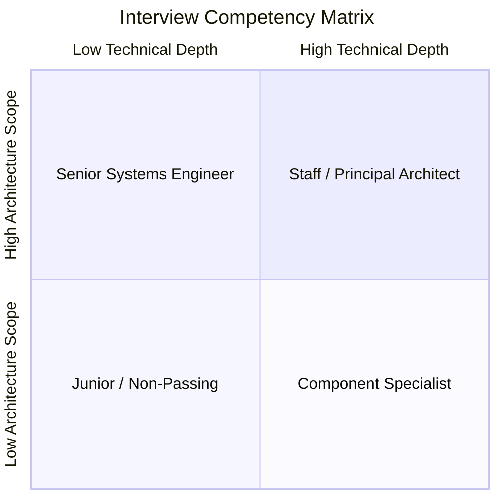
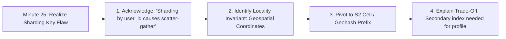

# System Design Interview Evaluation Rubric

Understanding how FAANG/MAMAA and tier-1 tech companies evaluate system design interviews is the key to demonstrating senior and staff-level competencies.

### 💡 Intuitive Real-World Analogy: The FAA Flight Checkride
Imagine an airline pilot taking their Federal Aviation Administration (FAA) captain evaluation.
The examiner does not grade you on whether you can push the throttle forward on a sunny afternoon with zero wind.
They grade you when:
- At 10,000 feet inside a thunderstorm, the left engine catches fire (**Hardware Failure**).
- The autopilot disconnects (**System Degradation**).
- The co-pilot panics (**Operational Chaos**).
The examiner watches: *Do you remain calm? Do you run through your emergency checklists methodically? Do you prioritize keeping the plane in the air before worrying about passenger snacks?*
In a system design interview, your interviewer is that FAA examiner. They will deliberately cut network cables, kill databases, and flood your cache with traffic to see if your architectural judgment holds under stress.

### 👶 Plain-English / ELI5 Overview
Interviewers don't have a single "correct" answer in their head. They are grading your thought process: Do you listen? Do you calculate the math before building? Do you design systems that can survive when things go wrong? And would they trust you with their company's production systems at 2:00 AM?

### ⚠️ The Horror Scenario: The Defensive Senior Rejection
An engineer with 12 years of experience interviews for a Staff role at Google:
- They design an e-commerce checkout flow using a single Redis instance for global cart locks.
- The interviewer asks: *"What happens if that Redis instance experiences a 15-second Stop-The-World garbage collection pause while holds the lock?"*
- The candidate gets visibly defensive: *"In my previous company, Redis never had GC pauses. Redis is written in C, not Java. That scenario is unrealistic in modern production."*
- The interviewer notes: *Candidate fails to understand OS-level memory swapping, hypervisor CPU throttling, and rejects constructive probe into fencing tokens.*
- **The Result:** Immediate "Strong No Hire". Defensive arrogance and failure to reason through edge cases kills more senior interviews than lack of knowledge.

---

## 1. The 4 Evaluation Axes

Every interviewer grades your performance along four core pillars:

### Pillar 1: Scoping & Requirement Engineering (20%)
- **What they look for:**
  - Did you clarify ambiguous requirements before jumping into solutions?
  - Did you distinguish between Functional Requirements (what the system does) and Non-Functional Requirements (latency, availability, consistency, durability)?
  - Did you perform accurate, defensible back-of-the-envelope capacity estimations (QPS, storage, bandwidth, memory)?
  - Did you clearly state what is **out of scope** to manage time effectively?

### Pillar 2: High-Level Architecture & Data Modeling (25%)
- **What they look for:**
  - Did you draw a clean end-to-end architecture (Client $\to$ CDN $\to$ Load Balancer $\to$ API Gateway $\to$ Services $\to$ Caches $\to$ DBs $\to$ Message Queues)?
  - Are API endpoints RESTful or cleanly defined with inputs, outputs, and status codes?
  - Is the database schema well thought out (Entities, Relationships, Primary Keys, Foreign Keys, Indexes)?
  - Did you justify the choice between Relational (SQL) and NoSQL/NewSQL?

### Pillar 3: Technical Deep Dives & Trade-Off Analysis (35%)
- **What they look for:**
  - **This is where senior and staff offers are won.** Can you identify the hardest bottleneck in the system?
  - Do you know *why* you chose a specific technology rather than just reciting its buzzword? (e.g., "We use Cassandra here because our write throughput is $500,000\text{ writes/sec}$ and wide-column LSM-trees excel at sequential append writes, whereas B-Tree random disk updates would saturate I/O").
  - Did you explain how to handle concurrent updates, data replication lag, cache invalidation, and split-brain scenarios?
  - Did you present trade-offs for every major decision?

### Pillar 4: Resilience, Scaling & Operational Excellence (20%)
- **What they look for:**
  - Single Points of Failure (SPOFs) identified and mitigated.
  - Rate limiting, circuit breakers, backpressure, and graceful degradation under load spikes.
  - Observability strategy: Metrics (Prometheus), structured logs, distributed tracing (OpenTelemetry).
  - Disaster recovery (RPO, RTO) and multi-datacenter active-active replication.

---

## 2. Level Expectations (L4 vs. L5 vs. L6 vs. L7)

| Level | Role Target | Expected Behaviors & Signals |
| :--- | :--- | :--- |
| **L4 (Mid-Level)** | Software Engineer | Needs guidance on ambiguous requirements. Can build standard 3-tier web architectures. Understands basic caching and database replication. Struggles when probed on complex edge cases or deep storage engine internals. |
| **L5 (Senior)** | Senior Software Engineer | Drives the interview independently. Accurately scopes requirements and calculates capacity. Designs resilient multi-service architectures. Explains consistency trade-offs (CAP, ACID vs BASE). Proactively identifies bottlenecks without prompting. |
| **L6 (Staff)** | Staff Software Engineer | Takes full ownership of massive, ambiguous problem spaces. Identifies business vs technical trade-offs. Discusses cross-datacenter replication, network partitions, multi-region failover, cost optimization (FinOps), and operational maintainability. |
| **L7 (Principal)** | Principal Architect | Designs systems that transform organizational velocity. Thinks about failure domains at global scale, hardware limitations, protocol overhead, and regulatory governance (GDPR/HIPAA). Simplifies unnecessary complexity. |

---

## 3. The 10 Fatal Traps (Why Candidates Fail)

1. **The Buzzword Salad**: Throwing Kafka, Redis, and Cassandra onto the whiteboard without explaining *why* they are needed or how data flows through them.
2. **Jumping Straight to Architecture**: Drawing boxes and arrows before asking clarifying questions or defining requirements.
3. **Ignoring Back-of-the-Envelope Math**: Designing an in-memory cache for a dataset that requires 100 Terabytes of RAM without noticing the cost or feasibility.
4. **The Monolithic Database Illusion**: Assuming a single PostgreSQL instance can handle 2 million concurrent writes per second.
5. **Ignoring Failure Modes**: Assuming networks never partition, disks never fill up, and instances never crash.
6. **Hand-Waving Synchronization**: Saying "we will just synchronize the two databases" without specifying 2PC, CDC, Outbox, or Saga patterns.
7. **Neglecting Edge Cases**: Ignoring hot partitions (e.g., Justin Bieber or Elon Musk on Twitter), cache stampedes, or clock skew.
8. **Over-Engineering**: Introducing distributed consensus (Raft/Paxos) and microservices when an asynchronous task queue and a single replicated Postgres instance would solve the problem.
9. **Defensiveness**: Arguing with the interviewer when they introduce a constraint or point out a flaw, instead of collaborating.
10. **Running Out of Time**: Spending 35 minutes on requirement scoping or API schemas and leaving zero time for scaling and deep dives.

---

## 🎯 Top Real-World Interview Questions & Deep-Dive Answers (FAANG / Staff Level)

### Question 1: How should a candidate react when they realize midway through an interview (Minute 25) that their initial architecture or sharding key is fundamentally flawed?
#### Answer:
This is one of the highest-signal moments in a Staff-level interview. Interviewers intentionally look for **intellectual honesty, rapid triage, and composed course correction**:
1. **Never Try to Hide or Defend the Mistake:** Hand-waving or doubling down on a broken assumption signals low self-awareness and production danger.
2. **Execute the Staff Pivot Script:**
   - Pause explicitly: *"Looking back at our access patterns and the requirement to support real-time geospatial range queries, I realize my initial choice of sharding by `user_id` will force an expensive $O(N)$ scatter-gather broadcast to every single database shard."*
   - Identify the Root Invariant: *"To eliminate cross-shard queries, the true locality invariant is geographic location rather than user identity."*
   - Present the Solution & Trade-Off: *"I propose we pivot our partition key to a Google S2 cell or Geohash prefix. The trade-off is that user profile lookups will now require a secondary index, but our primary dispatch query latency drops from 250ms to 5ms."*
3. **The Signal:** Admitting a flaw and methodically pivoting is evaluated far higher than a candidate who got the right answer on autopilot without explaining the alternatives.

---

### Question 2: How do you answer an interviewer who demands: "Design this system to achieve 99.999% ('Five Nines') availability"?
#### Answer:
Avoid junior platitudes like *"I'll add redundant servers and auto-scaling"*. Five Nines ($99.999\%$) allows only **5.26 minutes of total downtime per year across the entire planet**, including maintenance, deployments, and disasters.
1. **Calculate the Error Budget:**
   - Five nines means downtime cannot exceed 26 seconds per month.
   - Traditional manual incident response (page engineer $\to$ wake up $\to$ SSH $\to$ read logs) takes at least 15 minutes, which instantly burns the entire year's error budget in a single incident!
2. **The 4 Architectural Pillars of Five Nines:**
   - **Multi-Region Active-Active with Automated Failover:** No single cloud region or availability zone can be a SPOF. Traffic must be dynamically shifted via Anycast BGP or Route 53 health-check DNS within 10 seconds.
   - **Automated Blast-Radius Containment (Cell-Based Architecture):** Partition users into independent "cells" (e.g., 100 cells serving 1% of users each). If a fatal bug or memory leak occurs, at most 1% of users are impacted, preserving 99% overall availability.
   - **Zero-Downtime Deployments & Automated Rollbacks:** Canary deployments with automated metric analysis. If HTTP 500 error rates spike by $0.05\%$ over 30 seconds, traffic is instantly rolled back via Envoy/Service Mesh without human intervention.
   - **Chaos Engineering & Self-Healing:** Regular automated chaos testing (Chaos Monkey) terminating nodes, cutting AZ networks, and verifying consensus leader election completes within sub-second thresholds.

---

### Question 3: What exact signals distinguish an L6 (Staff Engineer) from an L7 (Principal Architect) during an interview debrief?
#### Answer:
In calibration committees, L6 and L7 candidates are separated by **organizational scale, simplification, and strategic foresight**:

| Competency Axis | Staff Engineer (L6) | Principal Architect (L7) |
| :--- | :--- | :--- |
| **Problem Scope** | Owns multi-team, cross-service complex technical systems (e.g., The entire checkout pipeline). | Owns company-wide architectural strategy and multi-year technological paradigms (e.g., Global multi-region active-active cloud migration). |
| **Complexity Management**| Excels at solving distributed complexity using advanced tools (Kafka, Raft, Flink, CRDTs). | **Actively removes complexity.** Often advocates *against* microservices or custom consensus if a simpler partitioned Postgres architecture solves the business goal with 10x lower maintenance. |
| **Financial Engineering**| Mentions cloud instance sizes and storage requirements. | Deep FinOps mastery: Analyzes AWS egress data transfer costs across AZs, reserved vs spot fleet economics, and hardware memory bus constraints. |
| **Governance & Legality** | Considers data schemas and caching. | Anticipates regulatory constraints: GDPR data residency geofencing, PCI-DSS compliance zones, HIPAA encryption, and antitrust audit trails. |
