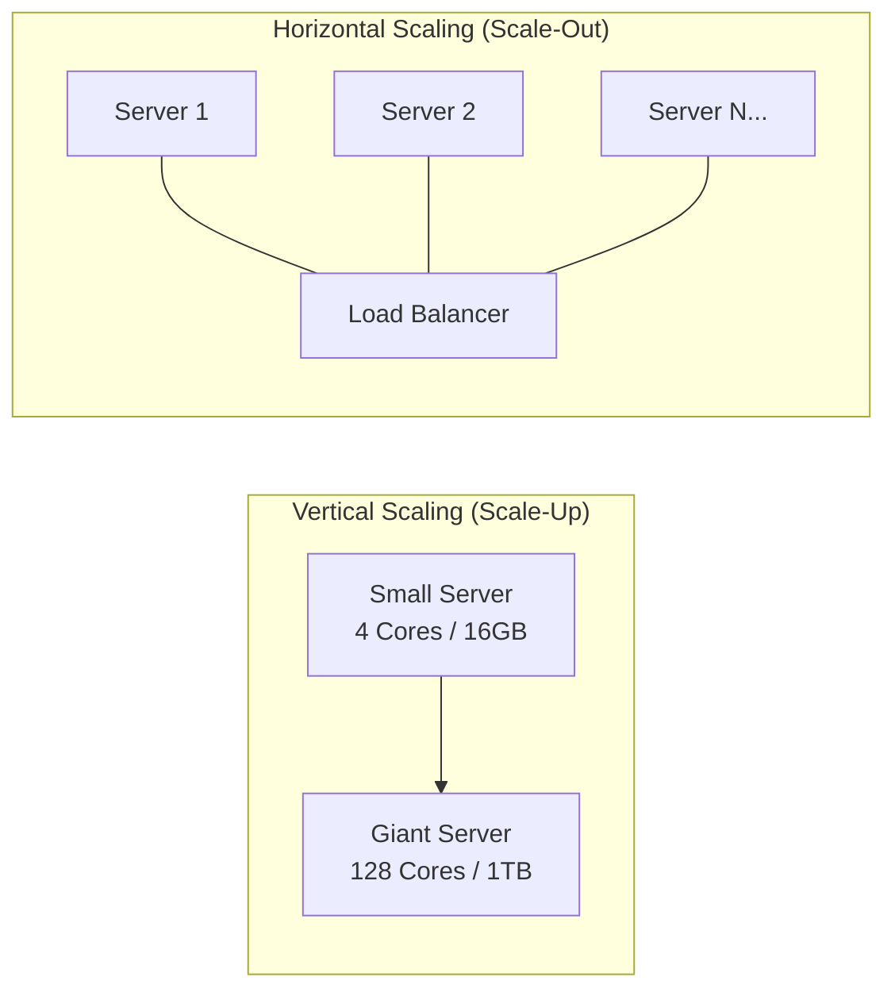
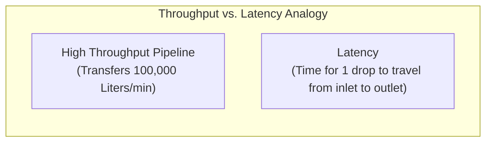
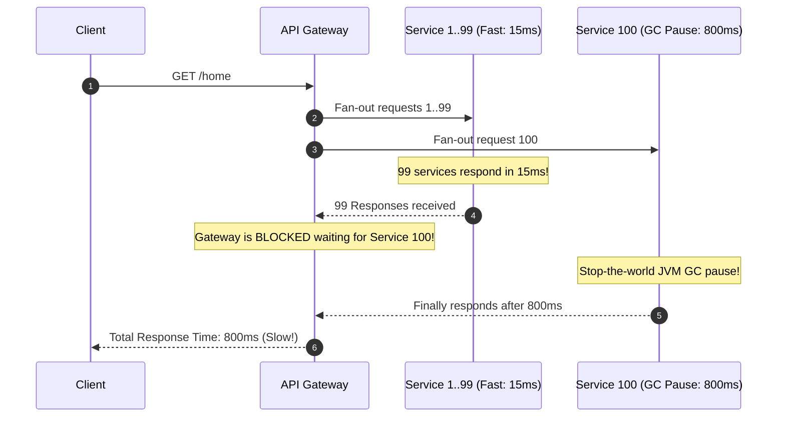
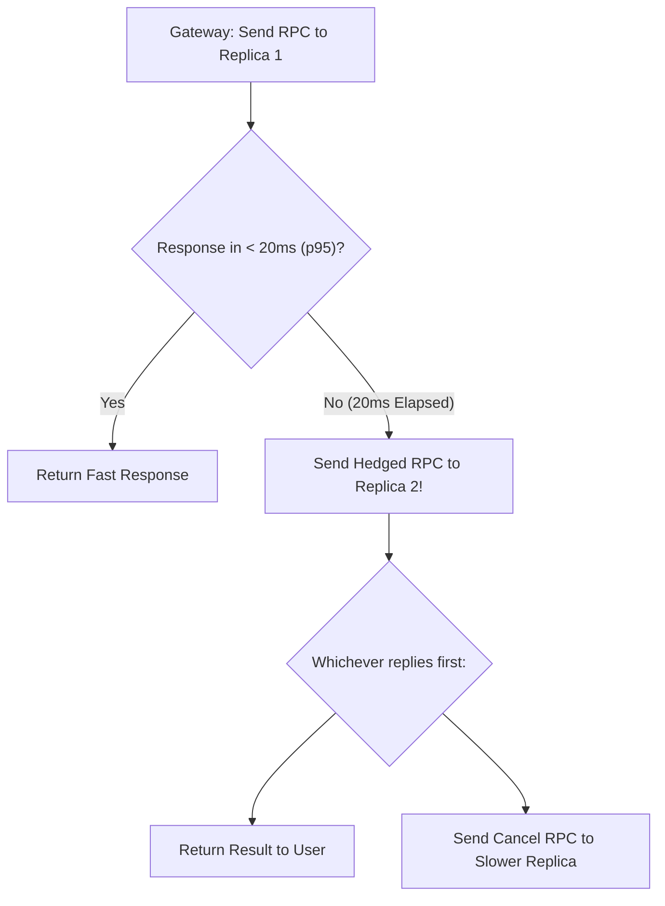

# Core System Qualities & Architectural Non-Functionals

When designing modern systems, software architecture is fundamentally defined by its **Non-Functional Requirements (NFRs)**. Any junior engineer can write code that works under ideal conditions; a senior/staff systems architect designs systems that remain correct, responsive, and maintainable under extreme traffic, hardware failure, and organizational evolution.

---

## 1. Scalability: Vertical vs. Horizontal vs. Elastic



### 💡 Intuitive Real-World Analogy: Monster Truck vs. Delivery Fleet
- **Vertical Scaling (Scale-Up):** Buying a single monster 18-wheeler truck with a jet engine to deliver packages.
  - *Advantage:* You only need one driver, and you don't need a radio dispatch system to coordinate routes.
  - *Catastrophe:* The monster truck cannot fit down residential alleyways, costs $5,000,000, and if a single tire blows, **100% of your company's deliveries freeze instantly**.
- **Horizontal Scaling (Scale-Out):** Buying a fleet of 100 standard delivery vans coordinated by a central dispatch station (Load Balancer).
  - *Advantage:* If 2 vans break down or get stuck in traffic, 98 vans continue delivering without interruption. You can add 20 more vans during Christmas and sell them in January.
  - *Catastrophe:* You must now manage radio channels, coordinate package partitioning, and handle driver traffic collisions.

### 👶 Plain-English / ELI5 Overview
Scaling is how your system survives when 10,000 people visit at the same time. You can either buy a bigger, more expensive computer (Vertical), or connect a bunch of cheaper computers together to share the load (Horizontal).

### ⚠️ The Horror Scenario: The Friendster Vertical Scaling Meltdown
In 2003, Friendster was the undisputed king of social networking with millions of viral users.
- The engineering team scaled vertically, buying increasingly massive Sun Microsystems enterprise database servers.
- As the user graph grew, calculating "friend-of-a-friend" traversals on a single monolithic database hit physical memory bus and lock contention limits.
- Page load times skyrocketed from 2 seconds to **40+ seconds**.
- The physical hardware was maxed out—they could not buy a bigger server on planet Earth.
- Users abandoned the frozen platform in droves for a new competitor built with horizontal LAMP shard architectures: **Facebook**.
- **The Lesson:** Vertical scaling has a hard physical ceiling. When you hit it, your business dies.

### Vertical Scaling (Scale-Up)
- **Concept:** Adding more compute, RAM, or NVMe storage to a single physical or virtual machine.
- **Pros:**
  - Zero application code architectural changes (no distributed state, no network partitioning, straightforward ACID transactions).
  - Minimal latency (inter-process communication over shared memory / PCIe bus rather than network).
- **Cons:**
  - **Hardware Ceiling:** You inevitably reach physical limits (e.g., maximum memory slots, single motherboard sockets).
  - **Cost Asymmetry:** High-end enterprise servers (e.g., 2TB RAM, 128 cores) cost exponentially more than equivalent commodity clusters.
  - **Single Point of Failure (SPOF):** Hardware failure knocks down the entire system.

### Horizontal Scaling (Scale-Out)
- **Concept:** Adding more commodity server nodes into a coordinated cluster behind a load balancer.
- **Pros:**
  - Virtually unlimited scaling ceiling.
  - Cost-effective (commodity hardware / standard cloud VMs).
  - Inherent redundancy: If 2 of 20 instances fail, the remaining 18 handle traffic.
- **Cons:**
  - Introduces distributed systems complexities: network latency, partial failures, split-brain, data partitioning, and consistency issues.

### Elasticity
- The ability of a system to dynamically allocate and de-allocate resources in real-time based on fluctuating demand (e.g., AWS Auto Scaling Groups, Kubernetes Horizontal Pod Autoscaler).
- Key challenge: Handling spin-up time (cold starts) before traffic spikes cause request queuing.

---

## 2. High Availability (HA) & The "Table of Nines"

Availability is the proportion of time a system is functional and working properly:

$$\text{Availability} = \frac{\text{Uptime}}{\text{Uptime} + \text{Downtime}} = \frac{\text{MTBF}}{\text{MTBF} + \text{MTTR}}$$

- **MTBF (Mean Time Between Failures):** How long a system runs without crashing.
- **MTTR (Mean Time To Repair):** How fast the system recovers or fails over after a crash.

### 💡 Intuitive Real-World Analogy: City Bus vs. Commercial Jetliner
- **$99\%$ Availability (Two Nines):** A municipal city bus. If a bus breaks down once a month and takes 7 hours to tow and repair, commuters are mildly annoyed, but life goes on.
- **$99.999\%$ Availability (Five Nines):** A commercial Boeing 787 passenger jet. An engine or avionics computer cannot fail for more than 5 minutes over an entire year across thousands of transatlantic flights. It requires dual-redundant hydraulic lines, backup optical data buses, and hot-standby generators.

### The Availability Nines Table

| Availability Level | Downtime per Year | Downtime per Month | Downtime per Day | Typical System Type |
| :--- | :--- | :--- | :--- | :--- |
| **$90\%$ (One 9)** | $36.5$ days | $72$ hours | $2.4$ hours | Internal experimental tool |
| **$99\%$ (Two 9s)** | $3.65$ days | $7.2$ hours | $14.4$ minutes | Non-critical internal SaaS |
| **$99.9\%$ (Three 9s)** | $8.76$ hours | $43.8$ minutes | $1.44$ minutes | Standard commercial web application |
| **$99.99\%$ (Four 9s)** | $52.6$ minutes | $4.38$ minutes | $8.66$ seconds | Tier-1 e-commerce, cloud infrastructure |
| **$99.999\%$ (Five 9s)**| $5.26$ minutes | $26.3$ seconds | $864$ milliseconds | Telecommunications, financial exchanges |
| **$99.9999\%$ (Six 9s)**| $31.5$ seconds | $2.63$ seconds | $86.4$ milliseconds | Nuclear control, life-support medical systems |

---

## 3. Reliability vs. Fault Tolerance vs. Resilience

- **Reliability:** The probability that a system performs its intended function without error for a specified period of time.
- **Fault vs. Failure:**
  - A **Fault** is a component deviating from its spec (e.g., hard drive bit rot, severed network fiber).
  - A **Failure** occurs when the entire system stops providing the required service to the user.
- **Fault Tolerance:** Designing the system such that internal component faults do not cascade into system-wide failures (e.g., RAID arrays, redundant power supplies, active replicas).
- **Resilience:** The capacity of a system to absorb shocks, gracefully degrade during unexpected degradation, and self-heal back to normal operation.

---

## 4. Latency vs. Throughput & Tail Latency



### 💡 Intuitive Real-World Analogy: Airport Baggage Claim Carousel
Imagine a family of 5 landing at an airport:
- **Throughput:** The baggage conveyor belt unloads 2,000 suitcases per hour.
- **Median Latency ($p50$):** Most passengers grab their single bag in 5 minutes.
- **The Tail Latency Fan-Out Trap:** The family cannot leave the airport until **all 5 of their bags** arrive on the carousel. Even if each bag has a 99% chance of arriving on time, the probability that the family is delayed waiting for that *one slow bag* is much higher!

### Tail Latency and Percentiles ($p50$, $p95$, $p99$, $p99.9$)
Never evaluate distributed systems using arithmetic **Average / Mean Latency**. Averages completely hide catastrophic tail experiences.

- **$p50$ (Median):** $50\%$ of requests were faster than this time. Represents typical user experience.
- **$p95$:** $95\%$ of requests were faster than this time; $5\%$ were slower.
- **$p99$:** $99\%$ of requests were faster than this time; 1 out of 100 users experienced this delay.
- **$p99.9$:** The worst 1 out of 1,000 requests.

### ⚠️ The Horror Scenario: The Microservice Fan-Out Catastrophe
In a modern microservices architecture, a single homepage request from a user fans out in parallel to $100$ backend services (recommendations, user profile, cart, pricing, inventory, advertisements, reviews):



> **The Mathematical Proof of Tail Latency Explosion:**  
> If each individual backend service has a $p99$ latency of $100\text{ ms}$ (a $1\%$ probability of taking $>100\text{ ms}$), what is the probability that the overall user request experiences a delay?
>
> $$P(\text{At least one service delayed}) = 1 - (1 - 0.01)^{100} = 1 - (0.99)^{100} \approx 1 - 0.366 = \mathbf{63.4\%}$$
>
> **Over $63\%$ of your end users will experience the $p99$ tail latency!** This is why controlling tail latency via hedging, timeouts, and circuit breakers is critical at scale.

---

## 5. Maintainability: The 3 Pillars

1. **Operability:** Giving operations teams clear visibility into system health through rich telemetry, standard runbooks, and smooth zero-downtime deployment pipelines.
2. **Simplicity:** Managing complexity. Removing accidental complexity (tight coupling, esoteric dependencies) so new engineers can understand the codebase quickly.
3. **Evolvability (Extensibility):** Structuring architectures so future business requirements can be incorporated without rewrites.

### ⚠️ The Horror Scenario: Knight Capital's $440 Million Operability Nightmare
In August 2012, Knight Capital was the largest equity trader in the US.
- A technician manually deployed new software to 8 server nodes, but accidentally forgot to copy the update to Node 8!
- Node 8 retained old, dead code from 2003 that repurposed an internal tracking flag.
- When live market open triggered, Node 8 interpreted incoming client orders as an instruction to continuously buy and sell millions of shares at market price.
- In 45 minutes, Node 8 executed 4 million erroneous trades, losing **$440,000,000** and bankrupting the firm before anyone could pull the plug.
- **The Lesson:** Operability is not an afterthought. Automated canary deployments, strict configuration management, and immutable infrastructure save companies from extinction.

---

## 🎯 Top Real-World Interview Questions & Deep-Dive Answers (FAANG / Staff Level)

### Question 1: How do you mathematically combat and eliminate the Tail Latency Fan-Out problem in hyperscale microservice architectures?
#### Answer:
Google's Jeff Dean and Luiz Barroso formalized the definitive engineering solutions in their landmark paper *"The Tail at Scale"*:
1. **Hedged Requests (Request Speculation):**
   - When a client sends an RPC to a backend shard, it tracks the historical $p95$ latency (e.g., 20ms).
   - If no response arrives within 20ms, the client immediately transmits a duplicate **hedged request** to a secondary replica, tagging both with a shared request token.
   - Whichever replica replies first satisfies the call; the client sends a `Cancel` RPC to the other.
   - *Result:* Eliminates 95% of tail latency spikes while adding only a tiny ~5% overhead to total network traffic.
2. **Tied Requests:**
   - Instead of waiting for a timeout, the gateway sends the request to two replica servers simultaneously.
   - The servers communicate via an internal cross-host lock: whichever server dequeues the task first executes it, while the other instantly discards it from its worker queue.
3. **Micro-Slicing & Dynamic Request Prioritization:**
   - High-priority interactive user clicks preempt long-running background batch jobs (e.g., analytical MapReduce tasks) in worker queues.
4. **SLA Deadlines & Context Propagation:**
   - Every incoming HTTP request is assigned a strict deadline timestamp (e.g., `deadline = now() + 250ms`).
   - This deadline propagates across all downstream gRPC calls via metadata headers. If Service 8 determines it cannot complete its work before the deadline expires, it short-circuits immediately without wasting CPU on doomed work.



---

### Question 2: When should a Staff Architect advocate for Vertical Scaling (Scale-Up) instead of Horizontal Scaling (Scale-Out)?
#### Answer:
Junior engineers instinctively recommend microservices and horizontal sharding for everything. A Staff Architect recognizes when **Vertical Scaling delivers 10x higher engineering velocity, lower cost, and simpler operations**:
1. **Relational ACID Invariants:**
   - Workloads that require complex relational foreign keys, multi-table joins, and strict ACID transaction serializability across the entire dataset.
   - Horizontal sharding destroys ACID joins, requiring expensive application-level aggregations or fragile 2PC protocols.
2. **The Stack Overflow Architectural Model:**
   - Stack Overflow famously served hundreds of millions of monthly pageviews using only **two monolithic Microsoft SQL Server instances** (one primary, one standby) equipped with 1.5 TB of RAM and PCIe NVMe drives.
   - *Why it worked:* Modern hardware is absurdly capable. A single AWS `u-12tb1.112xlarge` instance offers 448 vCPUs and 12 TB of RAM. If your entire dataset fits into 1 TB of RAM, keeping it on a single giant box eliminates distributed transactions, cache invalidation bugs, and network serialization overhead.
3. **The Decision Rule of Thumb:**
   - Scale vertically as long as:
     $$\text{Total Data Working Set} < \text{Maximum Single-Node RAM Capacity} \quad \text{AND} \quad \text{Throughput} < \text{Single-Node PCIe/IOPS Limits}$$
   - Only scale out horizontally when write throughput exceeds single-node disk bus limits, or when high availability mandates zero-downtime multi-datacenter failover.

---

### Question 3: How do you design an automated disaster recovery system to achieve an RTO of < 1 minute and an RPO of 0?
#### Answer:
Understanding **Recovery Time Objective (RTO)** and **Recovery Point Objective (RPO)** is essential for mission-critical infrastructure:
- **RTO (Recovery Time Objective):** Maximum allowable duration the system can remain down after disaster strikes ($< 60\text{ seconds}$).
- **RPO (Recovery Point Objective):** Maximum allowable data loss measured in time ($\text{RPO} = 0 \implies \text{Zero data loss allowed}$).

```mermaid
flowchart LR
    subgraph PrimaryRegion["Primary Cloud Region (US-East)"]
        P_App["App Cluster"] --> P_DB["Primary DB (Write Leader)"]
    end

    subgraph SecondaryRegion["Secondary Cloud Region (US-West)"]
        S_App["App Cluster (Standby)"] --> S_DB["Synchronous Standby DB"]
    end

    P_DB <== Synchronous WAL Replication (RPO = 0) ==> S_DB
    HealthCheck["Global Anycast / Route 53 Health Monitor"] -.->|Detects Outage| Failover["Automated Failover (< 60s RTO)"]
    Failover --> S_DB
```

1. **Achieving RPO = 0 (Zero Data Loss):**
   - Requires **Synchronous Replication** across physical failure domains. Every transaction commit must be flushed to the Write-Ahead Log (WAL) on at least one remote standby node across an independent region/AZ before acknowledging the client.
   - *Trade-off:* Adds speed-of-light network roundtrip latency to every write ($\sim 10-60\text{ms}$).
2. **Achieving RTO < 60s (Near-Instant Recovery):**
   - **Automated Health Probes & Consensus Fencing:** Multi-region consensus (e.g., Raft/Paxos in Spanner or CockroachDB) automatically detects leader loss within 5–10 seconds using heartbeat leases.
   - **Hot Standby Infrastructure:** Secondary region application clusters must be pre-provisioned and warmed up (running at 100% capacity), ready to accept immediate traffic without waiting for auto-scalers to boot VMs.
   - **Traffic Redirection:** Global Anycast BGP routing or Route 53 DNS failover with ultra-short TTLs (10s) reroutes ingress edge traffic to the healthy secondary region within 30 seconds.
