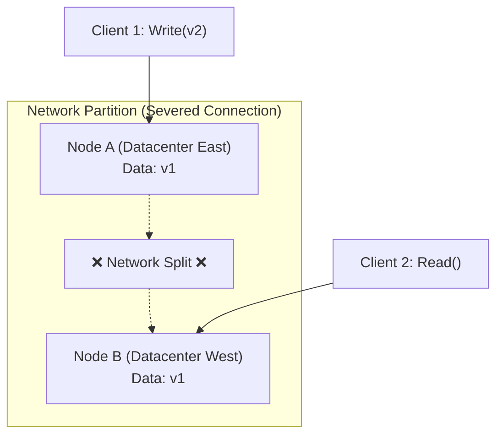
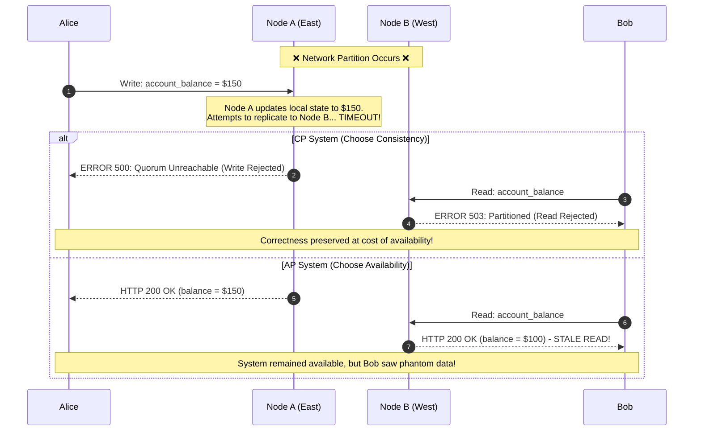
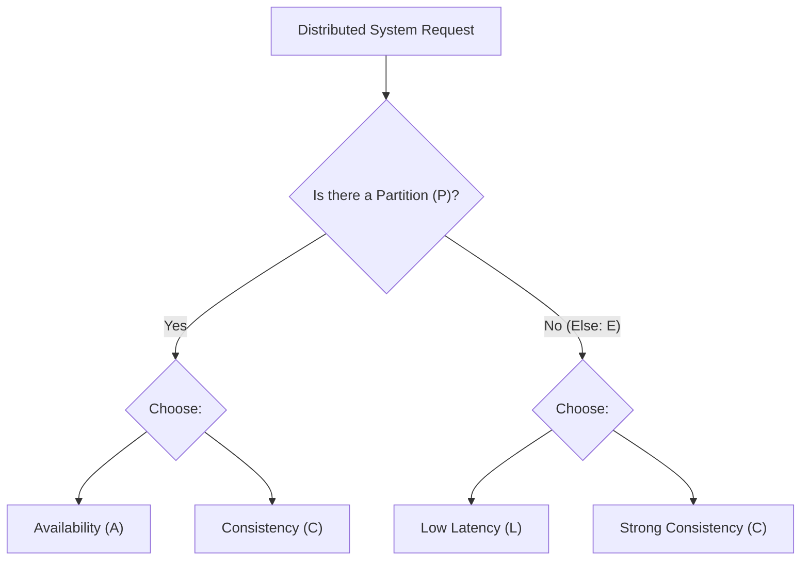
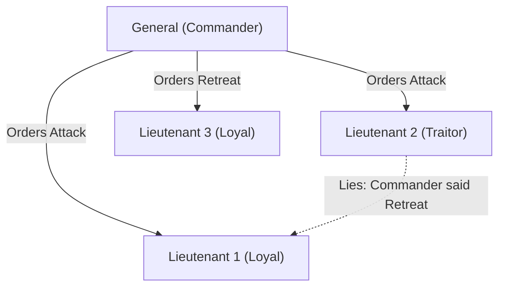
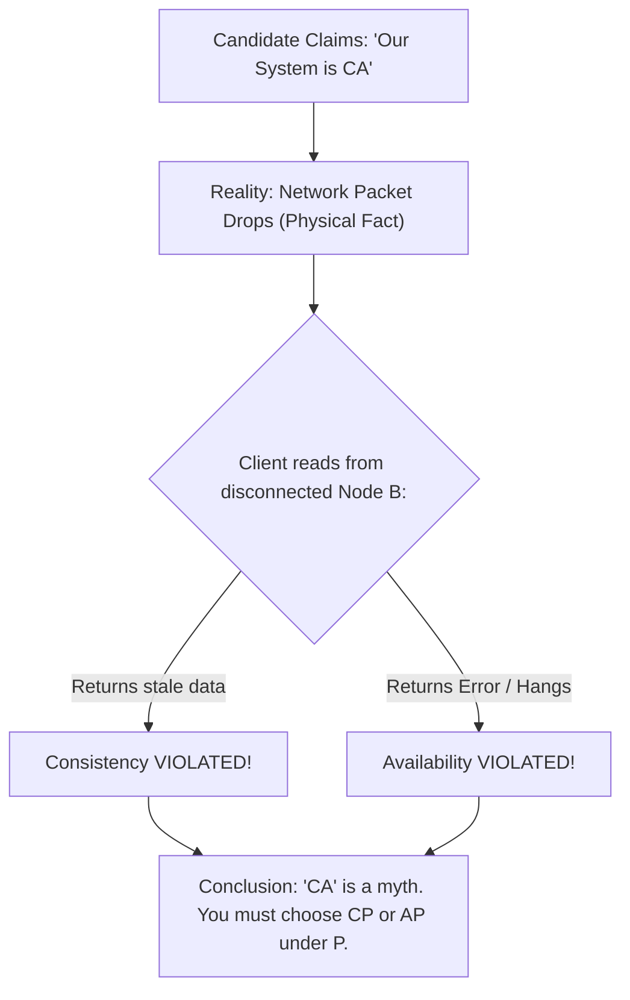

# Distributed Systems Theorems: CAP, PACELC, FLP & BFT

Distributed systems exist in a physical world governed by network latency, packet loss, and hardware failure. Academic research has proved mathematical limits on what any distributed architecture can achieve.

---

## 1. The CAP Theorem (Brewer's Theorem)

First conjectured by Eric Brewer in 2000 and formally proven by Seth Gilbert and Nancy Lynch in 2002.

### 💡 Intuitive Real-World Analogy
Imagine two branch offices of a bank: **Branch New York** and **Branch London**. Normally, the tellers talk via a dedicated transatlantic telephone line.
One morning, an undersea cable snaps—the phone line is dead (**Network Partition**).
- **Alice** walks into Branch New York and deposits $1,000.
- **Bob** walks into Branch London and asks to withdraw that same $1,000.

What can the London teller do?
1. **Option A (Availability):** Let Bob withdraw the cash. But London hasn't confirmed if Alice already withdrew it in New York! The bank risks double-spending (**sacrificing Consistency**).
2. **Option B (Consistency):** Tell Bob: *"Sorry, our transatlantic line is down. For safety, we cannot process withdrawals right now"* (**sacrificing Availability**).

There is no magical third option where Bob gets his cash immediately *and* the bank is 100% certain it hasn't given away free money while the line is cut.

### 👶 Plain-English / ELI5 Overview
When computers in different datacenters can no longer talk to each other because of broken network cables, you face a forced dilemma:
- Do you want your servers to keep answering users even if the answer is stale or wrong (**AP**)?
- Or do you want your servers to say *"Error / Try again"* so they never give a wrong answer (**CP**)?

You can never pick "both" during a network failure.

### ⚠️ The Horror Scenario: The Black Friday Inventory Nightmare
An e-commerce retailer configures their product catalog and inventory database as **AP** (Available, Partition-Tolerant) across US-East (Virginia) and US-West (Oregon) to achieve zero downtime.

1. Only **10 units** of a limited-edition gaming console remain in stock.
2. At 12:00:00 AM, a core fiber switch in Chicago fails, completely severing US-East from US-West for 15 minutes.
3. Because the system chooses Availability, US-East accepts orders for all 10 consoles and decrements its local stock to 0.
4. Concurrently, US-West accepts orders for 10 consoles from West Coast shoppers and decrements its local stock to 0.
5. At 12:15:00 AM, the network heals. The database attempts to reconcile: **20 consoles were bought, paid for, and confirmed, but only 10 physically exist.**
6. **The Result:** 10 furious customers, customer support flood, thousands of dollars in chargeback fees, and severe brand damage. If this had been designed as a **CP** system, one region would have refused writes during the partition, preserving exact physical inventory.

### 🚶 Step-by-Step Scenario: Partition in Action
Let's follow two clients, **Alice** and **Bob**, interacting with two database nodes, **Node A** and **Node B**, initialized with `account_balance = $100`.

### The Definitions
- **Consistency ($C$):** Specifically refers to **Linearizability** (Strong Consistency). Every read receives the most recent write or an error. All nodes appear to operate on a single, atomic global copy.
- **Availability ($A$):** Every non-failing node returns a non-error response for every received request (no timeouts or HTTP 500s). Note: Returning stale data counts as available; returning an error or hanging does not.
- **Partition Tolerance ($P$):** The system continues to operate despite an arbitrary number of messages being dropped or delayed by the network between nodes.

### The Myth: "Pick 2 out of 3"
In the physical world, networks are asynchronous and prone to severed fibers, switch failures, and packet loss. **You cannot choose "CA".** A CA system without partition tolerance simply means the system halts completely the moment a single network packet drops.

> **The Reality of CAP:**  
> When a network partition occurs ($P$), you MUST choose between:
> 1. **Consistency ($CP$):** Cancel or reject operations on isolated partitions to prevent serving stale or divergent data (preserves correctness, sacrifices availability).
> 2. **Availability ($AP$):** Allow nodes on isolated partitions to accept writes and reads independently (preserves availability, sacrifices consistency; produces split-brain / divergent state).

### 🏢 Real-World Production Battle-Testing
- **Google Cloud Spanner (CP):** Powers Google's advertising, Google Play billing, and multi-billion-dollar financial ledger services. If a region loses network quorum, it halts transaction commits in that region rather than risking corrupted financial balances.
- **Apache Cassandra at Netflix (AP):** Powers user viewing history, bookmark markers, and personalized video recommendations. If a cross-region AWS link drops between `us-east-1` and `eu-west-1`, Netflix prefers letting European viewers keep watching movies (even if their viewing history is a few minutes stale) rather than showing a black error screen.

### ⚖️ Practical Trade-Offs & Rules of Thumb
- **Choose CP when:** Financial transactions, user authentication/passwords, inventory reservation, order placement, or healthcare records are involved. Stale reads or duplicate writes mean legal liability or direct monetary loss.
- **Choose AP when:** Social media feeds, video streaming progress, real-time analytics counters, chat typing indicators, or telemetry metrics are involved. Brief staleness is imperceptible to users, but complete downtime causes massive frustration.

---

## 2. The PACELC Theorem

Formulated by Daniel Abadi in 2012 to address CAP's limitation: CAP only discusses system behavior when there is a network partition. But partitions are rare ($<0.1\%$ of normal operating time). What happens during normal healthy operation?

$$\text{If } \mathbf{P} \text{ (Partition)} \rightarrow \text{Choose between } \mathbf{A} \text{ and } \mathbf{C} ; \quad \text{Else } \mathbf{E} \rightarrow \text{Choose between } \mathbf{L} \text{ and } \mathbf{C}$$

### 💡 Intuitive Real-World Analogy
Imagine running a drive-through burger restaurant:
- **During a Hurricane (Partition - P):**
  - Do you close the drive-through window until the storm clears (**PC**)?
  - Or do you keep handing out pre-cooked cold burgers from the counter (**PA**)?
- **On a Sunny Day (Else - E):**
  - When a customer orders a burger, do you hold up the line for 5 minutes while the Head Chef, Sous Chef, and Quality Inspector all cross-examine the temperature of the patty before handing it out (**EC: Strong Consistency, high latency**)?
  - Or do you hand the burger out the instant the line cook flips it off the grill, trusting that the chefs will review the kitchen logs later (**EL: Low Latency, eventual consistency**)?

### 👶 Plain-English / ELI5 Overview
CAP asks: *"What do you do during a disaster?"*  
PACELC asks: *"What do you do on a normal Tuesday morning?"*  
Even when everything is working perfectly, you still cannot have both instant speed (Latency) and absolute guarantee of global synchronization (Consistency), because light only travels so fast through fiber optic cables.

### ⚠️ The Horror Scenario: The 100ms Latency Drop-off
An international retail application forces synchronous multi-datacenter cross-region consensus on every single user click (an **EC** configuration).
- A user in Sydney, Australia clicks "Add to Cart".
- The Sydney node must wait for synchronous acknowledgement from datacenters in Frankfurt and North Virginia (a 280ms round-trip speed-of-light tax).
- Amazon found that every **100ms of latency costs 1% in total sales**. Google found an extra 500ms delay dropped traffic by 20%.
- By failing to choose **EL** for harmless browsing interactions, the business bleeds millions of dollars in abandoned shopping carts.

### 🚶 Step-by-Step Scenario: Normal Operation Latency vs Consistency
Suppose a user updates their profile avatar URL:
1. **User Request arrives at Node 1 (US-East).**
2. **If Configured as PA/EL (e.g., Default Cassandra/DynamoDB):**
   - Node 1 updates its local SSD memory table.
   - Node 1 immediately replies `200 OK (Latency: 2ms)`.
   - Node 1 asynchronously sends the update packet to Node 2 (Frankfurt) and Node 3 (Tokyo) in the background.
3. **If Configured as PC/EC (e.g., Google Spanner / CockroachDB):**
   - Node 1 appends the log entry.
   - Node 1 sends Paxos messages to Frankfurt and Tokyo.
   - Node 1 **waits** until a majority quorum replies across the ocean.
   - Node 1 finally replies `200 OK (Latency: 140ms)`.

### PACELC Classification Matrix

| System | Classification | Behavior Under Partition ($P$) | Behavior Under Normal Operation ($E$) |
| :--- | :--- | :--- | :--- |
| **Cassandra** | **PA/EL** | Keeps accepting writes on any node. | Returns local node data immediately; syncs replicas asynchronously for minimal latency. |
| **DynamoDB** | **PA/EL** | Highly available writes across replicas. | Reads from single replica (low latency) unless `ConsistentRead=true` is requested. |
| **MongoDB** | **PC/EC** | Rejects writes to isolated partitions without majority. | Replicates synchronously to secondaries before acknowledging write (sacrifices latency for consistency). |
| **Google Spanner**| **PC/EC** | Halts transactions if Paxos quorum cannot be reached. | Waits for TrueTime commit wait uncertainty window to ensure global linearizability. |
| **PostgreSQL (Sync Repl)**| **PC/EC** | Blocks transactions if replica is unreachable. | Master waits for synchronous WAL flush on standby node. |

### 🏢 Real-World Production Battle-Testing
- **Stripe (PC/EC):** Stripe processes billions of dollars in daily payments. Stripe’s ledger engine cannot tolerate stale reads or split-brain ledger states under any circumstances. They happily pay the 50–100ms latency price on normal days to ensure mathematical correctness.
- **Uber Driver Location Tracking (PA/EL):** When an Uber driver travels down an avenue, their phone emits GPS coordinates every 4 seconds. Uber uses PA/EL storage. If a single coordinate update is dropped or delayed by 100ms, it is immediately superseded by the next ping. Latency and throughput matter far more than global consistency.

### ⚖️ Practical Trade-Offs & Rules of Thumb
- Use **PA/EL** when reading/writing transient high-throughput data (telemetry, session caches, social activity feeds, video view counts).
- Use **PC/EC** when executing irreversible business side effects (financial debits/credits, medical records, digital contract signings).

---

## 3. The FLP Impossibility Theorem

Published in 1985 by Michael J. Fischer, Nancy A. Lynch, and Michael S. Paterson.

### 💡 Intuitive Real-World Analogy
Imagine waiting for your friend at a coffee shop without cell phones. You both agreed to meet at 2:00 PM to decide which movie to watch:
- It is now 2:30 PM. Your friend has not arrived.
- Did your friend get into a car crash (**fail-stop crash**)?
- Or is your friend stuck in terrible traffic on the highway (**arbitrary network delay**)?

You face an impossible choice:
1. If you **wait forever**, you will never watch a movie (**loss of Liveness**).
2. If you **leave and buy a ticket alone**, your friend might walk into the theater 5 minutes later with tickets to a completely different movie (**loss of Safety / Consensus**).

In a purely asynchronous world where delays can be infinite, there is no mathematical algorithm that can guarantee you both agree without risking waiting forever.

### 👶 Plain-English / ELI5 Overview
If computers can take an unpredictable amount of time to reply, you can never mathematically prove whether a computer has died or is just running very slowly. Because of this, it is impossible to build a consensus system that is 100% guaranteed to never get stuck *and* 100% guaranteed to never make a mistake, unless you make some assumptions about time.

### ⚠️ The Horror Scenario: The Eternal Cluster Hang
A software engineer designs a custom distributed consensus protocol assuming a purely asynchronous network without timeouts.
1. A 5-node cluster is voting on a critical database migration lock.
2. Node 3 begins garbage collection (GC pause) and its hypervisor throttles its CPU for 45 seconds.
3. Because the protocol is purely deterministic and asynchronous, it refuses to make assumptions about timeouts (to preserve 100% safety).
4. The remaining 4 nodes wait indefinitely for Node 3's vote.
5. All incoming production requests pile up in HTTP connection pools. Memory usage spikes to 100%, causing cascading OOM crashes across the entire microservice fleet. Global production outage.

### 🚶 Step-by-Step Scenario: Why Deterministic Asynchronous Consensus Fails
Consider two nodes, **Node 0** and **Node 1**, deciding between value `0` and `1`:
1. Node 0 proposes `0`. Node 1 proposes `1`.
2. The network can delay any message arbitrarily.
3. If Node 0's message is delayed, Node 1 cannot tell if Node 0 crashed or if the network is just slow.
4. If Node 1 decides `1` (to preserve liveness), Node 0 might simultaneously assume Node 1 crashed and decide `0`. Now two conflicting decisions were made (Safety violated!).
5. Fischer, Lynch, and Paterson mathematically proved that in any such asynchronous deterministic protocol, there is always an execution path where an adversary can delay messages in such a way that the system remains in bivalent indecision forever.

### The Theorem
> In a fully **asynchronous network**, no deterministic consensus protocol can guarantee both **safety** (never reaching an incorrect agreement) and **liveness** (guaranteed termination) in the presence of even a **single unannounced fail-stop crash**.

### How Real Systems Circumvent FLP
Modern production systems do not operate in a purely asynchronous world. They circumvent FLP using practical compromises:
1. **Partial Synchrony & Timeouts:** Assuming that message delays are bounded by some duration $\Delta$ most of the time (e.g., Raft and Paxos use randomized heartbeats and election timeouts). If a node does not reply in time, it is assumed failed.
2. **Randomization:** Breaking deterministic deadlocks using random timers (e.g., Raft candidate election timers randomly staggered between 150ms and 300ms).
3. **Failure Detectors:** Utilizing heartbeat failure detectors ($\heartsuit\mathcal{W}$ or $\heartsuit\mathcal{P}$) that suspect nodes as dead if no response is received within a timeout window.

### 🏢 Real-World Production Battle-Testing
- **Kubernetes / etcd (Raft):** etcd circumvents FLP by assuming partial synchrony: cluster members send heartbeats every 100ms. If a leader doesn't respond within the election timeout (e.g., 1000ms), followers assume it is dead and elect a new leader.
- **Apache ZooKeeper (ZAB):** Uses TCP timeouts and ping intervals to detect dead ensemble peers.

### ⚖️ Practical Trade-Offs & Rules of Thumb
- Never attempt to write a custom consensus protocol without timeouts or randomization.
- Set election timeouts significantly higher than the typical round-trip time ($RTT$) of your network (typically $10\times RTT$) to prevent spurious failovers when the network briefly jitters.

---

## 4. Byzantine Fault Tolerance (BFT)

Standard distributed systems models (like Raft, Paxos, Kafka) assume **Crash-Fault Tolerance (CFT)**: nodes either work correctly or crash and stop sending messages. They assume nodes are trustworthy and do not lie.

In adversarial environments (e.g., public blockchains, decentralized networks, aerospace control systems), nodes may suffer **Byzantine Faults**:
- Maliciously sending different messages to different peers.
- Arbitrarily altering state due to memory bit flips or malicious software compromises.

### 💡 Intuitive Real-World Analogy
Imagine four generals surrounding an enemy city. They can only communicate via horseback couriers:
- If all generals attack together, they win.
- If they retreat together, they survive.
- If only some attack while others retreat, their army is slaughtered.

One of the generals is a **traitor**.
- The Traitor tells General 1: *"The Commander ordered us to ATTACK!"*
- The Traitor tells General 2: *"The Commander ordered us to RETREAT!"*

How do the loyal generals figure out the truth when couriers can be bribed and generals can lie through their teeth? They must cross-verify messages with everyone else and demand a supermajority.

### 👶 Plain-English / ELI5 Overview
Most software assumes computers are honest: when a server breaks, it just turns off. Byzantine fault tolerance handles the nightmare scenario where a server doesn't turn off—instead, it stays on, gets hacked or suffers a cosmic ray memory corruption, and actively feeds contradictory lies to everyone else in the system.

### ⚠️ The Horror Scenario: The Flight Control Bit-Flip
A passenger aircraft utilizes 3 redundant flight control computers to calculate elevator pitch adjustments:
1. A cosmic ray causes a single-event upset (bit flip) in Computer 2's RAM.
2. Computer 2 becomes Byzantine: to Computer 1, it reports *"Altitude is 30,000 ft, pitch down 5 degrees"*; to Computer 3, it reports *"Altitude is 10,000 ft, pitch up 15 degrees"*.
3. If the system was designed with simple CFT ($2f+1=3$ nodes), it cannot resolve the conflict. Computer 1 and Computer 3 see conflicting telemetry and cannot determine who is lying.
4. **The Disaster:** The flight computer disengages or triggers erratic aerodynamic oscillation. True safety-critical avionics (like the Boeing 777 primary flight computers) use quadruply-redundant channels ($3f+1=4$) with Byzantine fault-tolerant voting planes to isolate the rogue sensor immediately.

### 🚶 Step-by-Step Scenario: Why CFT Fails and BFT Succeeds
Suppose you have 3 nodes: **Node A**, **Node B**, and **Node C**. Node C is a traitor ($f=1$).
1. Commander Node A orders: `ATTACK`.
2. Node A sends `ATTACK` to Node B and Node C.
3. Traitor Node C tells Node B: *"Node A told me to RETREAT!"*
4. Node B receives:
   - `ATTACK` from Node A.
   - `RETREAT` from Node C.
5. Node B sees a 1-to-1 tie! Node B cannot know whether Node A is a traitor who sent two different orders, or whether Node C is lying. With $N=3$ and $f=1$, agreement is mathematically impossible.

Now upgrade to $N = 3f + 1 = 4$ nodes (Commander A, Loyal B, Loyal C, Traitor D):
1. Commander A sends `ATTACK` to B, C, and D.
2. Lieutenants share what they received with each other:
   - Node B tells C: *"A said ATTACK"*.
   - Node C tells B: *"A said ATTACK"*.
   - Traitor D tells B: *"A said RETREAT"*.
3. Node B compares votes: `ATTACK` (from A), `ATTACK` (from C), `RETREAT` (from D).
4. **Result:** `ATTACK` wins 2-to-1! Traitor D's lie is neutralized by the supermajority.

### The $3f + 1$ Quorum Theorem
To tolerate $f$ arbitrary Byzantine faulty nodes, a distributed consensus system must contain at least:

$$N \ge 3f + 1 \text{ total nodes}$$

- If $f = 1$ traitor, you need at least $3(1) + 1 = 4$ nodes.
- Quorum size required: At least $2f + 1$ nodes must agree (more than a simple two-thirds supermajority).
- CFT systems only need $2f + 1$ nodes to tolerate $f$ crash failures (e.g., Raft requires 3 nodes to tolerate 1 dead node).

### 🏢 Real-World Production Battle-Testing
- **PBFT / Tendermint Core (Cosmos Network):** Used in proof-of-stake distributed ledgers where validator nodes can be malicious and attempt double-spending attacks. Requires a $2/3+$ supermajority of validator signatures to commit a block.
- **Aerospace Avionics (SpaceX Dragon & Boeing 777):** Redundant flight-control computer clusters cross-compare flight control actuator commands over deterministic Byzantine-tolerant optical data buses.

### ⚖️ Practical Trade-Offs & Rules of Thumb
- **Do NOT use BFT for internal corporate datacenters:** BFT protocols require $O(N^2)$ message complexity and extensive cryptographic signatures. They are $10\times$ to $100\times$ slower than CFT protocols (Raft/Paxos).
- **Use CFT (Raft/Paxos) when:** All machines are inside your private VPC/datacenter, running authenticated internal code.
- **Use BFT when:** Machines belong to independent, untrusted third parties (public blockchains, cross-organization federated ledgers) or in life-critical avionics where hardware bit flips must be survived without human intervention.

---

## 🎯 Top Real-World Interview Questions & Deep-Dive Answers (FAANG / Staff Level)

### Question 1: An interviewer asks: "Can we design a Consistent and Available (CA) distributed system if AWS guarantees a 99.999% SLA on their network infrastructure?"
#### Answer:
**No. A distributed system can NEVER choose "CA".**
1. **The Physical Reality of Partitioning ($P$):**
   - Partition Tolerance is not a configuration toggle or architecture choice—it is an **inescapable physical law of distributed networks**.
   - A $99.999\%$ network SLA still permits over **5 minutes of packet drops, router restarts, or fiber cuts per year**.
   - Furthermore, GC pauses, kernel CPU stalls, or switch buffer overflows on a single host look 100% indistinguishable from a network partition to remote peers.
2. **The "CA" Reductio ad Absurdum:**
   - If a system claims to be "CA", it assumes partitions *never* happen.
   - The microsecond an actual network packet drops between Node A and Node B, if a client writes to Node A and reads from Node B:
     - If Node B responds with old data $\to$ Consistency is violated.
     - If Node B errors or blocks waiting for Node A $\to$ Availability is violated.
   - Therefore, a system claiming to be CA is simply an **untested CP or AP system that will crash catastrophically during its first network blip**.

---

### Question 2: How does the PACELC theorem change our choice of database when architecting an e-commerce platform with both high-traffic shopping carts and financial billing ledgers?
#### Answer:
The PACELC theorem exposes the trade-off that occurs **$99.9\%$ of the time when there is NO partition**:

$$\text{If } \mathbf{P} \text{ (Partition)} \rightarrow \text{Choose between } \mathbf{A} \text{ and } \mathbf{C} ; \quad \text{Else } \mathbf{E} \rightarrow \text{Choose between } \mathbf{L} \text{ and } \mathbf{C}$$

1. **For the Shopping Cart (Choose PA/EL):**
   - *Under Partition (P):* Choose **Availability (A)**. We never want a customer to see an error when clicking "Add to Cart".
   - *Normal Operation (E):* Choose **Latency (L)** over Consistency (C). A local read/write on a nearby replica returns in 2ms. If the cart occasionally shows a 1-second stale item count across multiple tabs, the customer does not care.
   - *Database Selection:* **Apache Cassandra or Amazon DynamoDB** (default read mode).
2. **For the Billing & Financial Ledger (Choose PC/EC):**
   - *Under Partition (P):* Choose **Consistency (C)**. If datacenters are split, we must reject payments rather than double-charge a user or create an un-auditable balance.
   - *Normal Operation (E):* Choose **Consistency (C)** over Latency (L). We gladly pay a 50–100ms multi-datacenter consensus roundtrip (Paxos/Raft) on every transaction to guarantee global serializability.
   - *Database Selection:* **Google Cloud Spanner or CockroachDB**.

---

### Question 3: How do modern consensus engines (Raft, Paxos) circumvent the FLP Impossibility Theorem without violating safety?
#### Answer:
The FLP theorem proved that in a purely asynchronous network, no deterministic protocol can guarantee both **safety** (never doing the wrong thing) and **liveness** (never getting stuck) with even a single crash.
Modern production systems circumvent FLP using **Partial Synchrony and Randomization**:
1. **Sacrificing Asynchrony (Partial Synchrony Assumption):**
   - Real-world algorithms assume that while network delays can fluctuate, there exists a bound $\Delta$ such that messages generally arrive within $\Delta$ most of the time.
   - Raft and Paxos use **heartbeats and election timeouts**. If a leader does not respond within $150-300\text{ms}$, followers assume it has crashed.
2. **Sacrificing Determinism (Randomized Symmetry Breaking):**
   - FLP relies on an adversary constructing an infinite sequence of deterministic split votes.
   - Raft breaks this mathematically by assigning each candidate a **randomized election timeout** (e.g., Node 1 waits 160ms, Node 2 waits 240ms). The probability of continuous split votes drops exponentially to zero on retries, guaranteeing liveness in practice.
3. **Safety is Never Compromised:**
   - If the network becomes wildly asynchronous (delays exceed timeouts), Raft may experience repeated elections (loss of liveness), but it will **never violate safety**—it will never commit conflicting log entries.

---

### Question 4: Walk through the mathematical quorum overlap proving why BFT requires $3f+1$ nodes whereas CFT requires only $2f+1$ nodes.
#### Answer:
Let $N$ be total nodes, and $f$ be the maximum number of faulty nodes tolerated:
1. **CFT Quorum Derivation:**
   - Nodes either function honestly or crash silently (fail-stop).
   - In CFT, a node does not lie. We only need two quorums $Q_1$ and $Q_2$ to overlap by at least 1 honest node:
     $$|Q_1 \cap Q_2| \ge 1$$
   - Since quorum size is $Q = \lfloor N/2 \rfloor + 1$:
     $$2(\lfloor N/2 \rfloor + 1) - N \ge 1 \implies N \ge 2f + 1$$
2. **BFT Quorum Derivation:**
   - Up to $f$ nodes can be malicious traitors, and another $f$ nodes can be slow/unresponsive.
   - A non-blocking quorum can only wait for $N - f$ responses.
   - Among those $N - f$ responses, up to $f$ of them could be deliberate lies sent by traitors.
   - The count of verified honest responses is $(N - f) - f = N - 2f$.
   - For the honest votes to strictly outvote the $f$ traitors:
     $$N - 2f > f \implies N > 3f \implies \mathbf{N \ge 3f + 1}$$
   - Furthermore, any two quorums of size $2f + 1$ out of $3f + 1$ intersect by:
     $$(2f + 1) + (2f + 1) - (3f + 1) = f + 1 \text{ nodes}$$
   - Since there are at most $f$ traitors, that intersection of $f+1$ nodes **must contain at least one guaranteed honest node**, preserving safety across views!
