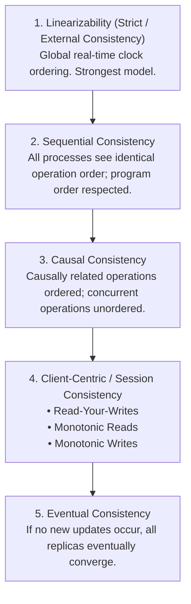
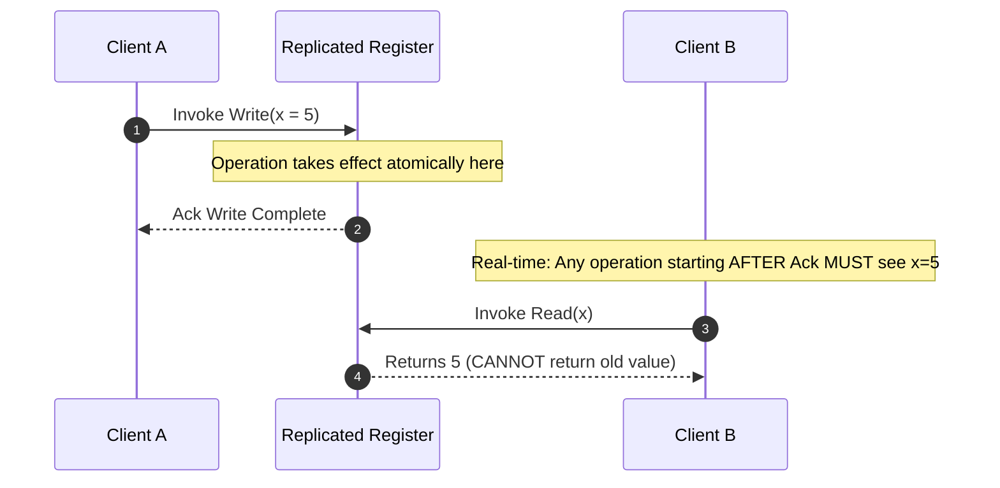
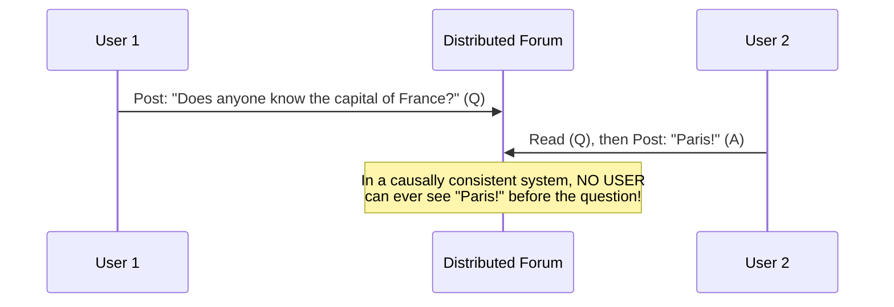
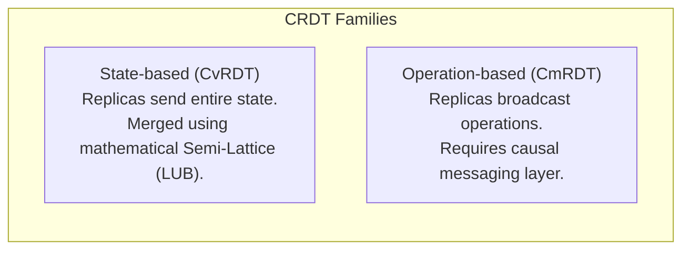
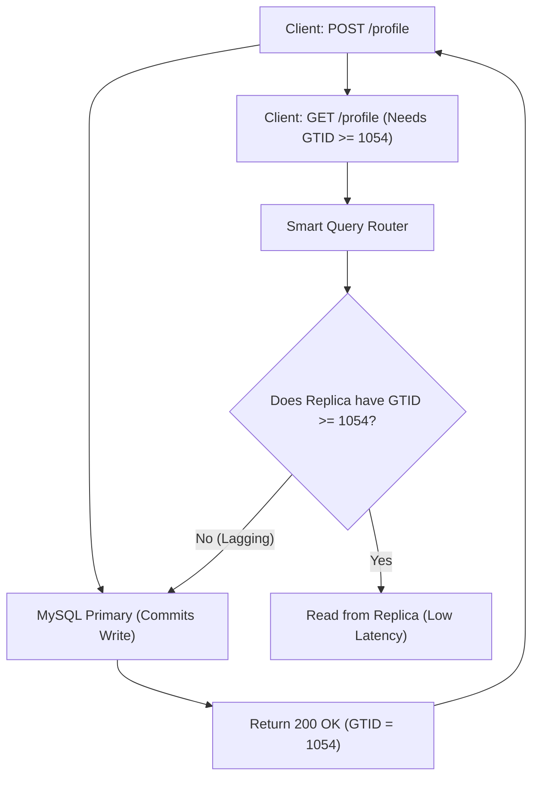

# The Consistency Models Hierarchy

In a distributed system with replicated data across multiple nodes, when an update occurs, what guarantees does the system provide to concurrent and subsequent readers?

---

## 1. The Consistency Spectrum

Consistency models form a strict hierarchy of guarantees, trading off operational latency and availability against developer cognitive simplicity.

### 💡 Intuitive Real-World Analogy: The Global Newspaper vs. The Bathroom Mirror
- **Linearizability (The Town Square Chalkboard):** A single chalkboard in the middle of town. If Alice writes *"Price of Bread is $5"* at 10:00:00 AM, the instant she puts the chalk down, anyone looking at the board anywhere in town sees *"Price of Bread is $5"*. Time and truth are absolute.
- **Sequential Consistency (The Chess Scorebook):** Two people reading a printed book of a historic chess match. Reader 1 reads Move 1, then Move 2, then Move 3. Reader 2 reads Move 1, Move 2, Move 3. They both observe the exact same sequence of events, but Reader 1 might be reading on Monday while Reader 2 reads on Thursday.
- **Causal Consistency (Detective Investigation):** A cause must always precede an effect. A gunshot must happen *before* the bullet hole appears in the wall. You can never see the bullet hole before the gun fires. However, two independent witnesses having lunch in different parts of town can be reported in any arbitrary order.
- **Read-Your-Writes (The Bathroom Mirror):** When you brush your hair in your bathroom mirror, you expect your reflection to show brushed hair immediately. If your neighbor hasn't seen your new haircut yet, that's fine. But if your own reflection shows you with messy hair 2 seconds after you brushed it, you feel like you are going insane.

### 👶 Plain-English / ELI5 Overview
Consistency is about agreeing on the truth:
- **Strong Consistency:** Every computer on Earth sees the exact same value at the exact same millisecond. (Very safe, but very slow).
- **Eventual Consistency:** Computers will figure out the truth eventually, but for a few seconds, some computers might give you yesterday's news. (Super fast, but you might see weird glitches).

---

## 2. Linearizability (Strong Consistency)

Introduced by Maurice Herlihy and Jeannette Wing in 1990.

### The Invariant
> A system is linearizable if all operations appear to execute **atomically** at a specific point in time between their invocation and their completion, respecting the **real-time global clock**.

- **Single-Copy Illusion:** The entire cluster behaves as if there were only one single node in existence.
- **Cost:** High write and read latencies. Reads cannot simply return local memory; they must verify consensus or consult a leader lease to avoid reading split-brain stale data.
- **Examples:** Apache ZooKeeper (for writes), etcd, Google Spanner.

---

## 3. Sequential Consistency

Introduced by Leslie Lamport in 1979.

### The Invariant
> The execution results are the same as if the operations of all processors were executed in some **single sequential order**, and the operations of each individual processor appear in this sequence in the order specified by its program.

### Key Difference from Linearizability
Sequential consistency does **not** bind operations to a real-time global clock.
- If Client A writes $x = 5$ at 12:00:00.000 PM, and Client B reads $x$ at 12:00:00.005 PM, Client B may still read the older value $x = 4$, provided that **all nodes in the cluster agree on the exact sequence** of operations and nobody ever observes time moving backward.
- Example: Social media comments. All users see comments in the exact same chronological thread order, even if a user in Tokyo sees comment #5 slightly later in real-time than a user in New York.

---

## 4. Causal Consistency

### The Invariant
> Operations that are **causally related** must be seen by every node in the system in the same order. Operations that are **concurrent (independent)** may be observed in different orders by different nodes.

### Determining Causality ($A \to B$)
Operation $A$ causes operation $B$ if:
1. $A$ and $B$ were executed by the same thread/client ($A$ occurred before $B$).
2. Thread 2 reads the result of operation $A$ and subsequently executes operation $B$ (question and answer).
3. Transitivity: If $A \to B$ and $B \to C$, then $A \to C$.

### ⚠️ The Horror Scenario: The Inverted Chat Thread
In an internal company Slack-like messaging service operating without causal consistency:
1. Manager posts message $Q$: *"Should we cancel the product launch?"*
2. Lead Engineer reads $Q$ and immediately replies $A$: *"No, absolutely do not cancel!"*
3. Because the network delivers messages out of causal order to the CEO's tablet:
   - The CEO receives $A$ first: *"No, absolutely do not cancel!"*
   - Then the CEO receives a concurrent proposal from marketing: *"Should we give away $1M in discounts?"*
   - Then the CEO finally receives $Q$.
4. **The Disaster:** The response appears under the wrong context, causing catastrophic business misunderstandings. Causal consistency guarantees that if $A$ was typed in response to $Q$, no human on Earth can ever see $A$ without seeing $Q$ first.

---

## 5. Client-Centric / Session Guarantees

When building user-facing web applications, global consistency is often unnecessary, but users will file bug reports if their own actions seem to disappear.

### 1. Read-Your-Writes Consistency
A user who submits an update will always observe their own update on subsequent page refreshes:
- *Anti-pattern:* You update your profile photo, refresh the page, and the old photo appears because your read hit an out-of-sync replica.
- *Mitigation:* Pin reads for a user to the primary database for 5–10 seconds following a write, or track the client's latest transaction commit timestamp.

### 2. Monotonic Reads
If a user reads version $v_2$ of a record, they will never subsequently observe an older version $v_1$:
- *Anti-pattern:* You refresh your inbox and see 10 unread emails. You refresh again 1 second later and see 8 unread emails because your second request was routed to a lagging replica.

### 3. Monotonic Writes
A system guarantees that a given user's writes are serialized and executed in the order they were submitted.

---

## 6. Eventual Consistency & CRDTs

### Eventual Consistency
The weakest consistency model: If no new updates are made to a given data item, eventually all accesses will return the last updated value.
- **Advantages:** Extreme write throughput, near-instant local reads, $100\%$ availability during network partitions.
- **Disadvantage:** Concurrent writes can overwrite or conflict with each other.

### Conflict-Free Replicated Data Types (CRDTs)
CRDTs achieve **Strong Eventual Consistency (SEC)**: Replicas can accept concurrent updates independently without coordination, and are mathematically guaranteed to converge to the exact same state once all updates are transmitted.

#### Common CRDT Data Types
- **P-N Counter (Positive-Negative Counter):** Independent state counters for increments and decrements (used for distributed like/vote counts).
- **LWW-Element-Set (Last-Write-Wins-Set):** Uses timestamps to resolve add/remove conflicts.
- **RGA (Replicated Growable Array) & YATA:** Powers collaborative text editing in tools like Google Docs, Notion, and Figma.

---

## 7. Comparative Summary Matrix

| Consistency Model | Latency Overhead | Partition Availability ($P$) | Anomaly Free? | Real-World Adoption |
| :--- | :--- | :--- | :--- | :--- |
| **Linearizable** | Very High | ❌ Unavailable | ✅ Yes (No anomalies) | Financial ledgers, Raft/etcd, Spanner |
| **Sequential** | High | ❌ Unavailable | ⚠️ No real-time clock | ZooKeeper syncs, multi-core CPU memory |
| **Causal** | Moderate | ✅ Available | ⚠️ Concurrent ordering undefined | Collaborative systems, social comment threads |
| **Read-Your-Writes** | Low | ✅ Available | ⚠️ Cross-client anomalies | User profile updates, e-commerce cart |
| **Eventual** | Minimal | ✅ Available | ❌ Stale reads, conflicting writes | DNS, CDN cache, Cassandra, DynamoDB |

---

## 🎯 Top Real-World Interview Questions & Deep-Dive Answers (FAANG / Staff Level)

### Question 1: How do you implement "Read-Your-Writes" consistency in an e-commerce platform using a MySQL primary and 10 read replicas with 500ms replication lag?
#### Answer:
When a customer clicks "Update Shipping Address", the write routes to the MySQL Primary. If their next HTTP GET request to view their account routes to a read replica that is 500ms behind, the user sees their old address, assumes the system failed, and resubmits the form.
Three battle-tested architectural patterns solve this without overloading the primary:
1. **Dynamic User-Session Pinning (Time-Window Buffer):**
   - When a user performs a mutating write (`POST /address`), set an encrypted session cookie or Redis token: `last_write_timestamp = now()`.
   - On subsequent reads, the API Gateway checks if `now() - last_write_timestamp < 5.0 seconds`.
   - If true, route the read directly to the **Primary Database**.
   - After the 5-second window expires (replication lag is well cleared), route subsequent reads to the read replicas.
2. **Replication GTID / LSN Tracking (Version-Aware Routing):**
   - MySQL generates a Global Transaction Identifier (GTID) or Log Sequence Number (LSN) upon commit.
   - Return the commit GTID in the response header to the client (e.g., `X-Transaction-GTID: 489210`).
   - On subsequent reads, the client sends this GTID. The load balancer routes the query only to a read replica whose `Executed_Gtid_Set` is $\ge 489210$. If all replicas lag, it queries the primary.
3. **Local Optimistic UI Updates:**
   - For low-risk applications (e.g., social comments), update the local browser/app cache immediately without waiting for the read roundtrip.

---

### Question 2: What is the exact difference between Linearizability and Serializability? Can a system provide both simultaneously?
#### Answer:
This is the ultimate Staff-level consistency question. Many candidates incorrectly treat them as synonyms:
- **Serializability (A Multi-Transaction Property):**
  - Originates from database theory (ACID).
  - Guarantees that the execution of a set of concurrent multi-operation transactions produces the exact same end state as if they had run in *some* serial order, one after the other.
  - **Does NOT impose real-time constraints.** If Transaction $T_1$ commits at 1:00 PM and Transaction $T_2$ starts at 1:05 PM, a serializable schedule is legally allowed to execute $T_2$ *before* $T_1$!
- **Linearizability (A Single-Operation, Real-Time Property):**
  - Originates from distributed systems theory (Gilbert & Lynch / Herlihy & Wing).
  - Pertains to individual read/write operations on a single object/register.
  - Guarantees that every read returns the latest value committed in **real-world physical time**. It imposes a global real-time constraint.
- **Strict Serializability (External Consistency):**
  - The combination of **both**! Transactions execute atomically, and their serial order matches the real-time order in which they were submitted.
  - **Google Cloud Spanner** and **CockroachDB** achieve Strict Serializability using TrueTime and Hybrid Logical Clocks.

---

### Question 3: In an Apache Cassandra cluster with Replication Factor $N=3$, how do you configure Read and Write consistency levels to eliminate dirty reads?
#### Answer:
Cassandra provides **Tunable Consistency** using quorum intersection math:
- $N$ = Total number of replicas storing the partition key.
- $W$ = Number of replicas that must acknowledge a write before success.
- $R$ = Number of replicas that must respond to a read query before returning data.

**The Quorum Invariant:**
$$W + R > N$$

1. **Why $W + R > N$ Guarantees Strong Consistency:**
   - By the **Pigeonhole Principle**, any read quorum of size $R$ and any write quorum of size $W$ must overlap by at least:
     $$(W + R) - N \ge 1 \text{ replica}$$
   - At least one node in the read set is guaranteed to hold the latest write.
   - Cassandra uses internal client timestamps to identify the newest write among the $R$ responses, resolving the newest value and triggering background **Read Repair** to update lagging nodes.
2. **Production Trade-Off Configuration:**
   - Standard Strong Consistency: $W = \text{QUORUM} (2)$, $R = \text{QUORUM} (2)$ where $2 + 2 = 4 > 3$.
   - Ultra-Fast Writes, Heavy Reads: $W = 1, R = \text{ALL} (3)$ ($1 + 3 = 4 > 3$).
   - Ultra-Fast Reads, Heavy Writes: $W = \text{ALL} (3), R = 1$ ($3 + 1 = 4 > 3$).
