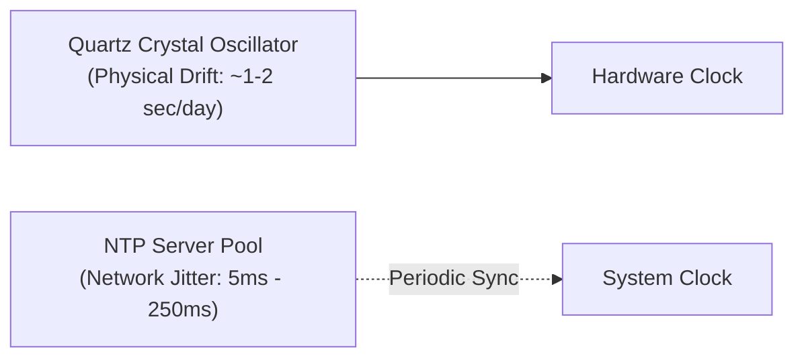
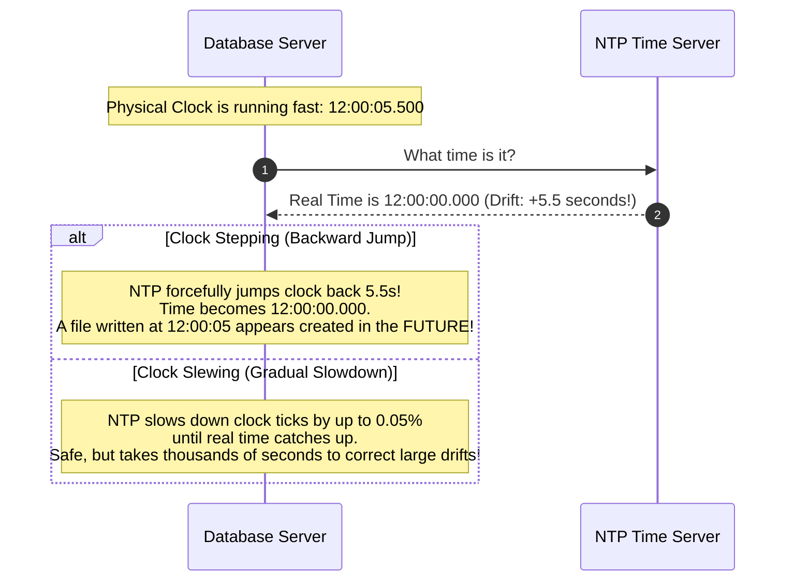
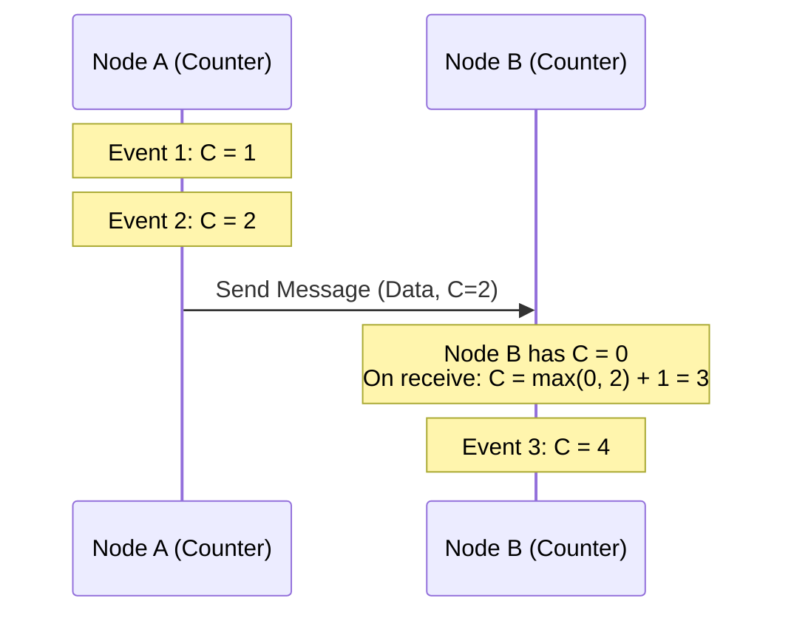
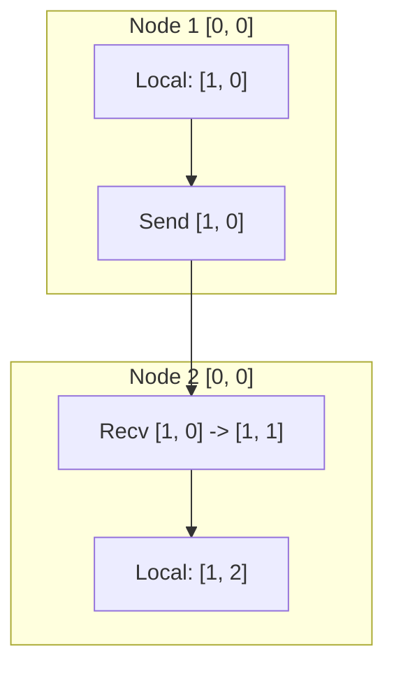
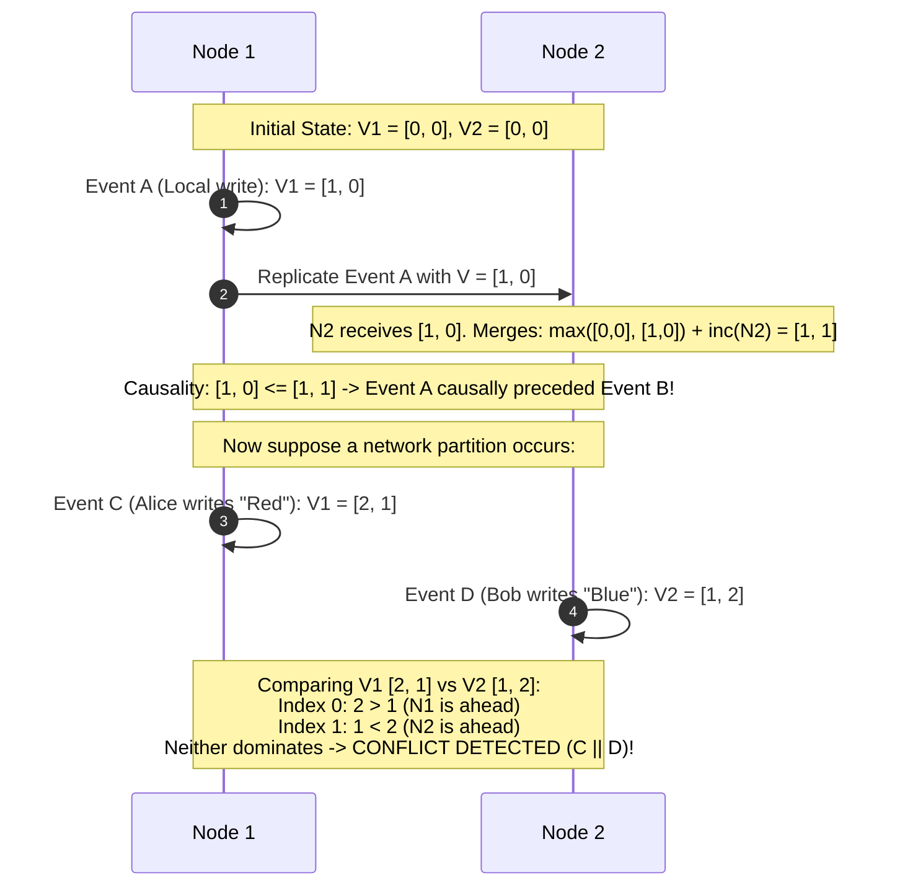
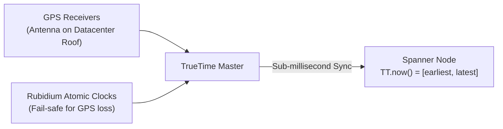
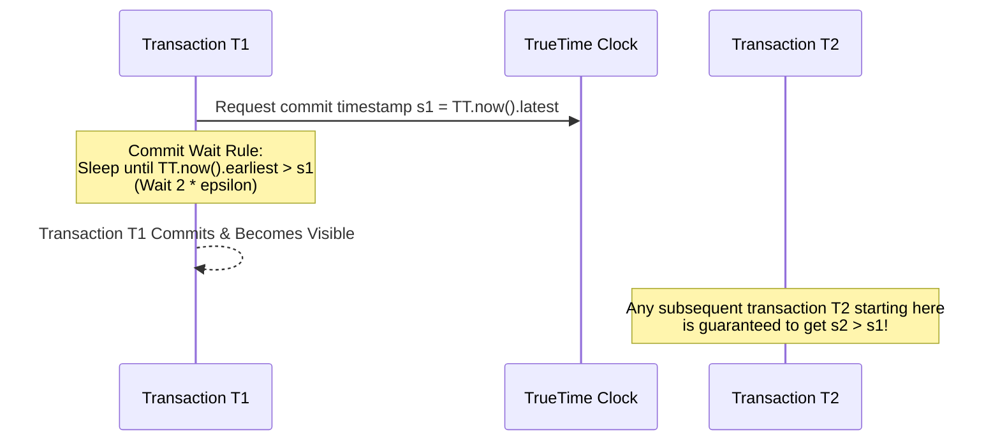
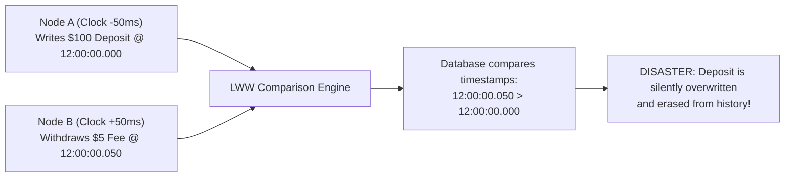

# Clocks, Time, and Ordering in Distributed Systems

Ordering events across multiple machines without a shared CPU or shared memory is one of the most deceptively difficult problems in computer science.

---

## 1. The Perils of Physical Clocks

Every physical server possesses an internal hardware clock driven by a quartz crystal oscillator.

### 💡 Intuitive Real-World Analogy
Imagine two runners competing in a cross-country marathon. One starts in New York wearing a $10 quartz digital watch, and the other starts in Miami wearing a different $10 watch.
- Temperature in New York is 20°F (-6°C); in Miami it is 95°F (35°C).
- Quartz crystals vibrate at frequencies that fluctuate with temperature.
- After 4 hours, New York's watch is 3 seconds slow, while Miami's watch is 4 seconds fast.
- If both runners cross their respective checkpoints and log *"Crossed at 12:00:00.000"*, who crossed first? 
You cannot determine who won by comparing cheap local wristwatches. In a distributed cluster, every server is wearing its own drifting wristwatch.

### 👶 Plain-English / ELI5 Overview
Computers do not have a magical universal clock. Each computer has a tiny vibrating quartz crystal that counts seconds. Because of heat, aging hardware, and network lag when syncing with time servers, no two computers ever agree on the exact millisecond. If you rely on computer time to decide who made a payment first, you will corrupt your data.

### ⚠️ The Horror Scenario: The Last-Write-Wins (LWW) Bank Account Obliteration
Consider a distributed database using physical timestamps for Last-Write-Wins conflict resolution:

1. **Alice** deposits $10,000 into her savings account at real-world time $t = 12:00:00.050$. Her request hits **Node 1**, whose clock runs **$50\text{ ms}$ slow** due to NTP sync lag. Node 1 stamps the write with timestamp **$12:00:00.000$**.
2. Earlier, at real-world time $t = 12:00:00.010$, a recurring $1 monthly bank maintenance fee is deducted on **Node 2**, whose clock runs **on time**. Node 2 stamps the deduction with timestamp **$12:00:00.010$**.
3. When the two nodes replicate data, the database compares the timestamps to determine the "latest" value:
   $$\text{Node 2 Timestamp } (12:00:00.010) > \text{Node 1 Timestamp } (12:00:00.000)$$
4. **The Disaster:** The database decides the $1 maintenance fee is newer than the $10,000 deposit! The deposit record is silently deleted, and Alice's balance drops. Alice's life savings vanish due to 50 milliseconds of clock drift.

### 🚶 Step-by-Step Scenario: Clock Slew and NTP Steps
Let's see what happens when NTP synchronizes time across two nodes:

### Why Physical Clocks Drift
1. **Thermal Variation:** Changes in server room ambient temperature alter the quartz vibration frequency (drift of $\sim 17\text{ seconds/week}$).
2. **NTP Latency & Jitter:** Network Time Protocol (NTP) adjusts clocks over the network, but network transit delays are asymmetric and unpredictable.
3. **Leap Seconds & Clock Steps:** If a clock drifts far ahead, NTP may "step" the clock backward, causing $t_2 < t_1$ on the same machine! Monotonic clock APIs (`clock_gettime(CLOCK_MONOTONIC)`) prevent backward jumps locally, but cannot be compared across different servers.

### 🏢 Real-World Production Battle-Testing
- **Cloudflare (2017 Leap Second Outage):** On New Year's Eve 2017, a leap second was inserted into UTC. Certain DNS servers saw time step backward. Code calculating elapsed time using wall-clock time resulted in negative durations, triggering internal runtime panics that took down 1% of the global internet's DNS resolution.
- **Apache Cassandra:** By default, Cassandra uses client-side timestamps for Last-Write-Wins (LWW). Production operators run dedicated PTP (Precision Time Protocol) or Chrony daemons with tight monitoring alerts to keep clock drift below $1\text{ ms}$, but even then, silent column overwrites remain a known operational hazard.

### ⚖️ Practical Trade-Offs & Rules of Thumb
- **Rule 1:** Never use `System.currentTimeMillis()` (wall-clock time) to measure elapsed intervals or benchmark performance. Always use monotonic clocks (`System.nanoTime()` in Java, `clock_gettime(CLOCK_MONOTONIC)` in Linux/C++, `time.monotonic()` in Python).
- **Rule 2:** Never rely on physical wall-clock timestamps for serializability across independent nodes unless you have hardware-backed bounded uncertainty (like Google TrueTime).

---

## 2. Lamport Timestamps (Logical Clocks)

Introduced by Leslie Lamport in his landmark 1978 paper *"Time, Clocks, and the Ordering of Events in a Distributed System"*.

### 💡 Intuitive Real-World Analogy
Imagine a courtroom trial where witnesses cannot remember what time of day events took place, but they remember the exact sequence of letters exchanged:
- Alice mails Letter #10 to Bob.
- When Bob receives Letter #10, he writes back: *"I received your letter #10, and my response is Letter #11"*.
- Even if Alice and Bob are in different time zones and Bob's kitchen clock is broken, anyone reading the letters knows with 100% certainty that Alice's letter #10 came before Bob's response #11.
Logical clocks discard wall-clock time entirely and use a monotonically increasing numbering chain based on causality.

### 👶 Plain-English / ELI5 Overview
Forget about hours, minutes, and seconds. Every server has a simple counter starting at 0. Every time a server does something, it adds 1. When it sends a message, it includes its counter. When another server receives that message, it looks at the sender's counter, sets its own counter to whichever number is higher, and adds 1. This guarantees that causes always have smaller numbers than effects.

### The Algorithm
Every node maintains a monotonically increasing integer counter $C$:
1. **Local Action:** Before executing a local event, increment counter:
   $$C = C + 1$$
2. **Sending a Message:** Attach current counter $C$ to the network packet.
3. **Receiving a Message:** Upon receiving a message with timestamp $C_{msg}$, update local counter:
   $$C_{local} = \max(C_{local}, C_{msg}) + 1$$

### Total Ordering
Lamport timestamps provide a partial order. To create a deterministic **total order**, tie-break using unique node IDs:

$$(C_1, \text{node}_1) < (C_2, \text{node}_2) \iff C_1 < C_2 \lor (C_1 = C_2 \land \text{node}_1 < \text{node}_2)$$

### ⚠️ The Horror Scenario: The False-Causality Bug
A developer assumes that because Lamport timestamp $C(A) < C(B)$, event $A$ must have caused event $B$:
- Node A generates Event $A$ with counter $C(A) = 3$ (e.g., "User deletes document").
- Node B is completely disconnected, hasn't talked to Node A in 3 days, and generates Event $B$ with counter $C(B) = 15$ (e.g., "User edits document").
- The developer writes code assuming: *"Since $C(A) < C(B)$, the deletion happened before the edit, so we must keep the edit and discard the deletion."*
- **The Bug:** Event $A$ and Event $B$ were totally independent and concurrent! Lamport timestamps cannot detect concurrency.

### The Mathematical Limitation
Lamport timestamps satisfy the forward property:
$$\text{If } A \to B \implies C(A) < C(B)$$
**However, the inverse is NOT true:**
$$C(A) < C(B) \ \not\Longrightarrow\ A \to B$$
You cannot determine whether two events were causally related or occurred concurrently just by looking at scalar integers.

### 🏢 Real-World Production Battle-Testing
- **Distributed Tracing (OpenTelemetry & Jaeger):** Span IDs and parent-child causal relationships emulate Lamport logical progressions to visualize the path of an HTTP request through 50 microservices.

### ⚖️ Practical Trade-Offs
- **Pros:** Minimal memory footprint (just a 64-bit integer); zero network overhead.
- **Cons:** Cannot detect concurrent operations; cannot determine if two independent events branched.

---

## 3. Vector Clocks

To accurately detect concurrent operations and causal relationships, every node maintains a **vector (array/map) of clocks**, with one entry per node in the cluster.

$$V = [c_1, c_2, \dots, c_N]$$

### 💡 Intuitive Real-World Analogy
Imagine three detectives—**Alice**, **Bob**, and **Charlie**—collaborating on a case:
- Each detective keeps a notebook scorecard tracking how many clues each detective has discovered: `[Alice: 3, Bob: 2, Charlie: 1]`.
- Alice solves a new clue $\to$ increments her own slot: `[Alice: 4, Bob: 2, Charlie: 1]`.
- She faxes her notebook to Charlie. Charlie merges Alice's scorecard with his own, taking the highest number for each detective.
- If Detective Bob has a scorecard `[Alice: 2, Bob: 5, Charlie: 1]`, we can compare Bob's and Alice's scorecards:
  - Alice has seen clues from herself that Bob hasn't seen (`4 > 2`).
  - Bob has seen clues from himself that Alice hasn't seen (`5 > 2`).
- Conclusion: Alice and Bob discovered clues **concurrently**! They must sit down and merge their theories.

### 👶 Plain-English / ELI5 Overview
Instead of each computer keeping just one number, every computer keeps a list of numbers—one for every computer in the system. By comparing two lists, you can instantly see if one change came strictly after another, or if two computers made conflicting changes at the exact same time without knowing about each other.

### ⚠️ The Horror Scenario: The Disappearing Shopping Cart
In an AP database without vector clocks, a customer is shopping on Amazon:
1. Customer on their phone adds a pair of headphones to their cart $\to$ hits Node 1.
2. Simultaneously, customer on their laptop removes a phone charger from their cart $\to$ hits Node 2.
3. Node 1 and Node 2 cannot talk immediately due to cross-datacenter latency.
4. Without vector clocks, a naive timestamp comparison overwrites one update with the other. The customer either pays for the deleted charger or loses the headphones they just added!
5. **With Vector Clocks:** The database identifies that both writes occurred concurrently ($V_1 \parallel V_2$). It preserves **both** cart states as "siblings" and lets the shopping cart service present both items to the customer.

### 🚶 Step-by-Step Scenario: Determining Causality vs Concurrency
Consider two nodes, **Node 1** and **Node 2**, managing a shared document:

### Update Rules
1. **Local Event on Node $i$:**
   $$V_i[i] = V_i[i] + 1$$
2. **Sending Message:** Node $i$ sends its full vector $V_i$.
3. **Receiving Message:** Node $j$ receives vector $V_{msg}$ and updates each component:
   $$V_j[k] = \max(V_j[k], V_{msg}[k]) \quad \forall k$$
   $$V_j[j] = V_j[j] + 1$$

### Determining Causality Between Vectors $V_A$ and $V_B$
- **$V_A \le V_B$:** True if and only if every element in $V_A$ is less than or equal to the corresponding element in $V_B$:
  $$\forall k, \ V_A[k] \le V_B[k]$$
- **$A$ causally preceded $B$ ($A \to B$):**
  $$V_A \le V_B \quad \text{and} \quad V_A \neq V_B$$
- **$A$ and $B$ are Concurrent ($A \parallel B$):**
  $$\exists i, j \quad \text{such that} \quad V_A[i] > V_B[i] \quad \text{and} \quad V_A[j] < V_B[j]$$

When two writes are concurrent ($A \parallel B$), a conflict is detected. Systems like Amazon Dynamo pass both versions (siblings) back to the client application for domain-level resolution.

### 🏢 Real-World Production Battle-Testing
- **Amazon Dynamo (Original Paper):** Vector clocks powered Dynamo's shopping cart conflict detection across multiple master datacenters.
- **Riak KV:** Uses dotted version vectors (an optimized variant of vector clocks) to detect sibling conflicts in distributed key-value storage.

### ⚖️ Practical Trade-Offs & Vector Bloat
- **The Vector Bloat Problem:** In large systems with thousands of clients or dynamic nodes, the vector clock array grows infinitely ($O(N)$ size per key).
- **Pruning Hazards:** If you truncate old vector entries to save memory, you risk mistaking causally ordered writes for concurrent conflicts.

---

## 4. Google TrueTime & Bounded Uncertainty

In Google Spanner (2012), Google solved distributed ordering across worldwide datacenters by building specialized physical hardware rather than relying solely on logical clocks.

### 💡 Intuitive Real-World Analogy
Imagine two high-speed photo finishes at the Olympic Games, but in two different stadiums on opposite sides of the Earth:
- The clock in Stadium Tokyo has an uncertainty of $\pm 5\text{ ms}$.
- The clock in Stadium London has an uncertainty of $\pm 5\text{ ms}$.
- Tokyo records Sprinter 1 crossing the finish line at `10:00:00.000` (meaning anywhere between `09:59:59.995` and `10:00:00.005`).
- How can London record Sprinter 2 and be **100% mathematically certain** that Sprinter 2 started *strictly after* Sprinter 1 finished?
- London forces Sprinter 2 to **stand still and wait** until London's clock reaches `10:00:00.010` ($2 \times \text{uncertainty}$).
- By deliberately pausing for the maximum possible clock uncertainty, time overlap is physically impossible!

### 👶 Plain-English / ELI5 Overview
Instead of pretending a computer clock knows the exact microsecond, Google's TrueTime says: *"I don't know the exact time, but I am 100% certain the real time is between 2:00:00.001 and 2:00:00.007"*. To make sure no two events are ever confused, Google makes servers wait out that tiny 7-millisecond blur before confirming a write. This guarantees global chronological order without servers having to talk to each other across oceans.

### ⚠️ The Horror Scenario: The Global Financial Arbitrage Race
A global cryptocurrency and stock exchange spans Tokyo, New York, and London:
1. Trader in Tokyo purchases 500 shares of stock at 09:30:00.002.
2. Tokyo immediately triggers an API event causing a program in New York to sell those 500 shares at 09:30:00.004.
3. If the distributed database uses loose physical clocks with 10ms drift, New York's clock might assign the sale a timestamp of 09:30:00.000.
4. **The Disaster:** A regulatory audit inspects the immutable ledger and discovers that the stock was sold *before* it was bought! Trading licenses are revoked, transactions are frozen, and millions in fines are levied.

### The TrueTime API
Instead of returning a single scalar timestamp, Spanner's `TT.now()` returns an interval with bounded uncertainty:

$$\text{TT.now}() = [t_{\text{earliest}}, \ t_{\text{latest}}] \quad \text{where} \quad t_{\text{latest}} - t_{\text{earliest}} = 2\epsilon$$

- $\epsilon$ is the maximum clock drift uncertainty (typically bounded to $< 7\text{ ms}$).

### The Commit Wait Invariant
To ensure external consistency (linearizability) across globally distributed transactions:
> If Transaction $T_2$ is initiated after Transaction $T_1$ commits, $T_2$'s commit timestamp MUST be strictly greater than $T_1$'s commit timestamp ($s_2 > s_1$).

### 🚶 Step-by-Step Scenario: How Commit Wait Eliminates Race Conditions
1. **Transaction $T_1$ executes** on a server in North America.
2. At commit time, the server calls `TT.now()`, which returns `[100, 108]` ($\epsilon = 4\text{ms}$).
3. The server chooses the commit timestamp $s_1 = 108$ (the maximum bound).
4. **The Commit Wait:** The server refuses to release its locks or notify the client. It pauses until `TT.now().earliest > 108`.
5. Once the real-world time has safely passed 108, $T_1$ commits and releases its locks.
6. Now, suppose a client sees $T_1$'s result and immediately fires Transaction $T_2$ on a server in Europe.
7. Europe calls `TT.now()`. Because physical time has already advanced past 108, Europe's `TT.now().latest` is guaranteed to be at least 109.
8. Therefore, $s_2 \ge 109 > s_1$. Causality is physically guaranteed without North America and Europe exchanging a single consensus message!

### 🏢 Real-World Production Battle-Testing
- **Google Cloud Spanner:** Powers Google Play, Google Ads, and large multi-region financial platforms. Spanner delivers global ACID transactions with serializable consistency across 5 continents.
- **CockroachDB & Hybrid Logical Clocks (HLC):** Because CockroachDB runs on commodity cloud hardware (AWS/GCP/Azure) without Google's proprietary GPS antennas and atomic clock datacenter racks, it uses **Hybrid Logical Clocks (HLC)**—combining physical NTP time with Lamport logical counters—to provide serializable transactions without TrueTime hardware.

### ⚖️ Practical Trade-Offs & Rules of Thumb
- **TrueTime:** Requires custom datacenter infrastructure (GPS receivers on datacenter roofs + rubidium atomic clocks in server rooms). Adds a deliberate $2\epsilon$ ($\sim 7\text{ ms}$) commit latency to all mutating transactions.
- **When to use TrueTime / HLC:** Multi-region distributed databases requiring strict serializability and globally consistent read snapshots at a specific point in time without cross-continental lock contention.

---

## 🎯 Top Real-World Interview Questions & Deep-Dive Answers (FAANG / Staff Level)

### Question 1: Why is using physical system time (`System.currentTimeMillis()`) fatal for distributed financial transaction ordering? What exact bugs occur?
#### Answer:
Relying on physical system clocks for ordering transactions across multiple nodes violates fundamental physical causality due to **clock skew, NTP jitter, and backward stepping**:
1. **The Asymmetric Network Tax:**
   - Network Time Protocol (NTP) syncs time over the internet or intranet by exchanging UDP packets with time servers.
   - NTP calculations assume symmetric network delay. In reality, router congestion, switch buffering, and asymmetric fiber routing mean outbound and inbound delays fluctuate unpredictably.
   - Typical physical clock drift in standard public cloud VMs ranges from **$5\text{ms}$ to over $250\text{ms}$**!
2. **The Backward Time Step Hazard:**
   - If a server's clock drifts ahead by 500ms, NTP may abruptly "step" the clock backward to sync with UTC.
   - Any transaction committed immediately after the step receives a timestamp *earlier* than transactions committed seconds ago on the same machine!
3. **The Last-Write-Wins (LWW) Silent Obliteration:**
   - If a user withdraws money on Node A (clock running 100ms slow) and immediately checks their balance on Node B (clock running 50ms fast), the balance check or subsequent debit can be stamped with a timestamp that appears *older* than the first write.
   - A database using LWW will silently drop the newer write, corrupting the financial ledger and failing accounting audits.

---

### Question 2: How do Vector Clocks detect concurrent writes vs. causal dependencies? Walk through an explicit example with vector comparisons.
#### Answer:
A Vector Clock is an array/map of logical counters: $V = [c_1, c_2, \dots, c_N]$ where $N$ is the number of participating nodes.
1. **The Invariants:**
   - **Causal Precedence ($V_A \le V_B$):** Event $A$ causally preceded Event $B$ if and only if:
     $$\forall k, \ V_A[k] \le V_B[k] \quad \text{AND} \quad \exists k, \ V_A[k] < V_B[k]$$
   - **Concurrency ($V_A \parallel V_B$):** Events $A$ and $B$ occurred concurrently without mutual knowledge if:
     $$\exists i, j \text{ such that } V_A[i] > V_B[i] \quad \text{AND} \quad V_A[j] < V_B[j]$$
2. **Concrete Step-by-Step Walkthrough:**
   - Suppose a document is replicated across 3 nodes ($[N_1, N_2, N_3]$), starting at $[0, 0, 0]$.
   - **Step 1:** Client 1 edits document on $N_1 \to$ Increments $N_1$'s slot: $V_1 = [1, 0, 0]$.
   - **Step 2:** $N_1$ replicates to $N_2$. $N_2$ receives $[1, 0, 0]$ and applies local edit $\to V_2 = [1, 1, 0]$.
     - *Check:* $[1, 0, 0] \le [1, 1, 0]$. Here $V_1$ causally preceded $V_2$. No conflict.
   - **Step 3 (The Split):** A network partition severs $N_1$ from $N_2$.
     - User on $N_1$ changes title to "Doc X" $\to V_1 = [2, 1, 0]$.
     - User on $N_2$ concurrently changes title to "Doc Y" $\to V_2 = [1, 2, 0]$.
   - **Step 4 (Reconciliation):** When the partition heals, the nodes compare vectors:
     - At index 0: $V_1[0] = 2 > V_2[0] = 1$ ($N_1$ is ahead).
     - At index 1: $V_1[1] = 1 < V_2[1] = 2$ ($N_2$ is ahead).
   - **Result:** Neither vector dominates! The system flags a **Concurrent Conflict ($V_1 \parallel V_2$)** and returns both versions as siblings to the client application for domain-level resolution.

---

### Question 3: Why does Google Spanner enforce the "Commit Wait" rule in TrueTime, and what happens to database performance if clock drift ($\epsilon$) spikes?
#### Answer:
Spanner's TrueTime returns an interval $[t_{\text{earliest}}, t_{\text{latest}}]$ of size $2\epsilon$, where $\epsilon$ is the bounded uncertainty (typically $< 7\text{ms}$).
1. **The Invariant:**
   - To guarantee external consistency (linearizability), if transaction $T_2$ starts after transaction $T_1$ commits, $T_2$'s commit timestamp must be strictly greater than $T_1$'s: $s_2 > s_1$.
2. **The Commit Wait Mechanism:**
   - When $T_1$ commits, the leader picks a commit timestamp $s_1 = \text{TT.now}().\text{latest}$.
   - The leader **intentionally sleeps (Commit Wait)** until it is guaranteed that the absolute real-world time has passed $s_1$:
     $$\text{Wait until } \text{TT.now}().\text{earliest} > s_1 \quad (\text{Duration } \approx 2\epsilon)$$
   - After the wait, $T_1$ releases its locks and replies to the client.
3. **What Happens if $\epsilon$ Spikes to 500ms?**
   - If GPS antennas lose satellite locks or atomic clocks experience thermal failure, $\epsilon$ grows.
   - **Safety is NEVER violated:** Because Spanner waits for $2\epsilon$, transactions will never be assigned out-of-order timestamps, preserving 100% linearizability.
   - **Throughput & Latency Collapse:** Every mutating transaction must now sleep for $2 \times 500\text{ms} = 1\text{ second}$ while holding exclusive row locks! Lock contention skyrockets, connection queues fill, and write throughput drops precipitously. This is why Google monitors $\epsilon$ with high-priority paging alerts.
