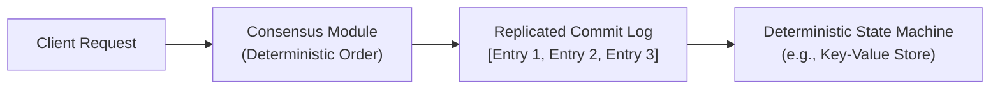
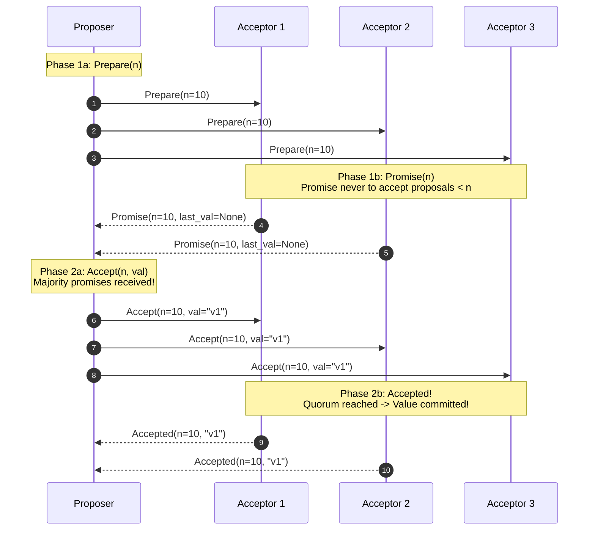
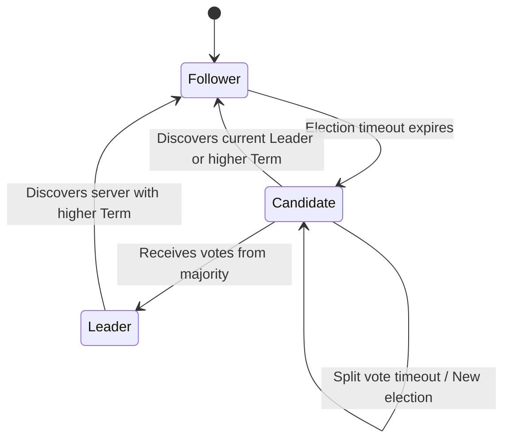
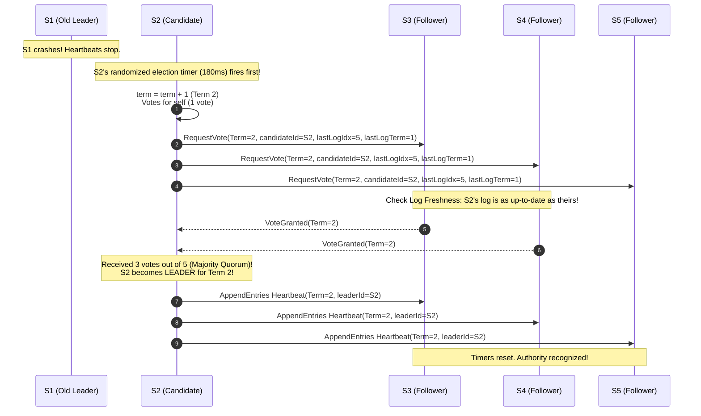
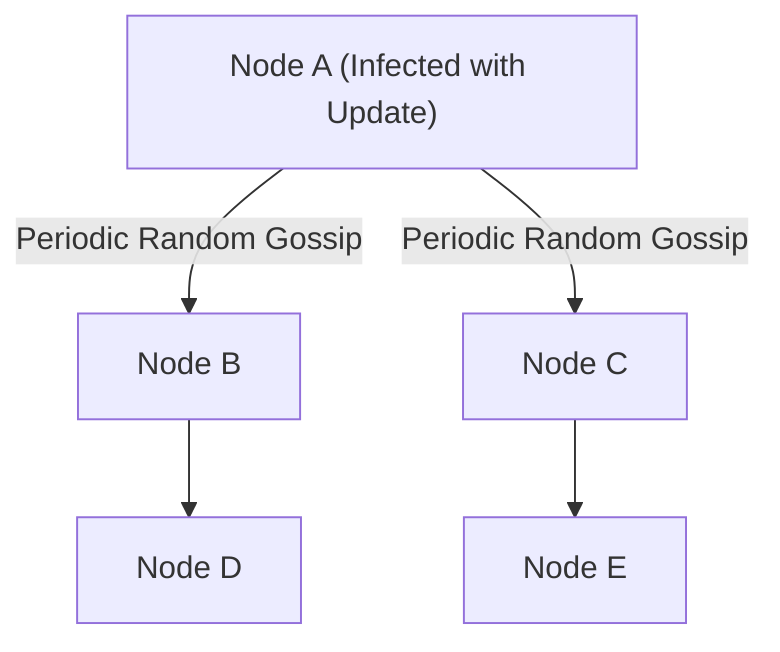
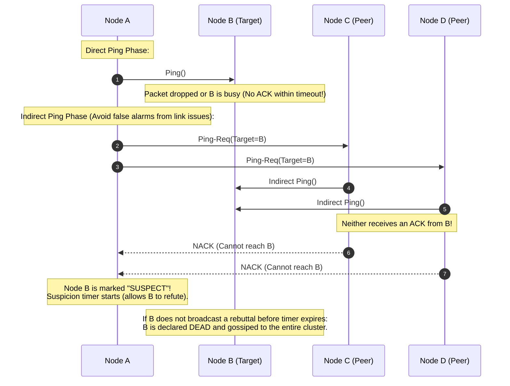
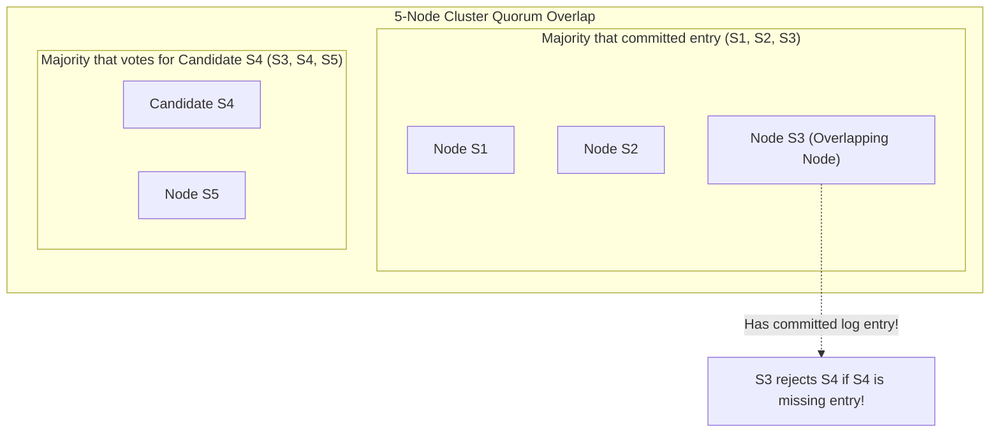

# Consensus Algorithms: Paxos, Raft, ZAB, and Gossip

How do independent servers agree on a single shared state when networks drop packets, delay messages indefinitely, and servers crash without warning?

---

## 1. State Machine Replication (SMR)

The standard paradigm for building fault-tolerant distributed systems:

### 💡 Intuitive Real-World Analogy
Imagine two grandmasters in different cities playing an identical game of chess. Each master has an identical board with pieces in the starting positions.
- A courier delivers a shared scoresheet of moves: `1. e4 e5`, `2. Nf3 Nc6`, `3. Bb5 a6`.
- As long as both grandmasters execute the **exact same moves in the exact same sequence**, their chessboards will always look 100% identical.
- The consensus protocol does not care about chess strategy—its sole job is making sure the couriers never mix up the order of the moves on the scoresheet.

### 👶 Plain-English / ELI5 Overview
If you give identical computers the exact same starting point and make them run the exact same list of instructions in the exact same order, they will end up with the exact same result. Consensus is just getting computers to agree on that instruction list.

### ⚠️ The Horror Scenario: Out-of-Order Execution in Financial Banking
Suppose two database replicas receive two concurrent operations for an account starting with `$50`:
- **Operation 1:** `Deposit $100`
- **Operation 2:** `Withdraw $80`

1. **Replica A executes Operation 1 then 2:**
   - Balance becomes $\$50 + \$100 = \$150$.
   - Withdrawal of $\$80$ succeeds.
   - Final Balance on Replica A: **$\$70$**.
2. **Replica B executes Operation 2 then 1 (out of order!):**
   - Attempt withdrawal of $\$80$ on $\$50$ balance $\to$ **REJECTED (Insufficient Funds)** + $\$35$ overdraft fee assessed!
   - Deposit of $\$100$ executes.
   - Final Balance on Replica B: **$\$115$**.
3. **The Disaster:** Two replicas have permanently diverged. Neither can be trusted. Customer balances are corrupted, audits fail, and engineers must manually reconstruct transactions from raw logs.

---

## 2. Paxos Protocol (Leslie Lamport, 1998)

Paxos is the foundational consensus protocol that proved consensus is solvable in asynchronous networks with crash-stop faults.

### 💡 Intuitive Real-World Analogy
Imagine a chaotic Greek parliament where politicians frequently wander off, fall asleep, or leave the chamber:
- A politician (Proposer) wants to pass a law.
- **Phase 1 (Prepare):** The politician sends a messenger to all parliamentarians (Acceptors): *"Will you promise to ignore any bill older than Bill #10?"* If a majority of politicians reply *"Promise! And by the way, the last bill I agreed to consider was Bill #8 with text 'Build an Aqueduct'"*, the proposer must adopt that text!
- **Phase 2 (Accept):** The politician sends out the final bill: *"Please vote on Bill #10 ('Build an Aqueduct')!"* If a majority accepts, the law is officially enacted!

### 👶 Plain-English / ELI5 Overview
Paxos is the original mathematical algorithm that proved a majority of computers can agree on a decision even if network messages are lost, duplicated, or delayed, as long as more than half of the computers are running and honest.

### The Roles
- **Proposers:** Propose values (client requests) tagged with a unique, monotonically increasing proposal number $n$.
- **Acceptors:** Form the consensus quorum ($Q = \lfloor N/2 \rfloor + 1$). They vote on proposals.
- **Learners:** Learn the agreed-upon value once a majority of acceptors have accepted it.

### ⚠️ The Horror Scenario: Paxos Dueling Proposers (Livelock)
In basic Paxos, if two proposers compete without a designated leader:
1. Proposer 1 broadcasts `Prepare(n=1)`. Acceptors promise.
2. Before Proposer 1 can send `Accept(n=1)`, Proposer 2 broadcasts `Prepare(n=2)`. Acceptors make a new promise to ignore $n < 2$.
3. Proposer 1 sends `Accept(n=1)` $\to$ **Rejected** by acceptors!
4. Proposer 1 immediately retries with `Prepare(n=3)`. Acceptors promise $n=3$, invalidating Proposer 2's `Prepare(n=2)`.
5. Proposer 2's `Accept(n=2)` is rejected. Proposer 2 retries with `Prepare(n=4)`.
6. **The Result:** The system is in an infinite livelock. Zero progress is made, CPUs run at 100%, and the cluster is effectively dead while remaining fully operational.

### Multi-Paxos Optimization
Basic Paxos requires two full round-trips (Prepare $\to$ Promise $\to$ Accept $\to$ Accepted) for every single log entry. Multi-Paxos solves dueling proposers by electing a stable leader once; subsequent log entries skip Phase 1 entirely and only require a single round-trip (Phase 2), providing high-throughput streaming replication.

---

## 3. Raft Consensus Algorithm

Designed by Diego Ongaro and John Ousterhout (Stanford, 2014) specifically to replace Paxos with an algorithm that is understandable, intuitive, and verifiable.

### 💡 Intuitive Real-World Analogy
Imagine a democratic republic governed by presidential terms:
- A President (Leader) rules during Term $T$.
- The President must constantly send telegrams ("Heartbeats") to all citizens (Followers): *"I am alive, do not panic."*
- Every citizen has a countdown timer on their desk. Every time a telegram arrives, the timer resets.
- If a citizen's timer expires because the President died or the telegraph lines were cut, that citizen stands up and declares: *"The President is gone! I am running for election in Term $T+1$!"* (Candidate).
- Citizens cast their vote for the first candidate who asks, but **only if that candidate has read every single historical law book that the voter has read**.
- Once a candidate receives votes from a majority of citizens, they take office as the new President.

### 👶 Plain-English / ELI5 Overview
Raft breaks consensus down into three straightforward problems:
1. **Leader Election:** If the boss server dies, pick a new boss using randomized timers.
2. **Log Replication:** The boss receives commands from clients and copies them to everyone else.
3. **Safety:** Make sure no one can be elected boss if they missed any committed messages from the past.

### ⚠️ The Horror Scenario: The Split-Brain Disk Destroyer
Suppose a 5-node cluster running Kubernetes `etcd` manages storage volumes for microservices.
1. A network switch partitions the cluster into two islands: Island A has 2 nodes (`S1`, `S2`); Island B has 3 nodes (`S3`, `S4`, `S5`).
2. If the consensus protocol lacked strict majority quorum checks, Island A might elect `S1` as leader, while Island B elects `S3` as leader (**Split-Brain**).
3. Client 1 tells `S1` to mount a distributed storage disk to Pod X.
4. Client 2 tells `S3` to mount that exact same physical storage disk to Pod Y.
5. Both pods write to raw block storage concurrently, clobbering filesystem superblocks and corrupting the database beyond repair.
6. **How Raft Prevents This:** Island A only has 2 votes out of 5 ($\le 50\%$). It can **never** elect a leader or commit entries. Only Island B (3 votes out of 5, a strict majority) can elect a leader and commit writes.

### 🚶 Step-by-Step Scenario: Leader Election & Log Replication
Let's trace a 5-node cluster (`S1`, `S2`, `S3`, `S4`, `S5`):

### 1. Server States & Terms
- Time is divided into **Terms** ($1, 2, 3, \dots$), acting as logical clocks.
- A node is always in one of three states:
  - **Follower:** Completely passive; responds to incoming RPCs from leaders and candidates.
  - **Candidate:** Transitions here when its election timer expires; requests votes to become leader.
  - **Leader:** Handles all client requests, coordinates log replication, and sends periodic empty `AppendEntries` heartbeats.

### 2. Leader Election
1. Each follower sets a **randomized election timeout** (typically between $150\text{ ms}$ and $300\text{ ms}$).
2. If no heartbeat is received before the timer fires:
   - Increments its current Term: $\text{term} \leftarrow \text{term} + 1$.
   - Transitions to **Candidate** state and votes for itself.
   - Broadcasts `RequestVote` RPCs to all peers.
3. If the candidate receives votes from a majority ($\lfloor N/2 \rfloor + 1$):
   - Transitions to **Leader**.
   - Immediately broadcasts heartbeats to assert authority and suppress other candidates.
4. **Randomized timeouts prevent Split Votes**: If two candidates start elections at the exact same moment and split the vote ($2-2-1$ in a 5-node cluster), their timers will fire at different intervals, allowing one candidate to quickly claim majority on the retry.

### 3. Log Replication & Safety Invariants
- **Client Request:** The leader appends the command to its local log.
- **Log Replication:** Leader sends `AppendEntries` RPC to all followers.
- **Commit:** Once the entry is replicated to a majority of nodes, the leader marks the entry as **committed** and applies it to its local state machine.
- **Leader Completeness Property:** A voter **rejects** a candidate's vote if the candidate's log is less up-to-date than the voter's own log. This mathematically guarantees that any candidate elected leader **must already contain all committed entries from all previous terms**!

### 🏢 Real-World Production Battle-Testing
- **Kubernetes / etcd:** Every Kubernetes cluster depends on `etcd` (a Raft implementation) to store all cluster state, pod schedules, and secret keys. If etcd loses quorum, Kubernetes stops scheduling.
- **CockroachDB (Multi-Raft):** Shards data into 64MB ranges, where each range is an independent 3- or 5-node Raft consensus group. Tens of thousands of Raft consensus groups run simultaneously on a single cluster.

---

## 4. ZAB Protocol (ZooKeeper Atomic Broadcast)

Used by Apache ZooKeeper for cluster coordination, service discovery, and metadata storage.

### 💡 Intuitive Real-World Analogy
Imagine a naval fleet led by an Admiral on a Flagship:
- Every order issued by the Admiral has a 64-bit dispatch number (`zxid`). The first 32 bits represent the Admiral's epoch (reign), and the second 32 bits represent a simple counter.
- If the Admiral's ship is torpedoed, the remaining captains assemble.
- The captain whose log contains the highest `zxid` is elected the new Admiral.
- Before issuing any new naval orders, the new Admiral broadcasts all missing dispatches to catch up any lagging ships.

### 👶 Plain-English / ELI5 Overview
ZAB is ZooKeeper's consensus engine. Unlike Raft, which was built for general replicated logs, ZAB was specifically designed for primary-backup systems where one master dictates tree updates (`znodes`) to standby followers.

### Characteristics
- Designed specifically for primary-backup systems.
- Two primary modes:
  1. **Crash-Recovery Mode:** If the leader crashes, the cluster runs Fast Leader Election (FLE) to elect a leader with the highest transaction ID (`zxid`). Replicas synchronize missing logs with the new leader.
  2. **Atomic Broadcast Mode:** Similar to a Two-Phase Commit (2PC) without an abort option. The leader sends a proposal, followers send an ACK, and upon receiving a majority of ACKs, the leader broadcasts a commit message.

### 🏢 Real-World Production Battle-Testing
- **Apache Kafka (pre-KRaft):** Used ZooKeeper/ZAB to manage topic partitions, broker registrations, and leader failovers.
- **Apache Hadoop (HDFS High Availability):** ZooKeeper ensures that only one Active NameNode controls the Hadoop cluster metadata, preventing dual-active split-brain corruption.

---

## 5. Gossip Protocols (Epidemic Dissemination) & SWIM

Consensus protocols (Raft, Paxos) require a strict majority quorum and do not scale gracefully beyond $\sim 7 - 9$ nodes due to network message saturation ($O(N^2)$).

For clusters with thousands of nodes (e.g., Cassandra, Consul, Redis Cluster), **Gossip Protocols** provide decentralized, eventual consistency and failure detection.

### 💡 Intuitive Real-World Analogy
- **Gossip (Epidemic):** Imagine high school rumors. If one student learns juicy gossip, they whisper it to 3 friends at lunch. Each of those friends whispers it to 3 other friends. Within 15 minutes, every student in the school knows the rumor, even though no one made a school-wide PA announcement.
- **SWIM (Friend Check):** If you call your friend Bob and his phone goes straight to voicemail, you don't immediately declare him dead. You text 3 mutual friends: *"Hey, can any of you reach Bob?"* If none of them can reach him either, only then do you report him missing.

### 👶 Plain-English / ELI5 Overview
Instead of having one central server monitor 10,000 machines (which would crush the network), every server picks 3 random servers every second and asks: *"Are you okay? Here is what I know"*. Updates and dead-server notices spread like a friendly virus across the entire datacenter in seconds.

### ⚠️ The Horror Scenario: The $O(N^2)$ Network Heartbeat Storm
A platform team builds an in-house cluster monitoring system:
1. Every node broadcasts an HTTP heartbeat to every other node every second.
2. At 10 nodes: $10 \times 10 = 100\text{ packets/sec}$ (works fine).
3. The cluster scales to 2,000 nodes: $2,000 \times 2,000 = \mathbf{4,000,000\text{ packets/sec}}$!
4. Network switches saturate. Switch buffers overflow and drop packets.
5. Nodes stop receiving heartbeats and falsely assume all other nodes have crashed.
6. Servers enter a catastrophic failover loop, taking down the entire enterprise infrastructure.
7. **With SWIM:** Network overhead per node remains constant $O(1)$, completely immune to cluster size!

### 🚶 Step-by-Step Scenario: The SWIM Failure Detection Protocol
How the Structured Weakly-Consistent Infection-Style Process Group Membership Protocol (SWIM) works:

### Properties of Gossip Protocols
- **Epidemic Dissemination:** Every $T$ milliseconds, each node selects $k$ random peer nodes (fan-out) and transmits its current cluster state metadata.
- **Exponential Convergence:** Information spreads to all $N$ nodes in $O(\log N)$ gossip rounds.
- **Decentralized & Resilient:** No single point of failure; immune to arbitrary node crashes.

### 🏢 Real-World Production Battle-Testing
- **HashiCorp Consul & Nomad:** Use Serf (a SWIM-based gossip library) to maintain cluster membership and detect server node failures across tens of thousands of instances.
- **Apache Cassandra:** Uses gossip to maintain cluster topology, token ring allocations, and schema synchronization.

---

## Summary: When to Use Which Protocol

| Requirement | Preferred Protocol | Communication Pattern | Fault Model | Examples |
| :--- | :--- | :--- | :--- | :--- |
| **Strict Linearizable Log Replication** | Raft / Multi-Paxos | Leader-to-Quorum | CFT ($2f + 1$) | [etcd](file:///home/prasanta/Documents/learning_folder/system_design/01_FOUNDATIONS_AND_PRINCIPLES/05_consensus_algorithms.md), Kubernetes, CockroachDB |
| **Centralized Coordination & Hierarchical Trees** | ZAB | Primary-to-Backups | CFT ($2f + 1$) | Apache ZooKeeper, Apache Kafka (pre-KRaft) |
| **Massive Cluster Membership & Heartbeats** | Gossip / SWIM | Random Peer-to-Peer | CFT (Probabilistic) | Apache Cassandra, Consul, Amazon DynamoDB |
| **Adversarial / Untrusted Nodes** | PBFT / Tendermint | All-to-All Signed Votes | BFT ($3f + 1$) | Blockchain networks, cryptographic ledgers |

---

## 🎯 Top Real-World Interview Questions & Deep-Dive Answers (FAANG / Staff Level)

### Question 1: How does Raft guarantee that a newly elected leader already contains all committed log entries from all previous terms? Explain the Leader Completeness property.
#### Answer:
Unlike Paxos, which allows a node to be elected leader even if it is missing committed entries and then forces the leader to "fill in the gaps", Raft enforces the **Leader Completeness Property**:
> If a log entry is committed in a given term, then that entry will be present in the logs of the leaders for all higher-numbered terms.

1. **The Invariant Rule in `RequestVote` RPC:**
   - When a candidate asks a follower for a vote, the follower **rejects** the vote if the candidate’s log is less up-to-date than the follower's own log:
   - A candidate's log is more up-to-date if:
     1. Its last log entry has a **higher term**, OR
     2. Its last log entry has the **same term, but a longer log length (higher index)**.
2. **The Quorum Overlap Proof:**
   - An entry is considered **committed** only after it has been replicated to a strict majority of nodes ($\lfloor N/2 \rfloor + 1$).
   - To become leader, a candidate must also win votes from a strict majority of nodes.
   - By the **Pigeonhole Principle**, any majority that elected the candidate MUST intersect with the majority that committed the entry by at least one node!
   - That overlapping node already contains the committed entry. Because that node refuses to vote for any candidate whose log is older than its own, **it is mathematically impossible to elect a candidate that lacks the committed entry**!

---

### Question 2: Why can't a single Raft or Paxos cluster scale to 100+ nodes to achieve higher write throughput? How does CockroachDB solve this via "Multi-Raft"?
#### Answer:
A single consensus group suffers from an **O(N) Leader Bottleneck and Latency Floor**:
1. **The Single Consensus Scaling Limit:**
   - Every single write must travel through the one elected Leader.
   - The Leader must broadcast log entries to all $N$ followers and wait for responses from $\lfloor N/2 \rfloor + 1$ nodes.
   - Adding more nodes does **NOT** increase write throughput; it **decreases** throughput because the leader has to send more network packets and wait for more remote ACKs! (A 3-node cluster is faster than a 9-node cluster).
2. **The Solution: Multi-Raft (CockroachDB & TiKV):**
   - Shard the database into small, independent horizontal key-ranges (e.g., 64MB chunks called *Ranges*).
   - Each individual 64MB Range is its own isolated 3-node or 5-node Raft consensus group!
   - Node 1 might be the Leader for Range A (`[a - g]`), while Node 2 is the Leader for Range B (`[h - p]`), and Node 3 is the Leader for Range C (`[q - z]`).
   - A cluster with 1,000 physical machines can host 100,000 independent Raft groups running concurrently across the fleet. Writes to Range A and Range B proceed fully in parallel with zero lock contention!

---

### Question 3: How does the SWIM gossip protocol detect node crashes in $O(1)$ CPU/network overhead per node, compared to traditional full-mesh heartbeats?
#### Answer:
In a 2,000-node cluster, full-mesh heartbeating requires each node to ping all 1,999 other nodes every second, generating $2,000 \times 2,000 = 4,000,000\text{ packets/second}$, saturating top-of-rack switches.
The **SWIM Protocol (Structured Weakly-Consistent Infection-Style Membership)** achieves $O(1)$ constant overhead per node using **Decoupled Failure Detection**:
1. **Direct Ping:** Every period $T$, Node $A$ selects one single peer $B$ uniformly at random and sends a `Ping`.
2. **Indirect Ping-Req (Handling Packet Jitter):** If Node $A$ does not receive an `Ack` within a short timeout, it does not declare $B$ dead. Node $A$ sends `Ping-Req(B)` to $k$ random peers (typically $k=3$).
   - These 3 peers ping Node $B$ independently across alternate network routes.
   - If any of them reach Node $B$, they forward the ACK to Node $A$. This prevents localized network switch blips from triggering false failovers.
3. **Suspicion Mechanism:** If indirect pings also fail, Node $B$ is marked `Suspect` (not `Dead`).
   - Node $A$ gossips: *"Node B is Suspect"*.
   - Node $B$ is given an incubation period (e.g., 5 seconds) to refute the suspicion by broadcasting: *"I am alive, incrementing my incarnation number!"*.
   - If no rebuttal is received, Node $B$ is permanently declared `Dead` and evicted from cluster membership.
   - **Network Overhead:** Every node only ever transmits a small, fixed number of UDP packets per second, completely independent of total cluster size.
