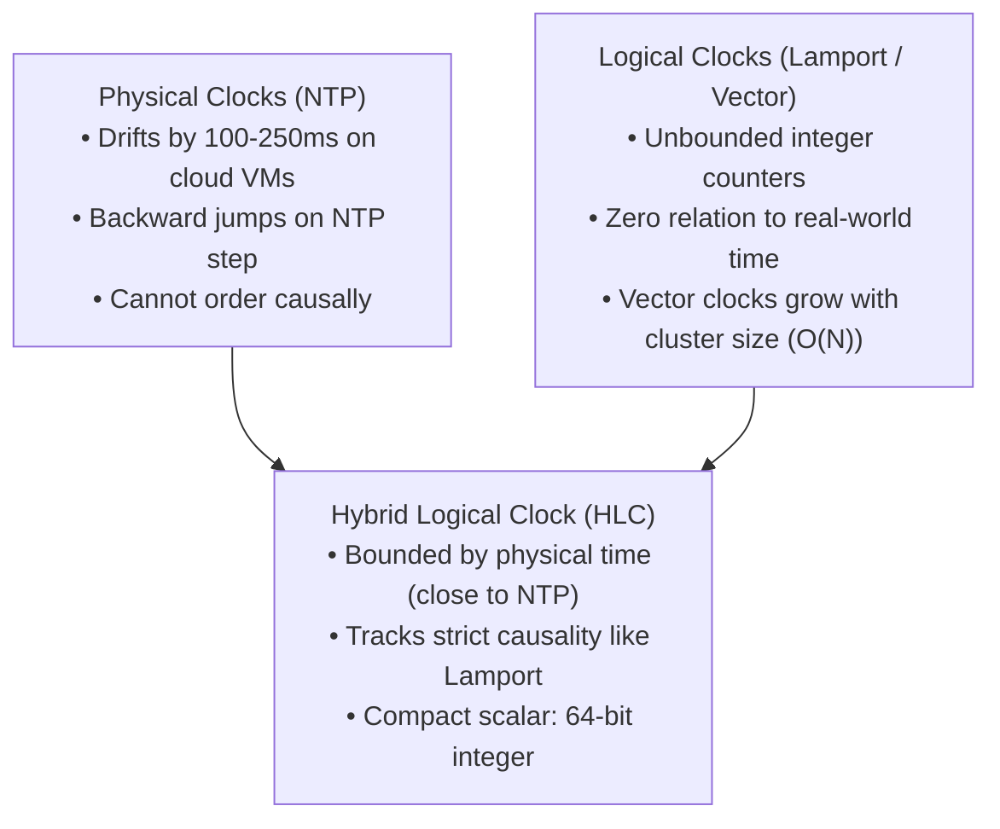
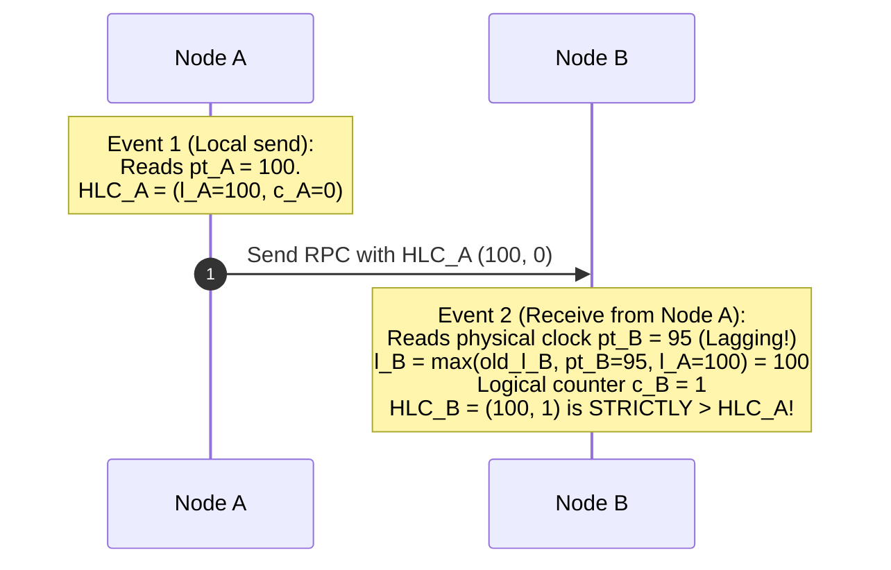
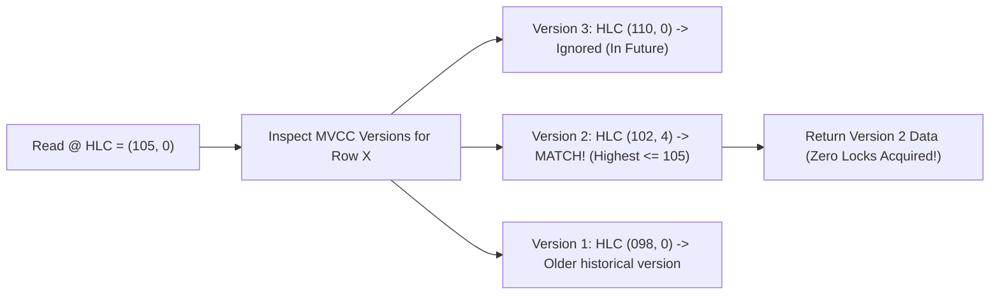

# Hybrid Logical Clocks (HLC) and Physical Clock Synchronization

Google Spanner achieved global external consistency using dedicated GPS receivers and atomic clocks (TrueTime). But what if you are building an open-source distributed database (like **CockroachDB, MongoDB, or YugabyteDB**) running on commodity cloud virtual machines (AWS, GCP, Azure) without physical atomic hardware?

The answer is **Hybrid Logical Clocks (HLC)**, formulated by Sandeep Kulkarni et al. in 2014.

---

## 1. Why Physical Clocks & Logical Clocks are Insufficient

### 💡 Intuitive Real-World Analogy: The Stopwatch with a Thumb-Clicker
Imagine a track and field referee timing an Olympic sprint with two tools in one hand: a digital stopwatch displaying milliseconds, and a mechanical thumb tally-clicker:
- When a runner crosses the line, the referee checks the stopwatch: `12:00:00.105`. If nobody else crossed in that millisecond, the record is `[12:00:00.105, click=0]`.
- If 4 more runners cross the finish line in a rapid clump *before* the stopwatch millisecond ticks forward, the referee doesn't guess milliseconds—he clicks the thumb tally:
  - Runner 2: `[12:00:00.105, click=1]`
  - Runner 3: `[12:00:00.105, click=2]`
  - Runner 4: `[12:00:00.105, click=3]`
- When the stopwatch finally ticks to `.106`, the clicker resets to `0`: `[12:00:00.106, click=0]`.
- If another referee arrives whose watch is 2 milliseconds ahead, our referee immediately catches up to match the highest time seen.
- **The Result:** The timestamps stay tightly synchronized with real human wall-clock time, but can sequence 65,000 events within the exact same millisecond without ever moving backward!

### 👶 Plain-English / ELI5 Overview
Computer clocks drift and jump backward, which corrupts databases. Logical clocks are just numbers (like 1, 2, 3) that have no idea what day or month it is, making queries like *"Find all orders from last Tuesday"* impossible. An HLC marries both: it uses real computer time for the date, but adds a tiny counter whenever events happen in the same millisecond, guaranteeing that cause always comes before effect.

### ⚠️ The Horror Scenario: The Cloud VM Time-Warp Overwrite
A distributed financial database runs across AWS (us-east-1) and GCP (us-central1):
1. **Node A (in AWS)** processes a wire transfer of $1,000,000 at physical time `14:00:00.100`. It commits the record and sends an RPC to Node B in GCP to credit the beneficiary.
2. **Node B (in GCP)** experiences an NTP step backward due to a virtualization hypervisor pause. Its physical clock reads `13:59:59.950` (running 150ms slow).
3. If using standard physical timestamps, Node B records the deposit credit with timestamp `13:59:59.950`.
4. **The Disaster:** A regulatory auditor runs a SQL query: *"List all account activities after 14:00:00.000"*. The query returns the $1,000,000 debit from Node A, but **omits** the credit on Node B! The bank appears to have vaporized $1,000,000 into thin air.
5. **How HLC Solves This:** Node B receives Node A's HLC message stamped with physical component $l = \text{14:00:00.100}$. Node B compares its local clock (`13:59:59.950`) with Node A's timestamp, takes the maximum ($l = \text{14:00:00.100}$), and sets its logical counter $c = 1$. The credit is guaranteed to have a higher timestamp than the debit, perfectly preserving causal history!

---

## 2. Anatomy of a Hybrid Logical Clock

An HLC timestamp consists of two components:

$$(l, c)$$

- **$l$ (Physical Component):** The maximum physical timestamp observed so far (tracks the physical clock $pt$).
- **$c$ (Logical Counter):** A logical sequence counter used to order events that occur within the same physical millisecond.

### The Core Invariants
1. **Bounded Drift:** $|l - pt| \le \epsilon$, where $\epsilon$ is the maximum allowable NTP drift (typically configured to $250 - 500\text{ ms}$). If a node's physical clock drifts farther than $\epsilon$, the node halts itself to protect consistency.
2. **Causal Ordering ($A \to B \implies HLC(A) < HLC(B)$):**
   $$(l_A, c_A) < (l_B, c_B) \iff l_A < l_B \lor (l_A = l_B \land c_A < c_B)$$
3. **Space Efficiency:** Fits cleanly inside a single **64-bit integer**:
   - High 48 bits: Physical millisecond timestamp $l$
   - Low 16 bits: Logical counter $c$ ($65,536$ events per millisecond).

---

## 3. The HLC Algorithm

### 1. Local Event or Send Event on Node $i$
When a local mutation occurs:
1. Read current physical clock: $pt_i$.
2. Update physical component:
   $$l'_i = \max(l_i, \ pt_i)$$
3. Update logical counter:
   $$c'_i = \begin{cases} c_i + 1 & \text{if } l'_i = l_i \\ 0 & \text{otherwise} \end{cases}$$
4. Set $l_i = l'_i$ and $c_i = c'_i$.

### 2. Message Receive Event on Node $j$
When Node $j$ receives a message with timestamp $(l_m, c_m)$:
1. Read current physical clock: $pt_j$.
2. Compute new physical component:
   $$l'_j = \max(l_j, \ pt_j, \ l_m)$$
3. Compute new logical counter:
   $$c'_j = \begin{cases} 
      \max(c_j, c_m) + 1 & \text{if } l'_j = l_j = l_m \\ 
      c_j + 1 & \text{if } l'_j = l_j \\ 
      c_m + 1 & \text{if } l'_j = l_m \\ 
      0 & \text{otherwise} 
   \end{cases}$$
4. Set $l_j = l'_j$ and $c_j = c'_j$.

---

## 4. How CockroachDB Uses HLC for Serializable Transactions

CockroachDB uses HLCs to assign commit timestamps to distributed transactions:

1. **Read Snapshots:** Reads at timestamp $T$ only read MVCC row versions with timestamps $\le T$.
2. **Uncertainty Windows:** If a node reads a key and observes a value written with timestamp in the interval $[T_{\text{read}}, T_{\text{read}} + \epsilon_{\text{max}}]$, the node enters an **Uncertainty Restart**:
   - The transaction restarts its read timestamp to ensure it never misses a causally preceding write that was committed on a node whose clock was slightly ahead!
3. **Eliminates Hardware Lock-In:** Allows running globally distributed, linearizable ACID transactions across standard AWS EC2 or Kubernetes clusters without installing physical GPS antennas on datacenter roofs.

---

## 🎯 Top Real-World Interview Questions & Deep-Dive Answers (FAANG / Staff Level)

### Question 1: How does CockroachDB achieve Multi-Version Concurrency Control (MVCC) snapshot reads using HLC without acquiring read locks?
#### Answer:
In CockroachDB, every row modification is stored with an HLC timestamp in an append-only RocksDB/Pebble storage engine:
1. **The MVCC Key Encoding:**
   - Keys are encoded on disk as `Key_User_1234 : HLC_Timestamp`.
   - Modifying a row does not overwrite existing bytes; it appends a new version with the transaction's commit HLC timestamp.
2. **Lock-Free Snapshot Isolation:**
   - When a transaction initiates a read at time $T_{\text{read}}$, it simply reads the newest row version whose `HLC <= T_read`.
   - Replicas do not need to coordinate with the Raft leader or acquire shared read locks. They can evaluate the query purely from local memory/disk, delivering **sub-millisecond read latency** with zero read-lock contention!

---

### Question 2: What is an "Uncertainty Restart" in CockroachDB, and how does it compare to Google Spanner's "Commit Wait"?
#### Answer:
Both mechanisms solve the identical physical challenge: clock skew across independent machines. But they choose **opposite trade-offs**:

| Dimension | Google Spanner (Commit Wait) | CockroachDB (Uncertainty Restart) |
| :--- | :--- | :--- |
| **Hardware Prerequisite** | Dedicated GPS receivers + Rubidium Atomic clocks in datacenters ($\epsilon < 7\text{ms}$). | Commodity cloud virtual machines with standard NTP ($\epsilon_{\text{max}} \approx 250-500\text{ms}$). |
| **Where the Cost is Paid** | Paid on **Every Write Transaction**. The leader pauses for $2\epsilon$ before releasing write locks. | Paid on **Occasional Read Conflicts**. Writes complete immediately with zero wait! |
| **Mechanism** | Writes wait out the clock uncertainty so future reads never see time collisions. | When a read encounters a row version stamped inside its uncertainty window $[T_{\text{read}}, T_{\text{read}} + \epsilon_{\text{max}}]$, the transaction **restarts** its read timestamp to jump ahead of the uncertainty window. |
| **Production Impact** | Predictable, bounded write latency (~7ms). Read transactions never restart. | Instant writes, but highly contested concurrent read-write workloads on hot rows experience transaction restarts. |

---

### Question 3: What happens if a node's physical clock drifts past the maximum allowable threshold ($\epsilon = 500\text{ms}$) in a CockroachDB cluster? Why does the daemon intentionally crash itself?
#### Answer:
In CockroachDB, each node periodically pings peer nodes and measures clock offset.
1. **The Correctness Invariant:**
   - The mathematical correctness of HLC causality and uncertainty restart windows depends strictly on the invariant:
     $$|l - pt| \le \epsilon_{\text{max}}$$
   - If a node's clock drifts beyond $\epsilon_{\text{max}}$ (e.g., NTP server stops responding or hypervisor CPU clock ticks freeze for 600ms), the database can no longer guarantee that an uncertainty restart will catch causally preceding writes!
2. **The Intentional Suicide (Fail-Fast):**
   - If a node detects $|pt_{\text{local}} - pt_{\text{peers}}| > \epsilon_{\text{max}}$, it logs a fatal error and **immediately terminates the process (`os.Exit(1)`)**.
3. **The Architectural Philosophy:**
   - It is infinitely better for a single node to crash (allowing Raft to elect a healthy successor within 500ms) than for a zombie node with a wildly drifting clock to accept transactions and silently corrupt the global ACID ledger.
