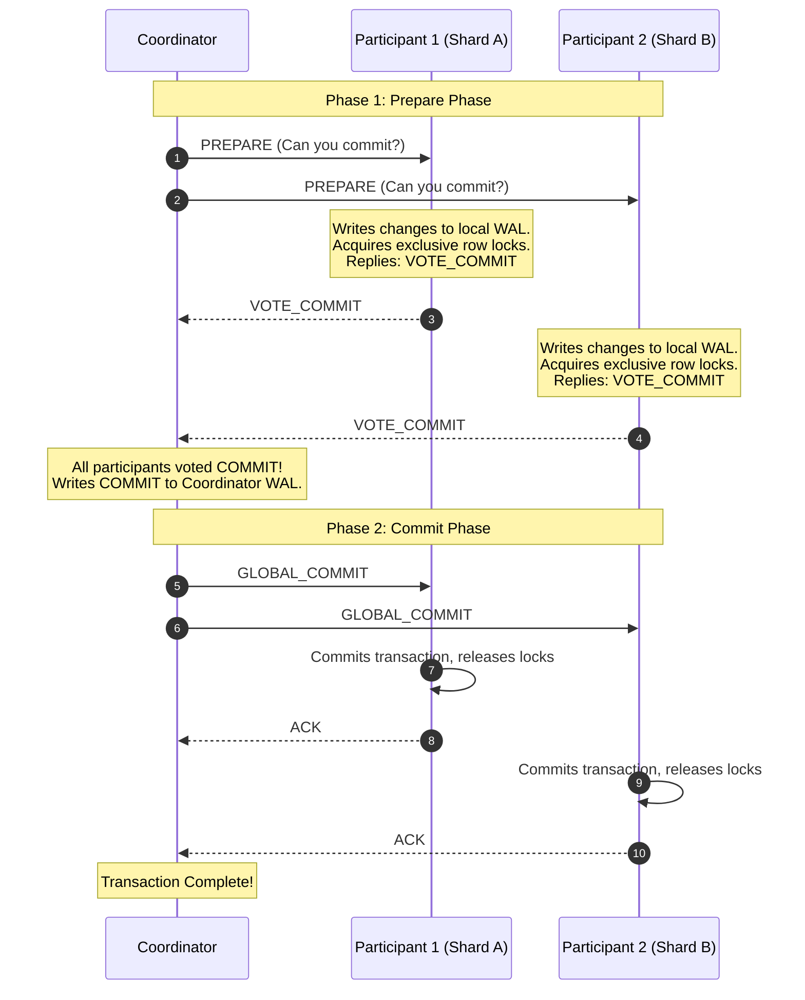
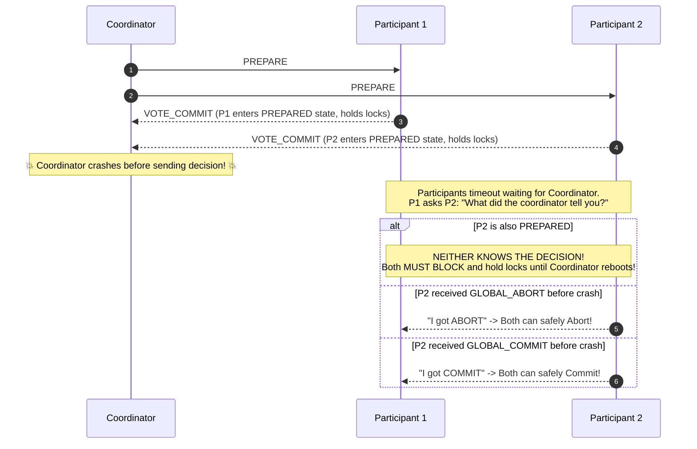
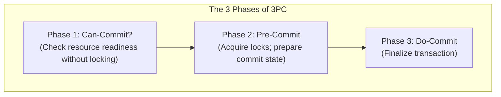
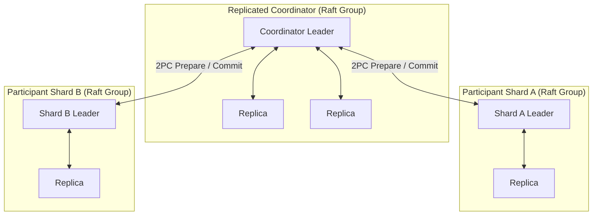
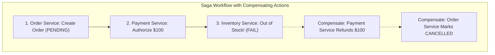

# Distributed Transactions: Two-Phase Commit (2PC) vs. Three-Phase Commit (3PC)

When a single logical transaction must atomically mutate data stored across multiple physically partitioned database shards or independent microservices, single-node ACID transactions no longer suffice. The system must execute an **Atomic Commit Protocol**.

---

## 1. Two-Phase Commit (2PC)

The classic atomic commit protocol, introduced by Jim Gray in 1978.

### 💡 Intuitive Real-World Analogy: The Wedding Vow
Imagine a traditional marriage ceremony:
- **Phase 1 (Prepare):**
  - The Priest (Coordinator) asks the Groom (Participant 1): *"Do you take this woman to be your lawfully wedded wife?"*
  - The Groom responds: *"I do"* (`VOTE_COMMIT`). He has officially pledged and surrendered his freedom (locks acquired!).
  - The Priest asks the Bride (Participant 2): *"Do you take this man...?"*
  - The Bride responds: *"I do"* (`VOTE_COMMIT`).
- **Phase 2 (Commit):**
  - The Priest declares: *"By the power vested in me, I now pronounce you husband and wife!"* (`GLOBAL_COMMIT`).
  - Both celebrate and the contract is complete.

### 👶 Plain-English / ELI5 Overview
When you transfer money from your checking account at Bank A to buy a car at Dealership B, you need both banks to agree simultaneously. The transaction coordinator asks both: *"Can you do this?"*. If both say *"Yes"*, the coordinator says *"Do it now!"*. If either bank says *"No"*, the coordinator tells everyone to cancel.

### ⚠️ The Horror Scenario: The Priest Collapses (The 2PC Blocking Disaster)
What happens if the Priest has a heart attack right after both the Bride and Groom say *"I do"*, but **before** declaring them married?
- Neither the Bride nor the Groom can walk away or marry anyone else—the Priest might recover in 10 minutes and produce a signed marriage license!
- But neither can consider themselves officially married either!
- They are **trapped in limbo at the altar indefinitely**, holding exclusive locks on their lives until someone finds the Priest's notebook.

**In Computer Systems:**
1. Shard 1 locks Alice's checking account row (`SELECT ... FOR UPDATE`).
2. Shard 2 locks Bob's savings account row.
3. Both reply `VOTE_COMMIT` to the Coordinator.
4. The physical server running the Coordinator catches fire and suffers a catastrophic SSD crash.
5. **The Disaster:** Shards 1 and 2 cannot unilaterally abort (the Coordinator might have committed). Nor can they commit (the Coordinator might have aborted). They must hold those exclusive database locks **indefinitely**.
6. Every subsequent query trying to access Alice's or Bob's account blocks. Connection pools fill to 100%. Web servers hang. The entire banking portal crashes with HTTP 504 gateway timeouts across the platform!

### 🚶 Step-by-Step Scenario: 2PC Failure and Recovery
Let's trace how recovery works when participants are left hanging:

### The Voting Rules
- **All Vote Commit:** If **every single participant** votes `VOTE_COMMIT`, the coordinator commits and broadcasts `GLOBAL_COMMIT`.
- **Any Vote Abort:** If **even a single participant** votes `VOTE_ABORT` (or times out), the coordinator broadcasts `GLOBAL_ABORT`, and all participants roll back.

---

## 2. Three-Phase Commit (3PC)

Invented by Dale Skeen in 1981 specifically to eliminate 2PC's blocking problem.

### 💡 Intuitive Real-World Analogy: The Rocket Launch Countdown
- **Phase 1 (Can-Commit):** Mission Control checks telemetry: *"Engines green? Telemetry green?"* (No fuel is ignited; nobody is locked into launching yet).
- **Phase 2 (Pre-Commit):** *"T-minus 10 seconds. Retract umbilicals, lock gantry."* Every subsystem prepares for inevitable launch. If everyone enters Pre-Commit, all subsystems know that **no subsystem voted abort in Phase 1**.
- **Phase 3 (Do-Commit):** *"Ignition! Launch!"*

### 👶 Plain-English / ELI5 Overview
3PC splits the commit process into three steps instead of two. By adding a middle "Pre-Commit" buffer step, if the coordinator computer suddenly dies, the participants can talk to each other and safely finish the commit on their own without waiting for the boss to come back to life.

### How 3PC Prevents Blocking
1. **Can-Commit?:** Coordinator asks participants if they can commit. If all say YES $\to$ moves to Pre-Commit.
2. **Pre-Commit:** Coordinator broadcasts `PRE_COMMIT`. Participants prepare resources. If all acknowledge $\to$ moves to Do-Commit.
3. **Do-Commit:** Coordinator broadcasts `DO_COMMIT`.
- **Why it avoids blocking:** If the coordinator crashes during Phase 2 or 3, participants can elect a new coordinator. If any non-faulty node reached `PRE_COMMIT`, participants know that **no node could have aborted in Phase 1**, so it is safe to proceed with commit!

### ⚠️ The Fatal Flaw of 3PC: Network Partitions Destroy Consistency
Skeen's 3PC mathematical proof makes a dangerous theoretical assumption: it assumes a **synchronous network with crash-stop failures only (no network partitions)**.

In the real world, networks suffer partitions ($P$ in CAP theorem):
1. The Coordinator broadcasts `PRE_COMMIT`.
2. A network partition severs Participant 1 (isolated in Datacenter West) from the Coordinator and Participant 2 (Datacenter East).
3. Participant 1 times out waiting for `PRE_COMMIT` $\to$ **Unilaterally Aborts and rolls back**.
4. Concurrently, Participant 2 receives `PRE_COMMIT`, acknowledges it, and proceeds to **Commit**!
5. **The Catastrophe:** **Split-Brain Transaction!** Shard A rolled back, while Shard B committed. Atomicity is violated, and customer money is duplicated or vaporized.
6. **Production Reality:** Because 3PC cannot survive network partitions, **3PC is never used in real-world production distributed systems.**

---

## 3. The Modern Solution: Consensus-Replicated 2PC

How do modern distributed databases (Google Spanner, CockroachDB, TiDB) achieve non-blocking atomic commits without 3PC's fatal partition vulnerability?

> **The Architectural Breakthrough:**  
> **Never run 2PC across single machines. Run 2PC across replicated Paxos or Raft consensus groups!**

### 💡 Intuitive Real-World Analogy
Instead of a single frail priest conducting the wedding ceremony, the ceremony is overseen by a **Council of 3 Priests**.
- Before declaring anything, the Head Priest records the vow in a leather ledger duplicated among all 3 priests.
- If the Head Priest has a heart attack, Priest #2 instantly steps up, reads the ledger, and finishes the ceremony without blinking. The wedding is never blocked!

### 👶 Plain-English / ELI5 Overview
The fatal flaw of classic 2PC was that the boss was just one computer. If it died, everyone froze. Modern systems make the boss a team of 3 computers running Raft or Paxos. If one computer blows up, the other two pick up right where it left off, so nobody ever gets stuck waiting!

### How Consensus-Replicated 2PC Works
1. The Transaction Coordinator is **not a single server**; it is a **Raft or Multi-Paxos consensus group**.
2. When the coordinator decides to commit, it writes the commit record into its replicated consensus log across a quorum of machines *before* broadcasting `GLOBAL_COMMIT`.
3. If the coordinator leader server crashes or burns down, the remaining Raft replicas immediately elect a new leader in $<500\text{ ms}$.
4. The new leader reads the replicated Raft log, discovers the committed transaction state, and immediately broadcasts `GLOBAL_COMMIT` to the participant shards!
5. **Result:** Non-blocking, partition-tolerant, strongly consistent distributed transactions at planetary scale.

### 🏢 Real-World Production Battle-Testing
- **Google Cloud Spanner:** Uses Multi-Paxos replication groups for each shard (Paxos group per directory). A distributed transaction uses 2PC across the Paxos leaders of the involved shards, using TrueTime for lock-free read snapshots.
- **CockroachDB:** Every table range is a Raft consensus group. Multi-range transactions write a *Transaction Record* to a Raft group. The transaction status flips from `PENDING` to `COMMITTED` via a single atomic Raft consensus write.
- **Stripe / Uber (The Saga Pattern for Microservices):** Across independent microservices and external payment APIs (e.g., Stripe, Visa, SendGrid), synchronous 2PC is inappropriate because external services cannot hold database locks for seconds. They use **Sagas**—a sequence of local transactions coordinated via events, paired with **Compensating Transactions** (e.g., if flight booking fails, execute `RefundCreditCard()`).

### ⚖️ Practical Trade-Offs & Architectural Rules of Thumb

| Architecture | Guarantees | Performance | When to Use | When NOT to Use |
| :--- | :--- | :--- | :--- | :--- |
| **Classic 2PC** | Atomic ACID | Poor (Blocking locks) | Single-datacenter legacy enterprise DBs | Cloud environments with unpredictable latency |
| **3PC** | Non-blocking (no partitions) | Medium | Academic synchronous models | Any real-world network with partitions |
| **Consensus 2PC (Spanner / CockroachDB)** | Strict Serializable ACID | Excellent (high throughput, fault-tolerant) | Distributed relational databases & financial ledgers | Loosely-coupled independent microservices |
| **Saga Pattern** | Eventual Consistency | Highest throughput & availability | Cross-microservice e-commerce workflows | Immediate financial ledger reconciliation |

---

## 🎯 Top Real-World Interview Questions & Deep-Dive Answers (FAANG / Staff Level)

### Question 1: Why is Two-Phase Commit (2PC) considered an anti-pattern for microservice architectures, and what should be used instead?
#### Answer:
In an interview, proposing classic synchronous 2PC across independent microservices is a primary cause of failure:
1. **The Availability Multiplier Collapse:**
   - In 2PC, the transaction availability is the mathematical product of all participants:
     $$A_{\text{total}} = A_{\text{coordinator}} \times A_{\text{service1}} \times A_{\text{service2}} \times \dots \times A_{\text{serviceN}}$$
   - If you have 5 services each with $99.9\%$ availability, the transaction availability drops to $(0.999)^6 \approx 99.4\%$. A single slow service degrades the entire company.
2. **Lock Amplification & Cascading Connection Pool Exhaustion:**
   - In Phase 1, every participant acquires exclusive database row locks (`SELECT ... FOR UPDATE`).
   - If Service B takes 3 seconds to complete (e.g., calling an external Visa payment API), Service A must hold its database locks for the entire 3 seconds!
   - Under high QPS, database connection pools are instantly exhausted, and every subsequent query stalls, causing cascading HTTP 504 gateway timeouts across the platform.
3. **The Staff-Grade Solution: The Saga Pattern:**
   - Decompose the global transaction into a series of **local ACID transactions**.
   - Each microservice executes its local transaction, updates its local database, and publishes an event or informs an **Orchestrator**.
   - If Step 3 fails, the orchestrator triggers **Compensating Transactions** (e.g., executing `RefundPayment()` or `ReleaseInventoryReservation()`) to undo the preceding steps asynchronously.

---

### Question 2: How do modern NewSQL databases (like CockroachDB and Google Spanner) run 2PC without suffering from the classic 2PC blocking problem?
#### Answer:
The classic 2PC blocking problem occurs because the Coordinator is a **Single Point of Failure (SPOF)**. If it crashes after participants vote `COMMIT`, participants are trapped in limbo holding locks.
Modern databases solve this by **combining 2PC with Consensus Replication (Multi-Paxos / Raft)**:
1. **The Replicated Transaction Record:**
   - The Transaction Coordinator is not a single machine—it is a **Raft consensus group**.
   - The coordinator writes a *Transaction Record* to its Raft log with initial state `PENDING`.
2. **Atomic State Flip via Consensus:**
   - Once all participant shards reply `VOTE_COMMIT`, the coordinator commits a log entry changing the status from `PENDING` to `COMMITTED` across a majority of its Raft replicas.
   - The commit takes effect the exact microsecond this Raft entry commits!
3. **Transparent Failover:**
   - If the physical server acting as coordinator leader burns down, the remaining Raft replicas elect a new leader in $<500\text{ms}$.
   - The new leader reads the replicated Raft log:
     - If the record says `COMMITTED`, it finishes broadcasting `GLOBAL_COMMIT`.
     - If the record says `PENDING`, it safely aborts and broadcasts `GLOBAL_ABORT`.
   - Participants are **never left blocking in limbo**, eliminating the 2PC flaw while retaining full distributed ACID guarantees!

---

### Question 3: How do you guarantee idempotency and handle partial failure during compensating transactions in a Saga?
#### Answer:
Compensating transactions are not magic—they are distributed network requests that can fail, timeout, or arrive out of order!
1. **Compensations MUST Be Idempotent:**
   - A compensation (e.g., `RefundUser(tx_123)`) might timeout over the network, prompting the orchestrator to retry.
   - The receiving payment service must check a persistent `idempotency_keys` table. If `tx_123` was already refunded, return HTTP 200 immediately without double-refunding!
2. **Handling the Out-of-Order Compensation Race (The Phantom Action):**
   - In rare race conditions, network delay could cause the compensation (`CancelReservation`) to arrive *before* the forward action (`MakeReservation`).
   - If the system blindly applies the cancel, it finds nothing to cancel. When the forward reservation finally arrives 2 seconds later, it creates a zombie booking that is never refunded!
   - *Fix:* The service must store a tombstone record for the cancellation token: if a reservation request arrives for an already-cancelled token, it is rejected immediately.
3. **The Dead Letter Queue (DLQ) & Human Intervention:**
   - If a compensating transaction repeatedly fails due to a bug or third-party API outage, it cannot be dropped.
   - The saga orchestrator routes the transaction to a DLQ and raises a high-priority alert for automated replay or manual human reconciliation.
