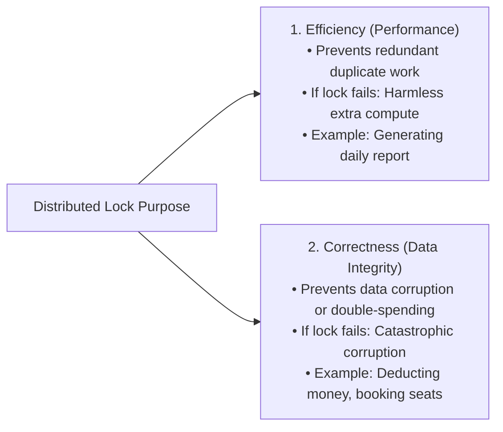
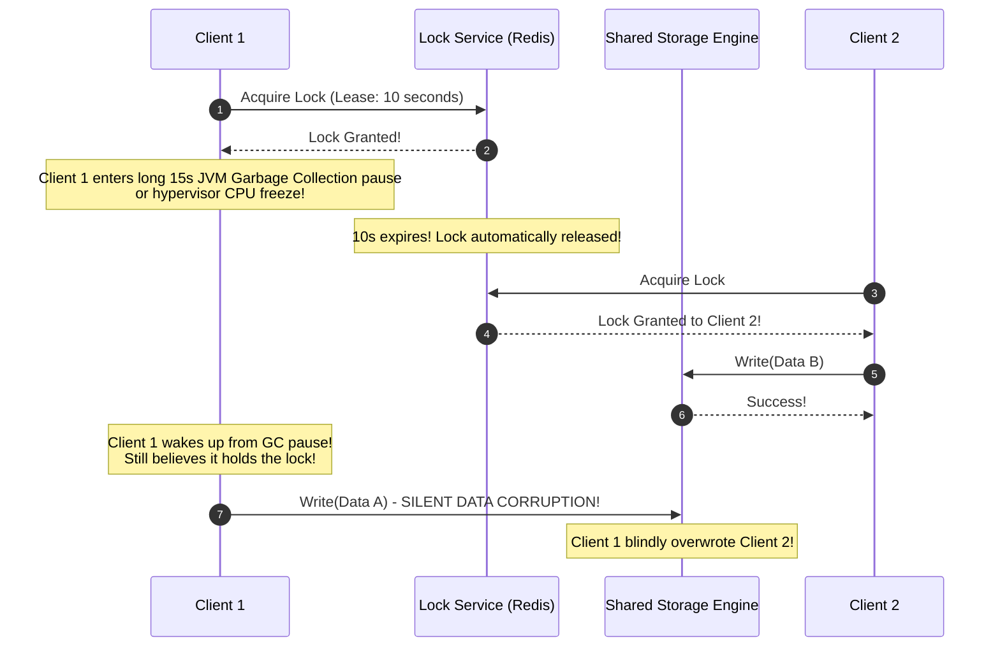
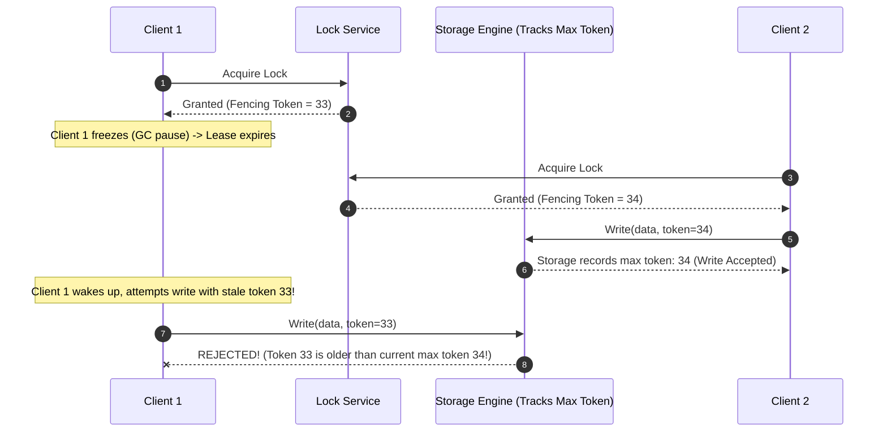
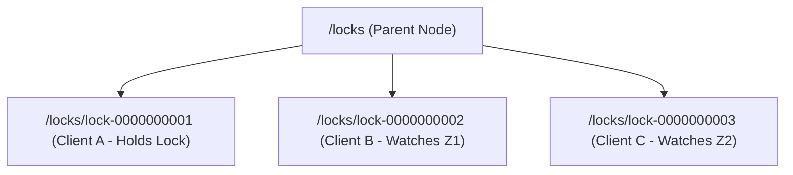
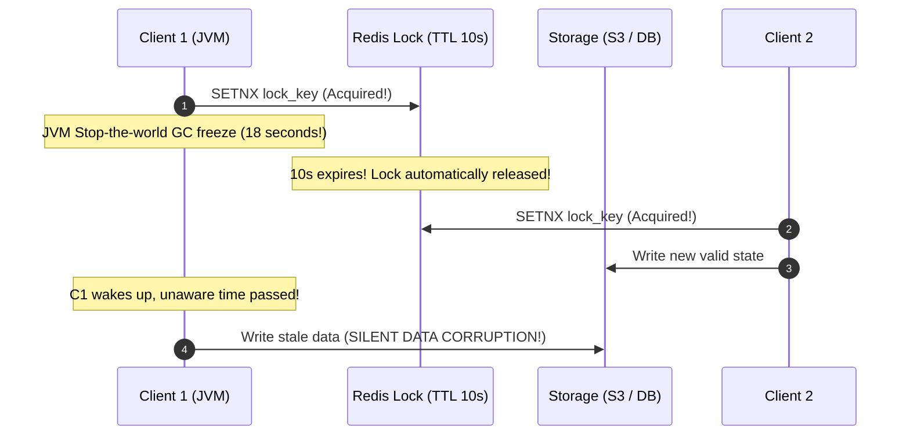

# Distributed Locking: The Redlock Controversy and Fencing Tokens

Coordinating exclusive access to shared resources across multiple independent servers requires understanding the subtle hazards of process pauses, network delays, and clock drift.

---

## 1. Why Do You Need a Distributed Lock?

Distributed locks serve two fundamentally different purposes:

### 💡 Intuitive Real-World Analogy
- **Lock for Efficiency:** Putting an "Occupied" sign on a conference room door so two people don't try to clean the whiteboard at the same time. If the sign falls off and two people clean it, you wasted 10 minutes of human effort, but nothing was damaged.
- **Lock for Correctness:** The safety interlock on a surgical radiation machine or a bank vault locking mechanism. If the lock fails and two operations execute concurrently, a patient receives a lethal overdose or a bank account is double-debited.

### 👶 Plain-English / ELI5 Overview
Before building a lock, ask yourself: *"If my lock fails once every 10,000 times, do I lose money or corrupt customer files, or did I just waste 2 seconds of server CPU?"*
- If you just wasted CPU $\to$ Use a simple Redis lock.
- If you lose money or corrupt files $\to$ Simple TTL locks are dangerous; you need consensus locks and **fencing tokens**.

---

## 2. The Flaw in Naive TTL Locks (Process Pauses & GC Freezes)

Why locks based purely on time expiration fail in distributed environments:

### 💡 Intuitive Real-World Analogy: The Hotel Room Keycard Catastrophe
Imagine a hotel where your keycard is programmed to stop working at 11:00 AM checkout:
1. At 10:55 AM, you fall into a deep, comatose nap on the bed (**Process Pause / Stop-The-World GC**).
2. At 11:00 AM, the hotel lock system expires your room lease.
3. At 11:05 AM, the front desk rents the room to a new guest, **Bob**. Bob enters the room, unpacks his laptop, and places an expensive diamond watch on the bedside table.
4. At 11:15 AM, you suddenly wake up in a haze. **You have no idea what time it is.** Your brain thinks only 1 minute passed!
5. You see a strange diamond watch on the table, assume it is trash, toss it out the window, and put your old backpack on the table!
6. **The Moral:** A process has no internal biological awareness of time that passed while it was suspended. When it wakes up, it resumes executing its code as if zero seconds elapsed!

### 👶 Plain-English / ELI5 Overview
When a computer runs a big memory cleanup (Garbage Collection) or when a cloud provider moves a virtual machine, the program completely freezes. While it is frozen, its lock timer expires. Another computer gets the lock and does work. When the frozen computer wakes up, it doesn't know it was asleep—it blindly finishes its old task and crushes the other computer's new work!

### ⚠️ The Horror Scenario: The S3 Financial Ledger Clashing Overwrite
A fintech company generates daily invoice settlements for $5,000,000 in vendor payouts:
1. **Worker 1** acquires a 10-second Redis lock on key `lock:invoices:2026-10-22`.
2. Worker 1 reads raw transactions and prepares the final payment file `s3://fintech/settlements/2026-10-22.csv`.
3. Worker 1's JVM experiences a **16-second Stop-The-World GC pause** due to memory heap defragmentation.
4. Redis TTL expires at 10 seconds. Redis releases the lock.
5. **Worker 2** acquires the lock, recalculates settlements with an emergency vendor cancellation added, and successfully writes the updated CSV to S3.
6. Worker 1 wakes up from GC. It doesn't check the clock (and even if it did, the check itself could be paused!). It executes: `s3Client.putObject("2026-10-22.csv", stale_unrevised_data)`.
7. **The Disaster:** Worker 1 blindly clobbers Worker 2's file on S3. The cancelled vendor is wired $500,000 in error, triggering audit investigations and financial loss.

---

## 3. The Martin Kleppmann vs. Antirez Redlock Debate

In 2016, Martin Kleppmann (author of *Designing Data-Intensive Applications*) published a landmark critique of the Redis **Redlock** algorithm proposed by Salvatore Sanfilippo (Antirez):

### Kleppmann's Key Critiques
1. **Physical Clock Assumptions:** Redlock relies on physical system clock rate matching across 5 independent Redis nodes. If NTP steps a node's clock forward, keys expire prematurely, violating mutual exclusion.
2. **Absence of Fencing Tokens:** Redlock does not provide a mechanism to prevent delayed writes from executing after lease expiration. Even if the lock is mathematically perfect, asynchronous network delays and GC pauses on the client will still corrupt storage unless storage checks a token.
3. **The Core Thesis:** A lock service that does not provide **fencing tokens** cannot guarantee correctness in an asynchronous network.

---

## 4. The Architectural Solution: Fencing Tokens

A lock service must never return just a boolean `True`. It must issue a **strictly monotonically increasing integer token** (a **Fencing Token**) every time a lock is acquired:

### 💡 Intuitive Real-World Analogy: Numbered Bank Vault Access Badges
Imagine a bank vault guarded by a security officer:
- When Client 1 enters, the front desk hands them Badge #33. The vault guard records: *"Current authorized visitor: #33"*.
- Client 1 falls asleep inside a back room.
- Because Client 1 hasn't returned, the desk declares badge #33 void and issues Badge #34 to Client 2.
- Client 2 enters the vault, presents Badge #34. The guard updates their ledger: *"Current authorized visitor: #34"*.
- Client 1 wakes up and tries to deposit a box of old documents presenting Badge #33.
- The guard inspects the badge: *"33 is smaller than 34. You are holding an outdated badge! Access DENIED!"*
- The guard (Storage Engine) enforces the fence!

### 👶 Plain-English / ELI5 Overview
Every time a computer gets a lock, it gets a ticket with a number that goes up: 1, 2, 3... Whenever it writes to the database, it must show its ticket. The database remembers the highest ticket number it has ever seen. If a slow, sleepy computer tries to write with ticket #33 when the database has already seen ticket #34, the database says *"Get out of here!"* and rejects the write.

### The Invariant
The storage engine must verify the fencing token on every mutating write:

$$\text{If } \text{token} < \text{max\_token\_observed} \implies \mathbf{\text{REJECT WRITE}}$$

Even if Client 1 freezes for 10 minutes, its delayed write is rejected when it wakes up, mathematically guaranteeing data integrity!

---

## 5. Apache ZooKeeper / Chubby Ephemeral Sequential Locks

The gold standard for distributed locking in production infrastructure (Kubernetes, Kafka, Hadoop).

### 💡 Intuitive Real-World Analogy: The Deli Counter Paper Ticket Dispenser
Imagine a busy bakery with 100 customers:
- You walk in and tear a paper ticket from the dispenser: `#42`.
- You don't scream at all 99 other customers. You simply look at the display board and watch Customer `#41`.
- When Customer `#41` gets their bread and leaves, you know it's your turn.
- If Customer `#41` faints and leaves the store, only you need to notice and step forward. The other 98 people in line remain quietly seated.

### 👶 Plain-English / ELI5 Overview
Instead of having 1,000 servers all hammer a single lock key at the exact same millisecond (the "herd effect"), each server takes a numbered ticket in line. Each server only watches the single server directly ahead of it. When that server finishes or crashes, the next server takes over smoothly.

### The Algorithm (Avoiding the Herd Effect)
1. **Create Node:** Client creates an **Ephemeral Sequential** znode: `/locks/lock-`.
2. ZooKeeper appends a monotonically increasing integer sequence: `/locks/lock-0000000002`.
3. **Check Lowest:** Client lists all children under `/locks`.
   - If its node has the **lowest sequence number**, it holds the lock!
4. **Watch Predecessor:** If not lowest, the client sets a watch **only on the immediately preceding node** (e.g., node 2 watches node 1; node 3 watches node 2).
   - **Eliminates Herd Effect:** When node 1 is deleted, only node 2 is notified, rather than waking up 10,000 waiting clients!
5. **Automatic Cleanup on Crash:** Because znodes are **ephemeral**, if a client crashes or its TCP heartbeat drops, ZooKeeper automatically deletes its lock node, allowing the next client to acquire the lock without deadlocks.

### 🏢 Real-World Production Battle-Testing
- **Google Chubby:** Google’s internal lock service powering Bigtable and GFS. Chubby coined the term "sequencer" for fencing tokens. Clients pass sequencers with RPCs, and Bigtable servers reject any RPC containing a stale sequencer.
- **Apache Curator (ZooKeeper):** Provides production-ready implementations of `InterProcessMutex` used by Apache Hadoop NameNodes to ensure only one active master manages the filesystem namespace.
- **Kubernetes Leader Election:** Uses `Lease` resources in `etcd`. Controllers update a renew time. When a pod dies, another replica acquires the lease via compare-and-swap on the `resourceVersion`.

---

## Summary & Architectural Rules of Thumb

| Requirement | Recommended Mechanism | Storage Requirement | Failure Consequence |
| :--- | :--- | :--- | :--- |
| **Efficiency Only** (e.g., deduplicating a batch email campaign) | Redis Lock (`SET key val NX PX 10000`) | Standard DB / S3 | Harmless duplicate email sent |
| **Correctness / Financial** (e.g., balance updates, inventory deduction) | ZooKeeper / etcd + **Fencing Tokens** | Storage must enforce $\text{token} \ge \text{max}$ | Prevented silent data corruption! |
| **Single Row Updates** | Database Optimistic Concurrency Control (`UPDATE ... WHERE version = N`) | Relational DB | Transaction rolled back safely |

---

## 🎯 Top Real-World Interview Questions & Deep-Dive Answers (FAANG / Staff Level)

### Question 1: An interviewer asks: "Why can't we safely use a Redis lock with a 10-second TTL to synchronize updates to an S3 file or SQL database?"
#### Answer:
This is the classic **Martin Kleppmann GC pause / process freeze trap**.
1. **The Fallacy of Client Execution Boundedness:**
   - In an asynchronous environment (such as any cloud VM, container, or JVM), you can **never assume an upper bound on code execution time**.
   - A client thread can freeze at any arbitrary line of code due to:
     - Full JVM Stop-The-World Garbage Collection (5–30 seconds).
     - OS memory page fault or swap thrashing.
     - Cloud hypervisor CPU quota throttling / vCPU migration.
2. **The Failure Progression:**
   - Client 1 acquires the lock at $t=0$ with a 10s TTL.
   - Client 1 reads data, prepares an update, and hits an 18-second GC pause.
   - At $t=10\text{s}$, Redis expires the lock.
   - Client 2 legitimately acquires the lock, performs mutations, and writes to storage.
   - At $t=18\text{s}$, Client 1 wakes up from GC. It has **no awareness that time elapsed**. It blindly executes line 52: `s3.putObject("file.csv", stale_data)`.
3. **The Conclusion:**
   - Mutual exclusion was violated, and Client 1 silently corrupted Client 2's data!
   - A lock that relies purely on client-side time leases **cannot guarantee mutual exclusion** without storage-enforced **fencing tokens**.

---

### Question 2: How does a Fencing Token solve the GC pause problem, and what specific capability must the underlying storage engine support?
#### Answer:
A Fencing Token shifts the enforcement of mutual exclusion from the fragile client to the **persistent storage engine**:
1. **The Fencing Token Mechanism:**
   - Every time the lock service grants a lock, it returns a **strictly monotonically increasing integer** (e.g., token 33, then token 34, then token 35).
   - This can be generated using a ZooKeeper `zxid`, an etcd `revision`, or a Redis `INCR` counter.
   - The client MUST pass this token with every mutating storage request: `storage.write(payload, token=34)`.
2. **The Storage Invariant:**
   - The storage engine tracks the highest token it has ever observed: `max_token_observed`.
   - On every write:
     $$\text{If } \text{token} < \text{max\_token\_observed} \implies \mathbf{\text{REJECT WRITE!}}$$
   - If Client 1 wakes up from an 18-second pause holding old token 33 and attempts to write, the storage engine inspects the request: $33 < 34$. It rejects Client 1 with an `HTTP 409 Conflict / StaleTokenException`!
3. **The Catch (Storage Engine Requirement):**
   - The storage engine **must natively support conditional checks or atomic compare-and-swap (CAS)**.
   - *Works with:* PostgreSQL/MySQL (`UPDATE ... WHERE token > max_token`), DynamoDB (`ConditionExpression`), Cassandra lightweight transactions (LWT), or S3 conditional writes.
   - *Fails with:* Plain non-versioned file writes or third-party legacy APIs that do not support conditional headers.

---

### Question 3: How does ZooKeeper's Ephemeral Sequential lock algorithm eliminate the "Thundering Herd" problem when 5,000 workers compete for a single lock?
#### Answer:
In a naive distributed lock, all 5,000 workers set a watch on the same single key `/locks/master`.
When the master releases the lock, ZooKeeper sends 5,000 watch event notifications across the network simultaneously. All 5,000 workers wake up, hammer ZooKeeper with read/write requests, and create a **CPU/network stampede** (Thundering Herd) where 4,999 workers fail.
**ZooKeeper’s Fair Lock Algorithm (Eliminating Herd Effect):**
1. Each worker creates an **Ephemeral Sequential** child node under `/locks`:
   - Worker A creates `/locks/lock-0000000001`
   - Worker B creates `/locks/lock-0000000002`
   - Worker C creates `/locks/lock-0000000003`
2. Each worker calls `getChildren('/locks')`.
3. If a worker owns the **lowest sequence number**, it holds the lock! (Worker A acquires the lock).
4. If not lowest, the worker **watches ONLY the immediately preceding node**:
   - Worker B watches *only* node 1.
   - Worker C watches *only* node 2.
5. **The Result:**
   - When Worker A finishes or crashes, ZooKeeper deletes `/locks/lock-0000000001`.
   - ZooKeeper fires a watch notification to **only ONE single process**: Worker B!
   - The remaining 4,998 workers remain asleep. Network traffic is strictly $O(1)$ per lock handover, completely immune to cluster size!
