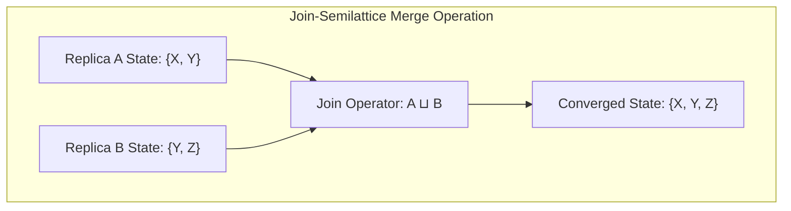
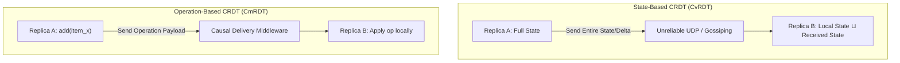
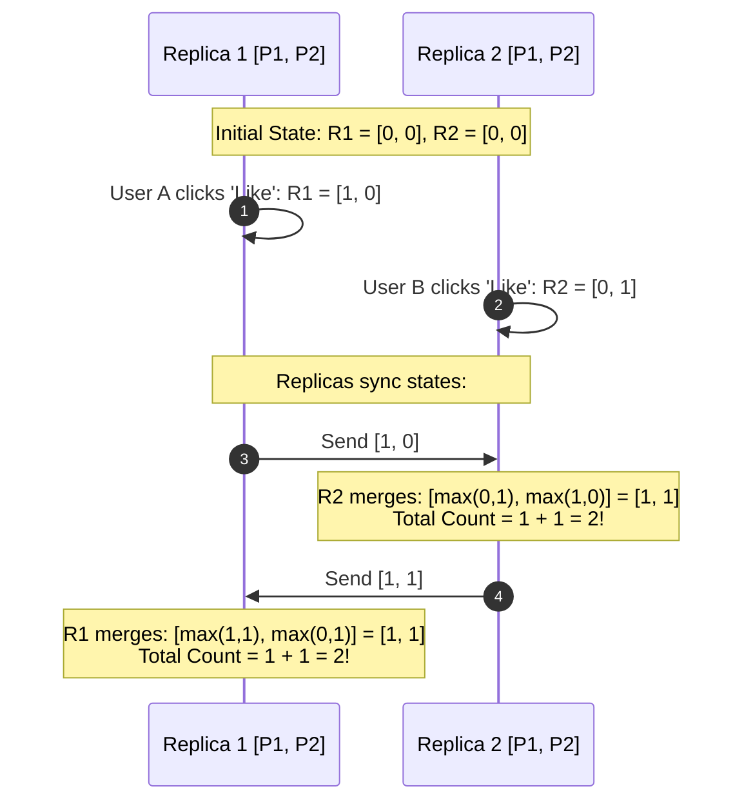
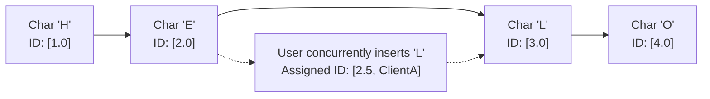
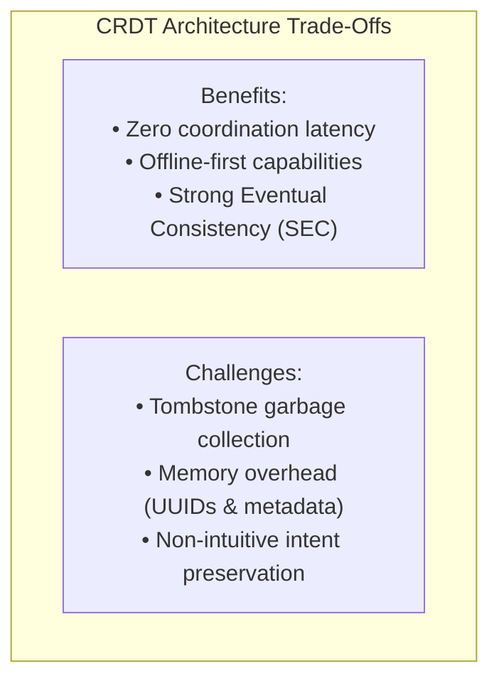
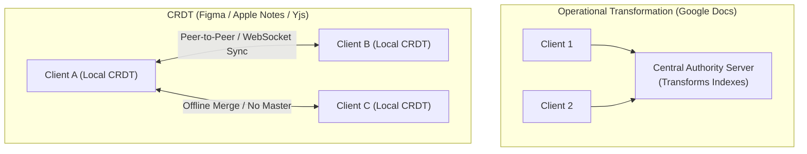

# Conflict-Free Replicated Data Types (CRDTs): State-Based vs. Operation-Based Deep Dive

In distributed systems operating under network partitions ($P$ in CAP theorem), maintaining strong consistency requires blocking writes. **Conflict-Free Replicated Data Types (CRDTs)**, formalized by Marc Shapiro et al. in 2011, enable concurrent updates across replicas without centralized coordination, mathematical consensus (Paxos/Raft), or distributed locks, guaranteeing **Strong Eventual Consistency (SEC)**.

---

## 1. Mathematical Foundations: Join-Semilattices

All CRDTs rely on the mathematical property of **Join-Semilattices**:
A semi-lattice is a partially ordered set $(S, \le)$ equipped with a binary merge operator $\sqcup$ (join) satisfying three invariants:
1. **Commutativity:** $x \sqcup y = y \sqcup x$ (Order of message delivery does not matter).
2. **Associativity:** $(x \sqcup y) \sqcup z = x \sqcup (y \sqcup z)$ (Packet batching or grouping does not matter).
3. **Idempotence:** $x \sqcup x = x$ (Duplicate packet delivery has no effect).

### 💡 Intuitive Real-World Analogy: Mixing Buckets of Paint
Imagine three friends—Alice, Bob, and Charlie—each carrying a bucket of paint:
- **Commutativity:** If Alice pours her bucket into Bob's, the color mix is identical to Bob pouring his into Alice's.
- **Associativity:** If Charlie also pours his bucket, it doesn't matter whether Alice and Bob mix first, or Bob and Charlie mix first.
- **Idempotence:** If Alice accidentally pours an extra copy of the exact same paint bucket into the tub, the mixture does not change color or suddenly turn into something else.
No matter which order the friends arrive, or if someone spills a duplicate bucket, the final paint mixture in the tub is **100% identical**.

### 👶 Plain-English / ELI5 Overview
A CRDT is a clever recipe for data that makes it impossible for computers to have merge conflicts. Even if two people edit a document while flying on an airplane with no Wi-Fi for 10 hours, when both land and connect to the internet, their changes combine seamlessly without showing a single *"Merge Conflict: Choose Version A or Version B"* error dialog.

### ⚠️ The Horror Scenario: The Emergency Medical Record Clobber
Two doctors in a hospital are treating a critically ill patient:
1. **Doctor A** is down in the radiological basement (zero Wi-Fi connectivity). On her tablet, she writes:  
   `Prescriptions: Add 50mg Epinephrine`.
2. **Doctor B** is in the emergency ward on the third floor. On his tablet, he writes:  
   `Allergies: Severe anaphylactic allergy to Penicillin`.
3. When both tablets reconnect to the hospital Wi-Fi:
   - The naive relational database uses **Last-Write-Wins (LWW)** based on HTTP `PUT` requests.
   - Doctor B's update hits the server at `10:05:02`.
   - Doctor A's update was stamped at `10:05:01`.
4. **The Disaster:** The database treats Doctor B's entire JSON document as the "winner". Doctor A's epinephrine prescription is completely wiped from the database! The nurse never administers the life-saving drug, endangering the patient's life.
5. **With CRDTs:** The medical chart is an OR-Set. Both the penicillin allergy and the epinephrine prescription are mathematically preserved simultaneously without human intervention.

---

## 2. State-Based (CvRDT) vs. Operation-Based (CmRDT)

### 💡 Intuitive Real-World Analogy: Sending the Entire Diary vs. Mailing Postcards
- **State-Based (CvRDT):** Every evening, you photocopy your entire 300-page personal diary and mail the whole stack to your friend.
  - *Postage is high* (bandwidth heavy), but if the postal service loses a letter or delivers two copies on Tuesday, your friend doesn't care. They just take the highest page count and merge.
- **Operation-Based (CmRDT):** You mail a tiny postcard saying: *"On page 42, add the sentence: 'Bought groceries'"*.
  - *Postage is tiny* (low bandwidth), but if the mailman loses that specific postcard or delivers postcard #5 before postcard #4, your friend's diary will become corrupted unless you have a guaranteed delivery protocol.

### 👶 Plain-English / ELI5 Overview
- **State-Based (CvRDT):** Send the whole snapshot. Heavy to send, but impossible for bad networks to break.
- **Operation-Based (CmRDT):** Send only what changed (e.g. "+1"). Super lightweight, but you need a reliable network that delivers messages in causal order.

### Comparison Matrix

| Dimension | State-Based CRDT (CvRDT) | Operation-Based CRDT (CmRDT) |
| :--- | :--- | :--- |
| **Payload Sent** | Sends the entire local state (or delta) | Sends the discrete mutation operation |
| **Network Guarantee** | Unreliable, out-of-order, duplicates allowed ($O(1)$ transport) | Exactly-once or at-least-once with causal ordering |
| **Merge Function** | Must be commutative, associative, idempotent ($\sqcup$) | Local execution must be commutative |
| **Bandwidth Cost** | High (grows with state size unless delta-CRDTs used) | Low (transfers only small operation payloads) |
| **Fault Tolerance** | Highly robust to packet drops and churn | Vulnerable if causal delivery middleware breaks |

---

## 3. Core CRDT Data Types Explained

### 3.1 Grow-Only Counter (G-Counter)
A counter that can only increment (e.g., website page views, video play counts).
- **State:** An array $P$ of length $N$ (number of replicas), where $P[i]$ is the count of increments executed at replica $i$.
- **Local Increment at replica $i$:** $P[i] \leftarrow P[i] + 1$.
- **Merge($A, B$):** Take the pairwise maximum: $\forall k: C[k] = \max(A[k], B[k])$.
- **Read Value:** Sum of all elements $\sum_{k=1}^N P[k]$.

### 3.2 Positive-Negative Counter (PN-Counter)
Supports increments and decrements (e.g., Reddit upvotes/downvotes, inventory counts) by pairing two G-Counters:
- **State:** Pair of G-Counters $(P, N)$ where $P$ tracks increments and $N$ tracks decrements.
- **Local Increment:** $P[i] \leftarrow P[i] + 1$.
- **Local Decrement:** $N[i] \leftarrow N[i] + 1$.
- **Merge($(P_A, N_A), (P_B, N_B)$):** $(\text{Merge}(P_A, P_B), \text{Merge}(N_A, N_B))$.
- **Read Value:** $\sum P - \sum N$.

### 3.3 Last-Write-Wins Element Set (LWW-Element-Set)
Resolves set additions and removals using timestamps (Lamport or Hybrid Logical Clock):
- **State:** Two sets: Add-Set $A$ containing $(e, t_{\text{add}})$ and Remove-Set $R$ containing $(e, t_{\text{rem}})$.
- **Membership Query:** An element $e$ is in the set if $e \in A$ and ($e \notin R$ or $t_{\text{add}} > t_{\text{rem}}$).
- **Merge:** Union of Add-Sets and union of Remove-Sets, taking maximum timestamp for duplicate elements.

### 3.4 Observed-Remove Set (OR-Set)
Avoids physical clock skew issues by assigning unique cryptographic UUID tags to each addition:
- **Adding an element:** Adds $(e, \text{uuid})$ to the Add-Set.
- **Removing an element:** Copies all *currently observed* UUIDs for $e$ into the Remove-Set.
- **Concurrent Add and Remove:** If Replica 1 adds $e$ while Replica 2 removes $e$, the newly added UUID was not observed by Replica 2; thus, **Add wins**! No deletions of concurrently created items can occur.

---

## 4. Sequence & Collaborative Text CRDTs (Yjs, Automerge, Logoot)

In collaborative text editing (Google Docs, Figma, Notion), simple character offsets break under concurrent edits:
- If Client A types at index 5 and Client B types at index 5 concurrently, simple positional indexes clash.
- **Sequence CRDTs (RGA, Treedoc, Logoot, YATA in Yjs):**
  - Assign each character a globally unique, immutable, fractional identifier between adjacent items.
  - Example: Between character with ID `1.0` and `2.0`, inserting a character creates ID `1.5`.
  - Inserting between `1.0` and `1.5` yields `1.25`.
  - Tie-breaking: If two users insert at `1.5`, tie-break deterministically using user UUID: `(1.5, UserA) < (1.5, UserB)`.

### 💡 Intuitive Real-World Analogy: Decimal Cards on a Clothesline
Imagine letters pinned to a clothesline with decimal cards:
- Card `1.0` has `'C'`, Card `2.0` has `'A'`, Card `3.0` has `'T'` ("CAT").
- Alice wants to turn it into "CHAT". She pins card `1.5` with `'H'`.
- Bob (offline) wants to turn it into "COAT". He pins card `1.8` with `'O'`.
- When they both hang their cards on the clothesline, they sort numerically:
  `1.0 ('C')` $\to$ `1.5 ('H')` $\to$ `1.8 ('O')` $\to$ `2.0 ('A')` $\to$ `3.0 ('T')`.
- The clothesline naturally accommodates infinite pins between any two numbers without ever knocking an existing pin off!

### 👶 Plain-English / ELI5 Overview
Instead of saying *"Insert the letter 'E' at position 3"*, which gets messed up if someone else adds or deletes letters before position 3, CRDTs give every single letter its own unique decimal name that stays the same forever.

---

## 5. Real-World Production Battle-Testing

1. **Apple Notes:** Uses CRDTs to synchronize offline edits across iPhone, iPad, and Mac via iCloud. You can edit notes on an airplane, and they merge seamlessly once you land.
2. **Figma Multiplayer Engine:** Uses fractional indexing and CRDT-like tree structures to synchronize concurrent vector graphic manipulations across thousands of designers simultaneously.
3. **Redis Enterprise (Active-Active Geo-Distribution):** Provides CRDT-backed data types (PN-Counters, OR-Sets, Sorted Sets) across multi-master datacenters spanning multiple continents without master failover delays.
4. **SoundCloud:** Uses PN-Counters for tracking track plays, likes, and follower counts across global datacenters, handling millions of concurrent increments without database lock bottlenecks.
5. **Notion & Linear:** Local-first software architectures store data locally in SQLite/IndexedDB using CRDT sync engines, making applications feel instantaneous to users.

---

## 6. Practical Trade-Offs & Architectural Traps

### 1. The Tombstone Problem (Memory Bloat)
When an item is deleted in a CRDT set or text document, it cannot be physically erased from memory immediately. A marker called a **tombstone** must remain so that if a delayed sync packet arrives from an offline node, the system remembers that the item was deleted rather than treating it as a new addition.
- In long-lived documents with heavy editing, tombstones can make document files $10\times$ larger than the visible text!
- Systems use garbage collection protocols to purge tombstones once all replicas have acknowledged seeing the deletion.

### 2. CRDTs vs. Operational Transformation (OT)

| Dimension | Operational Transformation (OT) | Conflict-Free Replicated Data Types (CRDTs) |
| :--- | :--- | :--- |
| **Architecture** | Centralized server required | Peer-to-Peer / Decentralized / Offline-first |
| **Complexity** | Complex transformation matrix algorithms | Clean mathematical semilattice proofs |
| **Memory Footprint** | Low (only stores visible text) | Higher (stores character IDs & tombstones) |
| **Prominent Systems** | Google Docs, Google Wave | Apple Notes, Figma, Notion, Yjs, Automerge |

### ⚖️ Architectural Rule of Thumb
- Use **CRDTs** for local-first software, offline-first mobile apps, real-time multiplayer canvases, and globally distributed high-throughput counters.
- Use **Traditional Consensus (Raft/Paxos)** when you need strict transactional invariants (e.g., ensuring a bank account never drops below $0, where concurrent independent withdrawals must be rejected).

---

## 🎯 Top Real-World Interview Questions & Deep-Dive Answers (FAANG / Staff Level)

### Question 1: How do Conflict-Free Replicated Data Types (CRDTs) fundamentally differ from Operational Transformation (OT) as used in Google Docs? When would you choose one over the other?
#### Answer:
Both CRDTs and Operational Transformation (OT) solve concurrent real-time collaborative editing, but with completely different architectural topologies:
1. **Operational Transformation (OT - The Centralized Authority Model):**
   - Used by **Google Docs** and Google Wave.
   - Requires a **centralized server** that acts as the single source of truth and sequencer.
   - Operations (e.g., `insert(index, char)`) are sent to the central server.
   - When operations conflict, the server transforms the index offsets using complex transformation functions ($T(op_1, op_2)$).
   - *Advantage:* Zero memory overhead per character. The document is just a plain string.
   - *Fatal Flaw:* Cannot work peer-to-peer or offline for extended periods. If 5 people edit offline on an airplane, transforming millions of conflicting historical matrix operations upon reconnection is mathematically intractable.
2. **Conflict-Free Replicated Data Types (CRDTs - The Decentralized Model):**
   - Used by **Apple Notes, Figma, Notion, Yjs, and Automerge**.
   - Peer-to-peer and offline-first by design.
   - Characters do not use mutable integer indexes; they receive **immutable, globally unique, fractional IDs**.
   - Merging is commutative and associative via Join-Semilattices. Two devices can sync directly over WebRTC or Bluetooth without a central server.
   - *Trade-off:* High memory overhead (each character carries a 64-bit to 128-bit UUID metadata tag) and tombstones for deletions.

---

### Question 2: Why are Commutativity, Associativity, and Idempotence mathematically mandatory for Join-Semilattice merges in state-based CRDTs (CvRDT)?
#### Answer:
In real-world networks (especially mobile, cellular, and cross-datacenter links), the transport layer is fundamentally unreliable:
1. **Commutativity ($x \sqcup y = y \sqcup x$):**
   - *Network Hazard:* Network packets arrive **out of order**. Packet $B$ arrives before Packet $A$.
   - *Mathematical Requirement:* Merging State $B$ into State $A$ must produce the identical result as merging State $A$ into State $B$. Order of arrival cannot matter.
2. **Associativity ($(x \sqcup y) \sqcup z = x \sqcup (y \sqcup z)$):**
   - *Network Hazard:* Packet batching and intermediate routing. A network gateway might bundle updates $(A + B)$ before forwarding to $C$, or $B$ might be delayed while $(B + C)$ merge first.
   - *Mathematical Requirement:* Grouping of network packets has zero effect on the final converged state.
3. **Idempotence ($x \sqcup x = x$):**
   - *Network Hazard:* Network retries, duplicate delivery over UDP, and gossiping re-transmissions.
   - *Mathematical Requirement:* Receiving and applying the exact same update 50 times in a row produces the exact same state as applying it once. Duplicate packets cause zero drift.
4. **Conclusion:**
   - Because a Join-Semilattice satisfies all three properties, replicas can communicate over lossy, out-of-order, uncoordinated networks and are **mathematically proven to converge to Strong Eventual Consistency (SEC)**.

---

### Question 3: How does an Observed-Remove Set (OR-Set) resolve the concurrent Add-Remove conflict? Walk through why "Add Wins" mathematically.
#### Answer:
In a distributed set, if User 1 adds item $X$ while User 2 concurrently removes item $X$, what should happen?
In a naive 2P-Set (Two-Phase Set), once an item is added to the tombstone Remove-Set, it can never be added back.
The **Observed-Remove Set (OR-Set)** solves this by assigning unique cryptographic UUID tags to every addition:
1. **The Data Structure:**
   - Add-Set ($A$): Set of tuples $(e, u)$ where $e$ is the element and $u$ is a unique tag.
   - Remove-Set ($R$): Set of tags $u$.
2. **Step-by-Step Scenario:**
   - Document contains element `"Apple"` with tag `tag_1`: $A = \{(\text{"Apple"}, \text{tag}_1)\}$.
   - **User 2 (Removes "Apple"):** User 2 has observed `tag_1`. User 2's remove operation adds `tag_1` to $R$: $R = \{\text{tag}_1\}$.
   - **User 1 (Concurrently Adds "Apple"):** User 1 adds `"Apple"`, generating a brand-new tag `tag_2`: $A = \{(\text{"Apple"}, \text{tag}_1), (\text{"Apple"}, \text{tag}_2)\}$.
   - **The Merge:**
     - The combined Add-Set has: $\{(\text{"Apple"}, \text{tag}_1), (\text{"Apple"}, \text{tag}_2)\}$.
     - The combined Remove-Set has: $\{\text{tag}_1\}$.
   - **Evaluating Membership:**
     - An element $e$ is in the set if there exists at least one tuple $(e, u) \in A$ such that $u \notin R$.
     - `tag_1` is in $R$ (removed).
     - But `tag_2` is NOT in $R$ (User 2 had never observed `tag_2` when they issued their remove command!).
   - **Result:** `"Apple"` remains in the set with `tag_2`! **Add Wins for concurrent independent operations**, while causal removes succeed cleanly!
