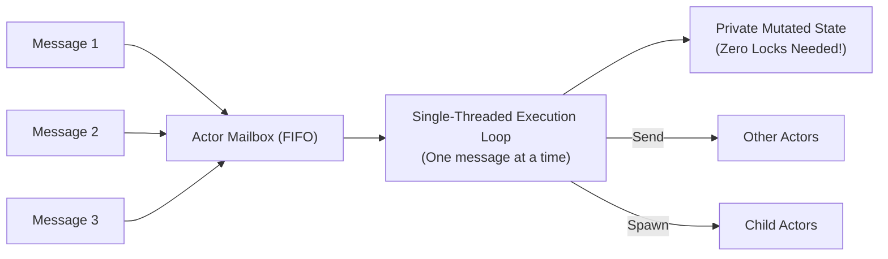
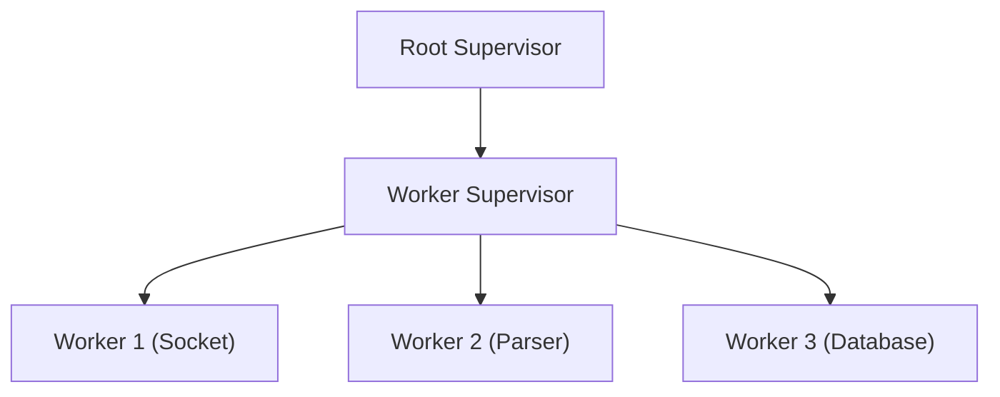
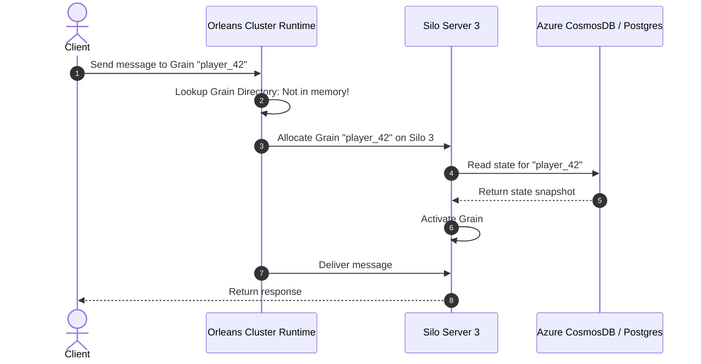
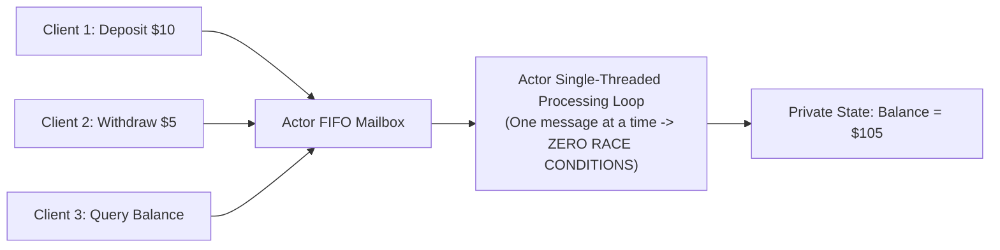

# The Actor Model, Erlang/OTP, and Microsoft Orleans Virtual Actors

In traditional concurrent programming, shared memory protected by mutexes, locks, and semaphores leads to deadlocks, race conditions, and priority inversions. The **Actor Model** replaces shared memory with isolated, message-passing computational entities.

---

## 1. Carl Hewitt’s Actor Model (1973)

An **Actor** is the fundamental primitive of concurrent computation. An actor encapsulates:
1. **Private State:** No external process can directly inspect or mutate an actor's memory.
2. **Mailbox:** An unbounded FIFO message queue.
3. **Behavior:** The logic executed upon processing a message.

### 💡 Intuitive Real-World Analogy: The Private Office with a Mail Slot
Imagine an office building where 1,000 specialists work:
- Each specialist (Actor) sits inside a locked private office.
- Nobody is allowed to touch another person's desk, computer, or filing cabinet (**No Shared Memory**).
- On the door of each office is a physical mail slot dropping into an inbox basket (**Mailbox**).
- If Alice wants Bob to calculate an invoice, she writes a memo, walks over, and drops it through Bob's mail slot.
- Bob sits at his desk and processes letters **one at a time in order**. He never has to lock his desk or fight with Alice over a pen.
- If Bob crashes (spills coffee and faints), his supervisor opens the door, clears the desk, and brings in a fresh specialist.

### 👶 Plain-English / ELI5 Overview
Instead of having 50 computer threads fighting and tripping over the same shared spreadsheet (which causes crashes and deadlocks), every task gets its own dedicated worker with its own private notebook and mailbox. Workers communicate only by sending letters to each other. Because each worker only does one thing at a time, you never need locks!

### ⚠️ The Horror Scenario: The Multithreaded Banking Deadlock
A payments startup builds a multi-threaded Java service using traditional synchronized mutex locks:
1. User 1 initiates a transfer of $100 from Account A to Account B.
   - Thread 1 locks Account A (`lock_A.acquire()`) and attempts to acquire `lock_B`.
2. Simultaneously, User 2 initiates a transfer of $50 from Account B to Account A.
   - Thread 2 locks Account B (`lock_B.acquire()`) and attempts to acquire `lock_A`.
3. **The Disaster:** **Deadlock!** Thread 1 waits for Thread 2; Thread 2 waits for Thread 1.
4. As more transactions arrive, subsequent threads queue up behind the frozen locks.
5. Thread pool reaches 100% capacity. JVM hangs completely. Health check probes fail, taking down the entire payment processing fleet.
6. **With the Actor Model:** Account A and Account B are independent actors. Thread 1 simply sends a message to Account A's mailbox: `Debit($100)`. Account A processes it sequentially and forwards `Credit($100)` to Account B's mailbox. Deadlocks are mathematically impossible because no thread ever holds two locks simultaneously!

### 1.1 The Axioms of the Actor Model
When an actor processes a message, it can only execute three actions:
1. **Send** a finite number of messages to other actors (via their addresses).
2. **Create** a finite number of new actors.
3. **Designate** the behavior to use for the next message it receives.

**Key Benefit:** Because an actor processes messages **one at a time sequentially**, its internal state is strictly thread-safe without ever acquiring a single lock or mutex!

---

## 2. Erlang/OTP: "Let It Crash" & Supervision Trees

Joe Armstrong and Ericsson developed Erlang and the Open Telecom Platform (OTP) to power telecom switches requiring nine nines ($99.9999999\%$) availability.

### 2.1 The "Let It Crash" Philosophy
In defensive programming, engineers write defensive checks for every possible error condition, often resulting in silent corruption. In Erlang:
- Processes should **fail fast and immediately terminate** upon an unexpected state.
- Crashed processes are completely isolated; they cannot corrupt memory of any other process.
- Other supervisor processes detect the death and orchestrate clean recovery.

### 2.2 Supervision Trees
Hierarchical organizational structures where supervisors monitor worker processes:

#### Restart Strategies:
- **`one_for_one`:** If a child crashes, only that specific child is restarted.
- **`one_for_all`:** If any child crashes, all other children supervised by that supervisor are killed and restarted together (used when siblings have strong state coupling).
- **`rest_for_one`:** If child $k$ crashes, all children spawned *after* child $k$ (in linear sequence) are killed and restarted.

---

## 3. Microsoft Orleans & The Virtual Actor Pattern

Traditional actor frameworks (Akka, Erlang) require manual lifecycle management: you must instantiate an actor, track its server address, monitor its crashes, and terminate it to free RAM.

Microsoft Research introduced **Orleans** and the **Virtual Actor Pattern (Grains)**, completely revolutionizing distributed computing for cloud gaming (Halo), IoT, and enterprise systems.

### 💡 Intuitive Real-World Analogy: Hotel Room Service on Demand
In traditional actor frameworks, you must hire and pay 1,000,000 hotel maids to stand in 1,000,000 empty hotel rooms 24/7 just in case a guest shows up (wasting all your money and memory).
In Microsoft Orleans (Virtual Actors):
- Conceptually, every room *exists*, but there are no maids standing inside empty rooms.
- When a guest rings the bell for Room 42, the hotel front desk immediately dispatches a maid to Room 42, loads the guest's profile from the computer, and answers the door (**Activation**).
- When the guest falls asleep and stops ringing for 10 minutes, the maid leaves and goes on break to save resources (**Deactivation**).

### 3.1 Grains: Virtual Entities that Never Die
- In Orleans, actors are called **Grains**.
- **Virtual Lifetime:** A Grain conceptually exists in the cluster perpetually. You never "create" or "destroy" a Grain.
- Addressing is pure identity: `GrainFactory.GetGrain<IUserGrain>(userId)`.
- If Grain `user_999` is not currently in memory on any server, the Orleans runtime automatically:
  1. Finds a silo (server) with available capacity.
  2. **Activates** the grain on that silo.
  3. Loads its persistent state from the database.
  4. Delivers the message.
- If the grain sits idle without receiving messages for 10 minutes, the runtime silently **deactivates** it to free RAM.

### 3.2 Grain Placement Directors
When an inactive Grain receives a message, Orleans decides where to activate it using **Placement Directors**:
1. **Random Placement:** Evenly distributes grains across all available silos.
2. **Activation-Count Based:** Places the grain on the server with the lowest count of active grains.
3. **Stateless Worker:** Allows multiple concurrent activations of the grain across all servers for high-throughput stateless compute.
4. **Geo-Distributed Silo Placement:** Places the grain on the silo physically nearest to the client.

---

## 4. Modern Production Applications
- **Halo (Microsoft):** Player state, real-time match lobbies, and leaderboard tracking modeled as virtual grains.
- **WhatsApp:** 2+ billion users managed via Erlang/BEAM lightweight processes (each connected user is an isolated Erlang actor).
- **Ray (AI Distributed Compute):** Ray uses distributed actors to manage GPU memory, model weights, and reinforcement learning environments across thousands of nodes.

---

## 🎯 Top Real-World Interview Questions & Deep-Dive Answers (FAANG / Staff Level)

### Question 1: How does the Actor Model eliminate race conditions without using mutexes? What is the single-threaded execution invariant?
#### Answer:
In traditional multi-threaded programming, race conditions occur when two threads attempt to read and write to the same memory location simultaneously without synchronization.
The Actor Model eliminates race conditions through **Strict Encapsulation and Sequential Message Ingestion**:
1. **Private Memory Boundaries:**
   - An actor's state cannot be read or modified by any outside pointer. Other actors cannot execute `actor.balance += 10`.
   - The only way to interact with an actor is by sending an immutable message into its FIFO mailbox.
2. **The Turn-Based Execution Loop:**
   - Even if 10,000 clients send messages to an actor simultaneously, the actor’s underlying runtime processes messages **one by one, strictly sequentially**.
   - Because only one message handler executes at any given instant in time, the internal state transitions are strictly deterministic and thread-safe.
   - Mutexes, read-write locks, and memory barriers are completely eliminated from application code!

---

### Question 2: What is the "Mailbox Overflow" problem in the Actor Model, and how do production systems implement backpressure to prevent Out-Of-Memory (OOM) crashes?
#### Answer:
Because actor mailboxes are theoretically unbounded FIFO queues, a major production hazard is **Mailbox Saturation**:
- If an actor receives 5,000 messages per second, but its internal processing logic (e.g., executing a slow database query) can only process 500 messages per second, the mailbox buffer will grow infinitely until the host runs out of RAM and crashes with an OOM error.

**Production Mitigations for Mailbox Saturation:**
1. **Bounded Mailboxes:**
   - Configure a maximum mailbox capacity (e.g., 10,000 messages).
   - If the mailbox fills up, define an overflow strategy:
     - *Drop Oldest:* Discard oldest messages (useful for video frames or GPS coordinate pings).
     - *Drop Newest:* Reject incoming messages immediately with an HTTP 429 / Backpressure error.
2. **Reactive Streams & Pull-Based Backpressure (Akka Streams):**
   - Instead of producers pushing messages aggressively, consumers *pull* batches of messages by requesting demand tokens: *"I have capacity to process 50 messages, send me 50"*.
   - If downstream actors slow down, upstream producers are forced to slow down all the way to the edge gateway.
3. **Dead Letter Queues (DLQ):**
   - Unhandled or timed-out mailbox messages are offloaded to persistent disk storage (e.g., Kafka / SQS) to keep the actor's RAM clean.

---

### Question 3: How do Virtual Actors (Microsoft Orleans Grains) fundamentally change how a Staff Architect designs a multiplayer gaming or IoT platform compared to traditional Akka actors?
#### Answer:
Traditional actors vs. Virtual actors represent the shift from **physical server-bound lifecycle management to serverless distributed state**:

| Feature | Traditional Actors (Akka / Erlang) | Virtual Actors (Microsoft Orleans Grains) |
| :--- | :--- | :--- |
| **Lifecycle** | Manual creation, monitoring, and explicit destruction (`actorRef.stop()`). | **Virtual and Perpetual.** Grains conceptually always exist. Activated on demand; deactivated when idle. |
| **Addressing** | Physical path: `akka://cluster/user/game_manager/player_123`. Tied to a specific host node. | Pure logical identity: `GetGrain<IPlayer>(player_123)`. Host location is completely abstracted. |
| **Node Crashes** | You must write custom supervision trees and restart code to re-instantiate the actor on another node. | **Automated Transparent Failover.** The runtime detects node failure and automatically re-activates the grain on a healthy host upon the next incoming message! |
| **Memory Management** | High risk of memory leaks if idle actors are forgotten. | Built-in LRU garbage collection silently unloads idle grains from RAM to disk. |

**Architectural Decision Rule:**
- Use **Virtual Actors (Orleans/Dapr)** for massive fleets of long-lived, stateful entities that are intermittently active (e.g., 50 million IoT smart meters, 10 million gamer profiles, or shopping cart sessions).
- Use **Traditional Actors (Erlang/Akka)** when you require microsecond low-latency message passing between continuously active, tightly coupled streaming workers.
