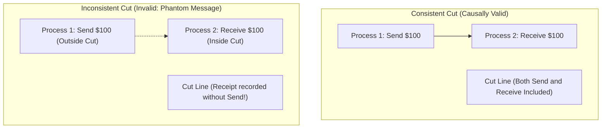
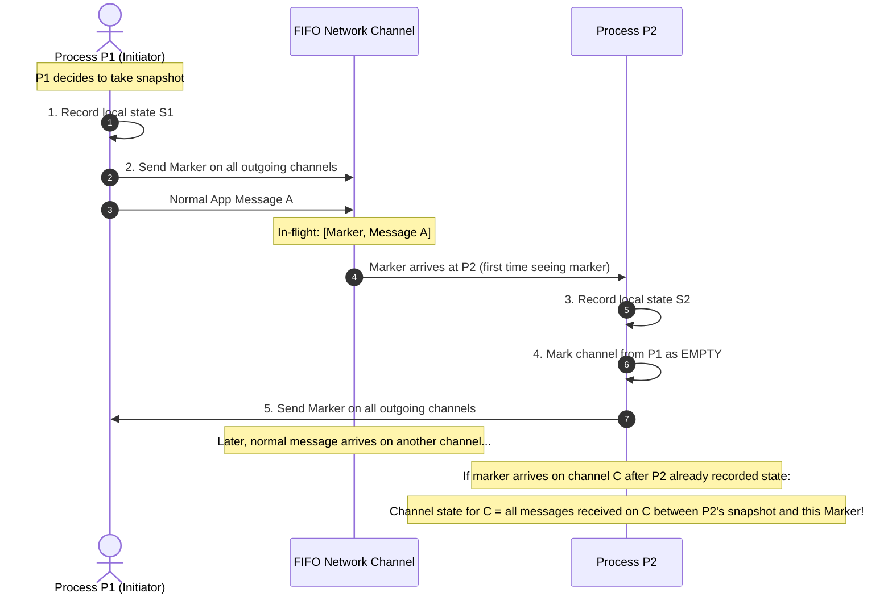
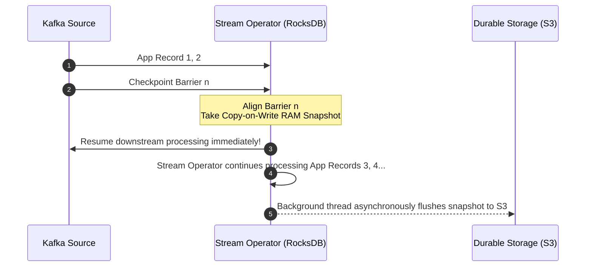

# Chandy-Lamport Distributed Snapshot Algorithm & Consistent Cuts

In a single-machine system, taking a snapshot is trivial: freeze execution and dump memory to disk. In a distributed system with hundreds of nodes communicating asynchronously over network channels, there is no shared memory and no global clock. Halting all servers to take a backup causes unacceptable downtime.

The **Chandy-Lamport Algorithm (1985)** allows a distributed system to capture a **consistent global state** (including both node states and in-flight messages in network channels) **without halting ongoing system execution**.

---

## 1. Mathematical Formalism: Cuts & Consistent Cuts

A distributed execution is modeled as a set of events across processes connected by directed FIFO channels.

### 💡 Intuitive Real-World Analogy: The Red Ping-Pong Ball in the Pneumatic Tube
Imagine two bank branches—Branch New York and Branch London—connected by pneumatic tubes that shoot cash canisters back and forth:
- The CEO wants to audit the bank's total wealth at noon without locking the bank doors or stopping customers.
- Branch New York counts the money in its vault: **$10,000**.
- Immediately, New York drops a bright **Red Ping-Pong Ball (The Marker)** into the pneumatic tube heading to London, and starts a notebook recording any money arriving from London.
- When the Red Ball shoots out of the tube in London, London immediately counts its vault: **$5,000**.
- If a canister containing **$2,000** was flying through the tube between New York and London, the red ball guarantees that:
  - If the canister was ahead of the red ball, London counts it in its vault.
  - If the canister was behind the red ball, New York logs it as "cash in transit in the tube".
- **The Result:** Total wealth is perfectly audited ($10,000 + $5,000 + $2,000 = $17,000) without ever freezing the pneumatic tubes or stopping bank business!

### 👶 Plain-English / ELI5 Overview
How do you take a photograph of a crowded soccer match where the ball and players are constantly running around, without blowing a whistle to make everyone freeze like statues? You pass a special red marker token along the same paths the ball travels.

### ⚠️ The Horror Scenario: The Phantom Money Banking Audit Disaster
An international financial system takes naive independent database snapshots without consistent cut synchronization:
1. At 12:00:00, the system snapshots **Account A (New York)**: Balance = **$10,000**.
2. At 12:00:01, Alice wires $10,000 from New York to Bob in **London**.
   - New York decrements Account A to $0 and fires an asynchronous SWIFT packet over the Atlantic.
3. At 12:00:03, the SWIFT packet arrives in London. London credits Bob's Account B: Balance = **$10,000**.
4. At 12:00:05, the system snapshots **Account B (London)**: Balance = **$10,000**.
5. **The Disaster:** An auditor merges the snapshots:
   $$\text{Total Recorded Balance} = \$10,000 \text{ (from A)} + \$10,000 \text{ (from B)} = \mathbf{\$20,000}$$
   The snapshot recorded **an effect (receipt of wire) without its cause (the debit had not occurred in A's past snapshot)**! $10,000 in phantom money was magically conjured from thin air! If restored, this backup would corrupt the bank's general balance sheet.

### 1.1 The Definition of a Cut
A **Cut** divides the distributed execution into PAST and FUTURE:
- A Cut is represented as a tuple of local process states $(S_1, S_2, \dots, S_n)$.

### 1.2 The Consistent Cut Invariant
A Cut $C$ is a **Consistent Cut** if and only if it is closed under the causal "happened-before" relation ($\to$):
$$\forall e_1, e_2: (e_2 \in C \land e_1 \to e_2) \implies e_1 \in C$$

**Intuition:** If an effect (message receipt) is recorded in the snapshot, the cause (message sending) **must** also be recorded in the snapshot! An inconsistent snapshot records an effect without its cause.

---

## 2. The Chandy-Lamport Marker Algorithm

### 2.1 Environmental Assumptions
1. Channels are **FIFO** (First-In, First-Out) and reliable (no message corruption or loss).
2. The network graph is strongly connected.
3. Marker messages flow along the same channels as normal application data messages.

### 2.2 Algorithm Execution Rules

The algorithm uses a special control message called a **Marker**.

#### Detailed Rules:

#### Rule 1: Initiating Process (e.g., Process $P_{\text{init}}$):
1. $P_{\text{init}}$ records its own local internal state.
2. Before sending any further application messages, $P_{\text{init}}$ sends a `Marker` along every outgoing channel.
3. $P_{\text{init}}$ begins recording incoming messages on all its incoming channels.

#### Rule 2: Receiving a Marker at Process $Q$ from Channel $C$:
- **Case A: First time $Q$ has received a Marker (from any channel):**
  1. $Q$ records its own local internal state.
  2. $Q$ marks the state of channel $C$ as **empty**.
  3. $Q$ immediately sends a `Marker` along every outgoing channel before transmitting any new application messages.
  4. $Q$ begins recording incoming messages on all other incoming channels (excluding $C$).
- **Case B: $Q$ has already recorded its local state:**
  1. The state of channel $C$ is recorded as the exact sequence of messages received on $C$ since $Q$ recorded its local state up until the arrival of the `Marker`.
  2. $Q$ stops recording on channel $C$.

#### Rule 3: Termination:
When every process has received a `Marker` on all of its incoming channels, the snapshot is complete. The global snapshot is the union of all recorded process states and channel states.

---

## 3. Real-World Applications

1. **Apache Flink Asynchronous Barrier Snapshotting (ABS):**
   - Flink streams use a variant of Chandy-Lamport where checkpoints inject checkpoint barriers into Kafka partitions and stream operators.
   - Operators snapshot state upon aligning barriers, delivering **Exactly-Once Processing** across millions of events/sec without stopping stream throughput.
2. **Distributed Deadlock Detection:**
   - Distributed wait-for graphs are constructed from global snapshots to detect cycles.
3. **Database Consistency Verification:**
   - Generating point-in-time recovery archives across multi-shard databases without taking tables offline.

---

## 🎯 Top Real-World Interview Questions & Deep-Dive Answers (FAANG / Staff Level)

### Question 1: How does Apache Flink adapt the Chandy-Lamport algorithm to provide high-throughput, Exactly-Once streaming without stopping stream processing?
#### Answer:
Apache Flink’s **Asynchronous Barrier Snapshotting (ABS)** algorithm is a production adaptation of Chandy-Lamport for Directed Acyclic Graphs (DAGs) of streaming operators:
1. **Checkpoint Barriers:**
   - Instead of a traditional `Marker`, Flink’s JobManager injects special lightweight metadata records called **Checkpoint Barriers** into the input stream (e.g., Kafka topic partitions).
   - Barriers divide the infinite stream of records into two discrete epochs: records belonging to the current checkpoint ($n$), and records belonging to the next checkpoint ($n+1$).
2. **Barrier Alignment:**
   - When an operator with multiple input channels (e.g., a Join operator) receives Barrier $n$ from Channel 1, it pauses consumption of Channel 1 and buffers incoming records.
   - It continues processing Channel 2 until Barrier $n$ arrives from Channel 2 (**Barrier Alignment**).
3. **Asynchronous State Persistence:**
   - Once all input barriers align, the operator creates a copy-on-write snapshot of its internal state (e.g., RocksDB state backend) in RAM.
   - It immediately emits Barrier $n$ downstream to subsequent operators, resuming stream processing within **microseconds**!
   - A background thread asynchronously uploads the memory snapshot to persistent cloud storage (S3/HDFS).
   - *Result:* True Exactly-Once processing across millions of events/second with zero cluster pauses!

---

### Question 2: Why does the Chandy-Lamport algorithm strictly require network channels to be First-In, First-Out (FIFO)? What happens if messages arrive out of order?
#### Answer:
The entire correctness of Chandy-Lamport relies on the **Marker serving as an impassable boundary line between the past and the future**:
1. **The FIFO Invariant:**
   - In a FIFO channel, if message $m$ is transmitted before the `Marker`, it is physically guaranteed to arrive *before* the `Marker`.
   - If message $m'$ is transmitted after the `Marker`, it is guaranteed to arrive *after* the `Marker`.
2. **The Out-of-Order Failure Mode (Non-FIFO):**
   - Suppose Channel $C$ is non-FIFO (e.g., UDP or multi-path IP routing).
   - Process $P_1$ sends Message $M_1$, then sends `Marker`, then sends Message $M_2$.
   - Due to network jitter, $M_2$ overtakes the `Marker`, and `Marker` overtakes $M_1$.
   - Process $P_2$ receives: $M_2 \to \text{Marker} \to M_1$.
   - **The Bug:** $M_1$ (sent *before* the snapshot) arrives *after* the marker, so $P_2$ mistakenly records it as an in-flight channel message. $M_2$ (sent *after* the snapshot) arrives *before* the marker, so $P_2$ mistakenly bakes it into its pre-snapshot local state!
   - **The Result:** The cut is no longer consistent—the snapshot is hopelessly corrupted.
3. **The Fix for Non-FIFO Networks:**
   - Overlay a TCP layer or attach logical sequence numbers to every packet so the receiving process reconstructs strict FIFO order before executing snapshot logic.

---

### Question 3: What is the fundamental difference between a Consistent Global Snapshot and a Distributed Transaction Commit?
#### Answer:
Candidates frequently confuse Chandy-Lamport with Two-Phase Commit (2PC):
- **Distributed Transaction Commit (2PC / 3PC):**
  - **Mutates State.**
  - Requires **all** participating nodes to actively coordinate and agree to make changes durable (ACID).
  - Can abort and rollback if a participant rejects the change.
  - Blocks ongoing writes while holding exclusive locks.
- **Consistent Global Snapshot (Chandy-Lamport):**
  - **Read-Only Inspection.**
  - Does NOT alter application state or abort business operations.
  - Runs concurrently alongside regular mutating traffic with **zero lock acquisition**.
  - Captures a causally valid *view* of what the distributed state machine looked like at some point in time, guaranteed to satisfy physical conservation laws (e.g., no phantom money created, no in-flight packets forgotten).
