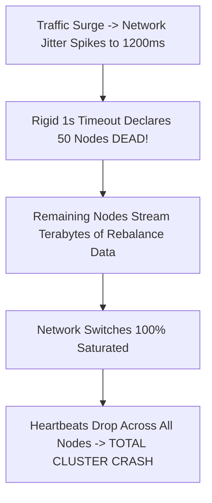
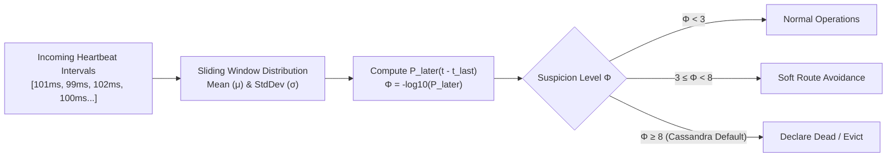

# Failure Detectors, Chandra-Toueg Hierarchy, and The $\Phi$-Accrual Algorithm

In an asynchronous distributed system, an unresponsive node poses an existential question: has the process **crashed**, is the network **partitioned/delayed**, or is the process undergoing an unannounced **JVM Stop-the-World GC pause**?

FLP Impossibility proved that deterministic consensus is impossible in an asynchronous network with even one crash failure. Chandra and Toueg (1996) proved that consensus *is* solvable if the system is augmented with an **unreliable failure detector**.

---

## 1. Chandra-Toueg Failure Detector Taxonomy

A failure detector is characterized by two formal properties:

1. **Completeness:** The detector eventually detects every actual crash.
   - **Strong Completeness:** Every crashed process is eventually suspected by *every* non-crashed process.
   - **Weak Completeness:** Every crashed process is eventually suspected by *at least one* non-crashed process.
2. **Accuracy:** The detector avoids suspecting healthy, non-crashed processes.
   - **Strong Accuracy:** No healthy process is ever suspected.
   - **Weak Accuracy:** At least one healthy process is never suspected.
   - **Eventual Strong Accuracy ($\diamond \mathcal{P}$):** There is a point in time after which no healthy process is suspected.
   - **Eventual Weak Accuracy ($\diamond \mathcal{S}$):** There is a point in time after which at least one healthy process is never suspected.

### The Chandra-Toueg Impossibility Boundary
Chandra and Toueg proved the foundational theorem:
$$\diamond \mathcal{S} \text{ (Eventually Weak Failure Detector) is the weakest class of failure detector that can solve Consensus.}$$

---

## 2. The Flaw of Traditional Fixed-Timeout Heartbeats

In traditional architectures, servers ping each other or emit heartbeats every $\Delta t$ seconds. If no heartbeat arrives within a hardcoded threshold (e.g., $5\text{ seconds}$), the node is declared dead.

### 💡 Intuitive Real-World Analogy: The ICU Heart Rate Monitor
Imagine an emergency hospital cardiac monitor:
- **The Binary On/Off Switch:** If a patient's heartbeat is late by 0.5 seconds, the alarm screams at 120 decibels, waking up the entire ward and summoning an emergency crash team. If the patient simply coughed or rolled over in bed, it causes chaos. But if the doctor sets the timeout to 60 seconds to avoid false alarms, a patient in cardiac arrest dies before the alarm triggers.
- **The $\Phi$-Accrual Monitor:** Tracks the patient's individual breathing and pulse distribution over the last 15 minutes.
  - Heartbeat late by 200ms $\to$ Suspicion is low ($\Phi = 1$): probably normal sinus arrhythmia.
  - Heartbeat late by 1,000ms $\to$ Suspicion rises ($\Phi = 4$): flag a warning on the nurse's station.
  - Heartbeat late by 5,000ms $\to$ Suspicion hits $\Phi = 8$: probability of survival is 1 in 100,000,000—sound full cardiac resuscitation alarms!

### 👶 Plain-English / ELI5 Overview
Instead of asking a blunt Yes/No question (*"Is this server dead?"*), the computer calculates a suspicion score based on how fast the network has been running lately. If the network is slow today, it patiently waits longer before panicking. If the server is truly dead, suspicion climbs continuously until the system safely replaces it.

### ⚠️ The Horror Scenario: The Cascading Failover Storm
A platform engineering team sets a rigid 1-second timeout on a 200-node database cluster:
1. During a viral product sale, network switch utilization hits 95%.
2. Network latency temporarily spikes from 5ms to 1,200ms.
3. The fixed-timeout detector fires: **50 healthy database nodes are falsely declared DEAD!**
4. The remaining 150 nodes initiate massive partition rebalancing, streaming hundreds of gigabytes of replica data over the already saturated network switches.
5. The extra replication traffic pushes switch latency to 3,000ms!
6. Heartbeats time out across 60 more nodes.
7. **The Disaster:** Cascading cluster collapse! The entire database fleet enters an unrecoverable failover loop, taking down production for 6 hours.

---

## 3. The $\Phi$ ($\text{Phi}$) Accrual Failure Detector

Naohiro Hayashibara et al. (2004) introduced the **Accrual Failure Detector**:
- Instead of returning a binary boolean decision (`ALIVE` or `DEAD`), the detector outputs a continuous value $\Phi$ representing the **suspicion level** that the monitored node has crashed.
- Applications decouple detection from action:
  - At $\Phi = 3$: Warn operators in metrics dashboards.
  - At $\Phi = 8$: Stop routing new client requests to this replica.
  - At $\Phi = 12$: Initiate partition rebalancing and replica reassignment.

### 3.1 Mathematical Derivation
The failure detector records a sliding window of recent heartbeat inter-arrival times (e.g., the last 1,000 intervals).
It fits these historical intervals to a normal distribution with:
- Mean: $\mu$
- Standard Deviation: $\sigma$

Let $t$ be the current time, and $t_{\text{last}}$ be the timestamp of the most recent heartbeat. The elapsed duration is:
$$\Delta t = t - t_{\text{last}}$$

The probability $P_{\text{later}}(\Delta t)$ that a heartbeat arrives more than $\Delta t$ time units after the previous one is given by the cumulative distribution function (CDF):
$$P_{\text{later}}(\Delta t) = \frac{1}{\sigma \sqrt{2\pi}} \int_{\Delta t}^{\infty} e^{-\frac{(x - \mu)^2}{2\sigma^2}} \, dx$$

Using standard Gaussian error functions:
$$P_{\text{later}}(\Delta t) = 1 - \frac{1}{2} \left[1 + \text{erf}\left(\frac{\Delta t - \mu}{\sigma \sqrt{2}}\right)\right]$$

The suspicion metric $\Phi$ is defined on a logarithmic scale:
$$\Phi = -\log_{10}(P_{\text{later}}(\Delta t))$$

### 3.2 Interpretation of $\Phi$ Values
- If $\Phi = 1$: $P_{\text{later}} = 0.1 \implies 10\%$ chance the delay is a normal network anomaly.
- If $\Phi = 2$: $P_{\text{later}} = 0.01 \implies 1\%$ chance the delay is a normal network anomaly.
- If $\Phi = 8$: $P_{\text{later}} = 10^{-8} \implies$ Only 1 in 100 million chance that the node is still alive.

### 3.3 Production Implementations
- **Apache Cassandra:** Uses the $\Phi$-accrual failure detector (with default threshold $\Phi = 8$) to identify unreachable replica nodes across WAN links.
- **Akka Cluster:** Employs $\Phi$-accrual to trigger cluster split-brain resolver (SBR) downing policies.

---

## 🎯 Top Real-World Interview Questions & Deep-Dive Answers (FAANG / Staff Level)

### Question 1: How does the $\Phi$-Accrual failure detector dynamically adapt to fluctuating network conditions without manual reconfiguration?
#### Answer:
Traditional heartbeat failure detectors use a static threshold (e.g., 5,000ms). When network latency shifts between day and night, operators must constantly tweak timeouts.
The $\Phi$-Accrual detector achieves **dynamic environmental adaptation** through a sliding window of historical observations:
1. **Continuous Statistical Sampling:**
   - Every node maintains a circular buffer of the last $N$ heartbeat intervals (typically $N=1,000$).
   - It continuously recalculates the sample mean ($\mu$) and standard deviation ($\sigma$).
2. **Automatic Latency Expansion:**
   - If the network becomes noisy or congested (e.g., cross-datacenter WAN link), the variance $\sigma$ naturally increases.
   - Because $\sigma$ is in the denominator of the Gaussian error function:
     $$\frac{\Delta t - \mu}{\sigma \sqrt{2}}$$
   - A larger $\sigma$ causes $\Phi$ to accumulate **more slowly**. The detector automatically grants the network more leeway before raising alarms!
3. **Automatic Latency Tightening:**
   - When running on a clean, ultra-low-latency 100GbE local network, $\sigma$ is tiny (sub-millisecond).
   - If a heartbeat is delayed by even 50ms, $\Phi$ spikes immediately to 10+, detecting a crash in milliseconds rather than seconds!

---

### Question 2: Why did Chandra and Toueg prove that $\diamond \mathcal{S}$ (Eventually Weak Failure Detector) is the absolute weakest detector that can solve Consensus?
#### Answer:
The FLP impossibility theorem proved that deterministic consensus cannot terminate in an asynchronous network with crash failures.
Chandra and Toueg bridged this gap by proving what **minimal information** an imperfect failure detector must provide:
1. **The Definitions:**
   - **Weak Completeness:** Every crashed node is eventually suspected by *at least one* healthy node.
   - **Eventual Weak Accuracy ($\diamond \mathcal{S}$):** There exists some point in time after which *at least one* healthy node is **never suspected** by any node.
2. **Why $\diamond \mathcal{S}$ Suffices:**
   - You do NOT need a perfect detector that never makes mistakes!
   - A failure detector in $\diamond \mathcal{S}$ can make an arbitrary number of false accusations for hours!
   - As long as the cluster eventually agrees that **one single node is trusted and not suspected**, that trusted node can act as an uncontested leader, break symmetry, and drive consensus to termination.
   - Any failure detector weaker than $\diamond \mathcal{S}$ permits an adversary to perpetually suspect all potential leaders, keeping consensus deadlocked forever.

---

### Question 3: How should a Staff Architect tune $\Phi$ thresholds across Local Area Networks (LAN) vs Wide Area Networks (WAN)?
#### Answer:
Choosing $\Phi$ thresholds is fundamentally a business trade-off between **Failover Latency** and **False Positive Risk**:

| Network Topology | Recommended $\Phi$ | Equivalent Error Probability | Operational Behavior |
| :--- | :--- | :--- | :--- |
| **Intra-Datacenter LAN (Same AZ)** | **$\Phi = 6 \text{ to } 8$** | $10^{-6} \text{ to } 10^{-8}$ | Low jitter. Fast failover ($\sim 500\text{ms}-2\text{s}$). Replicas quickly assume leader duties. |
| **Inter-Datacenter WAN (Cross-Region)** | **$\Phi = 10 \text{ to } 12$** | $10^{-10} \text{ to } 10^{-12}$ | High internet/fiber jitter. Avoids catastrophic false cross-region failovers during transient ISP routing flaps. |
| **Edge / Mobile Clients** | **$\Phi = 14+$** | $10^{-14}$ | Cellular drops are frequent. Tolerates 15–30s disconnections without evicting client sessions. |

**Staff Architectural Rule:**
Never trigger aggressive data re-replication at the same $\Phi$ threshold used for query routing. Use a **tiered response**:
- At $\Phi = 4$: Stop routing reads/writes to the node (Soft Avoidance).
- At $\Phi = 8$: Elect a new leader.
- At $\Phi = 12$: Initiate expensive disk partition data re-replication across the network.
