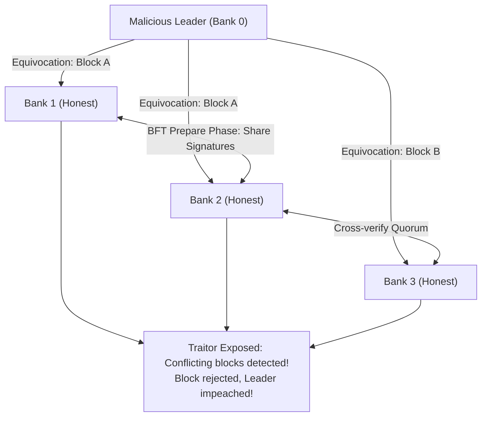
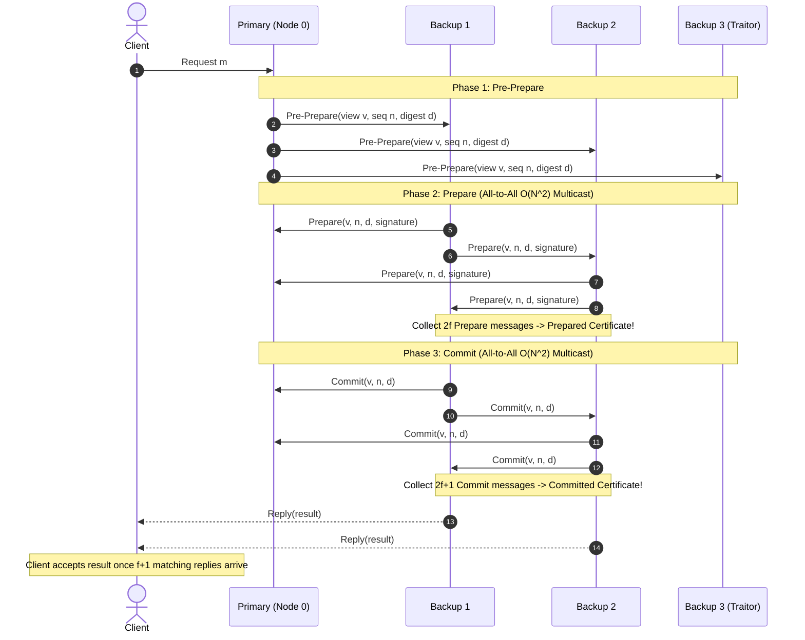
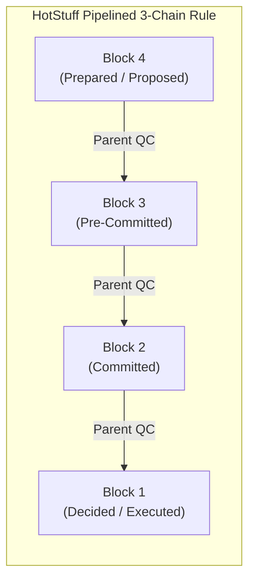
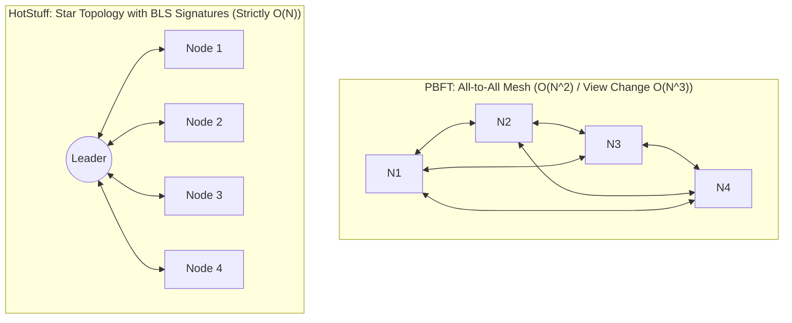

# Byzantine Fault Tolerance (BFT): From PBFT to HotStuff & Modern Proof-of-Stake

In standard distributed systems (Raft, Paxos), nodes are assumed to be **Crash-Fault-Tolerant (CFT)**: nodes may crash or experience network delays, but they never lie, forge messages, or maliciously send conflicting data to different peers.

In adversarial environments (cross-enterprise consortia, decentralized blockchains, defense communications), nodes can exhibit **Byzantine behavior**: arbitrary corruption, silent dropping of packets, message forgery, and deliberate **equivocation** (telling Node A that $X=1$ while telling Node B that $X=2$).

---

## 1. The Byzantine Generals Problem & The $3f+1$ Invariant

Leslie Lamport, Robert Shostak, and Marshall Pease (1982) proved the fundamental mathematical lower bound for Byzantine consensus.

### 💡 Intuitive Real-World Analogy: The Shouting Courtroom vs. The Secret Ballot
- **PBFT (The Shouting Courtroom):** Imagine a jury of 100 people trying to reach a verdict. Every single juror must shout their vote to every other juror in the room ($100 \times 100 = 10,000$ cross-shouts!). If the jury foreman faints or acts corruptly, all 100 jurors scream at each other simultaneously trying to elect a new foreman ($100^3 = 1,000,000$ messages). The courtroom descends into deafening chaos!
- **HotStuff (The Foreperson with a Cryptographic Stamp):** Jurors never shout across the room. Each juror quietly signs a paper ballot and hands it to the Foreperson. The Foreperson combines all signatures into a single digital wax seal (**BLS Threshold Signature**) and displays it. Communication is calm, orderly, and strictly linear ($O(N)$).

### 👶 Plain-English / ELI5 Overview
Traditional consensus (like Raft) assumes servers are honest teammates: when a server breaks, it simply falls asleep. Byzantine consensus handles evil servers: servers that get hacked, suffer cosmic ray memory corruptions, or actively lie to trick the system. It requires that at least two-thirds of the computers agree before any action is approved.

### ⚠️ The Horror Scenario: The Equivocation Double-Spend Catastrophe
A consortium of 4 international banks operates a shared inter-bank settlement ledger:
1. Bank 0 (acting as the Leader) has been compromised by a state-sponsored hacker.
2. The hacker wants to double-spend $100,000,000:
   - To Bank 1 and Bank 2, Bank 0 proposes Block A: *"Wire $100,000,000 to Account X"*.
   - Simultaneously, to Bank 3, Bank 0 proposes Block B: *"Wire $100,000,000 to Account Y"*.
3. If using standard Crash-Fault Tolerant consensus (Raft/Paxos), Bank 1 & 2 could accept Block A, while Bank 3 accepts Block B.
4. **The Disaster:** Two conflicting blocks are committed. Both Account X and Account Y receive $100,000,000. The currency ledger breaks parity, leading to regulatory seizure and multi-million-dollar lawsuits.
5. **How BFT Prevents This:** In BFT, a block cannot commit until $2f+1$ nodes cross-sign a cryptographic certificate. Because quorums intersect by at least one honest node, equivocation is mathematically prevented from ever committing.

### 1.1 Why $3f + 1$ Nodes are Required
In Crash Fault Tolerance (CFT), $2f + 1$ nodes can tolerate $f$ dead nodes because the remaining $f+1$ nodes form a guaranteed strict majority.

In Byzantine Fault Tolerance (BFT), out of $N$ total nodes:
- Up to $f$ nodes may be **malicious traitors**.
- Up to $f$ nodes may be **temporarily disconnected or slow** due to normal network latency.

When a node collects votes, it cannot wait for all $N$ nodes (otherwise $f$ dead nodes would halt the system forever). It must make a decision based on the first $N - f$ responses it receives:
1. Out of these $N - f$ responses, up to $f$ responses might come from traitors lying about their votes.
2. The remaining $(N - f) - f = N - 2f$ responses are guaranteed to be from honest nodes.
3. For the honest nodes to command a decisive majority over the $f$ traitors:
   $$N - 2f > f \implies N > 3f \implies N \ge 3f + 1$$

| Tolerated Failures ($f$) | Minimum CFT Nodes ($2f + 1$) | Minimum BFT Nodes ($3f + 1$) |
| :---: | :---: | :---: |
| **$f = 1$** | 3 nodes (majority = 2) | **4 nodes** (quorum = 3) |
| **$f = 2$** | 5 nodes (majority = 3) | **7 nodes** (quorum = 5) |
| **$f = 3$** | 7 nodes (majority = 4) | **10 nodes** (quorum = 7) |

---

## 2. Practical Byzantine Fault Tolerance (PBFT - Castro & Liskov, 1999)

Before 1999, Byzantine consensus was considered a theoretical curiosity with exponential time complexity. Miguel Castro and Barbara Liskov introduced **PBFT**, the first practical algorithm operating in polynomial time over asynchronous networks.

### 2.1 The 3-Phase Normal Case Protocol
PBFT operates across a sequence of **Views**. In each view, one replica acts as the **Primary** (leader), and the others are **Backups**.

1. **Pre-Prepare Phase:** Primary assigns sequence number $n$ to client request $m$, computes cryptographic digest $d = H(m)$, and broadcasts `Pre-Prepare` to all backups.
2. **Prepare Phase:** Replicas verify primary's signature. Each replica broadcasts `Prepare(v, n, d)` to all peers.
   - When a node collects $2f$ valid `Prepare` messages matching the pre-prepare digest, it creates a **Prepared Certificate**, proving that a supermajority agrees on ordering within view $v$.
3. **Commit Phase:** Replicas broadcast `Commit(v, n, d)` to all peers.
   - When a node collects $2f + 1$ valid `Commit` messages, it creates a **Committed-Local Certificate**, executes the operation on its state machine, and replies to the client.
4. **Client Acceptance:** The client waits for $f + 1$ identical replies from different replicas before accepting the result.

### 2.2 The View Change Bottleneck in PBFT
If the Primary crashes or acts maliciously, backups initiate a **View Change**:
- Every backup sends its entire history of prepared certificates to the next primary.
- The next primary combines these into a `New-View` message and broadcasts it.
- **Complexity:** View change requires **$O(N^3)$ to $O(N^4)$ message complexity**, making PBFT impossible to scale beyond $\sim 20$ nodes.

---

## 3. HotStuff: Linear View Change & Pipelined BFT (Yin et al., 2019)

Developed by VMware Research (Maofan Yin, Dahlia Malkhi, Michael K. Reiter et al.), **HotStuff** powers modern high-throughput blockchains (Facebook Libra/Diem, Aptos, Sui).

### 3.1 Key Architectural Breakthroughs
1. **Linear View Change ($O(N)$ Complexity):**
   - In HotStuff, backups **never multicast to all peers**. All communication flows exclusively through the Leader (**Star Topology**).
   - The Leader aggregates $2f+1$ votes into a single compact cryptographic signature using **BLS Threshold Signatures** (a single 48-byte Quorum Certificate - QC).
   - Message complexity drops from $O(N^2)$ in normal mode and $O(N^3)$ in view change down to **strictly linear $O(N)$** in both!
2. **Chained 3-Phase Pipelining:**
   - Instead of distinct messaging phases for each transaction, HotStuff pipelines consensus across consecutive block headers:
     - Header $k$: **Prepare** (proposes command).
     - Header $k+1$: **Pre-Commit** (locks command).
     - Header $k+2$: **Commit** (commits command).
     - Header $k+3$: **Decide** (executes command).
   - Every round of consensus acts as the prepare phase for the current block and advances the commit pipeline for previous blocks simultaneously.

### 3.2 The HotStuff 3-Chain Rule
A command in Block $B$ is safely committed and can be executed once the node observes a contiguous **3-chain of certified blocks**:
$$B_{\text{prepare}} \leftarrow B_{\text{pre-commit}} \leftarrow B_{\text{commit}}$$
This 3-phase locking rule guarantees that no two conflicting blocks can ever be committed, even during arbitrary leader failovers and Byzantine network partitions.

---

## 🎯 Top Real-World Interview Questions & Deep-Dive Answers (FAANG / Staff Level)

### Question 1: How does HotStuff reduce message complexity from $O(N^2)$ in PBFT down to strictly linear $O(N)$ during both normal operation and leader failover (View Change)?
#### Answer:
PBFT suffered an insurmountable scalability bottleneck because replicas communicated via an **all-to-all quadratic multicast mesh ($O(N^2)$)**, which exploded into $O(N^3)$ or $O(N^4)$ during View Change as nodes exchanged sets of prepared certificates.
HotStuff revolutionized BFT using two architectural shifts:
1. **Star Topology via Threshold Signatures:**
   - In HotStuff, replicas never send messages to each other. Replicas reply **only to the Leader**.
   - Replicas use **BLS Threshold Signatures** or Schnorr multi-signatures.
   - When $2f + 1$ replicas sign a proposal, the Leader aggregates these individual signatures into a single, compact **48-byte Quorum Certificate (QC)**.
   - The Leader broadcasts this single QC to all replicas ($N$ messages). Message complexity in normal execution is strictly $O(N)$.
2. **Pacemaker & Unified View Change:**
   - In PBFT, view changes required complex multi-round negotiations where nodes proved what they had prepared in past views.
   - In HotStuff, the 3-chain rule ensures that a Quorum Certificate is **self-verifying and universally comparable**.
   - When a leader times out, replicas simply send their highest observed QC to the new leader ($O(N)$).
   - The new leader selects the QC with the highest view number and proposes the next block ($O(N)$).
   - *Result:* View Change complexity is reduced from $O(N^3)$ down to strictly **linear $O(N)$**, allowing HotStuff clusters to scale from 20 nodes to thousands of validators!

---

### Question 2: Why are 3 consecutive Quorum Certificates (the 3-Chain Rule) required in HotStuff to commit a block, rather than 2 phases like Raft or Paxos?
#### Answer:
In Crash Fault Tolerance (CFT like Raft), a leader can commit an entry as soon as a majority acknowledges the write (**2 phases**), because followers are honest and never lie about past terms.
In Byzantine environments:
1. **The Traitorous Leader Equivocation Hazard:**
   - A malicious leader can propose Block $B$ in View $v$, collect $2f+1$ votes to form a QC, but **hide** the QC from honest nodes!
   - In the next view $v+1$, the malicious leader proposes a conflicting Block $B'$ to other honest nodes.
2. **The 3 Phases of Defense:**
   - **Phase 1 (Prepare):** Proposes the block. Replicas vote if the block extends their currently locked branch. Generates `Prepare-QC`.
   - **Phase 2 (Pre-Commit / Lock):** Once a node sees `Prepare-QC`, it **locks** that block. It promises never to vote for any conflicting proposal in higher views unless that proposal contains a higher QC. Generates `PreCommit-QC`.
   - **Phase 3 (Commit):** Once the node sees `PreCommit-QC`, it knows that a supermajority of honest nodes have successfully locked the block! No subsequent leader could ever gather $2f+1$ votes for a conflicting block. Generates `Commit-QC`.
   - **Phase 4 (Decide):** The block is safely applied to the state machine.
3. **The Lesson:** In BFT, you need one extra phase of consensus to verify that the locks themselves have been safely acknowledged across the quorum before finalizing irreversible state changes!

---

### Question 3: Under what enterprise circumstances should a Staff Architect select Byzantine Fault Tolerance (BFT) over Crash Fault Tolerance (Raft/Paxos)? Why don't AWS, Google, and Meta use BFT internally?
#### Answer:
A Staff Architect must resist the temptation to use complex blockchain/BFT algorithms inside standard enterprise cloud infrastructure:
1. **Why FAANG Datacenters Use CFT (Raft/Paxos/ZAB):**
   - **Shared Administrative Trust Domain:** All servers in an AWS or Google datacenter run signed, authenticated internal firmware inside an enterprise VPC with strict IAM controls.
   - **Performance Tax of BFT:**
     - Cryptographic signature generation and verification (ECDSA/BLS) adds severe CPU overhead.
     - Latency is $5\times$ to $20\times$ higher than Raft.
     - Quorum requirement is higher: Tolerating 2 dead nodes requires 7 nodes in BFT ($3f+1$) vs only 5 nodes in Raft ($2f+1$), increasing server costs by 40%.
2. **When BFT is Architecturally Mandatory:**
   - **Adversarial Multi-Party Consortia:** When 10 independent competing banks or logistics companies share a ledger and none of them trust each other's database administrators.
   - **Decentralized Cryptographic Networks:** Public Proof-of-Stake blockchains (Ethereum, Aptos, Cosmos) where anonymous nodes stake money and have direct financial incentives to lie or double-spend.
   - **Life-Critical Avionics & Nuclear Control:** Systems where physical cosmic ray radiation bit flips or sensor electrical shorts can cause hardware to send contradictory pitch/rudder readings to redundant flight computers.
