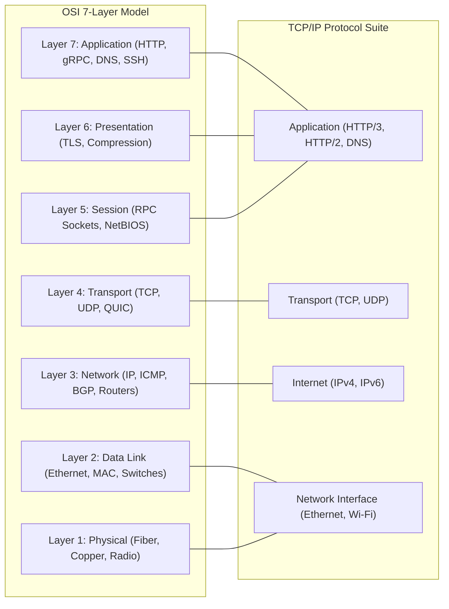
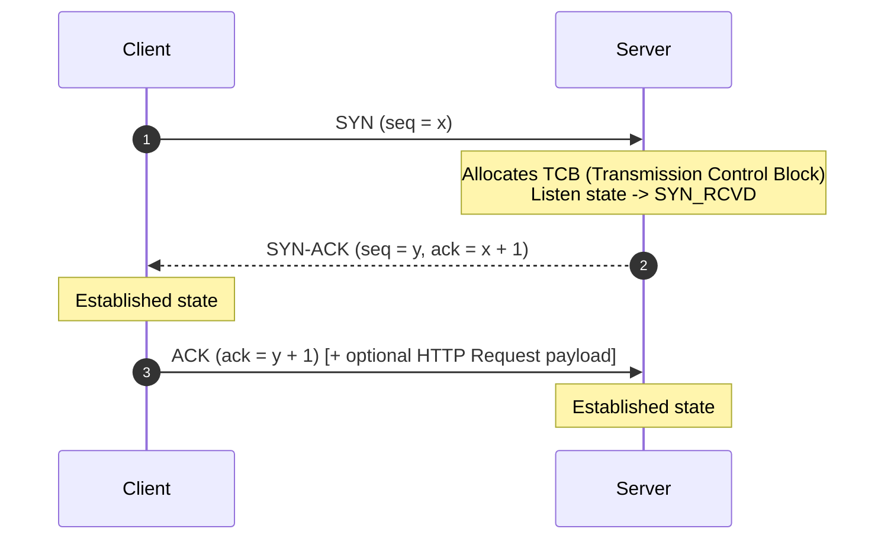
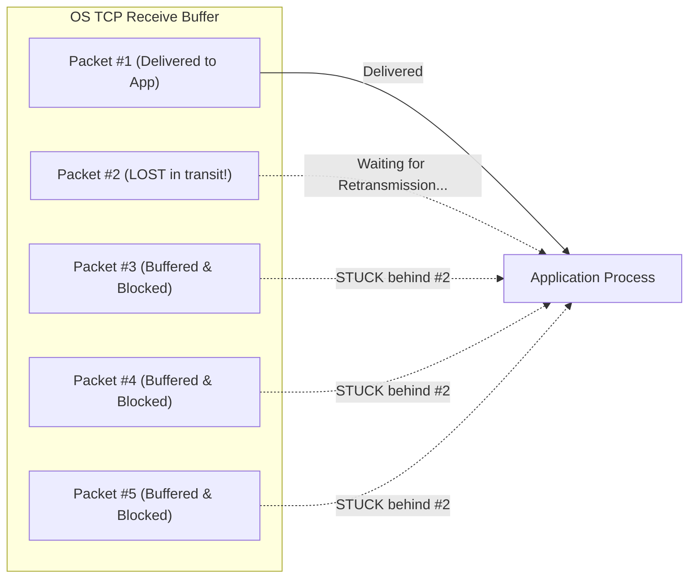
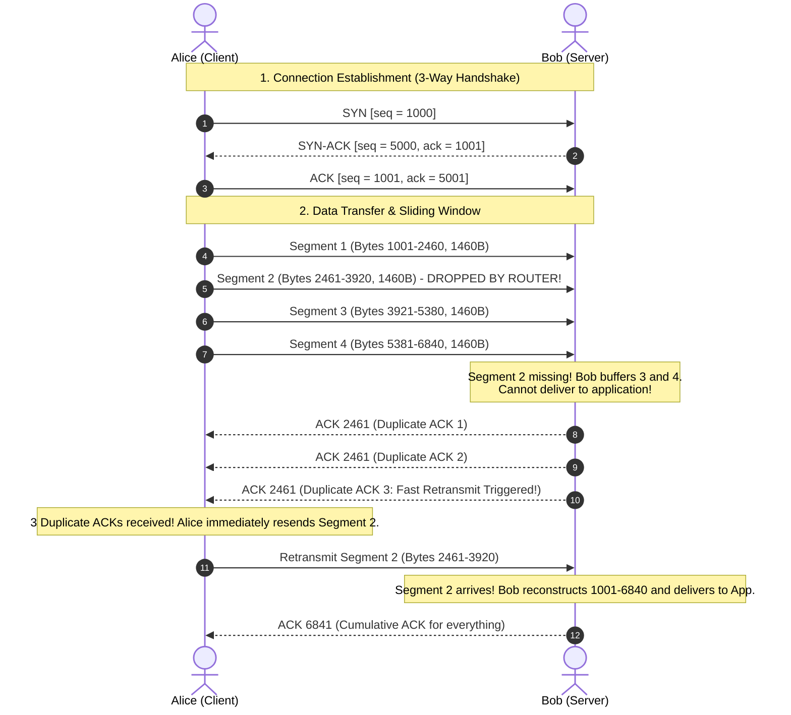
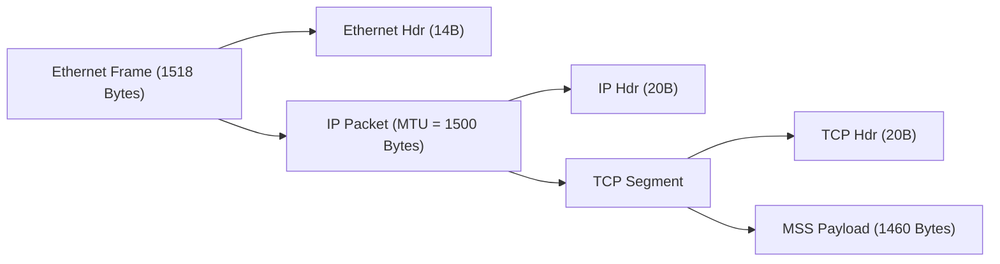
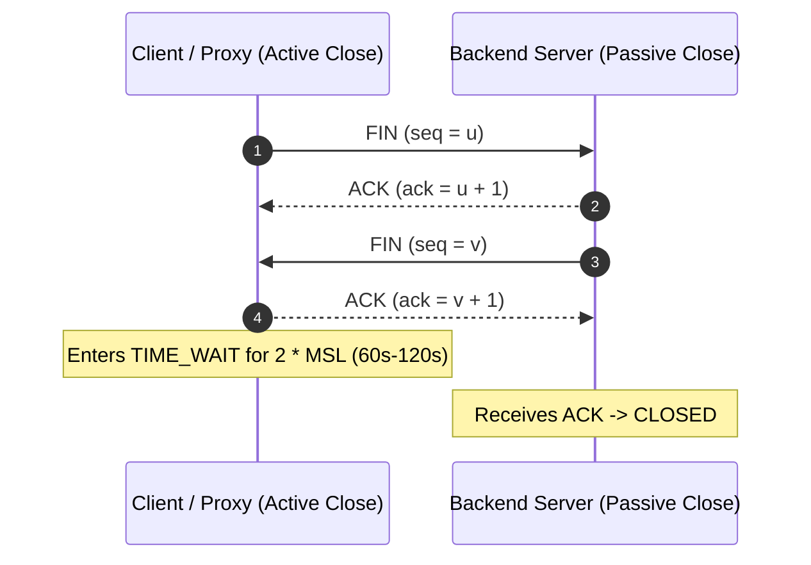
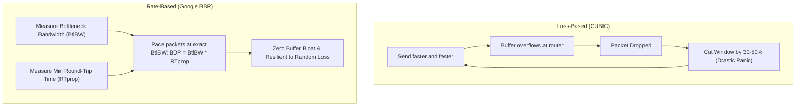
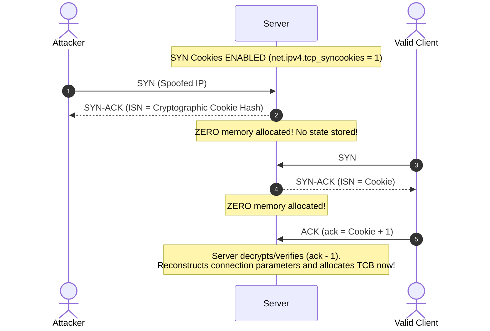

# OSI Model and Transport Layers: TCP vs. UDP

All distributed software systems communicate over physical networking gear. Understanding transport layer dynamics prevents latency bottlenecks, connection exhaustion, and packet loss surprises.

---

## 1. The OSI 7-Layer Model vs. The TCP/IP Model



### 💡 Intuitive Mental Model: Russian Nesting Dolls & The Postal Courier
Think of network encapsulation as **Russian nesting dolls** or sending a legal contract via international courier:
1. **Application Data (Payload):** The legal contract you wrote.
2. **Transport Layer (L4 - TCP/UDP):** Placing the contract in a certified envelope stamped with a sequence number, port address, and a return-receipt tracking barcode.
3. **Network Layer (L3 - IP):** Placing that certified envelope inside a shipping box stamped with physical street addresses (Source and Destination IP).
4. **Data Link Layer (L2 - Ethernet):** Loading the box onto an armored courier truck stamped with vehicle license plates (MAC addresses) to drive between local warehouses (network switches).
5. **Physical Layer (L1 - Wire/Fiber/Radio):** The asphalt road, diesel fuel, or fiber-optic pulses that physically move the truck.

Each layer only cares about its own envelope and doesn't inspect the inner contents. When the package arrives at the destination, each layer strips off its corresponding outer layer (decapsulation).

### 👶 ELI5 / Plain-English Overview
Why do we divide networking into 7 layers? **Separation of concerns.**
If you write an iOS app or a Node.js microservice, you shouldn't have to rewrite your network code if the user switches from a 5G cellular tower to home Wi-Fi or fiber-optic Ethernet. The Application Layer (`HTTP/JSON`) stays identical regardless of whether Layer 1 is bouncing radio waves off a cell tower or pulsing photons down a subsea glass cable.

---

## 2. Transmission Control Protocol (TCP)

TCP is a **connection-oriented, reliable, byte-stream** transport protocol. It guarantees that bytes are delivered in order, without duplication, and without corruption.

### 💡 The Physical Analogy: Certified Registered Mail with Return-Receipt
Imagine sending a 500-page book to a friend one page at a time. TCP is like:
- Numbering every single page (Sequence numbers).
- Demanding your friend send a stamped postcard back confirming each page arrived safely (Acknowledgements / ACKs).
- If you don't get a postcard for Page 4 within 3 days, you resend Page 4 before sending Page 5 (Retransmission).
- If the postal system slows down, you slow down how many pages you drop in the mailbox (Congestion Control).

### The TCP 3-Way Handshake
Before sending a single application byte (e.g., an HTTP GET request), client and server must establish sequence numbers and negotiate connection parameters:



- **Cost:** Adds 1 full network Round-Trip Time (1 RTT) before application data can travel.
- **SYN Flood Attack:** Attackers send thousands of `SYN` packets with spoofed source IPs without sending the final `ACK`. The server allocates memory for each half-open connection until kernel memory is exhausted.
  - *Mitigation:* **SYN Cookies** (encoding connection state cryptographically in the sequence number $y$ without allocating server memory until the final `ACK` arrives).

---

### ⚠️ The Horror Scenario: Ephemeral Port Exhaustion & The TIME_WAIT Death Spiral

Imagine an e-commerce platform processing a flash sale. The API Gateway forwards incoming user requests to backend payment services via HTTP. However, the software engineers forgot to enable **HTTP Keep-Alive** or **Connection Pooling**.

```
[API Gateway]  --- (New TCP Handshake per Request) --->  [Payment Service]
               <--- (4-Way FIN/ACK Close) -------------
```

1. Each incoming request creates a brand new TCP connection.
2. The operating system assigns a local ephemeral port from the range `32768` to `60999` (roughly 28,000 available ports).
3. The request completes in $5\text{ ms}$, and the API Gateway issues a `FIN` to close the connection.
4. **The Catastrophe:** The closing socket enters the **`TIME_WAIT`** state for $2 \times \text{MSL}$ ($2 \times 60\text{s} = 120\text{ seconds}$) to ensure late, duplicated packets in the internet aren't misdelivered to a future socket.
5. At a modest traffic rate of 1,000 requests/second:
   $$\text{Active TIME\_WAIT sockets} = 1,000 \text{ req/sec} \times 120 \text{ sec} = 120,000 \text{ sockets}$$
6. **Result:** The system exhausts all 28,000 ephemeral ports in less than 30 seconds!
7. The Linux kernel begins throwing:
   ```
   connect() failed: EADDRNOTAVAIL (Cannot assign requested address)
   ```
8. Every microservice call fails instantly, dropping 100% of payment checkouts while server CPU sits at a tranquil 3%!

#### Mitigation in Production
- **TCP Connection Pooling / Keep-Alive:** Reuse long-lived TCP connections across thousands of HTTP requests.
- **Kernel Tuning:** Enable `net.ipv4.tcp_tw_reuse = 1` (safely reuses `TIME_WAIT` sockets for outgoing connections when timestamps are valid).
- **Expand Ephemeral Port Range:** Set `sysctl net.ipv4.ip_local_port_range="1024 65535"`.

---

### TCP 4-Way Termination & TIME_WAIT
Closing a TCP connection requires a 4-step exchange (`FIN` $\to$ `ACK` $\to$ `FIN` $\to$ `ACK`).
- The closing endpoint enters the **`TIME_WAIT`** state for $2 \times \text{MSL}$ (Maximum Segment Lifetime, typically 60 seconds).
- **Socket Exhaustion Danger:** If a high-throughput proxy creates and destroys tens of thousands of short-lived TCP connections per second to backend servers, local ephemeral ports ($1024 - 65535$) will become trapped in `TIME_WAIT`, causing `Cannot assign requested address` errors.
  - *Mitigation:* Enable **TCP Connection Pooling**, `SO_REUSEADDR`, and persistent HTTP keep-alive connections.

---

### TCP Flow Control vs. Congestion Control

Do not confuse these two mechanisms; they solve completely different bottlenecks:

| Mechanism | Problem It Solves | Who Controls It? | Metric Used |
| :--- | :--- | :--- | :--- |
| **Flow Control** | Fast sender overwhelming a slow receiver's memory buffer | **Receiver** | `rwnd` (Receive Window advertised in TCP header) |
| **Congestion Control** | Senders overwhelming intermediate network routers & switches | **Sender** | `cwnd` (Congestion Window computed internally by sender) |

#### 1. Flow Control (Sliding Window & Zero Window)
- The receiver advertises a `Receive Window (rwnd)` in packet headers, telling the sender how much spare buffer memory it currently has.
- If the receiver process is busy processing data, its buffer fills up and it advertises `rwnd = 0` (Zero Window).
- The sender immediately freezes transmission and sends periodic 1-byte **Zero Window Probes** until the receiver's application drains the buffer and advertises a non-zero `rwnd`.

#### 2. Congestion Control (Slow Start, AIMD, and BBR)
- Begins with a small **Congestion Window (`cwnd`)** (typically 10 segments, initial window `IW10`).
- **Slow Start:** Multiplies `cwnd` exponentially ($1 \to 2 \to 4 \to 8 \dots$) for every ACK received until packet loss occurs or slow start threshold (`ssthresh`) is reached.
- **AIMD (Additive Increase / Multiplicative Decrease):**
  - Linearly increments `cwnd` by 1 MSS per RTT when things are healthy.
  - Drastically slashes `cwnd` in half (or drops to 1) when packet loss occurs.
- **Impact on Systems:** New TCP connections are sluggish. Cold connections take multiple round-trips to reach full network bandwidth.

---

## 3. User Datagram Protocol (UDP)

UDP is a **connectionless, lightweight, unreliable datagram** protocol.

### 💡 The Physical Analogy: Shouting into a Crowd or Postcards on a Windy Day
Imagine mailing postcards on a windy day, or a radio host broadcasting a live sports match:
- You fire information out into the air.
- You don't ask the listener if they heard the last sentence before speaking the next sentence.
- If a listener sneezes and misses 2 seconds of audio, you don't rewind the live show; you keep broadcasting real-time updates!

### Core Mechanics
- **No Handshake:** Zero round-trip delay ($0\text{ RTT}$). Packets are fired immediately.
- **No Ordering or Retransmission:** Packets can arrive out of order, duplicate, or vanish completely.
- **Zero Head-of-Line Blocking:** One dropped packet does not stall subsequent packets.
- **Headers:** UDP headers are only **8 bytes** (Source Port, Destination Port, Length, Checksum) compared to TCP's minimum **20 bytes**.

---

## 4. Head-of-Line (HoL) Blocking: The TCP Bottleneck

In TCP, all data travels as an ordered stream of bytes. If packet #2 of a 100-packet stream is lost in transit:
- The OS receiver buffer holds packets #3 through #100 in memory.
- The OS **refuses to deliver packets #3 through #100 to the application** until packet #2 is retransmitted and acknowledged!
- This is transport-level **Head-of-Line Blocking**. It is the primary reason why HTTP/3 abandoned TCP entirely in favor of QUIC on top of UDP.



---

## 5. 🚶 Step-by-Step Scenario: Alice, Bob, and Network Retransmission

Let's trace a concrete communication session between **Alice (Browser Client at `192.168.1.10:52418`)** and **Bob (Web Server at `198.51.100.4:443`)**:



### Walkthrough of the Failure and Recovery:
1. **The Dropped Packet:** Segment 2 is dropped by a congested intermediate router.
2. **Out-of-Order Arrival:** Bob receives Segment 3 and Segment 4. Because TCP is strictly in-order, Bob's operating system places 3 and 4 in the receive queue but cannot hand them to the application.
3. **Triple Duplicate ACKs:** Bob immediately echoes back what he is still waiting for: `ACK 2461`. When Alice receives 3 identical duplicate ACKs for byte 2461, she triggers **Fast Retransmit** (resending Segment 2 immediately without waiting for the slow Retransmission Timeout `RTO`).
4. **Cumulative ACK:** Once Segment 2 arrives, Bob's TCP stack instantly has all contiguous bytes up through 6840. He sends a single cumulative `ACK 6841`, and the entire stream unblocks!

---

## 6. MTU, MSS, and Packet Fragmentation



- **MTU (Maximum Transmission Unit):** The largest frame size a network interface can pass (standard internet MTU is $1500\text{ bytes}$).
- **MSS (Maximum Segment Size):** The largest payload of application data a TCP segment can hold without IP fragmentation:
  $$\text{MSS} = \text{MTU} - (\text{IP Header: } 20\text{B}) - (\text{TCP Header: } 20\text{B}) = 1460\text{ Bytes}$$
- If a packet exceeds the MTU of any intermediate router and has the `DF (Don't Fragment)` bit set, it is dropped and an ICMP "Fragmentation Needed" message is returned (Path MTU Discovery).
- **The Jumbo Frame Exception:** Inside private datacenters and AWS VPCs, engineers configure **Jumbo Frames (MTU = 9000 bytes)**, giving an $\text{MSS} \approx 8960\text{ bytes}$. This slashes CPU interrupt overhead by over $80\%$ for high-throughput database replication.

---

## 7. 🏢 Real-World Production Battle-Testing

### 1. Google's BBR Congestion Control
Traditional TCP algorithms (CUBIC, Reno) interpret packet loss as the primary signal of network congestion. On Wi-Fi and mobile networks, packets are frequently dropped due to radio interference, not network queue saturation. CUBIC cuts throughput in half unnecessarily.
- Google invented **BBR (Bottleneck Bandwidth and Round-trip propagation time)**.
- BBR measures real throughput and physical minimum RTT independently, pumping packets at the exact maximum capacity of the bottleneck pipe without filling intermediate router buffers.
- **Production Impact:** When YouTube migrated edge servers to BBR, global YouTube network throughput increased by $4\%$ globally and over $14\%$ in developing nations with lossy mobile networks.

### 2. Discord's Voice Architecture on UDP
- Discord runs over 10 million concurrent voice users. Every voice packet is delivered using **UDP via WebRTC**.
- If Discord used TCP, a single dropped audio packet would cause the listener's audio stream to freeze and buffer for $200\text{ ms}$, creating jarring speech lag.
- With UDP, if an audio frame is dropped, Discord's Opus audio codec simply interpolates the missing millisecond or drops it silently. The conversation stays seamlessly synchronized in real-time.

---

## 8. ⚖️ Practical Trade-Offs & Staff-Level Rules of Thumb

| Dimension | TCP | UDP |
| :--- | :--- | :--- |
| **Reliability** | Guaranteed delivery via ACKs and retransmissions | Best-effort; packet loss ignored |
| **Ordering** | Strictly guaranteed in-order delivery | Unordered; packets arrive at any time |
| **Handshake Overhead** | 1 RTT (3-way handshake) | 0 RTT (No connection setup) |
| **Header Size** | 20–60 bytes | 8 bytes |
| **Congestion Control** | Built-in (Slow start, AIMD, BBR, CUBIC) | None (Must be implemented in application) |
| **Use Cases** | Web traffic (HTTP/1, HTTP/2), Database connections, File transfer (FTP/SSH), Email (SMTP) | DNS lookups, Video streaming (RTP), Online gaming, VoIP, QUIC / HTTP/3 |

### Architectural Decision Rules:
1. **Choose TCP When:** Correctness and ordered byte delivery are non-negotiable (SQL queries, financial transfers, file uploads, REST/gRPC APIs over HTTP/2).
2. **Choose UDP When:** Real-time freshness matters more than completeness (live video streams, multiplayer FPS game tick synchronization, voice calls). If data from 100ms ago is useless now, choose UDP.
3. **Choose QUIC (UDP with User-Space Reliability) When:** You need the reliability of TCP combined with the zero-RTT handshake and stream independence of UDP (public web and mobile apps via HTTP/3).

---

## 🎯 Top Real-World Interview Questions & Deep-Dive Answers (FAANG / Staff Level)

### Q1: What happens under the hood when an active close occurs in TCP? Why is the `TIME_WAIT` state strictly necessary, why is its duration $2 \times \text{MSL}$, and how do you resolve socket exhaustion in a high-throughput API gateway?

#### 💡 Model Answer:
When an endpoint initiates connection termination (calling `close()`), it executes the **active close** sequence:
1. Active closer sends `FIN` (enters `FIN_WAIT_1`).
2. Passive closer returns `ACK` (active enters `FIN_WAIT_2`; passive enters `CLOSE_WAIT`).
3. Passive closer sends its own `FIN` (active enters `TIME_WAIT`; passive enters `LAST_ACK`).
4. Active closer sends final `ACK` and sits in **`TIME_WAIT`** for $2 \times \text{MSL}$ (Maximum Segment Lifetime, typically 60 to 120 seconds).



#### Why `TIME_WAIT` is strictly necessary (Two reasons):
1. **Reliable Final ACK Delivery:** If the active closer's final `ACK` is dropped in the network, the passive closer will retransmit its `FIN`. If the active closer had transitioned directly to `CLOSED`, it would respond to the retransmitted `FIN` with a `RST` (connection reset), causing the passive peer to terminate with an error rather than a clean close.
2. **Draining Lingering In-Flight Duplicates:** Old, delayed duplicate segments from the connection may wander through internet routers. Waiting $2 \times \text{MSL}$ ensures all wandering packets expire before their sequence numbers can be misinterpreted by a new incarnation of the socket using the same 4-tuple `(SrcIP, SrcPort, DstIP, DstPort)`.

#### Resolving Socket Exhaustion in Production:
When a high-throughput proxy (e.g., Envoy, NGINX) opens tens of thousands of short-lived connections to backend servers, ephemeral ports ($32768 - 60999$) are trapped in `TIME_WAIT`, throwing `EADDRNOTAVAIL`:
- **Enable Connection Pooling (Best Practice):** Use persistent HTTP Keep-Alive connections between the gateway and upstream services to eliminate connection setup/teardown per request.
- **Kernel Socket Reuse:** Set `net.ipv4.tcp_tw_reuse = 1`. This safely allows outgoing connections to reuse a `TIME_WAIT` socket if the new timestamp (`TCP Timestamps Option RFC 7323`) is strictly greater than the last packet seen on the old connection.
- **Expand Ephemeral Port Range:** Set `sysctl net.ipv4.ip_local_port_range="1024 65535"`.
- **Add Multiple Egress Virtual IPs:** Since a socket is identified by the 5-tuple, having 4 egress IPs on the load balancer quadruples available sockets to $4 \times 64,000 \approx 256,000$.

---

### Q2: How does TCP differentiate between network congestion and random packet loss? Why did Google design BBR to replace CUBIC?

#### 💡 Model Answer:
Legacy congestion control algorithms (Reno, CUBIC) make a flawed assumption: **they equate any packet loss with network congestion**.



#### The Flaw of CUBIC:
- On modern networks (especially Wi-Fi, 5G cellular, or satellite links like Starlink), packets are frequently lost due to radio interference, multipath fading, or transient hardware noise—**not because the network pipe is full**.
- When CUBIC experiences a $1\%$ random noise packet loss, it cuts its congestion window ($cwnd$) by $30\%$, throttling throughput even when the network pipe is completely clear.
- Furthermore, routers equipped with massive memory buffers hold overflowing packets rather than dropping them, inducing **Bufferbloat** (inflating RTT from $20\text{ms}$ to $1,500\text{ms}$).

#### How Google BBR Operates at Kleinrock's Horizon:
BBR (Bottleneck Bandwidth and RTT) models the physical physical reality of the connection by tracking two independent parameters:
1. **$\text{BtlBW}$ (Bottleneck Bandwidth):** The max delivery rate over a moving time window.
2. **$\text{RTprop}$ (Round-Trip Propagation Time):** The physical minimum RTT seen over a moving 10-second window.

BBR paces packet transmission at the exact **Bandwidth-Delay Product (BDP)**:
$$\text{BDP} = \text{BtlBW} \times \text{RTprop}$$
Because BBR never attempts to overflow intermediate router queues, it prevents bufferbloat while ignoring random packet loss up to $\sim 15\%-20\%$.

---

### Q3: How do SYN Cookies protect against SYN Flood DDoS attacks, and what are the subtle protocol trade-offs when enabled?

#### 💡 Model Answer:
In a standard TCP 3-way handshake, when the server receives a `SYN`, it allocates a **Transmission Control Block (TCB)** in kernel memory (consuming ~1KB of RAM) and places the socket in the `SYN_RCVD` queue. 
- In a **SYN Flood**, an attacker floods the server with millions of spoofed `SYN` packets.
- The server exhausts its connection backlog table, refusing legitimate connections.



#### The Cryptographic Cookie Mechanism:
When `tcp_syncookies = 1` and the SYN backlog fills up, the server **refuses to allocate any kernel memory**. Instead, it computes the server's Initial Sequence Number ($ISN$) as a cryptographic hash:
$$ISN = \text{SHA-1}(t, \text{SrcIP}, \text{SrcPort}, \text{DstIP}, \text{DstPort}, \text{SecretKey}) + \text{MSS Index}$$
Where:
- $t$: A 3-minute slowly incrementing timestamp (to prevent replay attacks).
- $\text{MSS Index}$: A 3-bit encoding of the client's Maximum Segment Size (from 8 standard values).

When the client returns the final `ACK` (`ack = ISN + 1`), the server subtracts 1, recomputes the hash using its secret key, and verifies that the client completed the handshake. Only then does it allocate memory for the TCB.

#### Architectural Trade-offs & Penalties:
1. **Loss of TCP Options:** The standard TCP sequence number is only 32 bits. After packing the timestamp and cryptographic hash, only 3 bits remain for the MSS. Other modern TCP extensions—such as **Window Scaling (RFC 7323)** and **Selective Acknowledgement (SACK)**—cannot fit in the cookie and are disabled unless TCP Timestamps are negotiated.
2. **CPU Overhead:** Computing cryptographic hashes for high-packet-rate floods increases kernel CPU utilization.
