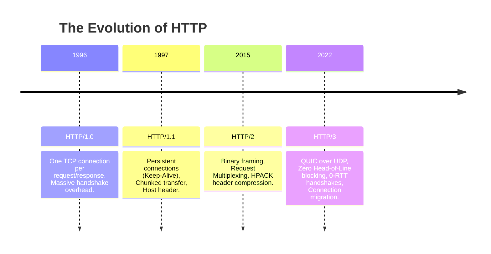
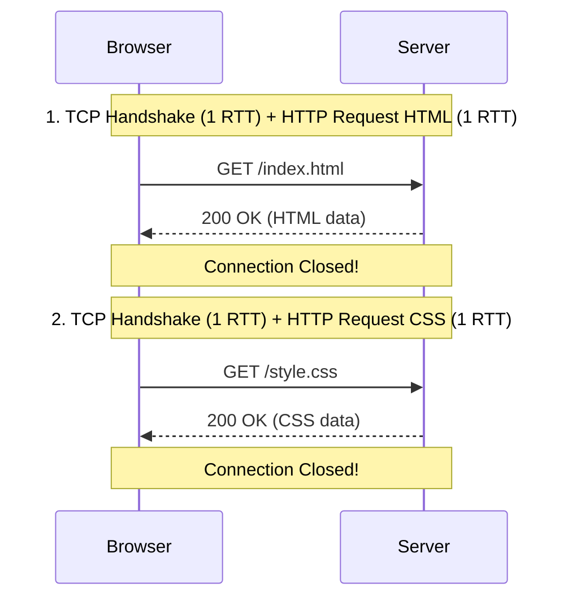
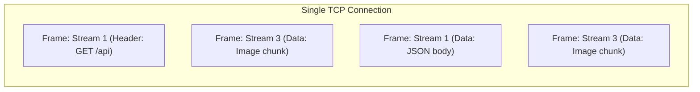
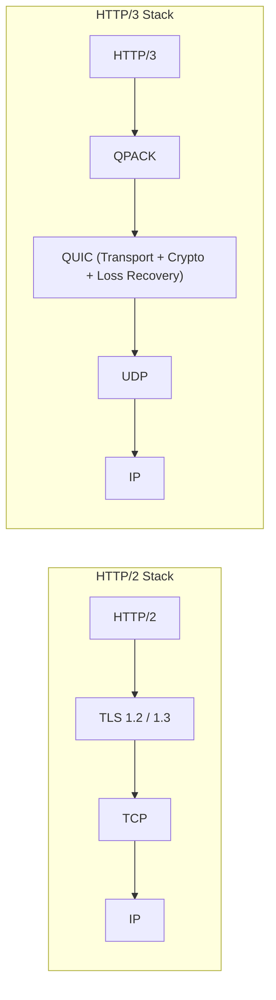
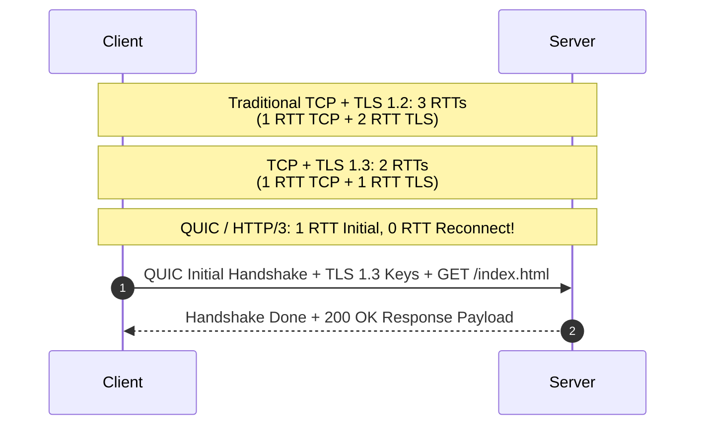
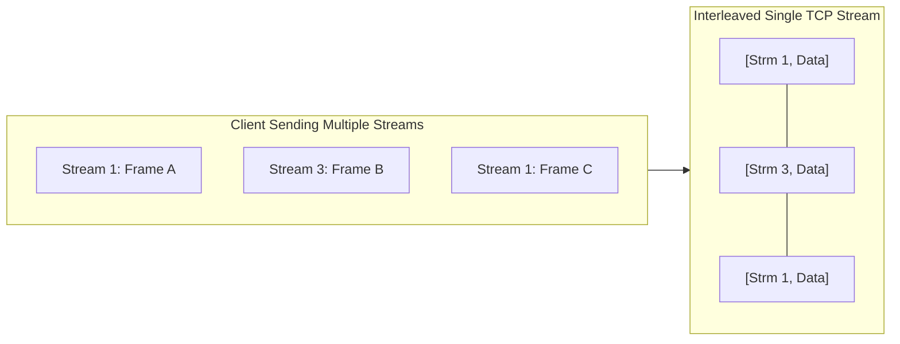
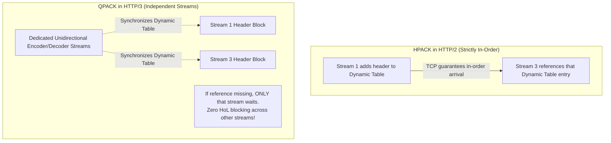
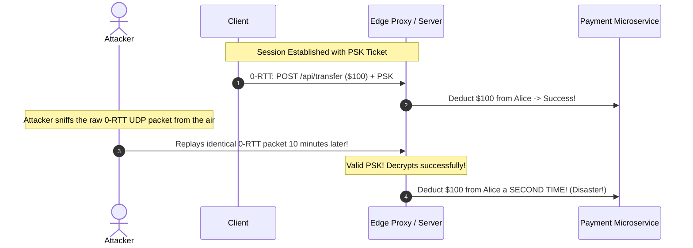

# Evolution of HTTP: HTTP/1.0, HTTP/1.1, HTTP/2, and HTTP/3 (QUIC)

The Hypertext Transfer Protocol (HTTP) is the lifeblood of the modern web and microservice communication. Its evolution over 30 years reflects the struggle to minimize latency, eliminate round-trips, and maximize throughput over imperfect physical networks.

---

## 1. Visual Evolution Timeline



---

## 2. 💡 Intuitive Mental Models: From Drive-Throughs to Flying Drones

To understand why the internet had to rewrite HTTP three times, visualize how food is delivered:

| Protocol | Physical Mental Model | What Breaks? |
| :--- | :--- | :--- |
| **HTTP/1.0** | **Room Service with Immediate Hangup:** You call room service for a burger. The waiter delivers it, walks all the way back down to the lobby, and checks out. You call again for fries; a new waiter checks in, walks up, and leaves. You call again for a napkin. | 50 items on a webpage = 50 slow, separate round-trips. |
| **HTTP/1.1** | **Single-Lane Drive-Through Window (Keep-Alive):** The car stays at the window for multiple items. But if Car #1 orders 100 complex milkshakes, Car #2 (who just wants a bottle of water) is stuck waiting in line behind them (**Application Head-of-Line Blocking**). | To bypass this, restaurants built 6 separate drive-through lanes (**Domain Sharding**). |
| **HTTP/2** | **Multi-Lane Mountain Tunnel (Multiplexing in 1 TCP Stream):** All cars share one big highway tunnel. Fast sports cars can pass slow trucks! But if one truck crashes at the single tunnel entrance, **the entire tunnel is shut down for all lanes** until the tow truck clears the wreckage (**TCP Head-of-Line Blocking**). | Under 2% mobile packet loss, HTTP/2 can run slower than HTTP/1.1. |
| **HTTP/3** | **Fleet of Autonomous Drones (QUIC over UDP):** Every single item is flown in by an independent drone. If Drone #3 hits bird turbulence and delays, Drones #1, #2, and #4 land at your balcony without a microsecond of pause! And if you walk to another room (Wi-Fi to 5G), the drones track your unique GPS badge (**Connection ID**) without restarting. | Firewalls blocking UDP port 443 require fallback. |

### 👶 ELI5 / Plain-English Overview
Why couldn't we just stick with HTTP/1.1? 
The modern web changed. In 1997, a website was a single HTML document and 2 small images. Today, a single web application loads over **150 resources** (JavaScript bundles, CSS styles, web fonts, tracking beacons, high-res images). Opening separate connections or queuing them one-by-one makes web apps feel sluggish, especially on unpredictable mobile phone networks.

---

## 3. HTTP/1.0: The Connection-Per-Request Era

In HTTP/1.0 (RFC 1945), each interaction required spinning up a brand new TCP connection:



- **Problem:** If a webpage has 50 images and scripts, the client must perform 50 separate TCP handshakes and 50 slow-start ramps. Extremely high latency and server CPU exhaustion.

---

## 4. HTTP/1.1: Persistent Connections & Pipelining

Standardized in 1997 (RFC 2616), HTTP/1.1 introduced:

### 1. Persistent Connections (`Keep-Alive`)
Connections stay open by default across multiple requests. Subsequent requests reuse the existing established TCP connection, eliminating redundant handshakes.

### 2. HTTP Pipelining & Application Head-of-Line (HoL) Blocking
HTTP/1.1 allowed clients to fire requests $R_1, R_2, R_3$ consecutively without waiting for the response to $R_1$.
- **The Fatal Flaw:** The server was **strictly required to return responses in the exact sequence they were requested** ($A_1 \to A_2 \to A_3$).
- If processing $R_1$ required a slow 5-second SQL query, responses $A_2$ and $A_3$ (even if generated in $2\text{ ms}$) had to queue behind $R_1$.
- Because of this application-level Head-of-Line blocking, browsers disabled HTTP pipelining by default and instead opened up to **6 parallel TCP connections per domain** (domain sharding).

---

## 5. HTTP/2: Binary Framing & True Multiplexing

Standardized in 2015 (RFC 7540), HTTP/2 fundamentally redesigned the wire format while preserving HTTP semantic verbs (`GET`, `POST`, status codes).



### Core Innovations
1. **Binary Framing Layer:** Replaced plain-text ASCII formatting with optimized binary frames (Headers, Data, Settings, Ping).
2. **True Request Multiplexing:**
   - Multiple bidirectional **Streams** interleaved simultaneously across a **single persistent TCP connection**.
   - Solved the application-level HTTP head-of-line blocking problem.
3. **HPACK Header Compression:**
   - Redundant HTTP headers (User-Agent, Cookies, Authorization) are compressed using static and dynamic lookup tables, slashing header byte overhead by up to $85\%$.
4. **Server Push:** Allows the server to proactively send critical assets (e.g., style sheets) before the client parses the HTML and asks for them.

### The Remaining Flaw in HTTP/2: TCP Head-of-Line Blocking
While HTTP/2 eliminated *application-layer* HoL blocking, it concentrated all traffic into a **single TCP stream**.
- If a single TCP packet is dropped on the network, the OS TCP stack pauses delivery of the entire stream.
- **Result:** In high-packet-loss environments (e.g., mobile networks with $2-3\%$ loss), HTTP/2 can actually perform **worse** than HTTP/1.1 with multiple connections!

---

## 6. ⚠️ The Horror Scenario: The Commuter Train Checkout Disaster

Consider a commuter, Alice, purchasing a limited-edition $500 festival ticket on her smartphone while riding a subway train:

```
[Alice Mobile]  ===== (1 Single TCP Connection - HTTP/2) =====>  [Checkout Edge Server]
                Stream 1: POST /api/checkout ($500)
                Stream 3: GET /assets/hero-banner.jpg
                Stream 5: GET /analytics/beacon.js
```

1. Alice clicks **"Confirm Payment"**. Her phone opens Stream 1 (`POST /api/checkout`) alongside dozens of background image and analytics streams multiplexed over the **single TCP connection**.
2. As the train enters an underground tunnel, the cellular signal degrades, suffering a transient **3% packet loss**.
3. A single TCP packet containing a tiny chunk of `hero-banner.jpg` (Stream 3) is dropped by the cell tower.
4. **The Disaster:** Because TCP enforces strict byte ordering across the entire socket, the mobile OS kernel buffers all subsequent incoming packets. It **refuses to deliver the payment confirmation response** (Stream 1) to Alice's banking app until the missing image chunk is retransmitted!
5. The checkout screen shows a spinning wheel for 15 seconds.
6. The train pulls into the station; Alice's phone disconnects from the cellular tower and hooks onto the station Wi-Fi.
7. Her IP address changes from `172.56.21.9` to `192.168.1.104`.
8. **The TCP 4-Tuple breaks completely.** The connection drops with `ECONNRESET`.
9. The app displays: *"Network error. Payment failed. Please try again."*
10. Alice taps "Confirm Payment" a second time—**accidentally double-charging her card $1,000** because the first payment had already been processed by the database before the network connection dropped!

---

## 7. HTTP/3 and QUIC: The UDP Revolution

Standardized in 2022 (RFC 9114), HTTP/3 replaces TCP with **QUIC** (Quick UDP Internet Connections), a transport protocol built directly on top of UDP.



### 1. Zero Transport Head-of-Line Blocking
In QUIC, each stream is an independent byte flow inside UDP datagrams. If packet loss occurs on Stream #3, **only Stream #3 pauses**. Stream #1, Stream #2, and Stream #4 continue processing at full speed without delay.

### 2. 0-RTT Connection Establishment
QUIC merges the transport handshake and the cryptographic security handshake (TLS 1.3) into a single unified step:
- **First connection:** 1 RTT (Transport + TLS negotiated simultaneously).
- **Subsequent reconnections:** **0 RTT**! The client sends encrypted application data in the very first packet.



### 3. Connection Migration
In standard TCP, a socket is identified by a 4-tuple: `(Source IP, Source Port, Dest IP, Dest Port)`.
- If a smartphone transitions from Home Wi-Fi to a 5G Cellular network, its Source IP changes. All active TCP connections drop instantly and must reconnect.
- QUIC identifies connections by a **64-bit Connection ID (CID)** independent of IP address. The user seamlessly transitions between networks with zero connection drop or stream interruption.

---

## 8. 🚶 Step-by-Step Scenario: HTTP/2 vs. HTTP/3 Under Packet Loss

Let's trace how Alice's browser fetches three assets: `index.html` (Stream 1), `styles.css` (Stream 3), and `logo.png` (Stream 5).

### Scenario A: Under HTTP/2 (Single TCP Stream)
1. Alice's browser sends frames for Stream 1, Stream 3, and Stream 5 inside a single TCP connection.
2. A router drops TCP Packet #2 (containing bytes for `styles.css`).
3. TCP Packet #3 (containing `index.html` and `logo.png`) reaches Alice's phone.
4. **The Block:** Alice's OS TCP stack sees byte gap at Packet #2. It holds Packet #3 in the kernel buffer.
5. Even though the HTML and image data have arrived intact, the browser cannot render them!
6. After 1 RTT, Packet #2 is retransmitted and acknowledged.
7. Only then does the kernel release Packet #3 to the browser. **Total delay: +1 full RTT for every asset on the page.**

### Scenario B: Under HTTP/3 / QUIC (Independent UDP Streams)
1. Alice's browser sends Stream 1, Stream 3, and Stream 5 in independent QUIC UDP datagrams.
2. A router drops UDP Datagram containing Stream 3 (`styles.css`).
3. The UDP Datagram containing Stream 1 (`index.html`) arrives safely.
4. **Instant Processing:** QUIC immediately delivers `index.html` to the rendering engine! Alice sees the text content instantly.
5. QUIC's loss detection fires a retransmit only for Stream 3 (`styles.css`).
6. Stream 1 and Stream 5 are completely unaffected by the loss in Stream 3.

---

## 9. 🏢 Real-World Production Battle-Testing

### 1. Google & YouTube
- Over **$50\%$ of all Google global traffic** runs on QUIC.
- YouTube reported that deploying QUIC reduced video buffering interruptions by **$15.3\%$ for desktop users** and **$18.0\%$ for mobile users**.
- In high-latency countries like India and Indonesia, search page load times dropped by over **$8\%$**.

### 2. Meta (Facebook & Instagram)
- Meta rolled out HTTP/3 globally across the Instagram and Facebook mobile apps.
- Meta observed a **$6\%$ reduction in egress network latency** and an **$8\%$ drop in video playback stall rates**.
- Connection migration proved transformative for users walking out of their houses into their driveways: zero video stutter when transitioning from home Wi-Fi to cellular networks.

### 3. The Enterprise Firewall Problem
- Many corporate IT networks and strict firewalls block outgoing UDP on Port 443, assuming UDP traffic is peer-to-peer torrents or DDoS reflection traffic.
- **Production Solution:** Clients issue initial requests over standard HTTP/2 (TCP). The server responds with an `Alt-Svc` header:
  ```http
  Alt-Svc: h3=":443"; ma=86400
  ```
- If QUIC UDP handshakes succeed, the browser upgrades to HTTP/3; if blocked, it seamlessly stays on HTTP/2 without failing the user request.

---

## 10. ⚖️ Comprehensive HTTP Comparison Matrix & Rules of Thumb

| Feature | HTTP/1.1 | HTTP/2 | HTTP/3 |
| :--- | :--- | :--- | :--- |
| **Transport Protocol** | TCP | TCP | QUIC (UDP) |
| **Wire Format** | Text (ASCII) | Binary Frames | Binary Frames |
| **Multiplexing** | ❌ No (Parallel TCP connections) | ✅ Yes (Single TCP stream) | ✅ Yes (Independent streams) |
| **Transport HoL Blocking**| High | Severe under packet loss | ❌ Completely eliminated |
| **Header Compression** | ❌ None | ✅ HPACK | ✅ QPACK |
| **Handshake Latency** | 1 RTT (TCP) + 1 RTT (TLS) | 1 RTT (TCP) + 1 RTT (TLS) | 1 RTT (Initial) / 0 RTT (Resumed) |
| **Connection Migration**| ❌ Impossible | ❌ Impossible | ✅ Native via Connection ID |

### Staff-Level Decision Rules:
1. **Use HTTP/3 (QUIC) When:** You are serving public mobile internet users, video streaming, or global web assets where users experience packet loss, cellular network switching, and high RTT.
2. **Use HTTP/2 When:** Communicating between internal microservices in the same datacenter (e.g., **gRPC** services over stable, 0.1ms latency networks with 0% packet loss). HTTP/2 avoids UDP firewall issues and has lower CPU overhead on static server hardware.
3. **Use HTTP/1.1 When:** Implementing simple internal webhooks, developer APIs, or legacy service-to-service communication where binary framing and multiplexing state machines add unnecessary debugging complexity.

---

## 🎯 Top Real-World Interview Questions & Deep-Dive Answers (FAANG / Staff Level)

### Q1: How does HTTP/2 multiplexing work at the frame layer, and why does HTTP/2 suffer severe performance degradation compared to HTTP/1.1 under 2%-3% packet loss?

#### 💡 Model Answer:
In HTTP/2, all communication occurs over a **single persistent TCP connection**. The protocol introduces a **Binary Framing Layer** that slices application requests and responses into typed binary frames (`HEADERS`, `DATA`, `SETTINGS`, `WINDOW_UPDATE`).
- Each frame carries a 31-bit **Stream Identifier** in its 9-byte header.
- Frames from different logical streams are interleaved concurrently across the single TCP pipe.



#### Why HTTP/2 Collapses Under 2% Packet Loss:
The core problem is an **abstraction mismatch**: HTTP/2 multiplexes streams at the *application layer*, but relies on TCP at the *transport layer*.
- TCP provides an abstraction of a single, ordered byte stream.
- If an intermediate router drops a single TCP packet carrying a chunk of Stream 1, the receiving OS TCP stack pauses delivery of **all subsequent packets** (including those for Stream 3, Stream 5, etc.) until the missing packet is retransmitted.
- In HTTP/1.1, browsers opened **6 parallel TCP connections**. If connection #1 dropped a packet, the other 5 connections continued downloading assets at full speed.
- **Production Consequence:** In lossy environments ($2\% - 3\%$ packet loss on mobile networks), the single TCP stream in HTTP/2 causes cascading Head-of-Line stalls across *all* assets on the website, making it slower than HTTP/1.1!

---

### Q2: What is the fundamental difference between HPACK (HTTP/2) and QPACK (HTTP/3)? Why couldn't QUIC simply reuse HPACK?

#### 💡 Model Answer:
Both HPACK and QPACK compress repetitive HTTP headers (such as `User-Agent`, `Cookie`, `Authorization`) using static tables (pre-defined common headers) and dynamic tables (storing headers negotiated during the active session).



#### Why HPACK Fails in QUIC:
- In HTTP/2, TCP guarantees strictly in-order delivery. Therefore, HPACK assumes that when Stream 3 references an entry inserted by Stream 1, the dynamic table mutation has *already* arrived and been decoded.
- In HTTP/3, QUIC streams are completely independent datagram flows. Stream 3 may arrive at the server **before** Stream 1!
- If HTTP/3 used HPACK, Stream 3 would have to wait for Stream 1 to arrive before it could decode its headers—**reintroducing Head-of-Line blocking at the header layer**!

#### The QPACK Solution:
QPACK separates the transmission of header blocks from modifications to the dynamic table:
1. Dynamic table updates are communicated over dedicated, unidirectional **Encoder and Decoder Control Streams**.
2. When a stream references an entry that has not yet been acknowledged via the decoder stream, only that *specific stream* is blocked awaiting the entry, or the encoder avoids referencing it altogether. All other streams proceed unimpeded.

---

### Q3: How does 0-RTT Connection Establishment work in HTTP/3 / QUIC? What is the Replay Attack vulnerability, and how do production architectures safeguard against it?

#### 💡 Model Answer:
In standard TLS 1.3 / QUIC, the first connection requires 1 RTT to exchange transport parameters and negotiate Diffie-Hellman cryptographic keys. 
- During connection shutdown or session ticket emission, the server sends the client a **Session Resumption Ticket** containing a cryptographically sealed **Pre-Shared Key (PSK)**.
- On subsequent visits, the client encrypts the application payload (e.g., `GET /user/profile`) using the PSK and transmits it inside the **very first UDP datagram** (`0-RTT Early Data`).



#### The Replay Attack Danger:
Because 0-RTT data is encrypted with a pre-existing static PSK before any dynamic ephemeral Diffie-Hellman exchange occurs, an eavesdropping adversary can record the exact binary packet and re-transmit it to the server. The server, seeing valid encryption, will decrypt and process it again!

#### Production Defenses:
1. **Restrict 0-RTT to Safe/Idempotent Verbs:** RFC 8470 strictly mandates that browsers and API clients **MUST NEVER** send non-idempotent mutations (`POST`, `PUT`, `DELETE`, or payments) via 0-RTT Early Data. Only safe `GET` requests for static assets are permitted.
2. **Single-Use Tickets & In-Memory Bloom Filters:** Edge servers (e.g., Cloudflare, Envoy) maintain a distributed in-memory cache of seen session ticket identifiers. If a ticket is presented twice within its valid window, the 0-RTT data is rejected and forces a 1-RTT handshake fallback.
3. **Client Hello Timestamps:** The server verifies that the embedded timestamp inside the 0-RTT packet matches the current server wall-clock time within a tight window (e.g., $\pm 5\text{ seconds}$).
