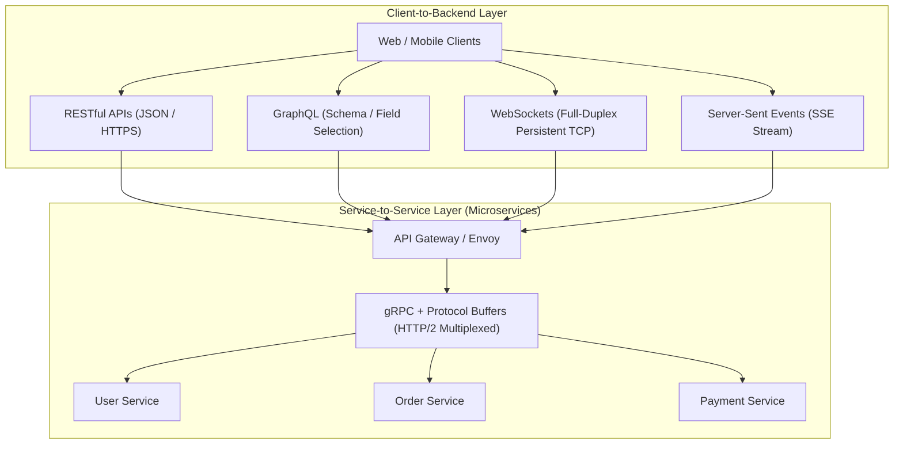
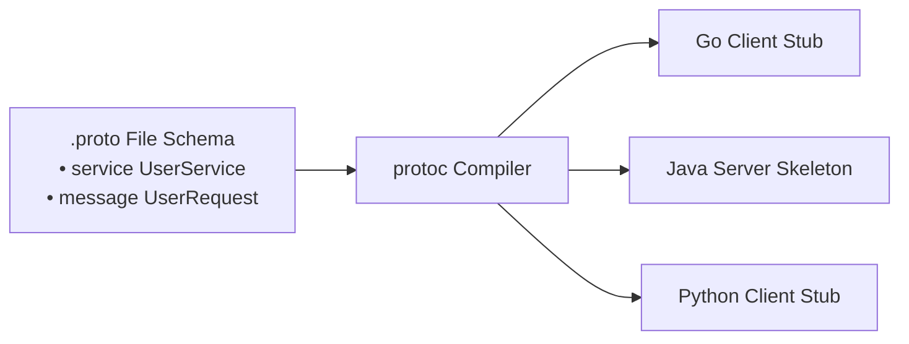
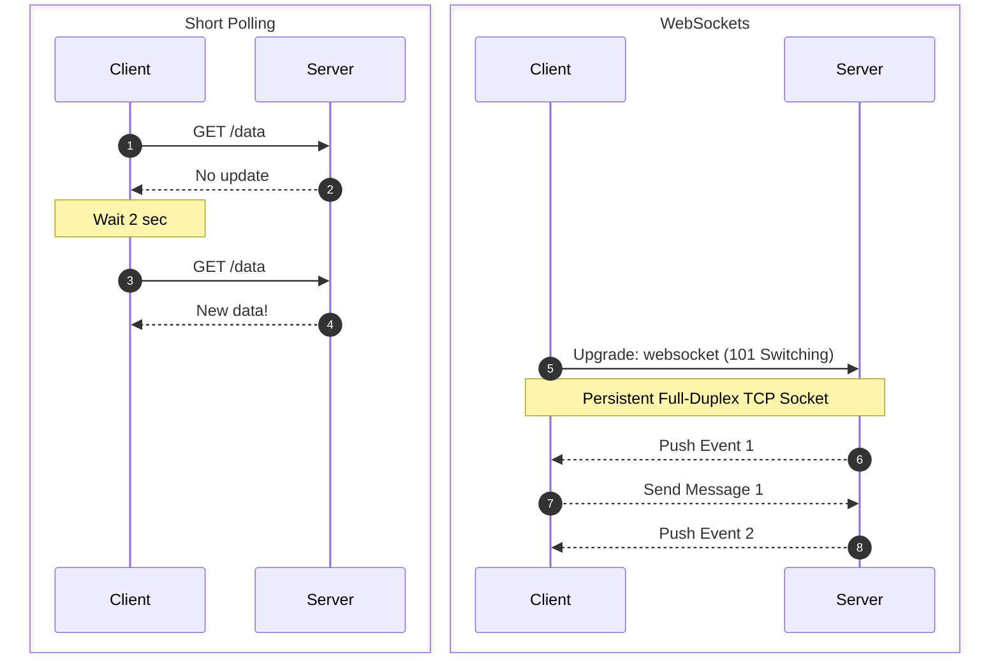
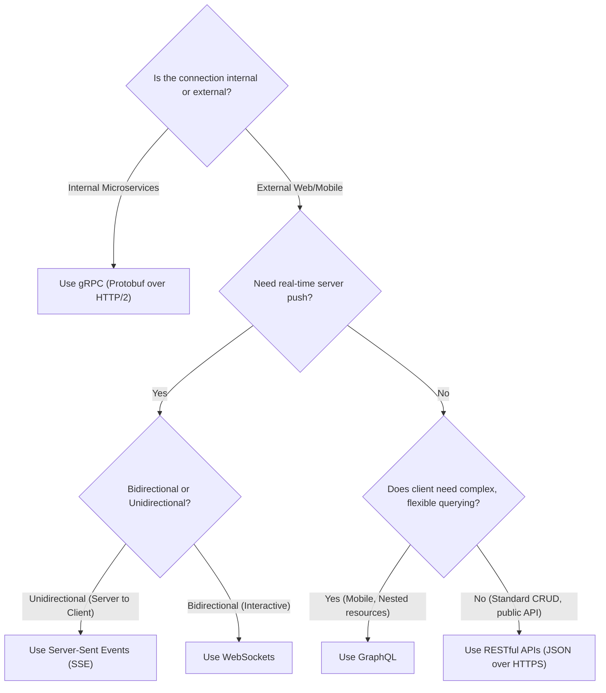
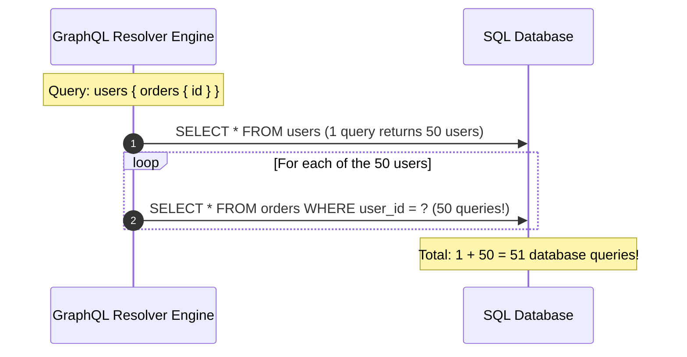
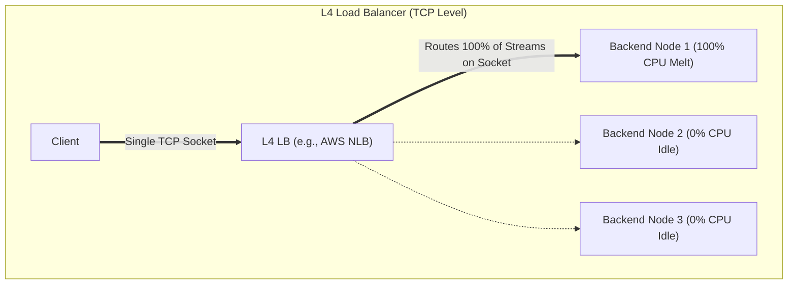

# Modern Communication Patterns: REST, GraphQL, gRPC, WebSockets, and SSE

Choosing the right communication protocol and data format between clients, gateways, and backend microservices determines bandwidth consumption, serialization speed, and real-time responsiveness.

---

## 1. 💡 Intuitive Mental Models: From Fixed Diners to Military Radios

To instantly understand when to use which communication paradigm, compare how humans exchange information:

| Pattern | Physical Mental Model | Strengths | Weaknesses |
| :--- | :--- | :--- | :--- |
| **REST** | **The Fixed-Price Diner Menu:** You order "Meal #3". You get a burger, fries, coleslaw, and a drink whether you want them or not (**Over-fetching**). If you want an apple pie, you must stand in a separate dessert line (**Under-fetching**). | Standardized, universal, cacheable by CDNs. | Verbose JSON, multiple round-trips for nested data. |
| **GraphQL** | **The Custom Salad Bar Slip:** You hand the chef an itemized slip: *"2 slices avocado, 4 olives, no dressing"*. The chef hands you exactly that in one bowl. | Single round-trip, eliminates over-fetching. | Complex resolvers, N+1 query traps, hard to cache at HTTP CDNs. |
| **gRPC / Protobuf** | **Military Radio Codes:** Instead of saying *"Hello server, could you please transmit the user profile for user identifier forty-two in conversational English?"*, you transmit `"Code 3, ID 42"` in dense binary. | 5x–10x faster serialization, tiny payload size, strict schema contracts. | Binary payload is not human-readable; limited native browser support. |
| **WebSockets** | **A Live Two-Way Telephone Call:** Once the line is connected, both people can speak and listen at the exact same millisecond. | True full-duplex bi-directional communication over 1 socket. | Stateful; holding millions of idle sockets consumes massive server RAM. |
| **SSE (Server-Sent Events)** | **A Financial Ticker Tape / Radio Broadcast:** The station transmits news directly to your ticker machine. You cannot talk back through the ticker, but it uses standard telephone wires (HTTP) and automatically reconnects if cut! | Unidirectional server push over standard HTTP/2, native browser auto-reconnect. | Unidirectional only (Client $\to$ Server requires separate HTTP POST). |

### 👶 ELI5 / Plain-English Overview
Why aren't all software systems built with just one protocol?
Because **context dictates constraints**:
- A smartphone on a 3G subway connection needs to minimize round-trips and byte sizes (**GraphQL** or **REST with compression**).
- Two microservices inside the same AWS availability zone transferring 50,000 payment records per second need raw serialization speed and low CPU overhead (**gRPC**).
- A collaborative Figma canvas or online multiplayer game needs instant two-way synchronization (**WebSockets**).
- An AI chatbot streaming tokens word-by-word needs lightweight, firewall-friendly server push (**SSE**).

---

## 2. Protocol Architecture Overview



---

## 3. REST (Representational State Transfer)

REST is a resource-oriented architectural style leveraging standard HTTP methods and conventions.

### HTTP Verb Idempotency & Safety
- **Safe:** Does not modify server state (can be called repeatedly without side effects).
- **Idempotent:** Making multiple identical requests produces the exact same server state as making a single request ($f(f(x)) = f(x)$).

| Verb | Purpose | Safe? | Idempotent? | Typical Response Code |
| :--- | :--- | :---: | :---: | :--- |
| `GET` | Retrieve resource representation | ✅ Yes | ✅ Yes | `200 OK` |
| `POST`| Create a new resource or execute operation | ❌ No | ❌ No | `201 Created` |
| `PUT` | Replace entire resource or create if absent | ❌ No | ✅ Yes | `200 OK` / `204 No Content` |
| `PATCH`| Partial update to resource | ❌ No | ❌ No (generally)| `200 OK` |
| `DELETE`| Remove resource | ❌ No | ✅ Yes | `200 OK` / `204 No Content` |

### Core Limitations
- **Over-fetching:** The endpoint returns 40 fields on an `Account` object when the mobile UI only needs `username` and `avatar_url`.
- **Under-fetching & N+1 Calls:** Fetching a user, their top 5 orders, and shipping status requires multiple sequential network calls:
  `GET /users/1` $\to$ `GET /users/1/orders` $\to$ `GET /orders/99/shipping`.

---

## 4. GraphQL

Developed by Facebook (2012) to solve over-fetching and under-fetching on mobile networks.

### Core Mechanics
- Single endpoint (typically `POST /graphql`).
- Strongly typed schema defined using Schema Definition Language (SDL).
- **Client-Specified Queries:** The client declares the exact shape of the response it requires:

```graphql
query GetUserProfile {
  user(id: "usr_101") {
    name
    avatarUrl
    orders(limit: 2) {
      id
      totalAmount
      shippingStatus
    }
  }
}
```

### Challenges & Engineering Mitigations
1. **N+1 Database Query Problem:** Naive resolvers query the database inside a loop for each child entity.
   - *Mitigation:* Use **DataLoader** to batch and memoize database lookups into a single SQL `WHERE IN (...)` query.
2. **Expensive / Malicious Query DoS:** An attacker can request nested recursive fields: `user { friends { friends { friends { ... } } } }`.
   - *Mitigation:* Implement **Query Depth Limiting** and **Query Cost Analysis** before execution.
3. **HTTP Caching Difficulty:** Since requests are `POST` payloads to a single `/graphql` URL, standard HTTP edge caches (CDNs) cannot cache responses without specialized hashed persisted queries.

---

## 5. gRPC and Protocol Buffers

Google's open-source, high-performance Remote Procedure Call (RPC) framework. The de-facto standard for internal microservices.



### Why gRPC Outperforms REST/JSON by 5x–10x
1. **Protocol Buffers (Protobuf) Binary Serialization:** Compact binary encoding using field tags and varints instead of verbose text strings (`{"first_name": "Alice"}`).
2. **HTTP/2 Native Transport:** Out of the box bidirectional streaming, stream multiplexing over a single TCP connection, and HPACK header compression.
3. **Strict Code-Generated Contracts:** The `.proto` file is the single source of truth. Both client and server stubs are automatically compiled into strongly typed code in 10+ languages.

### The 4 gRPC Streaming Modes
1. **Unary RPC:** Simple Request $\to$ Response (like traditional REST).
2. **Server Streaming:** Client sends 1 request; Server streams back multiple messages (e.g., live stock ticker).
3. **Client Streaming:** Client streams multiple chunks; Server responds with 1 summary (e.g., large file upload).
4. **Bidirectional Streaming:** Both client and server send a continuous stream of messages concurrently (e.g., chat, multiplayer gaming).

---

## 6. Real-Time Communication Patterns

When the server must push data to the client immediately:



### Deep Dive Comparison

| Pattern | Connection Model | Directionality | Protocol | Best Used For |
| :--- | :--- | :--- | :--- | :--- |
| **Short Polling** | Ephemeral HTTP | Client pulls | HTTP/1.1 or 2 | Low-frequency checks where real-time is not required. High server CPU waste. |
| **Long Polling** | Held HTTP connection | Client pulls (hanging) | HTTP/1.1 | Legacy browser fallback for real-time when WebSockets are blocked by proxies. |
| **Server-Sent Events (SSE)** | Persistent HTTP stream | Unidirectional (Server $\to$ Client) | HTTP/1.1 or 2 (`text/event-stream`) | AI chat token streaming (ChatGPT), live score feeds, real-time dashboards, notification streams. Auto-reconnect built-in. |
| **WebSockets** | Persistent bi-directional TCP socket | Full-Duplex (Client $\leftrightarrow$ Server) | `ws://` / `wss://` | Collaborative real-time editors, multiplayer gaming, financial order books, chat applications. |
| **WebRTC** | Peer-to-Peer UDP | Bi-directional P2P | RTP / SCTP | Real-time audio/video calls (Zoom, Google Meet), direct peer-to-peer file transfer. |

---

## 7. ⚠️ The Horror Scenarios: When Protocols Fail

### Horror Scenario 1: The GraphQL Recursive Query of Death (Database Meltdown)
A social platform builds a GraphQL API. A malicious user (or an innocent frontend developer writing a component) crafts this deeply nested query:

```graphql
query Exploit {
  me {
    friends {
      friends {
        friends {
          friends {
            name
            posts {
              comments {
                author {
                  friends { name }
                }
              }
            }
          }
        }
      }
    }
  }
}
```

- **The Disaster:** If the user has 100 friends, level 2 generates $100 \times 100 = 10,000$ calls. Level 3 generates $1,000,000$ calls!
- Without a query depth limiter, the naive backend resolver fires over **1.2 million SQL queries** into the primary PostgreSQL database within 4 seconds.
- Database CPU explodes to $100\%$, connection pool maxes out (`remaining connection slots reserved for superuser`), and the entire production database crashes!
- **Production Defense:** Implement **Query Depth Limiting** (reject queries deeper than 5 levels) and **Query Cost Analysis** (assign point costs to fields and reject queries exceeding 1,000 points).

---

### Horror Scenario 2: The WebSocket Thundering Herd & Memory Exhaustion
A cryptocurrency trading platform has 500,000 active users streaming live Bitcoin prices over WebSockets.
- During a deployment, the load balancer cluster restarts.
- All 500,000 mobile apps detect socket disconnection and immediately attempt to reconnect at the exact same second.
- **The Disaster:**
  1. **TLS Handshake Stampede:** Establishing 500,000 new TLS handshakes in 3 seconds spikes CPU on the edge gateway to 100%, causing CPU starvation and dropping health checks.
  2. **Memory Exhaustion:** Each open TCP socket requires OS send and receive buffers ($\sim 64\text{ KB}$ per socket). 500,000 sockets require $500,000 \times 64\text{ KB} \approx \mathbf{32\text{ GB of RAM}}$ purely for raw OS socket buffers, triggering Linux kernel Out-Of-Memory (OOM) killer terminations!
- **Production Defense:** Implement **Exponential Backoff with Full Jitter** on client reconnection, tune `tcp_wmem`/`tcp_rmem` buffer sizes down for idle sockets, and use edge proxy offloaders (Envoy/HAProxy).

---

## 8. 🚶 Step-by-Step Scenario: Checkout Flow (REST vs. GraphQL vs. gRPC)

Let's trace Alice buying an item on her mobile phone across three different protocol designs:

### 1. REST Approach (Chatty & Over-fetching)
- Call 1: `GET /api/v1/users/me` $\to$ Returns 60 fields of user data (only needs address ID).
- Call 2: `GET /api/v1/users/me/cart` $\to$ Returns cart items and item IDs.
- Call 3: `GET /api/v1/shipping-options?zip=94103` $\to$ Returns shipping options.
- Call 4: `POST /api/v1/orders` $\to$ Submits payment.
- **Total:** 4 network round trips ($4 \times 100\text{ ms} = 400\text{ ms}$ on mobile).

### 2. GraphQL Approach (Single Round Trip on Edge)
- Single `POST /graphql` query containing the exact fields required for checkout.
- Client receives the entire bundle in **1 single network round trip** ($100\text{ ms}$).
- **Behind the Scenes:** The GraphQL Gateway uses **DataLoader** to batch internal database reads, executing a single `SELECT * FROM items WHERE id IN (...)`.

### 3. gRPC Approach (Internal Microservices)
- The API Gateway terminates GraphQL/REST from Alice's phone.
- The Gateway calls the `OrderService` via gRPC:
  - Marshals the Protobuf message into 42 bytes of compact binary.
  - Sends it over an already-open, multiplexed HTTP/2 TCP connection.
  - Serialization takes **$8\text{ microseconds}$** (vs $1.2\text{ milliseconds}$ for JSON parse/stringify).
  - The transaction completes in sub-millisecond internal latency.

---

## 9. 🏢 Real-World Production Battle-Testing

### 1. Netflix: REST to gRPC Migration
Netflix migrated inter-service communication between hundreds of microservices from REST over HTTP/1.1 to **gRPC over HTTP/2**.
- **Results:** Slashed inter-service network bandwidth by **$50\%$**, reduced CPU overhead dedicated to JSON parsing by **$60\%$**, and achieved significant tail latency reductions across global clusters.

### 2. OpenAI / ChatGPT: Why Server-Sent Events (SSE) Beat WebSockets
When OpenAI designed the ChatGPT web interface, they chose **Server-Sent Events (SSE)** over WebSockets for streaming LLM tokens back to users.
- **Why SSE was the superior choice:**
  1. **Unidirectional Match:** The communication model is strictly one-way (the server pushes generated tokens to the user).
  2. **Standard HTTP/2:** Runs over standard HTTPS (port 443). Never blocked by enterprise firewalls or corporate proxies that aggressively drop raw WebSocket upgrades.
  3. **Native Browser Reconnection:** The browser `EventSource` API handles reconnection and sends the `Last-Event-ID` header automatically if the network drops.

---

## 10. ⚖️ The Architect's Decision Matrix



---

## 🎯 Top Real-World Interview Questions & Deep-Dive Answers (FAANG / Staff Level)

### Q1: How does the GraphQL N+1 problem occur, and how does DataLoader solve it internally using event loop microtask batching?

#### 💡 Model Answer:
The N+1 problem occurs because GraphQL resolvers execute **independently and recursively**:



#### The DataLoader Solution:
DataLoader decouples the fetching request from execution using **event-loop batching and in-memory memoization**:
1. When a resolver calls `loader.load(userId)`, DataLoader does **not** immediately fire a database query.
2. It pushes the `userId` into a batch queue and returns an unresolved `Promise`.
3. In Node.js / Go / Java, execution yields to the event loop tick / microtask queue.
4. Once all synchronous resolver functions for the current level have executed, DataLoader's batch function executes **once**:
   ```sql
   SELECT * FROM orders WHERE user_id IN (1, 2, 3, ..., 50);
   ```
5. DataLoader resolves each individual Promise with its corresponding orders. Total database queries: **reduced from 51 down to 2**!

---

### Q2: Why do Layer 4 (L4) Load Balancers fail when load-balancing gRPC traffic, and how does Envoy Layer 7 (L7) load balancing solve this?

#### 💡 Model Answer:
gRPC communicates over **HTTP/2**, which multiplexes hundreds of concurrent requests over a **single persistent TCP connection**.



#### Why L4 Fails:
- A Layer 4 load balancer operates at the TCP level. It only inspects the initial SYN packet and assigns the *entire TCP socket* to Backend Node 1.
- Because gRPC reuses that single persistent TCP socket for millions of subsequent RPC calls, **every single RPC call continues to hit Backend Node 1**!
- Backend Node 1 melts under load while Backend Nodes 2 and 3 sit completely idle.

#### The L7 Solution (Envoy / gRPC Lookaside):
1. **L7 Proxying (Envoy):** Envoy terminates the HTTP/2 connection, inspects individual binary frames and HTTP/2 Streams, and balances individual RPC streams evenly across all available backend pods.
2. **Client-Side Balancing (gRPC Lookaside / xDS):** The client queries a control plane (like Consul or Kubernetes CoreDNS via xDS), gets a list of all backend IP addresses, and establishes a connection pool to every pod, balancing streams directly from the client without any intermediate proxy hop!

---

### Q3: What makes Protocol Buffers significantly faster and more compact than JSON? Walk through Varints and Field Tag wire formats.

#### 💡 Model Answer:
JSON is a verbose, human-readable text format with three severe performance penalties:
1. **Redundant Schema Repetition:** Every single JSON record transmits field names as plain text (`"first_name"`, `"transaction_timestamp"`), wasting bandwidth.
2. **Expensive String Parsing:** Converting ASCII strings into machine floats and integers requires character-by-character validation and memory allocations.
3. **No Native Binary Types:** Binary data must be Base64-encoded, expanding payload size by $33\%$.

#### How Protocol Buffers Encodes Data at the Byte Level:
In Protobuf, field names are **never transmitted**. Instead, each field in a `.proto` file is assigned an integer tag:
```protobuf
message User {
  int32 id = 1;
  string name = 2;
}
```

#### 1. Tag-Length-Value (TLV) Wire Format:
Every serialized field begins with a **Key Byte** combining the field number and wire type:
$$\text{Key} = (\text{Field Number} \ll 3) \mid \text{Wire Type}$$
For `id = 1` (Wire type 0 for Varint), the key byte is simply `0000 1000` (`0x08`). Only 1 byte is needed to identify the field!

#### 2. Variable-Length Quantities (Varints):
Instead of allocating 4 fixed bytes for every integer, Varints use 7 bits per byte for data, and the 8th bit (Most Significant Bit - MSB) as a "continuation bit":
- The integer `1` is encoded in **1 single byte** (`0x01`) instead of 4 bytes (`0x00 0x00 0x00 0x01`).
- Small integers, common status codes, and counters consume 75% less memory on the wire.

#### 3. ZigZag Encoding:
Standard two's-complement negative numbers (like `-1`) have their highest bit set, which would force a Varint to consume 10 full bytes. Protobuf uses **ZigZag encoding** to map signed integers to positive integers:
$$-1 \to 1, \quad 1 \to 2, \quad -2 \to 3, \quad 2 \to 4$$
This ensures small negative numbers are also compressed into 1 or 2 bytes.
