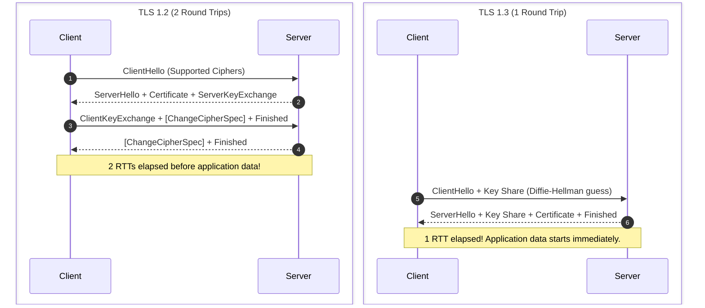
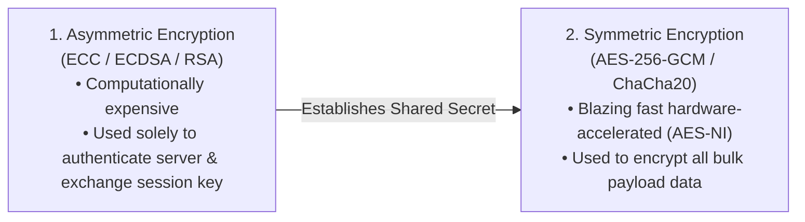
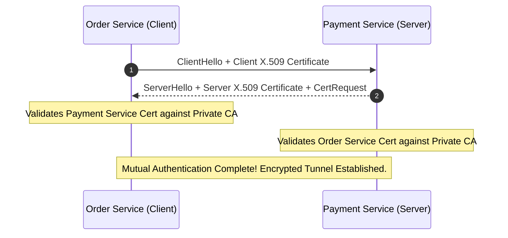
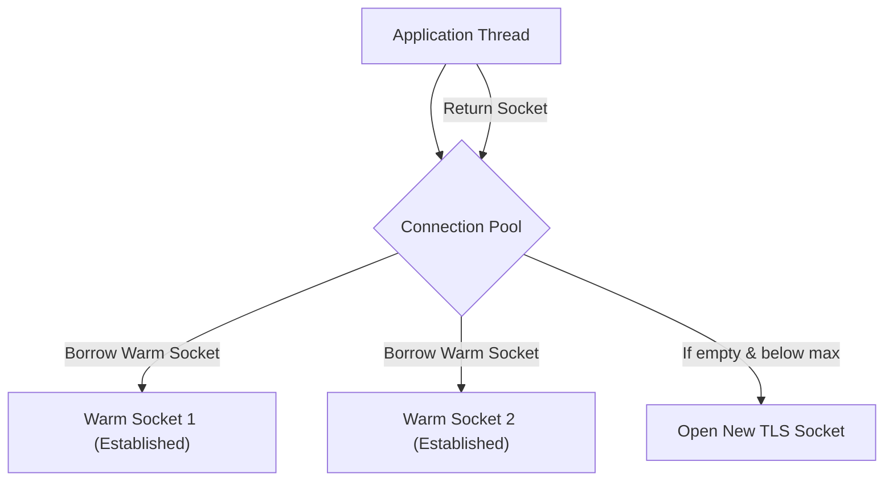
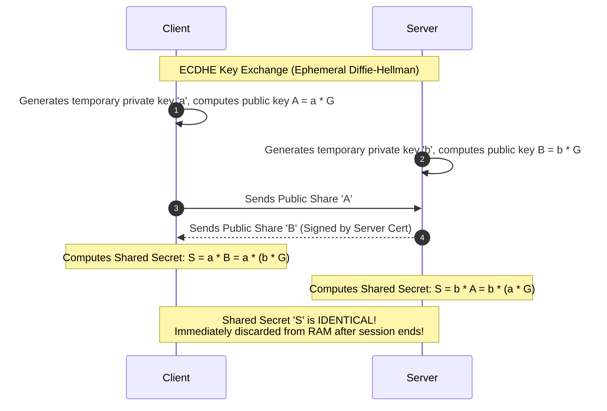
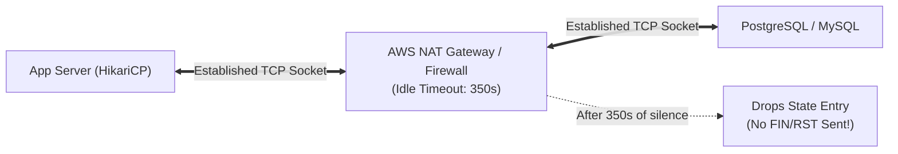
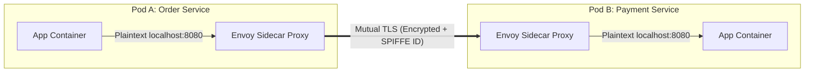

# TLS Security, Handshakes, and Connection Management

Securing communications across public and internal networks without sacrificing millisecond performance requires a deep understanding of cryptographic handshakes, cipher suites, and socket lifecycle management.

---

## 1. 💡 Intuitive Mental Models: Diplomatic Pouches and Fleet Taxis

To deeply understand TLS and connection pooling, use these physical mental models:

| Concept | Physical Mental Model | Why It Works |
| :--- | :--- | :--- |
| **Hybrid Encryption** | **The Diplomatic Courier & Armored Pouch:** Using asymmetric cryptography (RSA/ECC) is like paying an expensive courier to hand-deliver a secret combination lock code to a foreign embassy. Once both parties have the secret code, they lock all future daily correspondence in cheap, ultra-fast zipper pouches using that exact combination (**Symmetric AES-256**). | Asymmetric math is slow but solves trust; symmetric math is fast (hardware AES-NI) and encrypts bulk data. |
| **Mutual TLS (mTLS)** | **The Double-Check Military Bunker:** In regular TLS, you check the bank teller's badge (server authentication). In mTLS, the teller **also** checks your retinal scan and security clearance badge before speaking a single word. | Zero-Trust security: eliminates hard-coded API tokens in microservices. |
| **Connection Pooling** | **The Airport Taxi Queue:** Instead of manufacturing and registering a brand-new automobile every time a traveler steps out of the terminal (TCP 3-way + TLS handshake = 200ms), a fleet of 20 pre-inspected, warmed-up taxis idle at the curb. A traveler hops in instantly ($0\text{ ms}$). | Slashes tail latency by eliminating connection setup round-trips and CPU key derivation. |

### 👶 ELI5 / Plain-English Overview
Why is TLS complicated?
If you talk to a database or website over raw TCP, every router, internet service provider, and Wi-Fi sniffer in between can read your passwords and credit cards in plain text.
TLS wraps your communication in a cryptographic shield. However, running complex math across millions of connections can melt server CPUs and inflate latency if handshakes and connection pools are poorly tuned.

---

## 2. TLS 1.2 vs. TLS 1.3 Handshake

Transport Layer Security (TLS) encrypts transport data. TLS 1.3 (RFC 8446) fundamentally overhauled TLS 1.2, eliminating obsolete cryptographic ciphers and halving handshake latency.



### Why TLS 1.3 is Superior
1. **1-RTT Handshake:** In TLS 1.3, the client assumes a modern cipher suite (like Curve25519) and includes its public key share directly in the initial `ClientHello`. The server responds with its key share and switches immediately to encrypted mode, saving 1 full network round trip.
2. **0-RTT Session Resumption:** Clients that previously connected can store a Pre-Shared Key (PSK) and send encrypted application data on the very first packet.
   - *Security Caveat:* 0-RTT data is susceptible to **Replay Attacks** (an attacker can intercept and re-send the packet). Therefore, 0-RTT should only be allowed for idempotent HTTP operations (`GET`), never for financial or state-altering requests (`POST /transfer`).
3. **Mandatory Perfect Forward Secrecy (PFS):** Static RSA key exchange was completely removed. Even if a server's private key is compromised years later, past recorded traffic can never be decrypted.

---

## 3. Asymmetric vs. Symmetric Encryption in TLS

TLS uses a **hybrid cryptographic architecture**:



---

## 4. Mutual TLS (mTLS) in Microservices

Standard TLS only authenticates the server to the client (your browser verifies the bank's certificate). In a **Zero Trust** microservice architecture, every service must verify the identity of every caller.



- **Use in Service Meshes (Istio, Linkerd):** Sidecar Envoy proxies transparently terminate and establish mTLS connections between pods, providing cryptographic identity (SPIFFE IDs) without writing security code in application logic.

---

## 5. ⚠️ The Horror Scenarios: When Security & Sockets Fail

### Horror Scenario 1: The Ephemeral Handshake CPU Meltdown
An online ticketing platform experiences an unexpected traffic surge.
- The engineering team deploys a new microservice but forgets to configure **HTTP Keep-Alive** or **Connection Pooling** in their client HTTP library (`MaxIdleConns: 0`).
- Every outgoing call to the payment gateway opens a fresh TCP socket and negotiates a new TLS 1.2 handshake.
- At 20,000 requests/second, the CPU spends $90\%$ of its cycles computing modular exponentiation for asymmetric RSA key exchanges.
- The servers enter CPU starvation; health check probes fail, Kubernetes kills the pods, and the entire platform enters a cascading crash loop!
- **Fix:** Enabling a persistent connection pool with 100 warm sockets reduced CPU utilization from $95\%$ to $8\%$.

---

### Horror Scenario 2: The Firewall Silent Drop Black Hole
A Java application connects to an AWS RDS PostgreSQL database using an in-memory connection pool (HikariCP).
- During quiet night hours, database queries slow down, leaving sockets idle for 10 minutes.
- Between the application and the database sits an **AWS NAT Gateway / Stateful Firewall**.
- The firewall has an idle TCP timeout of **350 seconds**. When a connection is silent for 350 seconds, the firewall quietly deletes the connection tracking entry from its state table—**without sending a FIN or RST to either side**!
- At 3:00 AM, a user requests data. The application borrows an "established" socket from HikariCP and writes a SQL query.
- The packet hits the firewall, which silently drops it because its state table has no entry.
- The application thread hangs indefinitely waiting for a database response until it hits a 60-second read timeout.
- **Fix:** Set the connection pool's `maxLifetime` or `idleTimeout` strictly lower than the firewall's timeout (e.g., 300 seconds), and enable TCP Keepalive probes.

---

## 6. Connection Pooling and Socket Lifecycle

Creating and tearing down TCP + TLS connections on every request is a severe performance killer:
- 1 RTT for TCP 3-way handshake ($\sim 20 - 100\text{ ms}$).
- 1 RTT for TLS 1.3 handshake ($\sim 20 - 100\text{ ms}$).
- CPU overhead of asymmetric key generation.



### Essential Connection Pool Tuning Parameters
1. **`max_connections` (Total):** Upper bound of sockets to prevent exhausting database or upstream server memory.
2. **`max_idle_connections`:** Number of idle connections kept open awaiting sudden bursts.
3. **`idle_timeout`:** Drops connections that sit unused for too long to avoid firewalls silently severing them.
4. **`connection_max_lifetime`:** Enforces periodic socket recycling to trigger DNS re-resolution when backend IPs change during auto-scaling or deployments.

---

## 7. TCP Keepalive vs. HTTP Keep-Alive

A common source of confusion in production systems:

| Feature | TCP Keepalive (`SO_KEEPALIVE`) | HTTP Keep-Alive (`Connection: keep-alive`) |
| :--- | :--- | :--- |
| **Layer** | Layer 4 (Transport layer, OS kernel) | Layer 7 (Application layer, HTTP protocol) |
| **Purpose** | Detects dead peers or dropped middleboxes (firewalls, NAT routers) by sending empty probe packets if connection is silent for hours. | Reuses an established TCP connection for multiple sequential HTTP requests. |
| **Default Frequency** | Typically 2 hours (`tcp_keepalive_time = 7200`) | Measured in seconds (`Keep-Alive: timeout=60`) |

---

## 8. 🏢 Real-World Production Battle-Testing

### 1. Cloudflare: Session Ticket Key Rotation at the Edge
Cloudflare terminates TLS across hundreds of thousands of edge servers.
- To allow a mobile client to resume a TLS session on *any* edge server worldwide, Cloudflare uses centralized, cryptographically secure **Session Ticket Encryption Key (STEK)** rotation.
- Every hour, new session keys are distributed to thousands of edge servers, allowing 0-RTT/1-RTT resumption across arbitrary edge nodes while retaining forward secrecy against retrospective decryption.

### 2. Istio & SPIFFE/SPIRE: Automated Zero-Trust mTLS
- In a Kubernetes cluster with 5,000 pods, managing TLS certificates manually is impossible.
- Istio injects an Envoy sidecar proxy next to every container.
- Istio's control plane acts as a Certificate Authority (CA), issuing short-lived ($24\text{ hour}$) X.509 certificates encoded with **SPIFFE IDs** (e.g., `spiffe://cluster.local/ns/prod/sa/payment-service`).
- Envoy automatically rotates certificates every 12 hours in memory with zero downtime and enforces mutual identity verification before routing any RPC call.

---

## 9. ⚖️ Practical Trade-Offs & Staff-Level Rules of Thumb

1. **Always set `maxLifetime` in connection pools:** Never let a socket live forever. When cloud services auto-scale or rotate load balancers, DNS records change. A connection pool with infinite socket lifetimes will stay pinned to stale IP addresses.
2. **Align connection timeouts with firewalls:** Ensure your pool's idle timeout is **at least 30-60 seconds shorter** than the most aggressive intermediate firewall or AWS NAT Gateway timeout (typically 350 seconds).
3. **Enforce TLS 1.3 minimum for internal microservices:** Deprecate TLS 1.0 and 1.1 immediately. Use TLS 1.3 exclusively to eliminate 1 RTT of latency and protect against downgrade attacks.

---

## 🎯 Top Real-World Interview Questions & Deep-Dive Answers (FAANG / Staff Level)

### Q1: How does Ephemeral Diffie-Hellman (ECDHE) provide Perfect Forward Secrecy (PFS), and why was static RSA key exchange completely eliminated in TLS 1.3?

#### 💡 Model Answer:
In legacy TLS 1.2 with static RSA key exchange, the client encrypted a random "pre-master secret" using the server's public RSA key. 
- **The Catastrophic Vulnerability:** If an intelligence agency or attacker records years of encrypted network traffic, and five years later the server's private RSA key is leaked, stolen, or subpoenaed, the attacker can decrypt the recorded pre-master secret for **every past session in history** and read all past traffic!



#### The ECDHE Solution (PFS):
With **Ephemeral Elliptic-Curve Diffie-Hellman (ECDHE)**:
1. Both client and server generate temporary, one-time private scalar values ($a$ and $b$) and compute their public points ($A = aG$, $B = bG$).
2. They exchange only public points $A$ and $B$.
3. Both independently compute the shared secret $S = aB = bA = abG$.
4. **Why it provides Perfect Forward Secrecy:** The private keys $a$ and $b$ exist only in volatile RAM for the duration of the handshake and are **instantly wiped**. Even if the server's permanent certificate private key is compromised later, the adversary cannot reconstruct $S$ because $a$ and $b$ never existed on disk!
- TLS 1.3 banned static RSA key exchange to mandate PFS for 100% of internet connections.

---

### Q2: What causes "Connection reset by peer" or silent hangs in database connection pools behind cloud firewalls, and how do you architect pool parameters to eliminate them?

#### 💡 Model Answer:
This is one of the most common production outages in cloud microservices.



#### Root Cause:
1. The application pool holds 50 open connections to PostgreSQL.
2. Traffic drops during off-peak hours. Several connections sit idle in the pool for 400 seconds.
3. An intermediate stateful firewall (or AWS NAT Gateway / Azure Firewall) enforces an idle connection tracking timeout (typically **350 seconds**).
4. When 350 seconds pass without traffic, the firewall **silently purges the 5-tuple from its state table**. It sends no `RST` or `FIN` packet to either side.
5. The application assumes the socket is healthy. It borrows the socket and writes a SQL query.
6. The firewall receives the packet, finds no matching state table entry, and silently drops the packet (or returns a `RST`).
7. **The Result:** The application hangs until `socketTimeout` occurs, throwing `SocketException: Connection reset by peer` or `Backend connection closed unexpectedly`.

#### Production Mitigation Strategy:
- **Set `maxLifetime` Strictly Below Middlebox Limits:** In connection pools (HikariCP, c3p0, Go `sql.DB`), set:
  $$\text{maxLifetime} = 300\text{ seconds} \quad (\text{Strictly } < 350\text{s firewall limit})$$
- **Enable TCP Keepalive Probes:** Configure Linux kernel TCP keepalives to send 1-byte probes every 60 seconds:
  ```bash
  sysctl -w net.ipv4.tcp_keepalive_time=60
  sysctl -w net.ipv4.tcp_keepalive_intvl=10
  sysctl -w net.ipv4.tcp_keepalive_probes=3
  ```
- **Connection Validation on Borrow:** Enable lightweight ping validation (`testOnBorrow` / `connectionTestQuery = "SELECT 1"`) or non-blocking socket readiness checks before handing a borrowed socket to application code.

---

### Q3: In a Zero-Trust Service Mesh (e.g., Istio), how does Mutual TLS (mTLS) work under the hood without developers writing any security code? How are certificates rotated without dropping active connections?

#### 💡 Model Answer:
In a Kubernetes-based service mesh (such as Istio or Linkerd), mTLS is implemented via transparent **Envoy sidecar proxies**:



#### Transparent Interception:
1. When `OrderService` opens a connection to `http://payment-service`, Linux `iptables` rules inside Pod A's network namespace intercept the outgoing TCP packets and redirect them to the local Envoy proxy on port 15001.
2. Envoy A establishes an mTLS connection to Envoy B on port 15008.
3. During the TLS handshake, Envoy A presents its X.509 certificate, containing a **SPIFFE ID** in the Subject Alternative Name (SAN):
   `spiffe://cluster.local/ns/prod/sa/order-service-sa`
4. Envoy B presents its certificate with:
   `spiffe://cluster.local/ns/prod/sa/payment-service-sa`
5. Both proxies validate certificates against the mesh internal Certificate Authority (Istiod).
6. Envoy B evaluates an AuthorizationPolicy (e.g., *only allow calls from `order-service-sa`*).
7. Once verified, Envoy B forwards decrypted plaintext over `localhost` to the payment container.

#### Dynamic Zero-Downtime Certificate Rotation:
- Certificates are issued with short lifetimes ($24\text{ hours}$).
- Envoy uses the **Secret Discovery Service (SDS)** via gRPC to receive renewed certificates from Istiod in real-time.
- When a new certificate arrives, Envoy updates its active SSL context in memory. **Existing in-flight TCP connections continue using the old SSL context**, while new connections immediately use the updated certificate. No pod restarts or dropped connections occur!
