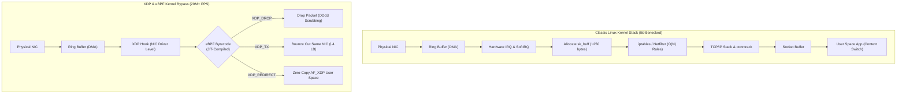
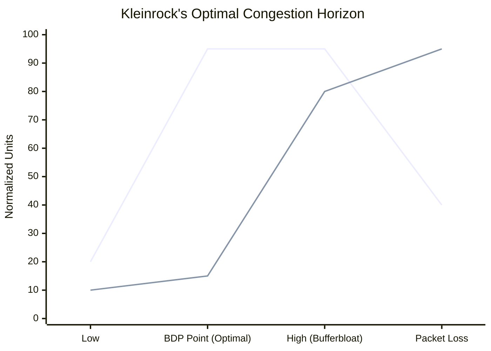
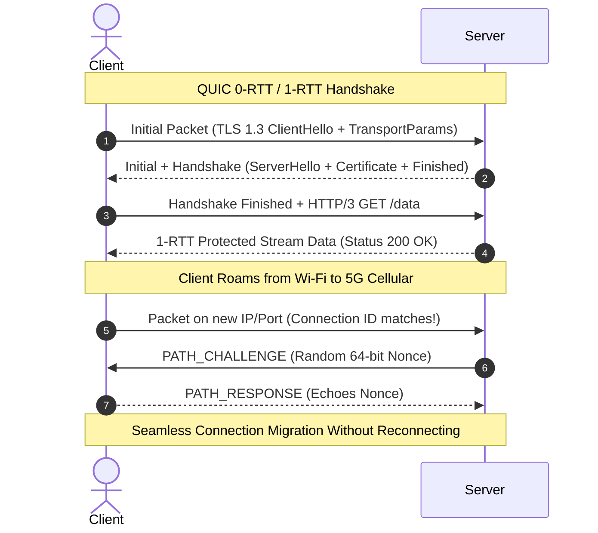
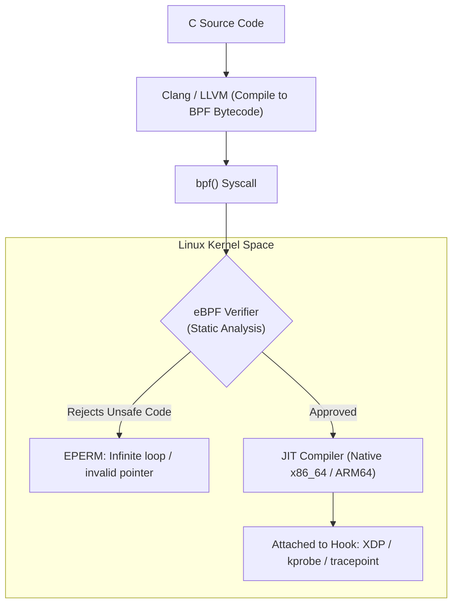
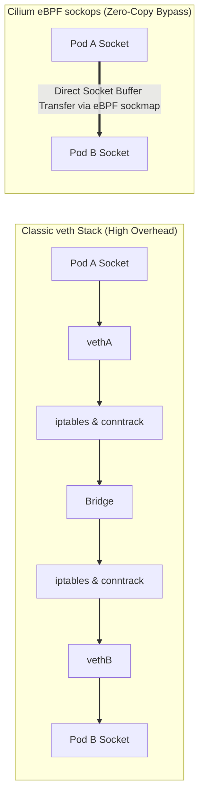

# Advanced Networking: eBPF/XDP, BBR Congestion Control, and QUIC Internals

High-scale modern infrastructure operates at the intersection of kernel bypass, custom congestion math, and transport-layer innovations. Understanding these internals separates Senior engineers from Staff and Principal Architects.

---

## 1. 💡 Intuitive Mental Models: Tarmac Security and Pipe Dynamics

To understand why kernel bypass and modern congestion algorithms are necessary, consider these physical analogies:

| Technology | Physical Mental Model | Why It Revolutionizes Networking |
| :--- | :--- | :--- |
| **Classic Linux Network Stack** | **Downtown Immigration Office:** Every single incoming passenger (packet) must board a bus downtown, fill out a 20-page carbon copy form (`sk_buff`), wait in 10 sequential checkpoint queues (`iptables`), and get escorted by a judge to the final office (context switch to user space). | Designed for 10 Mbps links. At 100 Gbps (14.8 million packets/sec), CPU burns out allocating memory structs. |
| **XDP / eBPF** | **Tarmac Biometric Scanner:** The instant a passenger's foot touches the airport runway tarmac, a high-speed laser scanner scans their face. If they are on a ban list, they are ejected immediately (**`XDP_DROP`**) in 10 nanoseconds without ever stepping foot inside the airport! | Bypasses the entire Linux kernel networking stack, dropping 25M+ packets/sec per core at line rate. |
| **Google BBR** | **Precision Water Pipe Filling:** Instead of turning a water valve higher and higher until water floods the room and pipes rupture (Loss-Based CUBIC), BBR calculates the pipe diameter and transit speed, keeping the pipe exactly $100\%$ full with zero spills. | Maximizes throughput while maintaining near-zero queuing delay, ignoring radio/Wi-Fi noise loss. |

### 👶 ELI5 / Plain-English Overview
Why do we need eBPF, BBR, and QUIC?
The internet was built on standards created in the 1970s and 1980s. When datacenters moved to **100 Gigabit Ethernet** and billions of smartphones connected via **flaky 5G networks**, the operating system's internal plumbing became the biggest bottleneck. Modern systems push packet handling directly into the network card driver (XDP) and replace 40-year-old TCP mechanics with smarter user-space transport protocols (QUIC).

---

## 2. The Linux Kernel Networking Bottleneck & eBPF/XDP

Traditional Linux networking was engineered decades ago for low-throughput links. In modern 100 GbE datacenters handling tens of millions of packets per second, the classic Linux kernel network stack becomes the primary CPU bottleneck.

### 2.1 The Classical Packet Journey (The Cost of Overhead)
When a packet arrives at a network interface card (NIC):
1. **NIC DMA Transfer:** The NIC writes the packet into a ring buffer in host memory via Direct Memory Access (DMA).
2. **Hardware Interrupt (IRQ):** The NIC asserts a hardware interrupt to a CPU core.
3. **SoftIRQ & NAPI:** The kernel schedules a soft interrupt (`NET_RX_SOFTIRQ`), switching CPU execution into the New API (NAPI) polling loop.
4. **`sk_buff` Allocation:** The kernel allocates an `sk_buff` (socket buffer) struct—a heavy, ~250-byte control structure for *every single packet*.
5. **Netfilter / `iptables` Traversal:** The packet traverses thousands of linear `iptables` rules ($O(N)$ lookup complexity).
6. **TCP/IP Stack Traversal:** Route lookup, TCP checksum, connection tracking (`conntrack`), and socket queueing.
7. **Context Switch to User Space:** The application awakens from `epoll_wait()`, copying packet payload from kernel space to user space (`read()` / `recv()`).

### 2.2 eBPF & XDP (eXpress Data Path)
**eBPF (Extended Berkeley Packet Filter)** provides an in-kernel virtual machine that executes verified, JIT-compiled bytecode inside the Linux kernel in response to kernel events/hooks without modifying kernel source code or loading unstable kernel modules.

**XDP (eXpress Data Path)** is the lowest-level hook in the Linux networking subsystem:
- Executes directly inside the **NIC driver layer**, before the OS allocates an `sk_buff` and before `iptables` or TCP connection tracking runs.
- **XDP Return Codes:**
  - `XDP_DROP`: Discards the packet immediately at line rate (drops 25M+ packets/sec per CPU core). Ideal for L3/L4 DDoS mitigation (e.g., Cloudflare Gatebot).
  - `XDP_TX`: Bounces the packet back out of the same NIC it arrived on (used by Meta’s Katran Layer 4 Load Balancer).
  - `XDP_REDIRECT`: Redirects the packet directly to a zero-copy socket (`AF_XDP`), bypassing kernel network stack completely into user-space processing.
  - `XDP_PASS`: Hands the packet up to the normal kernel network stack.

---

## 3. ⚠️ The Horror Scenarios: When Networking Architecture Fails

### Horror Scenario 1: The Kubernetes `iptables` 10,000-Rule Freeze
A fintech company migrates its core transactional engine to Kubernetes, expanding to 5,000 pods across 200 nodes.
- By default, Kubernetes `kube-proxy` writes networking rules into the Linux kernel using **`iptables`**.
- As services and endpoints scale, the `iptables` table inflates to **45,000 rules**.
- Because `iptables` is a flat, sequential list ($O(N)$ traversal):
  - Every single incoming network packet must linearly evaluate 45,000 sequential string matching rules!
  - Packet processing latency surges from $40\mu\text{s}$ to **$180\text{ milliseconds}$**.
  - When a single pod scales or terminates, `kube-proxy` must acquire a global kernel lock and rewrite the entire 45,000-rule table to disk, freezing node packet routing for up to 5 seconds!
- **Fix:** Replacing `iptables` with **Cilium (eBPF)** replaced $O(N)$ linear scans with $O(1)$ BPF hash maps, reducing network CPU overhead by $80\%$ and restoring microsecond latencies.

---

### Horror Scenario 2: The QUIC UDP Amplification DDoS Exploit
A new SaaS company enables HTTP/3 / QUIC on its edge load balancers. However, they misconfigure their TLS handshake certificate chain, sending a massive 9KB certificate payload on initial connection.
- An attacker sends spoofed UDP packets to the QUIC port (443) with the source IP address forged to be a victim bank's IP address.
- The attacker's payload is only **60 bytes** (a spoofed `Initial` packet).
- The poorly configured QUIC server responds to the victim with **9,000 bytes** of certificate data!
- **Amplification Factor:** $\frac{9000}{60} = \mathbf{150\times \text{ Amplification!}}$
- By firing a tiny 100 Mbps stream of spoofed UDP packets, the attacker leverages the company's servers to bombard the victim bank with a devastating **15 Gbps DDoS attack**!
- **Fix:** Strictly enforce RFC 9000's **3x Anti-Amplification Limit**: until a client's IP is cryptographically validated, a QUIC server must never transmit more than $3\times$ the bytes it received from the client.

---

## 4. TCP Congestion Control: The Bufferbloat Crisis & Google BBR

### 4.1 The Bufferbloat Problem
In early internet architecture, routers had small packet buffers; when congestion occurred, packets were dropped immediately. Modern router vendors installed huge memory buffers. 
- During congestion, routers queue hundreds of thousands of packets rather than dropping them.
- **Result:** Queues inflate latency from $20\text{ ms}$ to $2000\text{ ms}$ (bufferbloat) without increasing throughput by a single bit.

### 4.2 Loss-Based vs. Rate/Delay-Based Congestion Control
- **CUBIC (Loss-Based):** The default Linux TCP congestion control algorithm for over a decade. CUBIC increases the congestion window ($cwnd$) according to a cubic function until a **packet drop** occurs, then slashes $cwnd$ by $30\%$. Over lossy links (such as satellite, mobile, or high-bandwidth transoceanic cables where $1\%$ loss occurs from physical noise rather than congestion), CUBIC collapses throughput.
- **Google BBR (Bottleneck Bandwidth and RTT):** BBR is a rate-based, delay-sensitive congestion control algorithm that operates at **Kleinrock's optimal operating point**.

*(Blue line = Throughput; Orange line = Round-Trip Time)*

### 4.3 Kleinrock's Equation & The BBR State Machine
BBR explicitly models two physical constraints of the network pipe:
1. **$BtlBW$ (Bottleneck Bandwidth):** The physical maximum capacity of the slowest link along the route.
2. **$RTprop$ (Round-Trip Propagation Time):** The physical minimum speed-of-light travel time round-trip with empty queues.

The **Bandwidth-Delay Product (BDP)** is the maximum volume of data that can be in flight simultaneously without creating queues:
$$\text{BDP} = BtlBW \times RTprop$$

#### The BBR 4-Phase State Machine:
1. **Startup:** Exponentially doubles delivery rate each round trip to rapidly discover $BtlBW$.
2. **Drain:** Throttles sending rate below $BtlBW$ to completely drain any queues built up during Startup.
3. **ProbeBW:** Cycles sending rate ($1.25\times, 0.75\times, 1.0\times$) around $BtlBW$ to probe for newly available bandwidth while draining transient queues.
4. **ProbeRTT:** Briefly reduces inflight packets to 4 packets once every 10 seconds to allow the pipe to empty completely, refreshing the measurement of true $RTprop$.

**Production Impact:** On Google's YouTube backbone, switching to BBR increased throughput by up to $20\%$ globally and over $100\times$ on lossy long-haul routes.

---

## 5. HTTP/3 & QUIC Transport Internals

HTTP/2 multiplexed streams over a single TCP connection, but suffered from **TCP Head-of-Line (HoL) Blocking**: if packet 3 of Stream A was lost, TCP halted delivery of Stream B, C, and D until packet 3 was retransmitted. **HTTP/3 solves this by replacing TCP with QUIC** over UDP.

### 5.1 QPACK Header Compression vs. HPACK
In HTTP/2, HPACK used a shared stateful compression table across all streams. If an HTTP/2 frame referenced an entry added by a prior frame that was lost in transit, the decoder was forced to block—reintroducing HoL blocking at the HTTP layer!

**QPACK in HTTP/3:**
- Decouples stream headers from the shared compression table.
- Introduces two dedicated unidirectional control streams: the **Encoder Stream** and the **Decoder Stream**.
- If a header block contains references that haven't arrived yet on the control stream, only *that specific stream* waits; other independent streams proceed without delay.

### 5.2 Monotonic Packet Numbering (Solving TCP ACK Ambiguity)
In TCP, when a packet is retransmitted, the retransmitted segment carries the identical Sequence Number as the original. If an ACK arrives, the sender cannot tell whether the ACK corresponds to the original packet or the retransmission (**ACK Ambiguity**), distorting RTT estimates.

**QUIC's Solution:**
- Every QUIC packet carries a strictly monotonically increasing **Packet Number**, even if it contains retransmitted frame payloads!
- Stream offsets track byte positions within an application stream; Packet numbers track physical network transmissions. This enables microsecond-accurate RTT calculation.

### 5.3 Connection Migration & Anti-Amplification Limits
1. **Connection ID (CID) vs. 4-Tuple:** TCP binds a session to `(SrcIP, SrcPort, DstIP, DstPort)`. If a mobile device moves from Wi-Fi to cellular, the IP changes, immediately killing all active TCP sessions. QUIC binds connections to an opaque **Connection ID (CID)** chosen independently by client and server. The physical IP address can change dynamically while streaming video or downloads without interruption.
2. **The 3x Anti-Amplification Limit:** To prevent attackers from using QUIC servers as DDoS reflection amplifiers (by spoofing victim IPs in UDP packets), a QUIC server **must not send more than $3\times$ the number of bytes received** from an unvalidated client IP until the client proves ownership of its IP address via handshake completion or `PATH_RESPONSE`.

---

## 6. 🏢 Real-World Production Battle-Testing

### 1. Cloudflare Gatebot: Line-Rate DDoS Scrubbing with XDP
- Cloudflare edge servers receive hundreds of millions of malicious packets per second during global DDoS attacks.
- Using standard Linux sockets would saturate CPU softIRQs and crash the servers.
- Cloudflare deploys **XDP eBPF bytecode** directly inside the network driver.
- The program evaluates incoming packets against dynamic IP blacklist bloom filters and hash maps.
- **Performance:** Drops over **25 million packets per second per CPU core**, absorbing massive multi-terabit attacks at line rate without using any user-space memory or allocating an `sk_buff`!

### 2. Meta: Katran Layer 4 Load Balancer
- Meta powers all external ingress traffic (Facebook, Instagram, WhatsApp) through **Katran**, an open-source Layer 4 Load Balancer written in C++ and eBPF/XDP.
- When packets arrive, Katran inspects the 5-tuple, uses consistent hashing to select a backend real server, encapsulates the packet in Generic UDP Encapsulation (GUE), and immediately uses `XDP_TX` to bounce the packet back out the same NIC to the target server.
- Handles line-rate 100 GbE traffic with zero packet copies.

---

## 7. ⚖️ Practical Trade-Offs & Staff-Level Rules of Thumb

1. **Deploy eBPF / Cilium in Kubernetes when pod count exceeds 1,000:** The $O(N)$ linear overhead of `iptables` will degrade tail latency and introduce scaling freezes.
2. **Enable Google BBR on public edge proxies:** If you serve mobile users, global CDN assets, or transoceanic traffic, switching from CUBIC to BBR yields immediate $10\%-20\%$ throughput gains over lossy cellular links.
3. **Respect the 3x Anti-Amplification Limit in QUIC:** Keep initial TLS certificate chains small (or use intermediate certificate compression via RFC 8879) so the entire ServerHello and certificate fit within the 3x initial payload limit ($\sim 3,600\text{ bytes}$ for a $1,200\text{ byte}$ initial packet), preventing an extra round trip.

---

## 🎯 Top Real-World Interview Questions & Deep-Dive Answers (FAANG / Staff Level)

### Q1: How does the eBPF Verifier guarantee that running custom user bytecode inside the Linux kernel will never crash or hang the operating system?

#### 💡 Model Answer:
Historically, extending the Linux kernel required writing **Kernel Modules (LKM)**. If a kernel module had a null pointer dereference, an infinite loop, or an out-of-bounds memory write, it resulted in an immediate **Kernel Panic** that crashed the entire physical machine.

#### The eBPF Verifier's Strict Safety Checks:
Before any eBPF program is loaded into kernel execution, the **eBPF Verifier** performs exhaustive static code analysis via Directed Acyclic Graph (DAG) state exploration:
1. **Termination Guarantee (No Infinite Loops):** The verifier inspects all jump targets and loops. In older kernels, loops were forbidden (programs had to be unrolled); in modern kernels (Linux 5.3+), bounded loops are permitted only if the verifier can mathematically prove they will terminate within a finite maximum instruction count ($1,000,000$ instructions).
2. **Memory Safety & Pointer Tracking:** Pointers are strictly typed and tracked (e.g., `PTR_TO_CTX`, `PTR_TO_STACK`). The program can **never** read or write arbitrary kernel memory. Every pointer dereference is verified to be within bounded bounds (e.g., packet start to packet end).
3. **Restricted Register Access:** Uninitialized registers cannot be read. Stack space is strictly capped at **512 bytes**.
4. **Helper Functions & BPF Maps:** To interact with system memory, eBPF programs cannot call arbitrary C functions; they must call an allow-list of secure, in-kernel **BPF Helper Functions** (e.g., `bpf_map_lookup_elem()`).
Once verified, the bytecode is compiled into native machine code via the in-kernel **JIT (Just-In-Time) compiler**, executing at native bare-metal speed with zero risk of a kernel crash!

---

### Q2: How does Cilium utilize eBPF sockops to bypass the entire Linux TCP/IP stack for microservices communicating on the same physical host?

#### 💡 Model Answer:
In traditional Kubernetes networking, when Container A speaks to Container B on the same physical node:
1. The packet enters Container A's virtual network interface (`vethA`).
2. Traverses the kernel bridge / Open vSwitch.
3. Traverses Netfilter / `iptables` twice (once in each network namespace).
4. Slices through TCP/IP encapsulation, connection tracking, routing lookup, and decapsulation.
5. Arrives at Container B's virtual network interface (`vethB`).

#### The eBPF `sockmap` Shortcut:
Cilium hooks into the socket layer using **eBPF `sockops`** and **`BPF_MAP_TYPE_SOCKMAP`**:
1. When two local containers establish a TCP handshake, Cilium records both socket file descriptors into a kernel BPF map indexed by the 4-tuple.
2. Once the connection is established, Cilium attaches an eBPF stream parser (`sk_msg`) program.
3. When Container A calls `write()` on its socket, the eBPF program intercepts the memory buffer at the socket interface and **transfers the data directly into Container B's socket receive queue**!
4. **The Impact:** Bypasses `veth` pairs, IP routing, `iptables`, and TCP segmentation completely. Inter-pod communication latency drops by **$50\%$**, and throughput reaches physical memory bus speeds!

---

### Q3: What is Kleinrock's optimal operating point in congestion control, and why is it physically impossible for any algorithm to simultaneously minimize RTT and maximize throughput?

#### 💡 Model Answer:
Leonard Kleinrock proved mathematically in 1979 that the optimal operating point for any network pipe occurs at the boundary where:
1. **Throughput is maximized** (operating at exactly the Bottleneck Bandwidth $BtlBW$).
2. **Delay is minimized** (operating at the physical speed-of-light minimum propagation time $RTprop$).

#### The Ambiguity / Uncertainty Principle of Networking:
You **cannot measure both simultaneously using the same packet exchange**:
- To measure true physical minimum latency ($RTprop$), the network pipe must be **completely empty** so that packets never wait in intermediate router queues.
- But to measure the maximum bottleneck bandwidth ($BtlBW$), the network pipe must be **completely full** to saturate the link.
- If you push enough packets to measure bandwidth, you inevitably induce small queues, which artificially inflates RTT ($RTT > RTprop$).
- If you hold back packets to measure empty-queue RTT, you under-utilize the link ($Throughput < BtlBW$).

#### How Google BBR Resolves This Dilemma:
BBR does not attempt to measure both simultaneously. Instead, it uses a **state machine that alternates measurements over time**:
- In **`ProbeBW`** (runs $98\%$ of the time), BBR paces packets at the current estimate of $BtlBW$.
- Once every 10 seconds, BBR enters **`ProbeRTT`** for $200\text{ ms}$: it throttles inflight packets down to just 4 packets. This drains all router queues along the path, allowing BBR to record the true, unqueued physical $RTprop$.
- It multiplies the latest $BtlBW$ by the newly measured $RTprop$ to recalculate the optimal Bandwidth-Delay Product ($BDP$).
