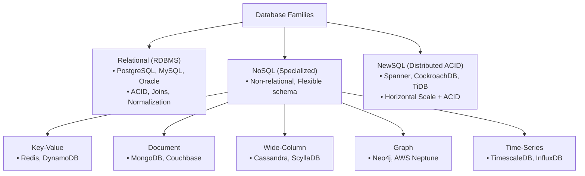
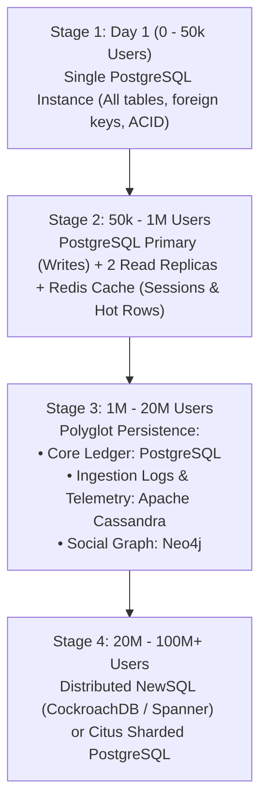
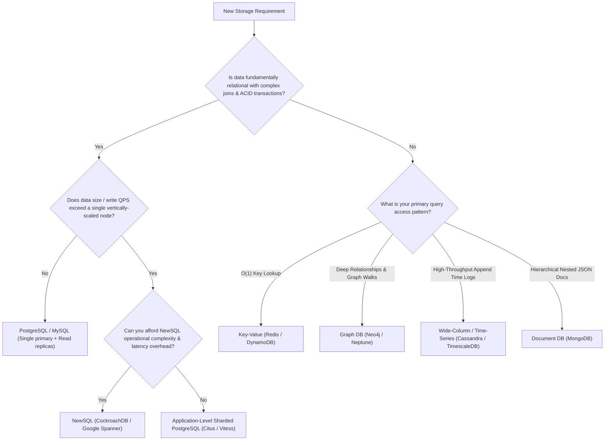
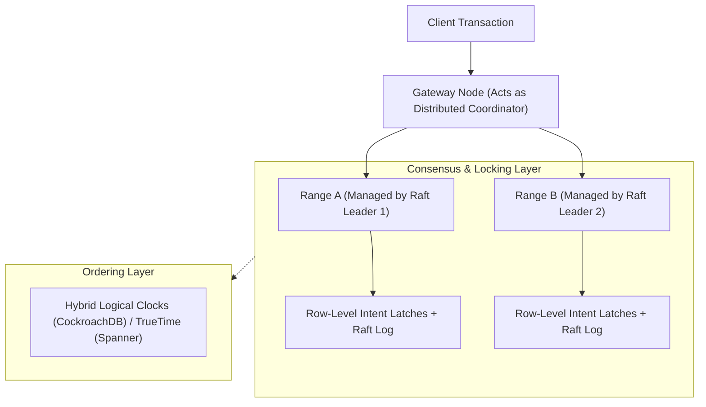

# Database Paradigms: Relational (SQL) vs. NoSQL vs. NewSQL

Selecting the correct database technology is one of the most consequential architectural decisions in system design. No single database excels at all access patterns, read/write ratios, and consistency guarantees.

---

## 1. 💡 Intuitive Mental Models: From General Ledgers to Corkboards

To understand why different database paradigms exist, visualize how humans organize physical records:

| Paradigm | Physical Mental Model | Where It Excels | Where It Breaks Down |
| :--- | :--- | :--- | :--- |
| **Relational (RDBMS)** | **The Bound Accounting Ledger:** Every line item is neatly cross-referenced with account numbers and foreign keys. Total balances must strictly balance. Modifying a column requires an audit re-indexing (**Schema Migration**). | Financial transactions, strict schemas, complex relational joins. | Cannot scale writes horizontally across 50 physical machines without painful sharding. |
| **Key-Value (Redis / DynamoDB)** | **The Coat Check Room:** You hand the attendant a claim ticket (`key`), you receive your coat (`value`) back in 2 seconds flat. No searching, no sorting. | Sub-millisecond $O(1)$ reads and writes for sessions and caching. | Incapable of complex filtering (cannot search "all coats that are blue"). |
| **Document (MongoDB)** | **The Manila Employee Folder:** All documents related to an employee (resume, address, medical claims, vacation dates) are stapled together in a single folder. | Hierarchical data, rapid prototyping, dynamic schemas. | Cross-document joins and multi-document consistency require complex orchestration. |
| **Wide-Column (Cassandra)** | **The Factory Conveyor Belt:** An infinite append-only belt sorted by machine ID and timestamp. You stamp millions of sensor logs onto the belt sequentially without stopping. | Astronomical write throughput, timeseries, IoT metrics, zero single points of failure. | Terrible at ad-hoc searching on non-partition keys (requires full cluster scan). |
| **Graph (Neo4j)** | **The Detective's Corkboard:** Entities are pushpins on the wall; relationships are pieces of string directly connecting pins together (**Index-Free Adjacency**). | Social networks, fraud rings, recommendation engines ($k$-hop walks). | Terrible at bulk table scans or mass numerical aggregations. |
| **NewSQL (Spanner / CockroachDB)** | **A Synchronized Global Bank:** Multiple identical ledger books across 5 continents kept in lockstep using atomic clocks and consensus voting. | Horizontal scaling + strict ACID transactions and SQL joins. | Higher write latency due to multi-node consensus (Raft/Paxos) round-trips. |

### 👶 ELI5 / Plain-English Overview
Why aren't all databases just relational?
In the 1980s, all data fit on a single computer's hard drive. **Relational databases (SQL)** were built around that single-computer model, ensuring perfect data consistency via table joins.
When the modern internet arrived in the 2000s (Google, Amazon, Facebook), billions of people began writing posts and clicking buttons simultaneously. Single database servers melted. Engineers invented **NoSQL** by stripping away complex joins and ACID guarantees in exchange for spreading data across thousands of cheap servers. Recently, **NewSQL** emerged to combine the scale of NoSQL with the mathematical safety of SQL.

---

## 2. Taxonomy of Modern Databases



---

## 3. Relational Databases (RDBMS)

Systems like **PostgreSQL** and **MySQL** have dominated software engineering for four decades.

### Core Strengths
- **Strict ACID Guarantees:** Ensures transactional integrity (financial debits/credits).
- **Expressive SQL & Joins:** Highly flexible declarative querying across multiple normalized tables.
- **Data Integrity:** Strict constraints, foreign keys, unique indexes, and schema enforcement prevent corrupted state.

### Scaling Bottlenecks
- **Scaling Limit:** Historically designed for single-node vertical scaling.
- **Join Penalty Across Shards:** Once data is sharded across multiple machines, performing cross-shard joins requires expensive scatter-gather operations that destroy latency.
- **Rigid Schema Evolution:** Running schema migrations (`ALTER TABLE`) on multi-terabyte tables can lock rows and degrade production throughput.

---

## 4. The NoSQL Paradigms

NoSQL emerged in the late 2000s to sacrifice general-purpose ACID and relational joins in exchange for horizontal scale, extreme write throughput, and schema flexibility.

### 1. Key-Value Stores (Redis, AWS DynamoDB, Memcached)
- **Data Model:** Simple dictionary mapping unique string keys to binary payloads, hashes, or lists: `key -> value`.
- **Performance:** $O(1)$ constant time reads and writes with sub-millisecond latency.
- **Best For:** Session stores, shopping carts, distributed caching, user preference lookups.

### 2. Document Stores (MongoDB, Couchbase)
- **Data Model:** Semi-structured hierarchical documents (JSON / BSON).
- **Properties:** Embeds related sub-entities inside a single document (e.g., an `Order` document contains an array of `items` and a nested `shipping_address`).
- **Best For:** Content management systems (CMS), product catalogs, event logging, rapid prototyping where schemas evolve continuously.

### 3. Wide-Column / Column-Family Stores (Apache Cassandra, ScyllaDB, HBase)
- **Data Model:** Multi-dimensional sorted map: `(Partition Key, Clustering Column, Timestamp) -> Value`.
- **Storage Engine:** Optimized for append-only sequential disk writes using LSM-Trees.
- **Strengths:** Unrivaled horizontal write throughput; linear scalability across hundreds of nodes with zero single points of failure.
- **Best For:** High-volume time-series data, IoT sensor streams, telemetry, activity feeds.
- **Anti-Pattern:** Ad-hoc filtering queries on non-indexed columns (requires full table scans).

### 4. Graph Databases (Neo4j, Amazon Neptune)
- **Data Model:** Nodes (entities), Edges (relationships), and Properties.
- **Traversal:** Index-free adjacency: Each node directly references its neighboring nodes in memory, allowing deep traversals ($k$-hop queries) in $O(1)$ per edge rather than costly recursive SQL joins.
- **Best For:** Social networks ("Friends of Friends"), recommendation engines, fraud detection rings, identity and access management graphs.

### 5. Time-Series Databases (TimescaleDB, InfluxDB, Prometheus)
- **Data Model:** Timestamped metrics with tags/dimensions.
- **Optimizations:** Automatic chronological chunking, aggressive columnar compression (e.g., Gorilla delta-of-delta encoding), automated downsampling, and TTL retention policies.
- **Best For:** Infrastructure observability, financial stock tickers, IoT sensor logs.

---

## 5. NewSQL: The Best of Both Worlds

NewSQL databases (Google Spanner, CockroachDB, TiDB, YugabyteDB) preserve the relational SQL interface, ACID transactions, and strong consistency of traditional RDBMS while natively scaling horizontally like NoSQL.

### How NewSQL Works
- Distributed storage engine sharded automatically into ranges/tablets.
- Consensus replication (Raft or Paxos) per shard to guarantee high availability and fault tolerance.
- Distributed Two-Phase Commit (2PC) and Snapshot Isolation for cross-range transactions.
- TrueTime or Hybrid Logical Clocks (HLC) for external consistency.

### Trade-offs
- Higher write latency than NoSQL (due to Raft/Paxos quorums and 2PC coordination).
- Complex operational deployment and higher compute overhead.

---

## 6. ⚠️ The Horror Scenarios: When Paradigms Clash

### Horror Scenario 1: The Distributed SQL Scatter-Gather OOM Collapse
An e-commerce marketplace stores 50 million customers and 200 million orders. To scale beyond a single server, the engineering team manually shards PostgreSQL by `user_id` across 16 database instances.
- A business analytics analyst executes a seemingly simple reporting query:
  ```sql
  SELECT u.country, SUM(o.total_amount) 
  FROM users u 
  JOIN orders o ON u.id = o.user_id 
  GROUP BY u.country;
  ```
- **The Catastrophe:** Because orders and users live on different physical database instances, the sharding middleware must broadcast a **Scatter-Gather** query to all 16 instances.
- Each instance dumps millions of un-aggregated rows across the internal network into the application gateway's RAM.
- The application gateway attempts an in-memory hash join across 200 million records.
- Memory usage spikes past 64 GB in 10 seconds; Linux kernel Out-Of-Memory (OOM) killer fires, terminating the gateway process!
- The query retries automatically, triggering a cascading OOM crash across all gateway instances.

---

### Horror Scenario 2: The Document Store "Schema Drift" Corruption
A rapid-growth startup chooses MongoDB for its flexibility: *"No migrations needed, just save JSON!"*
- Over 4 years, 6 different developers work on the user checkout code.
- Because there is no enforced schema:
  - Developer 1 saved `price: 49.99` (as a Float).
  - Developer 2 saved `price: 50` (as an Integer).
  - Developer 3 saved `price: "49.99"` (as a String).
  - Developer 4 saved `price: { amount: 4999, currency: "USD" }` (as a Nested Object).
- A newly hired data engineer writes an overnight batch job to calculate total daily revenue:
  ```javascript
  db.orders.aggregate([{ $group: { _id: null, total: { $sum: "$price" } } }])
  ```
- **The Disaster:** MongoDB's `$sum` operator silently ignores strings and nested objects without throwing an error!
- The revenue report shows **$\$120,000$** instead of the actual **$\$850,000$**. Financial disclosures to investors are wrong, leading to regulatory audits and an emergency month-long engineering freeze to sanitize corrupt data.

---

## 7. 🚶 Step-by-Step Scenario: Scaling a Database Architecture from 1 to 100M Users

Let's trace how an application's storage architecture evolves as it scales:



1. **Stage 1 (0 to 50k users):** Everything lives in a single, vertically scaled PostgreSQL instance. Normalized schema, foreign keys, local ACID transactions. Simplicity is king.
2. **Stage 2 (50k to 1M users):** Read queries start saturating disk I/O. Add a **Redis Cache** in front of Postgres for hot read queries. Add two **Asynchronous Read Replicas** to offload heavy read traffic.
3. **Stage 3 (1M to 20M users):** Write traffic from analytics, user activity clicks, and telemetry begins saturating Postgres writes. Adopt **Polyglot Persistence**:
   - Keep critical financial billing data in PostgreSQL.
   - Offload high-volume clickstream and audit logs to an LSM-tree store (**Apache Cassandra / ScyllaDB**).
   - Offload user friendship and recommendation graphs to a graph database (**Neo4j**).
4. **Stage 4 (20M to 100M+ users):** Core transactional data outgrows a single machine. Migrate from traditional Postgres to a distributed **NewSQL engine (CockroachDB or Google Spanner)** to gain horizontal scale with automated sharding and distributed ACID transactions.

---

## 8. 🏢 Real-World Production Battle-Testing

### 1. Uber: Why Uber Moved from PostgreSQL to Schemaless (MySQL + Cassandra)
- In 2014, Uber outgrew its monolithic PostgreSQL setup for storing trip data.
- **The Problem with Postgres at Uber's Scale:**
  1. Postgres writes immutable row versions (MVCC tuple append), creating index bloat and heavy write amplification on secondary indexes.
  2. High-frequency replication updates across datacenters saturated network bandwidth.
- **Uber's Solution:** Built **Schemaless**, an append-only distributed datastore using MySQL instances purely as dumb key-value chunk storage, managed by an orchestration layer inspired by Cassandra.

### 2. Stripe: The Uncompromising Choice of Relational ACID
- Despite handling billions in global transactions, Stripe chose **not** to migrate its core payments ledger to NoSQL.
- Financial accounting cannot tolerate eventual consistency, missing records, or write skew.
- Stripe maintains strict **Single-Leader Synchronous Relational Architecture**, using horizontal sharding only at the application boundary (routing merchant accounts to dedicated database clusters) to preserve full ACID transactional safety within every merchant account.

---

## 9. ⚖️ Architectural Decision Flowchart



---

## 🎯 Top Real-World Interview Questions & Deep-Dive Answers (FAANG / Staff Level)

### Q1: Under what precise conditions should a Staff Architect recommend migrating from PostgreSQL to a NoSQL store like Cassandra or DynamoDB? What are the hidden architectural costs?

#### 💡 Model Answer:
Migrating from a relational database to NoSQL is an irreversible, high-risk architectural shift. It should **never** be done for "general performance," but only when specific physical thresholds are breached.

#### Valid Justifications for Migration:
1. **Sustained Write Throughput Ceiling:** The write workload exceeds $50,000 - 100,000\text{ writes/sec}$, saturating the fastest PCIe Gen5 NVMe SSD write bandwidth on a vertically scaled instance.
2. **Predictable Linear Scale Requirements:** The dataset will grow predictably past $10\text{ - }50\text{ Terabytes}$ over the next 12 months, where single-node backup, vacuuming, and restoration times become operationally unviable.
3. **Strict Partition-Key Driven Access:** $99\%$ of application queries access data via a known partition key (e.g., `WHERE tenant_id = ? AND timestamp > ?`), with **zero need for ad-hoc relational joins or cross-table aggregation**.

#### The Hidden Architectural Costs (What You Lose):
- **Loss of Relational Joins:** Any join must now be executed in application code, requiring multiple network round-trips or denormalizing data into multiple tables.
- **Secondary Index Limitations:** Secondary indexes in Cassandra/DynamoDB require expensive scatter-gather reads across all cluster nodes or asynchronous global secondary indexes (GSIs) that suffer replication lag.
- **Operational Complexity:** Managing Cassandra tombstones, compaction strategies, hint handoffs, and repair schedules requires specialized DBA expertise.

---

### Q2: How do NewSQL databases (like CockroachDB or Google Spanner) achieve distributed ACID transactions across multiple physical shards without a single centralized lock manager?

#### 💡 Model Answer:
NewSQL engines distribute both data and transaction coordination across the cluster using three core layers:



1. **Range-Based Partitioning & Raft Consensus:** Data is sliced into contiguous $64\text{MB}$ ranges (tablets). Each range is replicated across 3 or 5 nodes via the **Raft or Paxos consensus protocol**. Writes within a single range are serialized by the Raft leader.
2. **Distributed Two-Phase Commit (2PC) with Transaction Records:**
   - When a transaction touches multiple ranges, the node receiving the request becomes the **Transaction Coordinator**.
   - It writes an uncommitted **Transaction Record** (`Status: PENDING`) to a designated Raft range.
   - It writes **Write Intents** (provisional row versions pointing back to the transaction record) across all target ranges.
   - Once all ranges acknowledge write intents, the coordinator writes `Status: COMMITTED` to the transaction record. The transaction is now permanently committed!
   - Background workers convert write intents into permanent MVCC row versions.
3. **Global Ordering Without a Central Bottleneck:**
   - **Google Spanner:** Uses **TrueTime**, an API backed by GPS receivers and atomic clocks with bounded time error ($\epsilon \le 7\text{ms}$). It waits out the uncertainty window ($2\epsilon$) before committing, guaranteeing linearizability.
   - **CockroachDB:** Uses **Hybrid Logical Clocks (HLC)** combining physical NTP wall-clock time with Lamport logical counters to order transactions optimistically, rolling back if clock skew violations are detected.

---

### Q3: What is "Index-Free Adjacency" in Graph Databases, and why does it outperform Relational Databases by orders of magnitude on deep relationship queries?

#### 💡 Model Answer:
In a relational database, relationships are modeled using **Foreign Keys**:
- Table `Users (id, name)` and Table `Friendships (user1_id, user2_id)`.
- To find "Friends of Friends" (a 2-hop traversal), SQL must execute a join:
  ```sql
  SELECT f2.user2_id FROM Friendships f1 
  JOIN Friendships f2 ON f1.user2_id = f2.user1_id 
  WHERE f1.user1_id = 42;
  ```
- **The Relational Bottleneck:** Evaluating this join requires searching a B+ Tree index on `Friendships` for each hop. Each index seek takes $O(\log N)$ time. For $k$ hops across billions of rows, the computational cost explodes exponentially: $O(M^k \log N)$, where $M$ is the average degree of a node.

```mermaid
flowchart LR
    subgraph Relational["Relational: Index Lookups on Every Hop"]
        R_U1["User 42"] -->|Index Seek O(log N)| R_F["Friendships Table"]
        R_F -->|Index Seek O(log N)| R_U2["Friend Node"]
    end
    subgraph GraphDB["Graph: Index-Free Adjacency (Direct Memory Pointers)"]
        G_U1["Node: User 42"] == Direct RAM Pointer O(1) ==> G_E1["Edge: FRIEND_OF"] == Direct RAM Pointer O(1) ==> G_U2["Node: Alice"]
    end
```

#### The Graph Engine Advantage (Index-Free Adjacency):
In native graph databases (like **Neo4j**):
- Nodes and edges are stored as physical doubly linked record structures on disk and in memory.
- Node record `User 42` contains a **direct 64-bit physical memory pointer** to its first connected edge record.
- Traversing to a friend does not require searching an index! The engine simply dereferences the memory pointer:
  $$\text{Hop Time} = O(1) \text{ constant time memory dereference}$$
- Traversal latency depends **only on the size of the immediate subgraph being explored**, completely independent of whether the total database contains 100 nodes or 10 billion nodes!
