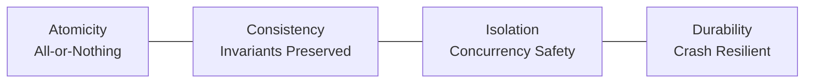
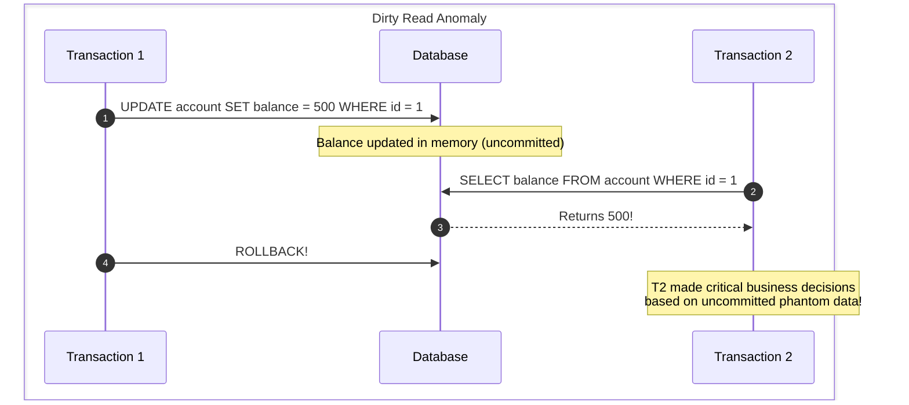
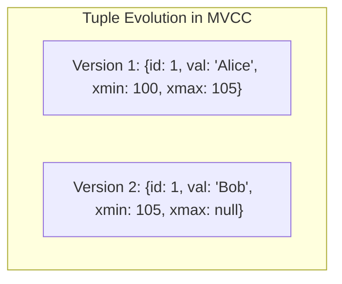
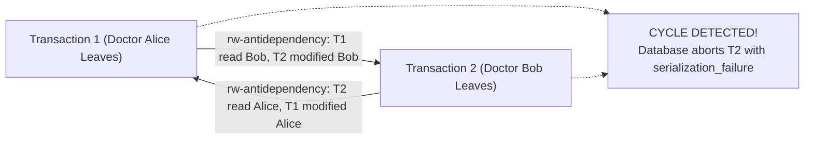
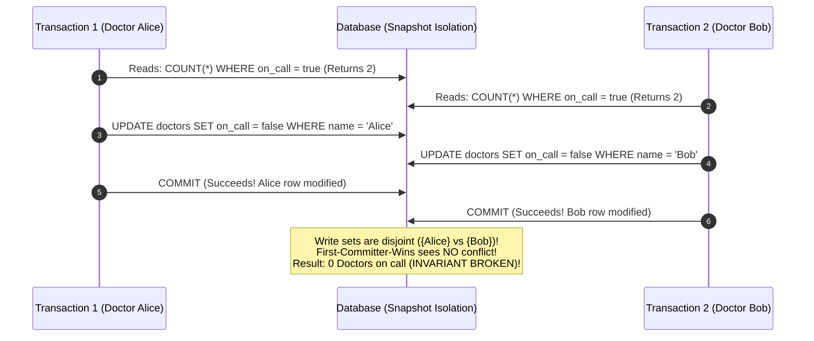
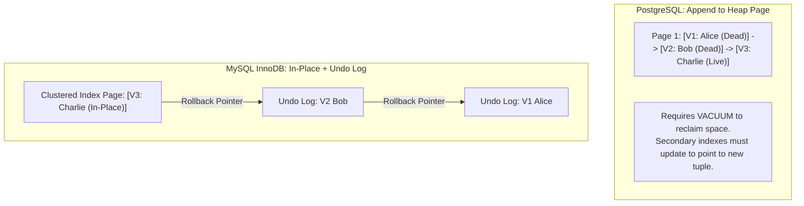
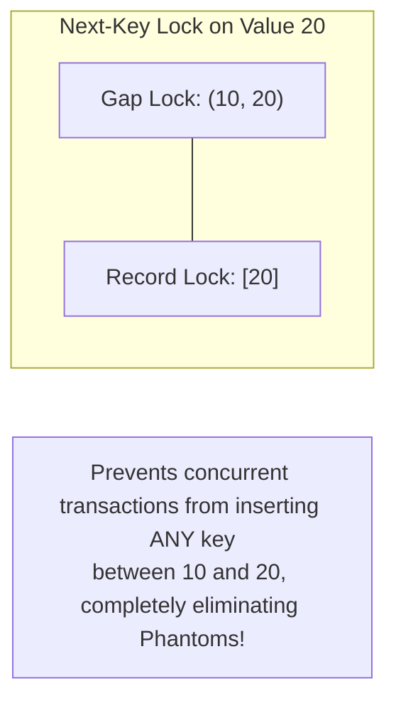

# ACID Transactions, Isolation Levels, and MVCC

Concurrency anomalies in databases can cause devastating financial, legal, and operational bugs. Understanding transaction isolation levels and concurrency control mechanisms is mandatory for designing correct data systems.

---

## 1. Deconstructing the ACID Acronym



### 💡 Intuitive Mental Model: The Legal Bank Wire Transfer
To grasp ACID, consider transferring $\$100$ from Alice's account to Bob's account:
- **Atomicity (All-or-Nothing):** Handing $\$100$ cash across a teller window. Either both Alice's account is debited AND Bob's account is credited, or nothing happens at all. Money never vanishes into the ether if the database server crashes halfway through.
- **Consistency (Invariants Preserved):** The physical conservation of money. The bank's core invariant holds: $\text{Balance}_{\text{Alice}} + \text{Balance}_{\text{Bob}} = \text{Total Money}$. Account balances can never violate check constraints (e.g., balance cannot be negative).
- **Isolation (Concurrency Illusion):** Imagine two people using physical debit cards at two different ATMs at the exact same millisecond trying to withdraw the last $\$100$ from a joint checking account. Isolation guarantees they are processed as if they stood one behind the other in line.
- **Durability (Carved in Granite):** Once the teller stamps "TRANSACTION APPROVED" and hands you a receipt, a sudden power outage or lightning strike hitting the bank datacenter an instant later cannot erase your deposit. The change was flushed to disk via `fsync`.

### 👶 ELI5 / Plain-English Overview
Why is transaction isolation hard?
If a database only served **one single user at a time**, system design would be trivial. But production databases handle tens of thousands of concurrent requests per second. To achieve high throughput, the database interleaves read and write operations from different users. 
However, interleaving creates dangerous timing illusions: users see half-finished calculations, overwrite each other's changes, or make conflicting decisions based on stale data. Isolation levels define the contract of how well the database protects you from these illusions.

---

## 2. Concurrency Anomalies & Phenomena

When multiple transactions read and write to the same rows concurrently, the following anomalies can occur:



### The 5 Classic Anomalies:

1. **Dirty Read (G1):** Transaction 2 reads uncommitted modifications made by Transaction 1. If Transaction 1 later rolls back, Transaction 2 made decisions based on data that never officially existed.
2. **Non-Repeatable (Fuzzy) Read (G2a):** Transaction 1 reads a row. Transaction 2 updates and commits that same row. Transaction 1 reads the row again within the same transaction and observes a different value.
3. **Phantom Read (A3):** Transaction 1 queries a range of rows (`SELECT WHERE status = 'PENDING'`). Transaction 2 inserts a brand-new row matching that predicate and commits. Transaction 1 re-executes the query and discovers a "phantom" row that was not there before.
4. **Lost Update (P4):** Two concurrent transactions perform a read-modify-write cycle on the same row. Transaction 2's commit blindly overwrites Transaction 1's commit without including Transaction 1's changes:
   $$\text{Balance} = 100 \implies T_1(+20), \ T_2(+50) \implies \text{Final Balance becomes } 150 \text{ instead of } 170!$$
5. **Write Skew:** Two transactions read overlapping data, make disjoint updates to different rows based on a shared invariant, and collectively violate the invariant.

---

## 3. ⚠️ The Horror Scenarios: When Isolation Fails

### Horror Scenario 1: The Black Friday Inventory Lost Update
Two shoppers, Alice and Bob, click "Buy Now" for the very last PlayStation console in stock ($Q = 1$) under standard **Read Committed** isolation:

```mermaid
sequenceDiagram
    autonumber
    actor Alice
    actor Bob
    participant DB as Postgres (Read Committed)

    Alice->>DB: BEGIN; SELECT stock FROM items WHERE id = 42;
    DB-->>Alice: stock = 1
    Bob->>DB: BEGIN; SELECT stock FROM items WHERE id = 42;
    DB-->>Bob: stock = 1 (Both see 1 item in stock!)

    Note over Alice: Calculates: 1 - 1 = 0
    Alice->>DB: UPDATE items SET stock = 0 WHERE id = 42;
    Alice->>DB: COMMIT;

    Note over Bob: Calculates: 1 - 1 = 0 (Blind Overwrite!)
    Bob->>DB: UPDATE items SET stock = 0 WHERE id = 42;
    Bob->>DB: COMMIT;
```

- **The Disaster:** Both transactions succeed! The warehouse has only 1 physical console, but both Alice and Bob received order confirmations and credit card charges. The business faces angry customers, negative reviews, and chargeback penalties.

---

### Horror Scenario 2: The Two-Account Bank Overdraft (Write Skew)
Alice has two bank accounts: Checking ($\$50$) and Savings ($\$50$).
- **Bank Rule / Invariant:** $\text{Checking} + \text{Savings} \ge 0$.
- Alice visits an ATM in Chicago to withdraw $\$80$ from Checking ($T_1$).
- Concurrently, Alice's automated mortgage autopay withdraws $\$80$ from Savings ($T_2$).

```mermaid
sequenceDiagram
    autonumber
    participant T1 as T1: ATM Chicago (Withdraw $80 from Checking)
    participant DB as Database (Snapshot Isolation)
    participant T2 as T2: Autopay (Withdraw $80 from Savings)

    T1->>DB: SELECT checking, savings FROM accounts WHERE user = 'Alice'
    DB-->>T1: checking = $50, savings = $50 (Total = $100 >= $80 -> OK!)
    T2->>DB: SELECT checking, savings FROM accounts WHERE user = 'Alice'
    DB-->>T2: checking = $50, savings = $50 (Total = $100 >= $80 -> OK!)

    T1->>DB: UPDATE accounts SET checking = checking - 80; (checking becomes -$30)
    T1->>DB: COMMIT;

    T2->>DB: UPDATE accounts SET savings = savings - 80; (savings becomes -$30)
    T2->>DB: COMMIT;
```

- **The Disaster:** Under standard **Snapshot Isolation / Repeatable Read**, both transactions commit without conflict because they modified **different rows** (`checking` vs `savings`)!
- **Result:** Alice's total balance is now $-\$60$. The bank's core invariant was completely shattered.

---

### Horror Scenario 3: The Classic Doctor On-Call Disaster
- **Hospital Constraint:** At least one doctor must remain on call in the emergency room at all times.
- Both Dr. Alice and Dr. Bob are currently on call.
- Alice requests sick leave: Her transaction checks `SELECT COUNT(*) FROM on_call` $\rightarrow$ returns 2. It proceeds to remove Alice from on-call.
- Concurrently, Bob requests leave: His transaction checks `SELECT COUNT(*) FROM on_call` $\rightarrow$ returns 2. It proceeds to remove Bob from on-call.
- Both transactions commit successfully under standard Snapshot Isolation!
- **Result:** **Zero doctors are now on call in the hospital ER!** Anomaly occurred because the transactions wrote to different rows based on a stale collective condition.

---

## 4. ANSI SQL-92 Isolation Levels Matrix

| Isolation Level | Dirty Read | Non-Repeatable Read | Phantom Read | Write Skew | Implementation Mechanism |
| :--- | :---: | :---: | :---: | :---: | :--- |
| **Read Uncommitted** | ⚠️ Allowed | ⚠️ Allowed | ⚠️ Allowed | ⚠️ Allowed | Reads without locks; writes take short exclusive locks. |
| **Read Committed** | 🛡️ Prevented | ⚠️ Allowed | ⚠️ Allowed | ⚠️ Allowed | Reads see latest committed snapshot at statement execution time (Postgres/Oracle default). |
| **Repeatable Read** | 🛡️ Prevented | 🛡️ Prevented | ⚠️ Allowed (Prevented in Postgres)| ⚠️ Allowed | Reads see consistent snapshot established at transaction start time (MySQL InnoDB default). |
| **Serializable** | 🛡️ Prevented | 🛡️ Prevented | 🛡️ Prevented | 🛡️ Prevented | Strict 2PL or Serializable Snapshot Isolation (SSI). |

---

## 5. Multi-Version Concurrency Control (MVCC)

Traditional databases used locks for everything: reading a row locked out writers, and writing a row locked out readers. This destroyed concurrent read performance.

Modern engines (PostgreSQL, MySQL InnoDB, CockroachDB) use **MVCC**:
> **Core MVCC Philosophy:**  
> **"Readers never block writers, and writers never block readers."**



### How MVCC Works (Under the Hood in PostgreSQL)
Every row header in PostgreSQL contains hidden system columns:
- `xmin`: The transaction ID ($XID$) that inserted this row version.
- `xmax`: The transaction ID ($XID$) that updated or deleted this row version (initially `0` or `null`).

#### Row Mutation Lifecycle:
1. **Insert:** Transaction $T_{100}$ inserts a user. A new tuple is written to the table page:
   $$\{ \text{name}: \text{"Alice"}, \ \text{xmin}: 100, \ \text{xmax}: \text{null} \}$$
2. **Update:** Transaction $T_{105}$ updates the name to `"Bob"`. The database does **not** overwrite the existing row in place:
   - The original tuple is marked with $\text{xmax} = 105$ (indicating it was superseded by $T_{105}$).
   - A brand-new tuple is appended with $\{ \text{name}: \text{"Bob"}, \ \text{xmin}: 105, \ \text{xmax}: \text{null} \}$.
3. **Visibility Rule:** When Transaction $T_{\text{read}}$ executes, it acquires a **Snapshot** listing all active, uncommitted transactions. A tuple is visible to $T_{\text{read}}$ if and only if:
   $$\text{xmin} \le T_{\text{read}} \quad \text{and} \quad (\text{xmax} \text{ is null} \lor \text{xmax} > T_{\text{read}} \lor \text{xmax was uncommitted})$$

---

## 6. 🚶 Step-by-Step Scenario: MVCC Row Visibility Walkthrough

Let's trace how concurrent transactions $T_{102}$ and $T_{108}$ see rows while $T_{105}$ is mutating them:

```
Time 0: Table contains:
  Tuple V1: { id: 1, val: "Alice", xmin: 100, xmax: null }

Time 1: Transaction T105 begins:
  T105 updates row 1 to "Bob":
  Tuple V1: { id: 1, val: "Alice", xmin: 100, xmax: 105 }  (Marked dead by 105)
  Tuple V2: { id: 1, val: "Bob",   xmin: 105, xmax: null } (New version)
  (T105 has NOT committed yet!)

Time 2: Transaction T102 begins and reads id = 1:
  - T102 inspects V2: xmin is 105. Since 105 > 102, V2 is INVISIBLE to T102.
  - T102 inspects V1: xmin is 100 (<= 102). xmax is 105 (uncommitted).
  - T102 returns "Alice"!
  (T102 reads without taking any locks! It is never blocked by T105's pending write!)

Time 3: T105 executes COMMIT.

Time 4: Transaction T108 begins and reads id = 1:
  - T108 inspects V1: xmax is 105 (committed and <= 108). V1 is DEAD.
  - T108 inspects V2: xmin is 105 (<= 108) and xmax is null. V2 is LIVE.
  - T108 returns "Bob"!

Time 5: Garbage Collection (VACUUM):
  Once all transactions older than T105 finish, PostgreSQL's autovacuum process
  physically removes Tuple V1 and reclaims disk space for future writes.
```

---

## 7. Serializable Snapshot Isolation (SSI)

How do modern engines (PostgreSQL, CockroachDB) eliminate Write Skew without the punishing performance penalty of strict Two-Phase Locking (2PL)?

**Serializable Snapshot Isolation (SSI)**:
1. Executes transactions optimistically under Snapshot Isolation (lock-free reads).
2. Tracks **$rw$-antidependencies (siREAD locks)** in memory: Detects when a transaction reads a version that was subsequently overwritten by a concurrent transaction.
3. Constructs a dynamic **Dependency Graph**:
   - If transaction $T_1$ reads a row and $T_2$ overwrites it, an edge $T_1 \xrightarrow{rw} T_2$ is drawn.
   - If $T_2$ reads a row and $T_1$ overwrites it, an edge $T_2 \xrightarrow{rw} T_1$ is drawn.
4. **Cycle Detection:** If the graph forms a directed cycle ($T_1 \to T_2 \to T_1$), the database detects that serializability has been violated and aborts one transaction with:
   ```sql
   ERROR: 40001: could not serialize access due to read/write dependencies among transactions
   ```



---

## 8. 🏢 Real-World Production Battle-Testing

### 1. PostgreSQL Bloat vs. MySQL InnoDB Undo Segments
- **PostgreSQL:** Writes new tuple versions directly into table data pages. If updates are frequent and transactions run for hours, tables suffer massive **table bloat**. If `VACUUM` cannot keep pace, performance drops off a cliff.
- **MySQL InnoDB:** Updates data in-place in the clustered B+ Tree index page, writing the old version into an **Undo Log** segment in the tablespace. Readers reconstruct older snapshots by walking backwards through undo logs. This avoids table bloat, but long-running transactions prevent undo log purging.

### 2. Google Spanner: Global Serializability with TrueTime
Traditional distributed databases struggle to order transactions across different continents without slow central coordinators.
- Google Spanner deployed **TrueTime**: an API synchronized via GPS satellite receivers and atomic clocks installed in every datacenter.
- TrueTime guarantees clock skew is bounded to within $\epsilon \le 7\text{ ms}$.
- When committing a transaction, Spanner deliberately waits $2\epsilon$ ($14\text{ ms}$) before releasing locks, guaranteeing that every subsequent transaction anywhere in the world is assigned a strictly greater timestamp.
- **Result:** External consistency (Linearizability + Serializability) across global clusters!

---

## 9. ⚖️ Practical Trade-Offs & Staff-Level Rules of Thumb

### Default Isolation Levels by Database:
- **PostgreSQL, Oracle, SQL Server:** Default to **Read Committed**.
- **MySQL InnoDB:** Defaults to **Repeatable Read**.

### How to Prevent Lost Updates in Production:
Instead of paying the abort-and-retry overhead of full `SERIALIZABLE`, use these proven patterns:

```sql
-- Pattern 1: Atomic In-Place Updates (Best for counters & inventory)
UPDATE items SET stock = stock - 1 WHERE id = 42 AND stock >= 1;

-- Pattern 2: Explicit Row-Level Locking (Pessimistic)
BEGIN;
SELECT stock FROM items WHERE id = 42 FOR UPDATE; -- Holds exclusive lock on row 42
UPDATE items SET stock = stock - 1 WHERE id = 42;
COMMIT;

-- Pattern 3: Optimistic Concurrency Control (OCC with version column)
UPDATE items SET stock = 0, version = version + 1 
WHERE id = 42 AND version = 5;
-- If affected rows == 0, abort and retry!
```

### Architectural Decision Rules:
1. **Use Read Committed + Atomic Updates When:** Building standard high-throughput web apps, user profiles, social feeds, and microservices where occasional serializable retries would kill throughput.
2. **Use `SELECT ... FOR UPDATE` When:** Dealing with scarce inventory, hotel booking, or airline seat reservations where two users must never claim the same physical resource.
3. **Use Serializable (SSI) When:** Handling complex multi-row financial accounting ledger transactions with complex cross-row invariants where write skew is catastrophic and retry logic is cleanly handled by application middleware.

---

## 🎯 Top Real-World Interview Questions & Deep-Dive Answers (FAANG / Staff Level)

### Q1: What is Write Skew, why does standard Snapshot Isolation (SI) fail to prevent it, and how does Serializable Snapshot Isolation (SSI) detect it in memory without locking?

#### 💡 Model Answer:
Snapshot Isolation (SI) ensures that every transaction reads from a consistent, frozen snapshot of the database taken at transaction start time. SI prevents Dirty Reads, Non-Repeatable Reads, and standard Lost Updates using a rule called **First-Committer-Wins (Write-Write Conflict Detection)**.



#### Why Snapshot Isolation Fails:
- First-Committer-Wins only detects concurrent writes to the **exact same row**.
- In **Write Skew**, the concurrent transactions read overlapping data sets (both count all on-call doctors), but **write to disjoint rows** (T1 writes to Alice; T2 writes to Bob).
- Because neither transaction modifies the row that the other wrote, Snapshot Isolation allows both to commit, shattering the business invariant!

#### How Serializable Snapshot Isolation (SSI) Solves It:
SSI (implemented in PostgreSQL and CockroachDB) avoids heavy two-phase locking by tracking **$rw$-antidependencies** in an in-memory lock table:
1. When $T_1$ reads a row, SSI sets an in-memory **`SIREAD` lock** (a non-blocking flag).
2. When $T_2$ later updates that same row, SSI creates a directed edge in an in-memory dependency graph: $T_1 \xrightarrow{rw} T_2$ (meaning $T_1$ read a state prior to $T_2$'s modification).
3. If $T_2$ also read a row that $T_1$ modified, a reverse edge is created: $T_2 \xrightarrow{rw} T_1$.
4. **Cycle Detection:** SSI detects the dangerous directed cycle ($T_1 \to T_2 \to T_1$). Because a cycle indicates non-serializable interleaving, the engine immediately aborts $T_2$ with `40001: serialization_failure`.

---

### Q2: What is the fundamental internal architectural difference between PostgreSQL's MVCC and MySQL InnoDB's MVCC? What is Transaction ID Wraparound in Postgres?

#### 💡 Model Answer:
While both engines provide Multi-Version Concurrency Control (readers never block writers, writers never block readers), their physical storage engines operate on completely opposing principles:

| Architectural Dimension | PostgreSQL MVCC (Append-Tuple) | MySQL InnoDB MVCC (In-Place + Undo Log) |
| :--- | :--- | :--- |
| **Where row updates go** | Appends a brand-new tuple into the heap page with new `xmin`/`xmax`. | Overwrites the clustered B+ Tree index record **in-place**. |
| **Where old versions live** | Left dead in the main table heap pages. | Pushed into separate **Undo Log Segments** in the tablespace. |
| **How older snapshots read** | Reads heap page directly; checks `xmin`/`xmax` visibility. | Reads current row; rolls backward along the Undo Log pointer chain. |
| **Space reclamation** | Requires **`VACUUM`** (or autovacuum) to prune dead tuples. | Background purge threads automatically discard undo logs when transactions finish. |
| **Major Operational Failure** | **Table Bloat** & **Transaction ID Wraparound Emergency**. | Excessive Undo Log growth during long-running transactions. |



#### The PostgreSQL Transaction ID (XID) Wraparound Catastrophe:
- PostgreSQL uses a **32-bit unsigned integer** for transaction IDs ($\approx 4\text{ billion}$ transactions).
- Because XIDs are circular ($2^{31}$ transactions in the past are "older", $2^{31}$ in the future are "newer"), if a database runs for 2 billion transactions without vacuuming:
- Old transaction IDs will suddenly wrap around and appear to be in the **future**!
- To the MVCC visibility formula, every historical record in the database instantly becomes **invisible**, effectively wiping out all customer data!
- **Postgres Protection:** When a database approaches 200 million transactions from the limit, autovacuum triggers an aggressive **Anti-Wraparound Freeze**. If it cannot complete, Postgres shuts down into single-user read-only emergency recovery mode.

---

### Q3: How does MySQL InnoDB prevent Phantom Reads under Repeatable Read without using full Serializable isolation? Explain Next-Key Locking.

#### 💡 Model Answer:
The ANSI SQL-92 standard states that **Repeatable Read** allows **Phantom Reads** (where Transaction 1 executes `SELECT WHERE age > 30`, Transaction 2 inserts a person with `age = 35`, and Transaction 1's re-query discovers the new row).
- **PostgreSQL's Approach:** Uses Snapshot Isolation for Repeatable Read. Because the transaction's snapshot is frozen at start time, the newly committed row is simply invisible to subsequent snapshot reads.
- **MySQL InnoDB's Approach:** In addition to MVCC snapshots for normal reads, InnoDB uses **Next-Key Locking** during locking reads (`SELECT ... FOR UPDATE` or `LOCK IN SHARE MODE`) and write operations.



#### Anatomy of Next-Key Locking:
A **Next-Key Lock** is the combination of:
1. **Record Lock:** Locks the specific physical index record.
2. **Gap Lock:** Locks the empty "gap" between this index record and the immediately preceding index record in the B+ Tree.

#### Example:
Suppose an index has values `10` and `20`.
- If Transaction 1 executes:
  ```sql
  SELECT * FROM users WHERE id BETWEEN 10 AND 20 FOR UPDATE;
  ```
- InnoDB locks:
  1. Record lock on `10` and gap lock on $(-\infty, 10]$.
  2. Record lock on `20` and gap lock on $(10, 20]$.
- If Transaction 2 attempts to `INSERT INTO users (id) VALUES (15)`, the thread is **blocked at the gap lock** until Transaction 1 commits!
- This guarantees zero phantoms even for range locking reads.
