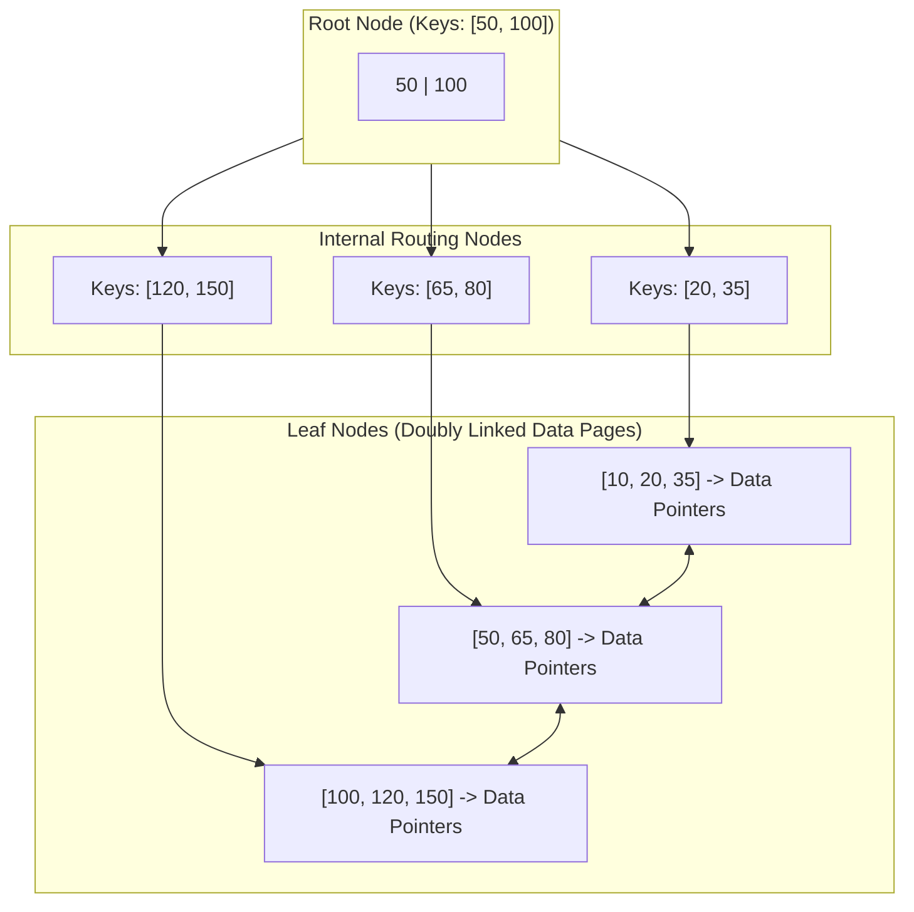
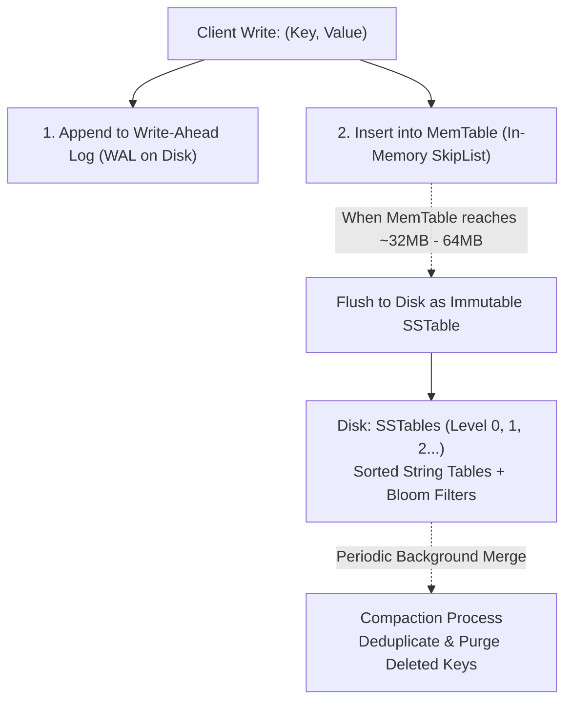
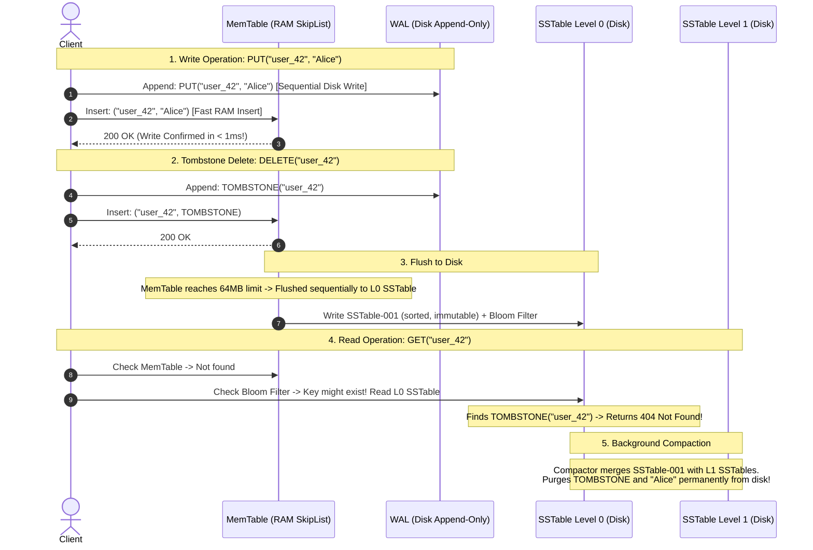
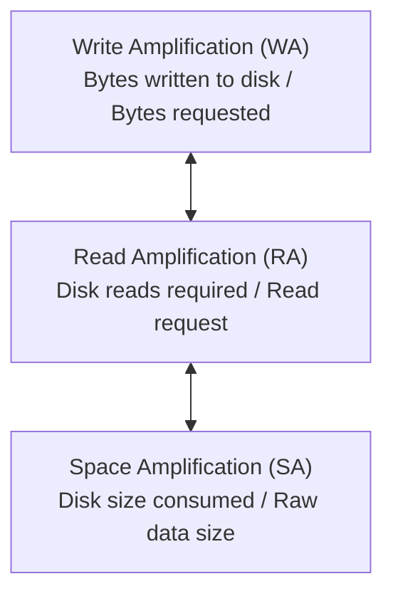
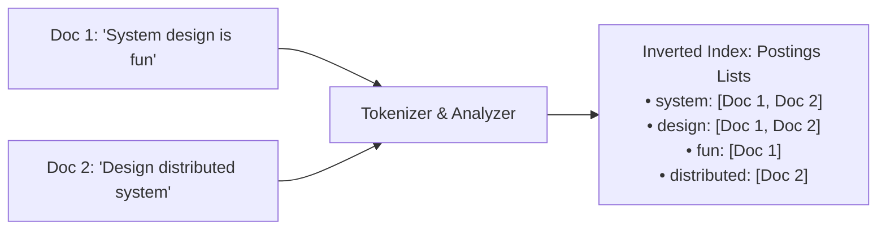
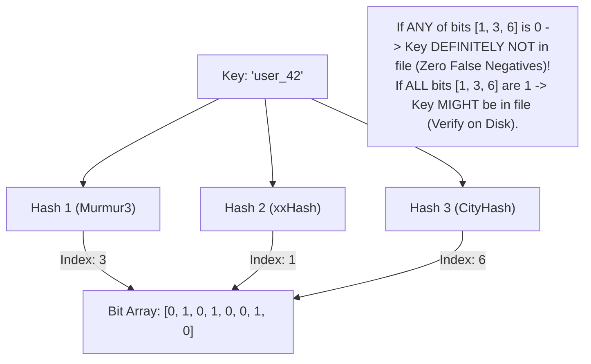
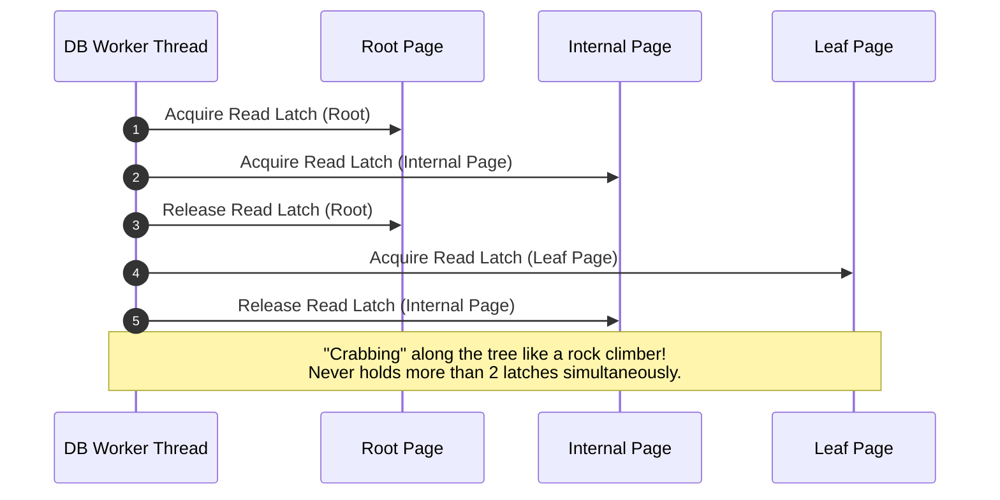

# Storage Engines and Indexing: B+ Trees vs. LSM-Trees

At the physical layer of every database lies the storage engine. Whether your system is optimized for read-heavy OLTP queries or write-heavy ingestion logs depends entirely on whether it uses a **B+ Tree** or a **Log-Structured Merge-Tree (LSM-Tree)**.

---

## 1. 💡 Intuitive Mental Models: Library Catalog vs. Accountant's Notebook

To deeply understand why databases are architected around two completely different data structures, compare how humans organize physical data:

| Engine | Physical Mental Model | How It Writes | How It Reads |
| :--- | :--- | :--- | :--- |
| **B+ Tree** | **The Dewey Decimal Library Catalog:** Every book has an exact, pre-assigned shelf position. Looking up any book takes 3 precise steps (Drawer $\to$ Row $\to$ Shelf). | Slower and painful. Inserting a new book between two full shelves requires physically shifting dozens of books and relabeling index cards (**Page Splits**). | Instantaneous & predictable ($O(\log N)$ disk page access). |
| **LSM-Tree** | **The Accountant's Notepad & Archive Boxes:** The accountant never runs to the file cabinet for every receipt. She jots it instantly on a desk notepad (**MemTable**) and duplicate journal (**WAL**). When full, she bundles them alphabetically into sealed boxes (**SSTables**). At night, an assistant merges old boxes and shreds obsolete duplicate receipts (**Compaction**). | Astronomical speed. Appending to the desk notepad is virtually free (pure sequential write). | Slower. If an old receipt is needed, you might have to check the desk, then Box 1, then Box 2. |
| **Bloom Filter** | **The Nightclub Bouncer with a Photographic Memory:** Standing outside the filing cabinet. | N/A (In-memory bit array). | Can instantly declare: *"That key is **definitely NOT** in this file!"* with 100% certainty, eliminating 99% of useless disk reads! |

### 👶 ELI5 / Plain-English Overview
Why do we need two different storage models?
**Because physical storage media (SSDs and HDDs) have a physics problem:** they love **sequential writes** (drawing a continuous line with a pen) and hate **random writes** (jumping the pen erratically across 10,000 different pages).
- **B+ Trees** prioritize blistering fast, predictable reads by maintaining strict order directly on disk pages, at the cost of slow random writes.
- **LSM-Trees** turn all writes into lightning-fast sequential appends, paying the penalty during reads and background compaction.

---

## 2. B-Trees vs. B+ Trees

Traditional relational databases (PostgreSQL, MySQL InnoDB, SQLite, Oracle) use **B+ Trees** as their default storage and indexing structure.

### Why B+ Trees Outperform Standard B-Trees for Databases
1. **Higher Fan-Out:** In a standard B-Tree, every node holds both search keys and data payloads. In a B+ Tree, internal nodes store **only routing keys and page pointers**. A $4\text{ KB}$ internal page can hold hundreds of keys, keeping the tree height shallow ($3 - 4$ levels can index billions of rows).
2. **Linked Leaf Scan:** All leaf nodes are linked sequentially as a doubly linked list. Executing a SQL range query (`WHERE age BETWEEN 25 AND 40`) requires locating the first leaf in $O(\log N)$ and scanning sequentially along the linked list, completely avoiding tree re-traversals.
3. **OS Page Cache Friendly:** Tree nodes are sized exactly to match OS disk page boundaries ($4\text{ KB}$ or $16\text{ KB}$ pages).

### Clustered vs. Secondary Indexes
- **Clustered Index (Primary Key):** The table rows are physically stored in the leaf nodes of the B+ Tree, sorted by the primary key. Only one clustered index can exist per table.
- **Secondary Index:** Leaf nodes contain the indexed column key and a reference back to the clustered primary key. A query on a secondary index performs two tree traversals (secondary index $\to$ primary key lookup).

---

## 3. ⚠️ The Horror Scenarios: When Storage Engines Break

### Horror Scenario 1: The High-Frequency Telemetry Write Amplification Meltdown
An electric vehicle company tracks 100,000 cars reporting battery voltage and GPS coordinates every 2 seconds ($50,000\text{ writes/sec}$). 
- The engineering team uses a standard MySQL InnoDB database with B+ Trees.
- **The Catastrophe:** Each telemetry ping updates a single 64-byte row. But in a B+ Tree, updates occur by modifying pages in the Buffer Pool and flushing them to disk. InnoDB must write an entire **$16\text{ KB}$ disk page** to disk even if only 64 bytes changed!
  $$\text{Write Amplification (WA)} = \frac{16,384 \text{ Bytes Written}}{64 \text{ Bytes Modified}} = \mathbf{256 \times \text{ Amplification!}}$$
- Writing $50,000 \times 16\text{ KB} = \mathbf{800\text{ MB/sec}}$ of physical disk writes for just $3.2\text{ MB/sec}$ of actual vehicle data!
- The NVMe SSD storage controller queue explodes to 100% saturation. Write latencies spike from $1\text{ ms}$ to $35\text{ seconds}$. 
- Within 4 months, the SSDs burn through their maximum TBW (Terabytes Written) flash endurance and permanently die.

---

### Horror Scenario 2: The LSM-Tree "Compaction Stall" Outage
A gaming company uses an LSM-Tree database (Cassandra/RocksDB) for high-speed player leaderboards. During an esports tournament, write volume surges by $500\%$.
- The disk I/O bandwidth is 100% monopolized by incoming writes.
- Background compaction threads cannot get enough I/O cycles to merge Level 0 SSTables into Level 1.
- Level 0 SSTables accumulate from the normal 4 files to over **80 files**.
- Every single read must now search through 80 different disk files, causing read latency to jump from $2\text{ ms}$ to $4,000\text{ ms}$.
- To protect itself from infinite disk exhaustion, RocksDB triggers an emergency **Write Stall**, freezing all incoming client writes until compaction catches up. The entire global game lobby hangs.

---

## 4. LSM-Trees (Log-Structured Merge-Trees)

Used by high-write engines like **Apache Cassandra, RocksDB, LevelDB, Bigtable, ScyllaDB, and ClickHouse**.

### The Core Problem LSM-Trees Solve
On both spinning HDDs and modern NVMe SSDs, **sequential writes are orders of magnitude faster than random writes**. B+ Trees perform random in-place updates to disk pages. Under heavy write loads, B+ Trees saturate disk I/O and suffer severe write amplification.

LSM-Trees eliminate random writes entirely by turning all writes into **sequential append-only logs**.

### Anatomy of an LSM-Tree
1. **Write-Ahead Log (WAL):** An append-only log on disk. If the server loses power, the in-memory state is recovered by replaying the WAL.
2. **MemTable:** An in-memory data structure (typically a SkipList or Red-Black Tree) that keeps keys sorted in real-time.
3. **SSTables (Sorted String Tables):** When the MemTable fills up, it is written to disk as a frozen, immutable file sorted by key. Once written, an SSTable is **never modified in-place**.
4. **Bloom Filters:** Each SSTable has an in-memory Bloom filter. Before scanning an SSTable file on disk for a key, the Bloom filter quickly determines if the key definitely does not exist, eliminating useless disk reads.
5. **Compaction:** A background thread periodically reads multiple SSTables, merges them into a new sorted SSTable using a merge-sort algorithm, discards superseded values and deleted tombstones, and frees disk space.

---

## 5. 🚶 Step-by-Step Scenario: Life of a Write and Read in an LSM-Tree

Let's trace what happens when client applications interact with an LSM-Tree:

### Why Deletes are "Tombstones":
Because SSTables on disk are strictly immutable, an LSM-tree cannot physically delete a record from an existing file. Instead, it writes a special deletion marker called a **Tombstone**. The record is only physically erased when the background compaction thread merges that SSTable with an older SSTable.

---

## 6. The RUM Conjecture & Storage Engine Matrix

The RUM Conjecture (Read, Update, Memory/Space) states that an engine can only optimize two properties at the expense of the third:

| Dimension | B+ Tree | LSM-Tree |
| :--- | :--- | :--- |
| **Primary Workload** | Read-Heavy OLTP | Write-Heavy Ingestion / High Throughput |
| **Write Performance** | Slower (Random page overwrites) | Ultra Fast (Sequential append-only writes) |
| **Read Performance** | Ultra Fast ($O(\log N)$ predictable page hits) | Slower (May need to check MemTable + multiple SSTables) |
| **Write Amplification (WA)**| High (Rewriting $16\text{ KB}$ page for 50-byte row change) | Lower for writes, but compaction adds WA later |
| **Space Amplification (SA)**| Moderate (Page fragmentation $\sim 30\%$) | Lower (Immutable files are packed tightly and compressed) |
| **Concurrency Model** | Complex page latches and row locking | Lock-free append writes to MemTable |
| **Adopted By** | Postgres, MySQL InnoDB, SQLite, Oracle | RocksDB, Cassandra, ScyllaDB, ClickHouse, CockroachDB |

---

## 7. Inverted Indexes (Search Engines)

Used by **Elasticsearch, Apache Solr, and Lucene** for full-text search.

Rather than mapping a document to its content (`DocID -> Text`), an inverted index maps every unique tokenized word to the sorted list of documents that contain it (**Postings List**):

- **Query Resolution:** Finding all documents containing `"system"` AND `"distributed"` is solved by computing the intersection of their sorted postings lists using two-pointer algorithms or skip pointers in $O(M + N)$ time.

---

## 8. 🏢 Real-World Production Battle-Testing

### 1. Meta / Facebook: Migrating to MyRocks (LSM-Tree on MySQL)
Meta ran one of the world's largest MySQL installations using InnoDB (B+ Trees). 
- As user data and message volumes exploded, SSD costs and write endurance became critical bottlenecks.
- Meta created **MyRocks**, replacing the InnoDB B+ Tree storage engine with RocksDB (an LSM-Tree engine).
- **Production Results:**
  - **Space Reduction:** MyRocks slashed database storage footprint by **$50\%$** because immutable SSTables have zero page fragmentation and can be compressed using Zstandard.
  - **Write Amplification:** Slashed write amplification by **$4\times$ to $10\times$**, drastically extending SSD lifespans and cutting datacenter hardware costs by hundreds of millions of dollars.

### 2. Netflix: Apache Cassandra for Viewing History
- Netflix tracks every second of video playback for over 250 million subscribers.
- This creates millions of continuous writes per second.
- Using B+ Trees would have bankrupted the database cluster on disk I/O.
- By using **Apache Cassandra's LSM-Tree storage engine**, writes are absorbed into in-memory MemTables and sequential WAL writes at sub-millisecond latencies, with Bloom filters ensuring playback queries resolve in under $5\text{ ms}$.

---

## 9. ⚖️ Practical Trade-Offs & Staff-Level Rules of Thumb

### Compaction Strategies in LSM-Trees:
1. **Size-Tiered Compaction (STCS):** Merges SSTables of similar sizes.
   - *Best for:* Heavy write workloads (Cassandra default for timeseries).
   - *Trade-off:* High space amplification (requires up to $50\%$ free disk space for compaction).
2. **Leveled Compaction (LCS):** Divides disk into Levels ($L_0, L_1, L_2\dots$) where each level is $10\times$ larger than the previous.
   - *Best for:* Read-heavy or mixed workloads (RocksDB default).
   - *Benefit:* Low space amplification ($<10\%$) and faster reads.

### Architectural Decision Rules:
1. **Choose B+ Trees (PostgreSQL, MySQL InnoDB) When:**
   - Your workload is predominantly read-heavy or requires predictable, low-latency random reads ($p99 < 5\text{ms}$).
   - You rely on complex SQL joins, foreign key constraints, and transactional consistency.
2. **Choose LSM-Trees (RocksDB, Cassandra, ClickHouse, ScyllaDB) When:**
   - Your workload is write-intensive ($> 50\%$ writes, such as IoT sensor streams, event tracking, chat messages, or timeseries metrics).
   - You need maximum storage compression to reduce massive disk infrastructure bills.
3. **Choose Inverted Indexes (Elasticsearch, Lucene) When:**
   - You need free-text search, fuzzy search, or multi-field filtering across millions of unstructured documents.

---

## 🎯 Top Real-World Interview Questions & Deep-Dive Answers (FAANG / Staff Level)

### Q1: Explain Write Amplification in B+ Trees vs. LSM-Trees with mathematical calculations. Why do random in-place updates wear out NVMe SSD flash memory faster than sequential append-only writes?

#### 💡 Model Answer:
**Write Amplification (WA)** is defined as:
$$\text{Write Amplification} = \frac{\text{Total Bytes Written to Physical Storage}}{\text{Logical Bytes Requested by Application}}$$

#### Mathematical Walkthrough:
Consider an application performing 10,000 updates/second to a database, where each update alters a single 32-byte integer counter:

1. **In a B+ Tree (e.g., MySQL InnoDB):**
   - Updates are performed in-place on $16\text{ KB}$ database pages in the buffer pool.
   - When the page is flushed to disk, the database writes the **entire $16,384\text{ byte}$ page** (plus a WAL record):
     $$\text{WA}_{\text{B+Tree}} = \frac{16,384 \text{ bytes (page)} + 64 \text{ bytes (WAL)}}{32 \text{ bytes (payload)}} \approx \mathbf{514\times \text{ Amplification!}}$$
   - To update 320 KB of counter data per second, the SSD must physically write **$164\text{ MB/sec}$** of disk I/O!

2. **In an LSM-Tree (e.g., RocksDB):**
   - The write is appended sequentially to the WAL ($64\text{ bytes}$) and inserted into the RAM MemTable ($0$ disk bytes).
   - Initial Write Amplification on write path: $\frac{64}{32} = \mathbf{2\times}$.
   - Over time, background Leveled Compaction merges SSTables through levels ($L_0 \to L_1 \to L_2$), re-writing data $\sim 10\times$ to $25\times$.
   - **Total Cumulative WA:** $\approx 15\times - 30\times$ (still **$15\times$ to $30\times$ less** than the B+ Tree!).

#### The Physics of SSD Flash Wear (Flash Translation Layer - FTL):
SSDs cannot overwrite flash memory cells in place. 
- Flash memory can be **read and written in Pages** ($4\text{ KB} - 16\text{ KB}$), but can only be **erased in Blocks** (typically 128 to 256 pages $\approx 2\text{ MB} - 4\text{ MB}$).
- When a B+ Tree performs random writes across thousands of different pages, the SSD's internal controller (FTL) must copy valid pages, erase entire $4\text{ MB}$ blocks, and rewrite them (**internal drive write amplification**).
- High random write loads burn through an SSD's Program/Erase (P/E) endurance cycles $10\times$ faster than sequential append streams.

---

### Q2: Walk through the internal math and implementation of a Bloom Filter. Why can it never yield a False Negative, and how do you calculate the optimal number of hash functions $k$?

#### 💡 Model Answer:
A **Bloom Filter** is a space-efficient, probabilistic data structure used by LSM engines (RocksDB, Cassandra) to test whether a key exists in an SSTable before touching the disk.

#### The Zero False Negatives Guarantee:
- When a key is inserted, it is hashed by $k$ independent hash functions, and the bits at indices $h_1(x), h_2(x), \dots, h_k(x)$ are set to `1`.
- When querying key $y$: if **even a single bit** at $h_i(y)$ is `0`, it is mathematically impossible for key $y$ to have ever been inserted!
- Therefore: **False Negative Probability = 0.00%**.

#### Why False Positives Occur:
Other keys inserted into the filter may have set bits $h_1(y), \dots, h_k(y)$ by coincidence, making an absent key appear to be present.

#### Mathematical Optimization:
Given:
- $n$ = Number of expected keys in SSTable.
- $m$ = Size of bit array in bits.
- $p$ = Desired false positive probability (e.g., $1\% = 0.01$).

The optimal number of bits per key is:
$$\frac{m}{n} = -\frac{\ln(p)}{(\ln 2)^2} \approx -1.44 \log_2(p) \quad \implies \text{For } p = 0.01, \ \frac{m}{n} \approx \mathbf{9.6 \text{ bits/key}}$$
The optimal number of hash functions $k$ is:
$$k = \frac{m}{n} \ln 2 \approx 0.7 \times 9.6 \approx \mathbf{7 \text{ hash functions}}$$
By allocating less than **10 bits of RAM per key**, an LSM storage engine eliminates $99\%$ of useless disk seeks!

---

### Q3: What is "Latch Crabbing" (Coupling) in B+ Tree concurrency control, and how does it prevent race conditions during page splits?

#### 💡 Model Answer:
In database storage engines, developers strictly differentiate between:
- **Locks (Logical):** Transaction-level locks held until `COMMIT` or `ROLLBACK` (e.g., row shared/exclusive locks in SQL).
- **Latches (Physical):** Short-term mutexes/read-write locks protecting in-memory page data structures from memory corruption during pointer traversals, held for microseconds.

#### The Latch Crabbing / Coupling Protocol:
When a reader or writer traverses the B+ Tree from root to leaf, it crawls down the tree nodes like a crab moving sideways:
1. **Acquire latch on parent.**
2. **Acquire latch on child.**
3. **Safety Check:** If the child is deemed "safe" (for a read: always safe; for an insert: has space and will not split; for a delete: will not merge), **release the latch on the parent**.
4. Repeat down to the leaf node.

#### Handling Page Splits on Insert:
- If a leaf page is full, inserting a key requires splitting the leaf and inserting a routing key into the parent.
- If the parent is also full, the split cascades upward.
- During unsafe modifications, the writer **retains write latches on parent nodes** until it verifies where the cascading split will stop, ensuring no reader ever observes a half-split, corrupted pointer state.
