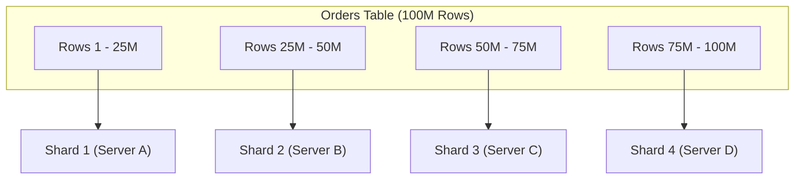
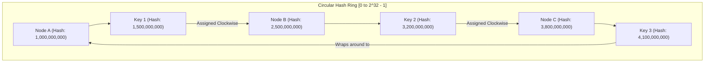
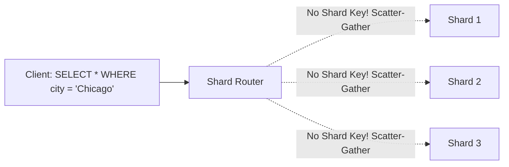
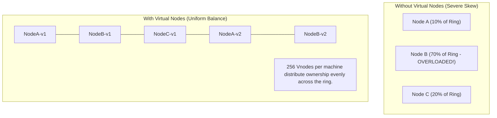
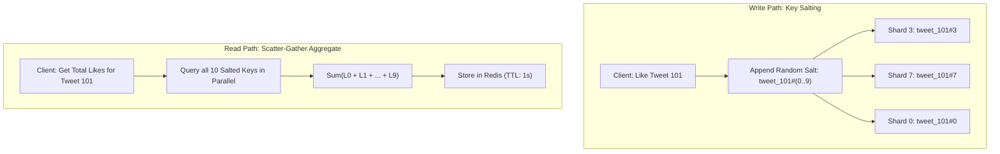
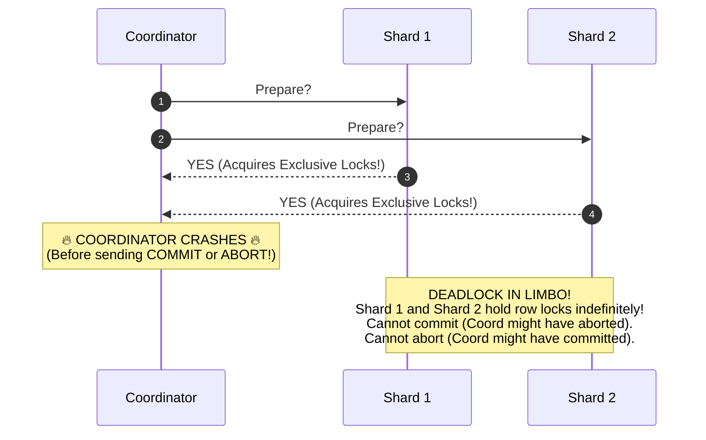

# Database Partitioning and Sharding Strategies

When database volume exceeds the disk capacity of a single machine, or write throughput saturates the fastest NVMe SSD, the database must be partitioned across multiple independent nodes.

---

## 1. Partitioning vs. Sharding



- **Vertical Partitioning:** Splitting a table by columns. Frequently accessed columns (e.g., `user_id`, `email`) remain in one table, while large or rarely accessed columns (e.g., `biography`, `profile_picture_blob`) move to an auxiliary table.
- **Horizontal Partitioning (Sharding):** Splitting a table by rows across multiple independent physical machines, such that each node contains an identical schema but a distinct subset of rows.

### 💡 Intuitive Mental Model: Splitting an Encyclopedia
Think of a 10,000-page encyclopedia:
- **Vertical Partitioning:** Splitting every page in half—binding the text into one volume and all the heavy colored photographs into a companion volume.
- **Horizontal Sharding:** Binding pages into 26 distinct alphabetical volumes (Volume A-C on Shelf 1, Volume D-F on Shelf 2). Each volume looks identical in format, but holds different rows of knowledge.
- **Consistent Hashing:** A round circular banquet table where guests pass plates clockwise to the nearest waiter. If a new waiter pulls up a chair, only the people sitting directly beside him hand over their plates. Nobody else moves!

### 👶 ELI5 / Plain-English Overview
Why shard?
A single database server—even a $\$50,000$ machine with 128 CPU cores and 1 Terabyte of RAM—eventually runs out of disk space and hits physical I/O limits. When your application grows from 10,000 users to 100 million users, you cannot buy a computer big enough. 
Sharding chops your giant database into hundreds of smaller, cheaper computers working together as a coordinated cluster.

---

## 2. Sharding Strategies

### Strategy 1: Range-Based Sharding
Data is partitioned based on continuous ranges of a key (e.g., Shard 1: User IDs $1 - 100,000$; Shard 2: User IDs $100,001 - 200,000$).
- **Advantage:** Range queries are fast (`SELECT * WHERE user_id BETWEEN 10 AND 50` touches only a single shard).
- **The Hotspot Trap:** If keys are monotonically increasing (e.g., autoincrement IDs or timestamps `created_at`), **$100\%$ of new writes hit the newest shard**, leaving all older shards completely idle!

### Strategy 2: Modulo Hash-Based Sharding
Data is routed using a hash function modulo the number of servers $N$:

$$\text{Shard ID} = \text{hash}(\text{Partition Key}) \pmod N$$

- **Advantage:** Evenly distributes writes across all available shards.
- **The Resharding Disaster:** If the cluster outgrows $N = 4$ nodes and you add a 5th node ($N = 5$), the result of $\text{hash}(\text{key}) \pmod 5$ changes for almost **$80\%$ of all existing keys**! The entire database must be rebalanced, saturating network and I/O.

---

## 3. ⚠️ The Horror Scenarios: When Sharding Fails

### Horror Scenario 1: The Modulo Hashing Black Friday Resharding Meltdown
An e-commerce marketplace stores user shopping carts using modulo sharding across 4 database nodes:
$$\text{Shard} = \text{hash}(\text{user\_id}) \pmod 4$$

On Black Friday morning, traffic surges by $400\%$. All 4 database nodes hit $95\%$ CPU and disk queue saturation.
- The DevOps team rushes to add a 5th database shard ($N = 5$) to relieve the cluster.
- **The Catastrophe:** Under modulo math, changing the denominator from 4 to 5 invalidates the location of:
  $$\text{Keys displaced} = 1 - \frac{1}{N+1} = 1 - \frac{1}{5} = \mathbf{80\% \text{ of all database records!}}$$
- To rebalance, the system must immediately migrate **40 Terabytes of live cart data** across the internal network.
- Every incoming cart checkout query routes to the new shard location, finds nothing (cache/data miss), and falls back to disk scans.
- The internal network switches saturate at $100\%$, database connections time out, shopping carts disappear for millions of shoppers, and the platform crashes during the most profitable hour of the year.

---

### Horror Scenario 2: The Social Media "Celebrity Key" Hotspot
A social network shards user tweets and comments horizontally by `author_user_id`.
- An international pop star with 150 million followers posts: *"New album out now!"*
- Within 2 minutes, 4 million fans like, retweet, and leave comments.
- **The Catastrophe:** Because all interactions reference the pop star's post, **$100\%$ of those 4 million writes route to a single physical database shard (Shard 17)**!
- Shard 17's CPU hits $100\%$, memory buffers overflow, and connection pools exhaust (`ERROR: too many connections`).
- Shard 17 crashes. Because the API Gateway is waiting synchronously for Shard 17, gateway worker threads hang, triggering cascading failures that take down the entire global website!
- Meanwhile, Shards 1 through 16 and 18 through 64 were sitting at $2\%$ CPU doing virtually nothing.

---

## 4. Consistent Hashing (The Industry Standard)

Invented by David Karger et al. (MIT, 1997) to solve the catastrophic resharding penalty of modulo hashing.



### How Consistent Hashing Works
1. The hash space is mapped to an abstract circle (ring) from $0$ to $2^{32} - 1$.
2. Both **servers** (using their IP/hostname) and **keys** are mapped to positions on the ring using the same cryptographic hash function (e.g., MurmurHash3).
3. To locate a key: Find its position on the ring and walk **clockwise** until encountering the first server. That server is the owner of the key.

### Virtual Nodes (Vnodes)
If you only map 3 physical nodes to the ring, large gaps can lead to severe data imbalance. Modern implementations (DynamoDB, Cassandra) use **Virtual Nodes**:
- Each physical machine is assigned hundreds of virtual positions on the ring (`NodeA-1`, `NodeA-2`, ..., `NodeA-256`).
- **Benefits:**
  1. Guarantees uniform statistical distribution of data across all hardware.
  2. Heterogeneous hardware: A beefy 64-core server can be assigned 500 virtual nodes, while a smaller 16-core server is assigned 125 virtual nodes.
  3. **Minimal Key Movement:** When a new server is added to a cluster of $N$ nodes, on average only $\mathbf{1/N}$ of keys migrate, without downtime!

---

## 5. 🚶 Step-by-Step Scenario: Consistent Hashing & Ring Rebalancing

Let's trace concrete ring coordinates on a $2^{32}-1$ integer ring:

### Initial Cluster State:
- **Node A** sits at coordinate `1,000,000,000`
- **Node B** sits at coordinate `2,500,000,000`
- **Node C** sits at coordinate `3,800,000,000`

### Step 1: Routing Incoming Keys
- `order_101` hashes to `1,500,000,000`:
  - Walking clockwise, the first server encountered is **Node B**. Stored on Node B.
- `order_102` hashes to `3,200,000,000`:
  - Walking clockwise, the first server encountered is **Node C**. Stored on Node C.
- `order_103` hashes to `4,100,000,000`:
  - Walking clockwise past $2^{32}-1$, it wraps around to $0$ and hits **Node A**. Stored on Node A.

### Step 2: Scaling the Cluster (Adding Node D)
Traffic increases. We add **Node D** at coordinate `2,000,000,000`:
- **Who is affected?**
  - Only the segment between Node A (`1,000,000,000`) and Node D (`2,000,000,000`).
  - Previously, all keys in that range were owned by Node B.
  - Now, keys in $(1,000,000,000 \dots 2,000,000,000]$ (such as `order_101`) transfer from Node B to Node D.
- **Who is UNTOUCHED?**
  - Node A does not move a single byte.
  - Node C does not move a single byte.
  - $\mathbf{75\%}$ of all data across the cluster stays exactly where it was!

---

## 6. Architectural Challenges of Sharding



### 1. Scatter-Gather Queries
If a query does not specify the partition key, the router must broadcast the query to **every single shard in parallel**, collect all responses, merge them, sort them, and return the result. Latency is dictated by the slowest shard ($p99$ tail latency spike).

### 2. Distributed Cross-Shard Transactions (Two-Phase Commit / 2PC)
Updating rows that live on different shards requires distributed coordination like **Two-Phase Commit (2PC)**:
- Phase 1: Prepare (Coordinator asks all shards if they can commit).
- Phase 2: Commit (Coordinator instructs all shards to commit).
- **Drawback:** 2PC is a blocking protocol. If the coordinator crashes mid-flight, resource locks on shards remain held indefinitely, causing cascading timeouts.

### 3. Mitigating Celebrity Hotspots: Salted Partition Keys
To prevent millions of writes from melting a single shard when a celebrity posts:

$$\text{Partition Key} = \text{user\_id} + \text{"\_"} + \text{random}(0, 9)$$

```
Write 1: "taylor_swift_3"  -->  Routes to Shard 12
Write 2: "taylor_swift_7"  -->  Routes to Shard 45
Write 3: "taylor_swift_0"  -->  Routes to Shard 3
```

- **Writes:** Spread evenly across 10 distinct shards. No single physical server is overwhelmed.
- **Reads:** The query layer reads all 10 salted keys (`taylor_swift_0` through `taylor_swift_9`) in parallel and computes the sum:
  $$\text{Total Likes} = \sum_{i=0}^{9} \text{Count}(\text{"taylor\_swift\_"} + i)$$

---

## 7. 🏢 Real-World Production Battle-Testing

### 1. Amazon DynamoDB: Automatic Partition Splitting
- DynamoDB assigns partitions using consistent hashing. Each partition can hold up to **$10\text{ GB}$ of data** and support a maximum of **$1,000\text{ Write Capacity Units (WCU)}$** and **$3,000\text{ Read Capacity Units (RCU)}$**.
- When a partition exceeds $10\text{ GB}$ or traffic spikes beyond capacity limits, DynamoDB automatically splits the partition into two child partitions, recalculates hash ranges on the ring, and rebalances data without downtime.

### 2. Discord: Sharding Billions of Messages
- Discord originally stored messages in MongoDB, which saturated disk I/O as message volume exploded.
- Discord migrated to Apache Cassandra and later ScyllaDB.
- **Partitioning Strategy:** Discord shards messages by `channel_id`.
- **The Mega-Channel Trap:** A general channel in a massive esports server generates millions of messages, creating huge partitions.
- **Discord's Solution:** Bucketing partition keys by time epoch:
  $$\text{Partition Key} = \text{channel\_id} + \text{":"} + \text{bucket\_id}$$
  Where `bucket_id` increments every 10 days. This keeps maximum partition sizes strictly under $100\text{ MB}$, ensuring predictable disk seeks.

### 3. Vitess (YouTube & Slack)
- YouTube invented **Vitess** to scale MySQL horizontally. Vitess acts as a smart proxy layer that sits in front of thousands of MySQL instances, handling sharding, scatter-gather query re-writing, and resharding migrations transparently to application code.

---

## 8. ⚖️ Practical Trade-Offs & Staff-Level Rules of Thumb

| Sharding Strategy | Best Used For | Major Pitfall |
| :--- | :--- | :--- |
| **Range-Based** | Timeseries data, sequential numeric ranges | Hotspotting on the latest range |
| **Modulo Hash-Based** | Simple, static clusters where node count never changes | Resharding disaster when $N$ changes |
| **Consistent Hashing** | Dynamic clusters (DynamoDB, Cassandra, Memcached) | Complexity of virtual nodes and ring metadata |

### Staff-Level Decision Rules:
1. **Rule of Thumb #1: Do NOT shard until you have exhausted every other scaling option.**
   - Before sharding, first:
     1. Add Read Replicas (offload read traffic).
     2. Add Redis / Memcached caching (offload hot rows).
     3. Vertically scale the database instance (e.g., AWS `r6i.32xlarge` with 1TB RAM and 128 vCPUs).
     4. Partition vertically (separate large blobs or archive historical data).
2. **Rule of Thumb #2: Choose your Partition Key wisely.**
   - A good partition key has **high cardinality** (millions of unique values) and **uniform access distribution**.
   - Bad partition keys: `status` (only 3 values), `created_at` (all writes hit the latest shard), `country_code` (massive skew towards US/India).
   - Good partition keys: `account_id`, `uuid`, or compound keys like `user_id + date`.

---

## 🎯 Top Real-World Interview Questions & Deep-Dive Answers (FAANG / Staff Level)

### Q1: How does Consistent Hashing minimize data movement when scaling a cluster, and why are Virtual Nodes (vnodes) essential to prevent data skew?

#### 💡 Model Answer:
In traditional modulo sharding ($\text{node} = \text{hash}(k) \pmod N$), adding or removing a single node changes the denominator from $N$ to $N+1$.
- **The Modulo Penalty:** Displaces $\frac{N}{N+1}$ of all keys (when adding the 10th node, **$90\%$ of keys move**!).
- **Consistent Hashing Formula:** Maps both nodes and keys to an integer ring $[0, 2^{32} - 1]$. When node $N+1$ is added to an existing $N$-node cluster:
  $$\text{Keys displaced on average} = \frac{1}{N+1}$$
  Adding a 10th node migrates only **$10\%$ of keys**, and the migration happens strictly between the new node and its immediate counter-clockwise neighbor.



#### Why Virtual Nodes (Vnodes) are Mandatory:
If you place only 3 physical machines on a continuous hash ring, pseudo-random hash placement creates uneven arcs. One machine might end up owning $70\%$ of the ring space while another owns $10\%$, creating severe hot partitions.
- **Vnode Mechanics:** Each physical machine is mapped to hundreds of virtual positions across the ring (e.g., `NodeA#1`, `NodeA#2`, ..., `NodeA#256`).
- **Mathematical Benefit:** By the Law of Large Numbers, assigning 256 vnodes per server guarantees that variance in data distribution drops to **$< 3\%$**, achieving near-perfect uniform statistical balance.
- **Hardware Heterogeneity:** A powerful 64-core machine can be assigned 512 vnodes, while an older 16-core machine is assigned 128 vnodes, naturally balancing load in proportion to compute capacity.

---

### Q2: How do you architect a system to handle "Celebrity Keys" or massive write hotspots where a single entity (e.g., Taylor Swift's account) receives 100,000 writes/second?

#### 💡 Model Answer:
Sharding by `entity_id` works well for normal users, but collapses for celebrity accounts because **100% of interactions route to the single shard that owns that partition key**.



#### The 3-Tier Production Architecture:
1. **Key Salting (Write Scatter):**
   - For identified celebrity keys, append a random integer suffix:
     $$\text{Key}_{\text{salted}} = \text{tweet\_101} + \text{"\#"} + \text{rand}(0, 9)$$
   - Writes are distributed evenly across 10 distinct database shards. Each physical machine absorbs only $10\%$ of write pressure.
2. **Scatter-Gather Read Aggregation:**
   - To read the total count of likes or comments, the application queries all 10 salted keys in parallel and computes their sum:
     $$\text{Total} = \sum_{i=0}^{9} \text{Count}(\text{"tweet\_101\#"} + i)$$
3. **In-Memory Buffer Aggregation (Write Batching):**
   - For extreme write surges (100,000 likes/sec), never hit the database directly!
   - Terminate likes on Redis using `INCR` or in-memory ring buffers inside API Gateway worker nodes.
   - Flush aggregated counters to the primary database asynchronously every 1 second in batches (`UPDATE tweets SET likes = likes + 12450 WHERE id = 101`).

---

### Q3: Why is distributed Two-Phase Commit (2PC) considered an anti-pattern for high-availability systems? Explain the Coordinator Crash Blocking failure mode.

#### 💡 Model Answer:
Two-Phase Commit (2PC) is an atomic commitment protocol ensuring all distributed shards commit or abort together:
- **Phase 1 (Prepare):** Coordinator asks all participants: *"Can you commit?"* Participants acquire local row locks, write undo/redo logs, and vote `YES` or `NO`.
- **Phase 2 (Commit):** If all voted `YES`, Coordinator writes commit log and sends `COMMIT` to all shards.



#### The Fatal Flaw: Blocking Under Coordinator Failure
- Once a shard votes `YES` in the Prepare phase, it enters the **In-Doubt / Limbo state**.
- It is **forbidden from making a unilateral decision**:
  - It cannot abort (the coordinator might have sent `COMMIT` to another shard).
  - It cannot commit (another shard might have voted `NO`, causing the coordinator to abort).
- **The Catastrophe:** If the coordinator crashes mid-flight, all participating shards must hold their exclusive row locks **indefinitely**.
- Any other queries attempting to access those rows will block and queue. Within seconds, database connection pools exhaust, triggering cascading timeouts across the entire platform.

#### Modern Production Alternative:
High-availability distributed databases avoid classic 2PC by:
1. Replicating the coordinator using **Raft or Paxos consensus** (so if a coordinator node dies, a new leader takes over immediately and resolves in-doubt transactions).
2. Using asynchronous **Saga Patterns with Compensating Transactions** for long-running workflows instead of distributed ACID locks.
