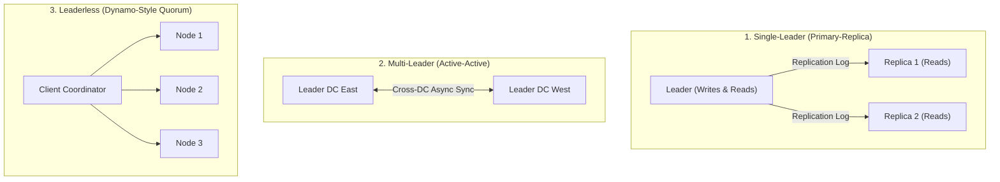
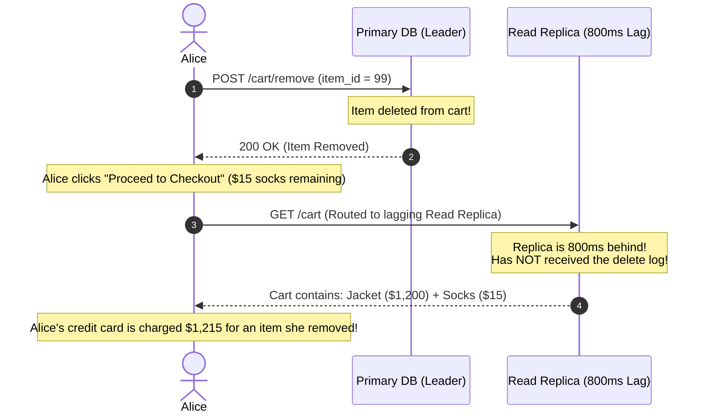
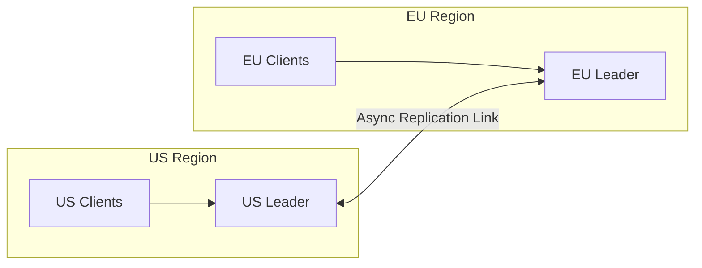
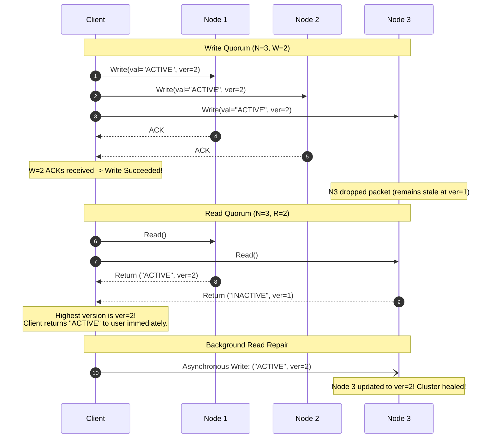
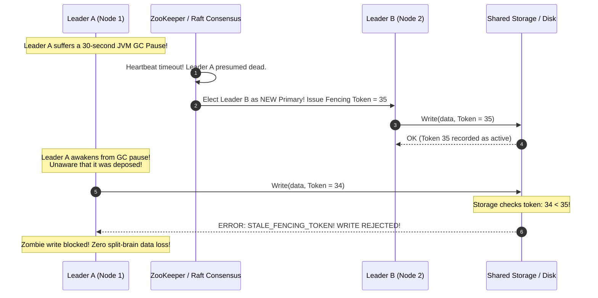
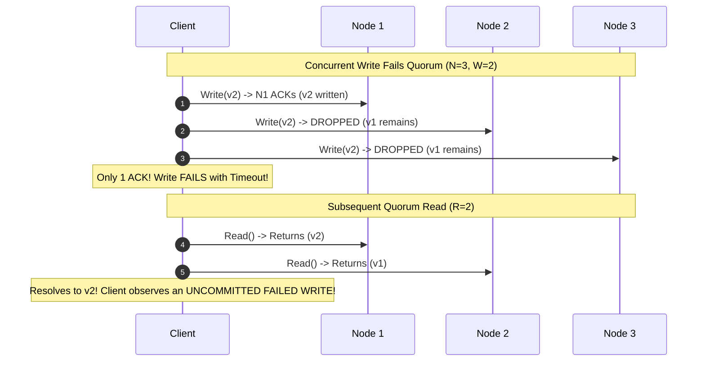
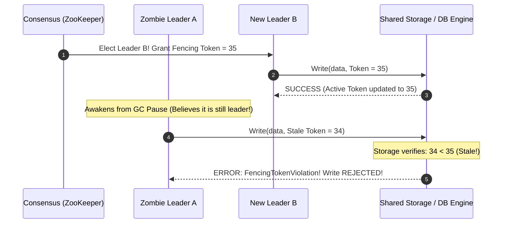
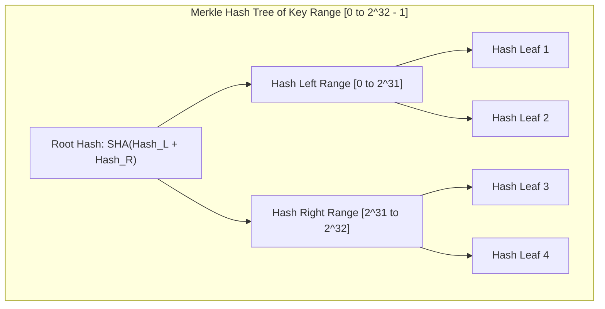

# Database Replication Strategies: Single-Leader, Multi-Leader, and Leaderless

Replication means keeping a copy of the exact same data on multiple machines connected via a network. It is the foundation of high availability, fault tolerance, and low-latency global reads.

---

## 1. Replication Topologies Overview



### 💡 Intuitive Mental Models: Classroom, Branch Offices, and the Committee

| Topology | Physical Mental Model | Where Writes Go | What Can Go Wrong? |
| :--- | :--- | :--- | :--- |
| **Single-Leader** | **The Professor and Students:** The professor writes on the chalkboard (Leader); students copy into their notebooks (Replicas). | Only the Professor (Leader). | If you ask a student what line 4 says, they might still be writing line 3 (**Replication Lag**). If the professor faints, students must elect a new teacher. |
| **Multi-Leader** | **New York & London Branch Offices:** Each office has its own manager recording local contracts. At 5 PM, they fax each other updates. | Either regional manager. | If NY and London both book the same boardroom at 2 PM, you have a **Write Conflict** when faxes cross! |
| **Leaderless (Dynamo)** | **The 5-Member City Planning Committee:** No boss exists. To approve a permit, any 3 members must sign ($W=3$). To inspect status, you interview any 3 members ($R=3$). | Broadcast to all members. | Slower network tail latency; requires version tracking (Vector Clocks) and Read Repair. |

### 👶 ELI5 / Plain-English Overview
Why replicate data?
1. **High Availability:** If your single database server suffers a power failure or fried motherboard at 2:00 AM, a replica immediately takes over so your users don't see error screens.
2. **Read Throughput & Low Latency:** If 100,000 users are loading profiles, one machine melts. Five read replicas distribute the load. Furthermore, putting a replica in Tokyo serves Japanese users in $5\text{ ms}$ instead of making them wait $150\text{ ms}$ for packets to cross the ocean to California.

---

## 2. Single-Leader Replication (Primary-Replica)

The most widely adopted topology (PostgreSQL, MySQL, Redis, MongoDB).

### Synchronous vs. Asynchronous Replication
- **Fully Synchronous:** Leader writes locally and waits for all replicas to acknowledge before returning success to the client.
  - *Pro:* Zero data loss if leader dies ($RPO = 0$).
  - *Con:* If one replica hangs or suffers network jitter, **the entire database blocks and halts all writes**.
- **Fully Asynchronous:** Leader returns success immediately after writing locally; replicas pull WAL changes in the background.
  - *Pro:* Writes are ultra fast; replica downtime does not block writes.
  - *Con:* If the leader crashes before WAL changes reach replicas, **unreplicated commits are permanently lost** (Failover data loss).
- **Semi-Synchronous (Best Practice):** Exactly one replica is synchronous; remaining replicas are asynchronous. If the synchronous replica hangs, the leader falls back to another replica.

---

## 3. ⚠️ The Horror Scenarios: When Replication Traps Strike

### Horror Scenario 1: The Split-Brain Double-Spend Disaster
A fintech company runs a Primary database in US-East and a Standby replica in US-West:

```
[US-East Leader]  <------- 45-Second Trans-Continental Fiber Cut ------->  [US-West Standby]
(Still healthy & accepting writes)                                           (Assumes East is dead!)
                                                                             Promotes itself to LEADER!
```

1. A transient fiber-optic cable cut severs communication between US-East and US-West for 45 seconds.
2. US-West's automated orchestrator fails to receive heartbeats from US-East. It assumes US-East is dead and **promotes US-West to Primary Leader**.
3. However, US-East is completely alive and still processing East Coast customer requests!
4. **The Disaster (Split-Brain):** Both US-East and US-West now believe they are the authoritative Primary Leader. Both accept writes concurrently!
5. Alice deposits $\$10,000$ in New York (written to US-East).
6. Concurrently, Alice withdraws $\$10,000$ in California (written to US-West).
7. Both databases allocate the exact same auto-incrementing ID (`user_transaction_id = 90124`) to completely different records.
8. When the network partition heals, the two database logs have fatally diverged. Data is permanently corrupted, and Alice successfully stole $\$10,000$!

#### Production Defense: Fencing Tokens & Epochs
Every time a new leader is elected by a consensus coordinator (ZooKeeper/etcd), it is issued a monotonically increasing **Epoch Number / Fencing Token** (e.g., Token 35):
- The shared storage layer verifies the token on every write.
- If the old "zombie" leader (Token 34) awakens and tries to write, storage rejects it:
  ```
  REJECT: Stale fencing token 34 < active token 35
  ```

---

### Horror Scenario 2: The E-Commerce Cart "Time Travel" Ghost Bug
An e-commerce shopper, Alice, adds a $\$1,200$ designer jacket to her cart, changes her mind, and clicks "Remove Item":



- **The Problem:** Asynchronous read replica lag causes **Monotonic Reads Violation** and breaks **Read-Your-Own-Writes Consistency**.
- **Production Fixes:**
  1. **Read-Your-Own-Writes Window:** When a user performs a write, route all reads for that user to the **Leader** for the next 5 seconds.
  2. **Replica Sticky Routing:** Hash-route each user ID to the same replica, ensuring their timeline moves monotonically forward.

---

## 4. Multi-Leader Replication (Active-Active)

Used for multi-region architectures where round-trip latency across oceans ($>100\text{ ms}$) is prohibitive.



### The Conflict Resolution Problem
What happens when User A in the US updates `title = "Alpha"` while User B in Europe concurrently updates `title = "Beta"` on the exact same row?
1. **Conflict Avoidance (Industry Standard):** Route all writes for a given record to the same datacenter (e.g., European users' accounts are always pinned to Frankfurt). If an American writes to a European record, the write is proxied to the Frankfurt Leader.
2. **Last-Write-Wins (LWW):** Attach physical timestamps to each write and keep the highest timestamp.
   - *Danger:* Clock skew between servers causes silent data loss (a write with a slightly lagging clock is permanently erased).
3. **CRDTs (Conflict-Free Replicated Data Types):** Use mathematically provable merge structures (e.g., PN-Counters, Observed-Removed Sets) where concurrent operations commute and resolve to the identical state regardless of arrival order.

---

## 5. Leaderless Replication (Dynamo-Style)

Pioneered by Amazon Dynamo (2007) and implemented in **Apache Cassandra and AWS DynamoDB**. There is no concept of a leader node. Clients (or coordinator nodes) write to and read from multiple replicas directly.



---

## 6. The Quorum Condition Formula

Let:
- $N$ = Number of replicas for a data item.
- $W$ = Number of replica acknowledgments required for a write to succeed.
- $R$ = Number of replicas queried for a read to succeed.

$$\mathbf{W + R > N}$$

### 💡 Why This Guarantees Strong Consistency (The Pigeonhole Principle):
If you have $N = 3$ nodes, and you require $W = 2$ and $R = 2$:
- $W + R = 2 + 2 = 4 > 3$.
- By the **Pigeonhole Principle**, the set of nodes you wrote to $\{N_1, N_2\}$ and the set of nodes you read from $\{N_2, N_3\}$ **must overlap by at least one node** (here, $N_2$).
- That overlapping node is guaranteed to return the latest version tag ($ver = 2$). The client detects the newest version and discards stale values!

### Handling Failures & Anti-Entropy:
1. **Sloppy Quorum & Hinted Handoff:** If the designated nodes are temporarily unreachable during a write, the coordinator writes the payload to temporary surrogate nodes tagged with a "hint". Once the primary node recovers, the surrogate hands the data back.
2. **Read Repair:** When a client issues a quorum read and receives mismatched version tags, it returns the newest version to the user and immediately sends an asynchronous write to heal the lagging replica.
3. **Merkle Trees (Anti-Entropy):** Replicas maintain cryptographic hash trees of key ranges. During background synchronization, nodes compare Merkle tree root hashes. If roots match, replicas are identical; if not, they descend the tree branches to isolate and synchronize only the mismatched keys without scanning whole tables.

---

## 7. 🚶 Step-by-Step Scenario: Fencing Tokens Halting a Zombie Leader

Let's trace how Fencing Tokens prevent catastrophic split-brain corruption when a primary database suffers a 30-second garbage collection pause:



---

## 8. 🏢 Real-World Production Battle-Testing

### 1. GitHub's 2018 24-Hour Outage
- GitHub suffered a 43-second network partition between its US-East primary datacenter and US-West backup.
- Automated failover promoted the US-West MySQL replica to Primary.
- However, internal services in US-East continued writing to the original US-East MySQL database.
- **The Fallout:** Both databases accepted conflicting writes. When network connectivity restored, thousands of pull requests, commits, and comments were scrambled across conflicting auto-increment IDs.
- GitHub engineers had to take the entire platform down for over **24 hours** to manually reconcile database ledgers row by row.

### 2. AWS DynamoDB & Apache Cassandra Quorum Tuning
- In production, teams configure Cassandra read and write consistency levels based on latency vs correctness trade-offs:
  - **`LOCAL_QUORUM`:** Queries a quorum of replicas within the local datacenter only ($W_{\text{local}} = 2, R_{\text{local}} = 2$). Guarantees strong consistency without paying cross-datacenter WAN latency penalties.
  - **`ONE` (Eventual Consistency):** Writes and reads return after a single node responds. Ultra-fast ($<1\text{ ms}$), but reads may observe stale data until background Read Repair or Merkle Tree Anti-Entropy catches up.

### 3. Stripe's Zero-Data-Loss Architecture
- For financial ledger processing, Stripe uses **Synchronous Single-Leader replication** across 3 distinct AWS Availability Zones.
- Every charge, transfer, and payout must be durably acknowledged by multiple AZs before returning HTTP 200 to merchant APIs, eliminating failover data loss entirely.

---

## 9. ⚖️ Architectural Decision Matrix & Rules of Thumb

| Dimension | Single-Leader | Multi-Leader | Leaderless (Dynamo) |
| :--- | :--- | :--- | :--- |
| **Write Coordination** | Single primary node | Multiple regional leaders | Any $W$ replica nodes |
| **Write Conflicts** | Impossible (Serialized by leader) | Common; requires conflict resolution | Handled via version tags / Vector Clocks |
| **Read Scalability** | Add more read replicas | Add read replicas per region | Tune $R$ and $W$ parameters |
| **Network Split Tolerance** | Halts if leader isolated | Each region operates independently | High (Sloppy quorums) |
| **Complexity** | Low | Very High | High |
| **Typical Databases** | PostgreSQL, MySQL, Redis, MongoDB | Multi-region Aurora, Couchbase | Cassandra, DynamoDB, ScyllaDB |

### Staff-Level Decision Rules:
1. **Choose Single-Leader (PostgreSQL, MySQL) When:** You need strict ACID consistency, foreign keys, and complex transactional logic (e.g., banking ledgers, checkout inventory, user accounts). It is simple, battle-tested, and predictable.
2. **Choose Leaderless Quorum (DynamoDB, Cassandra) When:** Your system demands $99.999\%$ write availability and continuous uptime across multi-region deployments, and can tolerate eventual consistency or tune $W + R > N$ (e.g., shopping carts, IoT telemetry, chat histories, activity feeds).
3. **Avoid Multi-Leader Unless Absolutely Forced:** Multi-leader active-active replication brings immense operational pain and conflict resolution edge cases. Only adopt it when inter-continental network write latency ($>150\text{ ms}$) is completely unacceptable for your business.

---

## 🎯 Top Real-World Interview Questions & Deep-Dive Answers (FAANG / Staff Level)

### Q1: While the Quorum condition $W + R > N$ mathematically guarantees that the read and write sets overlap, what are the subtle edge cases where a quorum read can still return stale or phantom uncommitted data?

#### 💡 Model Answer:
The formula $W + R > N$ is based on the **Pigeonhole Principle**: if you write to $W$ nodes and read from $R$ nodes out of $N$ replicas, at least one node must exist in both sets ($\{W\} \cap \{R\} \neq \emptyset$).
However, naive quorum implementations can still return stale or non-linearizable data due to 4 subtle production edge cases:



#### The 4 Quorum Failure Edge Cases:
1. **Uncommitted / Rolled-Back Writes Becoming Visible:** If a client writes $v_2$ to $N_1$, but network drops packets to $N_2$ and $N_3$, the write times out and fails. However, $N_1$ still holds $v_2$. If a subsequent quorum read touches $N_1$ and $N_2$, it will see $v_2$ and return it—**making a failed transaction visible to users**! (Cassandra and Dynamo do not roll back failed partial writes).
2. **Concurrent Overlapping Writes (Clock Skew):** If two clients write concurrently to the same key, and one write succeeds on $\{N_1, N_2\}$ while the other succeeds on $\{N_2, N_3\}$, Last-Write-Wins (LWW) relies on physical timestamps. If server clocks drift, an older write can silently overwrite a newer write.
3. **Sloppy Quorums & Hinted Handoff:** During network partitions, if writes route to temporary surrogate nodes rather than designated home nodes, the read quorum $R$ and write quorum $W$ may talk to disjoint sets of machines, violating linearizability.
4. **Concurrent Reads and Writes:** If a read arrives while a write is in flight across nodes, some nodes return the old value and some return the new value. Without **Read Repair** or consensus-based linearizable read leases (like Raft ReadIndex), the system can violate monotonic reads.

---

### Q2: How do Fencing Tokens mathematically prevent "Zombie Leaders" from causing data corruption after network partitions or Stop-the-World GC pauses?

#### 💡 Model Answer:
In single-leader architectures, the cluster uses a distributed consensus service (e.g., ZooKeeper or Raft) to elect a primary leader.
- **The Zombie Leader Problem:**
  1. Leader A is healthy.
  2. Leader A's JVM experiences a **30-second Stop-the-World Garbage Collection (GC) pause**, or an OS swap thrashing event.
  3. ZooKeeper's heartbeat timer ($5\text{ seconds}$) expires.
  4. ZooKeeper declares Leader A dead and elects Leader B as the new Primary.
  5. Leader A awakens from its GC pause. In its local memory, it still believes it is the legitimate Primary!
  6. Leader A proceeds to write mutations to the shared storage or database file.



#### The Fencing Token Mechanism:
To guarantee safety, we cannot rely on the leader to "know" when it has been deposed. The **Shared Storage Engine** must actively enforce validation using **Fencing Tokens**:
1. Every time the consensus service elects a new leader, it generates a **monotonically increasing integer token** (the Epoch or Term number, e.g., Token 35).
2. Every mutation sent by a leader to the storage tier **must include its current Fencing Token**.
3. The storage engine maintains the highest token it has ever observed:
   $$\text{ActiveToken} = \max(\text{ActiveToken}, \text{Token}_{\text{incoming}})$$
4. If an incoming write has $\text{Token} < \text{ActiveToken}$, the storage engine **unconditionally rejects the write**!
5. This mathematically guarantees that a zombie leader with an old token ($34 < 35$) can never commit a single byte to disk.

---

### Q3: How do Merkle Trees achieve Anti-Entropy synchronization in Cassandra and DynamoDB? How do nodes isolate mismatched data in $O(\log N)$ bandwidth?

#### 💡 Model Answer:
**Anti-Entropy** is a background background synchronization process that ensures replicas eventually converge even if they missed writes due to network drops, server crashes, or hinted handoff buffer overflows.

#### The Naive Trap:
Comparing whole tables between replicas across the network would consume Terabytes of bandwidth and saturate disk I/O.

#### The Merkle Tree Solution:
A **Merkle Tree** is a binary hash tree where:
- Leaf nodes are cryptographic hashes of individual key-value pairs (or small key ranges).
- Every internal node is the cryptographic hash of its two children:
  $$\text{Hash}_{\text{Parent}} = \text{SHA-256}(\text{Hash}_{\text{Left}} + \text{Hash}_{\text{Right}})$$



#### The $O(\log N)$ Synchronization Walkthrough:
1. Replicas independently construct Merkle trees for a specific token range.
2. Replica A sends its **Root Hash** to Replica B over the network.
3. **If Root Hashes Match:** Both replicas are guaranteed to be in identical states! Synchronization completes in **1 network exchange** using only 32 bytes of bandwidth.
4. **If Root Hashes Differ:** Replicas exchange child hashes. If the left child matches, the discrepancy is strictly in the right branch.
5. They descend down the tree branches in $O(\log N)$ hops, isolating the exact few mismatched keys without scanning millions of identical rows!
