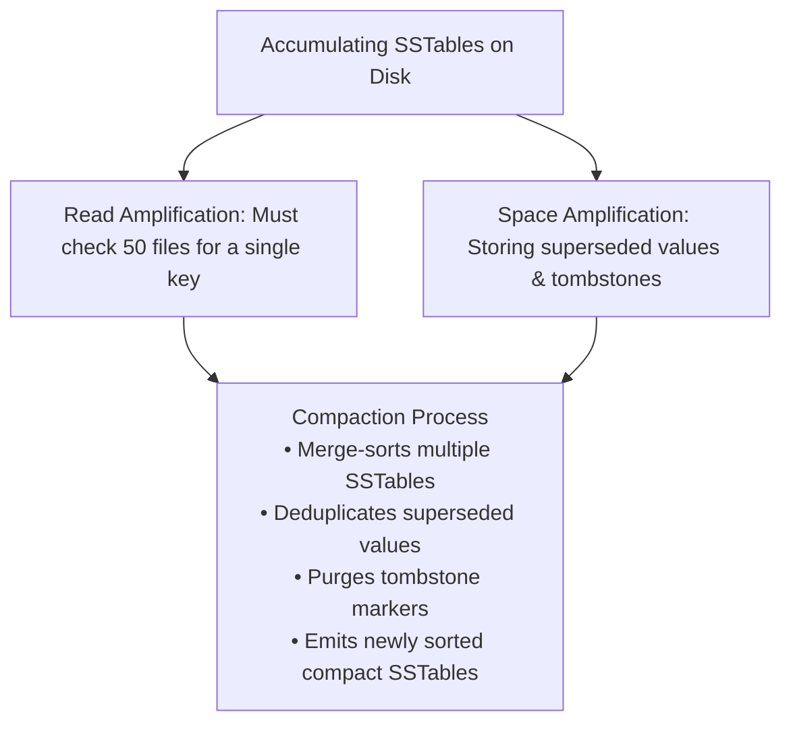
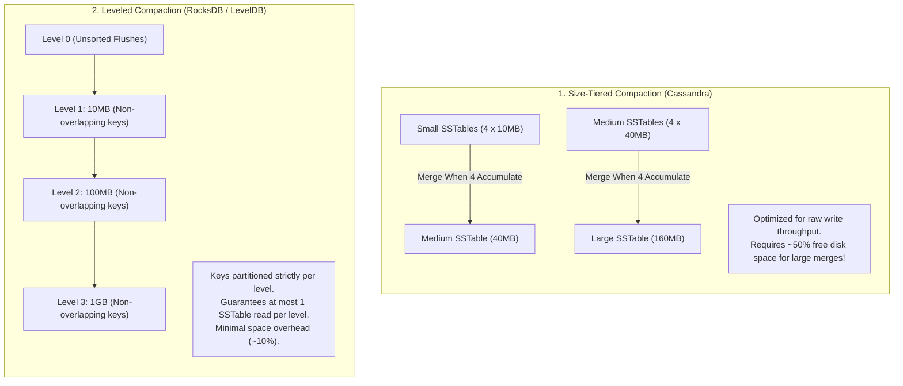
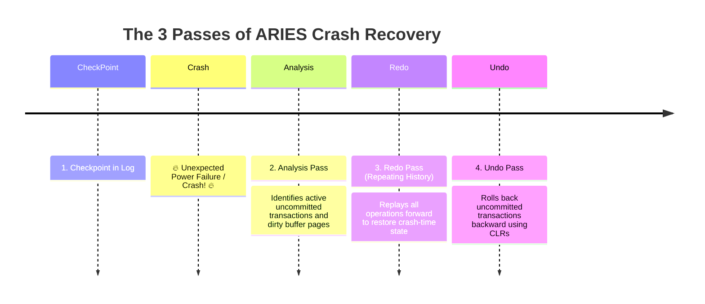
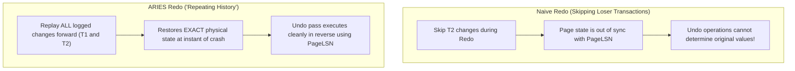

# LSM-Tree Compaction Strategies and ARIES WAL Recovery

Understanding how write-optimized storage engines maintain disk space and how databases recover with zero data loss after physical power cuts is essential for systems engineering mastery.

---

## 1. 💡 Intuitive Mental Models: Spring Cleaning & The Flight Black Box

To grasp compaction and crash recovery, visualize these real-world parallels:

| Technology | Physical Mental Model | Why It Is Mandatory |
| :--- | :--- | :--- |
| **LSM Compaction** | **The Receipt Shoebox Spring Cleaning:** Instead of searching through 50 boxes filled with old coffee receipts and cancellation slips (**Tombstones**), you spend Saturday morning sorting receipts alphabetically, shredding superseded duplicates, and packing them tightly into permanent archive folders (**Compaction**). | Keeps read latency low and purges deleted data from disk. |
| **ARIES Crash Recovery** | **The Aviation Flight Black Box & Detective:** When a plane crashes, the detective opens the black box log: <br/>1. **Analysis:** Lists all flights that departed but never landed (**Active Uncommitted Transactions**).<br/>2. **Redo ("Repeating History"):** Re-enacts the flight minute-by-minute to reconstruct the exact physical state at impact.<br/>3. **Undo:** Neatly cancels unfinished flights in reverse order, stamping cancellation certificates (**CLRs**) so a second power failure never causes confusion. | Guarantees Atomicity and Durability ($RPO = 0$) after physical power loss. |

### 👶 ELI5 / Plain-English Overview
Why do databases need compaction and ARIES recovery?
- In an **LSM database** (Cassandra, RocksDB), you never edit or delete files on disk—you only append new records and deletion markers. If you never clean up, your disk fills with ghost data, and looking up a single key requires searching 100 separate files.
- In **crash recovery**, if an electrical storm suddenly shuts down your server while 50 transactions are executing, the database must magically know which transactions committed (save them permanently) and which transactions were half-finished (wipe them clean as if they never happened).

---

## 2. Why Compaction is Mandatory in LSM-Trees

In an LSM-Tree (Log-Structured Merge-Tree), data is never updated or deleted in place:
- Updates append new versions to disk.
- Deletions append a deletion marker (**Tombstone**).
- Over time, hundreds of immutable SSTables accumulate on disk.



---

## 3. Size-Tiered vs. Leveled Compaction

The two primary compaction architectures in modern databases (Cassandra, RocksDB, ScyllaDB):



### Detailed Trade-Off Comparison

| Metric | Size-Tiered Compaction (STCS) | Leveled Compaction (LCS) | Time-Window Compaction (TWCS) |
| :--- | :--- | :--- | :--- |
| **Write Amplification (WA)**| **Lower ($\sim 2 - 8$)** (Gentle on SSD endurance) | **Higher ($\sim 10 - 30$)** (Frequent re-merging) | **Lowest ($\sim 1 - 2$)** (Appends strictly by time) |
| **Read Amplification (RA)** | **High** (Must check multiple SSTables per tier) | **Ultra Low** (At most 1 file per level) | **Low** (If querying specific time windows) |
| **Space Amplification (SA)**| **High** (Can require $50\%$ free disk headroom) | **Low ($\sim 10\%$)** (Predictable compact footprint) | **Low** (Deletes entire SSTables via TTL) |
| **Ideal Workload** | Write-heavy time-series, IoT metric logs | Read-heavy or balanced OLTP, key-value lookups | Strict timeseries with expiring Time-To-Live (TTL) |
| **Primary Adoption** | Apache Cassandra default | RocksDB, LevelDB, CockroachDB engine | Cassandra & ScyllaDB for telemetry |

---

## 4. ⚠️ The Horror Scenarios: When Compaction & Recovery Break

### Horror Scenario 1: The Cassandra 50% Disk Headroom Outage
An e-commerce startup runs an Apache Cassandra cluster using the default **Size-Tiered Compaction Strategy (STCS)**.
- Over 2 years, data grows until the primary database disk sits at **$55\%$ capacity** ($550\text{ GB}$ used on a $1\text{ TB}$ NVMe drive).
- Four large $120\text{ GB}$ SSTables accumulate in the highest tier.
- The background compaction daemon triggers a merge of all four files ($4 \times 120\text{ GB} = 480\text{ GB}$).
- **The Catastrophe:** STCS cannot delete the old four files until the new $480\text{ GB}$ SSTable is fully written to disk!
  $$\text{Required Disk Space} = 550\text{ GB (Existing)} + 480\text{ GB (New)} = \mathbf{1,030\text{ GB (Exceeds 1 TB Drive!)}}$$
- The drive hits $100\%$ capacity mid-compaction. Linux throws `No space left on device`.
- Cassandra crashes, corrupted half-compacted files cannot be cleaned up, and the node fails to reboot!
- **Fix:** For STCS, disks must **never exceed 50% capacity**. Alternatively, migrate to **Leveled Compaction (LCS)**, which merges small $100\text{ MB}$ slices requiring only $\sim 10\%$ headroom.

---

### Horror Scenario 2: The Double Crash Recovery Loop
A financial database server crashes during peak trading volume due to an unexpected power outage.
- When power returns, the database bootloader begins crash recovery.
- It begins rolling back an uncommitted $\$5,000,000$ wire transfer transaction.
- **The Disaster:** Before the rollback finishes, a power grid surge trips the datacenter circuit breaker a second time!
- If the recovery engine does **not** use **Compensating Log Records (CLRs)**, upon the second reboot it will attempt to roll back the partially rolled-back transaction a second time.
- The second undo executes operations against an already-undone state, causing arithmetic underflow, corrupting internal pointer indexes, and causing the database to crash permanently on every reboot!

---

## 5. Write-Ahead Log (WAL) & The ARIES Recovery Algorithm

When a database server crashes or loses power, how does it recover committed transactions without data corruption?

Introduced by C. Mohan et al. (IBM, 1992), **ARIES (Algorithms for Recovery and Isolation Exploiting Semantics)** is the foundational crash-recovery algorithm implemented in almost all industrial relational databases (PostgreSQL, DB2, SQL Server).



---

## 6. The 3 Recovery Passes of ARIES

### Pass 1: The Analysis Pass
- Scans the Write-Ahead Log forward starting from the last valid **Checkpoint**.
- Reconstructs two critical in-memory tables:
  1. **Transaction Table:** Which transactions were still active (uncommitted) at the instant of the crash.
  2. **Dirty Page Table (DPT):** Which disk pages in the buffer pool were modified in memory but not yet written to disk, and the oldest un-flushed Log Sequence Number (`RecLSN`).

### Pass 2: The Redo Pass ("Repeating History")
- Scans forward starting from the smallest `RecLSN` in the Dirty Page Table all the way to the end of the log.
- Re-executes the effects of **all logged updates**, including those of transactions that will later be rolled back!
- Ensures that the in-memory buffer pool is brought to the **exact physical state it had at the moment of the crash**.

### Pass 3: The Undo Pass
- Scans backward through the log.
- For each uncommitted transaction identified in the Analysis Pass, rolls back its operations in reverse chronological order.
- Writes **Compensating Log Records (CLRs)** to the log during undo.
  - *Why CLRs matter:* If the server crashes *again* during the recovery process, CLRs prevent the recovery engine from attempting to undo an undo operation!

---

## 7. 🚶 Step-by-Step Scenario: Concrete ARIES Crash Walkthrough

Let's trace how ARIES recovers a crash where Transaction 1 committed, but Transaction 2 was uncommitted:

```
Time 0: Checkpoint established at LSN 100.
Time 1: LSN 101: T1 updates Page P1 (Old: 10, New: 20)
Time 2: LSN 102: T2 updates Page P2 (Old: 50, New: 90)
Time 3: LSN 103: T1 writes COMMIT record. (Flushed to disk via fsync!)
Time 4: LSN 104: T2 updates Page P1 (Old: 20, New: 35)
Time 5: 🔥 CRASH OCCURS! (Power cord yanked) 🔥
```

### Recovery Execution:
1. **Pass 1 (Analysis):**
   - Scans forward from Checkpoint (LSN 100).
   - Reads LSN 103: Sees `T1 COMMIT`. Marks T1 as **Committed**.
   - Reads LSN 104: Sees `T2` active. Adds T2 to **Active (Loser) Transactions**.
   - Determines Dirty Page Table: Page P1 was modified at LSN 101; Page P2 at LSN 102. Smallest `RecLSN = 101`.
2. **Pass 2 (Redo - "Repeating History"):**
   - Scans forward from LSN 101 to LSN 104.
   - Replays LSN 101: Sets P1 = 20.
   - Replays LSN 102: Sets P2 = 90.
   - Replays LSN 104: Sets P1 = 35.
   - *Buffer pool is now in the identical state as the microsecond before the crash!*
3. **Pass 3 (Undo):**
   - Scans backward to undo active "loser" transaction **T2**:
   - Encounters LSN 104 (T2 updated P1 to 35): Reverts P1 back to 20!
   - Writes **CLR (Compensating Log Record)**: `CLR: Reverted P1 to 20, UndoNextLSN = 102`.
   - Encounters LSN 102 (T2 updated P2 to 90): Reverts P2 back to 50!
   - Writes **CLR**: `CLR: Reverted P2 to 50, UndoNextLSN = null`.
   - Writes `T2 END` record. Recovery complete! Zero data loss.

---

## 8. 🏢 Real-World Production Battle-Testing

### 1. Meta / RocksDB: Dynamic Level Base Compaction
- RocksDB powers critical infrastructure at Meta (ZippyDB, MyRocks).
- In traditional Leveled Compaction, if data grows unpredictably, Level 1 can be much smaller than intended, leading to excessive compaction between L0 and L1.
- RocksDB introduced **Dynamic Level Base Sizing**: dynamically adjusts the target size of Level 1 based on the actual size of the last level ($L_{\text{max}}$), reducing overall write amplification by over **$30\%$**.

### 2. Apple / Netflix: Time-Window Compaction Strategy (TWCS)
- Both Netflix and Apple store trillions of timeseries metrics in Apache Cassandra.
- Size-Tiered Compaction would constantly re-merge older historical data with new data, wasting immense disk I/O.
- By switching to **TWCS (Time-Window Compaction)**, SSTables are bucketed strictly by timestamp (e.g., 1-day windows).
- Once a day finishes, that day's SSTables are compacted once and **never touched again**. When the TTL expires (e.g., after 90 days), the entire SSTable file is deleted in $O(1)$ from the Linux filesystem without any compaction I/O!

---

## 9. ⚖️ Practical Trade-Offs & Staff-Level Rules of Thumb

1. **Rule of Thumb for Cassandra Disks:** If using Size-Tiered Compaction (STCS), **never let disk usage exceed 50%**. If disk reaches 50%, immediately scale up storage or migrate to Leveled Compaction.
2. **Use TWCS for Timeseries:** Whenever data has a Time-To-Live (TTL) and is queried by time ranges, use Time-Window Compaction Strategy. It reduces write amplification to near $1.0$.
3. **Align WAL `fsync` with Risk Tolerance:**
   - For financial ledgers: Flush WAL on every single transaction commit (`fsync = 1`).
   - For non-critical high-throughput ingestion: Group commits in memory and flush periodically every 10ms-100ms (`commit_delay`), trading off up to 100ms of data loss for a $10\times$ write throughput increase.

---

## 🎯 Top Real-World Interview Questions & Deep-Dive Answers (FAANG / Staff Level)

### Q1: Why does the ARIES recovery algorithm mandate "Repeating History" in the Redo Pass—replaying changes for transactions that it knows will later be rolled back in the Undo Pass?

#### 💡 Model Answer:
At first glance, replaying changes for transactions that you know are uncommitted (and will immediately be undone in the very next pass) seems wasteful. Why not just skip them during Redo?



#### The 3 Crucial Reasons for "Repeating History":
1. **Physical Page Consistency:** In modern databases, pages contain complex internal data structures (slotted page arrays, B+ Tree split pointers, free space maps). If a transaction performed an operation that split an index page, that page split **physically occurred on disk**. Skipping the operation during Redo would leave internal page pointers corrupt and inconsistent with the log.
2. **Precise LSN Synchronization:** Every database page on disk contains a header field called `PageLSN` (the Log Sequence Number of the last update applied to this page). The Redo engine uses `PageLSN` to determine whether an update needs to be re-applied:
   $$\text{If } LSN_{\text{log}} \le PageLSN \implies \text{Skip (Already on disk)}$$
   $$\text{If } LSN_{\text{log}} > PageLSN \implies \text{Re-apply update}$$
   By repeating history, ARIES ensures that the buffer pool perfectly matches the log state at the moment of the crash.
3. **Simplicity and Safety:** It cleanly decouples the recovery process into two completely independent, deterministic phases: Redo brings the system forward to the crash point; Undo safely walks it backward to the last consistent committed state.

---

### Q2: What is a Compensating Log Record (CLR) in ARIES, what is `UndoNextLSN`, and how do they mathematically guarantee that a database will never enter an infinite crash-recovery loop?

#### 💡 Model Answer:
A **Compensating Log Record (CLR)** is a special log entry written to the Write-Ahead Log during the **Undo Pass** of crash recovery. It records the action of undoing a previous operation.

```mermaid
flowchart LR
    LSN104["LSN 104: T2 Update P1"] <--- Undo Phase --- LSN105["LSN 105: CLR (Undid LSN 104)<br/>UndoNextLSN = 102"]
    LSN102["LSN 102: T2 Update P2"] <--- Undo Phase --- LSN106["LSN 106: CLR (Undid LSN 102)<br/>UndoNextLSN = null"]
    
    LSN105 -.->|Points directly to next operation to undo| LSN102
```

#### Anatomy of a CLR:
A CLR has a critical field called **`UndoNextLSN`**:
- When the engine undoes the update at `LSN 104` (which was performed by transaction $T_2$), it writes a CLR at `LSN 105`.
- It sets `UndoNextLSN` to point to the **previous update performed by $T_2$** (`LSN 102`), completely bypassing `LSN 104`.

#### The Bounded Recovery Guarantee (Preventing Infinite Crash Loops):
- What happens if the server loses power **while writing `LSN 106`** during crash recovery?
- Upon the next reboot, ARIES runs again.
- During the new Redo pass, it replays the CLR at `LSN 105` ("Repeating History").
- During the new Undo pass, when it inspects $T_2$, it reads `LSN 105` and follows `UndoNextLSN` **directly to `LSN 102`**!
- **It NEVER attempts to undo an operation that was already undone by a CLR!**
- Because every CLR strictly decrements the remaining work to be undone, the recovery process is guaranteed to make monotonic forward progress, mathematically eliminating infinite recovery loops.

---

### Q3: How does the Write-Ahead Logging (WAL) Protocol enforce the rule that "Log records must precede dirty page flushes"? What physical corruption occurs if this rule is violated?

#### 💡 Model Answer:
The **Write-Ahead Logging Protocol** dictates a strict invariant between in-memory buffer pool page flushing and disk logging:

> **The Fundamental WAL Invariant:**  
> Before a modified ("dirty") data page can be written from the in-memory buffer pool to permanent non-volatile storage, the log record describing the modification **must already be physically flushed to the WAL on disk via `fsync`**:
> $$\text{PageLSN} \le \text{FlushedToDiskLSN}$$

#### What Happens If This Rule Is Violated?
Imagine the database violated the WAL invariant:
1. Transaction $T_{\text{bad}}$ updates Page 42 in memory.
2. The operating system's virtual memory subsystem experiences memory pressure and flushes Page 42 to disk **before** the corresponding WAL entry is flushed.
3. Suddenly, power is cut!
4. On reboot, the database examines the WAL. Because the WAL entry was lost in volatile RAM, the database has **zero record that $T_{\text{bad}}$ ever modified Page 42**.
5. The database cannot undo $T_{\text{bad}}$'s changes because it doesn't know what was changed or who changed it!
6. **Result:** Page 42 contains uncommitted, corrupted phantom data permanently baked into the database file, violating Atomicity and Consistency forever.
