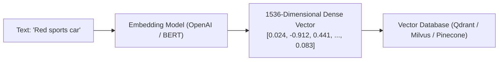
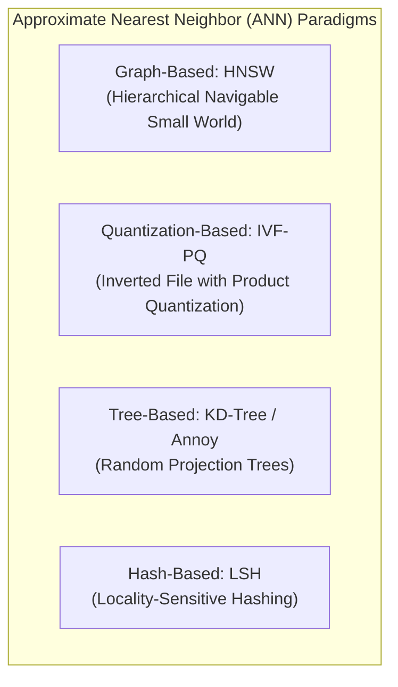
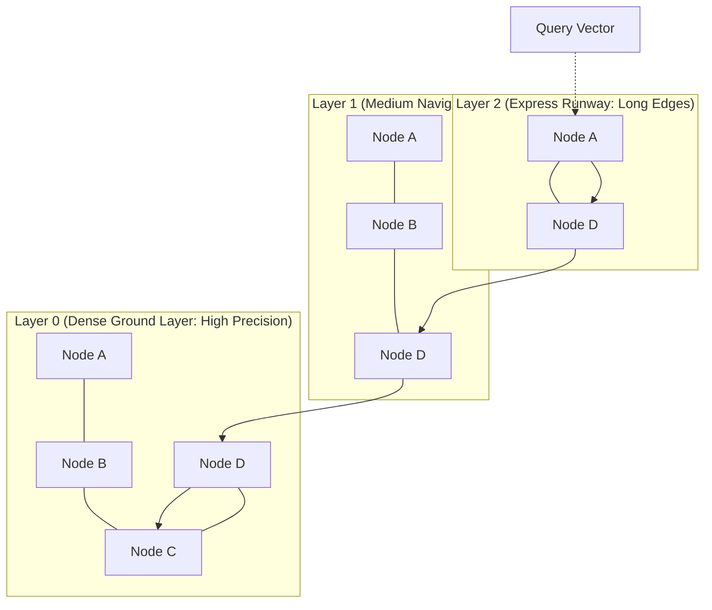
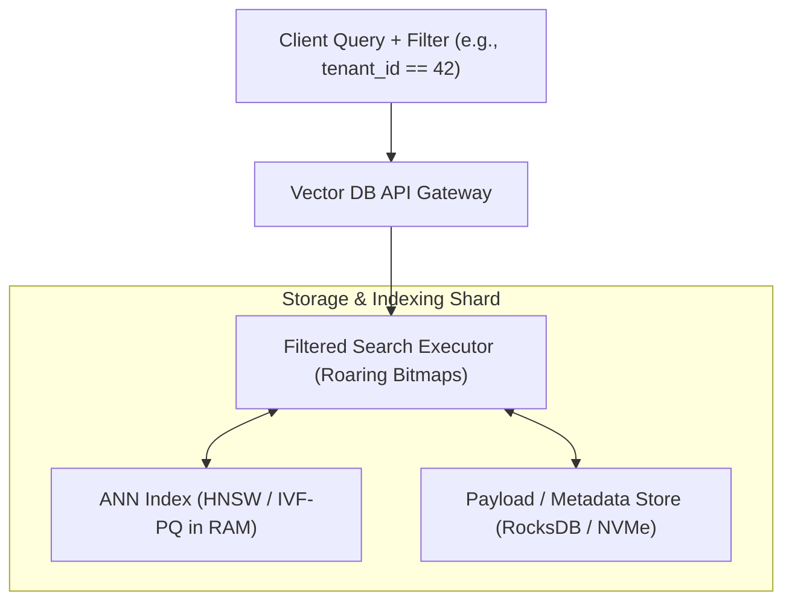
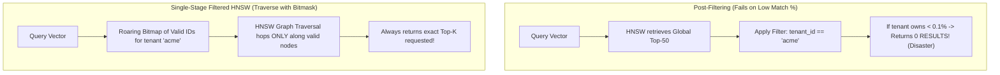
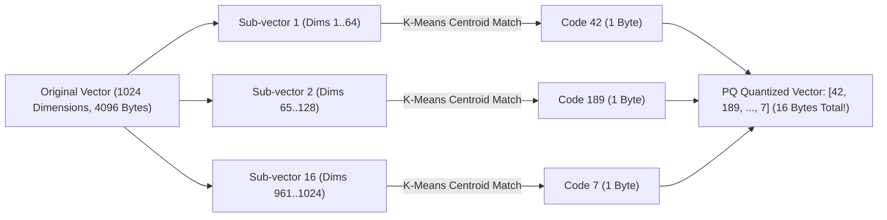
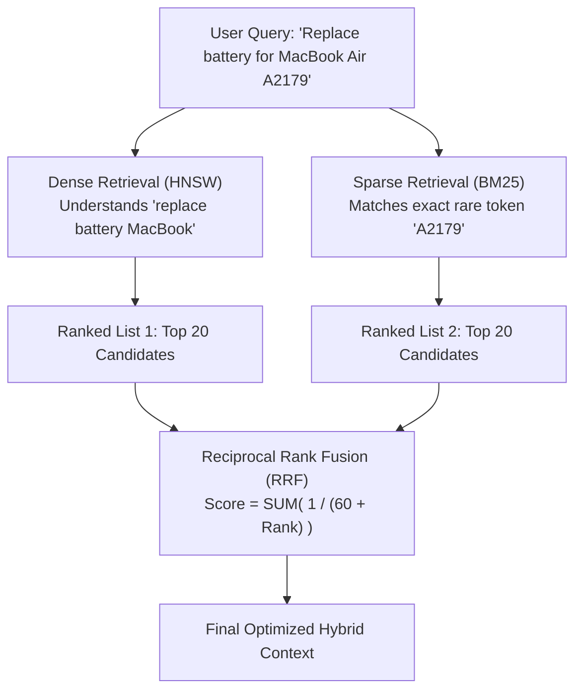

# Vector Databases and Approximate Nearest Neighbor (ANN) Search

With the explosion of Generative AI, Large Language Models (LLMs), and multi-modal search, computing infrastructure must store, index, and retrieve unstructured data (text, images, audio, video) converted into high-dimensional numerical vectors (**embeddings**).

Traditional databases (Postgres B+ Trees, DynamoDB hash keys) are designed for 1-dimensional scalar comparisons ($x = y$, $x > y$). They cannot perform nearest neighbor similarity searches across $1,536$-dimensional dense vector spaces.

---

## 1. 💡 Intuitive Mental Models: Semantic GPS and The Multi-Layer Flight Highway

To deeply understand vector search, use these physical mental models:

| Concept | Physical Mental Model | Why It Works |
| :--- | :--- | :--- |
| **Vector Embedding** | **The Semantic GPS of Meaning:** A standard GPS uses 2 coordinates (Latitude, Longitude) to locate cities on a map. An embedding model assigns every concept a coordinate in a **1,536-dimensional Galaxy of Meaning**. Words with similar concepts cluster together: `"King" - "Man" + "Woman" \approx "Queen"`. | Converts conceptual meaning into geometry where distance = semantic similarity. |
| **HNSW Proximity Graph** | **The Multi-Layer Highway System:**  • **Layer 2 (Express Skyway):** Inter-continental airline flights connecting distant hubs (London $\to$ Tokyo). • **Layer 1 (State Highway):** Highways connecting regional cities. • **Layer 0 (Local Side Streets):** Cobblestone streets connecting every individual house. | To travel from an Alaskan cabin to a Miami bakery, you fly to Florida (Layer 2), take the highway (Layer 1), and navigate local streets (Layer 0) in $O(\log N)$ hops instead of driving every side street in America! |
| **Product Quantization (PQ)** | **Low-Resolution JPEG Compression:** Storing raw 32-bit floating point vectors is like keeping uncompressed $50\text{MB}$ RAW image files. PQ compresses vectors into tiny 8-bit lookup codebooks, reducing memory by $95\%$ while retaining $98\%$ search accuracy. | Allows indexing 100M vectors in RAM without spending $\$50,000/\text{month}$ on cloud memory. |

### 👶 ELI5 / Plain-English Overview
Why can't PostgreSQL or MySQL search vector embeddings natively without special extensions?
Traditional database indexes (B+ Trees) require items to be **linearly ordered** ($1 < 2 < 3$, or $"Apple" < "Banana"$). 
In a 1,536-dimensional space, there is no such thing as "smaller than" or "larger than". You can only measure **geometric distance or angle** between two arrows in space. Comparing a user's question against 10 million vectors one by one takes 15 seconds. Vector databases use clever proximity graphs (ANN) to find the closest matches in **3 milliseconds**.

---

## 2. Vector Embeddings & Distance Metrics

An embedding model (e.g., OpenAI `text-embedding-3-large`, BERT, CLIP) maps semantic meaning into a continuous vector space $\mathbb{R}^D$ (where dimension $D \in [256, 3072]$).

### 1.1 Core Mathematical Distance Metrics
Given two vectors $\mathbf{u}, \mathbf{v} \in \mathbb{R}^D$:

1. **Euclidean Distance ($L_2$ Norm):**
   $$d(\mathbf{u}, \mathbf{v}) = \sqrt{\sum_{i=1}^D (u_i - v_i)^2}$$
   - Measures direct geometric distance. Sensitive to vector magnitude.
2. **Cosine Similarity / Cosine Distance:**
   $$\text{Cosine}(\mathbf{u}, \mathbf{v}) = \frac{\mathbf{u} \cdot \mathbf{v}}{\|\mathbf{u}\| \|\mathbf{v}\|} = \frac{\sum_{i=1}^D u_i v_i}{\sqrt{\sum u_i^2} \sqrt{\sum v_i^2}}$$
   - Measures angular difference independent of length (values from $-1.0$ to $+1.0$).
   - Cosine Distance $= 1 - \text{Cosine}(\mathbf{u}, \mathbf{v})$.
3. **Dot Product (Inner Product - IP):**
   $$\mathbf{u} \cdot \mathbf{v} = \sum_{i=1}^D u_i v_i$$
   - If vectors are normalized to unit length ($\|\mathbf{u}\| = \|\mathbf{v}\| = 1$), the Dot Product is mathematically identical to Cosine Similarity and eliminates the expensive square root operation!

---

## 3. The Curse of Dimensionality & Brute Force KNN vs. ANN

- **Exact $k$-Nearest Neighbors (kNN):** Compares the query vector against every single vector in the database.
  - Time Complexity: $O(N \cdot D)$.
  - For $100\text{ Million}$ vectors of dimension $1536$, a single query requires **153 Billion floating point operations** ($\approx 10\text{ seconds}$), which cannot scale in production.
- **Approximate Nearest Neighbor (ANN):** Trades a tiny fraction of accuracy (e.g., $95\% - 99\%$ recall) for orders of magnitude faster queries ($O(\log N)$ or $O(1)$ latency $\approx 2 - 10\text{ ms}$).

---

## 4. ⚠️ The Horror Scenarios: When Vector Architecture Fails

### Horror Scenario 1: The Post-Filtering "Empty Result" RAG Collapse
An enterprise AI startup builds a multi-tenant customer support chatbot serving 1,000 corporate clients using a vector database.
- A user from **Tenant 42** asks: *"How do I file an international expense claim?"*
- The query includes a metadata filter: `WHERE tenant_id = 42`.
- The architecture uses naive **Post-Filtering**:
  1. The HNSW index traverses the global graph and retrieves the **top-50 most semantically relevant vectors** across the entire database (10 million vectors).
  2. The system applies the filter `tenant_id == 42` and discards all non-matching vectors.
- **The Catastrophe:** Because Tenant 42 owns only $0.05\%$ of the total documents in the database, **all 50 candidates belong to other companies**!
- The post-filter discards all 50 candidates, returning an empty set to the LLM!
- The LLM responds: *"Sorry, no company documentation exists for expense claims"*, despite Tenant 42 having 500 pages of expense guidelines in the database!
- **Fix:** Adopt **Single-Stage Filtered Search** or **Pre-Filtering with Roaring Bitmaps**, traversing HNSW while actively evaluating bitmasks of valid document IDs at each hop.

---

### Horror Scenario 2: The Uncompressed In-Memory Cloud Bankruptcy
A company launches an image similarity search engine indexing 50 million product photos using OpenAI's `text-embedding-3-large` (dimension $D = 3,072$, stored as 32-bit floats).
- Raw vector size per item: $3,072 \times 4\text{ bytes} \approx 12.3\text{ KB}$.
- HNSW graph index overhead (storing 64 bidirectional edge pointers per node): an extra $8\text{ KB}$ per vector.
- Total RAM required:
  $$\text{Memory} = 50,000,000 \times 20.3\text{ KB} \approx \mathbf{1,015\text{ Gigabytes of RAM!}}$$
- The team provisions a fleet of AWS `r6i.32xlarge` memory-optimized instances. The AWS hosting bill explodes to **$\$18,000 / \text{month}$**!
- When traffic surges, RAM exhausts; Linux OOM killer terminates the vector database process, causing a 6-hour total service outage.
- **Fix:** Implement **Product Quantization (PQ)** or scalar quantization, compressing 3,072 floats down to 96 bytes, slashing memory footprint by **$92\%$** down to 80 GB of RAM.

---

## 5. Core ANN Algorithms

### 5.1 Hierarchical Navigable Small World (HNSW)
HNSW (Malkov & Yashunin, 2018) is the gold standard for high-recall in-memory vector search (used by Pinecone, Qdrant, Milvus, and pgvector):
- **Concept:** Inspired by the **Skip List** data structure applied to multi-layer proximity graphs.
- **Top Layers:** Sparse graphs with long-range edges for rapid global navigation across the vector space.
- **Bottom Layers:** Dense graphs with short-range edges connecting nearest neighbors for high precision.
- **Query Search:**
  1. Entry point at highest layer.
  2. Greedily follows edges closest to the query vector until reaching a local minimum.
  3. Drops down to the next denser layer and resumes greedy traversal from that node.
  4. Final layer yields top-$K$ nearest neighbors in $O(\log N)$ time.

### 5.2 Inverted File with Product Quantization (IVF-PQ)
Ideal for massive datasets exceeding RAM capacity (Faiss library by Meta):
1. **Inverted File (IVF):** Partitions vector space into $K$ Voronoi cells using $K$-Means clustering. During queries, only vectors belonging to the nearest $N_{\text{probe}}$ Voronoi centroids are inspected.
2. **Product Quantization (PQ):** Compresses vectors by splitting a $1024$-dim vector into $16$ sub-vectors of dimension $64$, clustering each sub-vector into $256$ codebooks ($1\text{ byte}$).
   - Compresses 4,096 bytes of 32-bit floats into **16 bytes** ($256\times$ memory reduction)!
   - Distances are computed via pre-calculated lookup tables (Asymmetric Distance Computation - ADC).

---

## 6. Modern Vector Database Architecture (Qdrant / Milvus / Pinecone)

A production vector database is more than just an algorithm—it is a distributed storage engine managing indexing, filtering, and replication:

### 6.1 Filtered Vector Search: Pre vs. Post vs. Single-Stage
- **Pre-Filtering:** Runs metadata filter first (e.g., `WHERE tenant_id = 42`), then performs brute-force vector distance on the tiny remaining subset. Fast if subset is small.
- **Post-Filtering:** Finds top-100 nearest neighbors via ANN graph, then discards records that fail metadata criteria. Fails catastrophically if the filter matches only $1\%$ of documents.
- **Single-Stage Filtered HNSW:** Traverses the HNSW graph while dynamically checking bitmasks of valid document IDs at each node hop, ensuring exact recall and fast traversal.

### 6.2 Hybrid Search: Dense Vector + Sparse Lexical (BM25)
Pure vector search excels at semantic matching ("laptop charger") but struggles with exact IDs, serial numbers, or rare keywords ("A2179 45W").
- **Hybrid Retrieval:** Runs Dense HNSW retrieval in parallel with Sparse BM25 / SPLADE lexical inverted index.
- **Reciprocal Rank Fusion (RRF):** Merges ranked lists mathematically:
  $$RRF\_Score(d) = \sum_{m \in \{\text{Dense}, \text{Sparse}\}} \frac{1}{k + \text{Rank}_m(d)} \quad (k \approx 60)$$

---

## 7. 🚶 Step-by-Step Scenario: RAG Retrieval Lifecycle

Let's trace how an enterprise AI search resolves a question with high-precision context:

1. **User Query:** *"How do I configure SSO authentication with Okta for Acme Corp?"*
2. **Dual Query Dispatch:**
   - **Dense Path:** Query is passed to an embedding model, producing 1,536-dimensional vector $\mathbf{q}$. Dispatched to HNSW index with a dynamic filter (`tenant = 'acme_corp'`).
   - **Sparse Path:** Query is tokenized (`["SSO", "authentication", "Okta", "Acme"]`) and dispatched to BM25 inverted index.
3. **Candidate Gathering:**
   - Dense search retrieves top-20 conceptual matches in $3\text{ ms}$.
   - Sparse BM25 retrieves top-20 exact keyword matches in $2\text{ ms}$.
4. **Reciprocal Rank Fusion (RRF):**
   - RRF formula scores each document. Documents appearing near the top of both dense and sparse lists receive massive score boosts.
5. **Cross-Encoder Reranking:**
   - The top 10 fused candidates are passed through a lightweight Cross-Encoder (reranker model) to score exact contextual relevance.
6. **LLM Generation:**
   - The top-3 highest-scoring documentation chunks are injected into the LLM system prompt as verified grounding context, generating an accurate, hallucination-free response!

---

## 8. 🏢 Real-World Production Battle-Testing

### 1. Uber Eats: Semantic Food Discovery with HNSW
- Uber Eats moved beyond simple keyword search (e.g., typing "dinner" returned only restaurants with "dinner" in their title).
- By embedding user queries and menu items into a shared vector space indexed via HNSW, searching for *"comfort food on a rainy evening"* retrieves ramen, mac and cheese, and hot chicken wings.
- Queries resolve in sub-$5\text{ ms}$ latencies across millions of dishes.

### 2. DoorDash: Overcoming Lexical Gaps with Hybrid Search
- DoorDash observed that pure vector search frequently failed when users searched for hyper-specific branded menu items (e.g., *"Big Mac"*, *"Dr Pepper"*), occasionally returning generic burger or soda competitors.
- By deploying **Hybrid Search (HNSW + BM25 with Reciprocal Rank Fusion)**, exact branded terms match the lexical BM25 index with 100% precision, while broad intent searches (*"healthy gluten-free breakfast"*) leverage semantic HNSW dense embeddings.

---

## 9. ⚖️ Practical Trade-Offs & Staff-Level Rules of Thumb

1. **Use `pgvector` (HNSW) When:** Your vector dataset is under $1 - 5\text{ Million}$ vectors and your application already relies heavily on PostgreSQL. It avoids the operational burden of managing a separate distributed database cluster.
2. **Use Specialized Vector DBs (Qdrant, Milvus, Pinecone) When:** You have over $10\text{ Million}$ vectors, require sub-5ms latency under thousands of queries per second, or require single-stage dynamic metadata filtering across multi-tenant shards.
3. **Always Normalize Vectors to Unit Length:** If using Cosine Distance, normalize vectors ($L_2$ norm $= 1.0$) upon insertion. This allows you to use the **Dot Product** distance metric, which eliminates square-root math and runs $3\times$ faster on modern CPU SIMD / AVX-512 instruction sets.

---

## 🎯 Top Real-World Interview Questions & Deep-Dive Answers (FAANG / Staff Level)

### Q1: Explain why Post-Filtering fails catastrophically on high-selectivity metadata filters in vector search. How does Single-Stage Filtered HNSW solve this?

#### 💡 Model Answer:
In real-world applications (such as multi-tenant enterprise search or e-commerce with price filters), vector similarity queries almost always include metadata filters (e.g., `WHERE tenant_id = 'acme' AND price < 50`).

#### The Post-Filtering Breakdown:
- **Post-filtering** performs the ANN graph traversal across the *unfiltered* global vector space, collects the top-$K$ candidates (e.g., $K = 50$), and then drops items that fail the metadata predicate.
- If the metadata filter matches only **$1\%$ or $0.1\%$ of the database**, the probability that any of the global top-50 items belong to that $0.1\%$ is near zero!
- Result: The user receives 0 results or degraded, irrelevant results.

#### The Single-Stage Filtered HNSW Solution:
Modern vector databases (like **Qdrant**) solve this using **Single-Stage Filtered Traversal**:
1. Before traversing the graph, the metadata engine constructs an in-memory **Roaring Bitmap** of all vector IDs that satisfy the filter (computed in microseconds).
2. During the HNSW graph traversal, as the algorithm evaluates candidate edges, it performs a bitwise check (`bitmap.contains(candidate_id)`):
   - **Candidate Selection:** If an edge points to a node that passes the filter, it is added to the nearest-neighbor priority queue.
   - **Path Traversal:** If a node does not pass the filter, it cannot be returned in the result set, but it can still be used as a structural "bridge" to navigate through the graph to reach valid nodes.
3. This guarantees that the engine **always returns the true top-$K$ valid vectors** with zero empty-result bugs!

---

### Q2: How does Product Quantization (PQ) achieve a 16x–32x memory reduction for billion-scale vector indexes? Walk through Sub-Vectors and Asymmetric Distance Computation (ADC).

#### 💡 Model Answer:
In vector search, holding billions of 1,536-dimensional vectors of 32-bit floats in RAM is cost-prohibitive. **Product Quantization (PQ)** is a lossy compression technique that decomposes high-dimensional vector spaces into low-dimensional orthogonal subspaces.

#### The PQ Compression Process:
1. **Subspace Slicing:** A vector of dimension $D = 1024$ (consuming $4,096\text{ bytes}$) is sliced into $M = 16$ sub-vectors of dimension $D^* = \frac{1024}{16} = 64$.
2. **K-Means Clustering (Codebook Generation):** For each of the 16 subspaces, run $K$-Means clustering across training vectors to generate $K = 256$ centroids.
   - Because $256 = 2^8$, each centroid can be represented by a **single 8-bit byte** ($0 - 255$).
3. **Quantization:** Each sub-vector is mapped to the index of its nearest centroid.
4. **The Compression Result:** The original 4,096-byte vector is now represented by an array of **16 single-byte integers** ($16\text{ bytes}$ total), achieving a massive **$256\times$ compression ratio**!

#### Asymmetric Distance Computation (ADC):
How do you compute the distance between an uncompressed query vector $\mathbf{q}$ and a compressed PQ vector on disk without decompressing it?
- **Step 1:** The query vector $\mathbf{q}$ is sliced into the same 16 sub-vectors.
- **Step 2:** Pre-calculate a small lookup table ($16 \times 256$ floats) containing the distance from each query sub-vector to all 256 centroids in that subspace.
- **Step 3 (ADC):** To calculate the distance to any compressed vector in the database, simply sum 16 values from the pre-computed lookup table using the vector's 16 code bytes as array indices:
  $$d(\mathbf{q}, \mathbf{x}) \approx \sum_{m=1}^{16} \text{LookupTable}[m][\mathbf{x}_m]$$
- No floating-point multiplication is required during search! Distances are computed via blisteringly fast RAM array lookups, enabling millions of distance calculations per second.

---

### Q3: Why does Hybrid Search (Dense HNSW + Sparse BM25 via Reciprocal Rank Fusion) consistently outperform pure vector search in production RAG systems?

#### 💡 Model Answer:
Pure vector search relies on **Dense Semantic Embeddings** (OpenAI, Cohere). While dense vectors excel at capturing abstract conceptual relationships, they suffer from two critical production failure modes:

| Search Paradigm | What It Excels At | Where It Fails |
| :--- | :--- | :--- |
| **Dense Vectors (HNSW)** | Semantic nuance, intent, synonyms (*"laptop power cord"* matches *"charger"*). | Exact identifiers, serial numbers, rare product SKUs, acronyms (*"error code 0x80070005"* or *"part #A2179"*). |
| **Sparse Lexical (BM25)** | Exact string matching, rare tokens, code symbols, part numbers. | Zero semantic understanding (cannot match *"inexpensive hotels"* with *"cheap lodging"*). |

#### The Reciprocal Rank Fusion (RRF) Magic:
Dense scores (cosine similarities $\in [-1, 1]$) and BM25 scores (unbounded floats $\in [0, \infty)$) cannot be added directly because their score distributions are completely incomparable.
**Reciprocal Rank Fusion (RRF)** solves this by ignoring raw score values and fusing items based strictly on their **relative rank order**:
$$RRF\_Score(d \in D) = \sum_{m \in \{\text{Dense}, \text{Sparse}\}} \frac{1}{k + \text{Rank}_m(d)}$$
Where $k$ is a smoothing constant (typically $60$).
- If a document appears in the top 3 of **both** the lexical and semantic result sets, its $RRF\_Score$ shoots to the top of the combined list.
- **Production Impact:** Hybrid search provides the best of both worlds: robust conceptual understanding combined with $100\%$ precision on exact product codes, acronyms, and technical error IDs.
