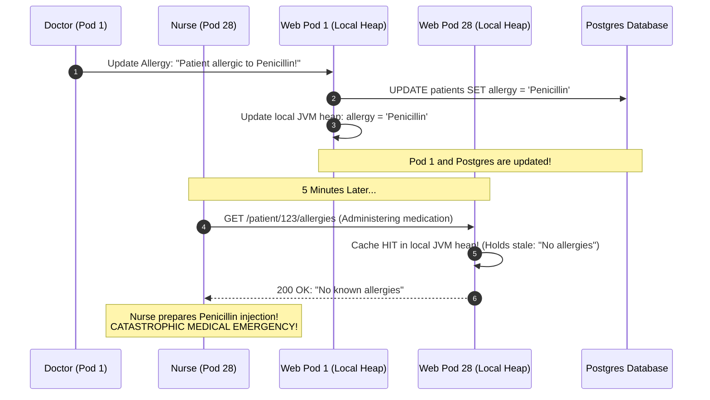
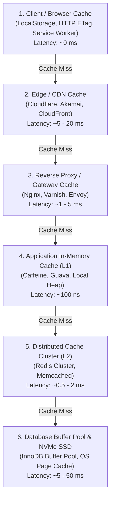
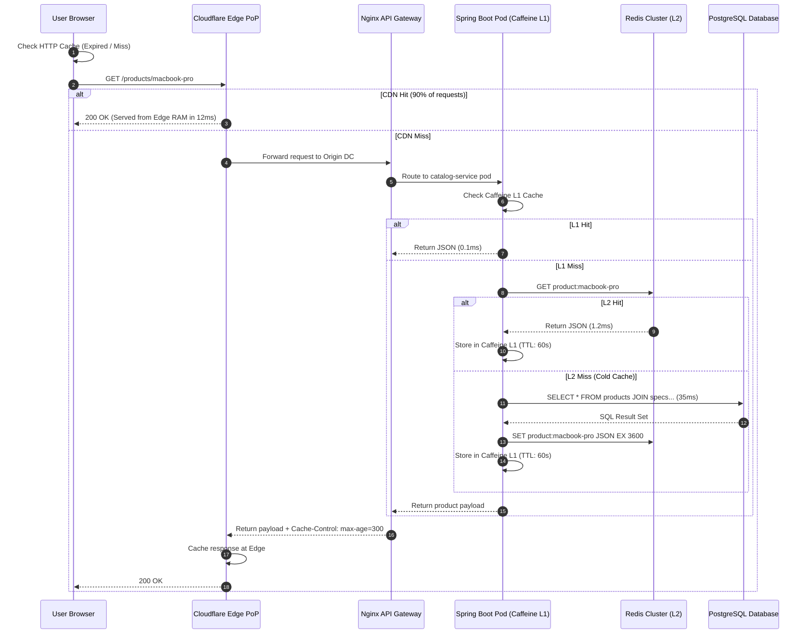
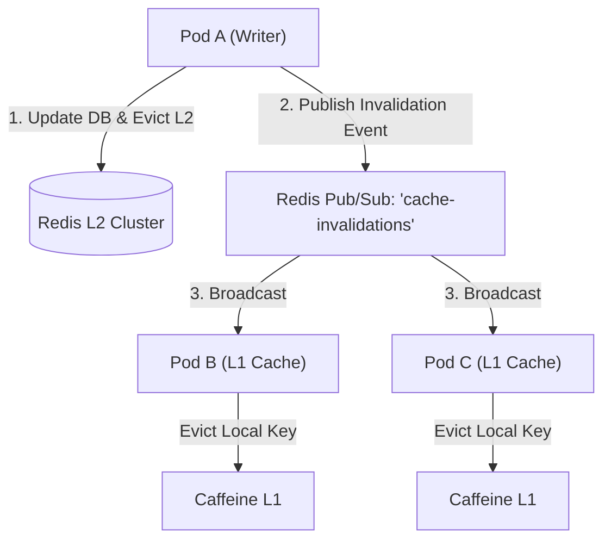

# Caching Topologies and Multi-Tier Caching Architecture

Caching is the single most effective technique for reducing user latency, protecting downstream databases from collapse, and scaling systems to millions of requests per second. In modern enterprise systems, caching is never a single monolithic box; it is an orchestrated, multi-tier defense system spanning from the user's mobile glass to the database NVMe controllers.

---

## 💡 Intuitive Real-World Analogy: The Multi-Tier Workspace

Imagine an architect working on a massive skyscraper project:
1. **Client / Browser Cache (Shirt Pocket):** The pencil and sticky note in the architect's shirt pocket. Grabbing it takes 0 seconds.
2. **Edge / CDN Cache (The Local Print Shop):** The blueprint printing shop across the street from the construction site. It stocks standard municipal building code booklets so workers don't have to call headquarters.
3. **Reverse Proxy / Gateway Cache (Building Lobby):** The reception desk in the architect firm’s lobby holding copies of the standard company brochure.
4. **Application In-Memory Cache (Desk Drawer):** A folder inside the architect's personal desk drawer. Access takes 1 second, but nobody else in the office can see what is inside it.
5. **Distributed Cache Cluster (Central Office Filing Room):** A shared, climate-controlled records room on Floor 3 where every architect in the firm stores shared active floor plans.
6. **Primary Database Disk (City Municipal Vault):** The underground county courthouse deed vault 15 miles away. Getting a document requires driving across town, filing paperwork, and waiting for an archivist to unlock the vault.

If you had to drive to the county vault every time you needed a measurement, you would complete one wall per month. Multi-tier caching ensures $99\%$ of questions are answered from your shirt pocket, desk drawer, or central records room.

---

## 👶 Plain-English / ELI5 Overview

Computers are bound by the physics of distance and storage media:
- Reading data from your phone's memory takes **nanoseconds**.
- Fetching data across the Pacific Ocean or reading from a spinning disk takes **hundreds of milliseconds**—millions of times slower!

**Multi-tier caching** is like setting up a series of checkpoints. When a user requests a web page:
1. First, check if the phone already saved a copy yesterday (**Browser Cache**).
2. If not, check if a server in the user's home city has it (**Edge CDN**).
3. If not, check if the web server's internal memory has it (**In-Process Cache**).
4. If not, check a shared high-speed RAM database (**Distributed Redis**).
5. Only if all checkpoints fail does the system query the slow, durable hard drives of the main database.

Every tier filters out a percentage of traffic, so the database only handles a tiny trickle of true cache misses.

---

## ⚠️ The Horror Scenario: The In-Process Cache Desynchronization Nightmare

A healthcare SaaS provider built an Electronic Health Records (EHR) portal running across 40 Kubernetes pods. To optimize performance, developers cached patient allergy profiles inside JVM local memory (using Google Guava):

### What Happened?
- Pod 1 updated its private heap cache and the PostgreSQL database.
- However, Pods 2 through 40 had **zero awareness** of the mutation. Their local in-memory caches still held the old data with a 1-hour TTL.
- When the nurse opened the chart, the load balancer routed the request to Pod 28. Pod 28 served the stale record from memory.
- **The Catastrophe:** The patient was almost administered a lethal drug due to local memory drift. The company faced massive lawsuits and regulatory audits, forcing an emergency architectural overhaul to a centralized **Distributed Redis Cache with Pub/Sub Invalidation**.

---

## 1. The Multi-Tier Caching Hierarchy

---

## 2. Deep Dive Across the Tiers

### Tier 1: Client & Browser Cache
- **Latency:** $\sim 0\text{ ms}$ (served directly from client device RAM/disk).
- **Control Mechanisms:** HTTP Cache-Control headers:
  - `Cache-Control: public, max-age=31536000, immutable` (ideal for content-hashed static assets `bundle.a8f9c.js`).
  - `Cache-Control: no-cache` (browser stores a copy, but must revalidate with server using `ETag` or `If-None-Match` before rendering).
  - `Cache-Control: no-store` (prohibits caching completely; used for sensitive banking/PII responses).

### Tier 2: Edge / Content Delivery Network (CDN) Cache
- **Latency:** $\sim 5 - 20\text{ ms}$ (served from local geographical Point of Presence).
- **Scope:** Caches static media (images, videos, stylesheets), as well as semi-static API responses (e.g., product catalog or public news feeds).
- **Purging:** Instant edge cache purge APIs (Cloudflare Cache Purge by Tag/URL).

### Tier 3: Reverse Proxy & API Gateway Cache
- **Latency:** $\sim 1 - 5\text{ ms}$.
- **Technology:** Varnish, Nginx, Envoy.
- **Function:** Sits directly in front of backend microservices. Prevents duplicate HTTP requests from traversing internal networks and provides HTTP acceleration.

### Tier 4: Application In-Memory Cache (Process-Local / L1)
- **Latency:** $\sim 100\text{ ns}$ (instantaneous RAM access; zero network overhead).
- **Technology:** Caffeine (Java), Google Guava, Golang `sync.Map` or `ristretto`.
- **Limitation:** In a cluster of 50 microservice pods, each pod has an isolated cache. Pods can see inconsistent data, and memory consumption is multiplied by 50.

### Tier 5: Distributed Cache Cluster (L2)
- **Latency:** $\sim 0.5 - 2\text{ ms}$ (fast network hop).
- **Technology:** Redis Cluster, Memcached, AWS ElastiCache.
- **Function:** A centralized, shared memory store accessible by all application servers. Guarantees a consistent view of cached objects across horizontal service fleets.

### Tier 6: Database Buffer Pool & Storage Cache
- **Latency:** $\sim 10 - 50\text{ µs}$ for buffer pool RAM; $\sim 1 - 5\text{ ms}$ for cold NVMe disk reads.
- **Technology:** MySQL InnoDB Buffer Pool, PostgreSQL Shared Buffers.
- **Function:** Keeps active indexes and table pages in server RAM to avoid physical disk reads.

---

## 3. Latency & Cost Comparison Across Tiers

| Cache Tier | Storage Medium | Typical Latency | Scale Capacity | Cost per GB | Invalidation Complexity |
| :--- | :--- | :--- | :--- | :--- | :--- |
| **Browser Cache** | Client Device Disk/RAM | $\sim 0\text{ ms}$ | $< 50\text{ MB}$ per domain | $0$ (Client device) | High (Client-controlled) |
| **Edge CDN** | Distributed Edge NVMe/RAM | $5 - 25\text{ ms}$ | Petabytes (Global) | Low (CDN network plan) | Moderate (Purge APIs) |
| **App Local Memory** | JVM / Process RAM | $\sim 100\text{ ns}$ | Gigabytes per pod | Moderate (VM RAM) | Very High (Pod desync) |
| **Distributed Redis** | Dedicated Server RAM | $0.5 - 2\text{ ms}$ | Hundreds of GBs / TBs | High (DRAM instances) | Low (Single shared key) |
| **Database Disk** | Enterprise NVMe SSD | $2 - 20\text{ ms}$ | Multi-Terabyte | Low to Moderate | N/A (Source of truth) |

---

## 🚶 Step-by-Step Scenario: The E-Commerce Product Page Request Journey

Let's trace how an e-commerce request for `GET /products/macbook-pro` traverses the multi-tier hierarchy:

---

## 🏢 Real-World Production Battle-Testing

### Meta (Facebook): TAO Multi-Level Social Graph Cache
- Meta’s **TAO** (The Associations and Objects cache) is a geographically distributed multi-tier cache serving billions of queries per second.
- **Architecture:** 
  - **L1 Cache (Client cluster):** Located close to web servers; handles hits locally with sub-millisecond latency.
  - **L2 Cache (Leader cluster):** Centralized per region; handles cache misses and serializes writes to underlying MySQL database shards.
  - Invalidation messages are streamed across regions via an asynchronous pub/sub pipeline.

### Netflix: EVCache & Open Connect CDN
- Netflix caches streaming video chunks on their custom hardware CDN appliances (**Open Connect**), installed directly inside ISP networks worldwide.
- Video metadata, viewing history, and bookmarks are cached using **EVCache** (distributed Memcached) replicated across multiple AWS availability zones, backed by Cassandra.

---

## ⚖️ Practical Trade-Offs & Decision Rules of Thumb

| Scenario | Recommended Cache Topology | What to Avoid |
| :--- | :--- | :--- |
| **Static Assets (JS/CSS/Images)** | Browser Cache + Edge CDN | Never serve static files directly from application containers |
| **High-Read, Low-Write Shared Data (Catalog)** | CDN + Distributed Redis + Local L1 (short TTL) | Avoid long L1 TTLs without Pub/Sub invalidation |
| **User Session / Auth Tokens** | Distributed Redis (Centralized L2) | Never store sessions purely in local process memory (breaks sticky sessions) |
| **Ultra-Hot Read Keys (e.g. Breaking News Headline)** | L1 In-Process Cache (Caffeine with 5-10s TTL) | Avoid querying Redis 500,000 times/sec for the exact same key |

---

## 🎯 Top Real-World Interview Questions & Deep-Dive Answers (FAANG / Staff Level)

### Question 1: How do you design a Two-Tier (L1 In-Memory + L2 Distributed) Caching system without suffering from L1 cache drift across hundreds of microservice instances?
**Model Answer:**
A Two-Tier cache combines ultra-low latency ($\sim 100\text{ ns}$ L1 in-process RAM) with consistency ($\sim 1\text{ ms}$ L2 distributed Redis). The critical challenge is **L1 Cache Drift**: when Pod A mutates data, Pods B through Z still hold stale entries in their local heaps.

**The Architectural Solution:**
1. **Short L1 TTLs:** Cap local in-process cache TTL to 5–30 seconds. Even in the worst-case disconnect, staleness is strictly time-bounded.
2. **Redis Pub/Sub or Kafka Invalidation Bus:** Whenever any pod mutates the database and evicts L2, it publishes an invalidation event: `{"event": "EVICT", "key": "product:123"}` to a Redis Pub/Sub channel.
3. Every running microservice pod subscribes to this channel. Upon receiving the message, the pod executes `localCache.invalidate(key)`.

**Edge Cases & Failure Modes:**
- **Network Partition on Pub/Sub:** Redis Pub/Sub does not buffer messages (at-most-once delivery). If Pod B experiences a brief network blip, it misses the eviction message. The short L1 TTL serves as the fallback safety net.
- **Invalidation Storm:** High mutation rates can flood the Pub/Sub bus. Group invalidations into batch hashes or rely solely on L2 for write-heavy keys.

---

### Question 2: In a globally distributed system, should you cache authenticated API responses at the Edge CDN? What are the security and architectural risks?
**Model Answer:**
Caching authenticated responses at the CDN edge provides massive latency improvements (serving users in 15ms instead of 250ms cross-continental hops), but presents severe security pitfalls if misconfigured:

1. **The PII Leakage Disaster:** If an authenticated response containing personal data (`/api/v1/user/profile`) is cached publicly, User Bob might receive User Alice's cached profile!
2. **Solution (Vary Header & Private Caching):**
   - Ensure the server sets `Cache-Control: private, no-cache`.
   - If edge caching is desired for personalized data, use the `Vary: Authorization` or `Vary: Cookie` header so the CDN shards cache entries by unique user credentials.
3. **Edge Worker Token Validation (Cloudflare Workers / Lambda@Edge):**
   - Cache content at the edge, but execute a lightweight cryptographic JWT signature verification at the edge worker *before* serving the cached payload.
   - If the token is invalid or expired, the edge worker rejects the request immediately without touching the origin.

---

### Question 3: How do you prevent Cache Stampedes when an ultra-hot key in an L2 Redis cache is evicted?
**Model Answer:**
When an ultra-hot key (e.g. `homepage:deals`) expires, thousands of concurrent requests miss simultaneously and crush the database. 

**Three Staff-Level Solutions:**
1. **Single-Flight / Mutex Locking (`SET NX PX`):** Only the first worker to acquire the lock queries the database. All other threads wait and retry the cache.
2. **Probabilistic Early Expiration (XFetch Algorithm):** Proactively recomputes the cache key *before* it expires based on a probability curve:
   $$\text{Compute Time } (\Delta) \times \beta \times (-\ln(\text{rand}())) > (\text{Expiry} - \text{Current Time})$$
3. **Stale-While-Revalidate (Background CDC Refresh):** Never set a hard TTL on hot keys. An asynchronous pipeline (Debezium + Kafka) refreshes the Redis key whenever the underlying database record changes.

---
*Related Documents:*
- [Cache Invalidation and Update Patterns](file:///home/prasanta/Documents/learning_folder/system_design/04_CACHING_STRATEGIES_AND_PATTERNS/02_cache_invalidation_patterns.md)
- [Cache Eviction Policies: LRU, LFU, ARC](file:///home/prasanta/Documents/learning_folder/system_design/04_CACHING_STRATEGIES_AND_PATTERNS/03_cache_eviction_policies.md)
- [Cache Anomalies and Mitigations](file:///home/prasanta/Documents/learning_folder/system_design/04_CACHING_STRATEGIES_AND_PATTERNS/04_cache_anomalies_and_mitigation.md)
- [Distributed Redis Architecture](file:///home/prasanta/Documents/learning_folder/system_design/04_CACHING_STRATEGIES_AND_PATTERNS/05_distributed_redis_architecture.md)
