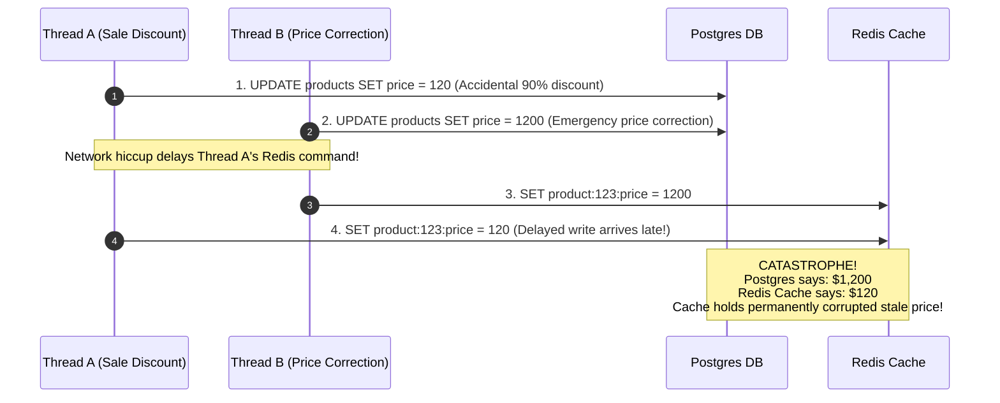
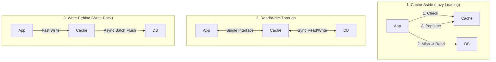
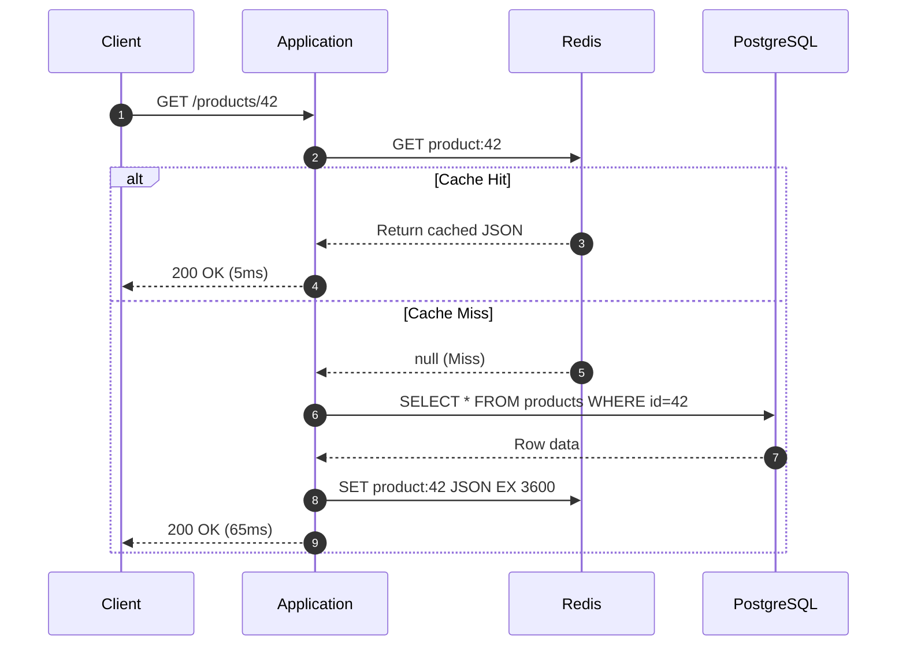
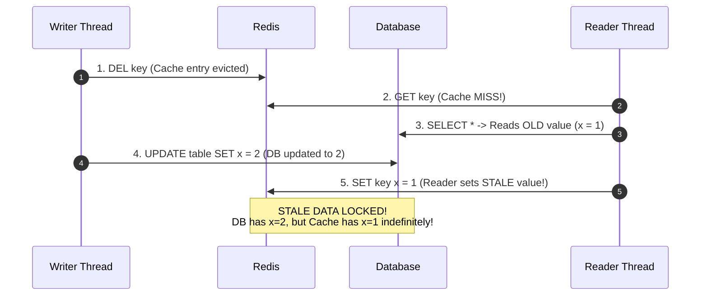
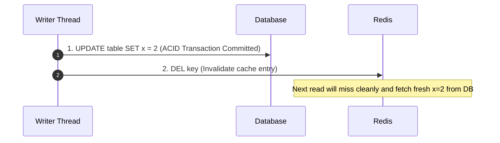
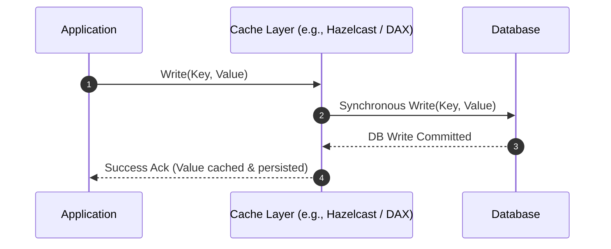
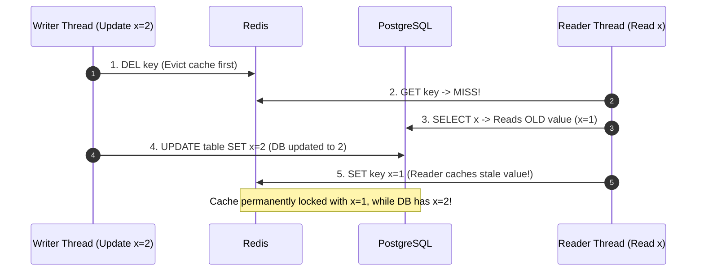
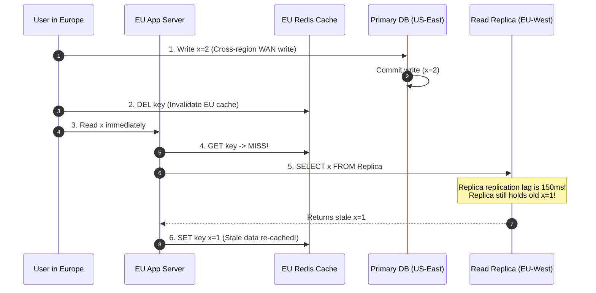

# Cache Invalidation and Update Patterns

> *"There are only two hard things in Computer Science: cache invalidation and naming things."*  
> — Phil Karlton

When mutating persistent state, keeping an in-memory cache synchronized with the underlying database without introducing race conditions is a critical distributed systems challenge. Once you copy data into an in-memory cache, you create a distributed system with multiple sources of truth. If one changes and the other does not, your system tells silent lies to users.

---

## 💡 Intuitive Real-World Analogy: The Front Desk Sticky Note vs. The Hotel Vault Ledger

Imagine a luxury boutique hotel:
- **The Database is the Master Safe Ledger:** Bound in heavy leather locked inside the manager's office safe. Reading it takes 5 minutes of walking, unlocking, and page-turning. However, whatever is written in the safe is legal truth.
- **The Cache is a Yellow Sticky Note on the Front Desk:** The receptionist copies the Wi-Fi password and VIP guest room numbers onto a sticky note right beside the phone. Answering a caller takes 1 second (RAM speed).

Now, VIP guest Alice moves from Room 101 to Penthouse 500:
- If the manager updates the safe ledger but forgets the sticky note, the receptionist keeps sending room service and visitors to Room 101.
- If two clerks try to scribble new room numbers over the same sticky note simultaneously, the paper turns into an illegible smear.
- **The safe practice:** When room assignments change, the manager writes the change into the master safe ledger first, walks out, and **rips off and shreds the sticky note**. The very next time someone asks for Alice's room, the receptionist experiences a "miss", walks to the safe, confirms the new Penthouse 500, and sticks a fresh note on the desk.

---

## 👶 Plain-English / ELI5 Overview

Caching makes your application fast by storing answers in ultra-fast memory (Redis, Memcached) instead of querying a slower disk-based database (PostgreSQL, MySQL). 

However, when data changes (e.g., an item price changes from $10 to $20), your system must coordinate two independent network systems:
1. **The Database** (durable, transactional, disk-backed)
2. **The Cache** (volatile, non-transactional, RAM-backed)

Because network calls can fail, experience latency, or arrive out of order, you cannot update both simultaneously in an atomic transaction. **Cache Invalidation Patterns** are the proven playbooks that dictate *who* writes to *what*, in *what order*, and *how* to handle failure so users never see stale, corrupted, or conflicting data.

---

## ⚠️ The Horror Scenario: The $120 MacBook Flash-Sale Disaster

To understand why cache invalidation order matters, consider an e-commerce platform running an anti-pattern: **"Update DB, then Update Cache"**.



1. An e-commerce admin accidentally updates a $1,200 MacBook Pro to $120 in PostgreSQL.
2. An automated price-guard bot catches the error 10 milliseconds later and issues an update back to $1,200.
3. Thread B updates Postgres to $1,200 and immediately updates Redis to $1,200.
4. However, a slight packet pause or GC pause on Thread A caused Thread A's update to arrive at Redis **after** Thread B.
5. Thread A overwrites Redis with `$120`.
6. For the next 24 hours (until TTL expires), the front-end reads from Redis and sells 5,000 MacBooks at $120 each. The company suffers millions of dollars in losses and must cancel orders, triggering a PR nightmare.

---

## 1. The 5 Core Cache Mutation Patterns



---

## 2. Cache-Aside (Lazy Loading)

The most ubiquitous pattern in web systems. The application layer orchestrates reads and writes by coordinating between the cache and the database directly.

### Read Workflow
1. Application receives read request for key $K$.
2. Application checks Cache: `cache.get(K)`.
3. If **Cache Hit**: Return cached value immediately.
4. If **Cache Miss**:
   - Query primary database: `db.get(K)`.
   - Write result to cache with a Time-To-Live (TTL): `cache.set(K, value, ttl=3600)`.
   - Return value to caller.



### Write Workflow: The Great Debate

When modifying data, the application must decide:
1. Should we **Update Cache** or **Evict (Delete) Cache**?
2. Should we touch the **Database First** or the **Cache First**?

#### Why "Update Cache" is Flawed
Updating the cache creates the race condition illustrated in the Horror Scenario: concurrent writes can arrive out-of-order at the cache, causing permanent staleness until the key's TTL expires. Furthermore, if data is written frequently but rarely read, updating the cache wastes CPU and memory caching entries that nobody will ever query.

#### Why "Delete Cache First, Then Update DB" Fails
If you delete the cache first, a concurrent read can repopulate the cache with old database data *before* your database write finishes:



#### The Golden Rule: Update DB First, Then Delete Cache


> **The Golden Rule:**  
> **Always UPDATE the Database FIRST, then EVICT (DELETE) the key from the Cache.**  
>
> Deleting the key invalidates the cached entry. The next read encounters a clean cache miss and safely repopulates the freshest value from the database.

#### The Theoretical Edge-Case Race Condition
Is "Update DB First, Then Evict Cache" $100\%$ immune to races? In theory, no:
1. **Thread A (Read):** Queries DB for key $K$, receives old value $X$, but gets paused before setting the cache (e.g., CPU scheduling or GC pause).
2. **Thread B (Write):** Updates DB for key $K$ to value $Y$, then executes `DEL K` on the cache.
3. **Thread A (Read resumes):** Finishes its execution and writes old value $X$ to the cache.

**Why this practically never happens in production:**  
For this race to occur, Thread A's cache write must be delayed long enough for Thread B to execute an entire disk write *and* issue a network delete to Redis. Because database writes require disk I/O, write locks, and WAL flushing, they are orders of magnitude slower than in-memory cache operations. Nonetheless, if this theoretical risk cannot be tolerated, systems use:
- **Delayed Double Deletion:** Delete the cache key, write to DB, wait 500ms, and delete the cache key a second time asynchronously.
- **Cache Leases / Version Tokens:** Introduced by Facebook's Memcached architecture.

---

## 3. Read-Through Caching

The application treats the cache as the single source of truth. The application code never queries the database directly.

- The cache provider integrates a loader plugin (e.g., AWS DAX for DynamoDB).
- On a cache miss, the **cache infrastructure itself** transparently fetches the missing data from the database, stores it in memory, and returns it to the client.
- **Benefit:** Simplifies application logic; centralizes data access code and prevents duplicate cache-aside logic across 20 different microservices.

---

## 4. Write-Through Caching

Data is written directly to the cache, and the **cache synchronously writes to the database** before returning success to the application:



- **Pros:** Data in cache is never stale; reads after writes are guaranteed to be fresh; simplified client code.
- **Cons:** High write latency. Every write operation incurs the latency cost of both the in-memory cache write and the disk-based database round-trip.

---

## 5. Write-Behind (Write-Back) Caching

The application writes directly to the cache and **returns success immediately** ($\sim 0.5\text{ ms}$). The cache places the mutation into an asynchronous in-memory queue and flushes changes to the database in background batches.

### Why Write-Behind is Powerful
1. **Ultra-Low Write Latency:** The caller receives an ACK at the speed of RAM.
2. **Write Coalescing & Absorption:** If a viral video receives 10,000 views in 1 second, a write-behind cache can absorb all 10,000 in-memory increments and execute a single coalesced database update:
   ```sql
   UPDATE videos SET views = views + 10000 WHERE id = 1;
   ```
   This reduces database write pressure by $99.9\%$.

### The Critical Vulnerability
If the cache node experiences a sudden hardware crash, kernel panic, or power loss before the in-memory queue is flushed to disk, **data is permanently lost**.

---

## 6. Refresh-Ahead Caching

If an item is configured with a 60-second TTL, and the system observes that the key is accessed every 5 seconds:
- At second 55, a background worker proactively re-fetches the record from the database and resets the TTL to 60 seconds.
- **Result:** End users **never experience a cache miss** or the latency penalty of cold database queries. Ideal for high-profile homepage headlines, live election tallies, and hot stock tickers.

---

## 🚶 Step-by-Step Scenario: Handling Concurrent Orders with Cache Invalidation

Let's walk through an e-commerce inventory update using Cache-Aside with Invalidation via Change Data Capture (CDC):

```mermaid
sequenceDiagram
    autonumber
    participant Buyer as User (Alice)
    participant API as Inventory API
    participant DB as PostgreSQL
    participant Debezium as Debezium CDC
    participant Kafka as Kafka Topic
    participant Invalidator as Invalidation Consumer
    participant Redis as Redis Cluster

    Buyer->>API: POST /cart/checkout (Buy last PlayStation 5)
    API->>DB: BEGIN TRANSACTION;<br/>UPDATE inventory SET stock = stock - 1 WHERE item_id = 99 AND stock > 0;<br/>COMMIT;
    DB-->>API: 1 row affected (Success)
    API-->>Buyer: 200 OK (Order confirmed!)
    
    Note over DB,Debezium: Asynchronous Invalidation Pipeline
    DB->>Debezium: WAL records row modification for item_id=99
    Debezium->>Kafka: Produce InvalidationEvent(item_id=99)
    Kafka->>Invalidator: Invalidator consumes message
    Invalidator->>Redis: DEL product:inventory:99
    Note over Redis: Cache entry evicted within 15ms
    
    participant UserBob as User (Bob)
    UserBob->>API: GET /items/99
    API->>Redis: GET product:inventory:99 (MISS)
    API->>DB: SELECT stock FROM inventory WHERE item_id = 99
    DB-->>API: stock = 0 (Out of stock)
    API->>Redis: SET product:inventory:99 stock=0 EX 300
    API-->>UserBob: 200 OK (Shows 'Out of Stock')
```

1. **Transactional Safety:** PostgreSQL handles the hard constraint (`stock > 0`) inside a serialized transaction.
2. **Decoupled Eviction:** Rather than requiring the API server to coordinate Redis deletes synchronously (which could fail if the Redis connection dropped right after the DB commit), the database Write-Ahead Log (WAL) streams the mutation through Debezium and Kafka.
3. **Eventual Cleanliness:** Even if network hiccups occur, Kafka retains the eviction event until the Invalidator deletes the key, guaranteeing eventual consistency.

---

## 🏢 Real-World Production Battle-Testing

### Facebook (Meta): Memcached Leases
In Facebook's famous paper *"Scaling Memcache at Facebook"*, they solved both stale cache repopulation and thundering herd using **Leases**.
- When a cache miss occurs, Memcached returns a unique **64-bit lease token** to the client.
- When the client attempts to set the cached value after reading the database, it must present that lease token.
- If a write invalidated that key in the interim, Memcached **invalidates the lease token**, rejecting the stale write!

### Netflix: EVCache and Microservice Invalidation
Netflix built **EVCache** (an open-source Memcached wrapper distributed across multiple AWS Availability Zones).
- Netflix employs the **Cache-Aside** pattern across thousands of microservices.
- Writes to Cassandra or Aurora trigger change events via Kafka that publish cache invalidation events to all cross-region EVCache clusters.
- If an eviction message fails, Netflix relies on conservative TTLs (e.g., 5 to 15 minutes) as a safety net against permanent drift.

### Shopify: Flash Sales and Delayed Double Deletion
During Black Friday, Shopify uses Redis for product availability. To prevent the read/write race condition under extreme concurrency:
- When a merchant updates product inventory, Shopify updates MySQL, immediately evicts Redis, and enqueues a delayed background job (via Sidekiq) to evict the Redis key again 1 second later (**Delayed Double Deletion**). This catches any slow read threads that queried MySQL right before the write committed.

---

## ⚖️ Practical Trade-Offs & Decision Rules of Thumb

| Pattern | Read Latency | Write Latency | Stale Data Risk | Data Loss Risk | Recommended Use Cases |
| :--- | :--- | :--- | :--- | :--- | :--- |
| **Cache-Aside** | Fast on hit, slow on miss | Fast (DB write + cache delete) | Minimal (TTL bounded) | None | General web APIs, e-commerce products, user profiles. |
| **Read-Through** | Fast on hit, slow on miss | N/A | Minimal | None | Clean architecture abstractions, centralized microservice data layers. |
| **Write-Through** | Blazing fast | Slow (Waits for DB write) | Very Low | None | Financial balances, authorization rules, systems requiring strong read consistency. |
| **Write-Behind** | Blazing fast | Blazing fast | Low | High (Node crash loses uncommitted queue) | Video view counters, IoT sensor ingestion, gaming leaderboards, click telemetry. |
| **Refresh-Ahead**| Always near-zero | Normal | Low | None | Hot predictable data (homepage headlines, top 10 trends, stock market indices). |

### Rules of Thumb for System Designers
1. **Default to Cache-Aside with Invalidation:** For 90% of web systems, update the database and delete the cache key with a sensible TTL (e.g., 5–60 minutes).
2. **Never Update Cache Directly on Mutation:** Updating the cache instead of evicting introduces concurrent out-of-order writes and caches unused data.
3. **Use Write-Behind only when loss is acceptable:** Reserve Write-Behind for metric aggregation and counters where losing 2 seconds of view counts during a power outage won't bankrupt the business.
4. **Always set a TTL:** Even if you have the most sophisticated invalidation pipelines in the world, bugs happen. A reasonable TTL (Time-To-Live) is your ultimate insurance policy against permanent data corruption.

---

## 🎯 Top Real-World Interview Questions & Deep-Dive Answers (FAANG / Staff Level)

### Question 1: Why should you update the database first and then evict the cache, instead of evicting the cache first and then updating the database? Walk through the exact race condition.
**Model Answer:**
Evicting the cache *first* creates an immediate, highly probable race condition under concurrent read/write traffic:



1. **The Flaw of "Delete First":** Between Step 1 (cache delete) and Step 4 (database commit), any concurrent read thread will encounter a cache miss, read the **old uncommitted database value**, and populate the cache with that stale data. Because the cache write occurs *after* the delete, the stale value remains in the cache indefinitely until the TTL expires.
2. **Why "Update DB First" is Vastly Superior:** If you update the database first, readers continue to hit the slightly stale cached value until the write commits and the cache is deleted. Once deleted, subsequent readers miss cleanly and repopulate the fresh data. Stale reads are bounded to the tiny sub-millisecond duration of the write transaction.

---

### Question 2: Under what exact concurrent execution sequence can "Update DB then Invalidate Cache" still theoretically produce stale data, and how do FAANG systems eliminate it?
**Model Answer:**
While rare, "Update DB First then Invalidate Cache" has one theoretical race condition:

**The Race Execution Sequence:**
1. **Thread 1 (Read):** Queries Cache $\to$ Miss.
2. **Thread 1 (Read):** Queries DB $\to$ Receives old value $x=1$. Before writing to Redis, Thread 1 experiences a CPU context switch or GC pause.
3. **Thread 2 (Write):** Updates DB to $x=2$.
4. **Thread 2 (Write):** Issues `DEL key` on Cache.
5. **Thread 1 (Read resumes):** Wakes up from GC pause and issues `SET key x=1`.
6. **Result:** Cache now holds stale $x=1$, while DB holds fresh $x=2$.

**Why it is rare in practice:**  
Step 3 involves disk I/O, WAL logging, and locks, while Step 1 and Step 5 are in-memory operations. For the race to trigger, the reader's memory write must be suspended long enough for an entire database write transaction and network delete to complete.

**Production Solutions (FAANG / Meta):**
1. **Memcached Leases (Facebook Paper):** Memcached issues a unique 64-bit lease token on a cache miss. When Thread 1 tries to write `SET key x=1 token=123`, Memcached checks if the key was invalidated in the interim. Since Thread 2 evicted the key, the lease token is invalidated, and Thread 1's write is **rejected**.
2. **Delayed Double Deletion:** The writer updates DB, deletes cache, sleeps 500ms (to ensure slow concurrent readers finish), and issues an asynchronous second `DEL key`.
3. **Version Stamps / Monotonic Timestamps:** Write records with a database revision number; reject cache writes where the incoming version is lower than the cached or database version.

---

### Question 3: How do you handle cache invalidation across multiple geographic regions with database replication lag?
**Model Answer:**
In a multi-region deployment (e.g. Primary DB in US-East, Read Replicas in EU-West and AP-Southeast), cross-region replication lag creates a severe cache invalidation hazard:



**Architectural Solutions:**
1. **Remote Region Marker (Facebook TAO Pattern):** When a user writes to the primary DB, the application writes a transient "dirty marker" key in the local regional cache: `SET marker:user:123 1 EX 2` (2-second TTL). When reading, if the marker exists, the app **routes the read query to the primary US database** instead of the local replica until replication catches up.
2. **Replication-Stream Invalidation:** Never invalidate the regional cache from the application layer. Instead, tail the local replica's replication stream (CDC). Only when the replica has physically committed the row change does the local CDC worker trigger `DEL key` on the regional cache!

---
*Related Documents:*
- [Cache Anomalies and Mitigations: Stampede, Penetration, Avalanche](file:///home/prasanta/Documents/learning_folder/system_design/04_CACHING_STRATEGIES_AND_PATTERNS/04_cache_anomalies_and_mitigation.md)
- [Event-Driven Architecture Patterns: Outbox and CDC](file:///home/prasanta/Documents/learning_folder/system_design/05_MESSAGING_EVENT_DRIVEN_AND_ASYNC/04_event_driven_design_patterns.md)
