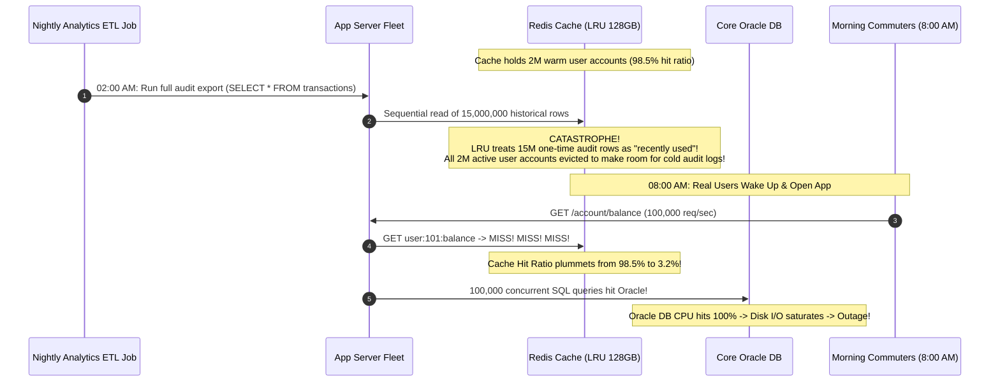
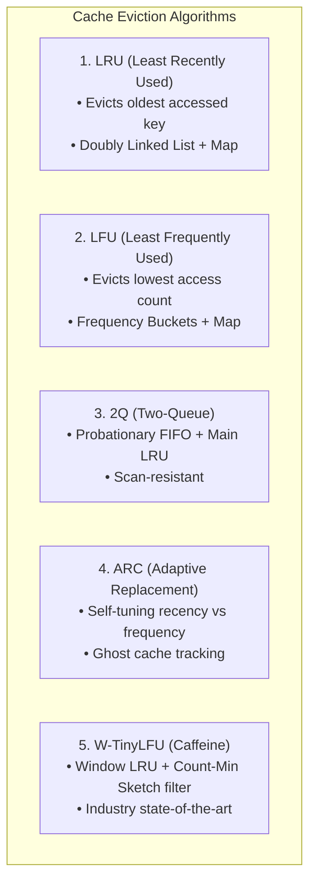
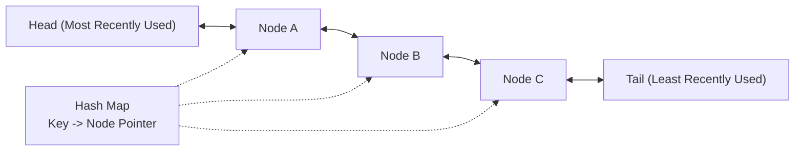
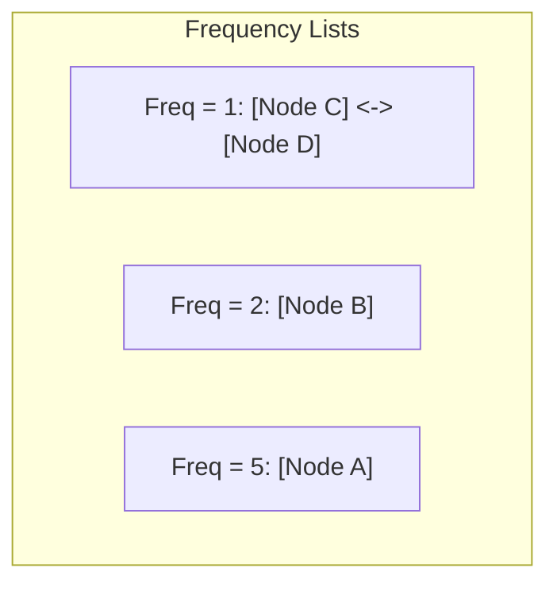
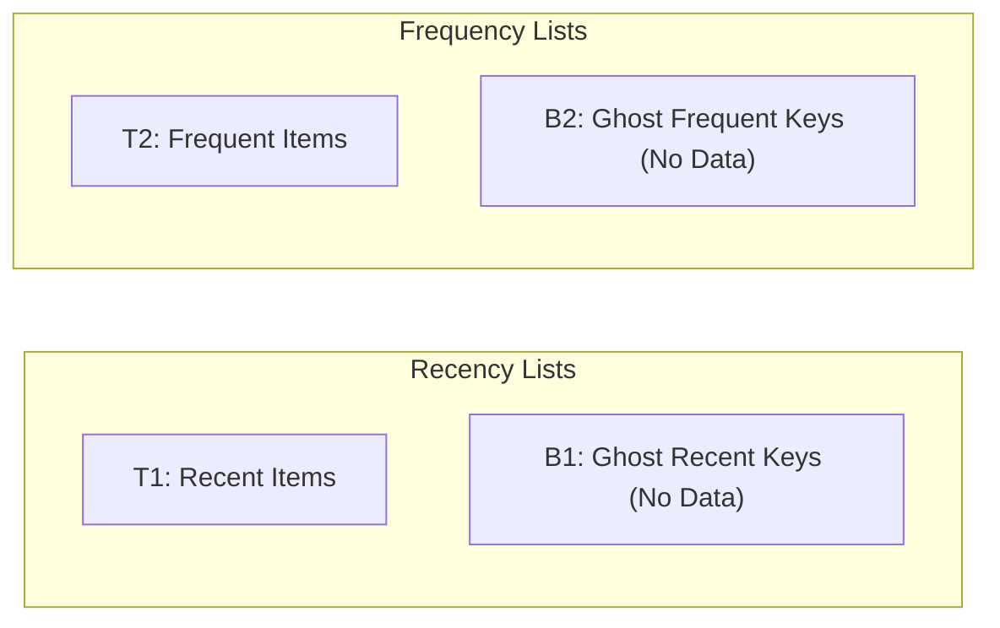
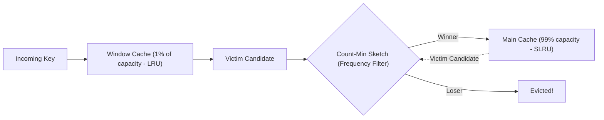

# Cache Eviction Policies: LRU, LFU, FIFO, 2Q, ARC, and W-TinyLFU

When memory reaches its hard capacity limit, a cache cannot simply refuse new writes. A **Cache Eviction Policy** determines which existing key must be sacrificed to make room for incoming data. The choice of eviction policy directly governs the system's **Cache Hit Ratio**, which determines whether your database enjoys smooth operations or suffers complete infrastructure collapse.

---

## 💡 Intuitive Real-World Analogies

### 1. LRU (Least Recently Used): The Desktop Paper Stack
Imagine your physical office desk has space for only 5 folders:
- Every time you need a folder, you pull it out and place it right on top of the stack.
- When a new folder arrives and your desk is full, you reach to the **very bottom of the stack** (the folder you haven't touched in the longest time) and throw it in the trash.
- **Strength:** Great if your current workday revolves around 2 or 3 active projects.
- **Weakness:** If an intern dumps 20 junk mail envelopes on your desk one afternoon, your active project folders get thrown into the trash!

### 2. LFU (Least Frequently Used): The Classic Bookstore Shelf
Imagine a neighborhood bookstore with limited shelf space:
- Every time a customer buys a book, the shopkeeper adds a tally mark to that title.
- When a new shipment arrives, the shopkeeper evicts the book with the **fewest total tally marks**.
- *The Flaw:* A book about the 2016 Olympics sold 5,000 copies in 2016 and accumulated 5,000 tallies. Today, nobody cares about it, but because its historical tally count is 5,000, it permanently hogs valuable shelf space while fresh new bestsellers are rejected.

### 3. ARC (Adaptive Replacement Cache): The Self-Balancing See-Saw
Imagine a see-saw with two teams: Team Recency and Team Frequency.
- Instead of guessing whether recent or frequent items are more important, the manager keeps a clipboard of **"recently evicted ghosts"** (keys without the heavy data payloads).
- If the manager notices people asking for keys that were recently evicted from Team Recency, the see-saw shifts its fulcrum to give more space to recency.
- If people ask for evicted frequent items, the see-saw automatically tilts toward frequency.
- **Result:** Complete self-tuning optimization without human intervention.

---

## 👶 Plain-English / ELI5 Overview

Memory (RAM) is expensive and finite. Your cache might have room for 1,000,000 items, but your database holds 50,000,000 items.

When item 1,000,001 arrives, the computer must play a game of triage: **"Who gets kicked off the island?"**
- **FIFO:** Kick out whoever arrived first (like a simple grocery line).
- **LRU:** Kick out whoever hasn't been read in the longest time.
- **LFU:** Kick out whoever has been read the fewest times.
- **Modern Hybrids (ARC, W-TinyLFU):** Smart algorithms that combine recency and frequency so that temporary spikes (like backups) don't wipe out your most valuable data.

---

## ⚠️ The Horror Scenario: The Midnight Analytics Cache Massacre

An online banking portal had a $98.5\%$ cache hit ratio during daytime hours, powered by a 128 GB Redis cluster running standard **LRU (Least Recently Used)** eviction.



### What Happened?
- At 2:00 AM, a batch analytics script executed a sequential scan over 15 million historical transaction records ("one-hit wonders").
- Because standard LRU blindly promotes every read key to the top of the stack, the 15 million one-off records pushed all 2 million active user accounts out of memory.
- When 100,000 morning commuters opened their banking apps at 8:00 AM, the cache hit ratio collapsed to $3.2\%$.
- The resulting thundering herd overwhelmed the primary Oracle database, halting banking services for 3 hours.
- **The Solution:** Adopting a **Scan-Resistant** eviction policy (like 2Q, ARC, or W-TinyLFU).

---

## 1. Algorithmic Comparison Overview



---

## 2. Least Recently Used (LRU)

The standard eviction policy in distributed systems. It operates on the principle of **temporal locality**: data accessed recently is highly likely to be accessed again soon.

### O(1) Data Structure Architecture
To achieve $O(1)$ time complexity for both `get()` and `put()` operations, LRU combines a **Doubly Linked List** with a **Hash Map**:



- **Hash Map:** Maps each key to its corresponding Node in memory ($O(1)$ lookup).
- **Doubly Linked List:** Maintains recency order:
  - When a key is accessed (`get`) or updated, detach the node from its current position and splice it directly to the **Head**.
  - When capacity is exceeded during insertion (`put`), remove the node at the **Tail**, delete its key from the Hash Map, and insert the new item at the **Head**.

### Python O(1) LRU Cache Implementation
```python
class Node:
    def __init__(self, key: str, val: any):
        self.key = key
        self.val = val
        self.prev = None
        self.next = None

class LRUCache:
    def __init__(self, capacity: int):
        self.capacity = capacity
        self.map = {}
        # Dummy head and tail nodes to eliminate edge-case pointer checks
        self.head = Node("", None)
        self.tail = Node("", None)
        self.head.next = self.tail
        self.tail.prev = self.head

    def _remove(self, node: Node):
        node.prev.next = node.next
        node.next.prev = node.prev

    def _add_to_head(self, node: Node):
        node.next = self.head.next
        node.prev = self.head
        self.head.next.prev = node
        self.head.next = node

    def get(self, key: str):
        if key not in self.map:
            return None
        node = self.map[key]
        self._remove(node)
        self._add_to_head(node)  # Move to MRU position
        return node.val

    def put(self, key: str, value: any):
        if key in self.map:
            node = self.map[key]
            node.val = value
            self._remove(node)
            self._add_to_head(node)
            return

        if len(self.map) >= self.capacity:
            # Evict LRU tail node
            lru_node = self.tail.prev
            self._remove(lru_node)
            del self.map[lru_node.key]

        new_node = Node(key, value)
        self.map[key] = new_node
        self._add_to_head(new_node)
```

---

## 3. Least Frequently Used (LFU)

LFU operates on the principle that items accessed most often across time are the most valuable to retain.

### O(1) LFU Implementation (Ketan Shah et al.)
Naive LFU implementations using min-heaps take $O(\log N)$ per access. A true $O(1)$ LFU implementation uses:
1. A **Key Map** mapping `key -> (value, frequency, node)`.
2. A **Frequency Map** mapping `frequency -> Doubly Linked List of Nodes`.
3. A pointer tracking the current `min_frequency`.



- When a node is accessed, its frequency increments from $f$ to $f+1$. It moves from frequency list $f$ to list $f+1$.
- To evict, pop from the tail of the list at `min_frequency`.
- **The Flaw (Frequency Pollution):** Historical popularity lingers indefinitely. Mitigate using **Frequency Aging** (e.g. dividing all counters by 2 every hour).

---

## 4. Scan-Resistant Caching: 2Q & Adaptive Replacement Cache (ARC)

### 2Q (Two-Queue)
1. New keys enter a **FIFO probationary queue ($A1$)**.
2. If an item is evicted from $A1$ without a second access, it is dropped forever (filtering out one-hit wonders).
3. If an item is accessed a **second time** while in $A1$, it is promoted to the **main LRU queue ($Am$)**.

### ARC (Adaptive Replacement Cache)
Developed at IBM (Megiddo & Modha), ARC maintains two active lists ($T_1$ for recency, $T_2$ for frequency) and two "ghost" history lists ($B_1, B_2$) that store only cache keys without data:



- If a request hits ghost list $B_1$, ARC shifts its dynamic tuning parameter $p$ to expand $T_1$.
- If a request hits ghost list $B_2$, ARC shifts $p$ to expand $T_2$.
- **Result:** Immune to sequential scans; zero human tuning needed.

---

## 5. Modern State-of-the-Art: Window TinyLFU (W-TinyLFU)

Used by **Caffeine Cache** (the industry-standard Java in-memory cache) and Go's **Ristretto**:



- **Window Cache (1%):** Absorbs high temporal recency bursts.
- **Count-Min Sketch:** A compact 4-bit probabilistic Bloom-like filter that tracks the frequency of millions of keys using only a few kilobytes of RAM.
- **TinyLFU Admission Policy:** When an item is evicted from the Window Cache, it competes against the victim candidate of the Main Cache. The item with the higher estimated frequency in the Count-Min Sketch wins admission to the Main Cache; the loser is discarded!

---

## 🏢 Real-World Production Battle-Testing

### Redis: Approximated LRU and LFU
- Redis does **not** use a standard Doubly Linked List for LRU. A linked list requires 2 pointers (16 bytes) per key, which would consume gigabytes of pure pointer overhead on a 50M-key Redis instance.
- **Redis Approximated LRU:** Every Redis object stores a 24-bit timestamp. When memory is full, Redis randomly samples $N$ keys (default $N=5$) and evicts the oldest key among the sample. At $N=10$, Redis approximated LRU is statistically indistinguishable from true LRU while saving hundreds of megabytes of RAM!

### ZFS Storage System: Adaptive Replacement Cache (ARC)
- The open-source enterprise ZFS file system uses ARC for its primary RAM block cache (L1ARC) and SSD cache (L2ARC), outperforming standard operating system page caches under mixed database and file workloads.

---

## ⚖️ Algorithmic Trade-Off Matrix

| Policy | Get Complexity | Put Complexity | Scan Resistant? | Memory Overhead | Primary Production Use Case |
| :--- | :---: | :---: | :---: | :---: | :--- |
| **FIFO** | $O(1)$ | $O(1)$ | ❌ No | Minimal | Simple bounded circular buffers |
| **LRU** | $O(1)$ | $O(1)$ | ❌ No | High (2 pointers per key + Map) | General-purpose web tier (Memcached) |
| **Redis Approximated LRU** | $O(1)$ | $O(1)$ | ❌ No | Extremely Low (24-bit int per key) | High-scale RAM caching (Redis) |
| **LFU** | $O(1)$ | $O(1)$ | ⚠️ Moderate | Very High (2 Maps + frequency nodes) | Static assets with predictable popularity |
| **2Q** | $O(1)$ | $O(1)$ | ✅ Yes | Moderate (2 queues) | Database buffer pools, disk block caches |
| **ARC** | $O(1)$ | $O(1)$ | ✅ Yes | Moderate (4 queues, 2 without data) | File systems (ZFS), enterprise storage |
| **W-TinyLFU** | $O(1)$ | $O(1)$ | ✅ Exceptional | Very Low (Count-Min Sketch) | JVM In-process caching (Caffeine), Go (Ristretto) |

---

## 🎯 Top Real-World Interview Questions & Deep-Dive Answers (FAANG / Staff Level)

### Question 1: How does Redis implement its eviction policies without using a Doubly Linked List, and why was this architectural trade-off chosen?
**Model Answer:**
A textbook LRU requires a Doubly Linked List and a Hash Map. In Redis, this design was intentionally rejected due to **memory footprint**:
1. **Memory Overhead:** A doubly linked list node requires two 64-bit pointers (`prev` and `next`), adding 16 bytes per entry. Across 100,000,000 keys, pointers alone consume $1.6\text{ GB}$ of expensive RAM purely for eviction metadata.
2. **Locking & Concurrency:** Splicing nodes to the head on every single read operation mutates pointers, turning reads into write operations and destroying cache concurrency.

**The Redis Approximated LRU Mechanism:**
- Redis adds a small **24-bit timestamp field** (`lru:24`) inside the standard `redisObject` header.
- On every read (`GET`), Redis updates this 24-bit clock with the current server time (resolution $\sim 1\text{ second}$).
- When memory limit is reached (`maxmemory`), Redis does **not** search the entire database. Instead, it takes a random sample of $K$ keys (configurable via `maxmemory-samples`, default $5$).
- It evicts the key with the oldest timestamp in the sampled pool.
- **Statistical Accuracy:** Sampling $K=5$ yields good results; sampling $K=10$ closely approximates true LRU with zero pointer memory overhead.

---

### Question 2: What is "Cache Pollution" and "Scan Resistance", and how does W-TinyLFU prevent analytical batch scans from evicting warm operational data?
**Model Answer:**
- **Cache Pollution:** Occurs when rarely accessed or one-hit-wonder keys consume cache capacity, displacing frequently accessed operational data.
- **The Scan Vulnerability in Standard LRU:** When an application executes a table scan (e.g., `SELECT * FROM orders` for a nightly report), every single row is read once. Standard LRU unconditionally inserts each key at the MRU head, evicting the entire warm active working set.

**How W-TinyLFU Solves It:**
W-TinyLFU separates recency from frequency using an **Admission Filter**:
1. **Window Cache (1% capacity):** New items enter a small LRU window. This ensures bursty, brand-new keys are given a chance to prove their value.
2. **Main Cache (99% capacity):** Protected by a segmented LRU.
3. **The TinyLFU Admission Gate:** When an item is evicted from the Window Cache, it does not automatically enter the Main Cache. Instead, its historical frequency is looked up in a compact **Count-Min Sketch** and compared against the victim candidate of the Main Cache.
4. If the new item has lower frequency than the incumbent, **it is rejected immediately**.
5. During a table scan, every scanned row has a frequency of 1. It enters the 1% window and is immediately dropped at the admission gate without ever touching the 99% main cache!

---

### Question 3: How would you design an eviction policy for an object cache where items have wildly varying sizes (e.g. 1 KB thumbnails vs. 50 MB video files)?
**Model Answer:**
Standard eviction policies (LRU/LFU) treat every key as cost-equivalent ($1$ entry). In a multi-media cache, evicting one $50\text{ MB}$ video file frees the exact same memory as evicting 50,000 $1\text{ KB}$ thumbnails. If an algorithm evicts 50,000 thumbnails to make room for 1 video file, the system's **overall cache hit ratio plummets by 50,000 requests!**

**The Architectural Solution: GreedyDual-Size-Frequency (GDSF) or Cost-Aware Eviction:**
Instead of evicting purely by timestamp $T$, calculate a priority score $H$ for each object $i$:

$$H_i = L + \left( F_i \times \frac{C_i}{S_i} \right)$$

Where:
- $L$ is an aging inflation factor (resets with each eviction to prevent old items from hoarding space).
- $F_i$ is the access frequency of object $i$.
- $C_i$ is the cost to re-fetch the object from origin (network latency or computation cost).
- $S_i$ is the size of the object in bytes.

**System Design Rules for Variable-Sized Caching:**
1. **Size-Class Sharding / Slab Allocation:** Group objects into separate cache pools by size classes (e.g., Pool A for $< 4\text{ KB}$, Pool B for $4\text{ KB} - 64\text{ KB}$, Pool C for $> 1\text{ MB}$). Run independent LRU policies inside each slab to prevent large files from competing with small files.
2. **Do Not Cache Heavy Blobs in Shared Redis:** Offload objects $> 1\text{ MB}$ to an Edge CDN or S3 with CloudFront; reserve low-latency in-memory cache for metadata and small JSON records.

---
*Related Documents:*
- [Caching Topologies and Multi-Tier Architecture](file:///home/prasanta/Documents/learning_folder/system_design/04_CACHING_STRATEGIES_AND_PATTERNS/01_caching_topologies_and_tiers.md)
- [Cache Invalidation and Update Patterns](file:///home/prasanta/Documents/learning_folder/system_design/04_CACHING_STRATEGIES_AND_PATTERNS/02_cache_invalidation_patterns.md)
- [Cache Anomalies and Mitigations](file:///home/prasanta/Documents/learning_folder/system_design/04_CACHING_STRATEGIES_AND_PATTERNS/04_cache_anomalies_and_mitigation.md)
- [Distributed Redis Architecture](file:///home/prasanta/Documents/learning_folder/system_design/04_CACHING_STRATEGIES_AND_PATTERNS/05_distributed_redis_architecture.md)
