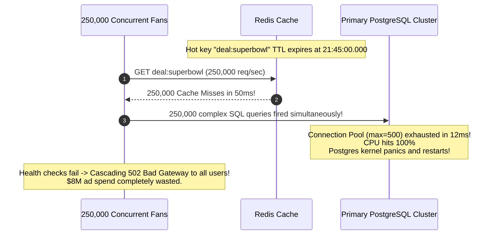
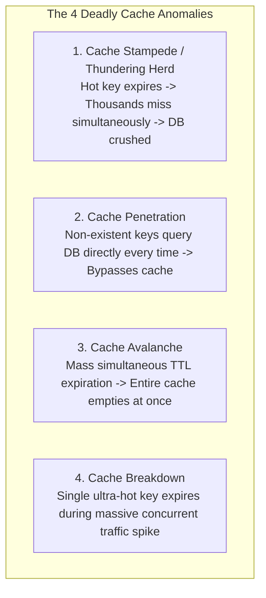
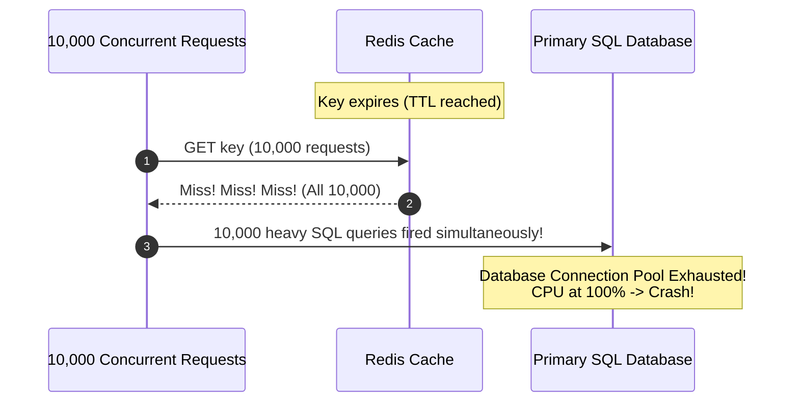
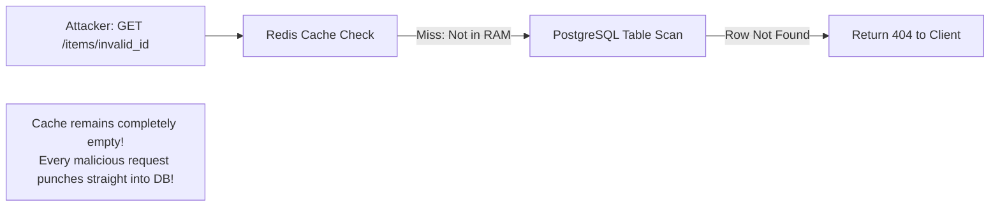
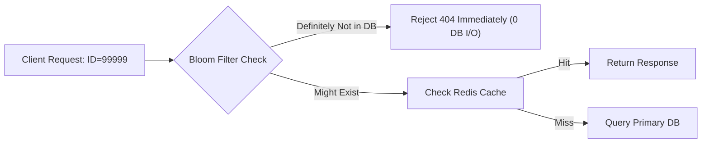
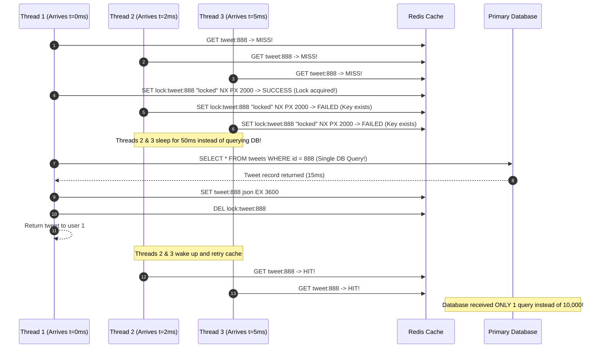
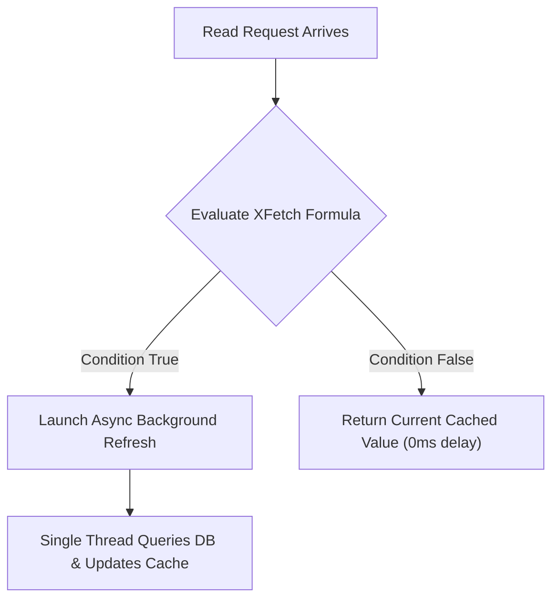
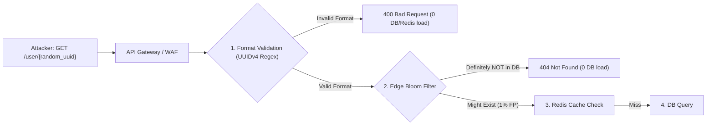

# Cache Anomalies and Mitigations: Stampede, Penetration, Avalanche & Breakdown

In high-throughput distributed systems, a cache sits between millions of clients and the primary database as a protective shield. When that shield develops subtle cracks—whether through synchronized expiration, malicious traffic patterns, or uncoordinated misses—the resulting traffic shockwaves can crush underlying databases within milliseconds.

---

## 💡 Intuitive Real-World Analogies

### 1. Cache Stampede (Thundering Herd): The Nightclub Coat Check
Imagine a crowded nightclub with 2,000 partygoers. The coat check counter has a single clerk and an index card showing where coats are stored. Suddenly, the index card blows away. Instead of one person politely asking the clerk to find the master list in the backroom, **all 2,000 people stampede into the backroom simultaneously**, knocking over shelves, trampling the manager, and tearing down the building.
- **The Solution:** A velvet rope (**Distributed Mutex**). Only *one* person is allowed into the backroom to retrieve the new card; everyone else waits outside for 30 seconds until the master list is pinned back up.

### 2. Cache Penetration: The Malicious Phone Prankster
A prankster calls a hotel front desk asking: *"Is Mr. Banana Applepie staying in Room 9999?"* The receptionist checks the front desk list: not found. So the receptionist walks down to the basement archives to check the historical registry: not found. Five seconds later, the prankster calls asking for *"Mrs. Purple Giraffe"*. Then *"Dr. Flying Spaghetti"*.
- Because none of these guests exist, the receptionist never writes them down on the desk pad, and spends 100% of their time running down to the basement archives until collapsing from exhaustion.
- **The Solution:** A **Bloom Filter** at the front desk that instantly proves whether a name is in the hotel registry before anyone walks to the basement, or writing *"Does not exist"* on the desk pad (**Null Object Caching**).

### 3. Cache Avalanche: Synchronized Smoke Detectors
An entire 100-unit condominium installs identical smoke detector batteries on January 1st at 12:00 PM. Exactly 365 days later at 12:00 PM, all 100 smoke detectors start screeching their low-battery alarm simultaneously, causing chaos and overwhelming the building maintenance team.
- **The Solution:** **TTL Jitter**. Install batteries with slightly varying lifespans (365 days $\pm$ 30 days) so maintenance handles one beeping detector every few days instead of 100 at the same instant.

---

## 👶 Plain-English / ELI5 Overview

A database is like an expert chef who cooks elaborate gourmet meals (disk I/O, joins, transactional locking). A cache is like a heated buffet tray holding pre-made dishes.

Normally, $99\%$ of hungry customers grab food directly from the buffet tray. But if:
- **The tray runs empty under a crowd:** Everyone rushes into the kitchen shouting at the chef (**Cache Stampede / Breakdown**).
- **Customers demand dishes the chef doesn't cook:** The buffet has no answer, so every customer demands to speak directly to the chef (**Cache Penetration**).
- **All buffet trays are cleared away at the exact same second:** The kitchen gets inundated with orders for every single dish on the menu at once (**Cache Avalanche**).

Understanding these four failures lets you build defensive guardrails so your database chef is never overwhelmed.

---

## ⚠️ The Horror Scenario: The Super Bowl Final-Drive Database Meltdown

At the 2024 Super Bowl, an e-commerce platform ran an expensive commercial offering a $1 sports memorabilia deal when a secret promo code appeared on TV.



1. The deal data was cached in Redis with a fixed TTL expiring at 21:45:00.
2. At 21:45:00.001, 250,000 concurrent mobile apps queried `deal:superbowl`.
3. Every single request missed the cache simultaneously.
4. 250,000 backend threads opened connections to PostgreSQL to run `SELECT * FROM promotions WHERE code = 'superbowl' JOIN inventory...`.
5. PostgreSQL's maximum connection pool (500 connections) saturated in 12 milliseconds; the remaining 249,500 connections queued up, memory spiked, and the database crashed.
6. When PostgreSQL restarted, the 250,000 waiting requests instantly crashed it again. The entire e-commerce platform remained dead for 45 minutes, wasting an $8 million TV ad campaign.

---

## 1. Summary of the 4 Deadly Cache Failures



---

## 2. Cache Stampede / Thundering Herd

### The Mechanism
A highly popular cached item (e.g., homepage configuration, product catalog, live score) with a TTL expires:
- Within a $50\text{ ms}$ window, $10,000$ incoming concurrent requests query the cache.
- Every single request observes a **Cache Miss**.
- All $10,000$ application threads simultaneously fire the heavy SQL query into the primary database.
- Database connection pools saturate, CPU hits $100\%$, and the database crashes.



### Mitigation Strategy 1: Distributed Mutex Locking (Single-Flight Pattern)
Only the first thread to acquire a distributed lock is permitted to query the database and repopulate the cache. All other threads wait or return the previous stale value:

```python
import time
import redis

r = redis.Redis(host='localhost', port=6379, db=0)

def get_product_details(product_id: str):
    # 1. Attempt to read from cache
    val = r.get(f"product:{product_id}")
    if val is not None:
        return val

    # 2. Acquire distributed lock (NX: Only set if Not Exists, PX: Expire after 5000ms)
    lock_key = f"lock:product:{product_id}"
    lock_acquired = r.set(lock_key, "locked", nx=True, px=5000)

    if lock_acquired:
        try:
            # 3. Only the winning thread queries the expensive database
            val = db_query_product(product_id)
            r.set(f"product:{product_id}", val, ex=3600)
            return val
        finally:
            # 4. Release the lock safely using Lua script or simple delete
            r.delete(lock_key)
    else:
        # 5. Losing threads sleep briefly and retry cache, or return stale fallback
        time.sleep(0.05)
        retry_val = r.get(f"product:{product_id}")
        if retry_val is not None:
            return retry_val
        return get_stale_fallback(product_id)
```

### Mitigation Strategy 2: Probabilistic Early Expiration (The XFetch Algorithm)
Formulated by Vattani et al. in 2015. Instead of waiting for the key to expire at $t = \text{expiry}$, workers calculate a probability curve as the expiration time approaches. If the condition is met, an early background thread recomputes the key *before* it ever expires:

$$\text{Compute Time } (\Delta) \times \beta \times (-\ln(\text{rand}())) > (\text{Expiry} - \text{Current Time})$$

- $\Delta$ is the measured computation time taken to regenerate the value from the DB.
- $\beta > 0$ is an aggressiveness multiplier (typically set to $1.0$).
- $\text{rand}() \in (0, 1]$ is a uniform random float.
- As the remaining time approaches zero, the probability of a read triggering a background recomputation approaches $1.0$, guaranteeing that exactly one worker refreshes the cache before it ever expires!

```python
import math
import random
import time

def xfetch_read(key: str, beta: float = 1.0):
    entry = cache.get(key) # Contains: {value, delta, expiry_timestamp}
    if not entry:
        return recompute_and_save(key)

    time_left = entry['expiry_timestamp'] - time.time()
    # If probabilistic condition met, refresh ahead of time!
    if (entry['delta'] * beta * (-math.log(random.random()))) > time_left:
        async_background_refresh(key)

    return entry['value']
```

---

## 3. Cache Penetration

### The Mechanism
An attacker maliciously requests millions of random, non-existent keys (`GET /users/-999999` or `GET /products/fake_uuid_xyz`):
- The cache checks memory: Key not found.
- The request passes through to the database: Row not found.
- Because the row does not exist, nothing is stored in the cache.
- The attacker fires $50,000\text{ req/sec}$, completely bypassing the cache and exhausting database I/O.



### Mitigations

#### 1. Cache Null / Sentinel Objects
If a key does not exist in the database, store a sentinel value (`{"status": "NOT_FOUND"}`) in the cache with a short TTL (e.g., 60 seconds). Subsequent queries hit the cache and return immediately without touching the database:
```python
def get_user_profile(user_id: str):
    cached = redis.get(f"user:{user_id}")
    if cached == "NULL_SENTINEL":
        return None  # Fast 404 from RAM
    if cached is not None:
        return cached

    user = db.find_user(user_id)
    if user is None:
        # Cache the non-existence for 60 seconds to absorb penetration
        redis.set(f"user:{user_id}", "NULL_SENTINEL", ex=60)
        return None

    redis.set(f"user:{user_id}", user, ex=3600)
    return user
```

#### 2. Bloom Filters at the Edge
Place an in-memory **Bloom Filter** in front of the cache containing all valid IDs. If the Bloom filter reports that an ID definitely does not exist, reject the request immediately at the API gateway without touching either the cache or the database!



- **Bloom Filter Properties:** Zero false negatives (if it says "does not exist", it 100% does not exist); tiny false positive rate ($\sim 1\%$) consuming only a few megabytes for millions of IDs.

---

## 4. Cache Avalanche

### The Mechanism
A large batch of cached entries (e.g., 500,000 product catalog entries) were initialized or imported at 12:00 AM with a fixed TTL of 24 hours (`ttl = 86400`):
- At exactly 12:00 AM the next day, all 500,000 keys expire simultaneously.
- A sudden tidal wave of misses crashes the entire storage tier.

### Mitigations

#### 1. TTL Jitter (Random Variance)
Never assign fixed static TTLs. Always add a random delta:
$$\text{TTL} = \text{Base TTL} + \text{random}(-\text{Variance}, \ +\text{Variance})$$

*Example:* For a 1-hour cache ($3600\text{ s}$), set TTL to $3600 \pm \text{rand}(0, 600)$ seconds. Expirations spread out smoothly over a 20-minute window rather than a single 1-second spike.

#### 2. Staggered Cache Pre-Warming
When deploying a new cache cluster or flushing data, run an automated script to warm the top 10% hottest keys with staggered TTLs before shifting production DNS traffic.

#### 3. Circuit Breaker Fallback
If the database latency spikes due to an avalanche, trip a circuit breaker to serve cached stale data or a static fallback response while the cache repopulates.

---

## 5. Cache Breakdown

### The Mechanism
Cache Breakdown is a special case of Cache Stampede focused on a **single ultra-hot celebrity key** (e.g., Taylor Swift's profile or Elon Musk's tweet) during peak traffic:
- Millions of users are reading the key every second.
- The key expires.
- Millions of threads rush to the database for this single row at the exact same instant.

### Mitigations
1. **Immortal Keys (No TTL):** Do not assign a TTL to ultra-hot keys. Keep them in cache indefinitely.
2. **Asynchronous Background Updating (CDC):** Whenever the entity changes in the database, a Change Data Capture (CDC) worker updates or invalidates the key asynchronously.
3. **Stale-While-Revalidate:** The cache returns the current stale value while a background thread fetches the new value from the database.

---

## 🚶 Step-by-Step Scenario: Preventing a Stampede on a Viral Tweet

Let's walk through how a single-flight mutex prevents a crash when a viral tweet cache expires:



---

## 🏢 Real-World Production Battle-Testing

### Meta (Facebook & Instagram): Bloom Filters & Leases
- Meta uses Bloom filters in frontend web tiers to eliminate cache penetration attacks on media and user IDs.
- For stampede prevention, Meta’s Memcached architecture issues **leases**. When a key misses, Memcached grants a lease token to only one client to query the database, while instructing other clients to wait or use stale data.

### Wikipedia: Varnish Cache and Grace Mode
- Wikipedia runs **Varnish HTTP Accelerators** in front of MediaWiki.
- When articles like breaking news expire under heavy traffic, Varnish enables **Grace Mode (stale-while-revalidate)**: it continues serving the stale cached HTML to 99.9% of readers while a single background request fetches the newly rendered article from the PHP application servers.

### Stripe: Idempotency Keys and Distributed Mutexes
- Stripe uses Redis-backed distributed locks with short auto-expirations (5–10 seconds) on payment idempotency keys. If an API client retries a payment three times within 50ms, only the first request processes while the others wait on the lock or receive the cached response.

---

## ⚖️ Practical Trade-Offs & Decision Rules of Thumb

| Anomaly | Root Cause | Best Solution | When to Avoid |
| :--- | :--- | :--- | :--- |
| **Cache Stampede** | Hot key expires; concurrent threads query DB | Distributed Mutex Lock or XFetch Algorithm | Avoid mutex if waiting latency violates strict SLA; use XFetch instead |
| **Cache Penetration** | Non-existent keys punch through cache to DB | Bloom Filter on valid IDs + Caching Null Objects | Avoid storing nulls indefinitely (must use short 30–60s TTL) |
| **Cache Avalanche** | Thousands of keys expire at the exact same instant | Add Random Jitter to TTLs + Staggered Warmup | Never use static TTLs for bulk-loaded datasets |
| **Cache Breakdown** | Single ultra-hot celebrity key expires under peak load | Mark key as immortal (No TTL) + Update via background CDC | Avoid immortal keys if data mutates rapidly without CDC |

### Rules of Thumb for System Designers
1. **Always apply TTL Jitter:** Any time you set a TTL, add `random(-0.1 * TTL, 0.1 * TTL)`. It costs 1 line of code and completely eliminates Cache Avalanche.
2. **Cache Nulls with Short Lifespans:** When an item is not found in the DB, store a null sentinel in Redis with a 60-second TTL. This neutralizes penetration attacks without permanently caching accidental missing records.
3. **Use Single-Flight for Expensive Computations:** If regenerating a cache key takes $>100\text{ ms}$ or requires an expensive SQL join, wrap the loader in a distributed mutex or Go `singleflight` group.

---

## 🎯 Top Real-World Interview Questions & Deep-Dive Answers (FAANG / Staff Level)

### Question 1: How does the XFetch algorithm mathematically prevent Cache Stampedes, and why is probabilistic early refresh superior to distributed locking under ultra-high throughput?
**Model Answer:**
While distributed mutex locking (`SET NX PX`) prevents duplicate database queries, it has a major drawback under extreme concurrency: **latency serialization**. When 50,000 threads miss on an expired key, 49,999 threads are blocked waiting for the single winning thread to finish, creating massive request queueing and latency spikes.

**The XFetch Algorithm Innovation:**
Formulated by Vattani et al. (VLDB 2015), XFetch performs **Probabilistic Early Recomputation**. Instead of waiting for the key to expire, reading threads evaluate this condition on every cache read:

$$\Delta \times \beta \times (-\ln(\text{rand}())) > (\text{Expiry} - \text{Current Time})$$

Where:
- $\Delta$: Time taken to compute the value from the database (measured dynamically during writes).
- $\beta > 0$: Aggressiveness tuning factor (typically 1.0).
- $\text{rand}() \in (0, 1]$: Uniformly distributed random float.
- $-\ln(\text{rand}())$: Follows an exponential distribution with mean 1.



**Why It Is Superior:**
1. **Zero Client Blocking:** The client whose read triggers the condition immediately receives the *current* valid cached value without waiting. The refresh occurs asynchronously in the background.
2. **Optimal Probability Curve:** When the key is far from expiration, the probability of recomputation is near 0. As time remaining approaches 0, the probability approaches 1.0. Statistically, **exactly one client triggers the background recomputation right before expiration**, ensuring the key never truly expires!

---

### Question 2: How would you defend against a distributed Cache Penetration DDoS attack targeting billions of non-existent UUIDs without exhausting Redis memory with Null Sentinels?
**Model Answer:**
Caching null values (`SET key NULL EX 60`) works against low-volume penetration. However, if an attacker fires 100,000 requests/sec with **unique, randomly generated 128-bit UUIDs**, caching nulls will fill Redis memory with billions of useless sentinel keys, triggering out-of-memory evictions of legitimate data!

**The Defense-in-Depth Solution:**


1. **Format & Cryptographic Checksums (Edge WAF):** Validate structure before querying any storage (e.g., regex, UUID version, or signed cryptographic customer IDs using HMAC).
2. **Scalable In-Memory Bloom Filter:** Load all valid entity IDs into an in-memory Bloom filter at the API Gateway.
   - A Bloom filter with a $1\%$ false positive rate requires only **$9.6$ bits per key**.
   - A database with 100,000,000 users requires only $\approx 114\text{ MB}$ of memory—easily fitting into API Gateway RAM.
   - If the Bloom filter says "Not Found", it is **$100\%$ guaranteed not to exist**. The gateway drops the request with `404 Not Found` without touching Redis or PostgreSQL.
3. **Token Bucket IP / Key Rate Limiting:** Apply aggressive rate limits on requests that generate 404 responses.

---

### Question 3: What happens during a sudden Redis cluster failure, and how do you prevent an immediate secondary cascading collapse of your primary database (Cache Avalanche)?
**Model Answer:**
When a cache cluster with an 85% hit ratio crashes, 100% of read traffic suddenly hits the database. Since databases are provisioned for the 15% cache-miss traffic, the $6.6\times$ load multiplier instantly causes connection pool exhaustion, CPU saturation, and total database collapse.

**The Resilience Playbook:**
1. **Resilient Circuit Breakers (Resilience4j / Envoy):** Wrap all database read queries in a circuit breaker. When database response time spikes above 500ms or connection pools exceed 80% capacity, **trip the circuit breaker immediately**.
2. **Graceful Degradation / Degraded Mode:** When the circuit breaker trips, serve a static degraded response (e.g., *"Product reviews temporarily unavailable"*) or serve stale data from disk rather than crashing the checkout flow.
3. **Database Connection Queuing (ProxySQL / PgBouncer):** Place connection poolers like PgBouncer in front of PostgreSQL with `pool_mode = transaction`. Cap active database connections strictly at the hardware saturation point (e.g., $2 \times \text{CPU cores}$). Any overflow requests queue safely in PgBouncer memory rather than spawning 50,000 Postgres backend processes that crash the OS kernel.
4. **Staggered Cache Re-Warming:** Before pointing full production DNS back to a newly provisioned Redis cluster, use an automated warmup worker to pre-populate the top 5% hottest keys.

---
*Related Documents:*
- [Cache Invalidation and Update Patterns](file:///home/prasanta/Documents/learning_folder/system_design/04_CACHING_STRATEGIES_AND_PATTERNS/02_cache_invalidation_patterns.md)
- [Rate Limiting Algorithms: Token Bucket & Leaky Bucket](file:///home/prasanta/Documents/learning_folder/system_design/07_RESILIENCE_FAULT_TOLERANCE_RATE_LIMITING/01_rate_limiting_algorithms.md)
- [Circuit Breakers and Resilient Retries](file:///home/prasanta/Documents/learning_folder/system_design/07_RESILIENCE_FAULT_TOLERANCE_RATE_LIMITING/03_circuit_breakers_and_bulkheads.md)
