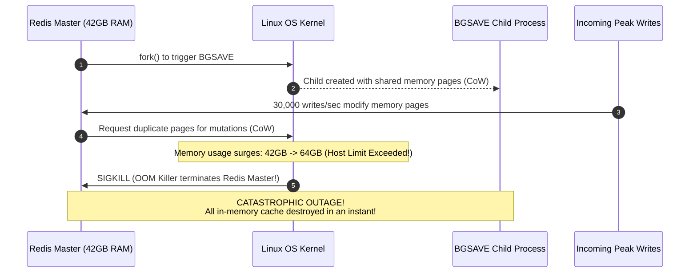
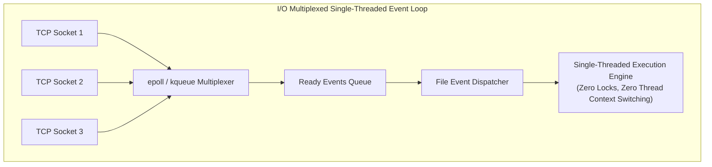
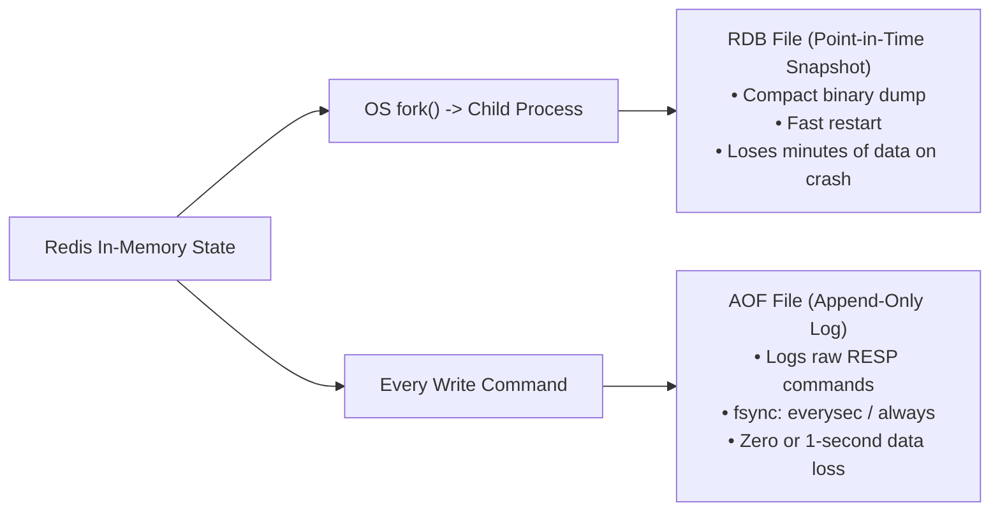
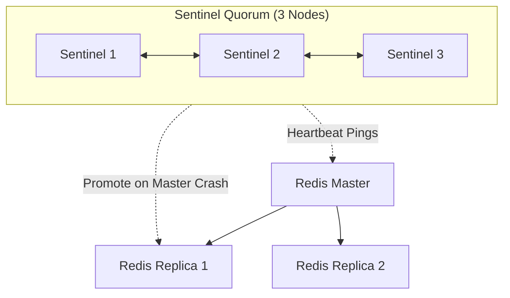
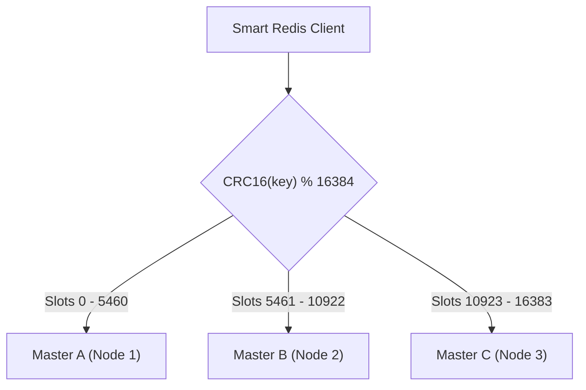
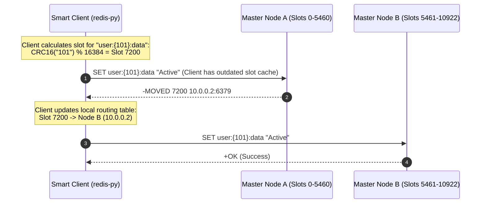
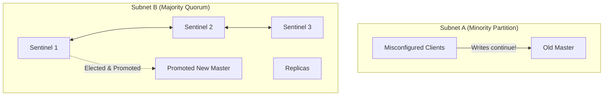

# Distributed Redis Architecture: Internals, Persistence & Clustering

Redis (Remote Dictionary Server) is the industry standard for ultra-low latency in-memory storage. Behind its simple key-value interface lies a sophisticated architecture featuring non-blocking I/O multiplexing, copy-on-write persistence, and decentralized cluster topologies capable of handling millions of operations per second at sub-millisecond latencies.

---

## 💡 Intuitive Real-World Analogies

### 1. The Single-Threaded Event Loop: The Chess Grandmaster
Imagine a world-class chess grandmaster playing a simultaneous exhibition against 50 club players:
- If the grandmaster sat down and waited 20 minutes for Player 1 to make a move, the event would take days.
- Instead, the grandmaster walks briskly along the tables. When a player has moved, the grandmaster spends **2 milliseconds** looking at the board, makes a move instantly, and moves on to the next active player (**Non-blocking Event Polling**).
- There is only **one grandmaster (single-threaded)**. Because there is only one mind making decisions, there is **zero debate, zero locks, zero collision, and zero confusion** over which piece belongs to whom.

### 2. Redis Cluster & Hash Slots: The 16,384 Mailroom Cubbies
Imagine an international corporate mailroom with exactly **$16,384$ numbered mail cubbies**:
- Every letter that arrives has its recipient name converted into a number between $0$ and $16,383$ using a deterministic postal formula (`CRC16(Name) % 16384`).
- If the mailroom has 3 clerks (Master Nodes):
  - Clerk A is responsible for Cubbies $0$ to $5,460$.
  - Clerk B is responsible for Cubbies $5,461$ to $10,922$.
  - Clerk C is responsible for Cubbies $10,923$ to $16,383$.
- If you hire a 4th clerk, you simply reassign cubbies $12,000$ to $16,383$ to Clerk D. The cubbie numbers never change!

---

## 👶 Plain-English / ELI5 Overview

Traditional databases are like libraries with millions of books stored on underground basement shelves (hard drives). Finding a book requires walking down stairs, unlocking doors, and flipping through pages.

**Redis is like writing notes on a giant whiteboard in the lobby (RAM).** Reading or writing takes milliseconds because everything is right in front of you. 

- **Why is it single-threaded?** In multi-threaded programs, threads spend a lot of time waiting in line for locks and fighting over memory. Redis avoids this completely by having a single lightning-fast worker execute operations one by one without locks.
- **What if power goes out?** Redis periodically saves its whiteboard memory to disk using **RDB snapshots** or writes every change into a journal called an **AOF (Append-Only File)**.
- **What if data is too big for one computer?** **Redis Cluster** slices the memory into 16,384 slots and distributes them across multiple machines.

---

## ⚠️ The Horror Scenario: The Copy-on-Write OOM Crash & Split-Brain Data Loss

### Disaster 1: The Copy-on-Write (CoW) Memory Meltdown
An e-commerce company hosted Redis on a 64 GB cloud VM. The dataset grew to 42 GB:
1. At peak traffic (30,000 writes/sec), Redis scheduled a background snapshot (`BGSAVE`).
2. Redis called `fork()` to create a child process. Under Linux, the child process shares the parent's memory pages via **Copy-on-Write (CoW)**.
3. Because the platform was receiving massive write traffic, Linux began duplicating memory pages for every mutated key.
4. Memory usage spiked from $42\text{ GB} \to 50\text{ GB} \to 62\text{ GB} \to 64.5\text{ GB}$.
5. The Linux kernel ran out of physical memory and invoked the **OOM Killer (Out-of-Memory Killer)**, instantly terminating the Redis master process!



### Disaster 2: The Sentinel Split-Brain Phantom Write
During a network partition, the network severed the connection between the Redis Master and the Sentinel quorum.
- The Sentinels concluded the master was dead and promoted Replica 1 to be the new Master.
- However, the old Master remained running in the partitioned subnet, and misconfigured clients continued writing financial balances to it.
- When the network partition healed, the Sentinels reconnected and **demoted the old Master to a Replica**.
- The old master flushed its memory to sync from the new master, **permanently erasing thousands of customer transactions**!

---

## 1. Why Redis is Blazing Fast

A single Redis instance can easily process $100,000+$ operations per second on commodity hardware.



### The 3 Core Performance Reasons
1. **Pure In-Memory Operations:** All data resides in RAM. Zero disk seek latency ($\sim 100\text{ ns}$ vs $\sim 5\text{ ms}$).
2. **Non-Blocking I/O Multiplexing (`epoll` / `kqueue`):** A single thread monitors thousands of network client sockets simultaneously without blocking.
3. **Single-Threaded Command Execution:** Commands are executed sequentially by a single core. **Zero lock contention, zero deadlocks, and zero CPU context switching overhead.** (Note: Modern Redis uses background helper threads strictly for disk I/O, asynchronous unlinking of large keys, and socket network byte translation).

---

## 2. In-Memory Data Structures Under the Hood

| Redis Type | Internal C Data Structure | Algorithmic Complexity | System Design Use Case |
| :--- | :--- | :--- | :--- |
| **String** | **SDS (Simple Dynamic String)**: Binary-safe, stores string length explicitly ($O(1)$ `strlen`). | $O(1)$ get/set/append | Session storage, caching API responses, distributed locks (`SETNX`). |
| **Hash** | **listpack** (small) $\to$ **dict (Hash Table)** (large). | $O(1)$ field get/set | User profile objects (`HSET user:100 name "Alice"`). |
| **List** | **quicklist** (linked list of compact listpacks). | $O(1)$ push/pop at ends | Task queues, activity feeds (`LPUSH` / `RPOP`). |
| **Set** | **intset** (small integers) $\to$ **dict (Hash Table)**. | $O(1)$ add/check | Unique tags, friend IDs, voting deduplication. |
| **Sorted Set (ZSet)** | Dual structure: **dict (Map)** for $O(1)$ score lookups + **SkipList** for $O(\log N)$ range ordering. | $O(\log N)$ insert/range | Real-time gaming leaderboards, sliding window rate limiters. |

---

## 3. Persistence Modes: RDB vs. AOF

Redis is an in-memory store, but it provides durability through two complementary persistence engines:



### 1. RDB (Redis Database Snapshot)
- Periodically creates a compact, point-in-time binary snapshot of memory to disk (`dump.rdb`).
- **How it works without blocking:** Redis calls `fork()` to create a child process. The OS uses **Copy-on-Write (CoW)** pages: the child writes the snapshot to disk while the parent continues serving user requests without pausing.
- **Trade-off:** If the server loses power between snapshot intervals (e.g., snapshots run every 15 minutes), the last 15 minutes of writes are permanently lost.

### 2. AOF (Append-Only File)
- Logs every received write command to an append-only file on disk using the standard Redis Serialization Protocol (RESP).
- **`appendfsync` Policies:**
  - `always`: Flushes to disk after every single write ($O(1)$ safety, but severely degrades throughput).
  - `everysec` (**Recommended Default**): Flushes once per second. Maximum potential data loss is strictly bounded to $1\text{ second}$.
  - `no`: Leaves disk flushing to the OS kernel (unpredictable latency, potential multi-minute data loss).
- **AOF Rewrite (`BGREWRITEAOF`):** To prevent the AOF file from growing indefinitely (e.g., 1,000 increments to a counter), a background worker rewrites the file using only the minimal commands needed to rebuild current state (`SET counter 1000`).

---

## 4. High Availability: Redis Sentinel

For single-master architectures, **Redis Sentinel** provides automated monitoring, health checking, and failover:



- **Subjective Down (`sdown`):** A single Sentinel node detects a master ping timeout.
- **Objective Down (`odown`):** A configured quorum of Sentinels agree the master is unreachable.
- Sentinels run a Raft-like leader election to choose a leader Sentinel, which automatically promotes the replica with the highest replication offset to become the new master.

---

## 5. Horizontal Scale: Redis Cluster (Hash Slots)

When data volume exceeds the RAM of a single physical server (e.g., $> 256\text{ GB}$), **Redis Cluster** provides automatic horizontal sharding across multiple master nodes without requiring Sentinels.



### The 16,384 Hash Slots Mechanism
- The entire cluster key space is divided into exactly **$16,384$ Hash Slots**.
- Every key is assigned to a slot using the formula:
  $$\text{Slot} = \text{CRC16}(\text{Key}) \pmod{16384}$$
- The 16,384 slots are partitioned across available master nodes:
  - Node 1: Slots $0 \dots 5,460$
  - Node 2: Slots $5,461 \dots 10,922$
  - Node 3: Slots $10,923 \dots 16,383$

### Hash Tags: Ensuring Multi-Key Operations
Redis Cluster forbids multi-key operations (transactions, pipelines, `MGET`) if the keys map to different slots.
- **Solution: Hash Tags `{...}`**: If a string contains `{...}`, only the text inside the curly braces is hashed!
  - `user:{usr_101}:profile` $\implies$ hashes `"usr_101"`
  - `user:{usr_101}:orders` $\implies$ hashes `"usr_101"`
- Both keys are guaranteed to land on the exact same hash slot and same physical master node!

### Client-Side Smart Routing & Redirection
- **Smart Clients:** Clients (e.g., Jedis, Lettuce, redis-py) cache the cluster slot-to-node mapping locally in memory.
- If a key migrated to a new node, the contacted node returns a redirect:
  - `MOVED 3999 10.0.0.5:6379` (Permanent redirect: client updates local slot cache).
  - `ASK 3999 10.0.0.5:6379` (Temporary redirect during active slot migration).

---

## 🚶 Step-by-Step Scenario: Client Routing in Redis Cluster



---

## 🏢 Real-World Production Battle-Testing

### Twitter (X): Twemproxy and Massive In-Memory Caching
- Twitter historically operated one of the world's largest Redis footprints to store user home timelines.
- Built **Twemproxy (nutcracker)**, an open-source high-performance proxy that shards data across thousands of Redis instances via consistent hashing, maintaining sub-millisecond timeline rendering.

### GitHub: Redis Sentinel for Zero-Downtime Failover
- GitHub runs Redis Sentinel clusters to manage session storage, background job queues (Resque), and webhook event pipelines.
- Automating failover via Sentinel ensures that when a primary database server undergoes OS patching or hardware degradation, write traffic resumes within 5 seconds without manual ops intervention.

---

## ⚖️ Practical Trade-Offs & Decision Rules of Thumb

| Architecture | Scalability Limit | Complexity | Automated Failover? | Best Use Case |
| :--- | :--- | :--- | :---: | :--- |
| **Standalone Redis** | Single node RAM ($< 64\text{ GB}$) | Minimal | ❌ No | Local development, unit testing |
| **Redis with Sentinel** | Vertical scale only (Single Master) | Moderate | ✅ Yes | Production datasets $< 64\text{ GB}$ needing High Availability |
| **Redis Cluster** | Horizontal scale (Terabytes of RAM) | High | ✅ Yes (Built-in) | Massive datasets ($> 64\text{ GB}$) or write loads $> 100\text{k ops/s}$ |

### Rules of Thumb for System Designers
1. **Never allocate $> 60\%$ of VM RAM to Redis:** Always leave 40% headroom for OS Copy-on-Write (`CoW`) page allocation during `BGSAVE` and AOF rewrites. If VM has 64 GB, set `maxmemory 38gb`.
2. **Never run `KEYS *` in production:** Redis is single-threaded. `KEYS *` will iterate over 50 million keys, locking the event loop for 10 seconds and causing global microservice timeouts. Always use `SCAN` with cursor iteration.
3. **Use Hash Tags for Co-located Data:** When designing Redis Cluster keys, wrap the tenant or user ID in curly braces `{user_123}:orders` to enable transactions and pipeline batching.

---

## 🎯 Top Real-World Interview Questions & Deep-Dive Answers (FAANG / Staff Level)

### Question 1: Why does Redis achieve such high throughput despite being single-threaded, and under what specific conditions does single-threaded execution become a massive architectural bottleneck?
**Model Answer:**
Redis operates a single-threaded event loop for command execution. It achieves $100,000+\text{ ops/sec}$ because:
1. **Memory Bound, Not CPU Bound:** In-memory lookups take $\sim 100\text{ ns}$. The CPU is practically never the bottleneck; network I/O and memory bandwidth are.
2. **Zero Lock Overhead:** Multi-threaded engines spend significant CPU cycles managing mutexes, spinlocks, and read-write barriers. Redis has zero concurrency contention.
3. **Zero Context Switching:** A single thread pinned to a CPU core maintains warm L1/L2 CPU caches without OS thread context-switching overhead.
4. **I/O Multiplexing:** Uses kernel-level multiplexing (`epoll` on Linux, `kqueue` on macOS) to handle 10,000+ open client sockets on a single thread.

**When Single-Threading Becomes a Critical Bottleneck:**
1. **Time-Complexity $O(N)$ Commands:** Running `KEYS *`, `SMEMBERS` on a set with 1M items, or `HGETALL` on a giant hash locks the single thread. During this time, **no other client request can be processed**, causing cascading timeouts across the entire microservice fleet.
2. **Large Value Deletion (`DEL` on a 500MB Key):** Reclaiming millions of memory pointers locks the memory allocator. (*Solution: Use asynchronous unlinking `UNLINK key`*).
3. **Lua Script Long Loops:** A Lua script runs atomically inside the event loop. An infinite loop or heavy regex inside a script freezes Redis completely.

---

### Question 2: What is a Redis Sentinel "Split-Brain" scenario, and how do you configure Redis to mathematically prevent silent data loss during network partitions?
**Model Answer:**
A Split-Brain occurs when a network partition isolates the Redis Master from the Sentinel quorum while clients can still reach both partitions:



1. **The Partition:** Subnet A has the Old Master and some clients. Subnet B contains 3 Sentinels, 2 Replicas, and the rest of the clients.
2. **The Split:** The Sentinels cannot reach the Old Master, declare `odown`, and promote a Replica to New Master.
3. **The Data Loss:** Clients in Subnet A continue writing to Old Master. When the network partition heals, Sentinels reconfigure Old Master to become a Replica of New Master. Old Master **wipes its entire memory space** to replicate from New Master, permanently erasing all writes accepted during the partition!

**The Production Prevention Configuration:**
Configure the master in `redis.conf`:
```properties
# Require at least 1 replica to acknowledge writes
min-replicas-to-write 1
# Maximum acceptable lag from replica in seconds
min-replicas-max-lag 10
```
- If the Old Master in Subnet A is disconnected from its replicas for $>10\text{ seconds}$, it **stops accepting writes** and returns an error: `NOREPLICAS Not enough good replicas to write`.
- Clients are rejected immediately instead of accumulating phantom writes that will be wiped later.

---

### Question 3: How does Redis Cluster manage horizontal slot rebalancing and node migrations live in production without dropping client connections or causing downtime?
**Model Answer:**
Redis Cluster achieves live rebalancing through incremental Hash Slot Migration managed by the `redis-cli --cluster reshard` utility:

**The Step-by-Step Live Migration Sequence:**
1. **Target Node Preparation:** Target Node (Node B) is set to importing state for slot $S$: `CLUSTER SETSLOT 7200 IMPORTING <NodeA_ID>`.
2. **Source Node Preparation:** Source Node (Node A) is set to migrating state: `CLUSTER SETSLOT 7200 MIGRATING <NodeB_ID>`.
3. **Batch Key Migration:** Node A executes `CLUSTER GETKEYSINSLOT 7200 100` and transfers the serialized key payloads to Node B atomically using the `MIGRATE` command.
4. **Handling Client Requests During Migration:**
   - If a client requests a key in Slot 7200 that has **not yet moved**, Node A processes it normally.
   - If a client requests a key that has **already moved**, Node A does not have it and returns an `-ASK 7200 10.0.0.2:6379` redirection.
5. **The `ASK` vs `MOVED` Protocol:**
   - `-MOVED` tells the client: *"This slot has permanently moved. Update your internal slot table."*
   - `-ASK` tells the client: *"This specific key has moved temporarily during migration. Send an `ASKING` command to Node B followed by your query, but do NOT update your internal slot cache yet."*
6. **Final Cutover:** Once all keys in Slot 7200 are migrated, Node A and Node B notify the cluster via Gossip protocol: `CLUSTER SETSLOT 7200 NODE <NodeB_ID>`. All nodes update their slot tables permanently.

---
*Related Documents:*
- [Caching Topologies and Multi-Tier Architecture](file:///home/prasanta/Documents/learning_folder/system_design/04_CACHING_STRATEGIES_AND_PATTERNS/01_caching_topologies_and_tiers.md)
- [Cache Invalidation and Update Patterns](file:///home/prasanta/Documents/learning_folder/system_design/04_CACHING_STRATEGIES_AND_PATTERNS/02_cache_invalidation_patterns.md)
- [Cache Eviction Policies: LRU, LFU, ARC](file:///home/prasanta/Documents/learning_folder/system_design/04_CACHING_STRATEGIES_AND_PATTERNS/03_cache_eviction_policies.md)
- [Cache Anomalies and Mitigations](file:///home/prasanta/Documents/learning_folder/system_design/04_CACHING_STRATEGIES_AND_PATTERNS/04_cache_anomalies_and_mitigation.md)
