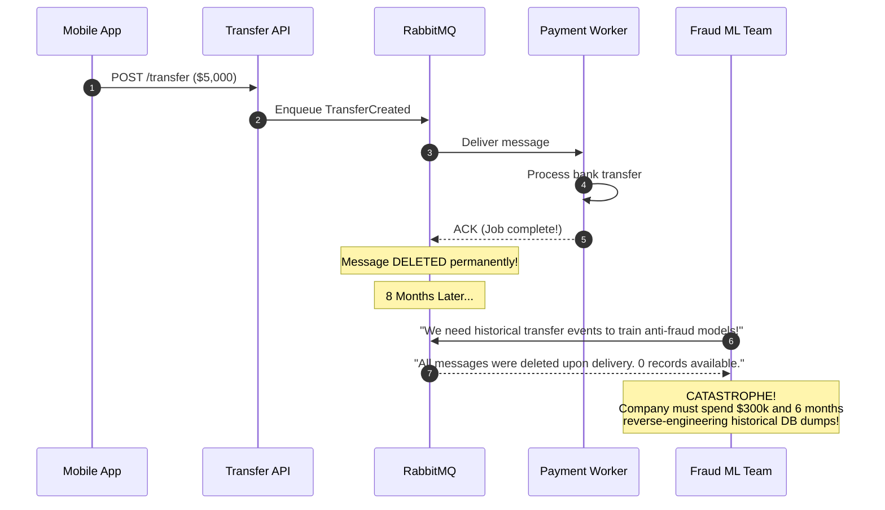
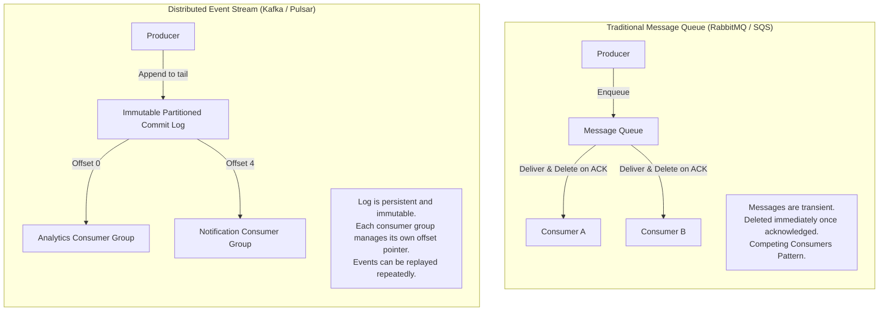
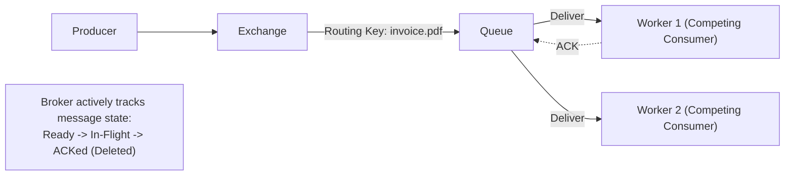
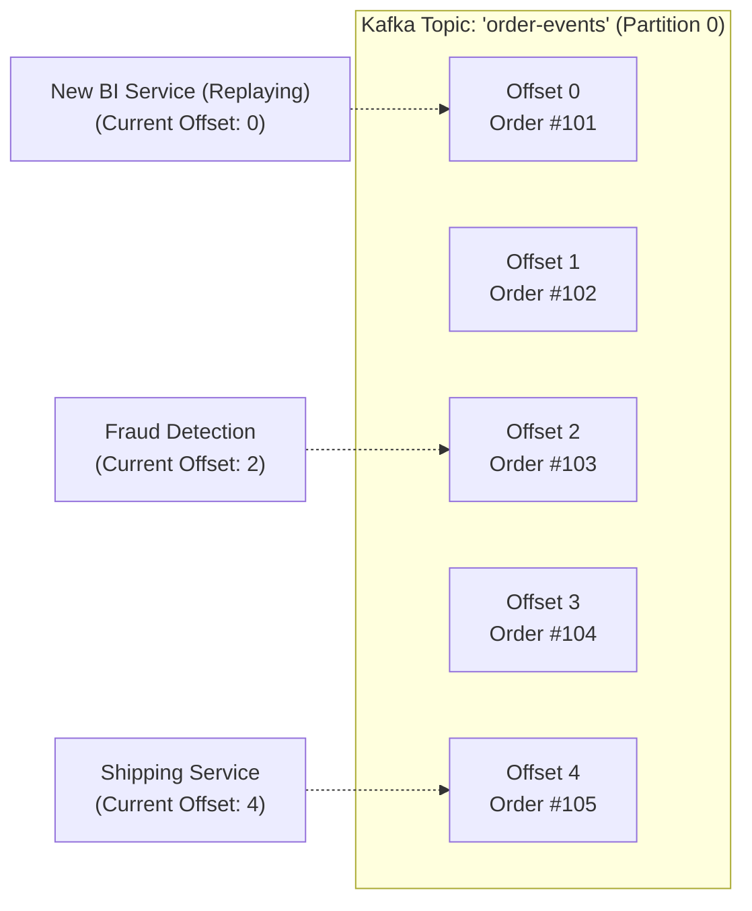
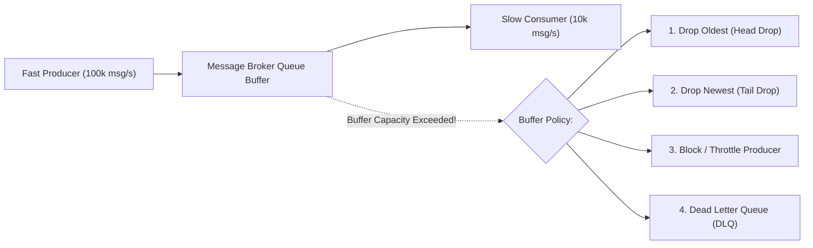
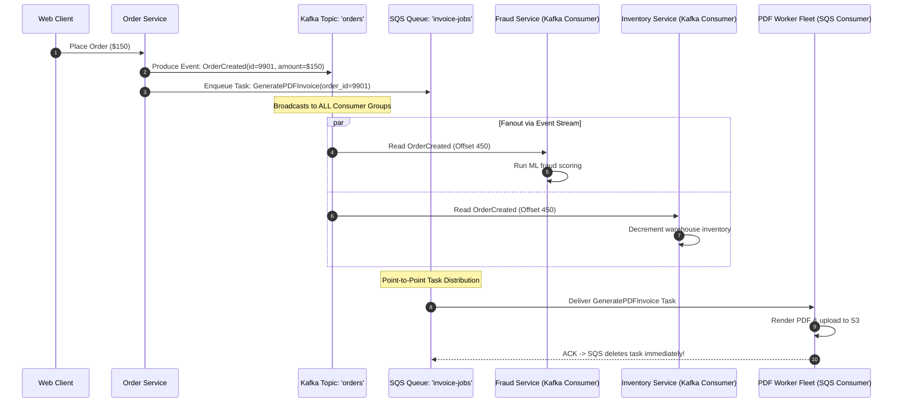
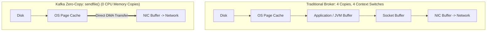
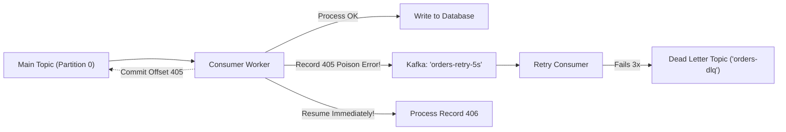

# Message Queues vs. Distributed Event Streams

Asynchronous messaging is the backbone of modern distributed systems. It decouples microservices, smooths out sudden traffic surges, and guarantees eventual consistency across disparate storage layers. However, choosing between a **Traditional Message Queue** (RabbitMQ, AWS SQS) and an **Append-Only Event Stream** (Apache Kafka, Apache Pulsar) is one of the most critical architectural decisions an engineer will make.

---

## 💡 Intuitive Real-World Analogies

### 1. Traditional Message Queue: The Diner Order Spike
Imagine a bustling diner kitchen:
- When a customer orders pancakes, the waiter writes the order on a paper slip and places it in a ticket rack.
- Chef Alice grabs the slip, cooks the pancakes, and **stabs the paper onto a metal spike (destructive pop / delete)**.
- Once spiked, that paper slip is gone forever. Chef Bob never sees it. If the restaurant owner later asks: *"What exact ingredients were ordered at 9:15 AM?"*, nobody can answer because the ticket was destroyed upon completion.
- **Philosophy:** Ephemeral task distribution. The goal is to give a job to *one* worker and dispose of it immediately after completion.

### 2. Distributed Event Stream: The Airport Flight Departure Board
Imagine the massive digital display board at an international airport:
- Flight updates are continuously logged in chronological order: *"Flight 202 Boarding at Gate 4"*, *"Flight 105 Delayed"*.
- The board **does not erase an announcement** just because passenger Alice reads it. 
- Alice reads line 12 at her own pace. Bob arrives 10 minutes later and reads line 5. The ground crew reads line 1 to prepare luggage.
- If a security auditor arrives tomorrow, they can rewind the log to midnight and review every flight announcement in the exact order it occurred.
- **Philosophy:** Persistent, immutable sequence of facts. Multiple independent observers read the exact same history at their own speed without mutating the log.

---

## 👶 Plain-English / ELI5 Overview

- **Traditional Message Queues (RabbitMQ, SQS):** Think of these as a **"To-Do List"** for workers. You post a task (e.g., *"Resize this photo"*). One worker grabs it, does the job, confirms it's done (ACK), and the broker throws the message away. If all workers are busy, messages wait in line. Once processed, it disappears forever.
- **Distributed Event Streams (Kafka, Pulsar):** Think of these as an **"Immutable Diary"** or historical ledger. You record a fact (e.g., *"Customer #42 purchased a shoes"*). That fact is stamped into an append-only log on disk and kept for days, months, or years. Ten different microservices (Inventory, Billing, Recommendations, Fraud Detection) can read the diary independently. If you write a brand new service next month, it can re-read the entire diary from page 1!

---

## ⚠️ The Horror Scenario: The $300,000 Ephemeral Data Loss

A fast-growing fintech startup built their microservice core using a traditional message queue (RabbitMQ):
1. Every time a user made a transfer, the API pushed a `TransferCreated` message to a RabbitMQ queue.
2. The `PaymentProcessor` service consumed the message, executed the transfer, and sent an `ACK`.
3. RabbitMQ dutifully **deleted the message from memory and disk**.



**The Disaster:** Eight months later, financial regulators mandated a real-time anti-money-laundering (AML) audit, and the machine learning team was hired to train fraud detection models. They asked for the stream of transaction events.
- Because RabbitMQ had destroyed every message upon delivery, **historical event data was gone**.
- Worse, when the company attempted to connect a new Fraud Service to the existing queue, the Fraud Service and Payment Service began **competing** for messages: half the transfers were processed by Payment without fraud checks, and the other half were inspected by Fraud but never paid out!
- The company spent $300,000 in engineering labor rebuilding databases and reverse-engineering logs to construct an event stream they should have had from day one.

---

## 1. Core Architectural Distinction



---

## 2. Traditional Message Queues (RabbitMQ, AWS SQS)

Designed around the **Smart Broker, Dumb Consumer** philosophy.



### How It Works
- **Routing & Exchanges:** The broker contains rich routing logic (RabbitMQ Direct, Topic, Fanout, and Header exchanges) to inspect message headers and direct them into specific queues.
- **Message Lifecycle:**
  1. `Ready`: Waiting in queue for an available worker.
  2. `In-Flight / Unacked`: Delivered to a worker; hidden from other workers.
  3. `ACKed`: Worker confirms success; broker **permanently deletes** the message.
  4. `NACKed / Timed Out`: Worker crashes; broker returns message to queue for another worker.
- **Competing Consumers Pattern:** Multiple workers listen to the same queue. Each message is processed by **exactly one worker**.
- **Individual Message Controls:** Provides native support for per-message TTL, priority queues (e.g., VIP jobs jump the line), and scheduled delivery delays (e.g., *"deliver this message in 15 minutes"*).

---

## 3. Distributed Event Streams (Apache Kafka, Apache Pulsar)

Designed around the **Dumb Broker, Smart Consumer** philosophy.



### How It Works
- **The Partitioned Log:** A topic is an ordered, append-only disk sequence of record batches. New messages are appended to the very end of a partition.
- **Sequential Disk I/O:** Kafka writes sequentially to disk, achieving millions of writes per second by leveraging the OS page cache and zero-copy network transmission (`sendfile` system call).
- **Immutable & Non-Destructive:** Messages are **never deleted when consumed**. They persist according to a time-based (e.g., 7 days) or size-based retention policy.
- **Offsets:** The broker does not track per-consumer acknowledgments. Consumers simply track an integer called an **Offset** (the index of their current reading position).
- **Time Travel & Event Replay:** A team can deploy a new service today, set its offset to `0`, and process every business event from the past 30 days to build its internal state from scratch.

---

## 4. Backpressure and Flow Control

What happens when an upstream producer emits 100,000 events/second, but downstream consumer workers can only process 10,000 events/second?



### How Backpressure is Handled
1. **Push vs. Pull Models:**
   - **RabbitMQ (Push-based):** The broker pushes messages to consumers. If consumers get overwhelmed, they must configure `prefetch_count` (e.g., *"send me at most 50 messages before waiting for an ACK"*).
   - **Kafka (Pull-based):** Consumers pull batches via `poll(timeout, max_records)`. Consumers naturally control their own rate; if a consumer slows down, it simply pulls fewer records on its next poll cycle.
2. **Dead Letter Queues (DLQ):** Poison-pill messages (malformed JSON, null pointer triggers) that fail repeatedly after max retries are safely diverted into a DLQ for developer inspection without stalling the main pipeline.

---

## 🚶 Step-by-Step Scenario: E-Commerce Checkout Pipeline

Let's trace how an e-commerce platform processes an order across both systems:



- **Why Kafka for `OrderCreated`?** Because multiple independent services need to react to this business domain fact (Fraud, Inventory, Analytics, Shipping). If a new Marketing Service is added next month, it simply subscribes to the topic without touching existing code.
- **Why SQS for `GeneratePDFInvoice`?** Because generating a PDF is a discrete background task that should be executed by exactly *one* worker and never replayed.

---

## 🏢 Real-World Production Battle-Testing

### Uber: Global Event Bus on Apache Kafka
- Uber processes **trillions of messages per day** and petabytes of data using Apache Kafka.
- Every GPS ping, ride request, driver dispatch, and surge-pricing update is written to Kafka as an immutable event stream.
- Multiple consumers (real-time driver matching, dispatch optimization, fraud detection, customer receipts) read the same event streams concurrently.

### Netflix: Distributed Tracing & Keystone Data Pipeline
- Netflix routes over **1.5 trillion events per day** through Kafka clusters into AWS S3, Elasticsearch, and Apache Flink for real-time operational diagnostics and video recommendation algorithms.

### Stripe: Asynchronous Task Queues with RabbitMQ & Redis
- While Kafka handles event streaming, Stripe relies on message queues for discrete transactional webhooks and merchant notification retries.
- RabbitMQ allows Stripe to handle per-message retry policies, exponential backoff scheduling, and priority queuing for critical merchant payout notifications.

---

## ⚖️ Practical Trade-Offs & Decision Rules of Thumb

| Feature | Message Queues (RabbitMQ, SQS) | Event Streams (Kafka, Pulsar) |
| :--- | :--- | :--- |
| **Data Retention** | Ephemeral (Deleted immediately upon ACK) | Persistent (Retained by time or size policy) |
| **Consumption Model** | Broker pushes to consumers (Push) | Consumers pull from broker (Pull) |
| **Consumer State** | Tracked entirely by Broker | Tracked by Consumers (Offsets) |
| **Message Ordering** | Strict FIFO per-queue (Single consumer only) | Strict FIFO within a partition across consumer groups |
| **Event Replay** | ❌ Impossible (Data deleted upon consumption) | ✅ Native (Seek offset to any historical timestamp) |
| **Throughput Capacity** | Tens of thousands msgs/sec | Millions of msgs/sec (Zero-copy sequential disk) |
| **Routing Flexibility** | Complex (Topic exchanges, wildcard binding) | Partition key based routing |
| **Priority & Delay** | ✅ Native per-message delays and priority queues | ❌ Difficult (Partitions must be read strictly in order) |
| **Primary Domain** | Task processing & workflow coordination | Event streaming, analytics, real-time sync, CDC |

### Rules of Thumb for System Designers
1. **Choose a Traditional Message Queue (RabbitMQ / SQS) when:**
   - You need discrete background tasks executed by competing workers (e.g., resize an image, convert video, deliver an email).
   - You need per-message delay timers (e.g., *"run this job in 30 minutes"*) or priority lanes.
   - You don't need to retain history once the task is finished.
2. **Choose a Distributed Event Stream (Kafka / Pulsar) when:**
   - Multiple different microservices need to react to the *same* business event.
   - You need high-throughput event streaming (telemetry, clickstreams, IoT).
   - You need **Event Replayability** to rebuild databases, train ML models, or backfill new analytics services.
   - You need strict partition-level ordering across a high volume of related keys (e.g., all banking transactions for `user_id=123` processed sequentially).

---

## 🎯 Top Real-World Interview Questions & Deep-Dive Answers (FAANG / Staff Level)

### Question 1: How does Apache Kafka achieve millions of messages per second on disk while traditional message brokers (RabbitMQ) struggle at higher scale? Which OS primitives make this possible?
**Model Answer:**
Many engineers assume Kafka is fast because it runs in memory. In reality, Kafka writes every single record to persistent disk! Its blistering throughput stems from exploiting four OS and hardware design principles:

1. **Sequential Disk I/O vs. Random Disk I/O:**
   - Disk head seeks on traditional magnetic disks or block allocations on SSDs are slow for random access ($\sim 100\text{ IOPS}$).
   - However, **Sequential Disk I/O** is as fast as memory access ($\sim 600\text{ MB/sec}$ on SATA disk, $3+\text{ GB/sec}$ on NVMe).
   - Traditional brokers (RabbitMQ) maintain complex B-Tree or pointer-based indices in memory and disk to track per-message ACKs and deletions, causing random I/O. Kafka writes strictly sequentially to the tail of an append-only commit log.

2. **The OS Page Cache (Zero JVM Garbage Collection):**
   - Kafka runs on the JVM, but it does **not** cache messages in the Java Heap!
   - Storing gigabytes of messages in JVM heap leads to massive object memory overhead (2x–4x data size) and catastrophic garbage collection pauses.
   - Kafka delegates all caching directly to the **Linux OS Page Cache**. When the broker process restarts, the OS page cache remains warm!

3. **Zero-Copy Network Transfer (`sendfile` System Call):**
   - Traditional broker flow: `Disk -> OS Page Cache -> JVM User Space -> Socket Buffer -> NIC Buffer` (4 context switches, 3 memory copies).
   - Kafka flow: Kafka uses the Java NIO `FileChannel.transferTo()` API, which maps directly to the Linux **`sendfile()`** system call.
   - The OS streams bytes **directly from the Page Cache to the Network Interface Card (NIC) buffer**, completely bypassing user space!



---

### Question 2: Why is strict global FIFO ordering an illusion in horizontally scalable messaging, and how do Kafka partitions balance concurrency against ordering?
**Model Answer:**
In distributed systems, **Global FIFO Ordering and Horizontal Scalability are mutually exclusive**:
- If you require strict global ordering across 1,000,000 messages/sec, all 1,000,000 messages must pass through a **single queue on a single thread on a single server**, creating a hard scalability ceiling.
- The moment you introduce multiple parallel consumers or multiple partitions, messages will be processed at varying speeds due to CPU scheduling and network latency, destroying global order.

**The Solution: Partition-Level Ordering (Partial Ordering):**
Kafka recognizes that in business domains, global ordering is rarely necessary. You do not care if Alice's order is processed before Bob's order; you only care that **Alice's Order #1 is processed before Alice's Order #2**.

```mermaid
flowchart LR
    P["Producer"] --> Router{"MurmurHash2(Key) % Partitions"}
    Router -->|Alice (Key='user_101')| P0["Partition 0 (Strict FIFO)"]
    Router -->|Bob (Key='user_202')| P1["Partition 1 (Strict FIFO)"]
    P0 --> C0["Consumer 0"]
    P1 --> C1["Consumer 1"]
```

- Producers assign a **Partition Key** (e.g. `user_id` or `order_id`).
- Kafka hashes the key using `MurmurHash2(key) % num_partitions`.
- All messages for `user_101` are guaranteed to land on the **exact same partition**.
- Kafka guarantees **strict FIFO ordering within each individual partition**, while allowing thousands of partitions to scale horizontally across a cluster.

---

### Question 3: How do you handle "Head-of-Line Blocking" and poison pill messages in an Event Stream versus a Message Queue?
**Model Answer:**
- **In Traditional Message Queues (RabbitMQ/SQS):** When a worker crashes on a malformed "poison pill" message, it sends a `NACK` or times out. After $N$ retry attempts, the broker natively diverts that single message into a **Dead Letter Queue (DLQ)**. The queue immediately advances to the next message with zero head-of-line blocking.
- **In Distributed Event Streams (Kafka):** Consumers manage an **Offset Pointer**. You cannot simply "delete" or "skip" an individual corrupt record in the middle of a continuous byte partition without advancing the offset. If consumer code crashes in an unhandled loop on record 405, **the entire partition freezes** for all subsequent messages!

**The Kafka Production DLQ Pattern (Uber / Confluent):**


1. **Catch-and-Publish:** Wrap message deserialization and processing in a strict `try-catch` block.
2. If processing fails, the consumer immediately publishes the payload to an asynchronous **Retry Topic** (`orders-retry-5s`) along with error headers and retry counts.
3. The consumer commits the offset on the main partition and **immediately processes the next record**, eliminating head-of-line blocking!
4. A dedicated background retry worker processes the retry topic with backoff. If max attempts are exceeded, the message is routed to an **Alerting DLQ Topic** for engineering triage.

---
*Related Documents:*
- [Event-Driven Architecture Patterns: Outbox, Saga, CDC & CQRS](file:///home/prasanta/Documents/learning_folder/system_design/05_MESSAGING_EVENT_DRIVEN_AND_ASYNC/04_event_driven_design_patterns.md)
- [Cache Invalidation and Update Patterns](file:///home/prasanta/Documents/learning_folder/system_design/04_CACHING_STRATEGIES_AND_PATTERNS/02_cache_invalidation_patterns.md)
