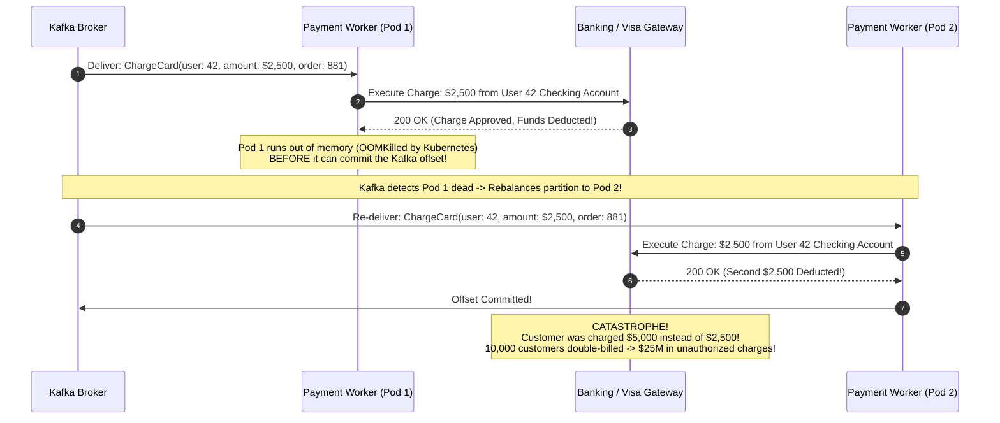
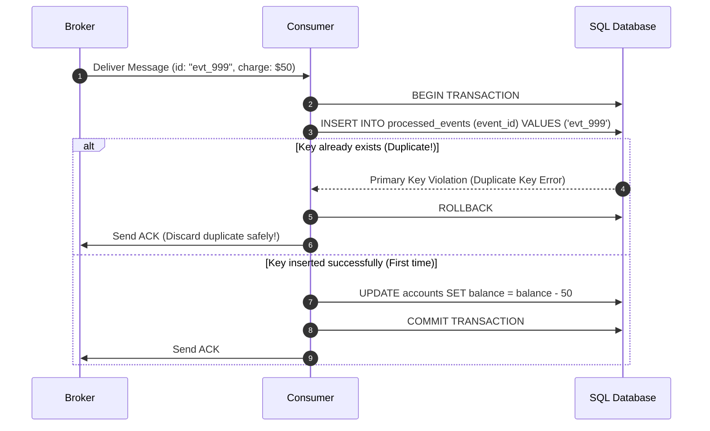
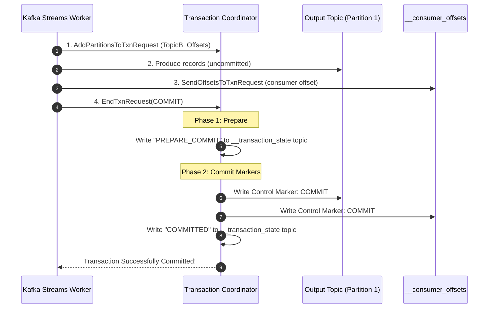

# Message Delivery Semantics and Exactly-Once Processing

In distributed systems, physical networks drop packets, workers crash midway through transactions, and acknowledgments get delayed. Achieving correctness requires understanding message delivery guarantees.

---

## 💡 Intuitive Real-World Analogies

### 1. At-Most-Once: The Unregistered Postcard
Imagine dropping a standard postcard into a public street mailbox:
- You walk away. You have no tracking number and receive no delivery receipt.
- If the mail truck catches fire, your postcard is lost forever.
- However, the recipient is **guaranteed never to receive two identical postcards**.
- **Philosophy:** Fire-and-forget. Perfect for high-frequency temperature sensor telemetry where losing one sample out of 10,000 is completely harmless.

### 2. At-Least-Once: The Persistent Certified Mail Courier
Imagine a courier delivering a legal contract:
- The courier knocks on your door. You take the contract, sign the delivery confirmation clipboard, and hand it back.
- But as the courier walks down your driveway, a gust of wind blows the clipboard into the sewer.
- Because the courier has no confirmation of delivery, their protocol forces them to print a duplicate copy and **knock on your door again tomorrow morning**.
- You receive the same document twice.
- **Philosophy:** Zero message loss guaranteed, but duplicates are inevitable.

### 3. Idempotency (The Secret to Exactly-Once): The Elevator Call Button
Imagine you are waiting in a hotel lobby for an elevator:
- You walk up and press the **"▲ UP"** button. The button illuminates.
- An anxious guest walks up 5 seconds later and presses the **"▲ UP"** button 5 times rapidly.
- Does the elevator arrive 5 times faster? Does it send 5 separate elevator cars? **No.**
- Because the action of pressing an illuminated button is **Idempotent**: executing it 1 time or 100 times produces the exact same end state.

---

## 👶 Plain-English / ELI5 Overview

When computer A sends a message to computer B over the internet, one of three things can happen:
1. **At-Most-Once (Maybe Once):** Computer A sends the message once and never checks if it arrived. If the network hiccups, the message vanishes forever.
2. **At-Least-Once (Once or More):** Computer A sends the message and waits for Computer B to say *"I got it!"* If Computer A doesn't hear back, it sends it again, and again, until confirmed. But if Computer B's confirmation gets lost in transit, Computer B receives duplicate copies.
3. **Exactly-Once Processing:** Computer A uses At-Least-Once delivery, but Computer B is smart enough to recognize duplicates using a unique serial number (like a tracking barcode). If Computer B sees a barcode it has already handled, it safely discards the duplicate.

> **The Golden Equation of Distributed Messaging:**  
> $$\mathbf{\text{Exactly-Once Processing}} = \mathbf{\text{At-Least-Once Delivery}} + \mathbf{\text{Idempotent Consumer Logic}}$$

---

## ⚠️ The Horror Scenario: The $25 Million Double-Charge Black Friday Disaster

An e-commerce giant launched a major Black Friday sale with a checkout microservice running on Kubernetes. Under heavy load, the payment processing fleet was configured with naive **At-Least-Once messaging** without idempotent consumers:



### What Happened?
- Pod 1 charged the customer's checking account via the Visa API.
- Before Pod 1 could write the Kafka offset back to the broker, a JVM Out-of-Memory error killed the pod.
- Kafka's consumer coordinator noticed the heartbeat failure and rebalanced the partition to Pod 2.
- Because the offset was never committed, Pod 2 re-read the exact same uncommitted message and executed the credit card charge a second time.
- Over the 2-hour sale, 10,000 customers were double-billed, triggering bank overdraft fees, massive customer outrage, and hundreds of thousands of dollars in card-network chargeback penalties.

---

## 1. The Three Delivery Models

```mermaid
flowchart TD
    subgraph AtMostOnce["1. At-Most-Once"]
        P1["Producer"] -->|Send (No Retry)| B1["Broker"]
        B1 -->|Commit Offset Before Processing| C1["Consumer"]
        Note1["Messages can be LOST, but never DUPLICATED."]
    end

    subgraph AtLeastOnce["2. At-Least-Once (Industry Standard)"]
        P2["Producer"] -->|Retry until ACK| B2["Broker"]
        B2 -->|Commit Offset AFTER Processing| C2["Consumer"]
        Note2["Messages NEVER LOST, but can be DUPLICATED."]
    end

    subgraph ExactlyOnce["3. Exactly-Once Processing (EOS)"]
        P3["Producer"] -->|Transactional Append| B3["Broker"]
        B3 -->|Deduplication & Idempotent Consumer| C3["Consumer"]
        Note3["Every message has the exact effect of being processed ONCE."]
    end
```

---

## 2. At-Most-Once Delivery
- **Mechanism:** The producer sends a message and does not retry if it times out. A consumer commits its offset/ACK **before** executing business logic.
- **Failure Scenario:** If the consumer worker crashes or runs out of memory while processing, the message is permanently lost because the broker believes it was already completed.
- **Acceptable For:** High-frequency, loss-tolerant metrics (e.g., CPU utilization samples, GPS tracking pings every 500ms, video streaming telemetry).

---

## 3. At-Least-Once Delivery
- **Mechanism:** The producer retries sending until it receives a cryptographic confirmation ACK from the broker. The consumer only commits its offset/ACK **after** business logic has successfully finished.
- **The Duplicate Hazard:**
  1. Consumer receives message: "Charge Card \$50".
  2. Consumer successfully charges the credit card.
  3. Consumer sends an ACK back to the broker.
  4. Network partition drops the ACK packet!
  5. The broker times out and redelivers the message to another consumer.
  6. **Without safeguards, the customer's credit card is charged twice!**

---

## 4. Exactly-Once Processing (EOS): The Truth

Can any distributed system guarantee that a network packet is transmitted across physical wires *exactly once*? **No.** Network packet loss makes retransmissions unavoidable (The Two Generals' Problem).

However, a system **can guarantee that the business side-effects of a message occur exactly once**.

---

## 5. Implementing Idempotent Consumers

### Pattern 1: Idempotency Keys with ACID Database Transactions
Every event must carry a unique cryptographic identifier (`event_id` or `idempotency_key`):



### Production Idempotent Worker Code (Python / PostgreSQL)
```python
import psycopg2
from psycopg2.errorcodes import UNIQUE_VIOLATION

def process_payment_event(event_id: str, account_id: str, amount: float):
    conn = db_pool.getconn()
    try:
        with conn:
            with conn.cursor() as cur:
                try:
                    # 1. Attempt to claim the event atomically in the database
                    cur.execute(
                        "INSERT INTO processed_events (event_id, processed_at) VALUES (%s, NOW());",
                        (event_id,)
                    )
                except psycopg2.IntegrityError as e:
                    if e.pgcode == UNIQUE_VIOLATION:
                        # Event was ALREADY processed! Safe duplicate detected.
                        logger.info(f"Duplicate event {event_id} discarded safely.")
                        return  # Do not charge again!
                    raise e

                # 2. Execute business mutation in the SAME transaction
                cur.execute(
                    "UPDATE accounts SET balance = balance - %s WHERE id = %s;",
                    (amount, account_id)
                )
                # 3. Transaction commits atomically!
    finally:
        db_pool.putconn(conn)
```

### Pattern 2: Natural Idempotency
Structure mutations as absolute assignments rather than incremental relative deltas:
- **Non-Idempotent:** `UPDATE inventory SET stock = stock - 1 WHERE item_id = 10;` (Running twice deducts 2 items).
- **Idempotent:** `UPDATE orders SET status = 'SHIPPED', shipped_at = '2026-10-22' WHERE order_id = 50;` (Running 10 times produces the exact same state).

---

## 6. Apache Kafka Exactly-Once Semantics (EOS)

Kafka provides end-to-end exactly-once stream processing across Kafka-to-Kafka pipelines (`read-process-write`):

1. **Idempotent Producer (`enable.idempotence=true`):**
   - The Kafka broker assigns each producer a 64-bit Producer ID (PID).
   - Each batch sent to a partition contains a monotonically increasing sequence number ($0, 1, 2, \dots$).
   - If the broker receives a batch with a sequence number it has already committed, it discards the duplicate in memory and returns an ACK without duplicating data in the partition log.
2. **Transactional API & Two-Phase Commit:**
   - Multi-partition writes and consumer offset commits are enclosed in an atomic transaction coordinated by Kafka's **Transaction Coordinator**.
   - Output messages are marked with commit markers. Consumers configured with `isolation.level=read_committed` buffer uncommitted messages and only release them to downstream code when the transaction commit marker appears.

---

## 🏢 Real-World Production Battle-Testing

### Stripe: Idempotency Keys on Payment APIs
- Every mutate request to Stripe’s API allows an `Idempotency-Key: <UUID>` header.
- Stripe stores incoming keys in an operational database.
- If an API client times out and retries the exact same charge request with the same idempotency key, Stripe bypasses payment processing and returns the **cached response of the original transaction**.

### Apache Flink & Kafka: Exactly-Once Stream Processing
- Flink utilizes the **Chandy-Lamport distributed snapshotting algorithm** combined with Kafka's Two-Phase Commit Producer (`KafkaProducer` transactional API).
- Checkpoint barriers inject markers into the stream. Downstream state is committed to disk only when all parallel operators reach the barrier, guaranteeing zero lost or duplicated calculations in multi-stage streaming aggregations.

---

## ⚖️ Practical Trade-Offs & Decision Rules of Thumb

| Guarantee | Latency Overhead | Throughput Impact | Duplicate Risk | Data Loss Risk | Recommended Production Use |
| :--- | :--- | :--- | :---: | :---: | :--- |
| **At-Most-Once** | Lowest (0ms ACK wait) | Maximum | None | High | Metrics, IoT GPS telemetry, video frame logs |
| **At-Least-Once** | Low (Single ACK roundtrip) | Very High | Yes (High under network partitions) | None | 90% of business microservices (with idempotent logic) |
| **Kafka EOS (Transactions)**| Moderate (2PC markers) | ~10-20% drop | None (Within Kafka ecosystem) | None | Financial stream processing, billing aggregations, CDC |

---

## 🎯 Top Real-World Interview Questions & Deep-Dive Answers (FAANG / Staff Level)

### Question 1: Why is physical "exactly-once delivery" mathematically impossible over an unreliable network, and how does software achieve "effective exactly-once processing"?
**Model Answer:**
Physical exactly-once delivery is impossible due to the **Two Generals' Problem**:
- Two generals across an enemy valley must agree on an attack time. General 1 sends a messenger: *"Attack at dawn"*.
- General 1 cannot attack until he knows the messenger arrived. So General 2 sends an acknowledgment messenger.
- But General 2 cannot attack until he knows his ACK arrived!
- This requires an **infinite series of acknowledgments to confirm the previous acknowledgment**, which can never be completed over an unreliable communication channel.

**How Software Solves It (Effective Exactly-Once):**
Software concedes that messages *will* be physically transmitted multiple times. It shifts the guarantee from the **network layer** to the **application state layer**:
1. Every message carries an immutable, unique identifier (`idempotency_key` or `UUID`).
2. The consumer enforces an **atomic check-and-insert** in its persistent database before processing.
3. If the message arrives a second time, the consumer recognizes the key, suppresses the duplicate business action, and sends a fresh ACK back to the broker.

---

### Question 2: How does Apache Kafka’s Transaction Coordinator use Two-Phase Commit (2PC) to achieve Exactly-Once Semantics (EOS) across streams?
**Model Answer:**
Kafka EOS is designed for `read-process-write` loops (consume from Topic A, compute, produce to Topic B, commit offset to `__consumer_offsets`):



1. **Step 1:** The worker registers output partitions and consumer offset partitions with the **Transaction Coordinator** (a specialized broker managing the internal `__transaction_state` topic).
2. **Step 2 & 3:** The worker produces records to the output topic and writes its consumer offset, but these records are flagged as **uncommitted**.
3. **Step 4 (Phase 1 - Prepare):** Worker calls `commitTransaction()`. The Coordinator logs a `PREPARE_COMMIT` record to `__transaction_state`.
4. **Step 5 (Phase 2 - Commit):** The Coordinator writes a special **Commit Marker** (a non-data control message) directly into the output topic and `__consumer_offsets`.
5. Downstream consumers running with `isolation.level=read_committed` read up to the Commit Marker, guaranteeing that aborted or in-flight transaction records are never visible to downstream code!

---

### Question 3: How do you design an idempotent payment consumer when the third-party bank API does NOT support idempotency keys?
**Model Answer:**
When dealing with legacy bank gateways (e.g. older SOAP/XML bank endpoints) that lack native idempotency keys, duplicate network requests will directly cause double-charges.

**The Distributed Double-Check & Reconciliation Architecture:**
```mermaid
sequenceDiagram
    autonumber
    participant Worker as Payment Worker
    participant DB as Internal State DB
    participant Bank as Legacy Bank API (No Idempotency)

    Worker->>DB: 1. SELECT * FROM payments WHERE idempotency_key = 'order_42' FOR UPDATE;
    alt Payment Already SUCCESS
        Worker-->>Worker: Return existing success; discard duplicate
    else Payment is IN_PROGRESS (Within 60s)
        Worker-->>Worker: Throw ConcurrentProcessingException; retry later
    else Payment is NEW
        Worker->>DB: INSERT INTO payments (status='PENDING', external_ref=NULL)
        
        Note over Worker,Bank: 2. Query Bank First Before Charging!
        Worker->>Bank: GET /transactions?account=XYZ&time_range=today
        alt Transaction with metadata exists
            Worker->>DB: UPDATE payments SET status='SUCCESS', external_ref=tx.id
        else Transaction does NOT exist
            Worker->>Bank: POST /charge ($100, custom_field="order_42")
            Bank-->>Worker: 200 OK (Charged, Bank Txn ID: 9988)
            Worker->>DB: UPDATE payments SET status='SUCCESS', external_ref='9988'
        end
    end
```

1. **State Machine Locking:** Use row-level locking (`SELECT ... FOR UPDATE`) in PostgreSQL to enforce strict state transitions: `NEW -> PENDING -> SUCCESS / FAILED`.
2. **Custom Metadata Injection:** Even if the bank has no idempotency key, inject your internal unique identifier into custom reference fields (e.g. memo field or custom tracking tag).
3. **Pre-Flight Inquiry Check:** Before calling the charge endpoint, query the bank's transaction ledger for your custom reference tag to ensure no in-flight charge succeeded during a prior network disconnect.
4. **Automated Asynchronous Reconciliation:** Run an automated hourly reconciliation batch that compares your internal database against the bank's end-of-day settlement files to catch and automatically refund any accidental duplicate charges.

---
*Related Documents:*
- [Message Queues vs. Distributed Event Streams](file:///home/prasanta/Documents/learning_folder/system_design/05_MESSAGING_EVENT_DRIVEN_AND_ASYNC/01_message_queues_vs_event_streams.md)
- [Kafka Architecture Deep Dive](file:///home/prasanta/Documents/learning_folder/system_design/05_MESSAGING_EVENT_DRIVEN_AND_ASYNC/03_kafka_deep_dive.md)
- [Event-Driven Architecture Patterns](file:///home/prasanta/Documents/learning_folder/system_design/05_MESSAGING_EVENT_DRIVEN_AND_ASYNC/04_event_driven_design_patterns.md)
