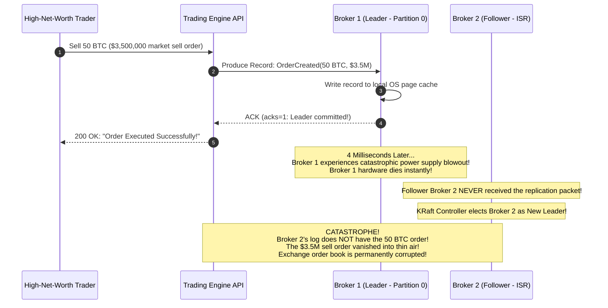
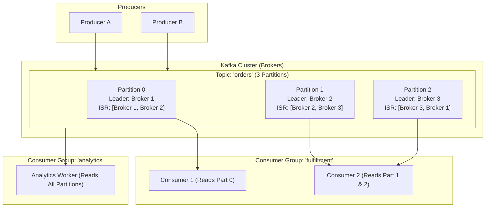
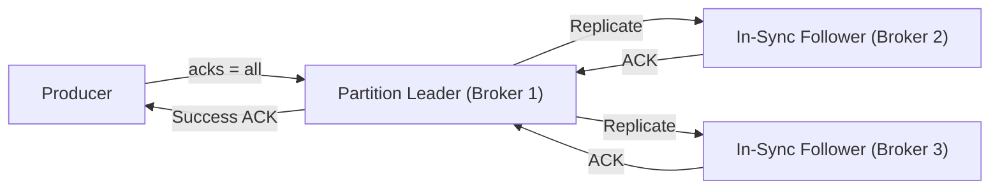
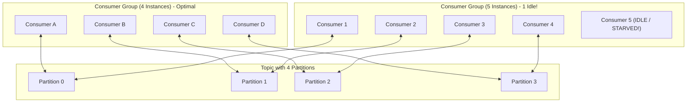
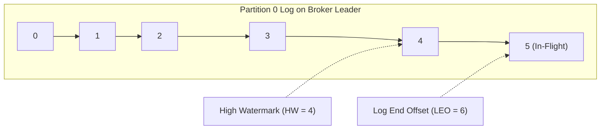
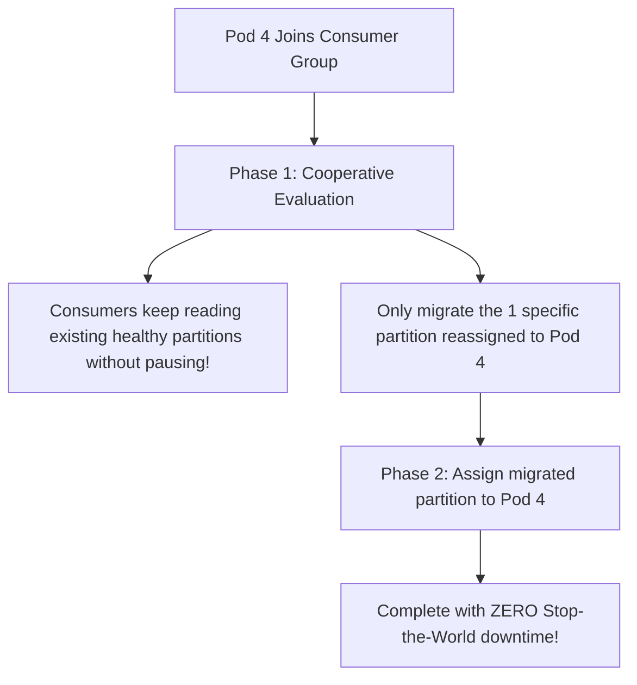
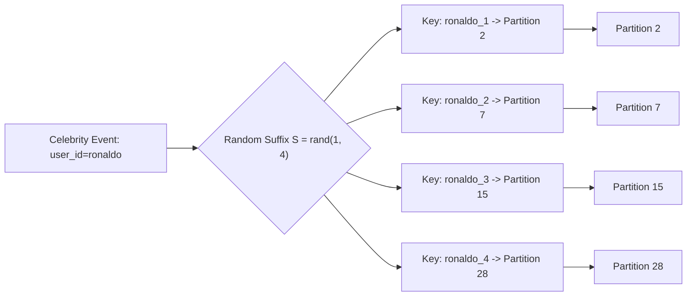

# Apache Kafka Deep Dive: Architecture, Internals & Zero-Copy

Apache Kafka is a distributed event streaming platform handling trillions of events daily across global technology companies. Behind its simple publish-subscribe interface lies a sophisticated architecture built on sequential disk I/O, OS page cache exploitation, hardware zero-copy primitives, and decentralized partition consensus.

---

## 💡 Intuitive Real-World Analogies

### 1. Partitions & Consumer Groups: The Supermarket Checkout Lanes
Imagine a massive grocery superstore on Saturday afternoon:
- The store opens **10 checkout conveyor belts (Partitions)**.
- If customer Alice arrives with groceries marked `"Family-101"` (Partition Key), a deterministic formula sends her to Lane 3. Inside Lane 3, items are scanned in **strict chronological order**.
- However, Lane 3 and Lane 7 operate in parallel. You cannot guarantee whether an item in Lane 3 finishes before an item in Lane 7!
- **The Cashier Staffing Rule (Consumer Groups):**
  - If you hire **5 cashiers**, each cashier operates 2 conveyor belts.
  - If you hire **10 cashiers**, each cashier operates exactly 1 belt (optimal scale).
  - If you hire **15 cashiers**, **5 cashiers stand around doing nothing**, because two cashiers cannot physically scan groceries on the same conveyor belt at the same time!

### 2. In-Sync Replicas (ISR) & Producer ACKs: The Triplicate Carbon Copy Receipt
When submitting an expense report to the company accounting department:
- **`acks = 0` (Fire and Forget):** You shout your expense total into the mail slot and walk away without waiting for anyone to answer. Fast, but if nobody was in the room, your expense is lost.
- **`acks = 1` (Leader Only):** The clerk takes your paper, gives you a thumb-up, and you leave. But if the clerk slips and drops the paper into the shredder before filing it, the record is gone.
- **`acks = all` (`min.insync.replicas = 2`):** You wait at the counter until the clerk and the assistant archivist in the backroom **both stamp their physical signatures onto the duplicate carbon copy**. Even if the primary clerk faints, the backroom copy guarantees your receipt is safe.

### 3. Zero-Copy Transfer: The Direct Warehouse Conveyor
Imagine shipping freight from a warehouse:
- **Traditional Transfer:** Workers unload boxes from a train, carry them into the office inspection room, open them on desks (User Space RAM), repack them, carry them back outside, and load them onto a delivery truck (4 moves, 4 CPU operations).
- **Kafka Zero-Copy (`sendfile`):** A motorized mechanical roller extends directly from the train car through the warehouse wall straight into the delivery truck. No worker touches the boxes; goods slide effortlessly from storage to the network cable via Direct Memory Access (DMA).

---

## 👶 Plain-English / ELI5 Overview

Traditional message queues treat messages like individual letters that get opened, stamped, and shredded one by one.

**Kafka treats data like an endless digital tape recorder.**
- Producers record audio onto the tape (Append-only write to disk).
- Topics are split into tracks called **Partitions** so multiple tape players can record simultaneously.
- When an application reads data, it doesn't erase anything; it simply holds a **bookmark (Offset)** pointing to where it left off.
- If an analytics system crashes, it re-opens the tape, looks at its bookmark, and resumes playing without losing a single beat.

---

## ⚠️ The Horror Scenario: The $3.5 Million `acks=1` Bitcoin Trade Evaporation

A high-frequency cryptocurrency exchange configured their Kafka order-matching engine with `acks=1` to shave off 2 milliseconds of producer latency.

### What Happened?
- With `acks=1`, Broker 1 acknowledged the produce request the instant it committed to its local OS page cache.
- 4 milliseconds later, before Broker 2 could replicate the bytes over the network, Broker 1 suffered a catastrophic hardware failure.
- Kafka promoted in-sync replica Broker 2 to be the new partition leader.
- Because Broker 2 never received the record, the 50 BTC sell order **evaporated from existence**.
- Meanwhile, the trader’s bank account showed a successful trade execution. The exchange suffered a $3.5 million balance discrepancy and had to cover the loss out of pocket.
- **The Rule:** Any mission-critical financial pipeline must set `acks=all` paired with `min.insync.replicas=2`!

---

## 1. Kafka Architectural Topology

---

## 2. Partitions, Keys & Ordering Guarantees

> **The Fundamental Kafka Ordering Rule:**  
> **Kafka guarantees strict message ordering ONLY within a single partition, NEVER across partitions in a topic.**

### Key-Based Partition Routing
When a producer publishes an event:
- If a **Partition Key** is provided (e.g., `user_id` or `order_id`), Kafka hashes the key:
  $$\text{Partition} = \text{MurmurHash2}(\text{Key}) \pmod{\text{Total Partitions}}$$
  All events for the same `user_id` land on the **exact same partition in strict chronological order**.
- If no key is provided (`null`), Kafka uses sticky round-robin batching to distribute messages evenly across all partitions.

---

## 3. In-Sync Replicas (ISR) and Producer ACKs

Durability in Kafka is configured per-producer via the `acks` parameter:

- **`acks = 0`:** Producer fires message and never waits for confirmation. Lowest latency, highest risk of data loss.
- **`acks = 1`:** Producer waits only for the single partition leader to commit to its local disk log before returning. If the leader crashes before replicating to peers, data is lost.
- **`acks = all` (`-1`) with `min.insync.replicas = 2`:** Producer blocks until the leader AND at least one in-sync follower have committed the write to their local logs. **Guarantees zero data loss even if the leader server explodes.**

---

## 4. Consumer Groups and Scaling Rules

A **Consumer Group** represents an independent logical application (e.g., Billing Service, Fraud Service).

### The Cardinal Consumer Rule
> **Each partition in a topic can be consumed by at most ONE consumer instance within the same Consumer Group at any given time.**

- If Topic has **4 Partitions** and Consumer Group has **2 Consumers**: Each consumer handles 2 partitions.
- If Topic has **4 Partitions** and Consumer Group has **4 Consumers**: Each consumer handles exactly 1 partition (ideal maximum parallelism).
- If Topic has **4 Partitions** and Consumer Group has **5 Consumers**: **Consumer 5 sits completely idle**, wasting CPU and memory resources!
- **System Design Rule:** Set the number of partitions based on your target maximum horizontal scale.

---

## 5. Why Kafka is So Outrageously Fast

A standard Kafka broker can saturate $10\text{ Gbps}$ network interfaces using commodity hard disks.

```mermaid
flowchart TD
    subgraph TraditionalTransfer["Traditional File Transfer (4 Context Switches, 3 Memory Copies)"]
        D1["Disk File"] -->|DMA Copy| K1["Kernel OS Buffer"]
        K1 -->|CPU Copy| U1["User Space Memory"]
        U1 -->|CPU Copy| S1["Socket Buffer"]
        S1 -->|DMA Copy| N1["NIC Network Card Buffer"]
    end

    subgraph ZeroCopyTransfer["Kafka Zero-Copy via sendfile() (2 Context Switches, Zero CPU Copy)"]
        D2["Disk File"] -->|DMA Copy| K2["Kernel OS Page Cache"]
        K2 -->|DMA Gather Directly!| N2["NIC Network Card Buffer"]
    end
```

### 1. Zero-Copy Data Transfer (`sendfile`)
Traditional servers read data from disk into kernel memory, copy it into user-space application RAM, copy it back into kernel socket memory, and finally transfer to the network interface card (NIC).
Kafka uses the Linux `sendfile()` system call: data is transferred **directly from OS Page Cache to the NIC buffer**, completely bypassing user-space RAM!

### 2. Sequential Disk Appends
Random disk writes require mechanical head seeks or SSD block erasures. Sequential disk writes append directly to the end of a segment file, performing as fast as physical RAM memory bandwidth ($\sim 600\text{ MB/sec}$ on standard SATA drives, $\sim 3\text{ GB/sec}$ on NVMe).

### 3. Exploitation of the OS Page Cache
Kafka runs on the JVM, but it stores almost nothing in the Java Heap memory, avoiding JVM Garbage Collection (GC) pauses. It lets the Linux OS Page Cache manage memory directly.

### 4. End-to-End Batching and Compression
Producers batch messages into chunks and compress them (using Snappy, LZ4, or Zstandard) before transmitting over the network. The Kafka broker writes the compressed bytes directly to disk without decompressing them, saving both network bandwidth and CPU cycles.

---

## 6. KRaft: Eliminating Apache ZooKeeper

Historical Kafka clusters required an external Apache ZooKeeper quorum to track cluster metadata, leader elections, and topic partitions.
- **The Bottleneck:** Metadata updates were slow, limiting clusters to $\sim 200,000$ partitions.
- **KRaft Mode (Kafka Raft):** Replaces ZooKeeper with an internal Raft consensus quorum running inside Kafka brokers. Clusters can now effortlessly scale to **millions of partitions** with sub-second controller failovers.

---

## 🏢 Real-World Production Battle-Testing

### LinkedIn: The Birthplace of Kafka
- LinkedIn operates over **100 Kafka clusters** with more than **100,000 brokers**, processing over **7 trillion messages per day**.
- Kafka serves as the central nervous system connecting user profile updates, search indexing, real-time messaging, and machine learning training pipelines.

### Uber: Chaperone Data Auditing
- Uber uses Kafka to ingest millions of real-time GPS locations and ride events every second.
- To prevent silent data loss, Uber built **Chaperone**, an open-source auditing service that attaches cryptographic timestamps to Kafka message batches and reconciles consumer offsets in real time across data centers.

---

## ⚖️ Practical Trade-Offs & Decision Rules of Thumb

| Configuration Parameter | Low-Latency Tuning | High-Throughput Tuning | High-Durability Tuning |
| :--- | :--- | :--- | :--- |
| **`acks`** | `1` | `1` or `all` | `all` (`-1`) |
| **`min.insync.replicas`** | `1` | `1` | `2` (in a 3-replica cluster) |
| **`linger.ms`** | `0` (send immediately) | `20 - 100 ms` (allow batch to fill) | `10 - 50 ms` |
| **`batch.size`** | Default ($16\text{ KB}$) | Large ($64\text{ KB} - 128\text{ KB}$) | Default |
| **`compression.type`** | `none` or `lz4` | `zstd` or `snappy` | `lz4` |

---

## 🎯 Top Real-World Interview Questions & Deep-Dive Answers (FAANG / Staff Level)

### Question 1: What is the exact difference between the High Watermark (HW) and the Log End Offset (LEO) in Kafka, and how do they prevent replicas from serving uncommitted, phantom data?
**Model Answer:**
Every partition replica in Kafka tracks two critical offset pointers:

1. **Log End Offset (LEO):** The offset of the next record to be written to the local log on that specific broker. If a broker has records 0 through 4 written to disk, its $\text{LEO} = 5$.
2. **High Watermark (HW):** The offset of the latest record that has been successfully replicated across **ALL in-sync replicas (ISR)**.
   $$\text{HW} = \min(\text{LEO}_{\text{Leader}}, \ \text{LEO}_{\text{Follower 1}}, \ \text{LEO}_{\text{Follower 2}}, \dots)$$

**Why HW is Vital for System Safety:**
- Consumers are **only permitted to read records up to the High Watermark** (`offset < HW`).
- If Producer sends record 5 to the Leader, Leader increments its local $\text{LEO} = 6$.
- If Leader crashes *before* Follower replicates record 5, record 5 is lost.
- Because consumers could only read up to $\text{HW} = 4$, consumers **never saw record 5**!
- If consumers had been allowed to read up to LEO, they would have acted on a ghost transaction that later disappeared upon leader failover!

---

### Question 2: What is a "Consumer Group Rebalance Storm", why does it cause "Stop-the-World" pauses, and how does KIP-429 (Cooperative Sticky Assignor) solve it?
**Model Answer:**
In traditional Kafka consumer rebalancing (Eager Rebalance Protocol):
1. When any consumer instance joins, crashes, or takes too long to process a batch (`max.poll.interval.ms` exceeded), the group coordinator triggers a **Rebalance**.
2. **The Eager Rebalance Catastrophe:** All consumers in the group must **revoke all their assigned partitions and stop consuming completely** (a distributed "Stop-the-World" pause).
3. The group leader recalculates partition assignments and redistributes them.
4. During this 10-30 second rebalance window, **zero messages are processed across the entire topic**, creating massive message lag and cascading downstream timeouts.

**The Solution: Cooperative Sticky Assignor (KIP-429):**
Instead of revoking everything, the Cooperative Sticky protocol uses an **incremental, two-phase rebalance**:

- Consumers continue processing traffic uninterrupted on their existing partitions.
- Only the specific partitions that need to be reallocated are temporarily paused and transferred.
- Rebalance pauses drop from 30 seconds to **under 100 milliseconds**!

---

### Question 3: How do you design a partition key strategy to avoid "Hot Partitions" when dealing with extreme celebrity power-law distributions (e.g. Cristiano Ronaldo with 600M followers vs. normal user)?
**Model Answer:**
Standard Kafka hashing uses `MurmurHash2(key) % num_partitions`. 
If you use `user_id` as the key:
- A normal user produces 5 events per day $\implies$ normal partition load.
- A celebrity user produces 500,000 events/sec $\implies$ **one single partition broker saturates its CPU and disk**, while the other 31 partitions sit completely idle (**Hot Partition / Straggler Problem**).

**The Architectural Solution: Salted Keys with Scatter-Gather Consumer:**

1. **Celebrity Detection:** Maintain an in-memory set of known high-volume entity IDs at the producer layer.
2. **Salting / Sharding the Key:** If `user_id` is a celebrity, append a random salt suffix between $1$ and $S$ (e.g. `ronaldo_1`, `ronaldo_2`, `ronaldo_3`, `ronaldo_4`).
3. **Partition Spread:** The salted keys hash to different partitions, spreading the 500,000 events/sec smoothly across multiple brokers and consumers.
4. **Downstream Reconstruction:** Downstream stream processors (Kafka Streams or Flink) window and merge the keyed partitions using a tumbling time window to reconstruct the global aggregate.

---
*Related Documents:*
- [Message Queues vs. Distributed Event Streams](file:///home/prasanta/Documents/learning_folder/system_design/05_MESSAGING_EVENT_DRIVEN_AND_ASYNC/01_message_queues_vs_event_streams.md)
- [Message Delivery Semantics & Exactly-Once](file:///home/prasanta/Documents/learning_folder/system_design/05_MESSAGING_EVENT_DRIVEN_AND_ASYNC/02_delivery_semantics_and_guarantees.md)
- [Event-Driven Architecture Patterns](file:///home/prasanta/Documents/learning_folder/system_design/05_MESSAGING_EVENT_DRIVEN_AND_ASYNC/04_event_driven_design_patterns.md)
