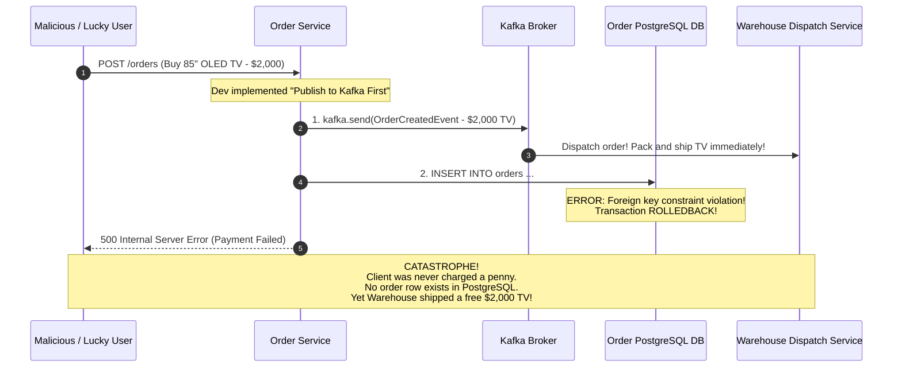
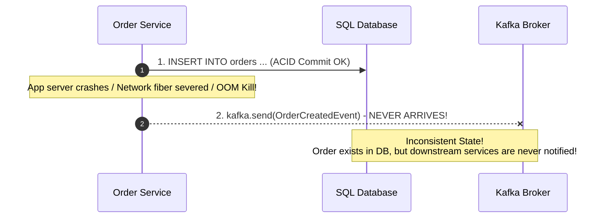
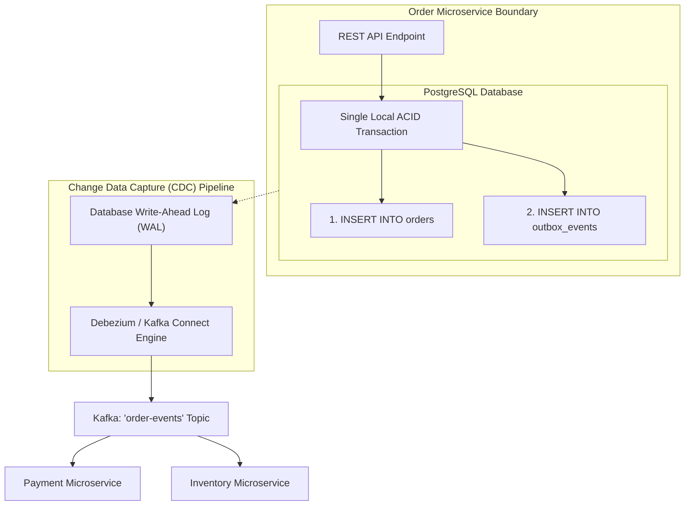
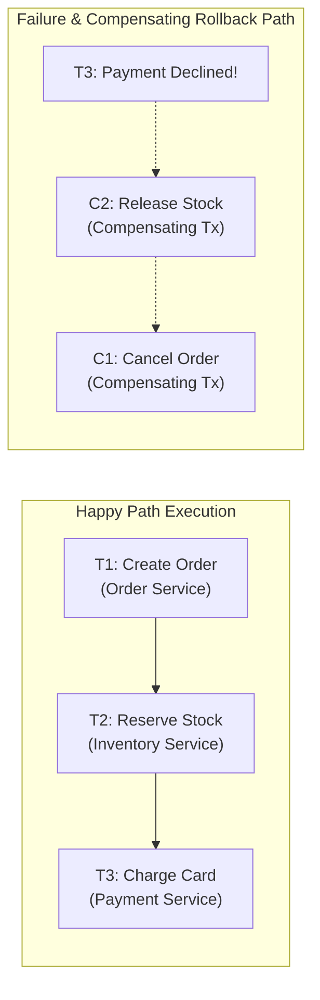
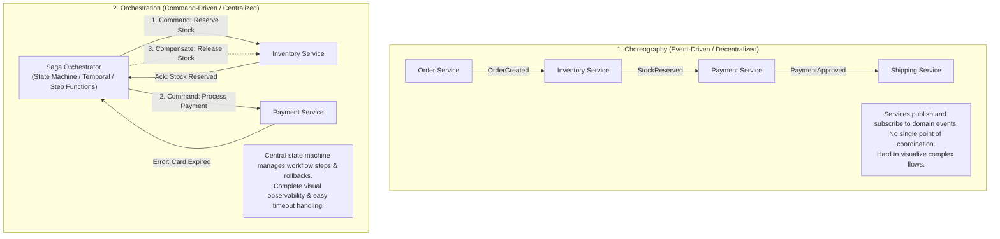
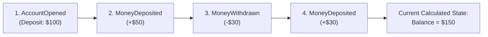
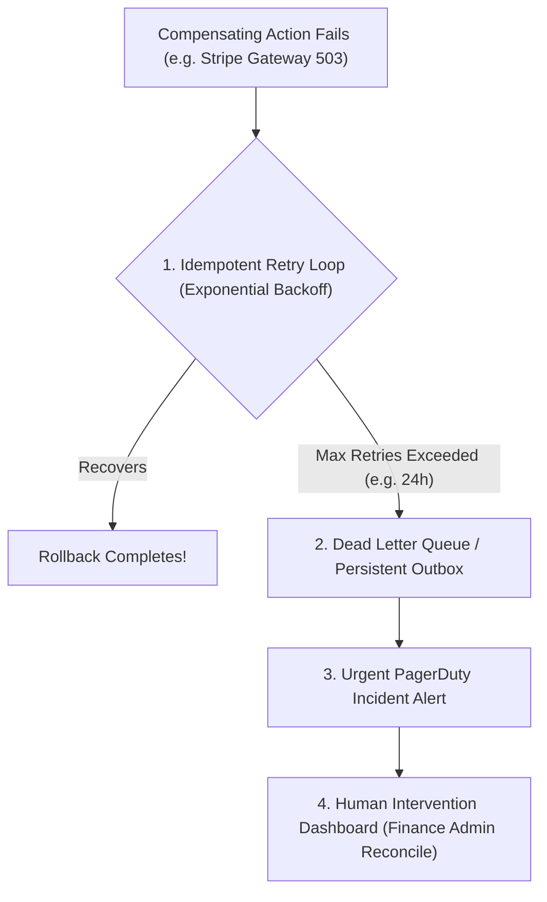

# Event-Driven Architecture Patterns: Outbox, Saga, CDC & CQRS

In a microservices architecture, every service owns its private database to maintain loose coupling and autonomous deployments. However, business workflows inevitably cross service boundaries. When placing an order requires mutating an Order database, a Payment ledger, and an Inventory warehouse, traditional ACID distributed transactions (like Two-Phase Commit / 2PC) become unusable bottlenecks that compromise availability.

Event-driven design patterns provide the foundational architecture for maintaining data consistency, resiliency, and auditability across distributed boundaries.

---

## 💡 Intuitive Real-World Analogies

### 1. Dual-Write Problem & Transactional Outbox: The Physical Office Mail Tray
Imagine working in a busy law firm. You need to sign a legal contract and mail a copy to your client:
- **The Dual-Write Disaster:** You sign the document, lock it in your office safe, and stand up to walk to the street mailbox. On your way out the door, the building's fire alarm rings, forcing an emergency evacuation. The signed contract is locked in your safe, but the client never receives the mail. Both parties are left in inconsistent states.
- **The Transactional Outbox:** You have a physical wooden **"OUTBOX" tray** on your desk. When you sign the contract, in the **exact same seated motion**, you slip a duplicate envelope into your desk outbox and lock your office. Later, an office mail courier (Change Data Capture / Debezium) walks from desk to desk, empties all outboxes, and delivers them to the postal service. If the courier gets delayed, the letters wait safely in the tray.

### 2. The Saga Pattern: Booking a Vacation
Imagine booking a 3-part vacation: (1) Flight to Hawaii, (2) Beachfront Hotel, and (3) Rental Car:
- You successfully book the flight ($600 charged).
- You successfully book the hotel ($1,200 charged).
- When you attempt to book the rental car, all cars on the island are completely sold out!
- You cannot remain stranded without transportation. You don't freeze and panic; instead, you trigger **Compensating Actions** in reverse order: you cancel the hotel (refund $1,200) and cancel the flight (refund $600). Your vacation plan fails cleanly, returning you to your initial state.

### 3. Saga Choreography vs. Orchestration: Jazz Improv vs. Symphony Conductor
- **Choreography (Jazz Improvisation):** Musicians react to the person playing next to them. The pianist plays a chord, the saxophonist hears it and plays a solo, the drummer reacts to the saxophone tempo. It works beautifully for a 3-person band, but put 50 musicians together without a coordinator and it turns into chaotic noise.
- **Orchestration (Symphony Conductor):** A maestro stands on stage with a master score. The conductor points to the violins: *"Play measure 12"*, awaits their tempo, and then cues the brass section: *"Now play measure 13"*. If the trumpet hits a wrong note, the conductor taps the podium and tells everyone to stop and reset.

---

## 👶 Plain-English / ELI5 Overview

In the old days of software, everything lived in one giant database. When a user bought an item, the computer ran a single transaction: update orders, charge money, and reduce stock. Either everything worked, or nothing changed.

In modern systems, each team runs its own separate service and database. The Order Service has PostgreSQL, the Payment Service has its own database, and the Inventory Service has another. If you try to write to your database and publish a message to Kafka in your code, one can fail while the other succeeds (**The Dual-Write Problem**).

- **Transactional Outbox** guarantees that saving data and sending a message happen as a single atomic unit.
- **Sagas** break a big multi-service transaction into small steps, with automated "undo" buttons if anything fails midway.
- **CQRS** creates dedicated read-only search copies of your data so complex queries don't slow down high-speed transactions.

---

## ⚠️ The Horror Scenario: The $2,000 Ghost TV Disaster

Consider an e-commerce platform that attempts dual-writes without an Outbox pattern:



### What Happened?
The developer tried to publish to Kafka first, then commit to PostgreSQL:
1. The message landed in Kafka successfully.
2. The downstream Warehouse consumed the message, printed a shipping label, and loaded the 85" TV onto a delivery truck.
3. Meanwhile, the database insert failed due to a constraint violation or connection timeout.
4. **Result:** The customer's credit card was never charged, no record of the order exists in the Order database, but the physical TV was shipped to their home.
5. If the developer had reversed the order (commit to DB first, then publish to Kafka), an Out-Of-Memory (OOM) crash between the two lines of code would charge the customer without ever dispatching the TV—resulting in credit card chargebacks and regulatory fines.

---

## 1. The Dual-Write Problem

The dual-write problem occurs whenever a service needs to mutate state in two independent systems without a distributed transaction manager:



- **Distributed Two-Phase Commit (2PC) is not the answer:** 2PC locks resources across all participants until the slowest participant commits. In a cloud environment, any network hiccup or node restart blocks all transactions, creating massive latency spikes and catastrophic availability loss.

---

## 2. The Transactional Outbox Pattern

The industry-standard solution to the dual-write dilemma. Instead of publishing to Kafka directly, the service writes the event to a dedicated `outbox` table within the **same local ACID database transaction**.



### The Transactional Outbox Schema
```sql
CREATE TABLE orders (
    id UUID PRIMARY KEY,
    customer_id UUID NOT NULL,
    total_amount NUMERIC(12, 2) NOT NULL,
    status VARCHAR(32) NOT NULL,
    created_at TIMESTAMP WITH TIME ZONE DEFAULT NOW()
);

CREATE TABLE outbox_events (
    id UUID PRIMARY KEY DEFAULT gen_random_uuid(),
    aggregate_type VARCHAR(64) NOT NULL,
    aggregate_id VARCHAR(64) NOT NULL,
    event_type VARCHAR(64) NOT NULL,
    payload JSONB NOT NULL,
    created_at TIMESTAMP WITH TIME ZONE DEFAULT NOW()
);
```

### The Atomic Application Code (Python / SQLAlchemy)
```python
def create_order(customer_id: str, amount: float, items: list):
    with db.begin() as transaction:
        order_id = uuid.uuid4()
        
        # 1. Mutate primary business entity
        db.execute(
            "INSERT INTO orders (id, customer_id, total_amount, status) VALUES (:id, :cust, :amt, 'PENDING')",
            {"id": order_id, "cust": customer_id, "amt": amount}
        )
        
        # 2. Append event to outbox table in the SAME transaction
        event_payload = {
            "order_id": str(order_id),
            "customer_id": customer_id,
            "total_amount": amount,
            "items": items
        }
        db.execute(
            "INSERT INTO outbox_events (aggregate_type, aggregate_id, event_type, payload) VALUES ('Order', :id, 'OrderCreated', :payload)",
            {"id": str(order_id), "payload": json.dumps(event_payload)}
        )
        # 3. Transaction commits atomically! Both succeed or both roll back.
```

### Publishing from Outbox to Kafka
1. **Approach A (CDC with Debezium - Recommended):** Debezium connects to PostgreSQL's replication stream (Logical Decoding / WAL) or MySQL's binlog. It detects new inserts into `outbox_events` and immediately forwards them to Kafka with sub-10ms latency and zero query load on the database.
2. **Approach B (Polling Publisher):** A background worker polls:
   ```sql
   SELECT * FROM outbox_events WHERE status = 'PENDING' ORDER BY created_at LIMIT 100 FOR UPDATE SKIP LOCKED;
   ```
   The worker publishes records to Kafka and marks them as `PROCESSED`. (Simpler to set up, but adds query polling load and can experience polling delays).

---

## 3. The Saga Pattern (Distributed Transactions)

When a business transaction spans multiple microservices, a **Saga** coordinates a sequence of local transactions:

$$T_1 \to T_2 \to T_3 \to \dots \to T_n$$

Each local transaction updates data within a single service and publishes an event or message to trigger the next step. If any local transaction $T_k$ fails (e.g., credit card declined, warehouse stock depleted), the Saga executes a series of **Compensating Transactions** in reverse order to undo all preceding mutations:

$$C_{k-1} \to C_{k-2} \to \dots \to C_1$$



### Crucial Principle: Compensating Transactions Are NOT Rollbacks
A compensating transaction does **not** roll back time. If $T_2$ reserved 1 item of inventory, $C_2$ executes an explicit business operation: *re-increment inventory by 1*. External observers can temporarily see that inventory was reserved. This semantic consistency is called **Eventual Consistency**.

---

## 4. Saga Coordination: Choreography vs. Orchestration



### Detailed Comparison Matrix

| Dimension | Choreography | Orchestration |
| :--- | :--- | :--- |
| **Coordination Model** | Decentralized; services react to domain events | Centralized; state machine sends explicit commands |
| **Coupling** | Loose coupling; services do not know callers | Central coordinator couples to individual service APIs |
| **Visibility & Debugging** | Difficult; must trace distributed logs across 5+ services | Trivial; orchestrator UI shows exact current step and failure reasons |
| **Cyclic Dependencies** | Risk of circular event ping-pong loops | Impossible; flow is explicitly governed by state machine |
| **Scalability** | Extremely high throughput for simple 2–3 step flows | Bottlenecked by orchestrator state management (solved by Temporal) |
| **Best Used For** | Simple flows (e.g., User Signup $\to$ Send Welcome Email) | Complex enterprise flows (Order Fulfillment, Payouts, Loan Approvals) |
| **Industry Tools** | Apache Kafka, AWS EventBridge, RabbitMQ | **Temporal.io**, AWS Step Functions, Camunda, Netflix Conductor |

---

## 5. CQRS (Command Query Responsibility Segregation)

In traditional CRUD systems, the same data model is used for both writing mutations and reading reports. As systems scale, this creates friction: writes need high-performance normalized tables with strict ACID integrity, while complex search queries need heavily denormalized, pre-aggregated data.

**CQRS splits the system into two distinct models:**
1. **Command Model:** Optimized for write throughput, validation, and domain invariants.
2. **Query Model:** Optimized for sub-millisecond retrieval, read-optimized search indices, and pre-computed projections.

```mermaid
flowchart LR
    Client["Client / Web UI"] -->|POST /orders (Command)| WriteAPI["Write API (Command Model)"]
    WriteAPI --> WriteDB[("PostgreSQL DB<br/>(Normalized ACID Storage)")]
    WriteDB --> CDC["Change Data Capture (Debezium / Kafka)"]
    CDC --> Projector["Denormalization Worker Fleet"]
    Projector --> ReadDB[("Elasticsearch / Redis<br/>(Denormalized Read Views)")]
    Client -->|GET /orders/search (Query)| ReadAPI["Read API (Query Model)"]
    ReadAPI --> ReadDB
```

- **Command Workflow:** Client sends `CreateOrderCommand`. The Command Service validates business rules against PostgreSQL and commits the transaction.
- **Async Projection:** The database write stream is captured via CDC (Debezium $\to$ Kafka) and consumed by projection workers. These workers build flat, denormalized documents and write them directly to **Elasticsearch** or **Redis Read Replicas**.
- **Query Workflow:** When a customer searches their order history, the query hits Elasticsearch directly, executing sub-millisecond text search without touching the primary PostgreSQL database.
- **Trade-Off:** **Eventual Consistency**. There is a small lag ($\sim 50\text{ ms} - 500\text{ ms}$) between when an order is submitted and when it appears in the read index.

---

## 6. Event Sourcing

Traditional systems persist the **current state** of an entity:

$$\text{Bank Account Record: } \{\text{account\_id}: 101, \text{balance}: \$150\}$$

If the balance is incorrect, there is no way to know why without sifting through external logs. **Event Sourcing** persists the **entire append-only sequence of immutable domain events** that produced that state:

$$\text{Current State} = \sum_{i=1}^{n} \text{Event}_i$$



### Why Event Sourcing is Transformative
1. **Perfect Auditability:** Used in banking, healthcare, and supply chain. Every mutation is an immutable event with an actor, timestamp, and reason.
2. **Time Travel Debugging:** Replay the event stream up to June 15, 2024, to see the exact state of the system at that historical moment.
3. **Snapshot Optimization:** Replaying 100,000 events to compute an account balance is slow. Systems take periodic snapshots (e.g., every 1,000 events: `Snapshot(balance=$120, offset=999)`), and only replay the delta events that occurred since the snapshot.

---

## 🚶 Step-by-Step Scenario: An E-Commerce Saga with Temporal.io

Let's walk through an Orchestrated Saga where a customer checkout fails due to an inventory shortage:

```mermaid
sequenceDiagram
    autonumber
    participant Client
    participant Orchestrator as Saga Orchestrator (Temporal)
    participant OrderSvc as Order Service
    participant PaySvc as Payment Service
    participant InvSvc as Inventory Service

    Client->>Orchestrator: StartCheckoutWorkflow(Order #500)
    Orchestrator->>OrderSvc: Step 1: CreateOrder(PENDING)
    OrderSvc-->>Orchestrator: OrderCreated(id=500)

    Orchestrator->>PaySvc: Step 2: AuthorizePayment($200)
    PaySvc-->>Orchestrator: PaymentAuthorized(txn_id=tx_99)

    Orchestrator->>InvSvc: Step 3: ReserveInventory(item_id=77)
    InvSvc-->>Orchestrator: ERROR: OutOfStock!

    Note over Orchestrator: Trigger Compensating Transactions!
    Orchestrator->>PaySvc: Compensate 2: VoidAuthorization(txn_id=tx_99)
    PaySvc-->>Orchestrator: AuthorizationVoided
    
    Orchestrator->>OrderSvc: Compensate 1: CancelOrder(id=500, reason="Out of Stock")
    OrderSvc-->>Orchestrator: OrderCancelled

    Orchestrator-->>Client: 409 Conflict: "Item out of stock; no payment charged."
```

1. **Step 1:** Order created in `PENDING` state.
2. **Step 2:** Payment authorized on credit card.
3. **Step 3:** Inventory reservation fails due to a concurrent stockout.
4. **Compensation:** The Orchestrator immediately executes compensating transactions in reverse order. It releases the credit card hold and marks the order as cancelled.
5. **Outcome:** Zero orphaned credit card charges, zero ghost orders, and a clean, reliable state.

---

## 🏢 Real-World Production Battle-Testing

### Uber: Chaperone & Temporal for Driver Dispatches
- When an Uber rider requests a ride, dozens of steps occur: surge pricing lock, driver dispatch, GPS geofencing, payment pre-authorization, and rider notification.
- Uber migrated from fragile event choreography to **Temporal.io orchestration**, making multi-step driver trip lifecycles deterministic, auditable, and resilient to infrastructure restarts.

### Stripe: Transactional Outbox for Webhook Delivery
- When a charge succeeds at Stripe, merchant servers must receive an HTTP webhook notification (`charge.succeeded`).
- Stripe uses an internal Transactional Outbox pattern. The charge record and the webhook event are committed to the primary database in the same transaction. A separate fleet of reliable delivery workers reads the events and dispatches webhooks with exponential backoff and idempotency tokens.

### Shopify: CQRS for Flash-Sale Checkout
- During major merchant sales, Shopify splits checkout into a strict write-pipeline running on MySQL, while buyer-facing product catalogs and search queries are served from heavily optimized read models in Redis and Elasticsearch, isolating read load from critical payment mutations.

---

## ⚖️ Practical Trade-Offs & Decision Rules of Thumb

| Pattern | Primary Advantage | Major Trade-Off / Cost | Recommended When |
| :--- | :--- | :--- | :--- |
| **Transactional Outbox** | Eliminates dual-write data loss; 100% atomic | Requires CDC infrastructure (Debezium/Kafka Connect) | Anytime a database mutation must publish to Kafka or a message queue |
| **Saga (Choreography)** | Loose coupling; no central coordinator | Chaotic traceability; difficult to debug | Simple 2–3 step workflows across loosely coupled teams |
| **Saga (Orchestration)** | Clear state machine; centralized audit trail | Coordinator is a central dependency | Complex 4+ step business flows (checkout, payments, logistics) |
| **CQRS** | Independent scaling of reads & writes; sub-ms search | Eventual consistency delay; dual data models | Complex search, high read-to-write ratios ($> 100:1$) |
| **Event Sourcing** | Infinite audit trail; time-travel replayability | Complex querying; schema migration headaches | Financial ledgers, healthcare records, compliance-heavy systems |

### Rules of Thumb for System Designers
1. **Never Dual-Write Directly in Application Code:** If you write `db.save()` followed by `kafka.send()` in the same function, your system is vulnerable to data corruption. Use the **Transactional Outbox Pattern**.
2. **Use Orchestration for Workflows with > 3 Steps:** If an asynchronous business flow involves more than 3 microservices, avoid choreography. Choreography becomes an untraceable "spaghetti architecture." Use a workflow engine like Temporal.
3. **Avoid CQRS Until You Need It:** Do not prematurely add CQRS to simple CRUD applications. Only introduce CQRS when read performance demands denormalized search engines (e.g., Elasticsearch) that the primary database cannot handle.

---

## 🎯 Top Real-World Interview Questions & Deep-Dive Answers (FAANG / Staff Level)

### Question 1: Why can't you simply use Two-Phase Commit (2PC / XA Transactions) across modern microservices, and how does the Saga pattern trade ACID for BASE?
**Model Answer:**
Distributed Two-Phase Commit (2PC) provides strong ACID guarantees across distributed databases via a centralized Transaction Manager (Prepare Phase $\to$ Commit Phase). However, it is an anti-pattern in cloud microservices due to the **CAP Theorem and Availability collapse**:

1. **The Blocking / Availability Bottleneck:**
   - In 2PC, all participating databases acquire **exclusive locks on rows** during the Prepare phase.
   - If Service C experiences a network blip or takes 5 seconds to reply, Services A and B hold their database row locks open.
   - All other transactions attempting to touch those rows block, exhausting database connection pools and causing cascading outages across the company (**O(N) availability degradation** where $A_{\text{system}} = A_1 \times A_2 \times \dots \times A_n$).
2. **Heterogeneous Tech Stacks:** 2PC requires all systems to implement the XA protocol. Modern systems mix PostgreSQL, DynamoDB, Redis, and Kafka—systems that cannot participate in a shared XA transaction.

**How Saga Replaces ACID with BASE:**
Sagas abandon the **Isolation** property of ACID:
- Each service executes a **local ACID transaction** and immediately releases its locks.
- System state is temporarily inconsistent to external readers (e.g. inventory is reserved, but payment has not yet succeeded).
- Consistency is **Eventual (BASE: Basically Available, Soft state, Eventual consistency)**. If a subsequent step fails, compensating transactions execute in reverse order to semantically undo the partial work.

---

### Question 2: What happens if a Compensating Transaction fails during a Saga rollback (e.g. refunding a credit card fails due to network outage)? How do you achieve ultimate consistency?
**Model Answer:**
In a Saga rollback ($T_1 \to T_2 \to T_3 \text{ [FAILS]} \implies C_2 \to C_1$), what if compensating action $C_2$ (Refund Credit Card) throws an HTTP 500 error or network timeout?
A Saga **cannot simply roll back a compensating transaction**; there is no "undo of an undo"!



**The 4-Tier Defensive Protocol:**
1. **Mandatory Compensator Idempotency:** Compensating transactions must be strictly idempotent. They will be retried repeatedly until success.
2. **Infinite Exponential Backoff (Guaranteed Forward Progress):** The orchestrator (Temporal / Step Functions) does not abort. It persists the workflow state and retries the compensation with exponential backoff (e.g., retry after 1s, 2s, 4s, ... up to 1 hour intervals) for up to 24–48 hours. Most payment gateways recover within minutes.
3. **Dead Letter Queue (DLQ) & Escalation:** If compensation fails permanently (e.g., customer closed their bank account), the workflow drops into a persistent DLQ.
4. **Human Reconciliation Dashboard:** Financial ops teams receive automated alerts to issue a manual bank wire transfer or company credit.

---

### Question 3: How does Change Data Capture (CDC) via Debezium tail PostgreSQL's Write-Ahead Log (WAL) to implement the Transactional Outbox pattern without polling overhead?
**Model Answer:**
Traditional outbox publishing uses polling:
`SELECT * FROM outbox WHERE status = 'PENDING' FOR UPDATE SKIP LOCKED LIMIT 100;`
Polling adds CPU overhead, locks database tables, and introduces polling latency ($\sim 1 - 5\text{ seconds}$).

**The Zero-Polling CDC Engine (PostgreSQL WAL + Debezium):**
```mermaid
sequenceDiagram
    autonumber
    participant App as Order Service
    participant PG as PostgreSQL Engine
    participant WAL as PostgreSQL Write-Ahead Log (Disk)
    participant Debezium as Debezium Connector (Logical Replication)
    participant Kafka as Kafka Broker

    App->>PG: BEGIN; INSERT INTO orders; INSERT INTO outbox_events; COMMIT;
    PG->>WAL: Append transaction commit to WAL on disk
    Note over PG,WAL: Zero polling queries! Standard disk append!
    
    WAL->>Debezium: Stream decoded row changes (pgoutput plugin)
    Note over Debezium: Debezium receives raw WAL bytes:<br/>Table: outbox_events, Op: INSERT, Payload: {...}
    Debezium->>Kafka: Publish Event to topic 'order-events'
    Kafka-->>Debezium: ACK
    Debezium->>PG: Advance Replication Slot LSN (Log Sequence Number)
```

1. **Logical Decoding (`pgoutput`):** PostgreSQL writes every committed row mutation to its append-only **Write-Ahead Log (WAL)** on disk before writing to table heap pages.
2. **Replication Slots:** Debezium connects as a PostgreSQL replication client using a **Replication Slot**. PostgreSQL streams decoded WAL changes directly over a persistent TCP socket.
3. **Sub-Millisecond Latency:** As soon as the transaction commits to disk, Debezium receives the event within 5 milliseconds with **zero SQL query overhead on the database CPU**.
4. **Exactly-Once Log Position:** Debezium advances the replication slot Log Sequence Number (LSN) only after Kafka acknowledges the write, guaranteeing that no outbox event is ever lost across server crashes.

---
*Related Documents:*
- [Message Queues vs. Distributed Event Streams](file:///home/prasanta/Documents/learning_folder/system_design/05_MESSAGING_EVENT_DRIVEN_AND_ASYNC/01_message_queues_vs_event_streams.md)
- [Cache Invalidation and Update Patterns](file:///home/prasanta/Documents/learning_folder/system_design/04_CACHING_STRATEGIES_AND_PATTERNS/02_cache_invalidation_patterns.md)
