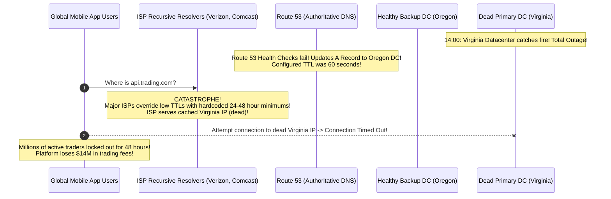
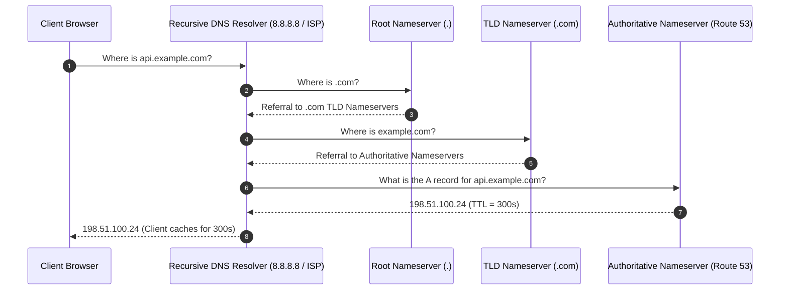
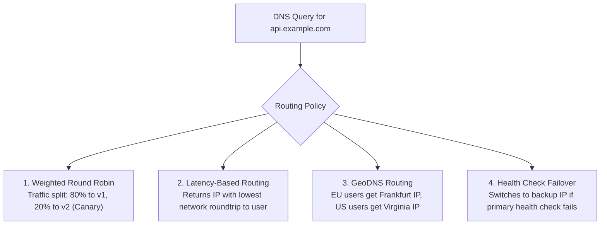
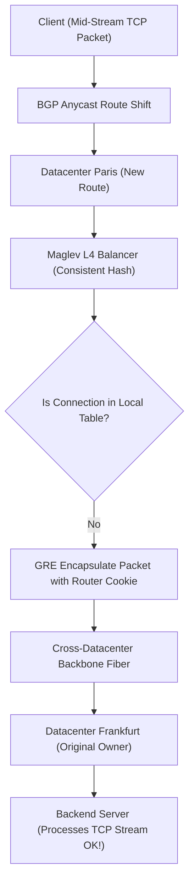
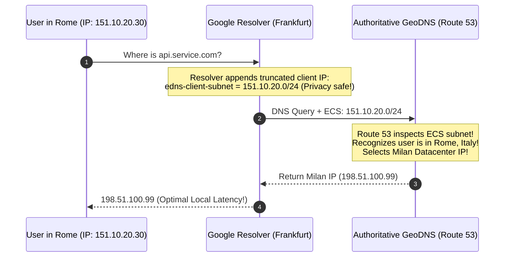

# DNS Resolution, GeoDNS, and Anycast BGP Routing

Before an HTTP request or TCP handshake can reach your load balancer, the client must translate your human-readable domain name (`api.company.com`) into an IP address and navigate global internet routing. Choosing the right combination of **Hierarchical DNS**, **GeoDNS**, and **Anycast BGP** determines whether your users experience sub-10ms edge responsiveness or 30-second connection timeouts.

---

## 💡 Intuitive Real-World Analogies

### 1. DNS Resolution: The Phone Directory Assistance (411)
Imagine trying to call Dr. Alice in Chicago before search engines:
- You dial 411 and ask: *"Give me the phone number for Dr. Alice at Mercy Hospital."*
- Operator 1 (Root Nameserver): *"I don't know Dr. Alice, but I know the directory for Illinois (TLD `.com`). Call 312-555-0000."*
- Operator 2 (TLD Nameserver): *"I don't have individual doctor numbers, but here is Mercy Hospital's directory assistance (Authoritative Nameserver). Call 312-555-1234."*
- Operator 3 (Authoritative Nameserver): *"Dr. Alice is at Extension 402 (`198.51.100.24`)."*
- You write the extension on a sticky note (**TTL Cache**) so you don't have to dial 411 again for the rest of the day.

### 2. Unicast vs. Anycast: The 911 Emergency Dispatch
- **Unicast (One-to-One):** Every person in the world has a single direct phone line to a single phone on a desk in Washington D.C. If someone calls from Sydney, Australia, the call crosses the Pacific Ocean. If that single telephone desk catches fire, nobody on Earth can call for help.
- **Anycast (One-to-Nearest):** Every citizen dials the exact same 3 digits: **`911`**. 
  - The telephone company’s switching network inspects where the call originated.
  - A caller in Seattle connects to the Seattle dispatch office. A caller in Miami connects to Miami dispatch.
  - If the Miami office loses power, the telecom network automatically forwards Miami calls to Orlando in seconds.
  - **Philosophy:** One universal public address, advertised everywhere, routed to the closest healthy edge station.

---

## 👶 Plain-English / ELI5 Overview

When you type `netflix.com` into your browser:
1. **The Phonebook (DNS):** Your computer doesn't know what letters mean; it only knows IP addresses (like `198.51.100.24`). DNS is the global phonebook that translates human names into numbers.
2. **GeoDNS:** A smart phonebook. If a user calls from London, give them an IP in Frankfurt. If a user calls from New York, give them an IP in Virginia.
3. **The Highway Navigator (Anycast BGP):** Instead of giving different IPs, give the entire world **one single IP address** (e.g. `1.1.1.1`). Internet routers will automatically direct each user down the fastest physical highway to the nearest datacenter in their own city!

---

## ⚠️ The Horror Scenario: The 48-Hour Stale DNS Black Hole

A global financial trading platform operated its primary datacenter in AWS US-East (Northern Virginia). During an unannounced regional power grid failure, the entire availability zone went dark.



### What Happened?
- Engineers set Route 53 DNS records with a short 60-second TTL, assuming failover would take 1 minute.
- When the Virginia datacenter crashed, Route 53 successfully updated the record to point to Oregon.
- **The Catastrophe:** Millions of client devices access the internet via cellular carriers and regional ISPs. To save bandwidth and server resources, many corporate and mobile ISPs **override short TTLs and enforce a minimum cache time of 24 to 48 hours**!
- For two full days, 45% of the company's mobile users were sent to the dead Virginia IP address.
- **The Modern Solution:** Deploying **Anycast BGP (like AWS Global Accelerator or Cloudflare)** gives the service static Anycast IPs. When a datacenter dies, BGP route advertisements are withdrawn, and internet routers reroute traffic globally in **under 30 seconds**, completely bypassing DNS caching!

---

## 1. The DNS Resolution Hierarchy



### DNS Record Types
- **A Record:** Maps domain $\to$ IPv4 address (`198.51.100.1`).
- **AAAA Record:** Maps domain $\to$ IPv6 address (`2001:db8::1`).
- **CNAME (Canonical Name):** Maps domain alias $\to$ another canonical domain (`www.example.com` $\to$ `example.com`).
- **ALIAS / ANAME:** Virtual CNAME at zone apex (root domain) supported by modern DNS providers.
- **MX Record:** Mail exchange routing.
- **TXT Record:** Machine-readable text used for cryptographic domain ownership verification (SPF, DKIM, DMARC).

---

## 2. Advanced DNS Routing Policies

Modern cloud DNS providers (AWS Route 53, Cloudflare) support dynamic routing algorithms:



---

## 3. Anycast BGP Routing

In traditional **Unicast**, each IP address maps to exactly one physical server in one datacenter. In **Anycast**, the **exact same IP address is advertised simultaneously by hundreds of edge datacenters worldwide** using the Border Gateway Protocol (BGP).

```mermaid
flowchart TD
    UserTokyo["User in Tokyo"] -->|BGP Shortest AS Path (10ms)| PoPTokyo["Edge PoP Tokyo (IP: 1.1.1.1)"]
    UserLondon["User in London"] -->|BGP Shortest AS Path (8ms)| PoPLondon["Edge PoP London (IP: 1.1.1.1)"]
    UserNYC["User in New York"] -->|BGP Shortest AS Path (5ms)| PoPNYC["Edge PoP New York (IP: 1.1.1.1)"]
```

### Why Anycast Revolutionized Cloud Infrastructure
1. **Sub-Millisecond Geo-Proximity:** Internet routers automatically direct user packets to the geographically closest Point of Presence (PoP) along the shortest BGP Autonomous System (AS) path.
2. **Instant DDoS Mitigation:** A 1-Terabit/sec distributed denial-of-service attack is split geographically across hundreds of global Anycast edge scrubbers, absorbing the volumetric attack locally without crushing the origin datacenter.
3. **Instant Zero-TTL Failover:** If the Tokyo edge PoP experiences a fiber failure, its BGP router withdraws the IP route advertisement. Upstream transit providers automatically divert Japanese traffic to Osaka or Seoul in **seconds**, with zero dependency on DNS TTL expiration!
4. **Employed By:** Cloudflare (1.1.1.1), Google DNS (8.8.8.8), AWS Global Accelerator, and major CDNs.

---

## 🏢 Real-World Production Battle-Testing

### Cloudflare: Global Anycast Network & DDoS Scrubbing
- Cloudflare announces their public DNS IPs (`1.1.1.1` and `1.0.0.1`) from over **300 cities across 100+ countries**.
- When a massive botnet launches a 2 Tbps volumetric DDoS attack, the traffic is distributed across all 300 data centers simultaneously. Each datacenter absorbs a negligible 6.6 Gbps, which is scrubbed in silicon via eBPF/XDP without origin degradation.

### AWS Global Accelerator: Static Anycast with Private Fiber Backbone
- Provides customers with two static Anycast IP addresses.
- User traffic enters AWS's private global fiber network at the nearest edge location. From that entry point, packets travel across AWS's congestion-free private fiber backbone directly to Application Load Balancers, avoiding the jitter and packet loss of the public commodity internet.

---

## ⚖️ Practical Trade-Offs & Decision Rules of Thumb

| Dimension | GeoDNS Routing | Anycast BGP Routing |
| :--- | :--- | :--- |
| **Routing Mechanism** | Application layer (Nameserver inspects client IP) | Network layer (BGP routers pick shortest AS path) |
| **Failover Speed** | Slow (Minutes to hours due to ISP DNS caching) | Sub-minute (BGP route withdrawal propagates in seconds) |
| **Cost & Complexity** | Low (Available in Route 53 / GoDaddy) | High (Requires owning an Autonomous System ASN & /24 IP block) |
| **DDoS Resilience** | Poor (Origin IPs are exposed) | Exceptional (Traffic naturally distributed across edge PoPs) |
| **TCP Session Stability**| Perfect (Client talks to single IP) | Risk of route flapping (BGP shift mid-TCP session) |

---

## 🎯 Top Real-World Interview Questions & Deep-Dive Answers (FAANG / Staff Level)

### Question 1: Why can't you rely on low DNS TTLs (e.g. 5 seconds) for sub-second disaster recovery failover in production, and how does Anycast BGP solve this?
**Model Answer:**
While the DNS specification defines TTL as the maximum caching duration, in the real-world internet, **DNS TTL is treated as a suggestion rather than a contract**:
1. **Aggressive ISP Caching:** Large telecommunications providers and mobile operators frequently override any TTL $< 300\text{ seconds}$ with a minimum cache duration of 1 hour or 24 hours to reduce DNS query load on their resolvers.
2. **Client-Side OS & Browser Caching:** Windows, macOS, Android, and web browsers implement internal DNS resolution caches that often ignore TTL expirations while an active HTTP Keep-Alive connection is open.
3. **Java JVM DNS Caching:** The default JVM configuration (`networkaddress.cache.ttl`) historically cached successful DNS lookups **forever** until application process restart!

**How Anycast BGP Solves This:**
Anycast decouples failover from DNS completely:
- The client retains the exact same IP address (`198.51.100.1`).
- When a primary datacenter fails, the edge BGP router sends a **BGP WITHDRAW** message to Tier-1 internet transit providers (Level 3, Telia, Cogent).
- Internet BGP routing tables update dynamically, routing packets to the nearest healthy datacenter within 10–30 seconds, with **zero DNS queries and zero TTL dependencies**.

---

### Question 2: What is the "BGP Route Flapping" problem in Anycast networks, and how do modern architectures prevent TCP connection resets when routes shift mid-stream?
**Model Answer:**
- **The Problem:** BGP is a routing protocol designed for packet switching, not stateful TCP streams. If an upstream transit provider experiences transient network congestion, BGP may suddenly recalculate the shortest path mid-connection.
- If Packet 1 (TCP SYN) was routed to the **Frankfurt Datacenter**, but Packet 3 (HTTP Data) is routed to the **Paris Datacenter**, Paris has no record of the TCP handshake in its local kernel state table and immediately replies with a **TCP RST (Connection Reset)**, terminating the user's connection!

**The Modern Architecture Solution (Google Maglev / Cloudflare Unimog):**


1. **Consistent Hashing with Connection Tracking:** L4 load balancers use consistent hashing tables (e.g., Maglev hashing) that are synchronized across data centers.
2. **Cross-Datacenter Forwarding (GRE Encapsulation):** If a packet arrives at Paris for an ongoing TCP session originated in Frankfurt, the Paris load balancer detects the connection token and tunnels the packet over private fiber to Frankfurt (**Datacenter Bouncing**), allowing the TCP session to complete smoothly.

---

### Question 3: How does EDNS Client Subnet (ECS) resolve the "Incorrect GeoDNS Routing" problem when users query through public DNS resolvers like Google (8.8.8.8) or Cloudflare (1.1.1.1)?
**Model Answer:**
- **The Problem:** In standard DNS, the Authoritative Nameserver only sees the IP address of the **Recursive Resolver** making the query, **not the end user**.
- If a user in **Rome, Italy** uses Google Public DNS (`8.8.8.8`), Google's resolver in **Frankfurt, Germany** queries the authoritative nameserver.
- The GeoDNS nameserver inspects the incoming IP, sees Frankfurt, and returns the IP of the Frankfurt datacenter! The Italian user is routed across the Alps, incurring unnecessary network latency.

**The Solution: EDNS Client Subnet (RFC 7871):**


1. The recursive resolver truncates the client’s IP (e.g. `151.10.20.30` $\to$ `151.10.20.0/24`) to preserve user privacy.
2. The resolver attaches this subnet in the DNS query payload using the **EDNS0 extension (`edns-client-subnet`)**.
3. The authoritative nameserver reads the client’s true geographic origin and returns the IP address of the geographically closest regional datacenter (e.g., Milan instead of Frankfurt).

---
*Related Documents:*
- [Load Balancing: Layer 4 vs. Layer 7](file:///home/prasanta/Documents/learning_folder/system_design/06_TRAFFIC_ROUTING_LOAD_BALANCING_CDN/02_load_balancing_l4_vs_l7.md)
- [Load Balancing Algorithms: Round Robin, Weighted, Least Connections, Maglev](file:///home/prasanta/Documents/learning_folder/system_design/06_TRAFFIC_ROUTING_LOAD_BALANCING_CDN/03_load_balancing_algorithms.md)
- [Content Delivery Networks (CDN)](file:///home/prasanta/Documents/learning_folder/system_design/06_TRAFFIC_ROUTING_LOAD_BALANCING_CDN/04_content_delivery_networks_cdn.md)
