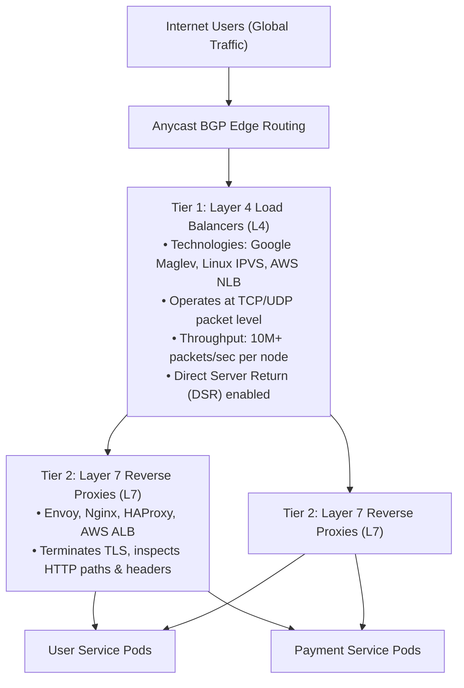
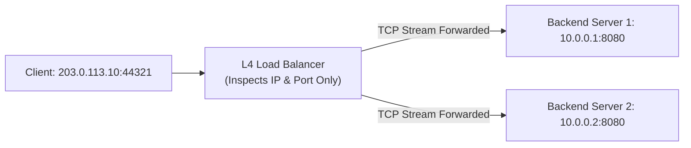
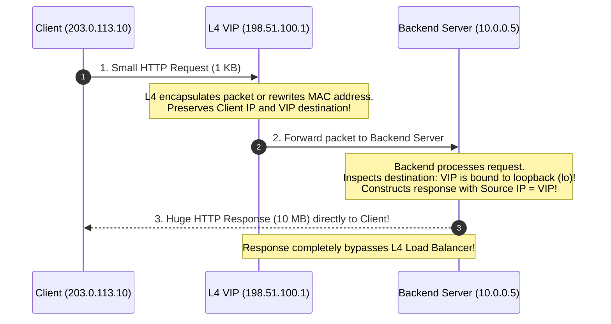
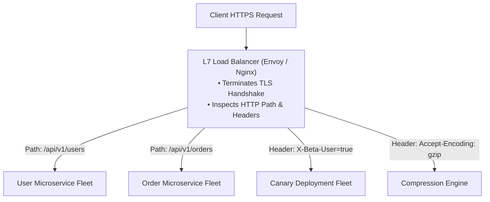
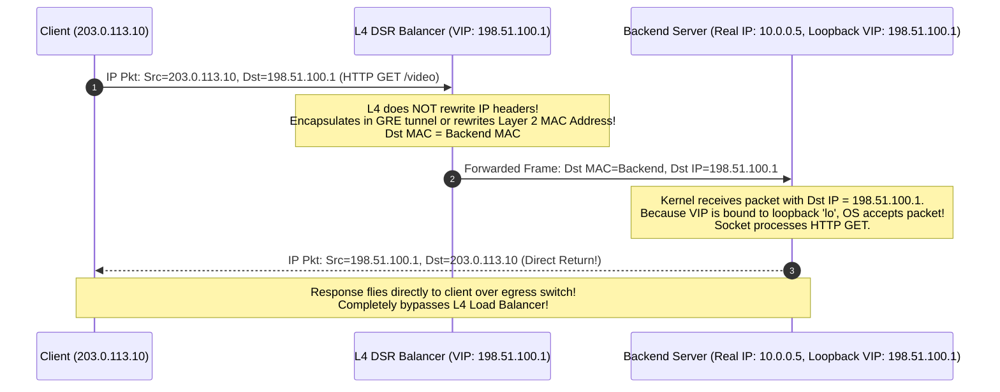

# Load Balancing: Layer 4 (Transport) vs. Layer 7 (Application)

Load balancers distribute incoming network traffic across a fleet of healthy backend servers to maximize throughput, minimize latency, and eliminate single points of failure. Understanding the fundamental architectural division between **Layer 4 (Transport Layer)** and **Layer 7 (Application Layer)** load balancing is essential for designing systems capable of serving millions of concurrent requests.

---

## 💡 Intuitive Real-World Analogies

### 1. Layer 4: The High-Speed Highway Toll Interchange
Imagine a state highway junction:
- The toll worker looks only at the vehicle's license plate and axle count (Source IP, Destination IP, Port).
- The worker does **not** stop the car, does **not** search the trunk, and does **not** ask what the passengers are talking about.
- The car is routed down Ramp 3 at $80\text{ mph}$.
- **Result:** Thousands of vehicles fly through every minute with practically zero delay because no one opens the vehicle to inspect cargo.

### 2. Layer 7: The Airport Customs Concierge
Imagine international airport customs:
- An officer stops the passenger, checks their passport and visa (TLS decryption & authentication).
- The officer inspects the baggage contents (HTTP path, JSON payload, cookies).
- If the passenger says: *"I am visiting for medical treatment"* (`/api/v1/health`), the officer directs them to Clinic Shuttle 4. If they say: *"I am importing commercial goods"* (`/api/v1/billing`), they are sent to the Cargo Inspection Terminal.
- **Result:** Intelligent, context-aware routing, but each inspection consumes time, table space, and human attention (CPU & memory buffers).

### 3. Direct Server Return (DSR): The Drive-Thru Window
When you order fast food:
- You speak a tiny order into the drive-thru microphone (small client HTTP request: $\sim 1\text{ KB}$).
- But the restaurant delivers a giant box containing 10 family meals (massive video/image response: $\sim 10\text{ MB}$).
- If the tiny intercom microphone also had to fit the giant meal box through the speaker wire, the intercom would explode!
- **Direct Server Return (DSR):** The client sends the small request to the L4 load balancer, but the backend server streams the massive payload **directly back to the client**, bypassing the load balancer entirely on the return path!

---

## 👶 Plain-English / ELI5 Overview

- **Layer 4 Load Balancers (AWS NLB, Linux IPVS, Maglev):** Operate at the network plumbing level (TCP/UDP). They see packets as sealed envelopes with addresses written on the outside. They don't know (or care) whether the packet is an HTTP website, a Netflix video stream, a database connection, or an online multiplayer game. They route millions of packets per second with blistering speed.
- **Layer 7 Load Balancers (Envoy, Nginx, HAProxy, AWS ALB):** Operate at the human application level (HTTP, gRPC, WebSockets). They open the envelope, read the letter inside, check the language, read the headers, and route traffic based on what the user is actually doing (e.g., routing `/login` to Auth servers, `/checkout` to Payment servers, and canary testing new features).

In production, global-scale systems do not choose between them—they **stack them together**: Layer 4 sits at the outer edge to absorb raw network traffic, and Layer 7 sits behind it to make intelligent application decisions.

---

## ⚠️ The Horror Scenario: The Saturated Egress & Broken Routing Disasters

### Disaster 1: The Egress Bandwidth Wall
A high-growth video streaming platform deployed an array of L7 reverse proxies to distribute 4K video streams:
- Clients sent small `GET /video/chunk_99.mp4` requests ($1\text{ KB}$).
- Backend video storage servers responded with video chunks ($5\text{ MB}$).
- Because the architecture routed all return responses back through the L7 proxy fleet for symmetric TLS encryption, the proxies' network interfaces saturated at 100 Gbps.
- The L7 proxies ran out of socket buffers, dropped $60\%$ of video packets, and caused global video buffering for millions of viewers.
- **The Fix:** Deploying an **L4 Direct Server Return (DSR)** layer allowed the 100 Gbps video data to fly directly from storage servers to users, reducing load balancer traffic by $99.9\%$.

### Disaster 2: The Path Routing Blunder
A junior architect placed an L4 Network Load Balancer in front of two microservice fleets: `Auth Service` and `Payment Service`.
- The architect expected L4 to route `/auth` to Auth pods and `/pay` to Payment pods.
- Because L4 operates strictly on TCP/IP packets without decrypting HTTP, it had no visibility into URLs.
- The L4 balancer distributed packets purely via round-robin IP hashing: half of the login requests were delivered to Payment pods (which returned `404 Not Found`), and half of the checkout payments were sent to Auth pods, completely shutting down company revenue.

---

## 1. The Two-Tier Production Topology

At global scale, tier-1 companies (Google, Meta, Netflix, AWS, Uber) deploy a **two-tier load balancing architecture**:



1. **Tier 1 (L4):** Handles raw line-rate packet switching, absorbs DDoS attacks, executes ECMP (Equal-Cost Multi-Path) hashing, and balances TCP connections across the L7 fleet.
2. **Tier 2 (L7):** Terminates TLS, decrypts HTTP/2 and gRPC streams, enforces path-based routing, checks authorization tokens, and manages canary traffic splits.

---

## 2. Layer 4 Load Balancing (Transport Layer)

L4 load balancers operate purely at the **TCP/UDP transport and IP network layers** (OSI Layer 4).



### Key Characteristics
- **No TLS Termination:** L4 does not decrypt HTTPS payloads; it forwards raw encrypted TCP packets directly to backends without inspecting content.
- **Direct Server Return (DSR):** High-end L4 systems (like Google Maglev) forward client requests to backend servers, but configure the backends to **reply directly to the client**, bypassing the load balancer on the egress path! Since responses (images, videos, HTML) are 10x–100x larger than incoming requests, DSR enables massive bandwidth scale.
- **Blazing Performance:** Processes tens of millions of packets per second per server with sub-millisecond CPU overhead.
- **Limitation:** Cannot read HTTP headers, URL paths, cookies, or payloads. It cannot route `/api/v1/billing` to Billing and `/api/v1/auth` to Auth.

### Direct Server Return (DSR) Architecture


---

## 3. Layer 7 Load Balancing (Application Layer)

L7 load balancers operate at the **Application Layer** (HTTP/1.1, HTTP/2, HTTP/3, gRPC, WebSockets).



### Core Capabilities
1. **Content-Based Routing:** Routes traffic dynamically based on URL path (`/auth` vs `/billing`), Host header (`api.domain.com` vs `static.domain.com`), HTTP methods, or headers.
2. **TLS Termination & Offloading:** Handles CPU-heavy asymmetric cryptographic handshakes in one place, allowing internal microservices to communicate over private VPC networks with minimal overhead.
3. **Advanced Traffic Shifting:**
   - **Canary Deployments:** Route $5\%$ of traffic to a new release version while $95\%$ remains on stable.
   - **Blue-Green Deployments:** Instant cutover between environments.
   - **A/B Testing:** Routing based on session cookies or user IDs.
4. **Resilience & Protection:** Built-in rate limiting, circuit breaking, request retries, and header sanitization (e.g., stripping untrusted internal headers from public clients).
5. **gRPC & HTTP/2 Multiplexing:** Understands gRPC framing and multiplexes multiple virtual streams over a single persistent TCP connection.

---

## 🚶 Step-by-Step Scenario: End-to-End Request Journey in Production

Let's trace what happens when Alice opens `https://streaming.app.com/watch/matrix`:

```mermaid
sequenceDiagram
    autonumber
    participant Alice as Client Browser
    participant L4 as L4 Balancer (Maglev / IPVS)
    participant L7 as L7 Gateway (Envoy Proxy)
    participant VideoSvc as Video Streaming Service
    participant AuthSvc as Auth Service

    Alice->>L4: TCP SYN (Port 443)
    L4->>L7: Pass TCP packet to healthy Envoy node (5-tuple hash)
    Alice<->L7: Complete TLS 1.3 Handshake (Keys negotiated at L7)
    
    Alice->>L7: GET /watch/matrix (Encrypted HTTPS)
    Note over L7: Envoy decrypts HTTP payload.<br/>Inspects path: /watch/* -> Route to VideoSvc.<br/>Checks cookie: session_id -> Validates token.
    
    par Async Auth Verification
        L7->>AuthSvc: Validate session token
        AuthSvc-->>L7: Token OK (Premium subscriber)
    end
    
    L7->>VideoSvc: Forward request over internal gRPC
    VideoSvc-->>L7: Return 4K Video Segment Stream
    L7-->>Alice: Stream Encrypted Video Data
```

1. **Step 1 (L4 Routing):** The client's initial TCP packets arrive at the public Virtual IP (VIP). The L4 load balancer hashes the 5-tuple (`Source IP`, `Source Port`, `Dest IP`, `Dest Port`, `Protocol`) and dispatches the raw packet to an Envoy proxy instance without decrypting TLS.
2. **Step 2 (TLS Handshake at L7):** Envoy completes the TLS 1.3 cryptographic handshake directly with Alice.
3. **Step 3 (Path Inspection):** Envoy reads the decrypted HTTP request: `GET /watch/matrix`.
4. **Step 4 (Routing Decision):** Because the path begins with `/watch/`, Envoy routes the request to the `Video Streaming Service` cluster, while user profile requests (`/user/profile`) would go to the `User Service`.
5. **Step 5 (Canary Evaluation):** If Alice has a header `X-Canary: true`, Envoy routes her to the new video codec fleet instead of standard production.

---

## 🏢 Real-World Production Battle-Testing

### Google: Maglev (Layer 4 Distributed Balancer)
- Published in a landmark 2016 paper, **Maglev** is Google's custom software L4 load balancer running on standard Linux servers.
- Handles all incoming traffic for Google Search, YouTube, and Gmail.
- Deployed at edge Points of Presence (PoPs), Maglev uses consistent hashing and Direct Server Return (DSR) to forward tens of millions of packets per second without keeping connection state in kernel tables.

### Netflix: Zuul & Envoy (Layer 7 API Gateway)
- Netflix operates thousands of microservices in AWS.
- All client device traffic flows through **Zuul** (and increasingly **Envoy**), which handles TLS termination, dynamic routing, canary routing splits, and distributed tracing headers (`x-request-id`).
- L7 proxies inspect every request's device type (Smart TV, iOS, Web) and route to tailored backend service aggregators.

### Amazon Web Services: NLB vs. ALB
- **AWS NLB (Network Load Balancer - L4):** Designed for extreme performance, capable of handling millions of requests per second, ultra-low latency, and static elastic IP allocation.
- **AWS ALB (Application Load Balancer - L7):** Designed for HTTP/HTTPS applications requiring path-based routing, host-based routing, HTTP/2, and native AWS WAF integration.

---

## ⚖️ Practical Trade-Offs & Decision Rules of Thumb

| Feature | Layer 4 Load Balancer | Layer 7 Load Balancer |
| :--- | :--- | :--- |
| **OSI Layer** | Layer 4 (Transport: TCP, UDP) | Layer 7 (Application: HTTP, gRPC, WS) |
| **TCP Termination** | ❌ Passes through (or NAT/DSR) | ✅ Terminates client TCP socket |
| **TLS Decryption** | ❌ No (Encrypted bytes forwarded) | ✅ Yes (Inspects decrypted payload) |
| **Routing Decisions** | Based on Client IP, Port, Protocol | Based on URL Path, Headers, Cookies, Method |
| **Throughput & Speed** | Extremely High (10M+ packets/sec per box) | Moderate to High (Requires payload parsing) |
| **Memory & CPU** | Extremely low memory footprint | Higher (Maintains full HTTP buffers & TLS state) |
| **WebSockets / gRPC** | Treated as plain TCP byte streams | Native protocol parsing, multiplexing & framing |
| **Direct Server Return (DSR)**| ✅ Supported (Egress bypasses load balancer) | ❌ Unsupported (L7 must proxy both directions) |
| **Leading Software** | Linux IPVS, Google Maglev, AWS NLB | Envoy Proxy, Nginx, HAProxy, Traefik, AWS ALB |

### Rules of Thumb for System Designers
1. **Use Layer 7 when:**
   - You need path-based or host-based routing (e.g., `/api/v1/auth` vs `/api/v1/checkout`).
   - You need TLS termination, SSL certificate management, and HTTP header sanitization.
   - You need microservice traffic management: canary releases, blue-green deployments, or A/B testing splits.
   - You are running gRPC or WebSockets that need connection multiplexing.
2. **Use Layer 4 when:**
   - You need extreme throughput and line-rate speed (millions of packets/sec).
   - You are proxying non-HTTP protocols (e.g., raw TCP database connections, gaming UDP packets, DNS, MQTT).
   - You need **Direct Server Return (DSR)** to stream massive video/download egress without choking load balancer bandwidth.
3. **The Gold Standard Architecture:**
   - Place an **L4 Balancer (NLB / IPVS)** at the outer edge to absorb raw DDoS and distribute TCP connections across a fleet of **L7 Balancers (Envoy / Nginx)** that handle business routing and security.

---

## 🎯 Top Real-World Interview Questions & Deep-Dive Answers (FAANG / Staff Level)

### Question 1: How does Direct Server Return (DSR) work at the packet level in an L4 load balancer (e.g. Google Maglev or Linux IPVS), and why must the VIP be configured on the backend server’s loopback interface?
**Model Answer:**
In traditional L4 NAT (Network Address Translation), the load balancer rewrites both the source and destination IP addresses, forcing all outgoing response packets to flow back through the load balancer. In high-bandwidth services (video streaming, CDNs), this creates an asymmetric bottleneck where 100 Gbps egress chokes the load balancer.

**The DSR Packet Mechanism:**


**Why the VIP must be bound to the Loopback (`lo`) Interface:**
1. The packet arriving at the backend server still has the **Destination IP set to the VIP (`198.51.100.1`)**, not the backend's real IP (`10.0.0.5`).
2. If the backend OS kernel does not have the VIP configured on an interface, the kernel drops the packet immediately as "not addressed to me".
3. By binding the VIP to the local loopback interface `lo` (with ARP disabled: `arp_ignore=1`, `arp_announce=2`), the backend kernel accepts the packet and delivers it to the listening application socket.
4. When the application writes the HTTP response, the socket uses the local socket address (`VIP 198.51.100.1`) as the **Source IP**. The client receives a response matching the exact IP it sent the request to, ensuring the TCP connection remains valid!

---

### Question 2: Why does an L4 load balancer completely fail to load balance gRPC and HTTP/2 traffic across backend pods without an L7 proxy?
**Model Answer:**
- **The Protocol Difference:** In HTTP/1.1 without Keep-Alive, each request opens a new TCP connection. An L4 balancer distributes new TCP connections evenly across servers.
- **HTTP/2 and gRPC Multiplexing:** HTTP/2 and gRPC create **one single, persistent, long-lived TCP connection** between the client and backend. Over this single TCP connection, thousands of independent RPC requests (streams) are multiplexed simultaneously.
- **The L4 Breakdown:** An L4 balancer only makes a routing decision during the initial **TCP Handshake (SYN packet)**!
  - Once Client A establishes a gRPC TCP connection to Backend Pod 1, **every single future gRPC call over that connection goes to Pod 1 forever**.
  - If 10 clients open connections to 10 pods, and Client 1 suddenly fires 50,000 gRPC requests/sec while the others are idle, **Pod 1 melts at 100% CPU**, while the other 9 pods sit at 0% CPU!
- **The Solution:** You must place an **L7 Load Balancer (Envoy)** in front of gRPC workloads. Envoy terminates the HTTP/2 connection, parses individual gRPC binary frames/streams, and load-balances **each individual RPC call** across all healthy backend pods.

---

### Question 3: Why do enterprise architectures deploy a Two-Tier Load Balancing design (L4 in front of L7) instead of exposing L7 proxies directly to public internet traffic?
**Model Answer:**
While L7 proxies (Envoy, Nginx) provide intelligent application routing, deploying them directly at the edge of the public internet creates severe architectural vulnerabilities:

1. **Stateful Connection Limits & Memory Footprint:**
   - Terminating TLS and parsing HTTP/2 buffers consumes substantial RAM per connection ($\sim 50\text{ KB} - 100\text{ KB}$ per socket in Envoy).
   - An Internet-scale volumetric SYN-flood or Slowloris attack can easily open 1,000,000 connections, exhausting hundreds of gigabytes of RAM on L7 proxies and causing kernel OOM crashes.
2. **Line-Rate Throughput Capacity:**
   - A single L7 Envoy proxy node saturates at $\sim 50,000 - 100,000\text{ req/sec}$ due to TLS decryption and HTTP header inspection.
   - A single L4 balancer (Google Maglev / Linux IPVS with eBPF) processes **10,000,000+ packets/sec** at line rate directly in kernel or network card silicon.
3. **The Two-Tier Synergy:**
   - **Tier 1 (L4 Edge):** Operates statelessly with Equal-Cost Multi-Path (ECMP) BGP routing. Absorbs volumetric DDoS, performs consistent hashing, and spreads millions of raw TCP connections evenly.
   - **Tier 2 (L7 Fleet):** Operates inside a protected private subnet. Focuses 100% of its CPU power on TLS termination, path routing, JWT validation, and canary traffic splitting.

---
*Related Documents:*
- [Rate Limiting Algorithms: Token Bucket & Leaky Bucket](file:///home/prasanta/Documents/learning_folder/system_design/07_RESILIENCE_FAULT_TOLERANCE_RATE_LIMITING/01_rate_limiting_algorithms.md)
- [Circuit Breakers and Resilient Retries](file:///home/prasanta/Documents/learning_folder/system_design/07_RESILIENCE_FAULT_TOLERANCE_RATE_LIMITING/03_circuit_breakers_and_bulkheads.md)
