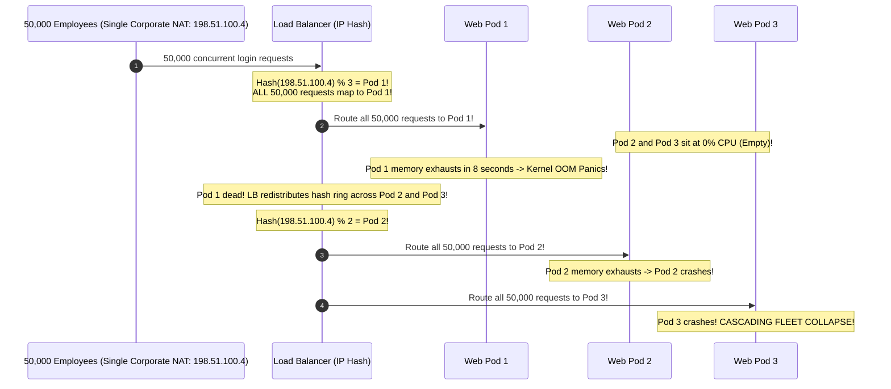
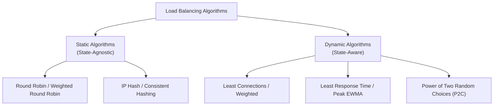
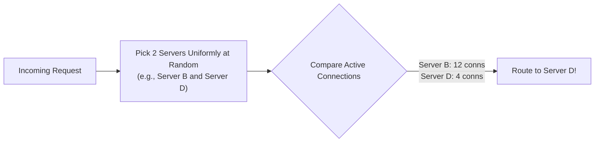
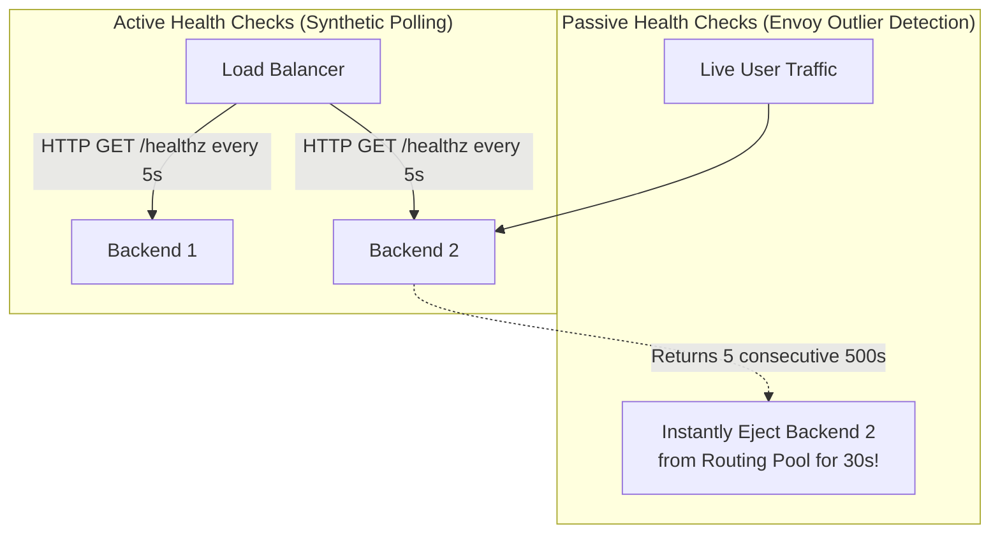
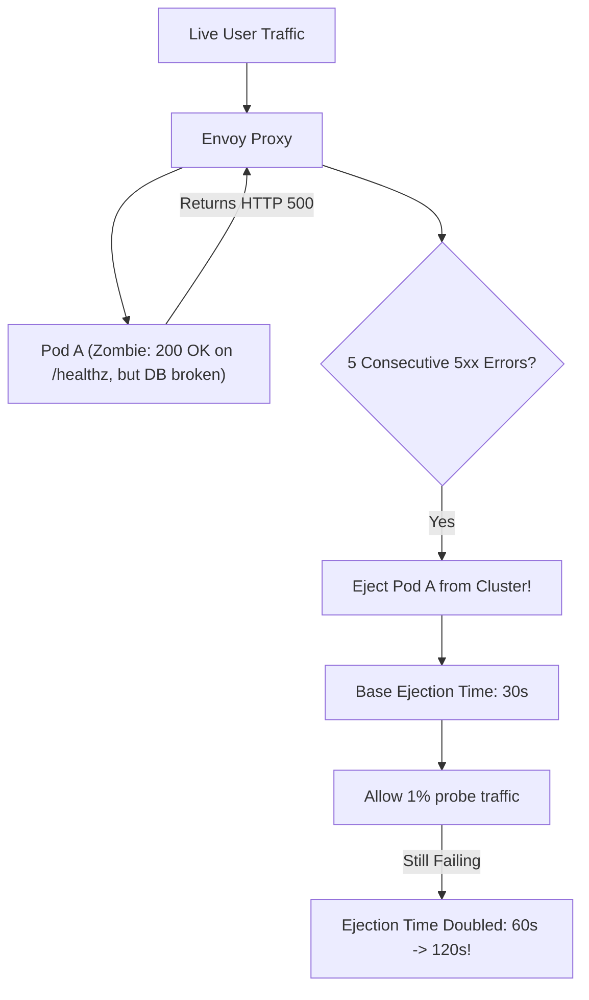

# Load Balancing Algorithms and Health Checking

A load balancer is only as resilient as the algorithm it uses to distribute traffic and its ability to detect and isolate failing servers before users notice. Choosing the wrong algorithm can turn a minor traffic surge into a complete fleet-wide cascading failure.

---

## 💡 Intuitive Real-World Analogies

### 1. Round Robin: Dealing Cards at Poker Night
Imagine dealing cards around a poker table:
- Player 1, Player 2, Player 3, Player 4. One card to each player in strict sequence.
- It doesn't matter if Player 1 is an 80-year-old grandfather who takes 5 minutes to read his cards, or if Player 2 plays in 2 seconds. The dealer hands cards blindly in order.
- **The Breakdown:** Player 1's pile of unplayed cards quickly stacks up to the ceiling, while Player 2 sits with empty hands waiting for work.

### 2. Power of Two Random Choices (P2C): Choosing a Supermarket Line
Imagine walking into a Costco warehouse with 40 open checkout lanes:
- **Global Least Connections:** You walk up and down all 40 lanes with a clipboard, counting the exact number of groceries in every single cart before picking the shortest line. (Exhaustive, slow, high CPU overhead).
- **Random Choice:** You close your eyes, pick a random number between 1 and 40, and walk into that line. (You risk picking the lane with a customer arguing over 50 expired coupons).
- **The Power of Two Choices (P2C):** You glance casually at **just 2 random lanes** in your field of view: Lane 7 and Lane 22. Lane 7 has 8 carts; Lane 22 has 2 carts. You immediately walk into Lane 22!
- By checking **just two candidates**, you avoid the worst lines with almost zero cognitive effort, achieving near-perfect load distribution.

### 3. Outlier Detection: The Restaurant Waitstaff
- **Active Health Check (Synthetic Polling):** Every 5 minutes, the manager walks over to the chef and asks: *"Are you alive?"* The chef says *"Yes!"* (returns 200 OK).
- **Passive Health Check (Outlier Detection):** The chef is technically alive, but every soup bowl they send out to customers is completely burnt (throwing 500 errors). The manager doesn't wait 5 minutes for the next verbal check; the manager sees 3 customers choke on soup and **immediately pulls the chef off the cooking line for a 30-minute break**.

---

## 👶 Plain-English / ELI5 Overview

When traffic arrives at your website, a load balancer decides which server handles each request:
- **Round Robin:** Take turns one by one. Good for quick, identical tasks.
- **Least Connections:** Send the next job to whoever has the fewest active tasks right now.
- **Consistent Hashing:** Send requests with the same user ID to the same server so their cache stays warm.
- **Power of Two Choices (P2C):** Pick two servers at random, compare them, and pick the one with less work. It is fast, mathematically brilliant, and powers modern tools like Envoy.
- **Health Checks:** Continuously eject dead or sick servers so your users never see error screens.

---

## ⚠️ The Horror Scenario: The Corporate NAT IP-Hash Fleet Collapse

An enterprise HR platform used **IP Hash Load Balancing** to ensure that an employee's requests always hit the same backend server (session stickiness without shared Redis session storage).

### What Happened?
- A Fortune 50 client with 50,000 employees logged into the platform simultaneously at 9:00 AM on Monday.
- All 50,000 employees accessed the internet from behind a corporate proxy gateway sharing a **single public NAT IP address**.
- Because the load balancer hashed the client IP, all 50,000 sessions were directed to Pod 1. Pods 2 through 10 sat completely idle.
- Pod 1 crashed from memory exhaustion. When the load balancer detected Pod 1 was dead, its hash ring remapped the IP to Pod 2.
- Pod 2 instantly crashed under the 50,000 requests. One by one, every server in the cluster fell like dominoes.
- **The Fix:** Session stickiness should be achieved via **Cookie Insertion (`Set-Cookie: SRV=pod_1`)**, never IP Hashing!

---

## 1. The Core Routing Algorithms

---

## 2. Static Algorithms

### 1. Round Robin
- Cycles sequentially through a list of healthy servers: $S_1 \to S_2 \to S_3 \to S_1 \dots$
- **Fatal Flaw:** Assumes all requests take equal processing time and all servers have equal capacity. If Server 1 receives a heavy report query while Server 2 receives lightweight health checks, Server 1 will run out of memory while Server 2 sits idle.

### 2. Weighted Round Robin
- Assigns integer weights based on server hardware capacity (e.g., Server A: Weight 3, Server B: Weight 1).
- Sequence: $A \to A \to A \to B \to A \to A \to A \to B$.

### 3. IP Hash Routing
- Hashes the client's IPv4/IPv6 address: $\text{Server} = \text{hash}(\text{IP}) \pmod N$.
- **Vulnerability:** Massive enterprise NAT gateways direct thousands of users to the exact same server, causing load imbalance and cascading crashes.

---

## 3. Dynamic Algorithms

### 1. Least Connections
- Directs traffic to the server currently handling the fewest active concurrent connections.
- **Ideal For:** Long-lived persistent connections (WebSockets, database connection pools, streaming media).

### 2. Peak EWMA (Exponentially Weighted Moving Average)
- Tracks the moving average latency of each server over time, multiplied by its active connection count:
  $$\text{Score} = \text{Latency}_{\text{EWMA}} \times (\text{Active Connections})^k$$
- Automatically shifts traffic away from a server that is slowing down due to garbage collection or disk saturation, long before a health check fails.

---

## 4. The Power of Two Random Choices (P2C)

Proven mathematically by Michael Mitzenmacher (2001) and adopted by modern high-performance proxies like **Envoy, Finagle, and Nginx**.

### Why P2C is Acoustically Brilliant
1. **Zero Central Coordination:** In a cluster with 50 load balancers, keeping a globally synchronized count of "least connections" across all servers requires expensive inter-balancer locks or gossip.
2. **Exponentially Low Maximum Load:**
   - Picking 1 server at random produces a maximum server queue load of $O\left(\frac{\log N}{\log \log N}\right)$.
   - Picking **just 2 random servers and choosing the better one** drops the maximum queue load exponentially to:
     $$O\left(\frac{\log \log N}{\log 2}\right)$$
   - Provides $99\%$ of the benefit of global least-connection tracking with almost zero CPU overhead!

---

## 5. Health Checks & Outlier Detection

### Active vs. Passive Health Checking
- **Active Health Checks (Synthetic Polling):**
  - Load balancer sends synthetic requests (`GET /healthz`) every $N$ seconds.
  - Requires $K$ consecutive successes to mark healthy; $M$ consecutive failures to mark dead.
  - *Risk:* A server might return 200 OK on `/healthz` while real user database queries are failing.
- **Passive Health Checking (Envoy Outlier Detection):**
  - Monitors real-world user traffic in real time.
  - If a backend node returns a burst of HTTP 5xx errors or connection timeouts (e.g., $> 10\%$ error rate over 10 seconds), the load balancer dynamically ejects that node from the active rotation pool for a cooling-off period (e.g., 30 seconds), without waiting for synthetic probes.

---

## 🏢 Real-World Production Battle-Testing

### Twitter: Finagle & The Power of Two Choices
- Twitter historically experienced extreme server latency variance under heavy tweet surges.
- When Twitter migrated their RPC framework (Finagle) from standard Round Robin to **P2C with Peak EWMA**, the 99.9th percentile latency of their microservice mesh dropped by over **75%**, virtually eliminating tail latency spikes.

### Envoy Proxy: Outlier Detection in Service Meshes
- Envoy monitors live traffic responses across Kubernetes service fleets.
- If an individual pod throws 5 consecutive HTTP 503 errors (due to a localized database connection pool exhaustion), Envoy’s outlier detector ejects that single pod from the load balancing pool for 30 seconds, routing traffic to healthy pods without human intervention.

---

## ⚖️ Algorithmic Comparison Matrix

| Algorithm | Complexity | State Tracking | Handles Bursty Traffic | Resilient to Heterogeneous Backends | Best Production Use Case |
| :--- | :--- | :---: | :---: | :---: | :--- |
| **Round Robin** | $O(1)$ | None | ❌ Poor | ❌ Poor | Short, uniform requests (Static file CDNs) |
| **Weighted Round Robin** | $O(1)$ | Minimal | ⚠️ Moderate | ✅ Good | Mixed hardware server tiers |
| **Least Connections** | $O(N)$ scan | High | ✅ Good | ✅ Good | Long-lived TCP/WebSocket sessions |
| **P2C (Power of Two)** | $O(1)$ | Low | ✅ Exceptional | ✅ Exceptional | Modern microservice meshes (Envoy, Finagle) |
| **Consistent Hashing** | $O(\log N)$ | Moderate | ⚠️ Poor (Hot keys) | ⚠️ Moderate | In-memory distributed caching (Memcached, Redis) |

---

## 🎯 Top Real-World Interview Questions & Deep-Dive Answers (FAANG / Staff Level)

### Question 1: Why does the Power of Two Random Choices (P2C) algorithm mathematically outperform Least Connections in large-scale multi-load-balancer architectures?
**Model Answer:**
In distributed systems with multiple load balancers (e.g. 20 Envoy edge proxies routing to 500 backend pods):
1. **The Distributed Least Connections Dilemma:**
   - For a load balancer to choose the true "least connected" server, all 20 load balancers must share real-time global state of every server's active connection count.
   - Synchronizing this state requires continuous inter-proxy gossip or centralized Redis counters, adding massive network overhead and latency.
   - Without global synchronization, all 20 load balancers independently see Server 42 as having the fewest connections and **all 20 forward their next 5,000 requests to Server 42 simultaneously**, instantly crushing it (**The Stampede / Flapping Effect**)!

2. **The P2C Mathematical Triumph (Mitzenmacher Theorem):**
   - Each load balancer picks **two servers uniformly at random** ($S_a, S_b$) and routes to whichever has fewer local connections.
   - Because each load balancer samples randomly, they rarely pick the same pair.
   - Mathematically, Mitzenmacher proved that moving from $d=1$ (pure random) to $d=2$ drops the maximum queue length from $O\left(\frac{\log N}{\log \log N}\right)$ to $O\left(\frac{\log \log N}{\log 2}\right)$—an exponential improvement in balance with zero inter-proxy communication!

---

### Question 2: What is the "Herd Behavior" or "Flapping" vulnerability in Least-Latency load balancing under latency spikes, and how does Peak EWMA mitigate it?
**Model Answer:**
- **The Flapping Vulnerability:** In naive Least-Latency routing, when Server 1 experiences a minor garbage collection (GC) pause and its response time spikes to 200ms, the load balancer shifts 100% of incoming traffic to Server 2 and Server 3.
  - Server 2 and Server 3 immediately become overloaded with 10x traffic, causing their latency to spike to 500ms.
  - The load balancer suddenly observes Server 1 has recovered (now at 10ms) and dumps 100% of traffic back onto Server 1!
  - Traffic oscillates wildly between servers in a destructive feedback loop (**Herd Flapping**).

**The Peak EWMA Solution (Finagle / Envoy):**
$$\text{Score} = \text{Latency}_{\text{EWMA}} \times (\text{Active Connections})^k$$
- **Exponentially Weighted Moving Average (EWMA):** Gives recent latency samples higher weight while smoothly incorporating historical performance, preventing a single fast response from instantly flooding a recovering server.
- **Active Connection Multiplier:** Even if a server's measured latency appears low, each new connection forwarded to that server immediately inflates its penalty score, naturally capping the number of in-flight requests and preventing stampedes.

---

### Question 3: How does Envoy’s Outlier Detection (Consecutive 5xx & Success Rate) protect microservices against "Zombie Nodes" that pass synthetic `/healthz` checks but fail real user requests?
**Model Answer:**
- **The Zombie Node Problem:** A microservice pod's database connection pool deadlocks, or its local disk fills up. When the load balancer calls `GET /healthz`, the lightweight health check handler simply returns `HTTP 200 OK` from memory because the health check endpoint does not execute deep database queries.
- The load balancer keeps routing real user checkout traffic to the node. 100% of user requests fail with HTTP 500!

**Envoy Outlier Detection Mechanisms:**

1. **Consecutive 5xx Ejection:** If an individual host returns $N$ consecutive 5xx responses (default $N=5$) during live traffic, Envoy immediately ejects the host from the load balancing pool for a `base_ejection_time` (e.g. 30 seconds).
2. **Success Rate Outlier Detection:** Envoy continuously calculates the average success rate across all hosts in a cluster. If Host A's success rate is more than $K$ standard deviations below the cluster mean, Host A is ejected.
3. **Ejection Multiplier:** If an ejected host rejoins the cluster and immediately begins failing again, Envoy doubles the ejection time ($30\text{s} \to 60\text{s} \to 120\text{s}$), isolating chronic zombie nodes permanently.

---
*Related Documents:*
- [Load Balancing: Layer 4 vs. Layer 7](file:///home/prasanta/Documents/learning_folder/system_design/06_TRAFFIC_ROUTING_LOAD_BALANCING_CDN/02_load_balancing_l4_vs_l7.md)
- [Service Mesh, Envoy, and Maglev Deep Dive](file:///home/prasanta/Documents/learning_folder/system_design/06_TRAFFIC_ROUTING_LOAD_BALANCING_CDN/05_service_mesh_envoy_and_maglev_deep_dive.md)
- [Circuit Breakers and Resilient Retries](file:///home/prasanta/Documents/learning_folder/system_design/07_RESILIENCE_FAULT_TOLERANCE_RATE_LIMITING/03_circuit_breakers_and_bulkheads.md)
