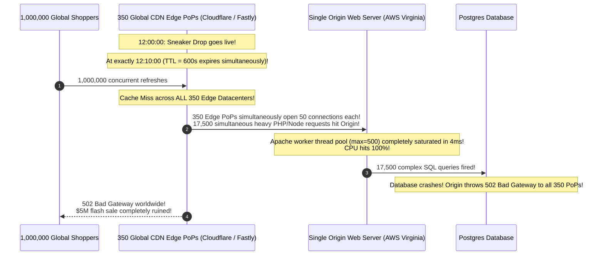
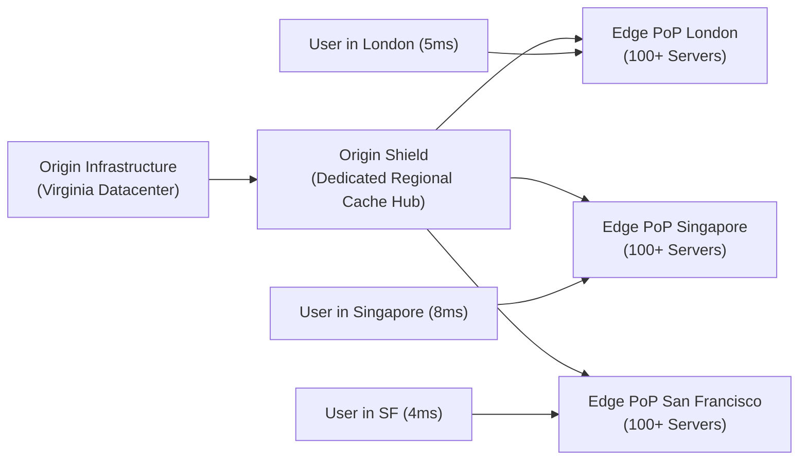
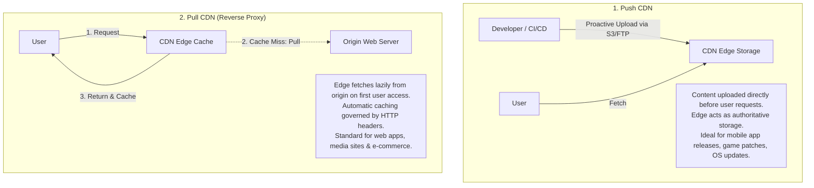
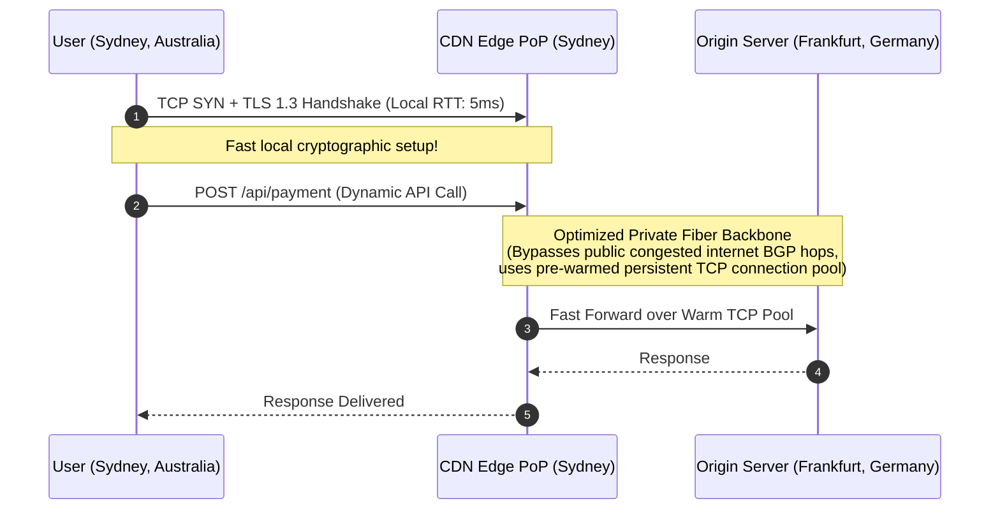
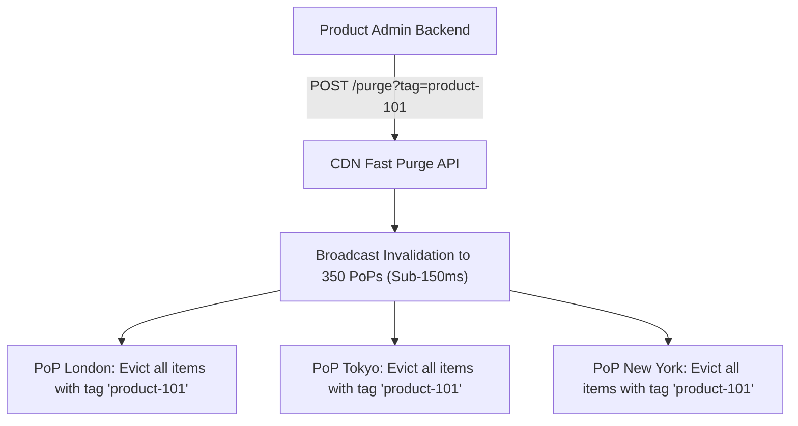
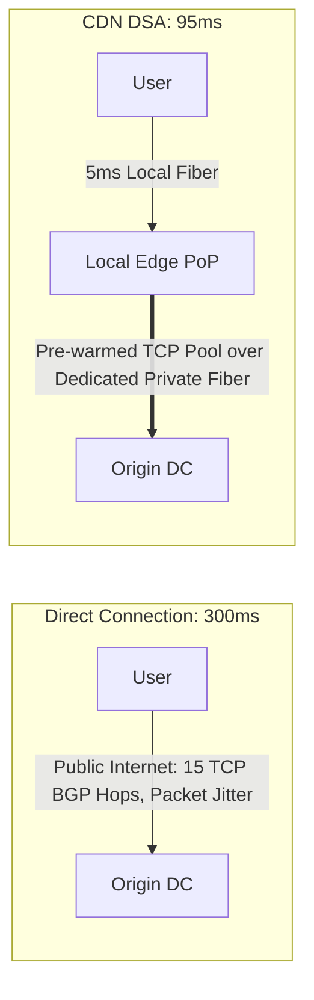

# Content Delivery Networks (CDNs) and Edge Computing

A Content Delivery Network (CDN) is a geographically distributed network of proxy servers and edge datacenters designed to deliver web assets, media streams, and API responses to users with minimal physical latency. In modern distributed systems, CDNs are no longer just static asset caches—they act as intelligent global entry points providing DDoS scrubbing, edge serverless compute, and dynamic API acceleration.

---

## 💡 Intuitive Real-World Analogies

### 1. Origin Shield & Edge PoPs: The Central Factory vs. Local Bodegas
Imagine a gourmet ice cream company based in Italy:
- **No CDN:** If a customer in Sydney, Australia wants ice cream, they must mail an order to Italy. The gelato melts during the 24-hour trans-continental flight.
- **Edge PoPs (Neighborhood Bodegas):** The company places refrigerated freezers in 5,000 neighborhood grocery stores worldwide. Australians buy gelato at the corner store in 2 minutes.
- **Origin Shield (Regional Distribution Hub):** If 500 grocery stores in Australia run out of chocolate gelato on the same afternoon, they don't all call the small factory in Italy at the same second. They call the **Sydney Regional Distribution Center (Origin Shield)**. The Sydney hub orders one giant freight container from Italy, satisfying all 500 bodegas while keeping the Italian factory calm.

### 2. Dynamic Site Acceleration (DSA): The Private High-Speed Bullet Train
Imagine mailing a confidential, unique contract that cannot be copied or cached (a dynamic `POST /checkout` API call):
- **Commodity Internet:** You drive your car on public city roads across 15 different congested highways, stopping at 20 traffic lights and toll booths (public BGP hops and TCP handshake packet loss).
- **Dynamic Site Acceleration:** You drive 2 minutes to your local city station (**Edge TLS Termination**). There, you hand the envelope to a conductor on a dedicated, private, non-stop bullet train with pre-cleared tracks (**Pre-warmed TCP Connection Pool over Private Fiber**). The envelope reaches the capital in a fraction of the time.

---

## 👶 Plain-English / ELI5 Overview

Light and electricity only travel so fast. A network packet takes about $150\text{ ms}$ to cross the Pacific Ocean. If your database is in Virginia, an Australian user has to wait at least a third of a second just for electricity to travel back and forth for every single click!

A **CDN (Content Delivery Network)** solves the physics problem by copying data onto thousands of edge computers located in every major city on Earth.
- When an Australian visits your website, pictures, videos, and scripts are delivered from a server in Sydney (5ms away).
- Even for actions that require the main database (like paying with a credit card), the CDN provides a private express lane to speed up the round-trip.

---

## ⚠️ The Horror Scenario: The 350-PoP Global Origin Flash-Sale Stampede

A luxury fashion retailer launched an exclusive sneaker drop. Their marketing team configured the product page with a 10-minute CDN cache TTL (`Cache-Control: public, max-age=600`), without enabling an **Origin Shield** or **Request Collapsing**:



### What Happened?
- At minute 10, the cached product page expired across all 350 edge datacenters at the exact same instant.
- Because there was no Origin Shield to coalesce requests, every edge location independently fired requests back to the origin server.
- The origin server received 17,500 simultaneous dynamic requests within 50 milliseconds.
- Apache worker threads exhausted instantly, PostgreSQL connection pools locked up, and the origin crashed.
- Worse, because the origin crashed and returned 502 Bad Gateway, the CDN did not cache the error, causing all 350 PoPs to continue hammering the dead origin every single second.
- **The Modern Solution:** Enable **Origin Shielding**, **Request Collapsing (Single-Flight at Edge)**, and `stale-while-revalidate`!

---

## 1. CDN Architectural Topologies



### The Role of Origin Shield & Request Collapsing
- **Origin Shield:** A centralized caching proxy positioned in the same cloud region or geographically proximate to the origin. Instead of 350 global edge datacenters querying the origin directly, all edge nodes pull from the Origin Shield.
- **Request Collapsing (Single-Flight / Wait-for-Object):** When 1,000 users in Tokyo request the exact same missing image simultaneously, the edge node sends **only one request** upstream to the origin. The remaining 999 requests pause and wait in memory, receiving the response the moment the first request returns.

---

## 2. Push vs. Pull CDN Architectures



---

## 3. Dynamic Site Acceleration (DSA)

CDNs do not merely cache static JPEG images and JavaScript bundles; they accelerate **dynamic, uncacheable API responses** (`POST /checkout` or `GET /user/balance`):



1. **Edge TLS Termination:** The client completes the TCP 3-way handshake and TLS 1.3 handshake locally over a $5\text{ ms}$ local link rather than waiting $250\text{ ms}$ for a round-trip to Frankfurt.
2. **Pre-Warmed Connection Pools:** The CDN maintains persistent, pre-warmed TCP/TLS connections over private optimized fiber backbones between the edge PoP and the origin.
3. **TCP Optimization:** Modern CDNs use custom TCP congestion control algorithms (like Google BBR) on their private backbones, achieving higher throughput and recovering instantly from packet loss.

---

## 4. Cache Invalidation at Scale & Cache-Tags (Surrogate Keys)

How do you invalidate a cached product page across 350 global datacenters within 150 milliseconds when an e-commerce merchant changes a price?

```http
HTTP/1.1 200 OK
Content-Type: application/json
Cache-Control: public, max-age=86400
Surrogate-Key: product-101 brand-apple category-laptops
```

When product 101 changes, the backend issues an API call to the CDN:
`POST /purge?tag=product-101`



- **Surrogate-Keys (Cache-Tags):** Instead of purging hundreds of individual URLs (`/products/101`, `/search?q=macbook`, `/category/laptops`), the CDN purges by tag. Every asset tagged with `product-101` is evicted globally in under 150 milliseconds!

---

## 5. Modern Cache-Control Directives

- `stale-while-revalidate=<seconds>`:  
  Instructs the CDN: *"If the cached object has expired, return the stale cached version to the user immediately ($0\text{ ms}$ delay), and asynchronously fire a background request to the origin to fetch the fresh copy for the next user."*
- `stale-if-error=<seconds>`:  
  Instructs the CDN: *"If the origin server throws an HTTP 500 error or times out, continue serving the stale cached copy to the user rather than showing an error page."*

---

## 🏢 Real-World Production Battle-Testing

### Fastly: Instant Purge & Real-Time Edge VCL
- Fastly built its global network on custom Varnish instances running in memory.
- Using their **Surrogate-Key** architecture, Fastly can purge millions of cached assets globally within **$150\text{ milliseconds}$**, allowing high-traffic news outlets (The New York Times) and e-commerce stores to cache content aggressively with long TTLs.

### Netflix: Open Connect Custom Hardware CDN
- Unlike typical web companies that use public CDNs, Netflix designed its own hardware CDN appliance: **Open Connect (OCA)**.
- Netflix embeds these appliances directly inside internet service provider (ISP) datacenters across the world.
- During off-peak hours (3:00 AM), Netflix pre-pushes upcoming popular movie and TV show files directly into the ISP-local appliances (**Push CDN**), so 100% of peak evening streaming traffic stays inside local ISP networks without touching the public internet transit.

---

## ⚖️ Practical Trade-Offs & Decision Rules of Thumb

| Dimension | Pull CDN (Reverse Proxy) | Push CDN (Edge Storage) |
| :--- | :--- | :--- |
| **Data Ingestion** | Lazy on-demand (Cache miss pulls from origin) | Proactive upload via API / rsync / S3 |
| **Origin Storage Cost** | Requires high origin server capacity | Storage moves to CDN edge |
| **Maintenance** | Zero-maintenance (HTTP headers govern behavior) | Requires manual management of file uploads & deletions |
| **Best Used For** | Web applications, e-commerce, news, dynamic APIs | Game patches, OS updates, large downloadable software |

---

## 🎯 Top Real-World Interview Questions & Deep-Dive Answers (FAANG / Staff Level)

### Question 1: How does Dynamic Site Acceleration (DSA) speed up 100% dynamic, completely uncacheable API calls (e.g. `POST /api/v1/checkout`)?
**Model Answer:**
Engineers often assume CDNs are useless for uncacheable dynamic APIs like checkout or payment submission. In reality, DSA cuts dynamic API latency by **50% to 75%** through four network-layer optimizations:



1. **Local TLS Handshake Termination:** A TLS 1.3 handshake over public mobile internet requires round trips. Terminating TLS at the local edge PoP takes $5\text{ ms}$ instead of $150\text{ ms}$ cross-continental round trips.
2. **Persistent Pre-Warmed TCP Connection Pools:** Between the Edge PoP and the Origin datacenter, the CDN maintains a pool of persistent, established TCP connections. When the dynamic API call arrives at the PoP, it is forwarded **immediately without paying the 3-way TCP handshake penalty**.
3. **Optimized TCP Congestion Control (BBR):** Commodity internet uses loss-based TCP algorithms (CUBIC). CDNs run congestion-based algorithms (Google BBR) on their private backbones, preventing throughput collapse over long-haul paths.
4. **Multiplexed HTTP/2 & HTTP/3 Egress:** Requests from thousands of local users are packed into multiplexed HTTP/2 streams across the CDN backbone.

---

### Question 2: What is the "Origin Stampede" problem in CDN edge networks, and how do Origin Shielding and Request Collapsing prevent origin server collapse?
**Model Answer:**
- **The Problem:** In a modern CDN with 300 edge Points of Presence (PoPs), when a viral video or popular article expires, thousands of users across 300 cities miss simultaneously. All 300 PoPs independently open concurrent connections back to the origin, multiplying traffic by $300\times$ and instantly crashing origin databases.

**The Two Architectural Defenses:**
1. **Request Collapsing (Single-Flight at the Edge):**
   - When 500 concurrent requests in the London PoP miss on the same URL (`/video/101.mp4`), the edge proxy executes **Request Collapsing**.
   - It issues **exactly one request** upstream to fetch the asset.
   - The other 499 requests are queued in memory. When the single response arrives, the edge proxy broadcasts the byte stream to all 500 awaiting clients simultaneously.
2. **Origin Shielding (Hierarchical Cache Tier):**
   - Position an intermediate caching tier (Origin Shield) in front of the origin.
   - The 300 Edge PoPs query the Origin Shield.
   - Even if all 300 edge PoPs experience a cache miss, **only the single Origin Shield queries the origin server**. Origin load is reduced from 300 queries to 1 query.

---

### Question 3: How do modern CDNs use `Surrogate-Keys` (Cache-Tags) to achieve sub-second invalidation of millions of related pages without flushing entire domains?
**Model Answer:**
In large-scale e-commerce, a single product change (e.g. iPhone 15 price drop) impacts hundreds of URLs: the product page, the category page, brand pages, search results, and navigation carousels.

**How Surrogate-Keys Work:**
1. **Response Tagging at Origin:** When the origin server renders a response, it appends a `Surrogate-Key` (or `Cache-Tag`) HTTP header containing all relevant business entity IDs:
   ```http
   HTTP/1.1 200 OK
   Cache-Control: public, max-age=604800
   Surrogate-Key: product_99 category_phones brand_apple
   ```
2. **CDN Indexing:** The CDN strips the header from the client response, but internally maps each tag in a high-speed in-memory reverse index:
   - `product_99` $\implies$ `[/items/iphone-15, /compare?id=99, /deals/flash]`
   - `brand_apple` $\implies$ `[/brands/apple, /categories/phones, ...]`
3. **Atomic Purge by Tag:** When the price mutates in PostgreSQL, the backend fires an asynchronous webhook to the CDN API:
   `POST /purge?key=product_99`
4. The CDN immediately invalidates all associated URLs across all 350 global datacenters in **under 150 milliseconds**, leaving all non-Apple and unrelated phone caches completely warm!

---
*Related Documents:*
- [DNS Resolution, GeoDNS, and Anycast BGP Routing](file:///home/prasanta/Documents/learning_folder/system_design/06_TRAFFIC_ROUTING_LOAD_BALANCING_CDN/01_dns_and_anycast_routing.md)
- [Load Balancing: Layer 4 vs. Layer 7](file:///home/prasanta/Documents/learning_folder/system_design/06_TRAFFIC_ROUTING_LOAD_BALANCING_CDN/02_load_balancing_l4_vs_l7.md)
- [Caching Topologies and Multi-Tier Caching](file:///home/prasanta/Documents/learning_folder/system_design/04_CACHING_STRATEGIES_AND_PATTERNS/01_caching_topologies_and_tiers.md)
