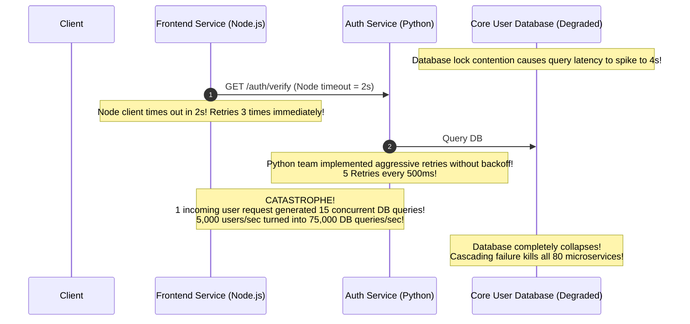
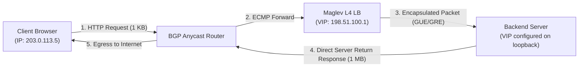
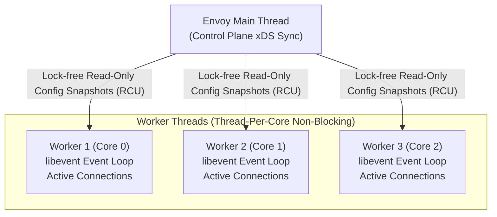
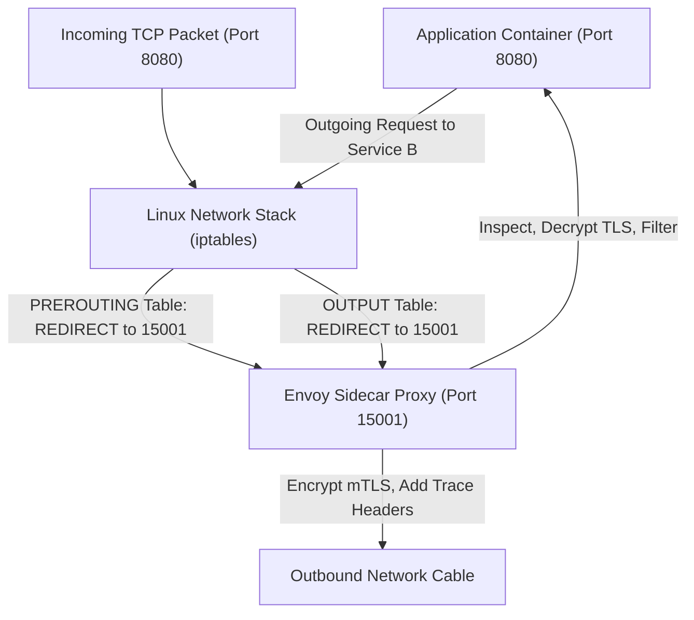

# Service Mesh, Envoy Proxy, and Google Maglev L4 Deep Dive

In modern cloud-native architectures, managing inter-service communication, security, telemetry, and traffic routing across thousands of microservice containers is impossible to handle in application code. This deep dive explores how **Google Maglev (L4)** provides line-rate packet switching at the outer perimeter, and how **Envoy Proxy & Service Mesh (L7)** manage distributed traffic with sub-millisecond thread-per-core architectures.

---

## 💡 Intuitive Real-World Analogies

### 1. Service Mesh Sidecar: The Personal Diplomatic Bodyguard & Translator
Imagine an international summit where 50 diplomats (microservices written in Java, Python, Go, Node, and C++) must collaborate:
- **Without a Sidecar (Library Hell):** You have to force every single diplomat to personally learn 20 languages, master martial arts, study advanced encryption ciphers, and carry a first-aid kit. If the security protocol changes, all 50 diplomats must go back to school for months.
- **With an Envoy Sidecar Proxy:** Every diplomat is assigned a personal, bilingual bodyguard who stands directly beside them (**Sidecar**).
  - The diplomat only speaks their native language into a short-range earpiece (`localhost:8080`).
  - The bodyguard handles mutual TLS passports, verifies identity badges, monitors heart rates (telemetry), retries failed messages, and guards the diplomat from being overwhelmed.

### 2. Maglev Consistent Hash Permutations: The Preferred Locker Draft
Imagine a school with 65,537 lockers (Table size $M$) and 100 students (Backends):
- Every student generates a deterministic list of their favorite locker numbers using two math formulas (`offset` and `skip`).
- Student A's list might be: $[5, 12, 19, 26, \dots]$. Student B's list might be: $[8, 20, 32, \dots]$.
- The principal calls students in turns to claim their top choices. If Locker 5 is empty, Student A claims it. If it’s occupied, Student A immediately looks at Locker 12.
- **The Result:** Every locker gets filled, every student owns an equal share of lockers, and when a student graduates, other students simply absorb their vacant lockers with **near-zero reshuffling**!

### 3. Hedged Requests: Calling Two Taxis
Imagine you need to catch a critical flight to a wedding:
- You open an app and order Taxi A.
- Normally, taxis arrive in 3 minutes. But 5% of the time, a driver gets stuck at a drawbridge (99th percentile tail latency).
- You set a timer: if Taxi A has not arrived within 5 minutes, **you immediately order Taxi B on a second app**.
- Whichever taxi pulls up to your driveway first gets your fare; you immediately cancel the second one.
- **Result:** You practically eliminate the risk of missing your flight with only a tiny fraction of duplicate effort!

---

## 👶 Plain-English / ELI5 Overview

When you have thousands of microservices:
1. **Google Maglev (L4):** Sits at the front door of the datacenter. It acts like a high-speed traffic cop directing millions of network packets per second without decrypting them or looking at what is inside.
2. **Envoy Proxy & Service Mesh (L7):** Sits inside your application servers. It intercepts every single web request, encrypts it with military-grade certificates (mTLS), splits traffic for canary releases, and automatically retries requests if a server stumbles.
3. **Adaptive Concurrency & Hedged Requests:** Smart math algorithms that prevent servers from choking when databases slow down, and eliminate slow tail latency spikes by firing backup requests.

---

## ⚠️ The Horror Scenario: The Polyglot Microservice Retry Storm

An enterprise migrated their monolith into 80 microservices across 5 different programming languages (Java Spring Boot, Go, Python Django, Ruby on Rails, and Node.js). Each engineering squad implemented their own HTTP client libraries for inter-service communication:



### What Went Wrong?
- The Python team implemented aggressive retries without exponential backoff.
- The Node.js team had mismatched timeout thresholds (2 seconds vs. Python’s 5 seconds).
- The Go team had no circuit breaker at all.
- When the primary user database experienced a transient 2-second lock contention, the incompatible, uncontrolled client retry logic created a self-inflicted **Retry Storm**.
- **The Modern Solution:** Move networking and resilience **out of application code** and into a standardized **Envoy Sidecar Service Mesh**. All timeouts, retries with full jitter, circuit breakers, and mutual TLS are configured centrally in YAML with zero application code changes!

---

## 1. Google Maglev: High-Availability Software Layer 4 Load Balancing

In hyperscale distributed systems, hardware load balancers (F5, NetScaler) hit cost and scaling limits. Google Maglev replaced dedicated hardware with commodity Linux servers providing line-rate Layer 4 routing.

### 1.1 Direct Server Return (DSR)
In typical internet services, request payloads are small (e.g., HTTP GET headers $\sim 1\text{ KB}$), while response payloads are massive (e.g., video chunks, images, HTML/JSON $\sim 1\text{ MB} - 10\text{ MB}$)—an **ingress-to-egress ratio of 1:100**.

If the load balancer sat in both directions (full proxy), the LB cluster would need $100\times$ more network bandwidth solely to relay egress traffic.
- **Direct Server Return (DSR):** The load balancer inspects incoming packets, leaves the source IP intact, encapsulates the packet inside Generic UDP Encapsulation (GUE) or Generic Routing Encapsulation (GRE), and forwards it to the backend backend.
- The backend decapsulates the packet, processes the request, and **sends the egress response directly to the client's public IP**, completely bypassing the load balancer!



### 1.2 The Maglev Consistent Hashing Algorithm
Traditional consistent hash rings (e.g., Ketama) require binary searches over millions of virtual nodes and can result in uneven distributions under node churn. Maglev introduces a **fixed lookup table of prime size $M$** (where $M \gg N$, e.g., $M = 65,537$).

Each backend host $i$ generates a unique pseudo-random permutation of the table indices using two independent hash functions:
$$\text{offset}_i = h_1(\text{backend}_i) \pmod M$$
$$\text{skip}_i = h_2(\text{backend}_i) \pmod{(M-1)} + 1$$
$$\text{entry}_{i, j} = (\text{offset}_i + j \times \text{skip}_i) \pmod M \quad \text{for } j = 0, 1, \dots, M-1$$

The algorithm fills the lookup table round-robin:
1. Each backend proposes its next preferred slot in its permutation sequence.
2. If the slot is empty, it claims it; if already occupied, it advances to its next permutation entry.
3. **Properties:**
   - Perfect load uniformity (each host receives $\approx M / N$ slots).
   - Minimal connection disruption when hosts enter or leave.
   - Lookup is an instantaneous $O(1)$ array access: `backend = lookup_table[hash(5_tuple) % M]`.

---

## 2. Envoy Proxy Architecture & The xDS Control Plane

Envoy is the industry standard high-performance L7 proxy designed by Lyft and adopted across Kubernetes (Istio, Consul).

### 2.1 Threading Model: Non-Blocking Thread-Per-Core
Unlike classic proxies that spawn threads per connection or use worker pools with lock synchronization, Envoy uses a **Thread-Per-Core** event loop model:
- **Main Thread:** Handles process lifecycle, configuration updates, and listens on sockets, passing accepted socket file descriptors to worker threads.
- **Worker Threads:** One worker thread pinned to each CPU core running an independent `epoll` / `kqueue` event loop.
- **Zero Lock Contention:** Once a connection is assigned to a worker thread, all filtering, TLS termination, HTTP parsing, rate limiting, and backend routing for that connection occur entirely within that single worker's thread memory without cross-thread mutexes.



### 2.2 The xDS Dynamic Configuration Protocol
Envoy proxies never require process restarts or configuration file reloads to apply changes. Instead, they stream updates dynamically from a centralized Control Plane (e.g., Istio `pilot`) via gRPC:

| API Name | Full Name | Purpose in Service Mesh |
| :--- | :--- | :--- |
| **LDS** | Listener Discovery Service | Configures ports, protocols (TCP, TLS, HTTP/1.1, HTTP/2, HTTP/3), and filter chains. |
| **RDS** | Route Discovery Service | Matches HTTP paths, headers, domains, and dictates traffic shifting (canary splits). |
| **CDS** | Cluster Discovery Service | Defines upstream clusters of services, health check parameters, and LB algorithms. |
| **EDS** | Endpoint Discovery Service | Resolves real pod/host IP addresses and ports inside upstream clusters dynamically. |

---

## 3. Adaptive Concurrency Limits & Tail Latency Mitigation

Static rate limits (e.g., $1000\text{ req/sec}$) are dangerous during backend degradation: if downstream database queries slow down from $10\text{ ms}$ to $500\text{ ms}$, the service will exhaust memory and threads long before reaching 1000 req/sec.

### 3.1 Little's Law Applied to Service Concurrency
John Little (1961) proved the fundamental law of queueing systems:
$$L = \lambda \times W$$
- $L$: Average number of concurrent requests in the system.
- $\lambda$: Throughput (requests arriving per second).
- $W$: Average latency / wait time per request.

If latency ($W$) spikes, the system *must* either restrict incoming throughput ($\lambda$) or allow concurrency ($L$) to balloon until worker thread pools exhaust and the service crashes.

### 3.2 Netflix Gradient Concurrency Limiter
Netflix open-sourced the Gradient Limiter (derived from TCP Vegas congestion control). Instead of measuring fixed request counts, it dynamically throttles concurrency by measuring the **RTT Gradient**:

$$\text{Gradient} = \frac{\text{RTT}_{\text{noload}}}{\text{RTT}_{\text{measured}}}$$

$$\text{NewLimit} = \text{CurrentLimit} \times \text{Gradient} + \text{Headroom}$$

- When backend latency is nominal ($\text{RTT}_{\text{measured}} \approx \text{RTT}_{\text{noload}}$), the gradient $\approx 1.0$, and the limit expands.
- If the downstream database slows down, $\text{RTT}_{\text{measured}}$ spikes, causing the gradient to drop below $1.0$, immediately and automatically reducing permissible concurrency before server threads exhaust!

### 3.3 Hedged Requests (Google "Tail at Scale" - Jeff Dean)
In massive distributed queries spanning 1,000 leaf servers (e.g., Google Search index lookup), the overall response time is governed by the slowest replica (the 99.9th percentile tail latency).

**The Hedged Request Pattern:**
1. Client sends request to primary replica $A$.
2. Client starts a timer for the expected 95th percentile latency (e.g., $15\text{ ms}$).
3. If replica $A$ has not replied within $15\text{ ms}$, the client fires an identical **hedged request** to replica $B$.
4. The client consumes whichever response arrives first and cancels the pending request.
5. **Trade-off:** Cuts $p99.9$ tail latency by up to $80\%$ with only a tiny $\sim 5\%$ increase in aggregate cluster load!

---

## 🏢 Real-World Production Battle-Testing

### Google: Maglev Across All Services
- Google has run Maglev in production since 2008 to serve Google Search, Gmail, and YouTube.
- Maglev machines operate in parallel clusters behind BGP routers using Equal-Cost Multi-Path (ECMP). Even if a Maglev node dies or reboots, its consistent hash table ensures that existing TCP connections are picked up by surviving Maglev nodes without breaking user streams.

### Lyft: The Origin of Envoy
- Lyft created Envoy in 2015 to solve the observability and resilience crisis in their microservice migration.
- Envoy sidecars running alongside hundreds of services unified distributed tracing (`x-client-trace-id`), standardized mutual TLS (mTLS), and provided automatic outlier detection that eliminated 95% of cascading outages.

---

## ⚖️ Practical Trade-Offs & Decision Rules of Thumb

| Architecture | Operational Complexity | Performance Overhead | Polyglot Support | Best Used For |
| :--- | :--- | :--- | :---: | :--- |
| **Application Client Libraries (e.g. Finagle, Ribbon)** | High (Per language) | Lowest (Zero network hop) | ❌ Poor | Single-language monoliths or microservices |
| **Centralized API Gateway (e.g. Kong, Apigee)** | Low to Moderate | High (Extra network hop) | ✅ Perfect | Public edge traffic ingress |
| **Sidecar Service Mesh (Envoy / Istio)** | High (Control plane ops) | Low ($\sim 1\text{ ms}$ localhost hop) | ✅ Perfect | Large polyglot microservice clusters ($> 20$ services) |

---

## 🎯 Top Real-World Interview Questions & Deep-Dive Answers (FAANG / Staff Level)

### Question 1: How does an Envoy sidecar proxy intercept incoming and outgoing container traffic transparently without modifying the application code?
**Model Answer:**
In a Kubernetes Service Mesh (such as Istio using Envoy), application containers have no idea they are communicating through a proxy. Traffic interception is achieved via Linux kernel **`iptables`** rules configured by an `initContainer` (`istio-init`) with `NET_ADMIN` capabilities before the application container starts:



1. **Inbound Redirection (PREROUTING Chain):**
   - The `iptables` rule intercepts incoming packets on the `PREROUTING` chain:
     `iptables -t nat -A PREROUTING -p tcp -j REDIRECT --to-ports 15001`
   - The packet is diverted to Envoy's inbound listener socket on port 15001. Envoy terminates mTLS, enforces rate limiting, and forwards the plaintext request to the local app container on `127.0.0.1:8080`.
2. **Outbound Redirection (OUTPUT Chain):**
   - When the application sends an outgoing request to an external service, the `OUTPUT` chain intercepts the packet:
     `iptables -t nat -A OUTPUT -p tcp -j REDIRECT --to-ports 15001`
   - **Preventing Infinite Loops (UID Exclusion):** The Envoy process itself runs under a dedicated Linux user ID (`UID 1337`). The `iptables` rule has an explicit exception:
     `iptables -t nat -A OUTPUT -m owner --uid-owner 1337 -j RETURN`
   - Packets generated by Envoy bypass redirection and fly out to the physical network card!

---

### Question 2: Why is Maglev’s consistent hashing algorithm superior to traditional Ketama / Ring consistent hashing in high-throughput network packet switching?
**Model Answer:**
Traditional consistent hashing (like Ketama used in Memcached) places servers and keys on a circular ring of $2^{32}$ points using virtual nodes. While effective for caching, it fails in line-rate packet switching (Maglev):

1. **Lookup Complexity:**
   - In a hash ring, locating the server for a hash key requires a **Binary Search** over the ring array: $O(\log(\text{Virtual Nodes}))$.
   - At 10,000,000 packets per second, performing binary searches on every packet causes CPU cache misses and throughput bottlenecks.
   - **Maglev Lookup is $O(1)$:** Maglev maps hashes into a fixed prime array of size $M$ (e.g. $65,537$). Looking up a backend is a single, direct array index operation:
     `backend = lookup_table[hash(5_tuple) % M]`
2. **Load Balancing Uniformity:**
   - Hash rings frequently produce uneven distributions unless thousands of virtual nodes are allocated per host.
   - Maglev’s permutation generation guarantees that every backend receives an **almost perfectly equal number of slots ($\approx M/N$)**, providing mathematical uniformity.
3. **Resilience to Churn:** When a backend is removed, only the slots owned by that backend are reassigned; all other backend assignments remain completely undisturbed.

---

### Question 3: How do Hedged Requests (from Jeff Dean’s "Tail at Scale") slash p99.9 latency in fan-out distributed architectures, and how do you prevent them from causing runaway load amplification?
**Model Answer:**
- **The Fan-Out Tail Latency Problem:** If a user search query fans out to 100 leaf partitions, and each leaf partition has a 99th percentile latency of 100ms, the probability that the overall query takes $\ge 100\text{ ms}$ is:
  $$P(\text{Delay}) = 1 - (0.99)^{100} \approx 63.4\%!$$
  The majority of user requests suffer severe tail latency delays!

**The Hedged Request Mechanism:**
Instead of setting a hard timeout, the coordinator client sends a request to Replica 1, waits until the 95th percentile latency threshold (e.g., $15\text{ ms}$), and if no reply has arrived, fires a **hedged duplicate request** to Replica 2:

```mermaid
sequenceDiagram
    autonumber
    participant Coord as Query Coordinator
    participant Rep1 as Replica 1 (Experiencing GC Pause)
    participant Rep2 as Replica 2 (Healthy)

    Coord->>Rep1: 1. Send Query
    Note over Coord: Start 15ms Timer (p95 latency)
    Note over Rep1: Replica 1 freezes in JVM GC pause...
    
    Note over Coord: 15ms timer expires! No response from Rep1!
    Coord->>Rep2: 2. Fire Hedged Request to Replica 2!
    Rep2-->>Coord: 3. Return Query Result (in 4ms!)
    Coord-->>Coord: Consume result; Return to user in 19ms total!
    Coord->>Rep1: 4. Cancel pending request
```

**Preventing Runaway Load Amplification (The 3 Guardrails):**
1. **Delay Hedge Until p95:** Never fire duplicate requests immediately. By delaying until the 95th percentile, **at most 5% of requests generate duplicate network traffic**, increasing cluster load by only $\approx 5\%$.
2. **Global Concurrency / Token Budget:** Cap aggregate hedged requests to a strict maximum (e.g. no more than $2\%$ of active cluster requests may be hedged at any time). If the system is under load, disable hedging automatically.
3. **Immediate Cancellation:** Include cancellation tokens (`gRPC Cancel / Context.abort`) so that when Replica 2 replies, Replica 1 terminates execution immediately.

---
*Related Documents:*
- [Load Balancing: Layer 4 vs. Layer 7](file:///home/prasanta/Documents/learning_folder/system_design/06_TRAFFIC_ROUTING_LOAD_BALANCING_CDN/02_load_balancing_l4_vs_l7.md)
- [Load Balancing Algorithms and Health Checking](file:///home/prasanta/Documents/learning_folder/system_design/06_TRAFFIC_ROUTING_LOAD_BALANCING_CDN/03_load_balancing_algorithms.md)
- [Circuit Breakers and Resilient Retries](file:///home/prasanta/Documents/learning_folder/system_design/07_RESILIENCE_FAULT_TOLERANCE_RATE_LIMITING/03_circuit_breakers_and_bulkheads.md)
