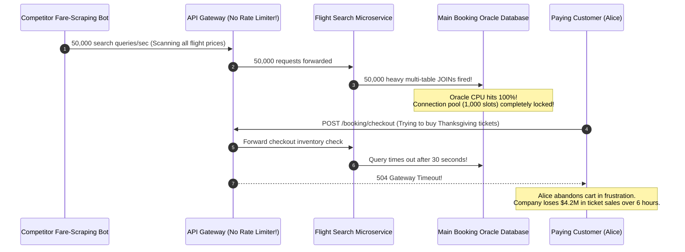
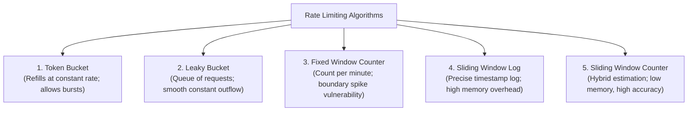
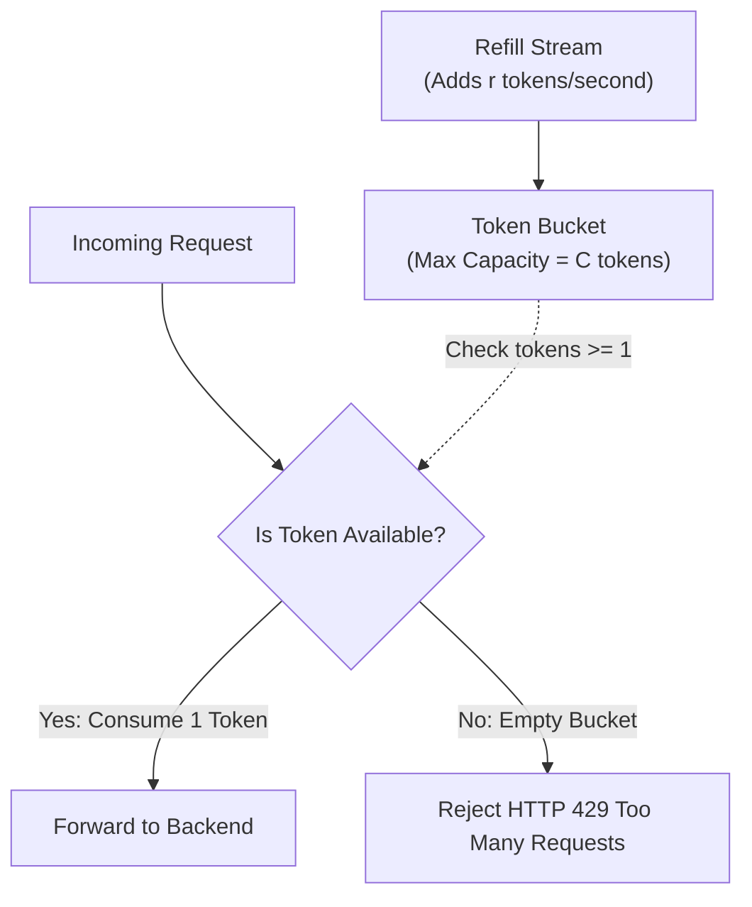
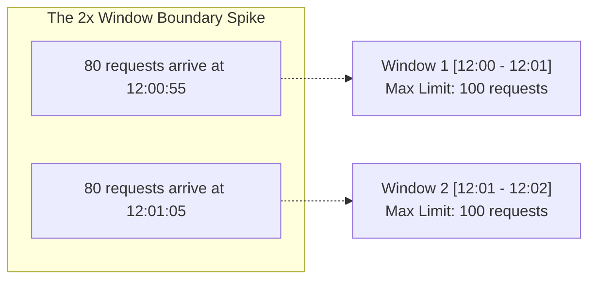
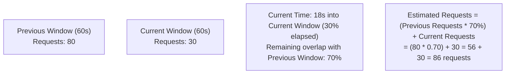
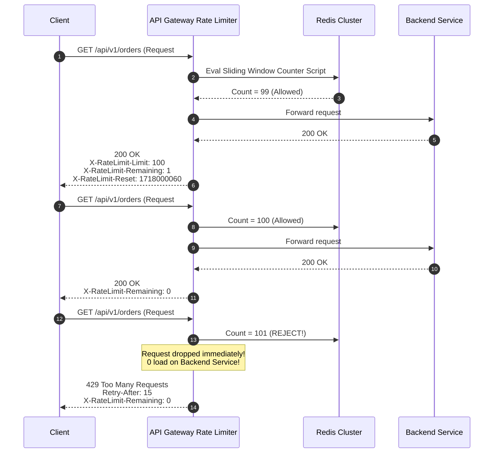
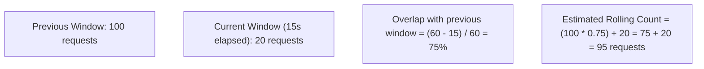
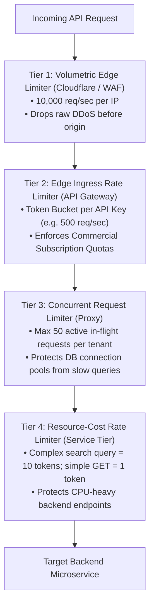

# Rate Limiting Algorithms: Token Bucket, Leaky Bucket & Sliding Windows

Rate limiting controls the rate at which requests are processed by a system. It prevents denial-of-service (DoS) attacks, stops abusive web scraping, prevents cascading downstream failures, and enforces commercial SaaS multi-tenant subscription tiers.

---

## 💡 Intuitive Real-World Analogies

### 1. Token Bucket: The Arcade Game Dispenser
Imagine an arcade that gives you game tokens:
- At the start of your visit, the dispenser fills your bucket with up to $10$ tokens (Bucket Capacity $C = 10$).
- Every 1 minute, the arcade machine drops $1$ new token into your bucket (Refill Rate $r = 1/\text{min}$). If your bucket is already full, extra tokens simply bounce off and fall away.
- When you want to play games, you can spend **all 10 tokens in 10 seconds** in an exciting burst!
- But once your bucket is empty, you must wait patiently for the machine to drop new tokens one by one.
- **Key Intuition:** Allows **instant bursts of traffic**, but bounds the long-term sustained rate to the refill speed.

### 2. Leaky Bucket: The Drip Irrigation Funnel
Imagine a funnel with a tiny, fixed hole at the bottom:
- No matter how violently or irregularly you pour water into the top (bursty incoming requests), water drips out of the bottom spout at a **completely constant, predictable rate of 1 drop per second** (Smooth Outflow).
- If you pour water faster than it leaks, the funnel fills up.
- If the funnel fills to the brim and you keep pouring, water spills over the edge onto the floor (**Dropped Requests / HTTP 429**).
- **Key Intuition:** Enforces **strict traffic smoothing** and protects fragile legacy backends that choke on sudden bursts.

### 3. Fixed Window Boundary Vulnerability: The Subway Turnstile Reset
Imagine a subway monthly pass that allows 10 rides per hour, resetting on the clock hour:
- A commuter swipes 10 times between 11:59:50 AM and 11:59:59 AM (legal for the 11:00–12:00 window).
- At 12:00:00 PM, the clock strikes noon and a brand new window opens with 10 fresh rides.
- The commuter immediately swipes another 10 times between 12:00:01 PM and 12:00:10 PM.
- **The exploit:** The commuter took **20 rides in a 20-second window**, completely violating the intent of the "10 rides per hour" limit!

---

## 👶 Plain-English / ELI5 Overview

Servers have finite CPU, memory, and database connections. If a popular bot or aggressive customer fires 100,000 requests per second at your server, it will crash and take all other customers down with it.

A **Rate Limiter** is a digital bouncer standing at the doorway of your API. When a request arrives, the bouncer checks the customer's ID card (API key, IP address, or user ID):
- If the customer has stayed within their allowed budget: *"Welcome, proceed inside."*
- If the customer is hammering the door too fast: *"Stop! HTTP 429 Too Many Requests. Try again in 12 seconds."*

Different algorithms dictate how that budget is calculated, refilled, and enforced.

---

## ⚠️ The Horror Scenario: The Thanksgiving Flight-Scraper Meltdown

A regional airline operated an online booking platform with a search API: `GET /api/v1/flights/search`. Searching required complex graph-traversal queries across flight legs, partner airlines, and dynamic seat inventory.



### What Happened?
- A third-party competitor deployed an automated bot farm scraping ticket prices ahead of Thanksgiving.
- The airline had no rate limiter in front of its search endpoint.
- 50,000 search queries per second flooded the database with multi-table joins, exhausting database connection pools within seconds.
- Real human travelers attempting to book holiday flights experienced 30-second spinning wheels and HTTP 504 Gateway Timeouts.
- By the time engineers manually blocked the bot's IP ranges 6 hours later, the airline had lost $4.2 million in direct bookings and suffered severe brand damage.

---

## 1. Algorithm Overview



---

## 2. Token Bucket Algorithm

The most widely adopted rate-limiting algorithm in modern distributed systems (powering AWS API Gateway, Stripe, and Google Cloud).



### Mathematical Parameters
- **Capacity ($C$):** Maximum number of tokens the bucket can hold at any time.
- **Refill Rate ($r$):** Number of tokens added to the bucket per unit time (e.g., 10 tokens/second).

### How It Operates
1. A bucket holds up to $C$ tokens.
2. Every $1/r$ seconds, a new token is added to the bucket. Tokens overflowing beyond capacity $C$ are discarded.
3. When a request arrives:
   - If at least 1 token exists, 1 token is consumed, and the request is permitted.
   - If the bucket is empty, the request is immediately rejected with HTTP `429 Too Many Requests`.
- **Primary Strength:** Elegantly handles **controlled bursts of traffic**. If the system is idle, the bucket fills to $C$. A sudden burst of $C$ concurrent requests can be serviced instantly without throttling.

### Production Redis Lua Implementation
To implement a Token Bucket in Redis without running a continuous background timer for millions of users, calculate token refills **lazily on request arrival**:

```lua
-- KEYS[1]: Rate limit key (e.g., "ratelimit:user_123")
-- ARGV[1]: Max Capacity (C)
-- ARGV[2]: Refill Rate per second (r)
-- ARGV[3]: Current Unix Timestamp (now)
-- ARGV[4]: Requested tokens (cost, usually 1)

local key = KEYS[1]
local capacity = tonumber(ARGV[1])
local refill_rate = tonumber(ARGV[2])
local now = tonumber(ARGV[3])
local requested = tonumber(ARGV[4])

-- Retrieve current bucket state: [tokens, last_updated_timestamp]
local data = redis.call("HMGET", key, "tokens", "last_updated")
local tokens = tonumber(data[1])
local last_updated = tonumber(data[2])

if tokens == nil then
    tokens = capacity
    last_updated = now
else
    -- Lazily calculate tokens refilled since last request
    local delta = math.max(0, now - last_updated)
    tokens = math.min(capacity, tokens + (delta * refill_rate))
    last_updated = now
end

if tokens >= requested then
    tokens = tokens - requested
    redis.call("HMSET", key, "tokens", tokens, "last_updated", last_updated)
    redis.call("EXPIRE", key, math.ceil(capacity / refill_rate))
    return 1 -- ALLOWED
else
    redis.call("HMSET", key, "tokens", tokens, "last_updated", last_updated)
    return 0 -- REJECTED (HTTP 429)
end
```

---

## 3. Leaky Bucket Algorithm

Modeled after a physical bucket with a small hole in the bottom. Typically implemented using a First-In, First-Out (FIFO) queue.

```mermaid
flowchart TD
    Requests["Incoming Requests (Bursty & Irregular)"] --> BucketQueue["FIFO Bucket Queue<br/>(Buffer Capacity = B slots)"]
    BucketQueue -.->|If Queue Full (Buffer Overflow)| Drop["Drop Request (HTTP 429)"]
    BucketQueue -->|Leaking at Strictly Constant Rate (r requests/sec)| Processing["Backend Processing Fleet"]
```

### How It Operates
1. Incoming requests enter a FIFO queue buffer.
2. If the queue is full (exceeds buffer capacity $B$), incoming requests are dropped or rejected.
3. The queue discharges (leaks) requests to the backend at a **strictly constant, predictable rate** $r$.
- **Primary Strength:** **Smooths out traffic spikes**. Ideal for downstream services that require a continuous, predictable ingestion rate (e.g., asynchronous video rendering or payment gateway communication).
- **Weakness:** Adds latency to bursts; requests sit in the queue even if the backend currently has idle capacity.

---

## 4. Fixed Window Counter Algorithm

Divides the timeline into fixed temporal windows (e.g., 1 minute: `12:00:00 - 12:01:00`).



### The Boundary Exploit
- Limit: 100 requests per minute.
- A client sends 100 requests at `12:00:59` (Window 1 approves).
- At `12:01:00`, a brand-new window opens with counter reset to 0.
- The client sends another 100 requests at `12:01:01` (Window 2 approves).
- **Result:** The backend receives **200 requests within a 2-second window**, completely defeating the 100 req/min limit and doubling the expected load!

---

## 5. Sliding Window Log Algorithm

Eliminates the boundary condition of fixed windows by maintaining a timestamped transaction log for each user.

### How It Operates
1. When a request arrives at timestamp $T$, append $T$ to a sorted set (e.g., Redis ZSET).
2. Evict all timestamps older than $T - \text{WindowSize}$ from the log using `ZREMRANGEBYSCORE`.
3. Count the remaining elements in the log using `ZCARD`:
   - If $\text{count} \le \text{Limit}$, allow the request.
   - If $\text{count} > \text{Limit}$, reject the request.
- **Strength:** $100\%$ mathematical precision; zero boundary exploits.
- **Weakness:** Extreme memory consumption. Storing 64-bit timestamps for millions of requests consumes gigabytes of expensive RAM.

---

## 6. Sliding Window Counter Algorithm

An elegant hybrid approximation combining Fixed Window memory efficiency with Sliding Window precision.



### Mathematical Formulation
Let:
- $\text{Win}_{\text{curr}}$ = Requests in current window.
- $\text{Win}_{\text{prev}}$ = Requests in previous window.
- Overlap Percentage = $\frac{\text{Window Size} - \text{Elapsed Time in Current Window}}{\text{Window Size}}$.

$$\text{Approximated Count} = \left(\text{Win}_{\text{prev}} \times \text{Overlap \%}\right) + \text{Win}_{\text{curr}}$$

- **Memory Efficiency:** Stores only **two integer counters per user**!
- **Accuracy:** Proven by Cloudflare to have less than $0.05\%$ variance under real-world traffic distributions.

---

## 🚶 Step-by-Step Scenario: Client Rate Limiting with HTTP Headers

Let's walk through an API Gateway enforcing a Sliding Window Counter for an API client with a limit of 100 requests/minute:



---

## 🏢 Real-World Production Battle-Testing

### Stripe: Multi-Tiered Rate Limiting
- Stripe enforces four independent tiers of rate limiters:
  1. **Request Rate Limiter:** Protects against aggressive spikes (Token Bucket).
  2. **Concurrent Request Limiter:** Limits how many simultaneous in-flight requests a merchant can have open (protects database connection pools).
  3. **Usage Limiter:** Throttles users repeatedly making invalid requests or hitting 401s.
  4. **Critical Infrastructure Limiter:** Sacrifices read traffic (dashboard browsing) to reserve capacity for mission-critical write traffic (processing payments).

### Cloudflare: Edge Rate Limiting with Sliding Window Counter
- Cloudflare protects millions of internet websites by executing the **Sliding Window Counter** algorithm directly inside V8 isolates and eBPF/XDP edge network layers, dropping billions of malicious DDoS requests per day with sub-millisecond overhead.

### GitHub: API Rate Limiting Transparency
- GitHub returns standard rate limiting headers on every API response:
  - `X-RateLimit-Limit`: Maximum requests permitted per hour (e.g., 5,000 for authenticated tokens).
  - `X-RateLimit-Remaining`: Number of requests remaining in current window.
  - `X-RateLimit-Reset`: Unix epoch timestamp when the current rate limit window resets.

---

## ⚖️ Practical Trade-Offs & Decision Rules of Thumb

| Algorithm | Handles Bursts? | Traffic Smoothing | Memory Footprint | Accuracy | Complexity |
| :--- | :---: | :---: | :---: | :---: | :---: |
| **Token Bucket** | ✅ Yes (Up to capacity $C$) | ❌ No | Low (Counter + Timestamp) | High | Low |
| **Leaky Bucket** | ❌ Drops bursts | ✅ Strictly smooth | Moderate (Queue size) | High | Moderate |
| **Fixed Window** | ⚠️ Allows 2x bursts at edges | ❌ No | Extremely Low (1 Counter) | Poor | Minimal |
| **Sliding Log** | ❌ No | ❌ No | High (Stores every timestamp) | Exact (100%) | Moderate |
| **Sliding Counter**| ⚠️ Slight smoothing | ⚠️ Moderate | Extremely Low (2 Counters) | Very High (99.95%)| Low |

### Rules of Thumb for System Designers
1. **Default to Token Bucket for General APIs:** If your service serves mobile apps and web users who naturally click in bursts, use Token Bucket. It provides great user experience without artificial delays.
2. **Use Leaky Bucket for Downstream Protection:** If your backend talks to a fragile legacy database, third-party SMS gateway (e.g., Twilio), or banking API that strictly enforces $50\text{ req/sec}$, place a Leaky Bucket in front to smooth out the flow.
3. **Use Sliding Window Counter for Distributed Edge Scale:** When running rate limiters across hundreds of edge proxy nodes where memory overhead must be minimal, use Sliding Window Counter.
4. **Always Return Rate Limit Headers:** Include `Retry-After`, `X-RateLimit-Limit`, and `X-RateLimit-Remaining` so polite API clients can throttle their own traffic automatically.

---

## 🎯 Top Real-World Interview Questions & Deep-Dive Answers (FAANG / Staff Level)

### Question 1: Why is a naive Redis implementation of the Token Bucket algorithm vulnerable to concurrent race conditions, and how does a Lua script guarantee atomicity with zero distributed lock overhead?
**Model Answer:**
In a naive application-level Redis implementation:
1. Worker reads current tokens: `tokens = redis.get("user:101:tokens")`.
2. Worker computes elapsed time and adds new tokens: `tokens += (now - last_updated) * refill_rate`.
3. Worker checks if `tokens >= 1`, decrements by 1, and writes back: `redis.set("user:101:tokens", tokens)`.

**The Race Condition (Check-Then-Act):**
If 10 concurrent requests arrive at 10 different API gateway nodes simultaneously when only 1 token remains:
- All 10 workers read `tokens = 1` from Redis concurrently.
- All 10 workers conclude that a token is available.
- All 10 workers decrement and permit the request.
- **Result:** The system allowed **10 requests instead of 1**, completely violating the rate limit under traffic spikes!

**The Solution: Atomic Redis Lua Scripting:**
Redis guarantees that a **Lua script executes atomically within its single-threaded event loop**. No other command or script can run in between:
- The entire "fetch $\to$ refill $\to$ compare $\to$ decrement $\to$ save" logic runs inside a single Lua script.
- The operation executes in sub-millisecond RAM time with **zero network round-trips** and **zero distributed locking (Redlock) overhead**.

---

### Question 2: Under what traffic pattern does the Fixed Window Counter algorithm permit 2x the allowed rate limit, and how does the Sliding Window Counter solve this using only two counters?
**Model Answer:**
- **The 2x Window Boundary Exploit:**
  Suppose the rate limit is 100 requests per minute, resetting on the clock minute (`12:00:00`, `12:01:00`).
  - An attacker sends 100 requests between `12:00:50` and `12:00:59` (approved: 100 in Window 1).
  - At `12:01:00`, a brand-new window opens and the counter resets to 0.
  - The attacker sends another 100 requests between `12:01:01` and `12:01:10` (approved: 100 in Window 2).
  - **The Exploit:** The backend processed **200 requests within a 20-second rolling window**, doubling the intended system capacity and crashing downstream databases!

**The Sliding Window Counter Approximation Formula:**


$$\text{Estimated Count} = \left(\text{Counter}_{\text{prev}} \times \frac{\text{WindowSize} - \text{Elapsed}}{\text{WindowSize}}\right) + \text{Counter}_{\text{curr}}$$

- **Why it is brilliant:** It requires storing only **two integer counters per client** (e.g. `user:101:2026-10-22-12-00` and `user:101:2026-10-22-12-01`).
- Unlike the Sliding Window Log (which stores millions of individual 64-bit timestamps in Redis ZSETs and consumes gigabytes of RAM), the Sliding Counter uses **less than 64 bytes of memory per user** while delivering $99.95\%$ mathematical accuracy.

---

### Question 3: How do you design a Multi-Tiered Rate Limiting strategy for a high-volume SaaS platform (like Stripe) that protects both hardware infrastructure and enforces commercial SLAs?
**Model Answer:**
A single rate limiter cannot simultaneously protect database thread pools, prevent volumetric scraping, and enforce billing quotas. A Staff-level architecture enforces **Four Orthogonal Layers**:



1. **Tier 1: Edge Volumetric Limiter (Cloudflare / Envoy):**
   - Tracked by Client IP / Geolocation. Absorbs raw volumetric scraping and botnets with zero origin load.
2. **Tier 2: Commercial Subscription Limiter (Token Bucket per Tenant):**
   - Enforces SaaS tiers: Free ($100\text{ req/min}$), Pro ($10,000\text{ req/min}$), Enterprise ($100,000\text{ req/min}$).
3. **Tier 3: Concurrency Limiter (Semaphore per Tenant):**
   - Limits how many **simultaneous in-flight requests** a single tenant can hold open (e.g., max 25 active connections). Even if a tenant has remaining token quota, if 25 of their requests are currently waiting on database locks, the 26th request is rejected immediately, preventing one slow customer from starving the database pool for everyone else!
4. **Tier 4: Cost-Aware Limiter (Weighted Token Bucket):**
   - Different endpoints consume different numbers of tokens. A fast `GET /users/me` costs 1 token; an expensive `POST /reports/export` with heavy joins costs 50 tokens.

---
*Related Documents:*
- [Circuit Breakers, Bulkheads, and Resilient Retries](file:///home/prasanta/Documents/learning_folder/system_design/07_RESILIENCE_FAULT_TOLERANCE_RATE_LIMITING/03_circuit_breakers_and_bulkheads.md)
- [Load Balancing: Layer 4 vs. Layer 7](file:///home/prasanta/Documents/learning_folder/system_design/06_TRAFFIC_ROUTING_LOAD_BALANCING_CDN/02_load_balancing_l4_vs_l7.md)
- [Cache Anomalies and Mitigations](file:///home/prasanta/Documents/learning_folder/system_design/04_CACHING_STRATEGIES_AND_PATTERNS/04_cache_anomalies_and_mitigation.md)
