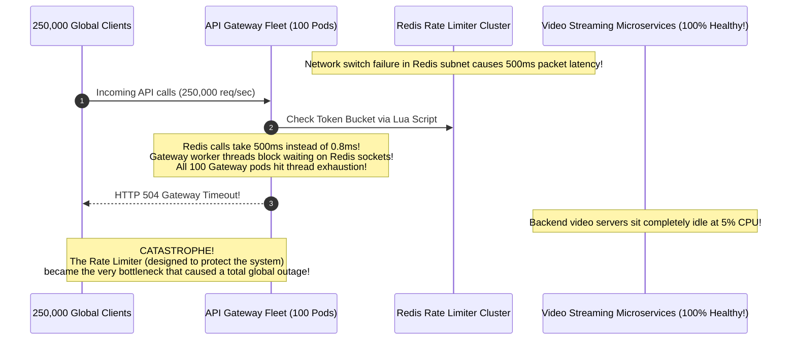
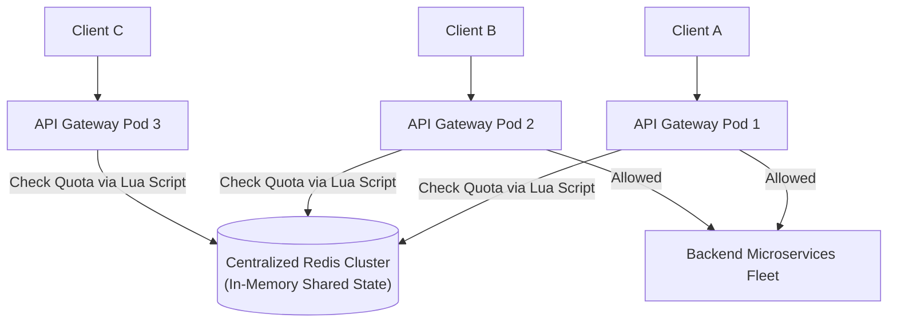
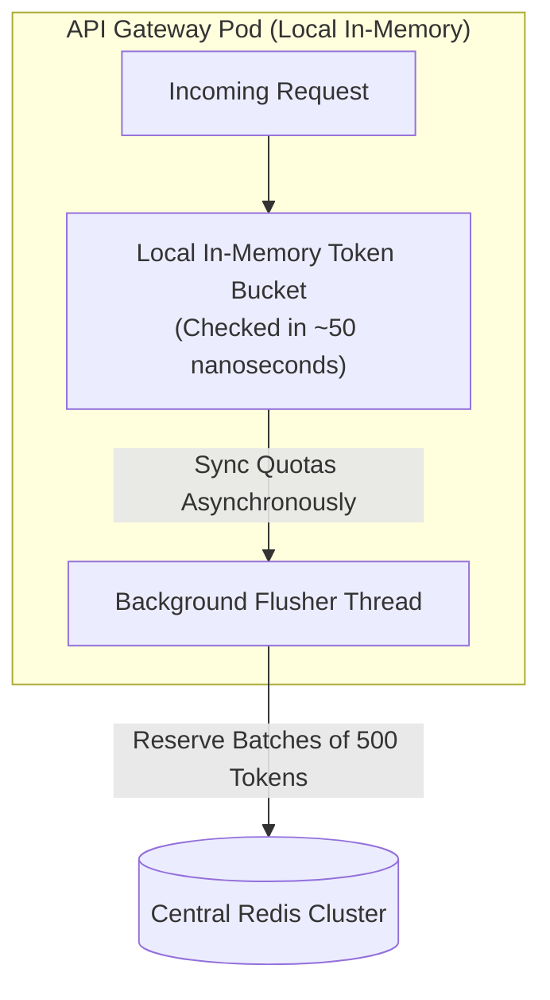
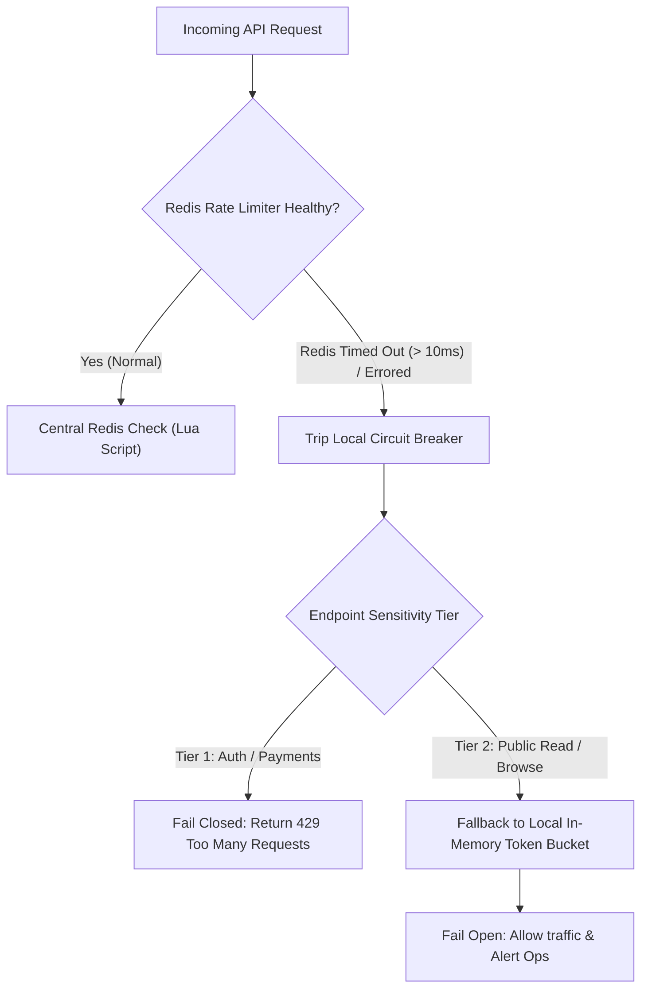
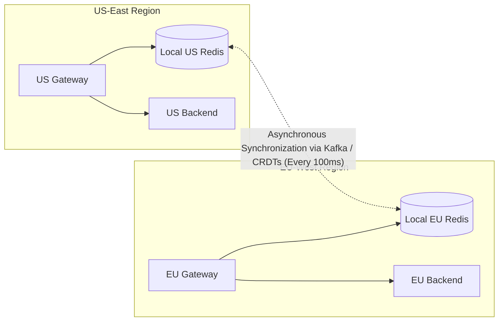

# Distributed Rate Limiting: Redis, Lua Scripts & High-Throughput Architectures

Scaling rate limiting across a horizontally distributed fleet of API gateways requires coordinating shared state, executing atomic operations without race conditions, and maintaining ultra-low latency. If designed poorly, the rate-limiting infrastructure itself can become the single point of failure that brings down your entire application fleet.

---

## 💡 Intuitive Real-World Analogies

### 1. Centralized Redis vs. Local Batching: The Bank Vault vs. Cashier Register
Imagine a busy retail department store:
- **Centralized Check on Every Request:** Every time a customer hands a $20 bill to a cashier to buy a candy bar, the cashier locks their register, walks down into the underground basement bank vault, gets a stamp of approval from the head bank teller, and walks back up. The store grinds to a dead halt; customers wait hours in line, and the vault door jams from thousands of cashiers crowding the stairs.
- **Local Quota Reservation (Batching):** At 8:00 AM, the cashier walks down to the vault once, withdraws **$500 in change (Batch Token Allocation)**, and returns to their register. For the rest of the morning, transactions take **2 seconds directly from the cash register drawer (Local RAM)**. Only when the drawer runs low does the cashier visit the vault again.

### 2. Fail-Open vs. Fail-Closed: The VIP Club Security Scanner
Imagine the electronic metal detector at the entrance of a crowded arena:
- Suddenly, the building experiences a power flicker and the metal detector goes offline.
- **Fail-Closed (Paranoid Security):** The guards lock the titanium doors and refuse entry to all 50,000 ticket holders. Nobody gets in until the scanner reboots. (Used by banking wire transfers and authorization checks).
- **Fail-Open (Business First):** The guards manually wave guests through with visual inspections so the concert can start on time. (Used by media streaming, social media feeds, and e-commerce browsing).

---

## 👶 Plain-English / ELI5 Overview

When you have 50 web servers, how do you make sure a malicious user doesn't send 10 requests to each server and sneak past a "50 requests per minute" limit?
- **The Simple Way (Centralized Redis):** Keep a shared scoreboard in a fast in-memory database like Redis. Every web server checks the scoreboard before serving a user.
- **The Challenge:** What happens when you have $1,000,000$ users per second? If every web server calls Redis for every single click, Redis will melt from the traffic!
- **The Smart Way (Distributed Batching):** Each web server "reserves" a batch of 50 tokens from Redis in advance. The web server serves the next 50 user requests from its own lightning-fast local memory without talking to the network.

---

## ⚠️ The Horror Scenario: The Irony of the Fainting Bodyguard

A multi-billion dollar streaming platform operated an API Gateway handling 250,000 requests per second. Every single incoming request made a synchronous network call to a centralized Redis cluster to verify rate limits.



### What Happened?
- A network fiber hiccup in the Redis availability zone caused Redis query latencies to spike from $0.8\text{ ms}$ to $500\text{ ms}$.
- Because the API gateways made a **synchronous blocking check on every request**, gateway worker threads froze waiting for Redis sockets.
- Within 10 seconds, all 100 API gateway instances exhausted their connection pools and began returning `504 Gateway Timeout` to all users worldwide.
- **The Ultimate Irony:** The backend streaming services were 100% healthy, but users could not watch videos because the *rate limiter* broke the website!
- **The Architectural Fix:** Implement **Asynchronous Batching**, **Strict 10ms Circuit Breakers on the Limiter**, and **Graceful Fail-Open Fallbacks**!

---

## 1. Centralized Rate Limiter Architecture



---

## 2. The Concurrency Race Condition & The Lua Solution

### The Read-Modify-Write Vulnerability
If an application gateway performs rate limiting using naive separate Redis commands:
1. Pod 1 executes `GET rate:usr_101` $\to$ Returns 99 (Limit is 100).
2. Pod 2 executes `GET rate:usr_101` $\to$ Returns 99.
3. Both pods conclude the user is within limits.
4. Pod 1 increments: `INCR rate:usr_101` $\to$ 100.
5. Pod 2 increments: `INCR rate:usr_101` $\to$ 101.
- **Result:** The user successfully exceeded the strict quota due to interleaved network operations.

### The Solution: Redis Atomic Lua Scripts
Redis executes Lua scripts **atomically in its single-threaded execution context**. No other command or script can interleave during execution.

```lua
-- KEYS[1]: Rate limit key (e.g. "rate:user_101")
-- ARGV[1]: Max tokens / capacity (e.g. 100)
-- ARGV[2]: Refill rate per millisecond
-- ARGV[3]: Current timestamp in milliseconds
-- ARGV[4]: Requested tokens (e.g. 1)

local key = KEYS[1]
local capacity = tonumber(ARGV[1])
local refill_rate = tonumber(ARGV[2])
local now = tonumber(ARGV[3])
local requested = tonumber(ARGV[4])

-- Retrieve current tokens and last update timestamp
local data = redis.call("HMGET", key, "tokens", "last_updated")
local tokens = tonumber(data[1])
local last_updated = tonumber(data[2])

if tokens == nil then
    tokens = capacity
    last_updated = now
else
    -- Compute refilled tokens based on elapsed time
    local elapsed = math.max(0, now - last_updated)
    tokens = math.min(capacity, tokens + (elapsed * refill_rate))
    last_updated = now
end

-- Evaluate if enough tokens exist
if tokens >= requested then
    tokens = tokens - requested
    redis.call("HMSET", key, "tokens", tokens, "last_updated", last_updated)
    redis.call("EXPIRE", key, math.ceil(capacity / refill_rate))
    return 1 -- ALLOWED
else
    redis.call("HMSET", key, "tokens", tokens, "last_updated", last_updated)
    return 0 -- REJECTED (HTTP 429)
end
```

---

## 3. Ultra-High QPS Architecture (Local Memory + Batch Reservation)

When traffic exceeds $1,000,000\text{ QPS}$, querying Redis on every single incoming HTTP request introduces network round-trips ($\sim 1\text{ ms}$) and can overwhelm the Redis cluster.



### Local Token Reservation Pattern
1. Gateway pods request token batches in bulk from Redis (e.g., reserve 200 tokens).
2. The gateway decrements tokens in its local JVM/Go process memory with **zero network latency ($\sim 50\text{ ns}$)**.
3. If an individual pod crashes, only its unused locally reserved quota is lost; the central database remains protected.
4. **Result:** Reduces Redis network QPS by **$99\%$**!

---

## 4. HTTP Rate Limiting Headers (RFC 6585)

When a rate limiter operates, it should communicate status to clients through standardized HTTP response headers:

```http
HTTP/1.1 429 Too Many Requests
Content-Type: application/json
Retry-After: 30
X-RateLimit-Limit: 100
X-RateLimit-Remaining: 0
X-RateLimit-Reset: 1771680030

{
  "error": "rate_limit_exceeded",
  "message": "Quota exceeded. Please retry in 30 seconds."
}
```

- **`X-RateLimit-Limit`:** Maximum requests permitted within the current window.
- **`X-RateLimit-Remaining`:** Remaining requests available before hitting quota.
- **`X-RateLimit-Reset`:** Unix epoch timestamp when the quota completely resets.
- **`Retry-After`:** Number of seconds the client must wait before making another request.

---

## 🏢 Real-World Production Battle-Testing

### Stripe: Redis-Backed Multi-Tier Rate Limiting with Fallback
- Stripe processes tens of thousands of payment API calls per second across multiple data centers.
- Every API key is rate-limited using Redis Lua scripts.
- **Resilience Design:** If the Redis cluster connection exceeds a hard 10ms timeout, Stripe’s gateway **fails open** for authenticated payment traffic, logging a high-priority warning to Datadog while ensuring merchants never lose sales due to rate limiter latency.

### Uber: Distributed Rate Limiting via Envoy RLS
- Uber open-sourced the **Envoy Global Rate Limiting Service (RLS)**.
- Envoy sidecars extract descriptors (e.g., `client_id`, `path: /trips/request`) and stream gRPC check calls to a clustered RLS tier backed by Redis, decoupling rate limiting rules from backend microservice code.

---

## ⚖️ Practical Trade-Offs & Decision Rules of Thumb

| Rate Limiter Architecture | Latency Overhead | Redis QPS Load | Quota Precision | Failure Mode Risk |
| :--- | :--- | :--- | :--- | :--- |
| **Synchronous Redis (Per Request)** | $\sim 1 - 2\text{ ms}$ | $100\%$ of incoming traffic | $100\%$ Exact | Gateway threads block if Redis slows |
| **Local Batch Reservation** | $\sim 50\text{ ns}$ (RAM) | $\sim 1\%$ of incoming traffic | Approximate ($\pm 5\%$) | Minor quota fragmentation across pods |
| **Edge-Only (Cloudflare / WAF)** | $\sim 0\text{ ms}$ (at edge) | Zero origin Redis load | Coarse-grained (by IP) | Cannot enforce per-user database quotas |

---

## 🎯 Top Real-World Interview Questions & Deep-Dive Answers (FAANG / Staff Level)

### Question 1: When your centralized Redis rate-limiter cluster crashes or experiences a network partition, should your API Gateway "Fail Open" or "Fail Closed"? How do you implement a resilient hybrid fallback?
**Model Answer:**
The choice between Fail-Open and Fail-Closed is a fundamental trade-off between **Availability** and **Security**:

1. **Fail-Closed (Default Deny):**
   - If Redis is unreachable, drop all incoming traffic with HTTP `429` or `500`.
   - **Mandatory For:** Login/authentication endpoints (prevents brute-force credential stuffing), financial transfer APIs (prevents balance-draining replay attacks), and SMS verification endpoints (prevents toll fraud).
2. **Fail-Open (Default Allow):**
   - If Redis is unreachable, permit incoming requests through to the backend.
   - **Mandatory For:** Public read APIs, video streaming, e-commerce checkout, and social media feeds. The business cost of turning away millions of legitimate paying customers is far greater than the risk of temporary over-quota consumption.

**The Hybrid Production Fallback Architecture:**


- Wrap the Redis call in a **10ms timeout** and a **Resilience4j / Envoy Circuit Breaker**.
- If Redis degrades, trip the breaker immediately to prevent worker thread exhaustion.
- Fall back to a **local in-process rate limiter (Caffeine/Guava)** with conservative limits (e.g. 50 req/sec per pod) while alerting on-call engineers.

---

### Question 2: How does the "Batch Reservation" pattern reduce Redis QPS by 99% in ultra-high-throughput systems, and what is the trade-off regarding quota precision?
**Model Answer:**
In a system handling 2,000,000 QPS across 200 API Gateway pods:
- Querying Redis on every request requires **2,000,000 Redis commands/sec**, demanding a massive, expensive 30-node Redis Cluster purely for rate limiting.

**The Batch Reservation Mechanism:**
1. When Gateway Pod 1 needs tokens for `user_101`, it does not ask for 1 token. It executes an atomic Lua script that requests a **Batch of $K$ tokens** (e.g., $K = 500$ tokens).
2. Redis decrements the user's bucket by 500 and grants the batch to Pod 1.
3. Pod 1 stores the 500 tokens in its local RAM (`AtomicInteger` in Java or Go `sync/atomic`).
4. For the next 500 requests from `user_101` hitting Pod 1, the gateway decrements its local counter in **$50\text{ nanoseconds}$ without touching the network**!
5. Only when the local bucket drops below 50 tokens does the background thread asynchronously request the next batch from Redis.

**The Architectural Trade-Off (Quota Fragmentation):**
- If a user has a global limit of 1,000 req/min, and the load balancer distributes traffic across 10 pods:
  - Each pod might reserve 100 tokens.
  - If the user sends all subsequent traffic to Pod 1, Pod 1 runs out of tokens and throttles the user, **even though Pods 2 through 10 have 900 unused reserved tokens sitting in memory**!
- *Mitigation:* Dynamically size the batch size $K$ based on user tier and current request frequency: active heavy users receive larger batches ($K=500$), while low-frequency users receive small batches ($K=10$).

---

### Question 3: How do you design a distributed rate limiter across multiple active-active geographic regions (e.g. US-East, EU-West, AP-East) without cross-region WAN latency penalties on every request?
**Model Answer:**
Making a cross-continental WAN round-trip (e.g., London to Virginia = $75\text{ ms}$) on every API request to check a centralized rate-limiting database completely destroys user latency SLAs.

**The Multi-Region Distributed Architecture (Local Redis + Asynchronous Sync):**


1. **Independent Regional Redis Clusters:** Each cloud region operates its own local Redis cluster. Gateway requests check their local regional Redis with sub-millisecond latencies ($\sim 0.5\text{ ms}$).
2. **Dynamic Quota Partitioning:**
   - If a tenant has a global budget of $10,000\text{ req/min}$, allocate regional quotas based on historical traffic distribution (e.g., $60\%$ to US-East = 6,000, $30\%$ to EU-West = 3,000, $10\%$ to AP-East = 1,000).
   - Each region enforces its local share independently with zero cross-region dependencies.
3. **Asynchronous Cross-Region Sync with CRDTs / Kafka:**
   - Regional limiters emit periodic usage deltas (every $500\text{ ms}$) to an asynchronous Kafka topic or CRDT (Conflict-Free Replicated Data Type) mesh.
   - If a user suddenly shifts 100% of their traffic from the US to Europe, the European limiter detects the surge, queries the global coordinator asynchronously, and rebalances the quota allocation within 1 second.

---
*Related Documents:*
- [Rate Limiting Algorithms: Token Bucket, Leaky Bucket & Sliding Windows](file:///home/prasanta/Documents/learning_folder/system_design/07_RESILIENCE_FAULT_TOLERANCE_RATE_LIMITING/01_rate_limiting_algorithms.md)
- [Circuit Breakers, Bulkheads, and Resilient Retries](file:///home/prasanta/Documents/learning_folder/system_design/07_RESILIENCE_FAULT_TOLERANCE_RATE_LIMITING/03_circuit_breakers_and_bulkheads.md)
- [Distributed Redis Architecture](file:///home/prasanta/Documents/learning_folder/system_design/04_CACHING_STRATEGIES_AND_PATTERNS/05_distributed_redis_architecture.md)
