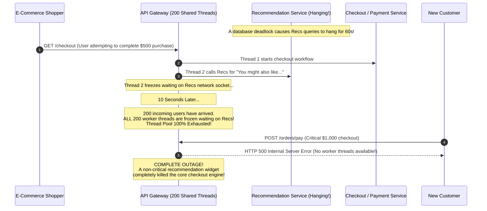
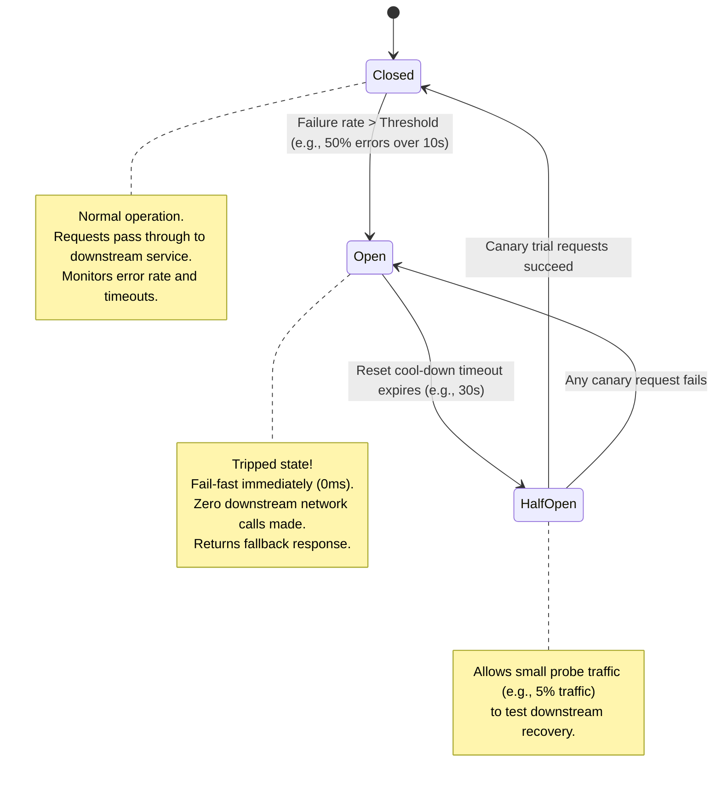
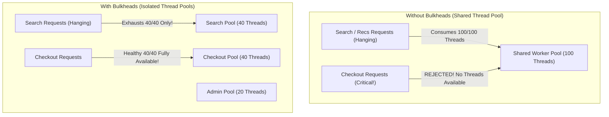
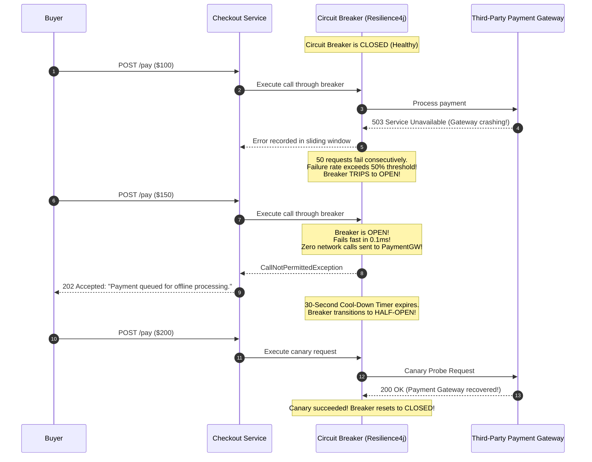
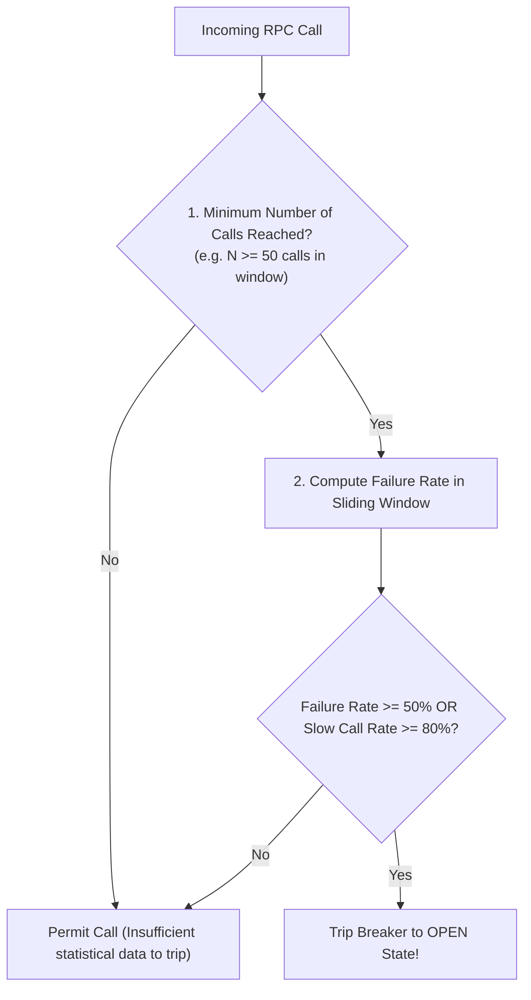
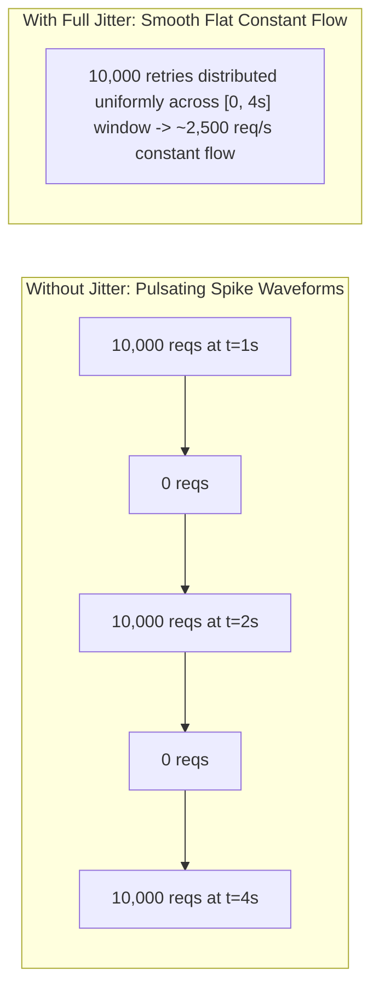
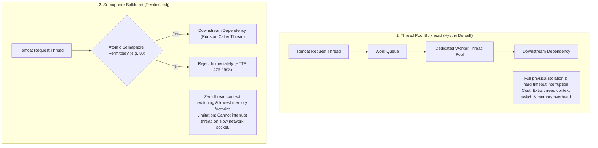

# Circuit Breakers, Bulkheads, and Resilient Retries

In a complex microservices architecture, individual service failures are not an exception—they are an everyday statistical certainty. Designing for resilience means ensuring that a localized degradation in an auxiliary service (such as an avatar renderer or recommendation widget) never cascades into a total company-wide outage.

---

## 💡 Intuitive Real-World Analogies

### 1. Circuit Breakers: The Home Electrical Fuse Box
Imagine your home electrical system:
- In your living room, an old space heater develops an electrical short circuit.
- If current kept flowing through the wall, the copper wiring would heat up to $1,000^\circ\text{F}$ and set the wooden studs of your house on fire.
- Instead, the **Circuit Breaker** in your basement detects the abnormal current surge and **trips to OPEN**.
- The power to the living room is cut instantly. The rest of your house—refrigerator, Wi-Fi, and lights—continues running without interruption.
- You unplug the broken heater, walk to the basement, and reset the switch to **CLOSED**.

### 2. Bulkheads: Watertight Ship Compartments
Named after the maritime engineering design used in naval warships and submarines:
- A ship’s hull is partitioned into discrete, isolated, watertight compartments (**Bulkheads**).
- If an iceberg punctures Compartment 3, ocean water fills Compartment 3 and stops at the steel partition.
- Because water cannot flood into Compartments 1, 2, 4, 5, and 6, the vessel maintains buoyancy and stays afloat.
- **Without Bulkheads:** Water rushes freely from the bow to the stern, dragging the entire vessel to the bottom of the sea.

### 3. Exponential Backoff with Full Jitter: The Crowded Doctor's Office
Imagine 100 sick patients arrive at a small medical clinic, but the doctor is temporarily attending an emergency:
- **Naive Retry (The Stampede):** The receptionist tells all 100 people: *"The doctor is busy! Everyone knock on the door again in exactly 60 seconds!"* At minute 1:00, all 100 patients pound on the door at the exact same instant, breaking the door and overwhelming the nurse.
- **Full Jitter:** The receptionist announces: *"The doctor is busy. Everyone please take a random ticket and return at any random time between now and the next 10 minutes."* Patients return staggered throughout the window, allowing the clinic to smoothly process one patient at a time without overcrowding.

---

## 👶 Plain-English / ELI5 Overview

When you build a system with 50 microservices, they are connected like dominoes:
- **Circuit Breakers** stop you from constantly knocking on the door of a server that has already fainted. If a service is broken, stop calling it immediately, fail fast, and give it breathing room to restart.
- **Bulkheads** put your server's worker threads into separate buckets. If the *"Movie Recommendations"* bucket gets jammed and freezes, the *"Credit Card Checkout"* bucket still has plenty of free workers to process payments.
- **Backoff & Jitter** ensure that when clients retry failed calls, they don't all retry at the same millisecond and accidentally launch a massive self-inflicted Distributed Denial of Service (DDoS) attack.

---

## ⚠️ The Horror Scenario: The Cascading Recommendation Catastrophe

An e-commerce site operated an API Gateway with a shared thread pool of 200 worker threads. On the checkout page, there was a small auxiliary widget: *"Customers who bought this also bought..."* powered by a Recommendation Microservice.



### What Went Wrong?
1. The recommendation service hung because of a missing database index.
2. The API Gateway had **no circuit breaker** and **no bulkheads**; it used a single shared pool of 200 threads.
3. Within 15 seconds, all 200 threads were frozen waiting for 60-second timeouts from the recommendation engine.
4. When legitimate shoppers tried to click "Place Order", the Gateway had zero available threads and threw `500 Server Error`.
5. **The Impact:** The company lost $1.5 million in revenue during a 2-hour outage—all because of a decorative recommendation widget that could have simply been hidden!

---

## 1. The Circuit Breaker Pattern

Popularized by Michael Nygard in *Release It!* and implemented in libraries like Netflix Hystrix, Resilience4j, and Envoy Proxy.



### The 3 States of a Circuit Breaker
1. **Closed (Normal Operation):**
   - Requests flow freely to the downstream dependency.
   - The breaker measures failures (HTTP 5xx, socket timeouts) over a rolling window (e.g., last 100 requests or last 10 seconds).
   - If error rate remains below the threshold (e.g., $< 50\%$), the breaker stays Closed.
2. **Open (Tripped / Short-Circuited):**
   - When the error threshold is breached, the breaker **trips Open**.
   - All subsequent calls **fail-fast immediately** without making a network call.
   - The application returns a graceful fallback (e.g., empty recommendations list, cached catalog, or cached user profile).
   - **System Benefit:** Downstream services get space to reboot without traffic pressure; upstream caller threads do not block or waste memory.
3. **Half-Open (Canary Probing):**
   - After a configured sleep window (e.g., 30 seconds), the breaker enters Half-Open state.
   - A small, metered trickle of requests (canaries) is permitted to pass through to the downstream service.
   - If the canaries succeed, the breaker resets to **Closed**, returning the system to normal.
   - If any canary fails or times out, the breaker assumes the downstream is still broken and trips back to **Open** for another sleep cycle.

---

## 2. The Bulkhead Pattern

Bulkheads isolate critical resources into independent partitions so that a failure in one partition cannot starve or exhaust resources in another.



### Application in Distributed Systems
1. **Thread Pool Bulkheads:** Assign separate thread pools to separate downstream dependencies. If the recommendation engine locks up, its dedicated 30 threads block, but the 50 threads reserved for payment checkout continue operating smoothly.
2. **Connection Pool Bulkheads:** Maintain dedicated database connection pools for write-heavy transactional operations versus long-running analytical search queries.
3. **Process / Pod Bulkheads:** Deploy non-critical microservices onto dedicated Kubernetes node pools with hard resource quotas (CPU/Memory limits) to prevent a memory leak in one service from triggering the Linux OOM Killer on critical services.

---

## 3. Retries: Exponential Backoff and Full Jitter

Blindly retrying failed requests is one of the most destructive anti-patterns in distributed systems. It generates a **Retry Storm** (Thundering Herd) that guarantees an ailing service can never recover.

```mermaid
flowchart LR
    subgraph Storm["Naive Retry (The Fatal Retry Storm)"]
        C1["1,000 Clients Fail at t=0"] -->|All retry at exact same second (t + 1s)| Target1["Recovering Backend (Crushed Again!)"]
    end
    subgraph Jitter["Exponential Backoff with Full Jitter"]
        C2["1,000 Clients Fail at t=0"] -->|Retries spread randomly across 0-10s window| Target2["Recovering Backend (Smooth Ingestion)"]
    end
```

### The Mathematics of Exponential Backoff & Full Jitter
AWS Architecture research (Marc Brooker & Tim Rath) proved that **Full Jitter** achieves the lowest queue depths, lowest completion times, and fastest system recovery:

1. **Exponential Backoff:** Progressively increases delay between subsequent retries:
   $$\text{Temp} = \min\left(\text{Max\_Backoff}, \ \text{Base} \times 2^{\text{Attempt}}\right)$$
2. **Full Jitter:** Randomizes the sleep duration uniformly across the entire backoff window:
   $$\mathbf{\text{Sleep\_Duration}} = \mathbf{\text{random}(0, \ \text{Temp})}$$

```python
import random
import time

class TransientException(Exception):
    pass

def call_with_resilient_retry(func, max_attempts=5, base=0.5, max_backoff=10.0):
    for attempt in range(max_attempts):
        try:
            return func()
        except TransientException as e:
            if attempt == max_attempts - 1:
                # Retries exhausted; propagate error
                raise e
            
            # 1. Calculate exponential backoff ceiling: min(10.0, 0.5 * 2^attempt)
            temp = min(max_backoff, base * (2 ** attempt))
            
            # 2. Full Jitter: Choose uniform random float between 0 and temp
            sleep_time = random.uniform(0, temp)
            
            # 3. Sleep before next attempt
            time.sleep(sleep_time)
```

### The 3 Jitter Variations Compared
- **No Jitter:** $\text{Sleep} = \text{Temp}$. Catastrophic synchronized thundering herds.
- **Equal Jitter:** $\text{Sleep} = \frac{\text{Temp}}{2} + \text{random}\left(0, \frac{\text{Temp}}{2}\right)$. Keeps some exponential growth, introduces partial variance.
- **Full Jitter:** $\text{Sleep} = \text{random}(0, \text{Temp})$. **Lowest server load and highest success rate.**

---

## 🚶 Step-by-Step Scenario: Recovering from Downstream Outage

Let's walk through an e-commerce checkout flow protected by a Resilience4j / Envoy Circuit Breaker:



1. **Failure Phase:** The external payment gateway starts throwing 503s. The breaker monitors error rates over a 10-second sliding window.
2. **Tripping Phase:** Error rate breaches $50\%$. The breaker trips to `OPEN`.
3. **Protection Phase:** Subsequent requests fail immediately (0.1ms) or return a graceful queued fallback. The struggling payment gateway receives 0 requests, allowing its engineers to restore services.
4. **Probe & Recovery Phase:** After 30 seconds, the breaker enters `HALF-OPEN`, sends 3 canary requests. When they succeed, it resets to `CLOSED`.

---

## 🏢 Real-World Production Battle-Testing

### Netflix: Hystrix & The Birth of Chaos Engineering
- Netflix pioneered circuit breakers with **Hystrix** (now evolved into Resilience4j and Envoy).
- Netflix introduced **Chaos Monkey** to deliberately kill production microservice instances in AWS to verify that circuit breakers tripped and fallback default UI carousels loaded without crashing the Netflix homepage.

### Amazon: AWS SDK Retry Policy
- All official AWS SDKs (Boto3, AWS Java SDK, AWS Go SDK) implement **Exponential Backoff with Full Jitter** by default when communicating with DynamoDB, S3, and SQS.
- This prevents millions of Lambda functions from crushing AWS services during sudden traffic spikes.

### Uber: Service Mesh with Envoy
- Uber deploys **Envoy** sidecar proxies across their entire microservice mesh.
- Circuit breaking is enforced at the network proxy layer:
  - `max_connections`: Maximum TCP connections allowed to an upstream service.
  - `max_pending_requests`: Maximum requests queued while waiting for a connection.
  - `max_retries`: Maximum consecutive retry attempts.
  If any limit is exceeded, Envoy immediately rejects requests without burdening the application runtime.

---

## ⚖️ Practical Trade-Offs & Decision Rules of Thumb

| Mechanism | Primary Benefit | Trade-Off / Risk | Best Used For |
| :--- | :--- | :--- | :--- |
| **Circuit Breaker** | Prevents cascading failures; enables fast-fail | Complex tuning (window size, thresholds) | Synchronous HTTP/gRPC RPC calls across microservices |
| **Bulkhead** | Prevents resource starvation across services | Memory & thread fragmentation overhead | Isolating critical transactions (Checkout) from non-critical (Recs) |
| **Exponential Backoff**| Gives ailing services time to recover | Increases client-perceived latency | Transient errors (network drop, lock conflict) |
| **Full Jitter** | Eliminates synchronized thundering herd retries | Client retry time is non-deterministic | High-concurrency client fleets and distributed workers |
| **Graceful Fallback** | Maintains degraded but working user experience | Stale or partial data shown to users | UI widgets, product recommendations, search autocomplete |

### Rules of Thumb for System Designers
1. **Never Retry Non-Idempotent Writes Blindly:** Only retry `GET`, `PUT`, or requests accompanied by a unique **Idempotency Key**. Blindly retrying a `POST /charge` can double-bill customers!
2. **Always Pair Retries with Circuit Breakers:** Retries without circuit breakers create retry storms. A circuit breaker ensures that if the system is genuinely down, retries are halted immediately.
3. **Every Circuit Breaker Needs a Fallback:** Decide in advance what the user sees when a breaker opens:
   - *Can we return a cached copy?*
   - *Can we omit this widget?*
   - *Can we queue this command for background execution?*
4. **Isolate Thread Pools for Third-Party APIs:** Any external third-party API (payment processors, SMS gateways, shipping trackers) must sit behind a **Bulkhead** and **Circuit Breaker**. You cannot control their uptime; do not let their outage sink your platform.

---

## 🎯 Top Real-World Interview Questions & Deep-Dive Answers (FAANG / Staff Level)

### Question 1: How do you mathematically tune a Circuit Breaker’s sliding window, minimum call threshold, and failure rate percentage to prevent premature tripping on low-traffic services?
**Model Answer:**
A poorly tuned circuit breaker can trigger a self-inflicted outage. Consider a low-traffic service receiving 2 requests per minute with a $50\%$ error threshold:
- If Request 1 succeeds and Request 2 experiences a transient 1-second timeout, the error rate is $50\%$.
- A naive circuit breaker trips to `OPEN`, cutting off all traffic because of a single random network packet drop!

**The 3-Parameter Mathematical Framework (Resilience4j / Envoy):**


1. **Sliding Window Type (Count-Based vs. Time-Based):**
   - **Count-Based Window:** Monitors the last $N$ calls (e.g. last 100 calls). Best for consistent high-throughput services.
   - **Time-Based Window:** Monitors calls over the last $T$ seconds (e.g. last 10 seconds). Best for varying traffic.
2. **Minimum Number of Calls Threshold (`minimumNumberOfCalls`):**
   - Never evaluate failure percentage until a minimum statistical sample size has passed through (e.g. minimum 50 calls). This prevents 1 failure out of 2 requests from tripping the breaker.
3. **Slow Call Rate Threshold (`slowCallRateThreshold`):**
   - Measure not just hard 5xx errors, but calls taking $> 2\text{ seconds}$. If $> 70\%$ of calls are slow, trip the breaker *before* server thread pools exhaust.

---

### Question 2: Why does Exponential Backoff WITHOUT Jitter fail catastrophically during recovery from an outage (The Synchronized Retry Storm), and why did AWS research select Full Jitter?
**Model Answer:**
- **The Failure of Pure Exponential Backoff:**
  Suppose 10,000 mobile clients fail at $t = 0$ due to a transient database blip.
  - With pure exponential backoff ($\text{delay} = \text{base} \times 2^{\text{attempt}}$ with base = 1s):
  - Attempt 1: All 10,000 clients retry at **exactly $t = 1.0\text{s}$**.
  - Attempt 2: All 10,000 clients retry at **exactly $t = 2.0\text{s}$**.
  - Attempt 3: All 10,000 clients retry at **exactly $t = 4.0\text{s}$**.
  - **The Catastrophe:** The recovering database is hammered with synchronized, pulsating tidal waves of 10,000 concurrent requests every few seconds, locking it in a permanent death spiral (**The Retry Storm / Thundering Herd**).

**AWS Research Proof (Full Jitter vs. Equal Jitter):**
Marc Brooker and Tim Rath (AWS Architecture) proved that **Full Jitter** achieves the lowest queue depths and fastest system recovery:
$$\text{Temp} = \min\left(\text{Max\_Backoff}, \ \text{Base} \times 2^{\text{Attempt}}\right)$$
$$\mathbf{\text{Sleep\_Duration}} = \mathbf{\text{random}(0, \ \text{Temp})}$$


- Full Jitter completely breaks synchronization across thousands of independent client nodes, converting sharp pulsating spike waves into a smooth, manageable trickle.

---

### Question 3: How do Thread Pool Bulkheads compare against Semaphore Bulkheads in terms of CPU context switching, memory footprint, and thread isolation?
**Model Answer:**
In distributed systems (such as Netflix Hystrix or Resilience4j), developers choose between two bulkhead isolation mechanisms:



| Dimension | Thread Pool Bulkhead | Semaphore Bulkhead |
| :--- | :--- | :--- |
| **Execution Thread** | Runs on a separate dedicated thread from a private pool | Runs directly on the caller/parent container thread |
| **Context Switching**| Higher (Incurs OS thread context switch overhead) | **Zero** (Instantaneous atomic integer check) |
| **Memory Overhead** | Higher (Each thread allocates stack memory $\sim 1\text{ MB}$) | **Near-Zero** (Single 64-bit integer counter in RAM) |
| **Hard Timeout Interrupt**| ✅ Supported (`thread.interrupt()` stops hung sockets) | ❌ Unsupported (Cannot force-kill caller thread on hang) |
| **Recommended Use** | Unreliable 3rd-party network calls that may hang | High-throughput trusted internal microservices ($> 50\text{k QPS}$) |

---
*Related Documents:*
- [Rate Limiting Algorithms: Token Bucket & Leaky Bucket](file:///home/prasanta/Documents/learning_folder/system_design/07_RESILIENCE_FAULT_TOLERANCE_RATE_LIMITING/01_rate_limiting_algorithms.md)
- [Load Balancing: Layer 4 vs. Layer 7](file:///home/prasanta/Documents/learning_folder/system_design/06_TRAFFIC_ROUTING_LOAD_BALANCING_CDN/02_load_balancing_l4_vs_l7.md)
- [Cache Anomalies and Mitigations](file:///home/prasanta/Documents/learning_folder/system_design/04_CACHING_STRATEGIES_AND_PATTERNS/04_cache_anomalies_and_mitigation.md)
