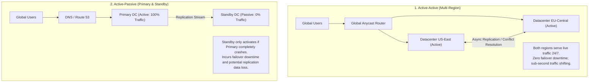
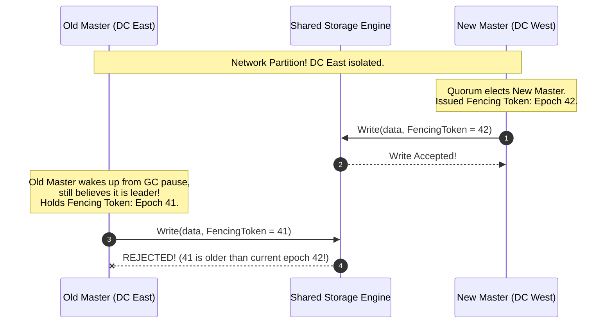
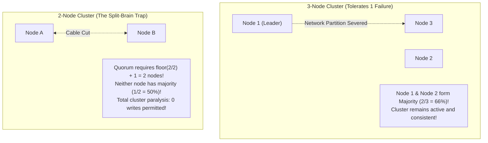

# High Availability, Disaster Recovery & Chaos Engineering

Building systems that survive physical datacenter floods, severed transoceanic fiber cables, and catastrophic software deployments requires treating failure as an everyday certainty. High Availability (HA) and Disaster Recovery (DR) are the architectural disciplines that ensure systems self-heal, isolate damage, and maintain continuous business operations under catastrophic conditions.

---

## 💡 Intuitive Real-World Analogies

### 1. Active-Passive vs. Active-Active: The Basement Generator vs. Twin Jet Engines
- **Active-Passive (The Hospital Diesel Generator):** A hospital runs on city electrical grid power. In the basement sits a diesel generator (Cold/Warm Standby). When a hurricane knocks out the city power grid, doctors scramble in the dark for 45 seconds (**RTO Downtime**), hoping the generator engine turns over and the fuel hasn't gone stale.
- **Active-Active (The Twin Engines of a Boeing 777):** A commercial jet flies with two engines running simultaneously at $50\%$ thrust. If Engine Left is struck by a bird and explodes mid-flight, Engine Right immediately spools up to $100\%$ thrust. There is **zero pause, zero restart, and passengers in the cabin do not even feel the plane drop**.

### 2. RPO vs. RTO: The Stolen Diary vs. The Broken Leg
- **RPO (Recovery Point Objective - "Lost Memories"):** You write your private diary every Sunday evening. If a thief steals your diary on Friday, you have permanently lost 5 days of memories (**RPO = 5 days of data loss**). If you back up every hour, your RPO is 1 hour.
- **RTO (Recovery Time Objective - "Clock Downtime"):** You slip and break your leg. From the second the bone breaks until the surgeon casts your leg and you can walk again is 3 hours (**RTO = 3 hours of operational downtime**).

### 3. Split-Brain & Fencing Tokens: The Comatose King & The Royal Seal
Imagine an ancient kingdom:
- The old King falls into a deep, unresponsive coma.
- The royal council concludes the King has died. They crown the young Prince, handing him the **Imperial Royal Seal #42** (Fencing Token).
- Suddenly, the old King awakens from his coma! Unaware he was replaced, he writes an order to the Royal Bank: *"Withdraw 1,000 gold coins"*, stamping it with his old **Imperial Seal #41**.
- The bank teller inspects the wax seal: *"Your Majesty, the highest seal registered in our ledger is #42. Your seal #41 is obsolete. Request denied."*
- **Result:** Fencing tokens prevent the resurrected old leader from causing catastrophic damage to the kingdom's treasury!

---

## 👶 Plain-English / ELI5 Overview

Computers, disks, and wires break every single day.
- **High Availability (HA)** means building your system with backup spare tires that take over instantly so users never notice a hiccup.
- **Disaster Recovery (DR)** is the fire drill plan for when an entire city's power grid goes dark.
- **RPO** tells you: *"How much recent data are we allowed to lose?"* (e.g., zero banking transactions vs. 1 hour of website clicks).
- **RTO** tells you: *"How many minutes can the website be offline before we get sued?"*
- **Chaos Engineering** means deliberately pulling the plug on a random server on a Tuesday afternoon to make sure your self-healing backup systems actually work!

---

## ⚠️ The Horror Scenario: The Undersea Cable Cut & The Double-Spend Split-Brain

A multi-national fintech platform operated an Active-Active payment database across two cloud datacenters: **US-East (New York)** and **EU-West (London)**.

```mermaid
sequenceDiagram
    autonumber
    participant Buyer as Customer Alice ($1,000 Balance)
    participant NYC as New York Datacenter
    participant London as London Datacenter
    participant Fiber as Transatlantic Undersea Fiber

    Note over Fiber: Catastrophic anchor strike cuts undersea fiber!<br/>NYC and London lose communication completely!
    Note over NYC,London: SPLIT-BRAIN! Both datacenters believe the other is dead!<br/>Both datacenters remain in read-write active mode!

    Buyer->>NYC: POST /buy (Purchase $900 Laptop in US store)
    NYC->>NYC: Check balance: $1,000 >= $900 (Approved!)
    NYC->>NYC: Deduct balance: $1,000 - $900 = $100

    Buyer->>London: POST /buy (Purchase $900 Smartphone in EU store)
    London->>London: Check balance: $1,000 >= $900 (Approved!)
    London->>London: Deduct balance: $1,000 - $900 = $100

    Note over Fiber: 12 Hours Later: Undersea fiber repaired! Networks reconnect!
    NYC<->London: Merge databases...
    Note over NYC,London: CATASTROPHE!<br/>Alice spent $1,800 from a $1,000 account!<br/>45,000 conflicting cross-border transactions occurred!<br/>Company loses $12M in unrecoverable double-spend overdrafts!
```

### What Happened?
- The system configured Active-Active replication without a third-party tie-breaking quorum or distributed consensus.
- When an undersea fiber was severed, both New York and London continued accepting writes independently.
- Alice executed two $900 purchases simultaneously against the same $1,000 account balance. Both succeeded.
- When the network partition healed, the databases could not reconcile the conflicting writes. The company suffered $12 million in unrecoverable overdraft losses and spent three months manually auditing customer ledgers.
- **The Golden Rule:** You cannot have a 2-datacenter Active-Active consensus system. Distributed consensus **strictly requires an odd number of voting regions ($3$ or $5$)**!

---

## 1. High Availability (HA) Deployment Topologies



### Standby Tiers in Active-Passive

| Standby Type | Compute State | Data Sync | Typical RTO (Recovery Time) | Infrastructure Cost |
| :--- | :--- | :--- | :--- | :--- |
| **Hot Standby** | Full cluster running live | Real-time continuous replication | $< 30\text{ seconds}$ | High ($100\%$ duplicate infra) |
| **Warm Standby**| Scaled-down minimal cluster | Continuous replication | $5 - 15\text{ minutes}$ (Auto-scales up) | Moderate |
| **Cold Standby**| Zero compute running | Nightly snapshots / S3 backups | $2 - 24\text{ hours}$ (Spun up via Terraform)| Low |

---

## 2. Disaster Recovery: RPO vs. RTO

Every enterprise business continuity plan is governed by two core recovery metrics:

```mermaid
timeline
    title Disaster Timeline: RPO and RTO
    11:45 AM : Last Consistent Data Snapshot (RPO Window = 15 mins data loss)
    12:00 PM : 🔥 Catastrophic Datacenter Fire! 🔥
    12:00 PM - 12:30 PM : Failover & Route Reconfiguration (RTO Window = 30 mins downtime)
    12:30 PM : Backup Datacenter Fully Restored & Serving Traffic
```

### 1. RPO (Recovery Point Objective)
- **Definition:** The maximum acceptable amount of data loss measured backward in time from the moment of disaster.
- **Example:** An RPO of $15\text{ minutes}$ means the business can tolerate losing at most 15 minutes of transactional data. If your database only takes nightly backups at 2:00 AM and crashes at 11:00 PM, you have an RPO of 21 hours (a catastrophic violation).

### 2. RTO (Recovery Time Objective)
- **Definition:** The maximum acceptable duration of clock downtime before the system must be restored to full operation.
- **Example:** An RTO of $30\text{ minutes}$ means the engineering team has at most 30 minutes to detect failure, reroute traffic, and restore service before facing contractual breach of SLA.

---

## 3. Split-Brain Mitigation & Fencing Tokens

When a network partition severs communication between two datacenters, both sides may believe the other is dead and attempt to promote a local leader (**Split-Brain**).



### The Fencing Token Solution
- Every time a new leader is elected by quorum, the consensus system generates a strictly **monotonically increasing Fencing Token** (e.g., Epoch counter $41 \to 42$).
- Every write RPC to storage must carry this token.
- The storage system tracks the highest token it has ever seen. If a write arrives carrying an older token ($41$), the write is unconditionally rejected, preventing split-brain data corruption!

---

## 4. Graceful Degradation & Load Shedding

Under extreme traffic surges where the system cannot fulfill $100\%$ of requests:

### Graceful Degradation
- If the AI recommendation engine collapses, don't crash the homepage; serve a static hardcoded list of "Top 10 Trending Products".
- If the live comment counter is slow, disable comment count updates and show comments only.

### Load Shedding (Priority Triage)
Categorize incoming requests by business priority:
1. **Critical:** `POST /checkout`, `POST /login` $\to$ Always processed.
2. **Standard:** `GET /catalog`, `GET /profile` $\to$ Processed normally.
3. **Low-Priority:** `POST /analytics`, `POST /telemetry`, `GET /recommendations` $\to$ Dropped immediately at the API gateway when CPU exceeds $85\%$.

---

## 5. Chaos Engineering: The Art of Breaking Systems

Pioneered by Netflix with **Chaos Monkey** (2011).

> **Core Philosophy:**  
> *"The best time to discover how your system behaves when a server dies is on a Tuesday afternoon during office hours, not at 3:00 AM on Christmas morning."*

### The 4 Steps of Chaos Engineering
1. **Define the Steady State:** Establish a baseline metric of normal behavior (e.g., $99.9\%$ of checkouts complete with $< 200\text{ ms}$ latency).
2. **Formulate a Hypothesis:** State what will happen when a component fails (e.g., *"If Redis Cluster Master A is terminated, traffic should fail over to Replica A within 3 seconds with zero checkout errors."*).
3. **Inject Failure in Production:** Automatically terminate instances, inject $500\text{ ms}$ packet latency, or simulate network packet loss.
4. **Evaluate & Fix:** If checkouts failed or cascading timeouts occurred, fix the resilience architecture before real disasters strike.

---

## 🏢 Real-World Production Battle-Testing

### Netflix: Chaos Kong & Simian Army
- Netflix expanded Chaos Monkey into **Chaos Kong**: an automated tool that deliberately drops **an entire AWS Availability Zone or AWS Region** without warning during business hours!
- By continuously testing regional evacuation, Netflix guarantees that their automated DNS and Envoy traffic-shifting pipelines can evacuate an entire cloud region in under 7 minutes.

### Google: Spanner TrueTime Multi-Region Active-Active
- Google Spanner provides multi-region Active-Active synchronous transactions across the globe.
- Uses **TrueTime (GPS receivers and atomic clocks embedded in datacenters)** to bound clock skew uncertainty ($\epsilon \le 7\text{ ms}$), enabling globally distributed transactions with strict external serializability.

### Stripe: Multi-Region Aurora Hot Standbys
- Stripe maintains an Active-Passive architecture with AWS Aurora Global Databases.
- Storage writes in US-East are replicated synchronously across three availability zones, while an asynchronous physical replication stream continuously replicates changes to an EU standby region with an RPO under 1 second.

---

## ⚖️ Practical Trade-Offs & Decision Rules of Thumb

| Architecture | RPO (Data Loss) | RTO (Downtime) | Cost Multiplier | Complexity |
| :--- | :--- | :--- | :--- | :--- |
| **Active-Active (Multi-Region)** | Zero (with 3-region Paxos) | Sub-second | $2.5\times - 3\times$ | Extremely High (Conflict resolution) |
| **Hot Standby (Active-Passive)** | $< 1\text{ second}$ (Async lag) | $< 1\text{ minute}$ | $2\times$ | Moderate |
| **Warm Standby (Pilot Light)** | Minutes | $5 - 15\text{ minutes}$ | $1.3\times$ | Moderate |
| **Cold Standby (Backup/Restore)**| Hours (to last snapshot) | Hours to Days | $1.05\times$ | Low |

---

## 🎯 Top Real-World Interview Questions & Deep-Dive Answers (FAANG / Staff Level)

### Question 1: How do you achieve data consistency in a Multi-Region Active-Active database without cross-region locking on every write?
**Model Answer:**
Executing cross-continental distributed locks (e.g., Two-Phase Commit between Virginia and London) incurs a minimum $75\text{ ms}$ speed-of-light network penalty on every write, destroying write throughput. 

**The Three Production Alternatives:**
1. **Partitioning by Geographic Territory (Home Region Routing):**
   - European customer accounts live primarily in EU-West; North American accounts live in US-East.
   - All writes for a customer are routed to their designated "Home Region" using an Anycast/DNS routing layer.
   - Cross-region replication occurs asynchronously. Users experience low latency because 99% of their writes are purely local!
2. **Conflict-Free Replicated Data Types (CRDTs):**
   - For collaborative or multi-master data (e.g., shopping cart items, chat messages, like counters), structure data as CRDTs (e.g. PN-Counters or Observed-Remove Sets).
   - Datacenters accept writes locally and merge states mathematically upon synchronization without coordination locks.
3. **TrueTime Atomic Commit (Google Spanner):**
   - Datacenters use synchronized atomic clocks to assign globally monotonic transaction timestamps.
   - Transactions execute without locks between regions, resolving write conflicts by timestamp ordering (**External Consistency**).

---

### Question 2: Why does distributed consensus (Raft / Paxos) strictly require an odd number of voting nodes ($2F + 1$), and what catastrophic failure occurs in a 2-node cluster during a network split?
**Model Answer:**
A distributed consensus system tolerates $F$ failures if and only if it contains a total of $2F + 1$ voting members, because a **Majority Quorum** requires:

$$\text{Quorum Size} = \left\lfloor \frac{N}{2} \right\rfloor + 1$$



**The 2-Node Cluster Trap:**
- For $N = 2$, Quorum requires $\lfloor 2/2 \rfloor + 1 = 2$ nodes.
- If a network partition cuts communication between Node A and Node B:
  - Node A sees only 1 node (50% $\implies$ No quorum).
  - Node B sees only 1 node (50% $\implies$ No quorum).
  - **Result:** Neither node can elect a leader, and the cluster freezes completely!
- A 2-node cluster has **the exact same fault tolerance as a 1-node cluster ($F=0$)**, but with double the cost and operational complexity.
- **Rule:** Always provision an odd number of voting members: 3 nodes (survives 1 failure) or 5 nodes (survives 2 failures).

---

### Question 3: How do you implement an automated Load-Shedding mechanism at the API Gateway using Little’s Law and Queue Delays (CoDel) when traffic exceeds 300% of capacity?
**Model Answer:**
When traffic spikes to 300% of maximum capacity, standard rate limiters may let through too many requests if downstream databases slow down. The gateway must perform **Adaptive Load Shedding**:

1. **The Flaw of Measuring CPU:** CPU utilization is a lagging indicator. By the time CPU hits 100%, request queues in memory are already thousands of items deep, guaranteeing multi-second latency for all users.
2. **Measuring Queue Delay (CoDel - Controlled Delay Algorithm):**
   - When a request arrives at the API Gateway queue, stamp it with the current timestamp: `T_in = now()`.
   - When a worker thread pops the request from the queue to process it, measure the **Queue Latency**:
     $$\text{QueueDelay} = \text{now}() - T_{\text{in}}$$
3. **The Load-Shedding Heuristic:**
   - If `QueueDelay` exceeds a target threshold (e.g. $> 20\text{ ms}$ over a rolling 1-second window), the system is officially congested.
   - The Gateway immediately drops incoming low-priority requests (analytics, recommendations, marketing queries) with `HTTP 503 Service Unavailable` with `Retry-After: 5`.
   - By dropping low-priority requests **before spending CPU resources parsing or processing them**, the system protects critical payment and authentication workflows, ensuring the platform never collapses!

---
*Related Documents:*
- [Circuit Breakers, Bulkheads, and Resilient Retries](file:///home/prasanta/Documents/learning_folder/system_design/07_RESILIENCE_FAULT_TOLERANCE_RATE_LIMITING/03_circuit_breakers_and_bulkheads.md)
- [Distributed Rate Limiting](file:///home/prasanta/Documents/learning_folder/system_design/07_RESILIENCE_FAULT_TOLERANCE_RATE_LIMITING/02_distributed_rate_limiting.md)
- [DNS Resolution, GeoDNS, and Anycast BGP Routing](file:///home/prasanta/Documents/learning_folder/system_design/06_TRAFFIC_ROUTING_LOAD_BALANCING_CDN/01_dns_and_anycast_routing.md)
