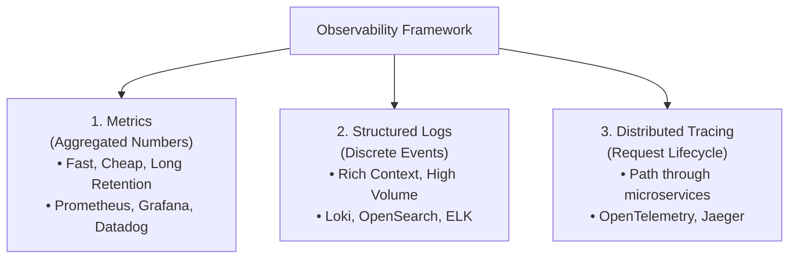
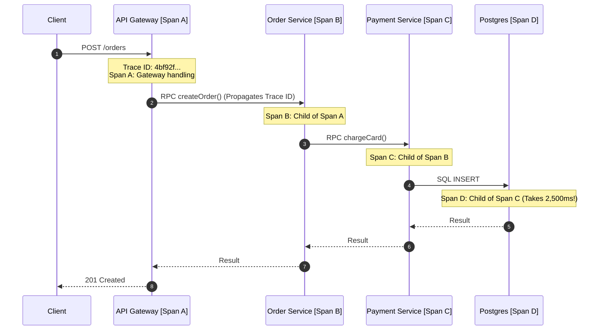
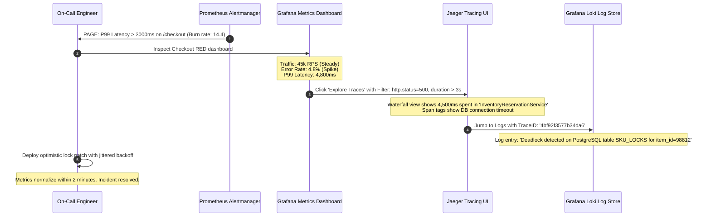
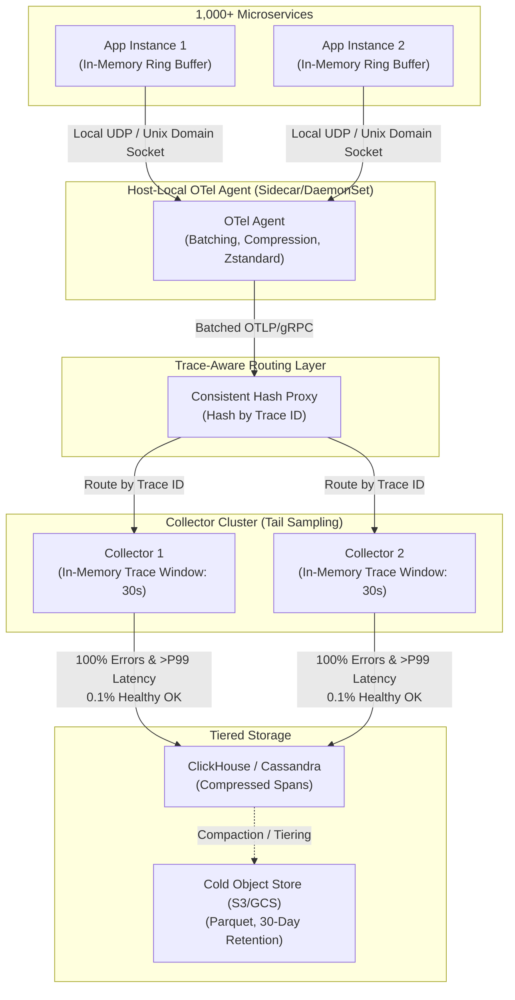
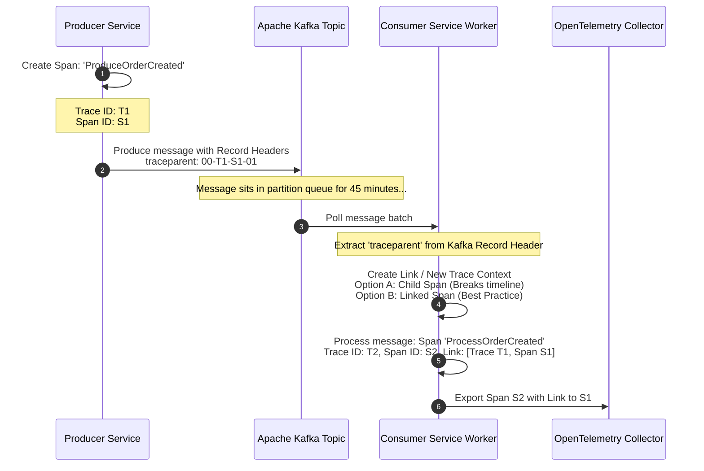
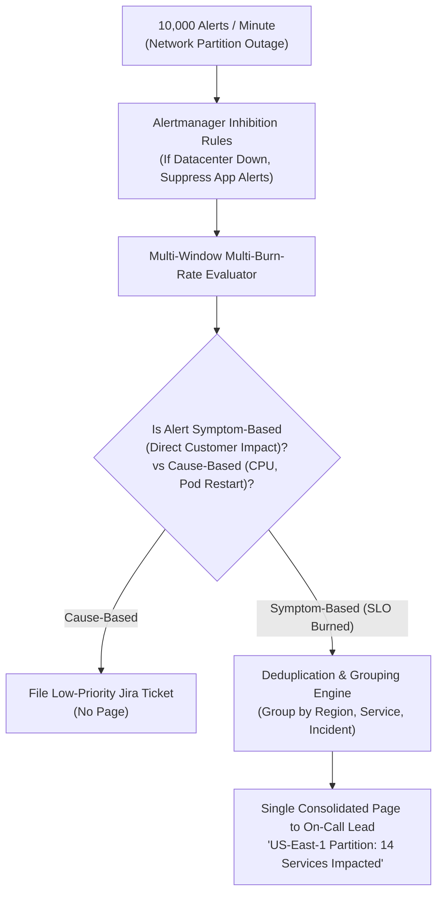

# The Three Pillars of Observability: Metrics, Logs & Tracing

In a distributed microservices architecture consisting of hundreds of services, tens of thousands of containers, and millions of concurrent requests, diagnosing production failures without comprehensive observability is impossible.

---

## 1. Monitoring vs. Observability

- **Monitoring:** Tells you **that** a system is broken (e.g., *"Payment service error rate is $8\%$."*). It tracks known failure modes that you anticipated ahead of time.
- **Observability:** Measures a system's internal state based on its external outputs. It enables engineers to understand **why** a system is failing, especially during complex, novel failure modes that have never occurred before.

---

## 💡 Intuitive Real-World Analogies: The Hospital Emergency Ward

If you're trying to diagnose a patient in a massive modern hospital, you need three distinct sources of information:

| Observability Pillar | Hospital Medical Ward Analogy | What it Answers in Software |
| :--- | :--- | :--- |
| **1. Metrics** | **The Vital Signs Monitor (Heart Rate, Blood Pressure, O2 Saturation)** | *"Is the system alive right now? Are numbers spiking?"* Fast, cheap numbers sampled every 10 seconds. Alerts fire immediately when CPU $>90\%$ or error rate $>1\%$. |
| **2. Logs** | **The Nurse's Clinical Diary Notes** | *"What specifically happened at 14:32:05?"* Discrete event diaries with full error stack traces, order IDs, and contextual payload metadata. |
| **3. Traces** | **The Patient's Stamped Journey Chart** | *"Where did the request spend its time?"* Tracks a single request as it hops from Emergency Triage $\to$ Radiology X-Ray $\to$ Pharmacy $\to$ Operating Theater, timing every stop to find the bottleneck. |

### 👶 ELI5: Why You Need All Three Together
Imagine a checkout button stops working on Black Friday:
1. **Metrics** sound the siren: *"Alert! Checkout API failure rate jumped from $0.01\%$ to $14\%$!"*
2. **Distributed Tracing** pinpoints the crime scene: You click the alert and see that out of 15 microservices, the request spent 4,950 ms waiting inside `fraud-detection-service`.
3. **Structured Logs** reveal the exact culprit: You filter logs by that specific `trace_id` in `fraud-detection-service` and find: `ERROR: GeoIP lookup Redis connection refused on port 6379`.
Without all three pillars working in harmony, debugging a modern distributed system is like trying to solve a crime in total darkness with 500 suspects.

### ⚠️ The Horror Scenario: The Blind $10 Million Outage
In 2018, a major online bank upgraded their microservices cluster. Within 20 minutes, customers reported failing wire transfers. Because the bank only had unstructured text logs stored on local server disks (`/var/log/app.log`), engineers spent 4 hours SSH-ing into 200 individual virtual machines, manually running `grep "NullPointerException"` while transfers failed. The 4-hour delay caused severe regulatory fines and $12M in cancelled transactions. With OpenTelemetry distributed tracing and centralized metrics, the exact failing downstream third-party banking gateway would have been identified on a Grafana dashboard in under 30 seconds.

---

## 2. The Three Pillars



---

## 3. Pillar 1: Metrics

Metrics are numeric values measured over intervals of time, optimized for rapid mathematical aggregation and real-time dashboarding.

### The 4 Core Metric Types (Prometheus Standard)
1. **Counter:** A monotonically increasing number that only ever increments or resets to zero on restart (e.g., `http_requests_total`).
   - Use `rate()` in PromQL to calculate requests per second.
2. **Gauge:** A numerical value that can arbitrarily go up or down (e.g., `cpu_utilization_percent`, `memory_bytes_used`, `active_threads`).
3. **Histogram:** Samples observations (usually request durations or response sizes) and counts them in configurable bucketing intervals (e.g., requests $< 50\text{ ms}$, $< 100\text{ ms}$, $< 250\text{ ms}$, $< 500\text{ ms}$).
   - Essential for calculating true percentiles ($p50, p95, p99$).
4. **Summary:** Computes sliding-window percentiles directly on the client side.

### Cardinality Explosion: The Metric Killer
Every label/dimension added to a metric generates a distinct time series. 
$$\text{Total Time Series} = \prod_{i=1}^{n} |\text{Unique Values of Label } i|$$
If an engineer adds `user_id` ($10^7$ users) as a label to `http_requests_total{method="POST", status="200", user_id="..."}`, the metric storage engine (e.g., Prometheus TSDB inverted index) will suffer an immediate out-of-memory crash.

---

## 4. Pillar 2: Structured Logging

Plain text logs (`print("User logged in")`) are virtually useless at scale. Production systems enforce **Structured JSON Logging**:

```json
{
  "timestamp": "2026-10-22T14:30:15.124Z",
  "level": "ERROR",
  "service": "checkout-service",
  "environment": "production",
  "trace_id": "4bf92f3577b34da6a3ce929d0e0e4736",
  "span_id": "00f067aa0ba902b7",
  "user_id": "usr_98124",
  "cart_id": "cart_4410",
  "error_code": "PAYMENT_GATEWAY_TIMEOUT",
  "message": "Payment processing failed after 3 retries",
  "duration_ms": 5021.4
}
```

### Key Practices
- **Correlation IDs:** Every log line must contain the distributed `trace_id` and `span_id`. When an alert fires, you can paste the `trace_id` and view every single log line emitted across 20 different microservices for that single request!
- **Zero Sensitive Data:** Sanitize logs at the gateway; never log credit card PANs, passwords, or PII.

---

## 5. Pillar 3: Distributed Tracing

In a distributed environment, a single user click might fan out into dozens of asynchronous RPCs and database calls across multiple microservices. Distributed tracing visualizes the end-to-end path of that execution.



### Core Terminology (OpenTelemetry Standard)
- **Trace:** Represents the complete end-to-end transaction journey through the system. Identified by a globally unique 128-bit `trace_id`.
- **Span:** Represents a single contiguous unit of work within a specific service (e.g., an HTTP handler, a database query, or a cache fetch). Contains:
  - Operation name
  - Start timestamp and duration
  - Span ID and Parent Span ID
  - Attributes / Tags (`http.status_code = 500`, `db.statement = "SELECT..."`)
- **Context Propagation:** The mechanism of passing the trace ID and parent span ID across network boundaries via standard HTTP headers (`traceparent` header defined in W3C Trace Context):
  `traceparent: 00-4bf92f3577b34da6a3ce929d0e0e4736-00f067aa0ba902b7-01`
  - `00`: Version
  - `4bf92f...`: 16-byte Trace ID
  - `00f067...`: 8-byte Parent Span ID
  - `01`: Trace flags (`01` = sampled, `00` = not sampled)

### Sampling Strategies: Head vs. Tail Sampling
Capturing 100% of traces at 500,000 QPS will generate tens of gigabytes per second of trace data.
1. **Head-Based Sampling:** The sampling decision is made at the very ingress gateway before the request begins (e.g., sample exactly 1% of all requests).
   - *Advantage:* Extremely low overhead; downstream services skip tracing immediately.
   - *Flaw:* If an error occurs in the unsampled 99%, the incident trace is completely lost.
2. **Tail-Based Sampling:** All spans are temporarily buffered in an OpenTelemetry Collector cluster in memory until the entire request trace completes.
   - *Logic:* If any span within the trace records an HTTP 5xx or duration $> 2,000\text{ ms}$, retain 100% of the trace. If completely successful, retain 0.1%.
   - *Trade-off:* Requires collector memory and sticky routing (consistent hashing by `trace_id` to route all spans of a trace to the same collector).

---

## 6. Observability Decision Matrix

| Pillar | Storage Cost | Query Latency | Granularity | Best Used For |
| :--- | :--- | :--- | :--- | :--- |
| **Metrics** | Extremely Low (Bytes per sample) | Sub-second | High-level trends | Real-time alerts, SLA dashboards, auto-scaling triggers |
| **Structured Logs**| High (Gigabytes / Terabytes) | Seconds to minutes | Deep, rich event details | Root cause analysis, compliance, security auditing |
| **Distributed Traces**| Moderate (Requires sampling) | Sub-second | Cross-service causality | Pinpointing latency bottlenecks and tail latency |

---

## 🚶 Step-by-Step Scenario: End-to-End Incident Triage with Metrics, Traces, and Logs

Let's walk through an engineer resolving a high-severity incident during a Black Friday flash sale:



1. **Detection (Metrics):** Prometheus evaluates the PromQL expression for latency burn rate. A high burn rate triggers an urgent PagerDuty alert to the engineer's phone.
2. **Isolation (Tracing):** The engineer clicks through the dashboard directly into Jaeger. The trace timeline clearly illustrates that the latency is not in the edge API gateway or payment processor, but concentrated in a child span of `inventory-service`.
3. **Root Cause (Logs):** Using OpenTelemetry trace-log correlation, clicking the child span filters the logs by `trace_id`. The engineer sees the exact database deadlock exception and row ID.

---

## 🏢 Real-World Production Battle-Testing

### Google: Dapper & Monarch
- **Dapper:** Google’s pioneering distributed tracing system, deployed across all production services since 2004. Dapper uses low-overhead thread-local storage for context propagation and asynchronous disk logging to achieve under $1.5\%$ CPU overhead and negligible memory cost.
- **Monarch:** Google’s planet-scale in-memory metric monitoring system that collects billions of metrics every minute with automatic spatial and temporal rollups.

### Uber: Jaeger & M3DB
- Uber developed **Jaeger** (now a graduated CNCF project) to trace millions of microservice calls across rider, driver, and routing engines.
- To handle metric scale, Uber built **M3DB**, an open-source, highly available distributed time-series database capable of processing hundreds of millions of writes per second with dynamic aggregation tiers.

### Netflix: Edgar & Mantis
- **Edgar:** Netflix's end-to-end request tracing tool that visualizes traces from client mobile apps through edge proxies down to microservices and persistence layers.
- **Mantis:** A stream-processing platform that allows engineers to query real-time log and event streams in production without ingesting all logs into expensive long-term storage.

---

## ⚖️ Practical Trade-Offs & Decision Rules of Thumb

| Dimension | Option A: Full Ingestion (100% Everything) | Option B: Smart Tiered Observability |
| :--- | :--- | :--- |
| **Cost** | 💸 Enormous ($500k+/year in cloud observability bills) | 💰 Economical (Controlled sampling and aggregation) |
| **Compute Overhead** | Noticeable (5-10% CPU for serializing & shipping logs) | Minimal (<1% CPU using ring buffers and kernel bypass) |
| **Troubleshooting Quality** | High, but drowning in noise | High, focused on anomalous and high-latency paths |

### Rules of Thumb for System Designers
1. **Never alert on raw logs; alert on metrics:** Logs are noisy and high volume. Alert on aggregated metric rates (SLI degradation or error budget burn rate).
2. **Propagate W3C Trace Context everywhere:** Even for asynchronous message queues (Kafka, SQS), inject `traceparent` into Kafka record headers so traces survive async pipeline boundaries.
3. **Enforce Tail-Based Sampling for Microservices:** Capture 100% of HTTP 5xx responses and 100% of latency outliers ($>p99$), but only 0.05% of standard HTTP 200 OK responses.
4. **Guard against metric cardinality:** Never use unbounded strings (user UUIDs, full URLs with query parameters, IP addresses) as Prometheus metric labels.

---

## 🎯 Top Real-World Interview Questions & Deep-Dive Answers (FAANG / Staff Level)

### Question 1: How do you design a distributed tracing ingestion pipeline that handles 10 million spans per second without bankrupting the company?
**Target Candidate Level:** Staff Systems Architect / Principal SRE

#### Answer
Handling 10,000,000 spans/sec requires a multi-tiered ingestion architecture featuring client-side non-blocking collection, collector-layer tail-based sampling, and partitioned distributed storage.



1. **Zero-Overhead Client Collection:**
   - The application SDK writes spans to a lock-free circular ring buffer in memory. If the buffer fills during traffic surges, drop spans rather than blocking customer request threads.
   - Spans are sent to a local host DaemonSet / Agent via local Unix Domain Sockets (UDS) to avoid network stack overhead.
2. **Trace-Aware Routing (Consistent Hashing):**
   - For tail-based sampling, all spans belonging to `trace_id = X` must arrive at the same collector instance to evaluate the entire request lifecycle.
   - A lightweight Envoy proxy hashes the `trace_id` in the OTLP header and routes all child spans to the assigned collector node.
3. **Collector Tail-Based Sampling Policy:**
   - Spans are held in an in-memory buffer for up to 30 seconds.
   - **Retention Rules:**
     - `http.status_code >= 500`: 100% retention.
     - `duration >= 2,000 ms`: 100% retention.
     - Specific VIP customer IDs (`account.tier == "enterprise"`): 100% retention.
     - All other healthy requests: Sampled probabilistically at $0.05\%$.
   - This drops raw volume from $10,000,000\text{ spans/sec}$ to $\approx 50,000\text{ spans/sec}$ ($99.5\%$ data reduction) without losing a single bug or outlier!
4. **Storage Architecture:**
   - Hot data is written to ClickHouse (columnar storage with Zstandard compression), achieving up to 10:1 compression ratio over raw JSON.

---

### Question 2: What causes high cardinality in Prometheus, how does it degrade performance, and how do modern time-series engines mitigate it?
**Target Candidate Level:** Senior / Staff SRE

#### Answer
In Prometheus, every unique combination of metric name and key-value label pairs forms an independent time series.

```
http_requests_total{service="auth", method="POST", handler="/login", status="200"}
```

#### The Cause: Unbounded Label Values
If an engineer accidentally adds a label with unbounded cardinality:
```
http_requests_total{service="auth", user_id="u_99218274", client_ip="198.51.100.4"}
```
With 10 million daily active users, Prometheus must create 10,000,000 new distinct time series.

#### Performance Degradation Mechanism:
1. **Inverted Index Bloat:** Prometheus maintains an inverted index on disk and memory (mapping label pairs to series IDs). High cardinality causes this index to balloon past available RAM.
2. **Garbage Collection Pressure:** Go runtime GC pauses spike as millions of small series metadata objects are scanned.
3. **Head Chunk Churn:** High churn means Prometheus must constantly initialize, close, and write head chunks to WAL, leading to disk I/O thrashing and out-of-memory (OOM) crash-loops.

#### Production Mitigations:
1. **Relabeling Rules (Drop / Sanitize at Ingestion):**
   Enforce Prometheus scrape config relabeling to drop or hash high-cardinality tags before TSDB commit:
   ```yaml
   metric_relabel_configs:
     - regex: "user_id|client_ip|device_id"
       action: labeldrop
   ```
2. **Recording Rules:** Pre-aggregate high-frequency raw series into lower-cardinality rollups:
   ```yaml
   - record: job:http_requests:rate5m
     expr: sum(rate(http_requests_total[5m])) by (service, status)
   ```
3. **M3DB / Thanos / Cortex Architecture:**
   Offload metrics to an horizontally scalable storage engine that shards the inverted index across hundreds of nodes and compacts aged metrics into S3 object storage chunks.

---

### Question 3: How do you implement distributed tracing across asynchronous event brokers (e.g., Apache Kafka) where message consumption can be delayed by minutes or days?
**Target Candidate Level:** Staff Distributed Systems Engineer

#### Answer



#### The Core Problem:
Synchronous RPCs (gRPC/HTTP) have an immediate parent-child call hierarchy where the parent span waits for the child. In event-driven architectures:
1. A message might sit on disk in a Kafka topic for hours or days.
2. A single produce event can be consumed by hundreds of independent consumer groups simultaneously (1-to-many fanout).
3. If the consumer treats the consume action as a direct child span of the producer, the parent trace duration would artificially appear as 48 hours long!

#### The Staff Engineering Solution: Span Links
1. **Header Injection:**
   The producer serializes the W3C `traceparent` into Kafka record headers:
   ```java
   ProducerRecord<String, byte[]> record = new ProducerRecord<>("orders", payload);
   openTelemetry.getPropagators().getTextMapPropagator().inject(
       Context.current(), record.headers(), KafkaHeaderSetter.INSTANCE
   );
   ```
2. **Span Links Instead of Child Spans:**
   The consumer extracts the `traceparent` from headers. Instead of creating a direct child span that distorts the producer’s timeline, the consumer starts a **new trace (or span)** and attaches a **Span Link** referencing the producer’s `TraceID` and `SpanID`:
   ```java
   Span consumerSpan = tracer.spanBuilder("ProcessOrderEvent")
       .addLink(extractedContext.getSpanContext())
       .startSpan();
   ```
3. **Visualization & Analytics:**
   Modern tracing UIs (Jaeger, Honeycomb) render linked spans as connected independent graphs rather than a misleading single-timeline waterfall, preserving accurate latency percentiles while maintaining end-to-end causality.

---

### Question 4: How do you design an alerting system that prevents "alert fatigue" during major datacenter network partitions while ensuring real customer impact is immediately addressed?
**Target Candidate Level:** Principal SRE / Infrastructure Lead

#### Answer
Alert fatigue causes on-call engineers to ignore critical pages or disable alerts. During a major switch failure or network partition, thousands of downstream services simultaneously fire "Can't connect to database" or "Heartbeat timeout" alerts.



#### Core Architectural Pillars:
1. **Alert on Symptoms, Not Causes:**
   - *Cause-based alerting (Anti-pattern):* Alerting when CPU $>85\%$ or Disk $>90\%$. (A server can run safely at 95% CPU without degrading customer requests).
   - *Symptom-based alerting (Best Practice):* Alerting when the customer-facing Availability SLI or Latency SLI is degrading (e.g., $5\text{xx}$ rate $> 1\%$ for 3 minutes).
2. **Multi-Window, Multi-Burn-Rate Alerts:**
   Google SRE standard requires evaluating two simultaneous time windows (short window and long window) to ensure an alert is both **fast to trigger** and **resilient to brief spikes**:
   - Page condition: $14.4\times$ burn rate over 1 hour **AND** $14.4\times$ burn rate over the previous 5 minutes.
   - If a transient spike clears in 3 minutes, the 5-minute window resets, automatically preventing unnecessary midnight wake-up pages.
3. **Alertmanager Inhibition Hierarchy:**
   Define explicit inhibition rules in Prometheus Alertmanager:
   ```yaml
   inhibit_rules:
     - source_match:
         alertname: "DataCenterNetworkPartition"
       target_match_re:
         alertname: "ServiceUnreachable|DatabaseConnectionFailed|PodEvicted"
       equal: ['datacenter', 'region']
   ```
   If `DataCenterNetworkPartition` fires for `region=us-east-1`, Alertmanager automatically silences all 5,000 downstream microservice connectivity alerts for that region, sending **one single root-cause page** to the networking team instead of waking 50 application teams.

---

*Related Modules:*
- [SLIs, SLOs, SLAs, and Error Budgets](file:///home/prasanta/Documents/learning_folder/system_design/08_OBSERVABILITY_MONITORING_RELIABILITY/02_sli_slo_sla_and_error_budgets.md)
- [SRE Golden Signals & OpenTelemetry Architecture](file:///home/prasanta/Documents/learning_folder/system_design/08_OBSERVABILITY_MONITORING_RELIABILITY/03_sre_golden_signals_and_telemetry.md)
- [Distributed Rate Limiting and Token Bucket](file:///home/prasanta/Documents/learning_folder/system_design/07_RESILIENCE_FAULT_TOLERANCE_RATE_LIMITING/01_rate_limiting_algorithms.md)
- [Distributed Tracing and Logging Flashcards](file:///home/prasanta/Documents/learning_folder/system_design/10_SYSTEM_DESIGN_INTERVIEW_FRAMEWORK/04_interview_qa_flashcards.md)
