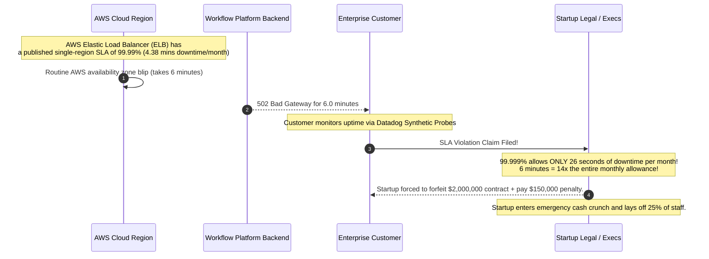
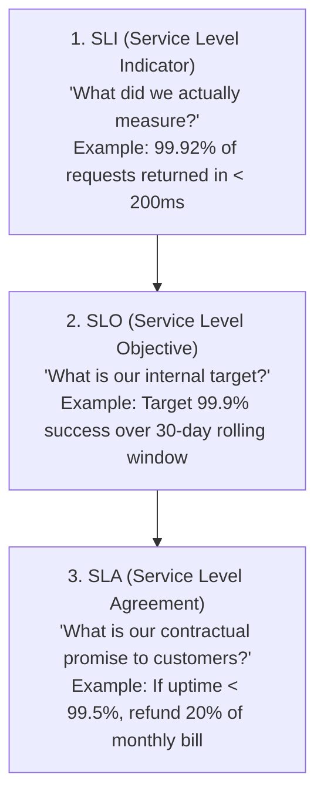
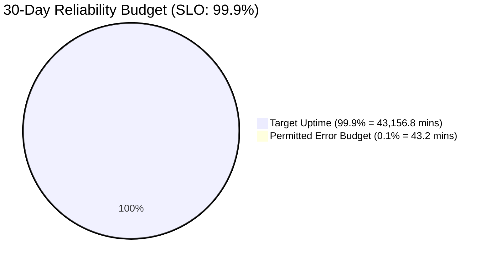
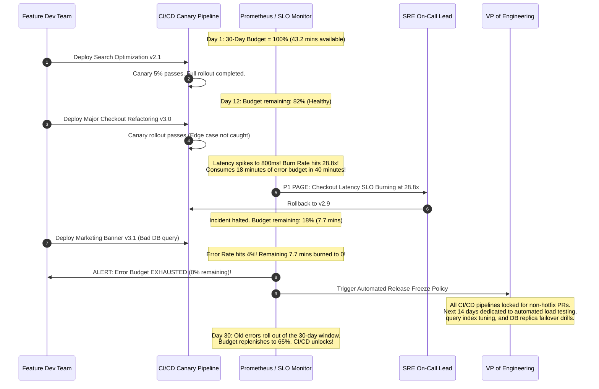
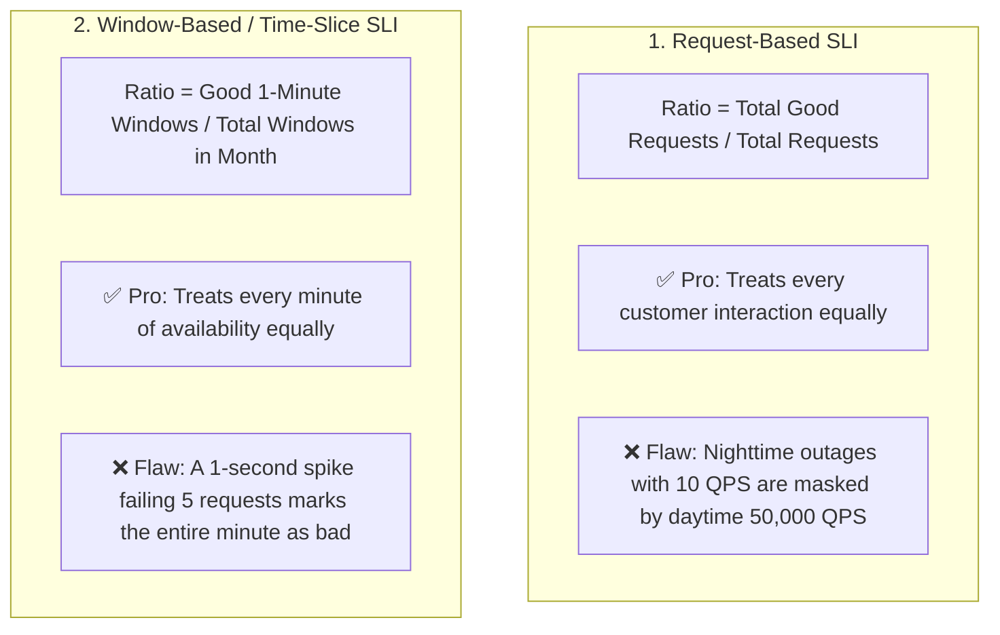
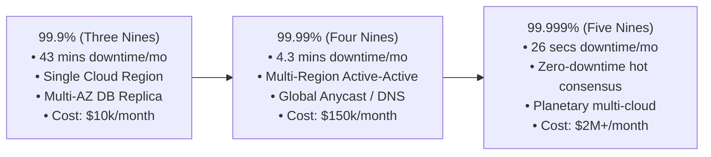
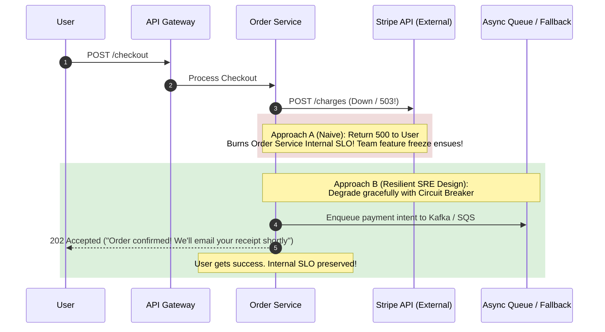

# SLIs, SLOs, SLAs, and Error Budgets

In modern Site Reliability Engineering (SRE), reliability is not an abstract aspiration; it is a mathematical budget managed collaboratively between engineering and product leadership.

---

## 💡 Intuitive Real-World Analogies

### 1. The Teenager's Monthly Driving Demerit Points (Error Budget)
Imagine a new driver given a monthly allowance of $10$ demerit points:
- Small offenses (driving 5 mph over the speed limit) cost 1 point.
- Major offenses (running a red light) cost 5 points.
- As long as the teenager has points remaining in their monthly budget, their parents let them borrow the car on weekends to have fun, explore new routes, and hang out with friends (**Shipping new product features, canary releases, and rapid experiments**).
- But if they burn all 10 points within the first week of the month, the car keys are confiscated immediately (**Deployment Freeze**). The teenager must spend the rest of the month cleaning the garage and taking defensive driving classes (**Refactoring, unit tests, bug fixes, infrastructure hardening**) until the next month begins.

### 2. The Restaurant Health Inspection Score (SLI, SLO, SLA)
- **SLI (Service Level Indicator):** The temperature probe reading of the meat refrigerator taken every 15 minutes (Actual measured number: e.g., $38.2^\circ\text{F}$).
- **SLO (Service Level Objective):** The restaurant manager's internal operational rule: *"The walk-in freezer must stay below $40^\circ\text{F}$ for $99.9\%$ of recorded hours this month."*
- **SLA (Service Level Agreement):** The city health inspector and commercial contract: *"If food temperature exceeds $45^\circ\text{F}$ for more than 2 consecutive hours, the health department shuts down the restaurant, voids the operating license, and levies a $\$50,000$ public fine."*

---

## 👶 Plain-English / ELI5 Overview

Software will never be $100\%$ reliable. Fiber optic cables get cut by excavators, power supplies fail, and human developers write bugs. Trying to make software $100\%$ reliable is impossibly expensive and actually counterproductive—because reaching $100\%$ means you can never deploy a new feature, update an operating system, or touch anything ever again.

SRE turns this reality into a formal game with three simple rules:
1. **SLI:** The thermometer that measures current health (*"What is our error rate right now?"*).
2. **SLO:** The target goal agreed upon by the engineering and product team (*"We promise our app will be healthy $99.9\%$ of the time over any 30-day window."*).
3. **Error Budget:** The allowable room for mistakes ($100\% - 99.9\% = 0.1\%$). In a 30-day month, $0.1\%$ means the system is legally allowed to fail for up to **43.2 minutes**.

If you haven't broken anything this month, you have spare budget—go fast, ship new code, and take risks! If you broke things and burned the budget to zero, stop deploying immediately and fix your foundation.

---

## ⚠️ The Horror Scenario: The "Five Nines" Sales Catastrophe

A B2B enterprise software startup built a collaborative workflow platform. During contract negotiations with a Fortune 50 customer, the aggressive VP of Sales promised **"99.999% Availability" (Five Nines)** in the contract SLA, with a penalty clause: *"Any breach will result in a $100\%$ refund of the $\$2,000,000$ annual license fee plus $\$50,000$ per minute of downtime."*



### What Happened?
- The software ran inside a single AWS cloud region. The underlying cloud services (AWS ELB, Aurora, NAT Gateways) only offered SLAs between $99.9\%$ and $99.99\%$.
- **Fundamental Law of Reliability:** An application **cannot mathematically exceed the reliability of its critical underlying infrastructure dependencies** unless active-active multi-region redundancy is implemented with zero-downtime consensus failover.
- By guaranteeing $99.999\%$ (less than 26 seconds of downtime per month) without an error budget policy or multi-region infrastructure, the startup signed a financial death warrant for a 6-minute cloud network hiccup.

---

## 1. The Definitions Hierarchy



### 1. Service Level Indicator (SLI)
The formal metric measuring how well the service is currently performing. Always calculated as a ratio:

$$\mathbf{\text{SLI}} = \frac{\mathbf{\text{Good Events}}}{\mathbf{\text{Total Valid Events}}} \times 100\%$$

- **Availability SLI:**
  $$\frac{\text{Requests with HTTP code } < 500}{\text{Total HTTP requests received}} \times 100\%$$
- **Latency SLI:**
  $$\frac{\text{Requests with response duration } \le 200\text{ ms}}{\text{Total successful HTTP requests}} \times 100\%$$

### 2. Service Level Objective (SLO)
The internal target for an SLI over a specified rolling evaluation window (e.g., 30 days).
- **Rule of Thumb:** Your internal SLO should **always be strictly more conservative than your public SLA** (e.g., SLO = $99.9\%$, SLA = $99.0\%$). This gives your team a safety buffer to detect and remediate degradation before financial penalties occur.

### 3. Service Level Agreement (SLA)
A legal, contractual agreement between a service provider and its paying customers. Violating an SLA triggers financial penalties, credits, or contract termination.

---

## 2. The Error Budget & Downtime Math

The mathematical inverse of your Service Level Objective:

$$\mathbf{\text{Error Budget}} = 100\% - \mathbf{\text{SLO}}$$

| Target SLO ("Nines") | Permitted Downtime / Year | Permitted Downtime / 30-Day Month | Permitted Downtime / Week |
| :--- | :--- | :--- | :--- |
| **99% ("Two Nines")** | 3.65 days | 7.2 hours | 1.68 hours |
| **99.9% ("Three Nines")** | 8.76 hours | **43.2 minutes** | 10.1 minutes |
| **99.95%** | 4.38 hours | **21.6 minutes** | 5.04 minutes |
| **99.99% ("Four Nines")**| 52.6 minutes | **4.32 minutes** | 1.01 minutes |
| **99.999% ("Five Nines")**| 5.26 minutes | **25.9 seconds** | 6.05 seconds |



### How Error Budgets Align Dev and SRE Incentives
In traditional organizations, Product/Dev wants to ship features constantly, while Ops wants to freeze changes to preserve stability. **Error budgets eliminate this conflict:**
1. **When Error Budget is Healthy ($> 0$):** Developers have full freedom to deploy features, experiment with canary releases, and take calculated risks.
2. **When Error Budget is Exhausted ($= 0$):** Feature releases are **automatically frozen**. All engineering capacity is diverted to refactoring, fixing bugs, improving automated test coverage, and hardening infrastructure until the budget replenishes.

---

## 3. Burn Rate Alerting

Traditional alerts that fire when an instantaneous error threshold is breached create **alert fatigue** (e.g., waking up an engineer at 3 AM for a 2-second transient network blip).

Modern SRE uses **Burn Rate Alerting**:

$$\text{Burn Rate} = \frac{\text{Actual Error Rate}}{\text{Allowed Budget Error Rate}}$$

- **Burn Rate 1:** Consumes exactly $100\%$ of the error budget over 30 days (Normal, no alert needed).
- **Burn Rate 14.4:** Consumes $100\%$ of the 30-day error budget in just **2 days** ($5\%$ of budget burned in 1 hour). **Triggers an immediate high-priority page to the on-call engineer.**
- **Burn Rate 6:** Consumes $100\%$ of budget in **5 days** ($10\%$ of budget burned in 6 hours). Emits a non-urgent ticket for business hours investigation.

### Multi-Window Multi-Burn-Rate (MWMBR) Alerting Matrix
Google SRE best practice requires verifying both a long window (to ensure significant budget consumption) and a short window (to verify the incident is still actively occurring):

| Severity | Alert Channel | Burn Rate | Long Window | Short Window | % Budget Consumed |
| :--- | :--- | :--- | :--- | :--- | :--- |
| **Page (P1)** | PagerDuty (Immediate) | **14.4** | 1 hour | 5 minutes | $2.0\%$ |
| **Page (P2)** | PagerDuty (Immediate) | **6.0** | 6 hours | 30 minutes | $5.0\%$ |
| **Ticket (P3)** | Slack / Jira (Work hours) | **3.0** | 24 hours | 2 hours | $10.0\%$ |
| **Ticket (P4)** | Slack / Jira (Work hours) | **1.0** | 3 days | 6 hours | $10.0\%$ |

---

## 🚶 Step-by-Step Scenario: Error Budget Depletion and Feature Freeze

Let's walk through a concrete 30-day cycle of an engineering team operating under an Error Budget Policy:



---

## 🏢 Real-World Production Battle-Testing

### Google: The SRE Error Budget Policy
- Google introduced error budgets to end the perennial war between Product Managers (who want speed) and Sysadmins (who want stability).
- If a Google service exhausts its error budget in a quarter, the SRE team legally has the authority to refuse to manage the service, redirecting all operational pages directly to the product engineering director's personal phone until reliability is proven.

### AWS: Granular SLA Tiers and Financial Credits
- Amazon Web Services explicitly defines SLAs per service:
  - AWS S3: $99.9\%$ monthly availability $\implies$ If uptime drops between $99.0\%$ and $99.9\%$, customer receives a $10\%$ credit. If $<95.0\%$, customer receives a $100\%$ refund.
- By defining SLAs at the API level (e.g., S3 Standard GET/PUT), AWS insulates itself from subjective customer downtime claims.

### Spotify: Rolling 30-Day SLOs and Autonomous Squads
- Spotify uses automated Slack alerts connected to Prometheus to notify microservice squads when their 30-day rolling error budget drops below $20\%$. The squad's sprint planning automatically swaps scheduled feature work for tech-debt remediation tickets.

---

## ⚖️ Practical Trade-Offs & Decision Rules of Thumb

| Architectural Choice | Rolling Evaluation Window (e.g., 30 Days) | Calendar-Month Window (e.g., Jan 1 - Jan 31) |
| :--- | :--- | :--- |
| **Resilience to Reset Gaming** | ✅ High: Bad deploy hurts you for 30 consecutive days. | ❌ Poor: Engineers push risky code on the 31st because budget resets tomorrow. |
| **Business Alignment** | ⚠️ Moderate: Doesn't cleanly align with monthly financial billing. | ✅ High: Perfectly aligns with customer billing invoices and SLA refunds. |
| **Operational Health** | ✅ Continuously smooth; prevents end-of-month panic. | ⚠️ Causes artificial panic at month-end and careless pushes at month-start. |

### Rules of Thumb for System Designers
1. **Never promise an SLA equal to your SLO:** Always keep an SLA buffer. If your internal SLO is $99.9\%$, set your customer SLA to $99.0\%$ or $99.5\%$.
2. **Never offer an SLA higher than your weakest critical dependency:** If your database or cloud provider provides $99.95\%$, your single-region API cannot contractually guarantee $99.99\%$.
3. **Use Request-Based SLIs for High-Volume Services:** Calculate $\frac{\text{Successful Requests}}{\text{Total Requests}}$. For low-volume batch services, use Time-Slice SLIs (e.g., % of 5-minute windows without failure).
4. **Automate Feature Freezes:** An error budget policy that is manually negotiated or easily overridden by sales executives is worthless. Enforce it automatically in CI/CD deployment gates.

---

## 🎯 Top Real-World Interview Questions & Deep-Dive Answers (FAANG / Staff Level)

### Question 1: How do you write production-grade PromQL queries for Multi-Window Multi-Burn-Rate (MWMBR) alerting to achieve a 99.9% availability SLO without false positives?
**Target Candidate Level:** Staff Site Reliability Engineer

#### Answer
A single-window alert either alerts too slowly (e.g., waiting 6 hours to detect a severe outage) or triggers false alarms on transient spikes (e.g., alerting on a 30-second network blip).

To monitor a **99.9% Availability SLO** over a 30-day window:
- Permitted error fraction: $1 - 0.999 = 0.001$ ($0.1\%$).
- For a **$14.4\times$ burn rate** (burns $2\%$ of budget in 1 hour), the error rate threshold is:
  $$\text{Threshold} = 14.4 \times 0.001 = 0.0144\text{ (1.44% error rate)}$$

We configure a dual-window rule that triggers **only if both the 1-hour window AND the 5-minute window exceed this threshold**:

```yaml
groups:
  - name: slo_alerts
    rules:
      # Record the error rate over 5m and 1h
      - record: job:http_requests_error:rate5m
        expr: sum(rate(http_requests_total{job="checkout", status=~"5.."}[5m]))
              / sum(rate(http_requests_total{job="checkout"}[5m]))

      - record: job:http_requests_error:rate1h
        expr: sum(rate(http_requests_total{job="checkout", status=~"5.."}[1h]))
              / sum(rate(http_requests_total{job="checkout"}[1h]))

      # High-Priority Pager Alert: 14.4x Burn Rate
      - alert: CheckoutHighErrorBurnRate
        expr: (job:http_requests_error:rate1h > (14.4 * 0.001))
          and (job:http_requests_error:rate5m > (14.4 * 0.001))
        for: 2m
        labels:
          severity: critical
          pager: "true"
        annotations:
          summary: "Checkout service burning 30-day error budget at 14.4x rate"
          description: "Current error rate is > 1.44% over both 1h and 5m windows. 2% of monthly budget consumed in 1 hour."
```

#### Why This Prevents False Positives:
- If a transient spike causes 50% errors for 15 seconds, `rate5m` briefly jumps, but `rate1h` remains negligible $\implies$ **No page sent**.
- If errors persist for 20 minutes, both `rate1h` and `rate5m` exceed $1.44\%$ $\implies$ **Page fires**.
- If the bug is rolled back and errors drop to 0, `rate5m` drops to 0 instantly, silencing the alert immediately without waiting for the 1-hour window to drain!

---

### Question 2: What is the architectural difference between Request-Based SLIs and Window-Based (Time-Slice) SLIs, and when does each fail?
**Target Candidate Level:** Staff Systems Architect

#### Answer



#### Mathematical Distinction:
1. **Request-Based SLI:**
   $$\text{SLI}_{\text{req}} = \frac{\sum_{i=1}^{N} \text{good\_requests}_i}{\sum_{i=1}^{N} \text{total\_requests}_i}$$
   - **Failure Mode:** Extreme traffic skew. Suppose an e-commerce platform processes 100,000 requests/sec at 2:00 PM and 100 requests/sec at 4:00 AM. A complete 30-minute catastrophic outage at 4:00 AM (180,000 failed requests) represents only $0.002\%$ of daily volume. Under a pure request-based SLI, the service maintains $99.998\%$ availability despite being completely dead for 30 minutes!
2. **Time-Slice / Window-Based SLI:**
   Evaluate each 1-minute or 5-minute slice:
   $$\text{Slice } t \text{ is 'Good' if } \left(\frac{\text{good\_requests}_t}{\text{total\_requests}_t} \ge 99.0\%\right)$$
   $$\text{SLI}_{\text{window}} = \frac{\text{Count of Good Slices}}{\text{Total Slices in 30 Days}}$$
   - **Failure Mode:** Low-volume or batch services. If a service receives only 1 request every 5 minutes, a single failed network retry marks the entire 5-minute slice as $0\%$ available, triggering false SLA penalties.

#### Decision Rule:
- Use **Request-Based SLIs** for high-volume, continuous APIs (payment gateways, search, edge reverse proxies).
- Use **Time-Slice SLIs** for enterprise B2B SaaS, batch payroll processing, or customer-facing portals where 24/7 continuous availability is contractually expected regardless of traffic dips.

---

### Question 3: Product leadership demands "Five Nines" (99.999% availability) for an upcoming tier-1 consumer application. As a Staff Engineer, walk through the mathematical, infrastructure, and financial analysis to approve or refute this requirement.
**Target Candidate Level:** Staff / Principal Engineer

#### Answer
A Staff Engineer must translate business requests into concrete hardware, network, and organizational costs.



#### 1. The Mathematical Reality:
- 99.999% availability permits **only 25.9 seconds of downtime per month** (or 5.26 minutes per calendar year) across all scheduled maintenance, unexpected bugs, hardware crashes, and upstream cloud provider blips.

#### 2. The Dependency Chain Constraint:
According to the reliability multiplication theorem:
$$R_{\text{system}} = \prod_{i=1}^{k} R_{\text{component\_i}}$$
If our system relies on:
- AWS Route 53 DNS ($100\%$ SLA)
- AWS Application Load Balancer ($99.99\%$ SLA)
- AWS Aurora PostgreSQL Multi-AZ ($99.99\%$ SLA)
- Upstream Identity Provider / Okta ($99.9\%$ SLA)

$$\text{Theoretical Max Availability} = 1.0 \times 0.9999 \times 0.9999 \times 0.999 = \mathbf{99.88\%}$$
We are mathematically incapable of providing $99.999\%$ while relying on standard cloud primitives in a single region!

#### 3. What Five Nines Actually Requires:
1. **Multi-Cloud / Multi-Region Active-Active:** True synchronous or bounded Raft replication across independent cloud providers (AWS + GCP) to survive cloud-wide control plane outages.
2. **Hitless Sub-Second Failover:** Zero-downtime database failover; client SDKs must buffer writes during state transitions without erroring out.
3. **Automated Rollbacks Under 5 Seconds:** Human intervention cannot be in the loop. It takes a human engineer 3–5 minutes just to wake up, find their laptop, and log into VPN. By that time, **8 years worth of Five-Nines error budget is burned!**
4. **Exponential Cost Jump:** Moving from 99.9% to 99.999% increases infrastructure and operational engineering payroll costs by $10\times$ to $50\times$.

#### Recommendation to Leadership:
*"For a consumer service, the user's mobile cellular network has an inherent failure rate of $1\% - 2\%$ (Two Nines). Providing 99.999% on the backend is completely unnoticeable to a user whose cell phone drops signal in an elevator. We should set our SLO to **99.95%**, invest the saved millions into core product features, and maintain an Error Budget Policy that ensures rapid innovation."*

---

### Question 4: How do you handle third-party dependency outages (e.g., Stripe, Twilio, AWS S3) in your internal SLOs without unfairly punishing your engineering team?
**Target Candidate Level:** Staff Systems Architect

#### Answer
When an external payment processor (Stripe) goes down for 2 hours, does your team burn its error budget and freeze feature deployment?



#### Production Architecture Solutions:
1. **Decouple User Experience from External Synchronous RPCs:**
   Use the **Outbox Pattern** or asynchronous queuing. If Stripe is unresponsive, capture customer payment authorization intents and retry asynchronously with exponential backoff and jitter. The user receives a clean `202 Accepted` confirmation.
2. **Define Multi-Layered SLIs (Bounded Contexts):**
   - **Internal Platform SLI:** Measures availability of everything under our engineering control:
     $$\text{SLI}_{\text{internal}} = \frac{\text{Good Requests} + \text{Requests failed strictly due to Stripe 5xx}}{\text{Total Requests}}$$
     This metric governs engineering feature freezes. If Stripe goes down, our engineers do not suffer a release freeze.
   - **End-to-End User Experience SLI:** Measures actual customer success:
     $$\text{SLI}_{\text{user}} = \frac{\text{Completed Purchases}}{\text{Total Checkout Attempts}}$$
     This metric governs product health and triggers cross-functional crisis escalations with the vendor.
3. **Multi-Vendor Active-Passive Routing:**
   For business-critical third-party dependencies (e.g., SMS delivery or payment processing), implement an abstraction layer with dynamic routing:
   - Primary: Stripe; Secondary: Adyen.
   - If Stripe error rate exceeds $5\%$, the circuit breaker trips and automatically routes traffic to Adyen in under 500 ms.

---

*Related Modules:*
- [The Three Pillars of Observability](file:///home/prasanta/Documents/learning_folder/system_design/08_OBSERVABILITY_MONITORING_RELIABILITY/01_three_pillars_of_observability.md)
- [SRE Golden Signals & Telemetry Pipelines](file:///home/prasanta/Documents/learning_folder/system_design/08_OBSERVABILITY_MONITORING_RELIABILITY/03_sre_golden_signals_and_telemetry.md)
- [Circuit Breakers and Bulkheads](file:///home/prasanta/Documents/learning_folder/system_design/07_RESILIENCE_FAULT_TOLERANCE_RATE_LIMITING/03_circuit_breakers_and_bulkheads.md)
- [Distributed Rate Limiting Algorithms](file:///home/prasanta/Documents/learning_folder/system_design/07_RESILIENCE_FAULT_TOLERANCE_RATE_LIMITING/01_rate_limiting_algorithms.md)
