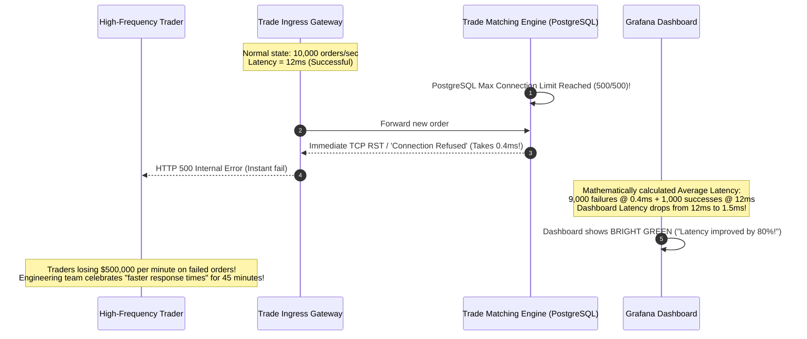
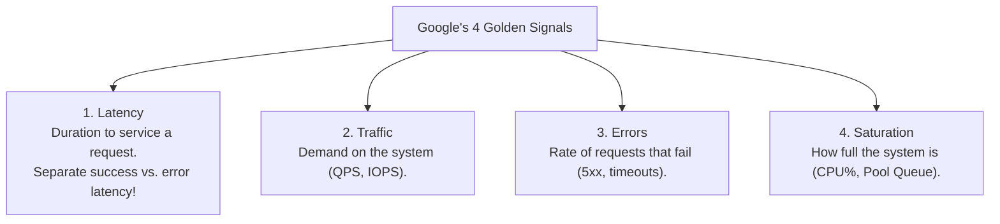
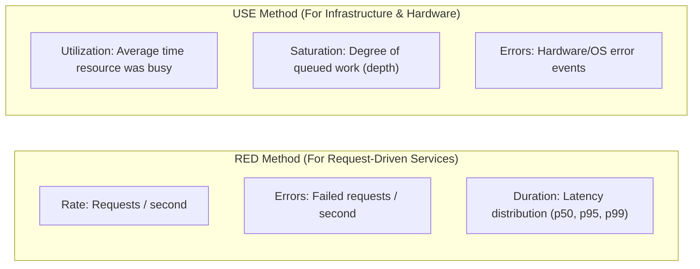
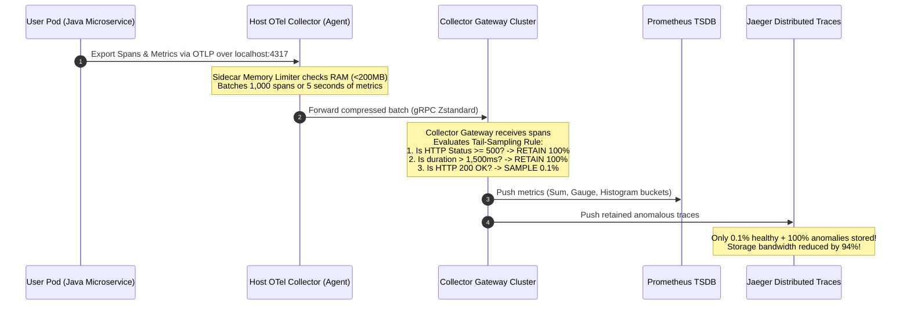
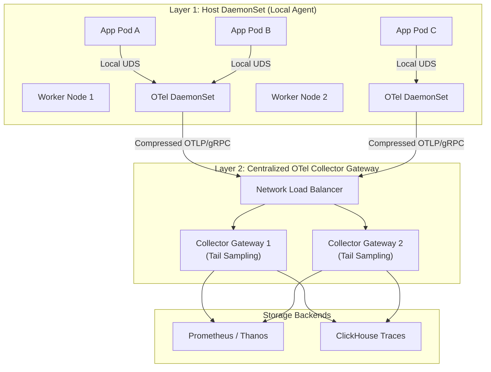
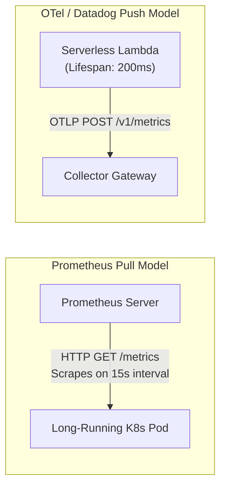

# SRE Golden Signals, RED/USE Methods & OpenTelemetry

Standardizing what metrics you collect and how telemetry data is pipeline-processed is crucial for reliable operations.

---

## 💡 Intuitive Real-World Analogies

### 1. The Airplane Cockpit Primary Flight Display (4 Golden Signals)
A commercial airline pilot flying through dense fog at 35,000 feet cannot look at 10,000 individual switches and wire voltages. Instead, their Primary Flight Display focuses on 4 indispensable instruments:
1. **Airspeed (Traffic):** How fast are we moving through the air?
2. **Altimeter & Glide Slope (Latency):** Are we hitting our descent timeline smoothly?
3. **Engine Stall & Warning Alarms (Errors):** Are turbine blades failing or cabin pressure dropping?
4. **Fuel Tanks & Engine Temperature (Saturation):** Are the turbines running red-hot at 98% capacity, 5 minutes away from melting?

### 2. The Kitchen Chef vs. The Stovetop Burners (RED vs. USE)
- **The RED Method (Request-Driven Work):** Measures the dining room experience. 
  - *Rate:* How many dinner orders per hour is the kitchen receiving?
  - *Errors:* How many plates get sent back by unhappy customers?
  - *Duration:* How long does a customer wait between ordering and taking their first bite?
- **The USE Method (Resource / Infrastructure Constraints):** Measures the kitchen appliances.
  - *Utilization:* Is the pizza oven running 58 minutes out of every 60 minutes?
  - *Saturation:* How many raw pizzas are stacked on the counter waiting for oven space?
  - *Errors:* Did the oven overheat and trip the circuit breaker?

---

## 👶 Plain-English / ELI5 Overview

When an app starts running slowly or throwing errors, engineers frequently panic, staring at hundreds of random CPU graphs and scrolling through millions of log lines without a clue.

To prevent this chaos, Site Reliability Engineering groups all software monitoring into two standard mental models:
1. **For Services (APIs, Web Apps, Microservices):** Use the **RED Method** or **Google's 4 Golden Signals**. Track how many requests come in, how many fail, and how fast they finish.
2. **For Hardware & Infrastructure (CPUs, Disks, Networks, Memory):** Use the **USE Method**. Track how busy the hardware is, how long the waiting lines are, and whether the hardware is failing.

To collect and ship all this data without locking your company into expensive vendor proprietary agents, the industry created **OpenTelemetry (OTel)**—a universal, open-source postal service for monitoring data.

---

## ⚠️ The Horror Scenario: The Hidden "Fast-Fail" Latency Illusion

An online brokerage launched an algorithmic trade execution gateway. The engineering team monitored **Average Latency** on a giant TV dashboard.



### What Happened?
- The database connection pool became saturated. Instead of queuing and timing out slowly, the gateway immediately rejected incoming connections with a connection-refused error in **$0.4\text{ ms}$**.
- The engineering dashboard only tracked overall average latency across all requests.
- As the failure rate skyrocketed to $90\%$, the ultra-fast $0.4\text{ ms}$ error responses mathematically pulled the overall average latency **down from $12\text{ ms}$ to $1.5\text{ ms}$**.
- The engineers believed their system was performing better than ever while their business was collapsing!
- **Core Lesson:** Never mix error latency with success latency, and never rely on averages instead of percentiles ($p50, p95, p99$).

---

## 1. Google's 4 Golden Signals

Defined in Google's *Site Reliability Engineering* book as the four essential metrics for monitoring any user-facing service:



### 1. Latency
- The duration taken to process a request.
- **Rule:** Always separate latency of successful requests from failed requests. A database timeout returning an immediate HTTP 500 in $2\text{ ms}$ will falsely drag down average latency while masking severe backend degradation!
- Always measure distributions using percentiles:
  - $p50$: Median user experience.
  - $p95 / p99$: Tail latency experienced by your most active or power users.

### 2. Traffic
- Measures incoming demand: Requests Per Second (RPS) for web services, concurrent sessions for WebSockets, or network bytes/sec for streaming pipelines.

### 3. Errors
- Explicit errors (HTTP 500 Internal Server Error, gRPC `UNAVAILABLE`).
- Implicit errors (HTTP 200 returned, but with an empty response body or error payload).
- Policy errors (HTTP 429 rate limit exceeded).

### 4. Saturation
- Measures the fraction of constrained resources currently in use (e.g., memory utilization, thread pool queues, disk I/O wait).
- **Early Warning Indicator:** Systems rarely degrade linearly; performance collapses exponentially when saturation reaches $80\% - 90\%$ due to queuing delay ($M/M/1$ queue formula: $W = \frac{1}{\mu - \lambda}$).

---

## 2. RED vs. USE Monitoring Methods



- **Use the RED Method** for software microservices, APIs, and HTTP endpoints.
- **Use the USE Method** for physical hardware, operating system kernels, CPUs, disks, and network interfaces.

---

## 3. OpenTelemetry (OTel) Architecture

OpenTelemetry is the CNCF vendor-neutral open standard for generating, collecting, and exporting telemetry data (metrics, logs, traces).

```mermaid
flowchart LR
    subgraph Apps["Instrumented Services"]
        App1["Go Service (OTel SDK)"]
        App2["Java Service (OTel SDK)"]
        App3["Python Service (OTel SDK)"]
    end

    subgraph Collector["OpenTelemetry Collector Daemon"]
        Recv["Receivers (OTLP, Zipkin, Jaeger)"] --> Proc["Processors<br/>• Batching<br/>• Memory Limiter<br/>• Head/Tail Sampling"]
        Proc --> Exp["Exporters (OTLP, Prometheus, Elastic)"]
    end

    subgraph Backends["Storage Backends"]
        Prom["Prometheus (Metrics)"]
        Jaeger["Jaeger (Traces)"]
        Loki["Grafana Loki (Logs)"]
    end

    App1 & App2 & App3 -->|OTLP Protocol (gRPC/HTTP)| Recv
    Exp --> Prom
    Exp --> Jaeger
    Exp --> Loki
```

### The OTel Collector Pipeline
1. **Receivers:** Ingest telemetry data in multiple protocols (OTLP, Prometheus, Zipkin).
2. **Processors:**
   - **Batch Processor:** Combines spans into larger batches to reduce network I/O.
   - **Memory Limiter Processor:** Drops data or applies backpressure if the collector’s memory approaches safety limits.
   - **Sampling Processor:** Keeps $100\%$ of error traces while sampling only $1\%$ of normal successful traces to reduce cloud storage bills by $90\%$.
   - **Attributes Processor:** Sanitizes sensitive user tokens or credit card information from spans before saving.
3. **Exporters:** Translates and routes processed telemetry to any visualization backend without requiring application code changes.

---

## 🚶 Step-by-Step Scenario: Telemetry Pipeline Routing and Tail-Sampling

Let's trace how telemetry flows through a production OpenTelemetry Collector architecture during a traffic surge:



---

## 🏢 Real-World Production Battle-Testing

### Uber: M3 & Jaeger at Multi-Million Scale
- Uber runs Jaeger sidecars on thousands of hosts across multiple private datacenters and AWS regions.
- To prevent network congestion during peak commuting hours, Uber's agents dynamically tune their trace sampling probability based on overall traffic volume (Adaptive Sampling).

### Shopify: Flash-Sale Telemetry with OpenTelemetry
- During Black Friday / Cyber Monday, Shopify handles over $\$5$ billion in GMV.
- Telemetry pipelines use host-local OpenTelemetry collectors that compress metrics and traces before shipping across cross-region VPC peering links, slashing cross-zone egress network charges by tens of thousands of dollars per day.

---

## ⚖️ Practical Trade-Offs & Decision Rules of Thumb

| Dimension | Push Model (e.g., OTLP / Datadog) | Pull Model (e.g., Prometheus Scrape) |
| :--- | :--- | :--- |
| **Ephemeral / Serverless Jobs** | ✅ Excellent (Lambdas push before terminating) | ❌ Poor (Target terminates before scrape cycle) |
| **Network Security & Firewalls** | ⚠️ Moderate (App requires egress access to collector) | ✅ High (Collector pulls inwards; no outbound egress needed) |
| **Overload Protection** | ❌ Risk (Flooding collector during DDoS spike) | ✅ High (Scraper pulls at its own controlled rate) |
| **Auto-Discovery** | ⚠️ Relies on dynamic service registration | ✅ Built-in Kubernetes API pod discovery |

### Rules of Thumb for System Designers
1. **Use RED for APIs, USE for Nodes:** Never try to apply the USE method to an HTTP service or the RED method to a Linux kernel SSD drive.
2. **Histograms over Summaries:** In Prometheus, use `Histograms` rather than `Summaries` whenever you need to aggregate percentiles across multiple nodes or Kubernetes pods. Percentiles cannot be mathematically averaged across servers!
3. **Always Deploy a Memory Limiter Processor:** When deploying the OpenTelemetry Collector, always configure the `memory_limiter` processor as the very first processor in the pipeline to prevent pod OOM-kills during unexpected traffic spikes.

---

## 🎯 Top Real-World Interview Questions & Deep-Dive Answers (FAANG / Staff Level)

### Question 1: Why must you never calculate average latency across a cluster, and why can you not mathematically average percentiles (e.g., averaging P99s)?
**Target Candidate Level:** Staff Systems Architect / Senior SRE

#### Answer

#### 1. Why Averages Lie:
The mathematical mean is completely vulnerable to bimodal distributions. In modern microservices, $99\%$ of requests might hit an in-memory cache and return in $2\text{ ms}$, while $1\%$ miss cache, lock a database row, and take $5,000\text{ ms}$.
- Average latency: $\approx 51.98\text{ ms}$ (Looks acceptable to management).
- Reality: 1 out of every 100 customers experiences a crippling 5-second spinning wheel!

#### 2. Why Averaging Percentiles is Mathematically Invalid:
Suppose Pod A handles 10,000 requests with a $p99$ of $10\text{ ms}$. Pod B handles 100 requests with a $p99$ of $1,000\text{ ms}$.
$$\text{Naive Average of P99} = \frac{10 + 1,000}{2} = 505\text{ ms}$$
This number is completely meaningless because:
- Percentiles are rank-ordered statistics, not linear values.
- Pod A handled $100\times$ more traffic than Pod B.
- The actual combined cluster $p99$ is still under $15\text{ ms}$!

#### The Staff Engineering Solution: Histogram Buckets
To aggregate percentiles across 500 pods, you must collect **Histogram Buckets** (counters of requests falling into defined ranges: $\le 10\text{ms}, \le 50\text{ms}, \le 200\text{ms}, \le 1000\text{ms}$).
In PromQL, histogram buckets can be cleanly summed across all pods before calculating the global quantile:
```promql
histogram_quantile(0.99, sum(rate(http_request_duration_seconds_bucket[5m])) by (le))
```

---

### Question 2: In OpenTelemetry, should you run the OTel Collector as a Host Sidecar/DaemonSet, a Centralized Cluster, or a Dual-Layer Gateway? Compare the trade-offs at 50,000 pods scale.
**Target Candidate Level:** Principal Infrastructure Architect

#### Answer



#### The Verdict: Dual-Layer Gateway Architecture
At 50,000 pods scale, running **only** sidecars or **only** a centralized cluster fails:

| Model | Pros | Cons at 50k Pods Scale |
| :--- | :--- | :--- |
| **Sidecar Only** | Isolation per pod; no cross-node sharing. | 💸 Extreme memory waste: 50,000 sidecars $\times$ 100MB = **5 TB of RAM** spent just on monitoring agents! Tail-sampling impossible across distributed spans. |
| **Central Cluster Only** | Centralized config; minimal pod overhead. | Direct network connections from 50k pods overwhelm central load balancers; uncompressed network traffic chokes VPC links. |
| **Dual-Layer (DaemonSet + Gateway)** | **Recommended:** 1 DaemonSet per physical node (buffers & compresses data locally via Unix Domain Sockets) forwarding to a scaled Gateway cluster for tail sampling and credential injection. | Requires managing two sets of collector Kubernetes deployments. |

---

### Question 3: How do you prevent telemetry instrumentation from crashing or degrading the application it is supposed to monitor (Observer Effect)?
**Target Candidate Level:** Staff Systems Engineer

#### Answer
A monitoring system must never become the cause of an outage.

#### Key Architectural Mitigations:
1. **Lock-Free Asynchronous Buffers:**
   Application SDKs must write telemetry to memory-bounded circular ring buffers (e.g., LMAX Disruptor pattern). If the buffer fills because the local collector is struggling, **always drop spans rather than blocking customer worker threads**:
   ```go
   select {
   case spanQueue <- span:
       // Span enqueued successfully
   default:
       // Queue full! Increment dropped_spans_counter and discard span immediately
   }
   ```
2. **Memory Limiter Processor with Hard & Soft Caps:**
   In the OTel Collector, configure the `memory_limiter` processor:
   ```yaml
   processors:
     memory_limiter:
       check_interval: 1s
       limit_percentage: 80 # Soft limit: initiate shedding/backpressure
       spike_limit_percentage: 20 # Hard limit: immediately drop data
   ```
3. **Local Unix Domain Sockets over TCP Loopback:**
   Transporting spans over `localhost:4317` consumes Linux TCP ephemeral ports and socket descriptors. Under 50,000 RPS, this causes port exhaustion (`EADDRNOTAVAIL`). Using **Unix Domain Sockets (`unix:///var/run/otel.sock`)** bypasses the network stack, uses zero TCP ports, and reduces CPU utilization by $30\%$.

---

### Question 4: Compare Pull vs. Push telemetry architectures in Kubernetes and Serverless environments. Which should you pick and why?
**Target Candidate Level:** Senior SRE / Cloud Architect

#### Answer



1. **Why Pull Wins for Kubernetes Infrastructure:**
   - **Centralized Health Check:** If Prometheus fails to pull metrics from a pod, it immediately records `up == 0`. The monitoring system detects pod death without waiting for missing push heartbeats.
   - **Backpressure & Scrape Control:** The Prometheus server controls the rate of ingestion. If Prometheus is running out of disk or CPU, it can stretch the scrape interval from $15\text{s}$ to $30\text{s}$. In a push architecture, an application traffic spike dumps millions of pushes onto collectors, causing cascading queue overflows.
2. **Why Push Wins for Serverless & Ephemeral Batch Jobs:**
   - AWS Lambda functions or Spark ephemeral worker nodes live for only $200\text{ ms}$ to a few seconds.
   - A pull scraper running every 15 seconds will miss **$99\%$ of short-lived serverless invocations**!
   - Ephemeral jobs must push their telemetry before the process terminates (using an asynchronous OTel Lambda layer or OpenTelemetry Forwarder).

---

*Related Modules:*
- [The Three Pillars of Observability](file:///home/prasanta/Documents/learning_folder/system_design/08_OBSERVABILITY_MONITORING_RELIABILITY/01_three_pillars_of_observability.md)
- [SLIs, SLOs, SLAs, and Error Budgets](file:///home/prasanta/Documents/learning_folder/system_design/08_OBSERVABILITY_MONITORING_RELIABILITY/02_sli_slo_sla_and_error_budgets.md)
- [Circuit Breakers and Bulkheads](file:///home/prasanta/Documents/learning_folder/system_design/07_RESILIENCE_FAULT_TOLERANCE_RATE_LIMITING/03_circuit_breakers_and_bulkheads.md)
- [Distributed Rate Limiting Algorithms](file:///home/prasanta/Documents/learning_folder/system_design/07_RESILIENCE_FAULT_TOLERANCE_RATE_LIMITING/01_rate_limiting_algorithms.md)
